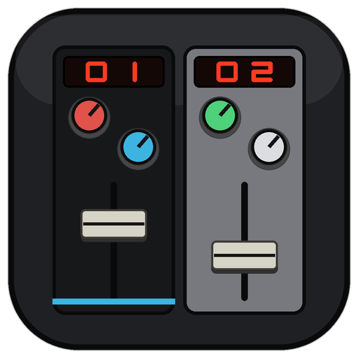
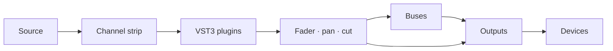

<p align="center">
  
</p>

<h1 align="center">Faider</h1>

<p align="center">
  <b>Audio routing and mixing for Windows.</b><br>
  Every device, program and microphone on one console, with the controls of a studio desk.
</p>

<p align="center">
  
  
  
  
  
  <a href="https://github.com/dayztoolsforu/faider/actions/workflows/checks.yml"></a>
  <a href="https://dayztoolsforu.github.io/faider/#manual"></a>
  
</p>

<p align="center">
  <a href="#overview">Overview</a> ·
  <a href="#features">Features</a> ·
  <a href="#getting-started">Getting started</a> ·
  <a href="#documentation">Documentation</a> ·
  <a href="#how-it-works">How it works</a> ·
  <a href="#acknowledgements">Acknowledgements</a>
</p>

Faider puts every sound on your PC on one desk. Send any program, microphone or device to
any output with a click, process each one with its own channel strip and VST3 plugins, and stop
worrying about which app plays where.

<p align="center">
  
</p>

## Overview

Windows gives you one default. Every program plays to one device and every app hears one
microphone. Doing more than that usually means a stack of separate tools, each with its own window,
its own clock and its own idea of where the sound goes.

Faider replaces that stack with one desk. Every source becomes a channel and every
destination an output. You route between them with a click. Channels get a full console strip and
VST3 plugins. Devices are remembered by name, so unplugging a headset never moves your speakers.
Everything runs on one clock, without drift. Use it for streaming, calls, gaming, VR and recording on
one PC.

## The console

<p align="center">
  
</p>

The mixer is a large-format console. It has Light and Dark channel strips, raw strips for apps, pads
and tape, and output strips with a bus compressor. On the Routing page every strip is a block under
its place on the desk. Click one block, then another, and the route between them goes on or off.

**SIMPLE** shows the same mix with the processing hidden: each channel's fader, meter, CUT, SOLO and
a big key for every output. **SETUP** builds a mix from four questions (where you listen, your
microphones, how apps hear you, which programs get a channel). It opens on the first start. The
switch in the top bar flips the whole console between SIMPLE and PRO.

| | |
|---|---|
| Install folder | `C:\Program Files\Faider` (installer), `C:\Faider` (built from source) |
| Mix and settings | `%APPDATA%\Faider` |
| Manual | [Faider manual](https://dayztoolsforu.github.io/faider/#manual) (13 languages) |
| Website | [dayztoolsforu.github.io/faider](https://dayztoolsforu.github.io/faider/) |

## Features

**Sources and channels**
- Interface inputs (ASIO), Windows devices or "whatever the default is", any program captured on its own (no virtual driver), browser tabs, loopback, pads, tape and a test tone
- A full strip on every channel: filters, neural noise reduction, gate and expander, compressor with mix and peak or RMS detection, four-band EQ, de-esser, auto-level and voice effects
- VST3 plugins on any channel, bus or combinator path, with automatic latency compensation. Each new plugin is tested in a separate process before it loads into the mix

**Routing, buses and outputs**
- Route any channel to as many buses and outputs as you have (up to 8 of each). Routes that would feed back are refused
- Buses as sub-mixes, or combinators that split a signal into parallel plugin paths
- Outputs made on demand for each device. The output strips carry a bus compressor, mix EQ, width, SAFE limiter and LUFS metering
- Mix-minus feeds and stems built from FIND (MIX-MINUS AND STEMS)

**Tools**
- Pads: four banks of sixteen, with trim, fades, choke groups, global hotkeys and macros
- Tape: a playlist player with gapless playback
- Recorder: any channel, bus or output, or every channel at once, to WAV, FLAC, AIFF or OGG (MP3, AAC, Opus and ALAC with ffmpeg)
- Instant replay of the last 30 seconds to 5 minutes

**Control and automation**
- Scenes that glide, undo and redo for every mix change, named sessions and a session timeline
- Macros fired by hotkeys, pads, the API or triggers (an app starts, a device connects, an output falls silent, a time of day)
- MIDI mapping, and OSC from programs on the same PC
- APP RULES (SETTINGS > GENERAL, or FIND) give a program its own channel the moment it starts playing
- An in-game overlay, a mini mixer and a tray mixer

**Reliability**
- One clock: every secondary device and captured program is resampled to the master clock (an ASIO interface, a Windows playback device or the built-in clock), with drift correction
- Devices remembered by name, with live stream statistics and a full event log
- PRE-FLIGHT checks the setup on start: the interface, the mic cable and its route, muted mics, feedback and doubling
- Runs with ordinary user rights, so the in-game overlay can reach it. Started as administrator, it restarts itself normally

## Screenshots

<table>
  <tr>
    <td width="50%"><br><sub>Routing: a block selected, its routes highlighted</sub></td>
    <td width="50%"><br><sub>Pads: four banks of sixteen, with an editor per pad</sub></td>
  </tr>
  <tr>
    <td width="50%"><br><sub>SIMPLE: a key for every output on each channel, the processing hidden</sub></td>
    <td width="50%"><br><sub>Outputs: bus compressor, mix EQ, width, SAFE limiter and LUFS metering</sub></td>
  </tr>
</table>

## Getting started

### Requirements

| | |
|---|---|
| Operating system | Windows 10 version 2004 or later, or Windows 11 |
| Audio interface | Optional. With an ASIO driver it sets the clock, for the lowest delay. Without one the clock is a Windows playback device, or the built-in clock when there's none |
| Toolchain | Visual Studio Build Tools (C++ workload), CMake 3.22 or later, Git |
| ASIO SDK | Optional, for ASIO interfaces: the Steinberg ASIO SDK (free from Steinberg) extracted to `third_party/asiosdk_2.3.3_2019-06-14`. Without it the build runs on Windows devices only |
| Optional | [VB-CABLE](https://vb-audio.com/Cable/) for a microphone apps can hear; `ffmpeg.exe` on the PATH for compressed recording formats |

### Install

Download `Faider-<version>-Setup.exe` from [Releases](../../releases) and run it. The
installer isn't code-signed, so Windows may warn about an unrecognised app. Click **More info > Run
anyway**.

### Build from source

```powershell
cmake -S . -B build
cmake --build build --config Release
```

The first configure fetches JUCE. To build, install and start it in one step, run
**`Restart Faider.cmd`**. It quits the running copy, builds, installs to
`C:\Faider` and starts it. On the first install it also makes a desktop shortcut.

To make the installer, install [Inno Setup 6](https://jrsoftware.org/isinfo.php) and run
`tools\build-installer.ps1`. It builds the Release app and writes
`build\installer\Faider-<version>-Setup.exe`. That installer puts the app in Program Files,
with the Microsoft Visual C++ runtime files it needs beside it, and offers VB-CABLE's download page
when no VB-Audio device is found. The version comes from `CMakeLists.txt`.

The website is the `docs` folder, published by GitHub Pages. It is one page, `docs/index.html`, built
from `tools/manual-page` (the home view), the manual and its translations, and CREDITS.md: after
changing any of them, run `pip install markdown` once, then `python tools/manual-page/build.py`.

### First run

A few seconds after start, PRE-FLIGHT checks the setup and points to anything that needs fixing.
The manual's [first-time setup](https://dayztoolsforu.github.io/faider/#2-first-time-setup) takes you
through adding a microphone, hearing it, letting apps hear it and bringing in a program.

Installing VB-CABLE makes Windows switch its default playback and recording devices to the cable.
Set your speakers and microphone back under **Settings > System > Sound**.

## Documentation

| Document | |
|---|---|
| User manual, 13 languages | [Faider manual](https://dayztoolsforu.github.io/faider/#manual) |
| The app and its layout files | [console/README.md](console/README.md) |
| All documentation | [docs/README.md](docs/README.md) |

## How it works

**Clocking.** One device sets the clock, and all processing happens in its callback. That's an ASIO
interface if there is one, else a Windows playback device, else a built-in timed clock that needs no
device. If the Windows device setting the clock is unplugged, the next one takes over. Every other
device, and every captured program, runs on its own clock. Each one joins through a buffer that
resamples by the ratio of the two rates, with a small correction that holds the buffer's fill
steady, so clocks drifting apart never click. Program capture uses Windows' per-process loopback,
with no virtual driver.

**Signal flow.**



Buses run in dependency order, so a bus feeding a bus adds no delay. Outputs sum, process and play
to their devices. A missing device leaves its output silent until it returns.

**Threads and safety.** Structure changes happen on the message thread, under a lock the audio
thread only tries. A busy moment costs one silent block, never a wait. Faders, mutes, routes and
meters are atomics. A new plugin is tested in a separate copy of the program first, so one that
crashes on load is caught before it reaches the mix. A crash writes a log and a minidump.

**Sessions.** The mix saves itself to `session.xml` within a second of any change. Up to 60 earlier
versions are kept, and a mix that can't be loaded is set aside rather than lost.

### Repository layout

```
src/            the engine (engine/), devices (devices/), the interface (ui/)
console/        the console, the Routing page and the strip layouts (layout/)
tests/          engine checks (tools/run-tests.ps1 runs those that need no hardware)
docs/           manuals, translations and images
installer/      the Inno Setup script (tools/build-installer.ps1 builds the installer)
tools/          build, install and test scripts
assets/         program icons and the headphone profiles
third_party/    RNNoise (the optional ASIO SDK goes here, not committed)
```

## Acknowledgements

Faider is built on other people's work. The full list is in the app under
SETTINGS > GENERAL > ABOUT and in [docs/CREDITS.md](docs/CREDITS.md).

| Component | Authors | Licence | Used for |
|---|---|---|---|
| [JUCE](https://juce.com) 8.0.12 | Raw Material Software | AGPLv3 / commercial | Audio devices, plugin hosting, file formats, the interface |
| [RNNoise](https://github.com/xiph/rnnoise) 0.2 | Jean-Marc Valin, Xiph.Org Foundation, Mozilla, Amazon | BSD 3-clause | Noise reduction |
| [AutoEq](https://github.com/jaakkopasanen/AutoEq) | Jaakko Pasanen | MIT | Headphone correction profiles |
| FLAC, Ogg Vorbis (via JUCE) | Xiph.Org Foundation | BSD | Recording formats |
| VST3 SDK (via JUCE) | Steinberg Media Technologies | See the SDK | Plugin hosting |
| ASIO SDK (optional) | Steinberg Media Technologies | GPLv3 / proprietary | Low-latency drivers |

<sub>Works with, not included: VB-CABLE (VB-Audio Software), FFmpeg.
VST and ASIO are trademarks of Steinberg Media Technologies GmbH.</sub>

## Licence

Faider is free software under the [GNU Affero General Public License v3](LICENSE).
