# Faider User Manual

**Version {version} · Windows 10 (2004) or later**

Faider is a live audio router and mixer for Windows, built around a large-format console.
It takes sound from your audio interface, your Windows devices and individual programs, runs it
through channel strips, buses and outputs, and plays the result on any devices you choose: your
headphones, your speakers, a stream, a virtual microphone for calls and games.

This manual covers everything the app does, walks you through the common jobs step by step, and
tells you what to do when something goes wrong.

---

## Contents

1. [Before you start](#1-before-you-start)
2. [First-time setup](#2-first-time-setup)
3. [The window](#3-the-window)
4. [How routing works](#4-how-routing-works)
5. [The console](#5-the-console)
6. [The channel strip, section by section](#6-the-channel-strip-section-by-section)
7. [Raw strips: apps, pads, tape and combinators](#7-raw-strips-apps-pads-tape-and-combinators)
8. [Outputs](#8-outputs)
9. [Plugins](#9-plugins)
10. [The Routing page](#10-the-routing-page)
11. [Tools: Pads](#11-tools-pads)
12. [Tools: Tape, Recorder and Replay](#12-tools-tape-recorder-and-replay)
13. [Devices](#13-devices)
14. [Scenes, undo and sessions](#14-scenes-undo-and-sessions)
15. [Settings](#15-settings)
16. [Remote control, overlay and tray](#16-remote-control-overlay-and-tray)
17. [How-to guides](#17-how-to-guides)
18. [Troubleshooting](#18-troubleshooting)
19. [Reference](#19-reference)

---

## 1. Before you start

### What you need

| | |
|---|---|
| **Windows** | Windows 10 version 2004 or later, or Windows 11. Capturing a single program's sound needs 2004 or later |
| **An audio interface** | Optional. With its ASIO driver installed, Faider runs on the interface's clock for the lowest delay. Without one it runs on your Windows playback device, or on its built-in clock (see [Clocking](#clocking)) |
| **Headphones** | Plugged into your interface (or any Windows playback device) so you can hear your mix |
| **VB-CABLE** | Optional and free (vb-audio.com/Cable). A virtual microphone, so apps such as Discord, games and OBS can hear your mix |
| **ffmpeg** | Optional. With `ffmpeg.exe` on your PATH, or picked in **SETTINGS > Recording > FFmpeg**, the recorder can also write MP3, AAC, Opus and ALAC |

### Words used in this manual

| Word | Meaning |
|---|---|
| **Channel** (input) | One source on the desk: a mic, a device, a program, the pads, the tape |
| **Strip** | The column on the console that controls a channel, bus or output |
| **Route** | A connection that sends a channel or bus somewhere: to a bus or an output |
| **Bus** | A sub-mix. Whatever is routed to it is summed, processed together and routed on |
| **Combinator** | A bus that splits its sound into parallel paths, each with its own plugins, then sums them |
| **Output** | A final mix that plays on a device (your headphones, speakers, a virtual cable) |
| **Interface** | Your ASIO audio interface, if you have one |
| **Clock** | What everything runs in time with: your interface, else your Windows playback device, else the built-in clock |

## 2. First-time setup

This chapter takes you from the installer to a working setup: your microphone in your headphones,
apps hearing your mic, and a program's sound on its own channel. Do the steps in order. Each one
takes a minute or two.

### Step 1: Install Faider

1. Run the installer, `Faider-<version>-Setup.exe`.
2. Windows SmartScreen may warn about an unrecognised app, because the installer isn't code-signed.
   Click **More info**, then **Run anyway**.
3. Choose **Install for all users** (recommended; allow the administrator prompt) or **Install for
   me only** (no administrator needed), then accept the licence. If you want a desktop shortcut,
   tick it on the way (it's off by default). An update installs the same way as the copy already
   there, without asking.
4. The installer puts the app in `C:\Program Files\Faider` (for you only:
   `%LOCALAPPDATA%\Programs\Faider`) and adds **Faider** to the Start menu. Everything it needs
   comes with it.
5. On the last page you can start Faider straight away. If no VB-CABLE is installed, it
   also offers to open VB-CABLE's download page.

Your mix and settings live in `%APPDATA%\Faider`, separate from the program. Uninstalling asks
whether to remove them too, and leaves them in place unless you say yes.

**Installing without the wizard.** For scripts and deployment tools, the installer takes Inno
Setup's switches:

| Switch | |
|---|---|
| `/SILENT` | No wizard, only the progress window |
| `/VERYSILENT` | Nothing is shown |
| `/SUPPRESSMSGBOXES` | With either of those: message boxes get their default answer |
| `/NORESTART` | Windows is never restarted after the install |
| `/TASKS="desktopicon"` | Makes the desktop shortcut |
| `/ALLUSERS`, `/CURRENTUSER` | For all users (the default: Windows asks for an administrator unless it's run as one) or for the user running it |
| `/LOG="file"` | Writes the log to that file. A log is always written: without this it is `Setup Log <date>.txt` in `%TEMP%` |

For example: `Faider-<version>-Setup.exe /VERYSILENT /SUPPRESSMSGBOXES /NORESTART /CURRENTUSER`.
A silent install quits a running Faider first, and doesn't start Faider or offer VB-CABLE's page
afterwards. The uninstaller (`unins000.exe` in the program's folder) takes `/SILENT` and
`/VERYSILENT` too. Uninstalled silently, your mix and settings are never removed.

### Step 2: Install VB-CABLE (optional)

VB-CABLE gives you a virtual microphone that other apps can pick. Skip this step if you only want
to mix for your own headphones.

1. Download VB-CABLE from vb-audio.com/Cable and run its installer as administrator.
2. Restart Windows when it asks.
3. Windows now has two new devices. **CABLE Input** is a playback device: whatever plays into it
   comes out of **CABLE Output**, a recording device that apps can choose as a microphone.

> **Windows switches your sound to the cable.** Installing a virtual cable often makes it
> Windows' default: **CABLE Input** as your speakers and **CABLE Output** as your microphone. You
> then hear nothing from Windows, and apps that use the default mic hear the cable. Switch both
> back straight after installing. Faider can do it for you.

**Put your devices back with Faider:** click **SET MY DEFAULTS**: on SETUP's **APPS HEAR YOU** page
(step 4), on PRE-FLIGHT's **WINDOWS DEFAULTS** row, or **WINDOWS DEFAULTS** in FIND. It lists your
real speakers and microphones. Pick your headphones or speakers, then click it again and pick your
microphone. Each becomes Windows' default and its default for calls.

**Or put them back in Windows:**

1. Open **Settings > System > Sound** (or right-click the speaker icon in the taskbar >
   **Sound settings**).
2. Under **Output**, choose your headphones or speakers (or your interface's outputs), not
   **CABLE Input**.
3. Under **Input**, choose your real microphone, not **CABLE Output**.
4. Windows keeps a separate default for calls. Scroll down to **More sound settings**. On the
   **Playback** tab, right-click your headphones or speakers > **Set as Default Communication
   Device**. On the **Recording** tab, do the same for your microphone.

A quicker way to set the output: click the speaker icon in the taskbar, click the **>** beside the
volume slider, and pick your device.

Keep your real devices as Windows' defaults. Faider plays into the cable only where you
route it, and each app picks **CABLE Output** as its microphone itself (step 6). If any of Windows'
defaults is the cable, PRE-FLIGHT reports it under **WINDOWS DEFAULTS**.

### Step 3: Start Faider

Open the Start menu and click **Faider** (or use the desktop shortcut, if you made one).
The first time, **SETUP** opens in its own window.

### Step 4: Answer SETUP's four questions

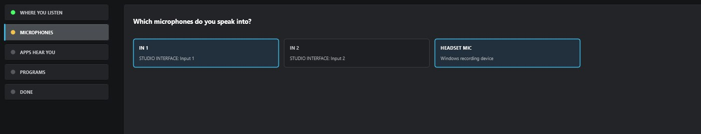

SETUP asks four questions, one per page, and builds your mix from your answers. Click the cards to
choose. On every page except the third you can choose more than one. **NEXT** moves on, **BACK**
goes back.

1. **WHERE YOU LISTEN**: pick your headphones or speakers. Windows' default is already chosen.
2. **MICROPHONES**: pick the microphones you speak into. These are your interface's inputs
   (**IN 1**, **IN 2** …) and your Windows recording devices.
3. **APPS HEAR YOU**: pick the virtual cable apps use as their mic (**CABLE Input**, after step 2),
   or **NOT NOW**. While Windows still plays or records on the cable, **SET MY DEFAULTS** at the
   bottom puts your real speakers and microphone back (step 2).
4. **PROGRAMS**: pick the programs you want on the desk: those playing sound now, and those running that are "Not playing yet" (captured when they play).
5. Click **BUILD THE MIX**. **DONE** lists what was made.
6. Click **OPEN THE MIXER** to see it.

What each answer makes:

| Page | What it makes |
|---|---|
| **WHERE YOU LISTEN** | An output on each device. The first is called **HEADPHONES**, the others are named after their device |
| **MICROPHONES** | A channel for each, called **MICROPHONE** (MICROPHONE 2 …) |
| **APPS HEAR YOU** | An output called **MIC FOR APPS** on the cable. Every microphone is routed to it |
| **PROGRAMS** | A raw channel for each, routed to where you listen, plus an app rule that brings it back by itself whenever the program plays |

Your microphones aren't routed to your own headphones, so you don't hear a delayed echo of your
voice. To hear yourself, route the mic to your headphones (step 6).

SETUP is not a page: run it again from **Run setup** in SETTINGS > Startup & checks, or **FIND** (**SETUP: BUILD A MIX**), whenever you add a
device or a program. It adds what's missing and never removes anything.

### Step 5: Check the audio is running

Look at the **health light** at the top right.

- **Green** with a percentage: the audio is running. Go on to step 6.
- **Red, reading OFF**: the audio isn't running. Another program may have your interface (a DAW,
  the driver's control panel). Close it and restart Faider. See
  [18.4](#184-the-interface-wont-start-or-stopped).

Click the light to open **DEVICES**. **STREAMS** shows the clock in use (ASIO, Windows or the
built-in clock; see [Clocking](#clocking)), and **BUFFER** sets its buffer size. The smallest size
that plays without crackles gives you the least delay. 256 or 512 samples suits most systems.

### Step 6: Hear yourself and let apps hear you

The Mixer shows a strip for each channel, bus and output. The **routing boxes** in each strip's
header show where it goes: one box per bus and output device, lit where it's routed (see
[4](#4-how-routing-works)).

1. Speak and watch your microphone's level meter move.
2. To hear yourself, light the box for your headphones in the mic's routing boxes.
3. In Discord, your game, OBS or any other app, choose **CABLE Output** as the microphone.
4. Check what they get: **HEAR WHAT THEY HEAR** (on PRE-FLIGHT's **MIC OUTPUT** row, or in **FIND**, Ctrl+K) records 5 seconds of what apps
   receive and plays it back to you.

If you hear a program twice, see [18.7](#187-i-hear-something-twice-or-an-echo).

**ADD CHANNEL** and **ADD APP** in the sidebar add channels (**ADD APP** also lists running programs that are **NOT PLAYING YET**). Route something to a device that has no output and an output is made on it.
Right-click an output for **DEVICE...** (where it plays) and **HEADPHONE EQ**. Right-click any strip for **RENAME...**,
**COLOUR**, **IN THE MINI MIXER** and **REMOVE**. Removing a
program's channel also removes its app rule, so the channel doesn't come back by itself.

### Step 7: The whole console, or COMPACT

The Mixer is the whole console: each channel's input, filters, dynamics and EQ, buses and
combinators, plugins. For a smaller view, **COMPACT** in the sidebar folds every strip to its name
bar and fader section. Click it again for the whole strips (see [The sidebar](#the-sidebar)).

To shape your microphone, see [17.1](#171-hear-yourself-set-up-a-microphone). Every control is in
[6](#6-the-channel-strip-section-by-section).

### Step 8: Run PRE-FLIGHT

A few seconds after start, **PRE-FLIGHT** checks the setup and opens only if something needs
attention (not on the very first start, when SETUP comes first). Run it any time from
**Run pre-flight** in **SETTINGS > Startup & checks**, or **FIND** (Ctrl+K). Every row should be green. See
[18.1](#181-pre-flight).

### Step 9: Finish

- **Your mix saves itself** within a second of any change. To keep a version under a name, use
  **Save as…** in **SETTINGS > Sessions**.
- **Start with Windows**: its switch in **SETTINGS > General** starts Faider in the tray when
  you sign in, so your mic works from the start.
- **Closing the window doesn't stop the audio.** Faider keeps running in the system tray
  so your mic and headphones keep working. To stop it, right-click the tray icon and choose
  **Quit Faider**. Starting the program while it's in the tray brings the window back.

The first time each page opens, a short tip explains it. Turn tips off with **Tips** in
**SETTINGS > General**.

That's the setup done. The rest of this manual covers each part in detail.

## 3. The window

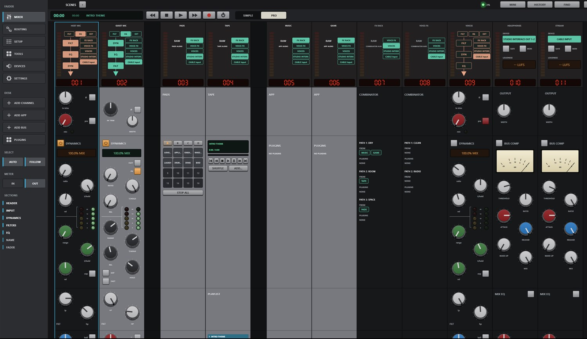

### The sidebar

The pages are cards down the left: **MIXER**, **ROUTING**, **TOOLS**, **DEVICES**,
**SETTINGS**. The page showing has a lit blue edge. While the Mixer shows, the sidebar also has
these cards:

| Group | Card | What it does |
|---|---|---|
| **DESK** | **ADD CHANNEL** | Opens the input menu: interface inputs, Windows devices, apps playing, programs not playing yet, a browser (whole, or one tab isolated), the test tone. Pads and tape get their channel from their own pages (**TOOLS**) |
| | **ADD APP** | Lists the programs playing sound now, then, under **NOT PLAYING YET**, those running with a window that are silent. Pick one to give it a channel; one that isn't playing is captured from the moment it does |
| | **ADD BUS** | A bus, or a combinator (two paths to start) |
| | **PLUGINS** | Slides the plugin panel up under the strips (see [9](#9-plugins)) |
| | **COMPACT** | Folds every strip to its name bar and its fader section (pan, SOLO, CUT, SEL, the fader and its readout); the desk shrinks to fit and goes to the top. Lit while compact; click it again for the whole strips. Also **COMPACT DESK** / **FULL DESK** in FIND |
| **SELECT** | **AUTO** | Touching any control on a strip selects that strip |
| | **FOLLOW** | The desk glides to the selected strip, also when it's chosen elsewhere (FIND, a hotkey) |
| **SECTIONS** | HEADER … FADER | The sections of the strip (while COMPACT, only NAME and FADER). Lit ones are on screen. Click one to glide to it |

The SELECT and COMPACT choices are remembered. Where the channel meters read (**IN**, **PRE** or **POST**) is set in
**SETTINGS > Audio > Channel meter point**.

### The top bar

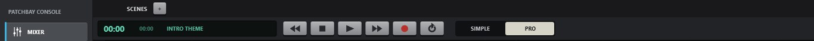

From the right:

| Control | What it does |
|---|---|
| **+ 100% -** | Zoom. Steps between 100, 125 and 150%. Click the percentage for 100%. Ctrl + / Ctrl - / Ctrl 0 do the same |
| **FIND** (Ctrl+K) | Search every page, setting, channel, scene, macro, pad and command by name |
| **HISTORY** (Ctrl+H) | Every change you've made. Pick one to go back to it |
| **MINI** | The mini mixer: a small mixer window (the tray icon opens it too). **PIN** on it keeps it on top |
| **Health light** | Green: audio is fine. Amber: the audio load is high or a device ran short recently. Red: an audible glitch in the last 10 seconds, or no audio running. The number is the audio load. Click it for DEVICES |
| **SCENES** | Your stored mixes. **+** stores a new one (see [14.1](#141-scenes)) |

In a narrow window the health light goes first, then MINI, then HISTORY. FIND reaches them all.

### The transport

Under the top bar, on every Mixer view, you get the Tape deck's time (elapsed and track length),
the track name and its keys: **rewind 10 s**, **stop**, **play/pause**, **forward 10 s**,
**record**, **loop**.

- **Record** is the Recorder's **REC**: it records the source chosen on TOOLS > TAPE, in its format and folder, and stays lit while that recording runs. Press again to stop.
- **Loop** steps through **repeat all** → **repeat one** (marked **1**) → **off**.

---

## 4. How routing works

Routing decides where each sound goes. Nothing is heard until it's routed, and anything can be
routed to as many places as you like.

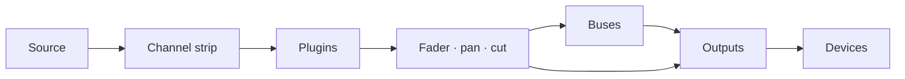

### The path of a sound

1. **A channel** takes one source and runs it through its strip (input, filters, dynamics and EQ,
   in the order its header shows), then its plugins, then its fader, pan and cut.
2. **Routes** send the channel on, to any of the buses and outputs at once (up to 8 of each). Every
   route carries the channel after its fader, so the fader and **CUT** affect everywhere it's
   routed.
3. **A bus** sums everything routed to it, runs its own strip and plugins, and is routed on to
   outputs (or into other buses) the same way.
4. **An output** sums everything routed to it, runs its bus compressor, mix EQ and limiter
   (**LIMIT**), and plays on its device.

### Outputs are devices

Each output plays on one device: your interface's outputs, a USB headset, speakers, **CABLE
Input**. You don't create outputs by hand. Route something to a device and an output is made on
it. That's why the routing boxes list devices as well as buses.

- There's one output per device. Route several channels to the same device and they meet in its
  output.
- Different outputs carry different mixes. Your headphones can hear game, music and voice while
  the stream output gets only music and voice.
- Unplug a device and its output goes silent until the device comes back.

### Three places to route

All three change the same routes. Use whichever is closest.

| Where | How |
|---|---|
| **Routing boxes** (each strip's header) | One box per bus and output device. Lit: routed there. Click to switch |
| **ROUTE TO** (right-click a strip) | The same list as a menu, ticked where it's routed |
| **The Routing page** | Every strip as a block, every route as a line. Click one block, then another (see [10](#10-the-routing-page)) |

### Buses

Use a bus when several channels need the same treatment or one fader. Route the channels to the
bus and the bus to the output. Then take the channels' direct routes to that output off, or they
reach it twice (once direct, once through the bus). A bus can feed another bus, and that adds no
delay.

### Combinators

A combinator is a bus split into parallel **paths** (two to start). Each path has its own plugins,
and the paths are summed at the combinator's fader. Route a source into one path or several (see
[7](#7-raw-strips-apps-pads-tape-and-combinators)).

### Rules that keep it safe

- **Feedback loops are refused.** A route that would bring a sound back to where it came from (a
  bus into a bus that feeds it, an output's sound fed back into its own input) is switched straight
  off again, and the event log names the loop.
- **Solo** on any strip silences every strip that isn't soloed, except those marked solo safe.
- **App channels and doubling.** A program plays on its own device as well as into its channel
  (see [18.7](#187-i-hear-something-twice-or-an-echo)).

### Clocking

One device sets the clock. Faider chooses it in this order when it starts:

1. **ASIO**: your audio interface, through its ASIO driver. The lowest delay.
2. **Windows**: with no ASIO driver, your Windows default playback device (a virtual cable, a
   screen's speakers or a VR headset only when nothing else is there). Your interface's outputs
   become that device's outputs, and microphones are added as Windows devices.
3. **Built-in clock**: with no playback device at all. Every device, your headphones included,
   follows it.

Every other device and every captured program runs on its own clock and joins through a small
buffer that corrects for drift, so clocks drifting apart never click. **DEVICES > STREAMS** shows
each one, and the clock in use.

If the Windows device setting the clock is unplugged, switched off or stops working, the next clock
takes over by itself and a notice tells you which. A device that won't start (because another
program holds it) is skipped until your devices change, then tried again. On the built-in clock, a
playback device that's plugged in takes over from it.

To choose the clock yourself, use **Clock** in **SETTINGS > Audio**: **The interface (ASIO)** (the
order above, the default), a Windows playback device by name, or **The built-in clock**. The
choice takes effect when Faider starts again, and **RESTART NOW** does that straight away. Your mix
comes with it and stays saved for your interface. When you choose the built-in clock, no device takes
over from it.

## 5. The console

### Layout

The desk shows every strip from left to right: **channels**, then **buses** (violet name bar), then
**outputs** (amber name bar). Each strip has seven sections, top to bottom:

| Section | Holds |
|---|---|
| **HEADER** | The level meter, the FILT / EQ / EXT keys, the processing order, the routing boxes, the strip number |
| **INPUT** | Trim, polarity, mic drive, the input switch and stereo width |
| **DYNAMICS** | Compressor, gate, de-esser and auto-level |
| **FILTERS** | Low-pass, high-pass and the NOISE switch |
| **EQ** | Four bands |
| **NAME** | The name bar and power switch |
| **FADER** | Pan, SOLO, CUT, SEL, the fader and its readout, the DUCK lamp |

### Mouse and keyboard

| Action | Result |
|---|---|
| **Drag** a knob or fader up/down | Changes it. Its value shows beside it while you drag or hover |
| **Double-click** a knob or fader | Back to its default |
| **Click** a key or switch | On / off |
| **Click** the name bar | Selects the strip |
| **Drag** a strip's name bar sideways | Moves it among its own kind: channels, buses or outputs (see [17.4](#174-reorder-channels)) |
| **Click** the power symbol on the name bar | Switches the strip off or on |
| **Right-click** a strip | The strip's menu |
| **Mouse wheel** | Scrolls the desk across. **Shift + wheel** scrolls up and down |
| **Ctrl + / Ctrl -** | Zoom the whole window |

A left click never opens a menu. Menus are always on the right button.

### Selecting a strip

The selected strip is outlined in blue. Select a strip by clicking its name bar or its **SEL** key,
or by touching any of its controls with **AUTO** on. The selected strip is the one the plugin panel
shows, and the one FIND, hotkeys and remote controls act on.

With the desk focused (click it first): **Left / Right** select the previous / next strip,
**M** cuts it, **S** solos it, and **Up / Down** move its fader 0.5 dB (3 dB with **Shift**).

### Switching a strip off

Click the power symbol at the left of the name bar. The strip fades and greys out. It isn't
processed, and its device or program is let go. While it's off, **nothing on it can be changed**:
knobs, keys and the plugin panel ignore clicks, and its menu only offers **TURN ON** and spacers.
Click the power symbol again to bring it back.

### Spacers

Spacers are blank strips that give you room between groups. Right-click a strip > **ADD SPACER
BEFORE** / **ADD SPACER AFTER**. Right-click a spacer for **NARROW**, **ADD ANOTHER** and **REMOVE
SPACER**. A spacer stays with the strip it follows when that strip moves.

### The strip menu (right-click)

| Item | |
|---|---|
| **INPUT** | Change the source: **INTERFACE** inputs, **WINDOWS DEVICES** (or WINDOWS DEFAULT), **WHAT AN OUTPUT PLAYS** (loopback), **TEST TONE**, **NOTHING** |
| **ROUTE TO** | Every bus and output device, ticked where it's sent |
| **PLUGINS** | Open one, **ADD PLUGIN...**, **REMOVE** |
| **MAKE MONO / MAKE STEREO** | Channels only |
| **NOISE** | Noise reduction: **ON** (as the strip's NOISE switch), **NEURAL** or **SPECTRAL**, and its **DEPTH** (-6 to -30 dB) |
| **KEY FROM** | The channel the strip's **EXT** key listens to (its sidechain), or **NONE**. Not on an app, pads, tape or combinator strip |
| **DUCK UNDER** | Another channel this one dips under while that channel is heard, or **NONE**, and how far it dips (**DEPTH**, -6 to -24 dB). Works on an app channel too, so music dips while you talk |
| **COLOUR** | The channel's colour, shown along its name bar and on its Routing block |
| **IN THE MINI MIXER** | Ticked: the strip has a fader in the mini mixer (see [16](#16-remote-control-overlay-and-tray)) |
| **ADD SPACER BEFORE / AFTER** | |
| **RENAME...** | |
| **REMOVE** | Deletes the channel or bus |

---

## 6. The channel strip, section by section

### HEADER

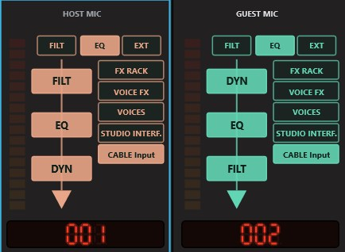

| Control | What it does |
|---|---|
| **Level meter** | The channel's level as a column of round LEDs (the louder side), the highest lit held a moment. It reads on the meter standard chosen in SETTINGS > Audio > Meter standard: its own LEDs, colours and marks (a VU column reads -20 to +3, a PPM BBC column 1 to 7), where SETTINGS > Audio > Channel meter point says (IN, PRE or POST). Outputs' meters read the same way |
| **FILT** | Sends the filters into the gate/compressor's detector (key filtering) |
| **EQ** | The EQ in or out |
| **EXT** | The dynamics listen to an external key (sidechain) instead of the channel itself: the channel picked under right-click > **KEY FROM**. Pressed before one is picked, it opens that list |
| **Processing order** | Three blocks (FILT, EQ, DYN), top to bottom in the order the channel runs them. **Click a block** to move it up one. The top one goes to the end. Lit blocks are in use |
| **Routing boxes** | One box per bus and output device. Lit: the channel is sent there. Click to switch (see [Outputs are devices](#outputs-are-devices)) |
| **Number** | The strip's place on the desk |

### INPUT

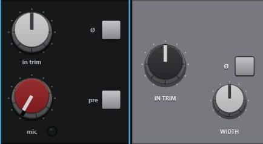

| Control | |
|---|---|
| **IN TRIM** | Input gain |
| **ø** | Polarity invert |
| **MIC** | Drive: adds warmth and level (shown as a percentage). The green LED beside it lights while the source has signal |
| **PRE** | The input stage in or out (out: trim, polarity and drive are bypassed) |
| **WIDTH** | Stereo width: 0 % mono, 100 % as it is, 200 % twice as wide. Faint on a mono channel |

### DYNAMICS

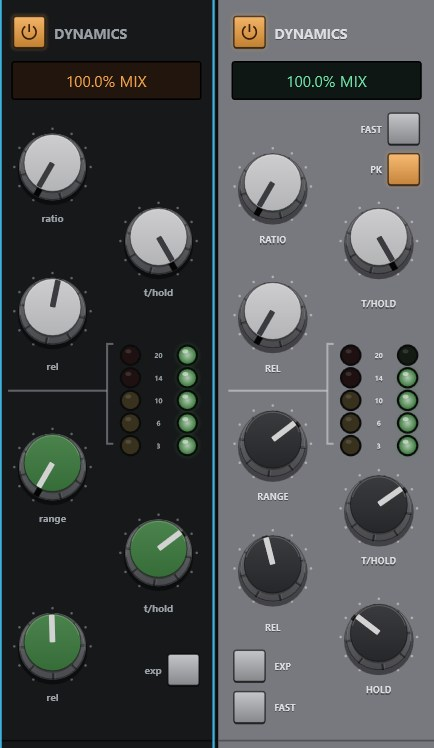

The **IN** switch (with the power symbol) puts the compressor and gate in or out together.

**Compressor**

| Control | |
|---|---|
| **MIX** | Wet/dry blend (parallel compression). Drag the green readout |
| **ratio**, **thresh**, **rel** | Ratio, threshold and release |
| **fast** | Fast attack (3 ms). Off is 10 ms |
| **pk** | Peak detection. On (the default), the compressor reacts to peaks. Off, it reacts to the average (RMS) level, which is smoother |
| **Gain reduction LEDs** | 3, 6, 10, 14 and 20 dB of reduction |

**Gate / expander**

| Control | |
|---|---|
| **range**, **thresh**, **rel**, **hold** | How far it closes, where it opens, how fast it closes, how long it holds |
| **exp** | Expander mode (a gentler gate) |
| **fast** | Fast attack (0.1 ms). Off is 1.5 ms |
| **Gate LEDs** | How far the gate is closing |

The LEDs show what the compressor and gate *would* do even while they're switched out, so you can
set them before putting them in.

**De-esser**

| Control | |
|---|---|
| **DE-ESS** | The de-esser in or out. It has its own switch: the **IN** switch above doesn't touch it |
| **thresh** | Where it starts to work, -50 to 0 dB. Loud "s" sounds over it are taken down, the rest of the voice isn't |
| **freq** | Where it listens for the "s" sounds, 3 to 10 kHz. Only the highs, from a little under it up, are turned down |
| **De-ess LEDs** | 3, 6 and 10 dB of reduction (it takes off 12 dB at most). They light only while it's in |

**Auto-level**

| Control | |
|---|---|
| **AUTO-LEVEL** | Auto-level in or out (its own switch too). It slowly rides the channel's level toward the target, and holds still through pauses so it doesn't bring up the room |
| **target** | The level it aims for, -30 to -10 dB |
| **range** | How far it may turn the channel up or down, 0 to 24 dB |

### FILTERS

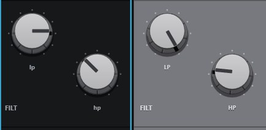

**lp** (low-pass) and **hp** (high-pass). Turned all the way down, the high-pass is out. Turned all
the way up, the low-pass is out.

**NOISE** switches noise reduction in or out: hiss, hum and room noise are taken down while the
voice stays. Right-click the strip > **NOISE** for **NEURAL** (the default, at 48 kHz; at other
rates it runs as SPECTRAL) or **SPECTRAL**, and for how deep it goes. Off, it costs nothing.

### EQ

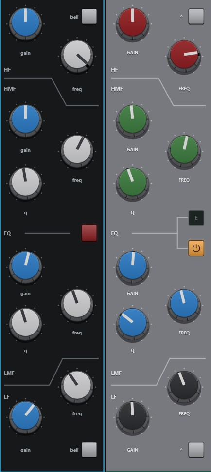

| Band | Controls |
|---|---|
| **HF** | gain, freq, **bell** (shelf when off) |
| **HMF** | gain, freq, q |
| **LMF** | gain, freq, q |
| **LF** | gain, freq, **bell** (shelf when off) |

The **EQ IN** switch puts the whole EQ in or out (the same as the header's EQ key).

### FADER

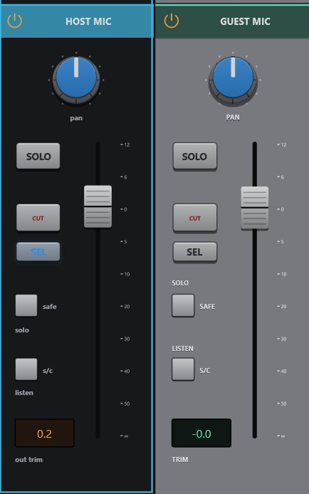

| Control | |
|---|---|
| **PAN** | Left/right. Double-click to centre |
| **SOLO** | Solo in place |
| **CUT** | Silences the channel (the **M** key on the desk) |
| **SEL** | Select this strip |
| **Fader** | Level, +12 dB to off. The readout below shows the level in dB |
| **safe** | Solo safe: this channel stays audible when others are soloed |
| **listen** | Listen to the dynamics' key signal |
| **duck** | Lights while the channel is dipped under another (right-click > **DUCK UNDER**) |

### Voice effects

Beside the strip's own processing, every channel carries four voice effects of its own:

| Effect | What it does |
|---|---|
| **ROBOT** | Ring modulation: the voice is multiplied by a tone, so it sounds metallic |
| **ECHO** | A delay, up to a second |
| **RADIO** | Band-limited to 300 Hz - 3 kHz and driven, so it sounds like a small speaker |
| **PITCH** | The voice moved up or down, up to an octave either way |

They are switched with a macro: the action **FX ON**, **FX OFF** or **FX TOGGLE**, with the channel
as its target ([15](#15-settings)). A pad, a hotkey, a trigger or remote control can fire that
macro, so the effects come and go with the mix.

---

## 7. Raw strips: apps, pads, tape and combinators

Some channels carry sound that's already finished: a program's audio, the pads, the tape. They get
a **raw strip**, with routing, plugins if you want them, pan, fader and keys, and no built-in
effects. When one appears on the desk, its built-in effects are switched out once (and logged in
the event log). Its plugins are kept.

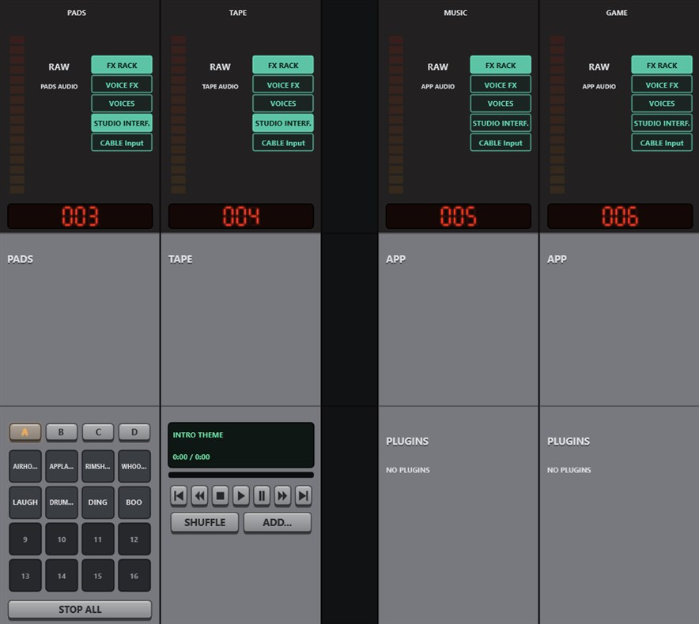

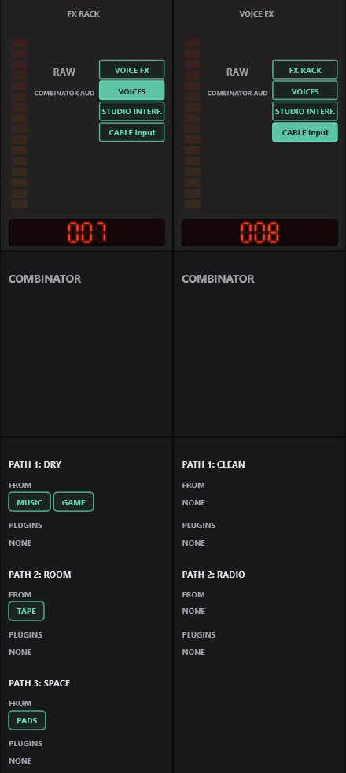

| Strip | Its middle sections hold |
|---|---|
| **App** | The plugin list (click one to open it) and **ADD PLUGIN** |
| **Pads** | Bank keys **A–D**, the 4×4 pads (press to play; a HOLD pad plays while held) and **STOP ALL** |
| **Tape** | The deck's screen and seek bar, the transport (previous, rewind, stop, play, pause, forward, next), **SHUFFLE**, **ADD...**, and the playlist (click a track to play it) |
| **Combinator** | For each path: **FROM**, the channels and buses feeding it (click one to go to its strip), and **PLUGINS** on that path (click one to open it). **EDIT IN ROUTING** opens the Routing page |

A combinator has no effects of its own. Its sound comes from what feeds it and from each path's
plugins. Right-click it > **PATHS** to add a path, and, for each path, to open, add or remove its
plugins, rename it or remove it.

---

## 8. Outputs

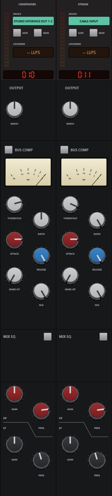

Each output has its own dark strip:

| Control | |
|---|---|
| **DEVICE** | The device it plays on. Click to choose another |
| **LIMIT** | A limiter after the fader: nothing leaves above -1 dBFS |
| **MON** | Monitor this output |
| **LUFS** | Short-term loudness of what leaves ("-- LUFS" when silent) |
| **WIDTH** | Stereo width |
| **BUS COMP** | In switch, the VU-style gain reduction meter, **threshold**, **ratio**, **attack**, **release**, **make-up**, **mix** |
| **MIX EQ** | In switch, HF gain and freq, LF gain and freq |
| **CUT**, **SEL**, fader | As on a channel |

Right-click an output for **DEVICE...**, **HEADPHONE EQ** (headphone correction: **NONE**, or your
model, listed by brand), **ALERT IF SILENT** (under -60 dBFS for **10 S**, **30 S**, **1 MIN** or **5 MIN**, or **OFF**) and **ALERT IF CLIPPING**
(while LIMIT is off), which flash the tray icon and write to the event log, **IN THE MINI MIXER**,
**MIX-MINUS AND STEMS...**, spacers, **COLOUR** (along its name bar and on its Routing block), **RENAME...** and **REMOVE**.

Outputs are made for you, one per device (see [Outputs are devices](#outputs-are-devices)).

**MIX-MINUS AND STEMS...** (on an output's right-click menu, or in FIND) builds a feed per guest (everything but their own voice) and voice,
music and game stems.

---

## 9. Plugins

Faider hosts **VST3** plugins on channels, buses and combinator paths, with automatic
latency compensation.

### Adding a plugin

- On a channel: right-click > **PLUGINS > ADD PLUGIN...**, or **ADD PLUGIN** on a raw strip, or
  **ADD** in the plugin panel.
- On a combinator path: right-click the combinator > **PATHS > PATH n > ADD PLUGIN...**. Click a
  path's plugin on the combinator strip to open it.

Every plugin is **tested first in a separate copy of the program**, so a plugin that crashes or
hangs while loading can't take your mix down. It has 30 seconds to load (**Plugin test time** in
SETTINGS > Audio gives slow plugins 60 or 120). The result is remembered until the plugin file
changes.

### The plugin panel

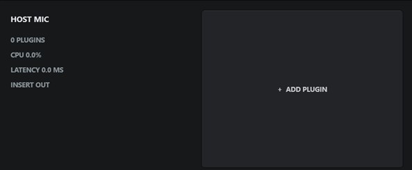

Click **PLUGINS** in the sidebar. A panel slides up under the strips with the **selected strip's**
plugins in the order they run. **FIND** > **PLUGINS: name** opens it on that strip. Each card
shows:

- **CPU**: the plugin's share of the processing time (green, amber past 2 %, red past 5 %)
- **Latency**: the delay it adds
- **BYPASSED**: switched off but still loaded (still using memory)
- **HEAVY**: unusually expensive

Keys on each card: **BYPASS**, **OPEN** (its window), **REMOVE**, and arrows to move it earlier or
later. **ADD** at the end adds another.

---

## 10. The Routing page

The Routing page shows the whole mix as a map: every strip as a block and every route as a line.
Use it to see where everything goes, and to route by clicking two blocks.

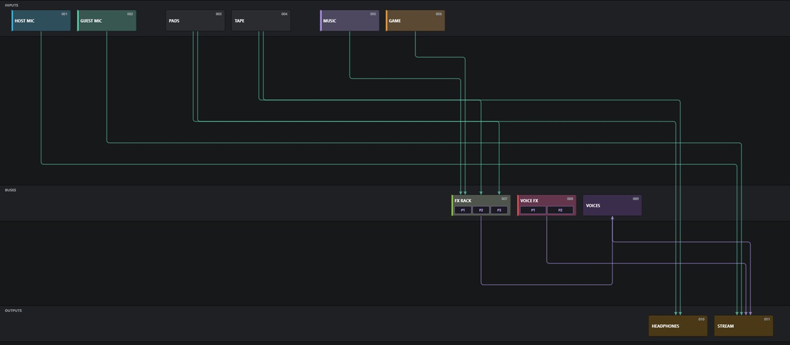

### Reading the page

- **Three rows:** **INPUTS** at the top, **BUSES** in the middle, **OUTPUTS** at the bottom. Output
  devices that don't have an output yet sit at the right end of the OUTPUTS row, in grey.
- **Each block sits under its strip.** A block is at the same position across the page as its strip
  on the desk, spacers included, and the page scrolls across with the desk (mouse wheel). Rearrange
  the desk and the map follows.
- **Each block shows** the strip's name and number. A switched-off strip is dimmed. A channel with
  its own colour shows it as a tint and a band at the left.
- **Lines are routes.** Each one runs straight down from its source into a lane of its own in the
  gap below its row, across, and down into the block it feeds, ending in an arrow. Input routes
  are teal, bus routes violet. Several lines leaving or arriving at one block are spread across it
  in order, so they never stack.
- **Combinators** show their paths as cells **P1, P2, …** along the bottom of the block. Lines end
  in the path they feed.

### Routing block to block

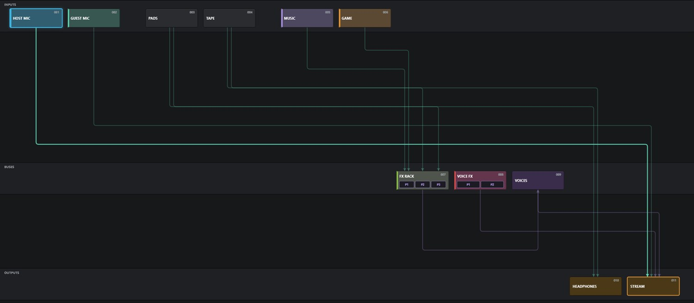

1. **Click a block.** It lights blue and pulses. The blocks it's routed to, or routed from, get a
   highlighted border, their lines brighten, and everything else dims.
2. **Click another block.** The route between them switches on (a line appears) or off (the line
   goes). Either order works: source then destination, or destination then source.
3. The first block **stays selected**, so keep clicking to route it to several places, or to take
   several routes off.
4. **Click it again**, click empty space, or press **Esc** to let go.

If the two blocks can't be routed (two outputs, say), the second one is selected instead.

### Examples

| To | Click |
|---|---|
| Hear your mic | MIC, then the headphones' output |
| Let apps hear your mic | MIC, then **CABLE Input** (in the outputs row, grey until it has an output) |
| Send a group through a bus | The bus, then each channel; then the bus, then its output |
| Take a channel out of the stream | The channel, then the stream's output (the line goes) |
| Feed one combinator path | The source, then the path cell (P1, P2…). Click more cells to feed several paths. Clicking the combinator outside its cells feeds its first path |

Clicking a grey device block makes its output, and the new output appears on the desk at once.

Drag a block sideways along its row to move its strip (see [17.4](#174-reorder-channels)). A route
that switches straight off again would make a feedback loop (see [18.8](#188-a-route-wont-switch-on)).

## 11. Tools: Pads

**TOOLS > PADS** gives you four banks (**A–D**) of 16 pads: 64 sounds, up to 32 playing at once.

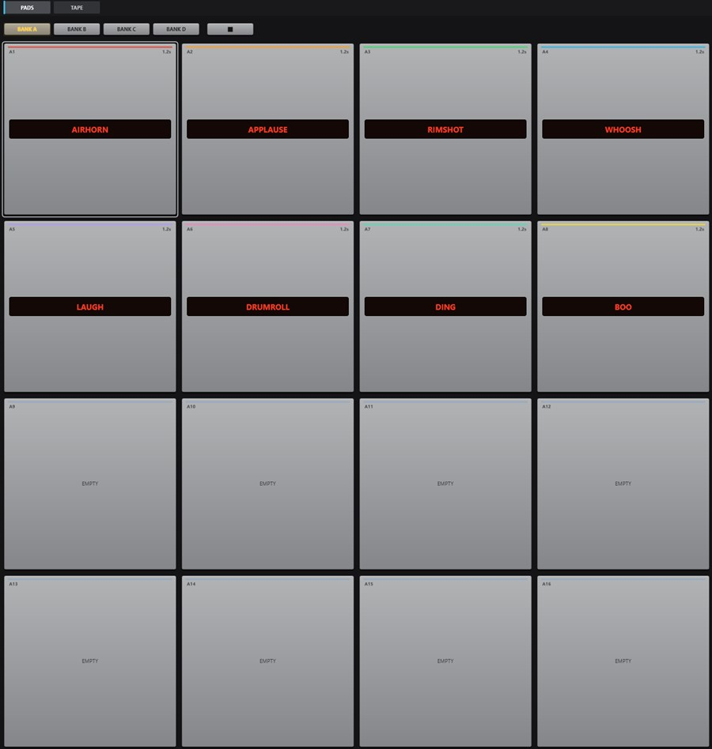

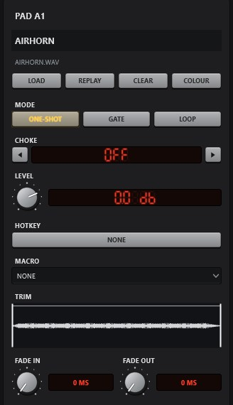

### Getting sound out

Pads play into a **PADS channel**. Click **CREATE PADS CHANNEL** (it then reads **PADS CHANNEL
ACTIVE**), or choose another input in the **PLAY INTO** menu to play the pads through that
channel's plugins and routes. With no pads channel, presses are ignored.

### Loading and playing

| Action | |
|---|---|
| Click an **empty** pad | Choose a sound file |
| Click a loaded pad | Play it |
| Right-click a pad | Select it for editing without playing |
| Drop files on a pad | Loads them into that pad and the following ones in the bank |
| **Ctrl + drag** onto another pad | Swaps the two pads |
| **STOP ALL** | Fades out every pad |

Formats: WAV, FLAC, AIFF, OGG, MP3. A pad whose file has moved shows **MISSING: FILE**.

### The pad editor

| Setting | |
|---|---|
| Name | Double-click to rename |
| **LOAD**, **CLEAR**, **COLOUR** | |
| **REPLAY** | The instant-replay buffer becomes this pad's sound (saved as a WAV in the recordings folder). Arm replay in TOOLS > TAPE first |
| **MODE** | **ONE-SHOT** plays to the end (pressing again restarts). **HOLD** plays while held. **LOOP** starts on one press and stops on the next |
| **CHOKE** | OFF or group 1–8. Pads in one group stop each other |
| **LEVEL** | -INF to +12 dB |
| **HOTKEY** | Click (**LEARN...**), then press the keys (see [HOTKEYS](#hotkeys)) |
| **MACRO** | A macro to run with the pad (a pad can have a macro and no sound) |
| **TRIM** | Drag the start and end lines on the waveform. Double-click for the whole file |
| **FADE IN / FADE OUT** | 0–5 s |

---

## 12. Tools: Tape, Recorder and Replay

### The tape deck

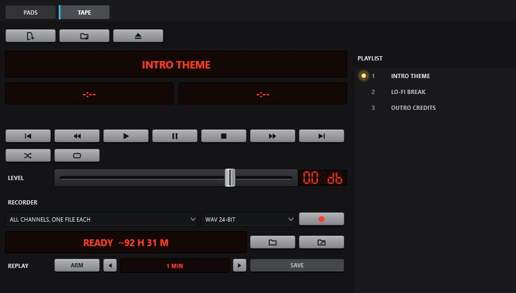

**TOOLS > TAPE** plays a playlist into a **TAPE channel**. Click **CREATE TAPE CHANNEL** to make one.

- **ADD FILES**, **ADD FOLDER**, or drop files and folders anywhere on the page. **EJECT** clears
  the playlist.
- Double-click a track to play it, drag one to reorder, and press Delete to remove selected tracks.
- Transport: **PREV**, **REW** (back 10 s; hold to rewind fast), **PLAY**, **PAUSE**, **STOP**,
  **FF** (forward 10 s; hold to fast-forward), **NEXT**. Also **SHUFFLE**, **REPEAT** (all / one /
  off) and **LEVEL**.
- Tracks play gapless. Pauses and skips fade over 30 ms so they never click.

The top bar's transport and the tape strip on the desk control the same deck.

### The recorder

| | |
|---|---|
| **Source** | Any output, bus or input, or **ALL CHANNELS, ONE FILE EACH** (multitrack: every input and every output, sample-aligned) |
| **Format** | WAV 24-bit (default), 16-bit, 32-bit, 32-bit float; FLAC 24/16-bit; AIFF 24/16-bit; OGG Vorbis 128–320k. With ffmpeg: MP3, AAC (M4A), Opus, ALAC. Each shows how much time fits on the disk |
| **REC** | Starts and stops (the top bar's record key does the same). The screen shows time, size, time left, and any dropped blocks |
| **PATH** / **REVEAL** | Choose the folder / open it in Explorer |

Recordings go to `Music\Faider Recordings` unless you pick a folder. ffmpeg formats record
a WAV first and convert it when you stop (the WAV is kept if conversion fails). Faider uses the
`ffmpeg.exe` picked in **SETTINGS > Recording > FFmpeg**, else the one on your PATH. Recording stops by
itself when less than 1 GB is free.

### Instant replay

**ARM** keeps the last **30 s**, **1**, **2** or **5 minutes** of the recorder's source.
**SAVE** writes it to a file (right-click SAVE to give it a global hotkey). With multitrack chosen,
replay uses the first output.

---

## 13. Devices

**DEVICES** lists every Windows audio device and ASIO driver. What sets the clock is chosen in
**SETTINGS > Audio > Clock** (see [Clocking](#clocking)).

**Windows audio**, in **SETTINGS > Audio** too, shows the priority of Windows' audio engine
(audiodg.exe, which carries every Windows device and captured app): **Normal priority** is Windows'
default, **Priority unknown** if it can't be read. Beside it:

- **Boost** raises it to High, which can stop crackling on Windows devices and captured apps on some
  PCs. It needs administrator rights, so Windows asks first; saying no changes nothing. It doesn't
  survive a restart of Windows audio or of the PC: Faider watches it, tells you once from the tray
  when it's back at Normal, and **Boost Windows audio again...** on the tray menu (or **Boost** here,
  or **BOOST WINDOWS AUDIO** in FIND) boosts it again. While it's boosted the key reads **Stop
  boosting**, which stops the watching; it stays High until Windows audio restarts or you choose
  **Back to normal**.
- **Pin to one core** (the switch under it, off unless you choose it) also holds it to your last
  processor core, from the next Boost. It only restricts where it runs, never adds cores: use it only
  for crackle on a USB headset.
- **Back to normal** (when it isn't at Normal, or is pinned) puts it back at Normal priority on every
  core now, without waiting for a restart. Windows asks first, as for Boost, and Faider stops watching.

**Boost** and **Back to normal** need Faider installed for all users (in Program Files). A copy
installed for you only, or built from source, says **Needs Faider installed for all users** under the
row and doesn't ask Windows: any program could change the files in such a folder, and they would then
run as administrator.

It doesn't affect ASIO interfaces, which don't go through Windows audio.

| Column | |
|---|---|
| **I/O** | ASIO, OUT or IN |
| **DEVICE**, **HARDWARE** | Its name and the adapter it's on |
| **FORMAT** | Channels and sample rate |
| **STATE** | Active, unplugged, disabled, or **off in Faider** |
| **TAGS** | DEFAULT and CALLS for Windows' default devices |

Click a header to sort. Select devices (Ctrl/Shift for several), then use:

| Key | |
|---|---|
| **EXCLUDE / INCLUDE** | Faider stops (or resumes) using the device. Excluded devices are never opened and are left out of lists |
| **DISABLE / ENABLE IN WINDOWS** | Turns the device off or on in Windows itself |
| **RENAME** | Your own name for the device, used throughout Faider (or double-click a row) |

### Streams

Under the list, **STREAMS** shows the audio engine's health:

- **CALLBACK LOAD** (and peak), **OVERLOADS**, **BLOCKS SKIPPED**. These turn warning-coloured if any happened
- **BUFFER**: your interface's buffer size (smaller means less delay and more load)
- Per device: buffered audio, total latency, **DRIFT** (the clock correction in ppm), **UNDER**
  (ran dry, silence played), **OVER** (overflowed, audio dropped), **RESYNC** (re-centred). A row
  that dropped audio shows red
- **RESET STATS** clears the counters

### VB-CABLE

If VB-CABLE is installed, a bar at the top sets its **sample rate** and **max latency**. **APPLY**
asks for one administrator prompt and restarts the cable.

The event log at the bottom records every device plugged in, removed or recovered.

---

## 14. Scenes, undo and sessions

### 14.1 Scenes

A scene stores every channel's fader, pan, cut, solo, power and routes (and, if you choose, plugin
settings).

- **Store:** click **+** in the top bar and give it a name.
- **Recall:** click its key. Faders and pans glide over half a second. The rest switches at once.
- **Right-click a scene** for: recall cuts only / levels only, store to it, include plugin
  settings, rename, a global hotkey, **Recall on device** (when a device appears; back when it
  goes), **Auto-scene** (when an app starts playing, a device connects, or at a time of day), MIDI
  learn, move, delete.

Devices and the channels themselves aren't part of a scene.

### 14.2 Undo and history

**Ctrl+Z** undoes, **Ctrl+Y** (or Ctrl+Shift+Z) redoes. **HISTORY** (Ctrl+H) lists every change.
Pick one to jump back to it.

### 14.3 Sessions

Your mix saves itself within a second of any change, and on exit.

| | |
|---|---|
| **SESSION TIMELINE** | **Open timeline** in SETTINGS > Sessions, FIND, or **Session timeline...** on the tray menu: every kept version by date. **RESTORE EVERYTHING** (Faider restarts with it), or **PUT ONE CHANNEL BACK** (its level, pan, CUT and rack) without restarting |
| **Save as…** | SETTINGS > Sessions > This mix (or **SAVE SESSION AS...** in FIND): keep the mix under a name. **Export…** beside it saves the mix to a file |
| **Saved sessions** | SETTINGS > Sessions: **Open** a named mix (Faider restarts with it) or **Export** it to a file; **Import…** loads one from a file |

Up to 60 earlier versions are kept (at most one every 5 minutes). If your mix ever can't be loaded
(the interface is missing, the file is damaged), it's **set aside** rather than lost, and a fresh
mix starts. See [18.2](#182-my-mix-is-gone-a-fresh-mix-started).

---

## 15. Settings

**SETTINGS** has a sidebar down its left: a search box at the top, then its pages in four groups.
**APP**: **General**, **Notifications**, **Startup & checks**, **Updates & about**. **AUDIO**:
**Audio**, **Recording**. **MIX**: **Apps**, **Sessions**. **CONTROL**: **MIDI & OSC**, **Hotkeys**,
**Macros**. The page you pick fills the rest as one column: its title, a line on what it's for, then
a row for each setting with its name, what it does under the name, and its control at the right.
On/off settings are switches that glow cream when on; a choice of a few shows them side by side, the
one chosen in cream; a value with a menu opens it when you click it.

Type in the search box to see the settings that match from every page, each under its page's name
(Esc clears it). **FIND** (Ctrl+K) finds every setting by its name too, and opens its page with its
row lit for a moment. A page whose name or keywords match ("hotkey", "shortcut", "macro") is listed first, with **Open**.

### GENERAL

The **APP** pages:

| Page | Setting | What it does |
|---|---|---|
| **General** | **Language** | The language of the interface: English, Deutsch, Español, Français, Italiano, 日本語, 한국어, Nederlands, Polski, Português (Brasil), Svenska, Türkçe or 简体中文, each in its own name. The first start follows Windows' display language if it's one of them, English if not. Updated from a version before languages, it stays in English. A change takes effect at the next start: **RESTART NOW** restarts Faider at once, **LATER** keeps it for then. The desk's keys, the event log and product names stay in English |
| | **Start with Windows** | Opens Faider in the tray when you sign in |
| | **Zoom** | **100%**, **125%**, **150%**, or **Custom…** for any size from 75 to 200%. Ctrl + and Ctrl - step between the first three |
| | **Look** | The console's colours and typeface; its menu lists your looks and **Save as…** (see [Looks](#looks)) |
| | **Tips** | A tip about each page, the first time it's shown. **Show again** shows each page's tip once more |
| **Notifications** | **Warn if I talk while cut** | A notice when a cut mic is above -30 dBFS |
| | Corner notices | A switch each: devices connected or gone, a channel clipping (its source or its output at full scale), scenes recalled, macros run, undo and redo. The event log has everything either way |
| **Startup & checks** | **Pre-flight on start** | PRE-FLIGHT a few seconds after start, shown only if something's wrong |
| | **Pre-flight**, **Zero the desk** | **Run pre-flight** and **Check** run them now (see [18.1](#181-pre-flight)) |
| | **Setup: build a mix** | **Run setup** asks SETUP's four questions again (see [2](#2-first-time-setup)): it adds what's missing and never removes anything |
| **Updates & about** | **Check for updates** | On by default: at most once a day (half a minute after start, or once a day has passed while it keeps running), Faider sends one request to GitHub asking for its newest release. The request carries only the app's name and version (for example `Faider/0.2.0`); nothing is downloaded or installed. If a newer version is out, the tray says so, and **Get Faider x.y.z...** on the tray menu, **GET FAIDER x.y.z** in FIND or **Get Faider x.y.z…** here opens its page. Switch it off and Faider never asks. |
| | **Version** | The version running now. **Check now** (or **CHECK FOR UPDATES NOW** in FIND) asks at once and says when you're up to date |
| | **About Faider** | Version and credits |
| | **Privacy** | **Read policy** opens Faider's privacy policy on GitHub |
| | **Problem report** | **Save report…** saves the logs, the last crash and the versions in a .zip you can send. Nothing is sent by itself |

The **AUDIO** and **MIX** pages:

| Page | Setting | What it does |
|---|---|---|
| **Audio** | **Clock** | What sets the clock, from the next start: **The interface (ASIO)**, a Windows playback device by name, or **The built-in clock** (see [Clocking](#clocking)). Under it, what sets it now |
| | **Windows audio** | The priority of Windows' audio engine, with **Boost** and **Back to normal** (see [13](#13-devices)) |
| | **Pin to one core** | With Boost, Windows audio is held to the last core: only for crackle on a USB headset |
| | **Channel meter point** | Where every channel's meter reads: **IN** (raw source), **PRE** (after effects) or **POST** (after the fader, the default) |
| | **Meter standard** | How meters read, and the LEDs, colours and marks of the desk's level meters: **Peak** (the default: sample peak in dBFS with a fast fall), **Peak IEC**, **True Peak** (dBTP, ITU-R BS.1770: 4x oversampled, so it also shows peaks between the samples; its scale runs to +3), **RMS**, **VU**, **PPM** (EBU, BBC, DIN, Nordic), **K-20**, **K-14**, **K-12** and **LUFS M** (momentary loudness, EBU R128) |
| | **Plugin test time** | **30 S** (default), **60 S** or **120 S**: how long a new plugin has to load in its test before it fails |
| **Recording** | **FFmpeg** | Where `ffmpeg.exe` is, or **Not found**. **Pick…** chooses it (used before the one on your PATH); **Use PATH** forgets the one picked and uses the PATH's |
| **Apps** | **App rules** | A table: each program, where it goes, **Change** and **Delete**. **Add rule** picks a program playing now (or one with a channel), then a bus or output. Removing a program's channel removes its rule. **APP RULES** in FIND brings you to this table |
| **Sessions** | **This mix** | **Save as…** keeps the mix under a name; **Export…** saves it to a file |
| | **Saved sessions** | The mixes kept under a name, with when each was saved: **Open** (Faider restarts with it) or **Export** to a file. **Import…** opens a session from a file |
| | **Session timeline** | **Open timeline**: every kept version by date (see [14.3](#143-sessions)) |

### LOOKS

A **look** is every colour the console paints with, together with the typeface and the sizes that go
with it. The strips, the readouts, the knobs, the keys and the lamps all draw from the look in force,
so one look changes the whole desk at once.

**Look** (SETTINGS > General) lists the looks you have and puts the one you choose in force; the desk
is drawn again the moment it changes. **Save as…** at the end of its list writes the look in force to
a new file under a name you give it.

A look is one file in `%APPDATA%\Faider\looks`, written as JSON, so you can write one by hand and copy
it to another machine. A file that is missing or broken leaves the built-in look in place, and whatever
a file leaves out falls back to the built-in value: a part-written file still works.

| | |
|---|---|
| `name` | The look's name, as it appears in the list |
| `font` | One typeface Windows ships with, so it stays crisp at the desk's small sizes |
| `keyRadius` | How round a key's corners are, in pixels |
| `fontSizes` | `legend`, `caption`, `readout`: the three printing sizes |
| `colours` | Every colour, as `#rrggbb`, or `#rrggbbaa` where a part is see-through |

The colours are named after the part they paint: the panels and the printing, the keys, the faders'
plate, the readouts, the knobs by function, the lamps, the strips' bodies, what a channel, a bus and an
output look like, the accent, the recesses and the shading. **Save as…** writes out every
name the look has, so the quickest way to begin is to change one thing on the desk, save it, and edit
that file.

A `palette` group names the colours a layout file can put on a part: `red`, `green`, `blue`, `black`,
`white`, `violet`, `grey`, `cream`, `orange`, `amber`, `teal`, `salmon`.

### MACROS

A macro is a list of **actions** run from a hotkey, a pad, a trigger or remote control.

1. Click **+ NEW**, then name it (double-click the name).
2. **+ ACTION**: CUT, UNCUT, CUT TOGGLE, SET FADER (dB, fade time), ASSIGN ON/OFF/TOGGLE (a route),
   CHANNEL ON/OFF, TRIGGER PAD, STOP PAD, ALL NOTES OFF, TRANSPORT PLAY/PAUSE, TRANSPORT NEXT,
   RECORD START/STOP, WAIT, SCENE RECALL, FX ON/OFF/TOGGLE (a voice effect, see
   [Voice effects](#voice-effects)), WINDOWS DEFAULT OUTPUT/INPUT, PLUGIN SETTING.
3. Optionally, **+ TRIGGER**: APP STARTS, APP STOPS, DEVICE CONNECTED, DEVICE DISCONNECTED, OUTPUT
   SILENT (for n seconds), OUTPUT HAS SOUND, TIME (24-hour).
4. Optionally, a **HOTKEY**, and **MOMENTARY** (the actions are undone when the key is released,
   for push-to-talk).
5. **FIRE** runs it now.

### HOTKEYS

Every assignable hotkey is on the **Hotkeys** page, in two tables. **Assigned** lists the pads, the
macros, the scenes and **Save instant replay** (the tape), each with where else it can be set and its
key. Click a key, then press the new keys (Esc cancels, Delete clears). Hotkeys must include Ctrl, Alt
or an F key, and they work while a game has focus. A key that something else in Faider already has (a
pad, a macro, a scene, instant replay or a fixed key) is refused, here and wherever else a hotkey is
set, and the note at the top names what has it. A key Windows refused (another app may have it), or
one that two things still share in a mix from an earlier version, is marked in red under its line:
only one of them works. **Fixed** lists the keys that are always the same, and where they work
([19.1](#191-keyboard-shortcuts)). Its **On the mixer** keys work on the console too
([5](#5-the-console)).

### CONTROL

The **MIDI & OSC** page:

| Setting | |
|---|---|
| **MIDI map** | **Start mapping** starts MIDI MAP (see [16](#16-remote-control-overlay-and-tray)). Ctrl+L starts it anywhere; Esc or **Finish mapping** ends it |
| **Inputs and bindings** | **Open**: each MIDI input switched on or off, and every binding. Under it, how many bindings there are |
| **OSC** | A switch: listen for OSC from programs on this PC. Under it, the port it listens on |
| **OSC port** | The port (1024–65535, 9000 to start): type it and click **Apply**. If OSC is on, it moves there at once |

---

## 16. Remote control, overlay and tray

| | |
|---|---|
| **MIDI MAP** (Ctrl+L) | Ctrl+L, or **Start mapping** in SETTINGS > MIDI & OSC, starts it; Esc ends it. Click a control on screen, then move a knob or key on your controller. Each strip's fader, pan, CUT, SOLO, power and routing keys can be mapped, as well as scenes, pads and the tape. The mouse wheel scrolls the desk while mapping (Shift+wheel up and down) |
| **OSC** | Programs on this PC can send to port 9000, or the port set in **OSC port** (SETTINGS > MIDI & OSC; it never listens to the network): `/faider/input/NAME/fader -12` (dB), `/faider/output/NAME/mute 1`, `/faider/bus/NAME/pan -0.5`, `/faider/input/NAME/solo 1`, `/faider/scene NAME`, `/faider/macro/NAME 1` (0 releases it). Write spaces in names as `_`. Every address: [OSC reference](https://github.com/dayztoolsforu/faider/blob/main/docs/OSC.md) |
| **In-game overlay** (Ctrl+Shift+O) | Each mic channel's talking light, LIVE / CUT and level, plus up to four scene keys. Never takes focus from a game. Drag it anywhere |
| **MINI** | The mini mixer: a small window with a fader, meter and **CUT** for each strip ticked **IN THE MINI MIXER** on its right-click menu (each output's while none is). Its meters are columns of round LEDs on SETTINGS > Audio > Meter standard, as on the desk. **PIN** keeps it on top of everything. **OPEN** returns to the main window |
| **Tray** | Click the icon for the mini mixer (it opens a moment later, once no second click has followed); double-click to open the window, without the mini mixer. Right-click: Show, scene recall, Session timeline, Get Faider x.y.z... (when a newer version is out), Boost Windows audio again... (when a boost has been undone), Start with Windows, Save a problem report..., About, Quit. The icon flashes amber during an alert |

Faider always runs with your ordinary user rights, even when it's started from an
administrator window. It restarts itself with ordinary rights, because the in-game overlay can't
reach a program running as administrator. The few steps that need an administrator
(applying VB-CABLE settings, re-enabling a device Windows has switched off) ask for permission
themselves.

---

## 17. How-to guides

### 17.1 Hear yourself: set up a microphone

1. **ADD CHANNEL** > your interface input (or a Windows recording device). It appears as a new
   channel strip.
2. Speak, and set **IN TRIM** so the level meter peaks around -12 to -6 dB.
3. Route it: click the routing box for your headphones' output (or use the Routing page).
4. Clean it up: **hp** to remove rumble (around 80–100 Hz), then the gate and compressor (**IN**
   on DYNAMICS), then EQ.

### 17.2 Let apps hear your mic (Discord, games, OBS)

1. Install **VB-CABLE** (PRE-FLIGHT offers a link), then set your real speakers and mic back as
   Windows' defaults ([Step 2](#step-2-install-vb-cable-optional)).
2. Route your mic channel to the **CABLE Input** device. An output is created on it.
3. In the app, choose **CABLE Output** as its microphone.
4. Click **Run pre-flight** (SETTINGS > Startup & checks) to check that nothing on the way is cut and nothing loops.

### 17.3 Bring a program into the mix

1. Start the program.
2. **ADD APP** > pick it (under **NOT PLAYING YET** if it's silent now). It gets a raw channel (no effects).
3. Route it where you want it heard. If you hear it twice, see
   [18.7](#187-i-hear-something-twice-or-an-echo).

### 17.4 Reorder channels

Drag a channel's **name bar** sideways on the Mixer (scroll down to the NAME section), or drag its
block on the Routing page. A blue bar shows where it will land, and the strips glide into place.
Spacers move with the strip they follow. Buses and outputs move the same way, each among its own
kind, and their routes go with them.

### 17.5 Group channels into a bus

1. **ADD BUS**, then rename it (right-click > **RENAME...**).
2. On the Routing page, click the bus, then click each channel to route it in.
3. Click the bus, then its output, to route the bus on.
4. If you only want those channels through the bus, take their direct routes to the output off.

### 17.6 Parallel processing with a combinator

1. **ADD BUS > COMBINATOR**. It starts with two paths. Right-click it > **PATHS > ADD PATH** for
   more.
2. On the Routing page, route sources into the path cells (**P1**, **P2**…).
3. Right-click > **PATHS > PATH n > ADD PLUGIN...** for each path.

### 17.7 Make a stream mix and a headphone mix

1. Send your channels to two outputs, for example your headphones and the device your streaming
   software captures.
2. Each output has its own fader, bus compressor, EQ and limiter (**LIMIT**). Turn **LIMIT** on for the
   stream output.
3. To keep something out of the stream, take that channel's route to the stream output off (with
   its routing box or on the Routing page).

### 17.8 Record

1. TOOLS > TAPE > **RECORDER**: choose the source and format.
2. Press **REC** (or the record key in the top bar). Press again to stop.
3. **REVEAL** opens the folder.

### 17.9 Make a push-to-talk key

1. SETTINGS > **Macros** > **+ NEW**.
2. **+ ACTION** > **UNCUT** > your mic channel.
3. Turn **MOMENTARY** on and set a **HOTKEY**. While you hold it the mic is live, and on release it
   is cut again. Start with the mic cut.

---

## 18. Troubleshooting

When the overlay, a MIDI controller or OSC doesn't respond:

| Problem | Check |
|---|---|
| **The overlay doesn't show** | Ctrl+Shift+O is a hotkey for the whole of Windows. If another app has it, SETTINGS > Hotkeys marks it in red and the event log says so: **SHOW OVERLAY** in FIND opens the overlay without the key. The overlay is a window that stays on top, made for a game in a borderless window, so set the game to borderless or windowed. It lists microphone channels only (interface inputs and Windows devices), and reads **NO MIC CHANNELS** when there are none |
| **A MIDI controller does nothing** | Each MIDI input is off until you switch it on in SETTINGS > MIDI & OSC > **Inputs and bindings**. A controller plugged in after Faider started isn't opened by itself: press **REFRESH** there and switch its input off and on, or restart Faider. Move a control and **LAST** at the bottom of that list shows what arrived. A control does nothing until it's bound in **MIDI MAP** (Ctrl+L). Only control changes and notes are read: faders and pans follow a knob or fader, not a key, and keys switch CUT, SOLO and the like |
| **OSC does nothing** | OSC is off until its switch is on (SETTINGS > MIDI & OSC). The sender has to use the port shown under it (9000 unless you changed it) and run on this PC: Faider listens on `127.0.0.1` only, so a phone or another PC can't reach it. If the port couldn't be opened (another program may have it), Faider says so and OSC stays off: type another in **OSC port** and click **Apply**. Then check the address: the strip's name, with `_` for spaces (see the [OSC reference](https://github.com/dayztoolsforu/faider/blob/main/docs/OSC.md)) |

### 18.1 PRE-FLIGHT

PRE-FLIGHT runs a few seconds after start (and from **Run pre-flight** in SETTINGS > Startup & checks, or FIND) and only shows
up if something is wrong. Each row has a light, the finding and a fix:

| Check | Problem | Fix |
|---|---|---|
| **AUDIO** | It didn't start (another app may have it) | **DEVICES** |
| **MIC CABLE** | No VB-CABLE: apps can't hear your mix as a mic | **GET VB-CABLE** |
| **MIC OUTPUT** | No output plays into the mic cable | **ROUTING** (while it's fine, its key is **HEAR WHAT THEY HEAR**) |
| **MIC CHANNELS** | Something on the way to the mic is cut | **UNCUT** |
| **WINDOWS DEFAULTS** | Windows' default speaker or mic (or its default for calls) is the virtual cable | **SET MY DEFAULTS** |
| **HEARD ONCE** | A feedback loop, or something heard twice | **SOUND SETTINGS** |
| **WINDOWS AUDIO** | Windows devices or captured apps are in the mix and Windows' audio engine is at Normal priority: yellow, a suggestion only; red if your boost was undone by a restart. Green when only ASIO is used | **BOOST** |

**ZERO THE DESK** (bottom left; also **Zero the desk** in SETTINGS > Startup & checks, and **ZERO DESK** in FIND) checks what a last session can leave
set: solos, key listen, gain trims more than 12 dB off, and cut outputs. Each has a **FIX**.

### 18.2 My mix is gone, a fresh mix started

Your mix isn't lost. When it can't be used at start, it's **set aside** as
`session-unloaded-<date>.xml`. The event log says why:

| Reason | What to do |
|---|---|
| The saved interface isn't connected | Connect it, then **SESSION TIMELINE** (SETTINGS > Sessions, FIND or the tray) > the "kept:" version > **RESTORE EVERYTHING** |
| The saved interface couldn't be opened (another program has it) | Close the other program and restart Faider. Nothing is saved over your mix meanwhile |
| session.xml couldn't be read | **SESSION TIMELINE** > a recent version > **RESTORE EVERYTHING** |

### 18.3 No sound

Work along the signal path:

1. **Health light** red and reading OFF: the audio isn't running. See
   [18.2](#182-my-mix-is-gone-a-fresh-mix-started) and [18.4](#184-the-interface-wont-start-or-stopped).
2. **The channel's meter** (Channel meter point: IN): if it isn't moving, check its **Input** (right-click) and
   that the source is playing. A strip that's switched off passes nothing.
3. **CUT** is off, the fader is up, and nothing else is soloed (another strip's **SOLO** silences
   everything else).
4. **Routing:** at least one routing box is lit, or there's a line on the Routing page.
5. **The output**: not CUT, fader up, and **DEVICE** shows the right device (not "NO DEVICE" or
   "(OFF)").
6. **The device** is plugged in and not excluded on DEVICES.

### 18.4 The interface won't start, or stopped

- Another program may hold it (a DAW, the driver's control panel). Close it and restart.
- **INTERFACE DOWN** on the tray: the interface reset itself and wouldn't reopen. Change its buffer
  size on DEVICES or restart Faider.
- Rate or buffer changes made in the interface's own control panel are picked up by themselves.
- To run without the interface for a while, choose a Windows playback device or the built-in clock
  in **SETTINGS > Audio > Clock** and click **RESTART NOW**. Your mix comes with it and stays saved for your
  interface: choosing **The interface (ASIO)** again goes back to it.
- Or start Faider with `"C:\Program Files\Faider\Faider.exe" --clock windows` (your Windows playback
  device) or `--clock builtin` (the built-in clock). `--clock` with part of an ASIO driver's name
  (`--clock focusrite`) picks that driver. It wins over SETTINGS > Audio > Clock for that run, and the next
  start without it goes back to your choice.

### 18.5 Clicks, crackles or dropouts

1. Look at the **health light** and **DEVICES > STREAMS**.
2. High **CALLBACK LOAD** or OVERLOADS: raise the **BUFFER**, or find expensive plugins in the
   plugin panel (**HEAVY**, high CPU) and bypass or remove them.
3. **UNDER / OVER** climbing on one device: that device is struggling. Try another USB port, close
   other programs using it, or exclude it if you don't use it.
4. Steady **DRIFT** is normal. It's the correction that keeps clocks in step.
5. Crackling only on Windows devices or captured apps: try **Boost** (SETTINGS > Audio >
   Windows audio, or **BOOST WINDOWS AUDIO** in FIND). It raises Windows' audio engine from Normal, Windows' default, to High.
   Windows asks for administrator approval, and a restart of Windows audio or of the PC undoes it
   (Faider tells you). It doesn't affect ASIO interfaces. For a USB headset that still crackles,
   **Pin to one core** is optional and only restricts it to one core.

### 18.6 An app doesn't appear in ADD APP

- The program must be **playing sound**, or running with a window of its own (then it's under **NOT PLAYING YET**). One that runs without a window, or a Microsoft Store app whose window Windows hosts for it, isn't listed until it plays: start playback, then open the menu again.
- Programs that already have a channel are greyed out (**ON THE DESK**).
- Windows older than 10 version 2004 can't capture a single program ("Windows refused app capture").

### 18.7 I hear something twice, or an echo

- A program keeps playing on its own device as well as into its channel. If its channel is routed
  to an output on that same device, you hear it directly and through Faider. Switch that route off
  (its routing box on the channel), or move the program to another device. PRE-FLIGHT
  warns about this.
- Windows' default speaker is set to the virtual cable. PRE-FLIGHT > **WINDOWS DEFAULTS** names it,
  and **SET MY DEFAULTS** puts your speakers back.

### 18.8 A route won't switch on

It would make a **feedback loop** (see [Rules that keep it safe](#rules-that-keep-it-safe)). The
event log names the loop. Remove the route that feeds back.

### 18.9 I can't change anything on a strip

The strip is **switched off** (dim and grey). Click the power symbol on its name bar.

### 18.10 Dragging a channel does nothing

Drag by the **name bar** (the NAME section, near the bottom; scroll down if needed), or drag the
block on the Routing page. A strip moves only among its own kind: a bus can't go among the
channels.

### 18.11 A plugin won't load

Each plugin is tested in a separate copy of the program first, and the reason for a failure is
reported: it didn't finish loading in time (30 s, unless **Plugin test time** in SETTINGS > Audio
gives it 60 or 120), it crashed while being tested, or there's no VST3 plugin in the file. Update or
reinstall the plugin. Once its file changes, it's tested again.

### 18.12 The program crashed

A report is written to `%APPDATA%\Faider\crash.log`, with a minidump `crash.dmp`. Your mix
is saved within a second of any change, so you lose at most the last moment's changes.

To report a problem, right-click the tray icon > **Save a problem report...** (or **SAVE A PROBLEM
REPORT** in FIND). It puts the crash report, the event log and the status snapshot (those that
exist), with Faider's and Windows' versions, in one .zip where you choose (the desktop to start),
then shows it in Explorer. Nothing is sent anywhere: attach the file yourself.

### 18.13 Recording stopped by itself

Recording stops when less than 1 GB of disk space is left (or the format's size limit is near).
The tray shows **RECORDING STOPPED, NO ROOM**. Free some space or choose another **PATH**.

### 18.14 No sound from Windows after installing VB-CABLE

Windows has made the cable its default device. **SET MY DEFAULTS** (PRE-FLIGHT's **WINDOWS
DEFAULTS** row, or **WINDOWS DEFAULTS** in FIND) sets your headphones or speakers as the default
output again, and your real microphone as the default input, each for calls too. Or do it in
**Settings > System > Sound**. See [Step 2](#step-2-install-vb-cable-optional).

---

## 19. Reference

### 19.1 Keyboard shortcuts

| Keys | |
|---|---|
| **Ctrl+K** | FIND |
| **Ctrl+Z / Ctrl+Y** (Ctrl+Shift+Z) | Undo / redo |
| **Ctrl+H** | History |
| **Ctrl+L** | MIDI MAP |
| **Ctrl + / Ctrl - / Ctrl 0** | Zoom in / out / 100% |
| **Ctrl+Shift+O** | Show / hide the in-game overlay (works anywhere) |
| **Left / Right** | Select the previous / next strip (desk focused) |
| **M / S** | Cut / solo the selected strip |
| **Up / Down** | Selected fader ±0.5 dB (±3 dB with Shift) |
| **Esc** | Let go of the selected block (Routing) |

### 19.2 Command line

| | |
|---|---|
| `--minimised` | Start in the tray (what **Start with Windows** uses) |
| `--quit` | Quit the running copy, as the tray's **Quit** does. With none running, nothing happens |
| `--allow-admin` | Started as administrator, stay that way. Without it Faider starts itself again with ordinary rights (see [16](#16-remote-control-overlay-and-tray)) |
| `--clock windows`, `--clock builtin`, `--clock <driver>` | For this run, the clock is your Windows playback device, the built-in clock, or the ASIO driver whose name contains `<driver>`. It wins over SETTINGS > Audio > Clock (see [Clocking](#clocking)) |
| `--boost-audiodg [--pin-core N]`, `--unboost-audiodg` | What **Boost** and **Back to normal** (SETTINGS > Audio > Windows audio) start, as administrator: Windows' audio engine to High priority (pinned to core N only if given), or back to Normal on every core, then it exits. 0: done; 2: bad arguments; 3: audiodg not found; 4: access denied; 5: priority refused; 6: High set but the pin refused; 7: Normal set but every core refused |
| `--scan <plugin> --out <file>` | Internal: the test Faider runs in a separate copy before a plugin loads (see [9](#9-plugins)). No window, no audio |
| `--after <process id>` | Internal: added when Faider starts itself again (**RESTORE EVERYTHING**, **RESTART NOW**, giving up administrator rights). The new copy waits, up to a minute, for that process to end |

### 19.3 Files

In `%APPDATA%\Faider`:

| File | |
|---|---|
| `session.xml` | Your mix |
| `history\` | Earlier versions (up to 60) |
| `sessions\` | Named mixes |
| `session-unloaded-*.xml` | Mixes set aside at start |
| `settings.xml` | Preferences |
| `looks\` | The looks: one JSON file each (see [Looks](#looks)) |
| `console.xml` | Spacers and SELECT choices |
| `plugins.xml` | The plugins found and how each one tested |
| `events.log` | Everything that happened (rotates at 5 MB) |
| `status.txt` | A snapshot of the engine every few seconds: devices, levels, buffers, drift |
| `crash.log`, `crash.dmp` | Crash reports |

The program itself is in `C:\Program Files\Faider` (installed for you only:
`%LOCALAPPDATA%\Programs\Faider`). Recordings go to
`Music\Faider Recordings` unless you choose another folder.

### 19.4 Colours

| Colour | Means |
|---|---|
| Blue outline | Selected |
| Grey name bar | Channel |
| Violet | Bus |
| Amber | Output |
| Teal line | A channel's route |
| Violet line | A bus's route |
| Green health light | Audio fine; amber: under strain; red: glitch or not running |
