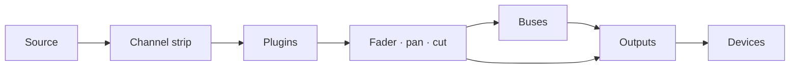

# Faider Benutzerhandbuch

[English](../FAIDER-MANUAL.md)

**Version 0.1 · Windows 10 (2004) oder neuer**

Faider ist ein Live-Audio-Router und Mixer für Windows, aufgebaut wie ein Großformat-Mischpult.
Das Programm nimmt Klang von deinem Audio-Interface, deinen Windows-Geräten und einzelnen Programmen auf,
schickt ihn durch Kanalzüge, Busse und Ausgänge und gibt das Ergebnis auf beliebigen Geräten aus: auf
deinen Kopfhörern, deinen Lautsprechern, in einem Stream oder auf einem virtuellen Mikrofon für Anrufe und Spiele.

Dieses Handbuch beschreibt alles, was die App kann, führt dich Schritt für Schritt durch die
häufigsten Aufgaben und sagt dir, was du tun kannst, wenn etwas schiefgeht.

---

## Inhalt

1. [Bevor du loslegst](#1-before-you-start)
2. [Ersteinrichtung](#2-first-time-setup)
3. [Das Fenster](#3-the-window)
4. [So funktioniert das Routing](#4-how-routing-works)
5. [Das Pult](#5-the-console)
6. [Der Kanalzug, Bereich für Bereich](#6-the-channel-strip-section-by-section)
7. [Raw-Strips: Apps, Pads, Tape und Combinatoren](#7-raw-strips-apps-pads-tape-and-combinators)
8. [Ausgänge](#8-outputs)
9. [Plugins](#9-plugins)
10. [Die Seite Routing](#10-the-routing-page)
11. [Tools: Pads](#11-tools-pads)
12. [Tools: Tape, Recorder und Replay](#12-tools-tape-recorder-and-replay)
13. [Geräte](#13-devices)
14. [Szenen, Rückgängig und Sitzungen](#14-scenes-undo-and-sessions)
15. [Einstellungen](#15-settings)
16. [Fernsteuerung, Overlay und Tray](#16-remote-control-overlay-and-tray)
17. [Anleitungen](#17-how-to-guides)
18. [Fehlerbehebung](#18-troubleshooting)
19. [Referenz](#19-reference)

---

## 1. Bevor du loslegst

### Was du brauchst

| | |
|---|---|
| **Windows** | Windows 10 Version 2004 oder neuer, oder Windows 11. Um den Klang eines einzelnen Programms abzugreifen, ist 2004 oder neuer nötig |
| **Ein Audio-Interface** | Optional. Ist sein ASIO-Treiber installiert, läuft Faider auf dem Takt des Interfaces und hat so die geringste Verzögerung. Ohne Interface läuft es auf deinem Windows-Wiedergabegerät oder auf seinem eingebauten Takt (siehe [Takt](#clocking)) |
| **Kopfhörer** | Am Interface (oder an einem beliebigen Windows-Wiedergabegerät) angeschlossen, damit du deinen Mix hörst |
| **VB-CABLE** | Optional und kostenlos (vb-audio.com/Cable). Ein virtuelles Mikrofon, damit Apps wie Discord, Spiele und OBS deinen Mix hören können |
| **ffmpeg** | Optional. Liegt `ffmpeg.exe` im PATH, kann der Recorder zusätzlich MP3, AAC, Opus und ALAC schreiben |

### Begriffe in diesem Handbuch

| Begriff | Bedeutung |
|---|---|
| **Kanal** (Eingang) | Eine Quelle am Pult: ein Mikrofon, ein Gerät, ein Programm, die Pads, das Tape |
| **Strip** | Die Spalte am Pult, die einen Kanal, einen Bus oder einen Ausgang steuert |
| **Route** | Eine Verbindung, die einen Kanal oder Bus irgendwohin schickt: auf einen Bus oder einen Ausgang |
| **Bus** | Ein Submix. Alles, was darauf geroutet wird, wird summiert, gemeinsam bearbeitet und weitergeroutet |
| **Combinator** | Ein Bus, der seinen Klang in parallele Pfade aufteilt, jeden mit eigenen Plugins, und sie dann wieder summiert |
| **Ausgang** | Ein fertiger Mix, der auf einem Gerät abgespielt wird (deine Kopfhörer, Lautsprecher, ein virtuelles Kabel) |
| **Interface** | Dein ASIO-Audio-Interface, falls du eines hast |
| **Takt** | Das, wonach sich alles richtet: dein Interface, sonst dein Windows-Wiedergabegerät, sonst der eingebaute Takt |

## 2. Ersteinrichtung

Dieses Kapitel führt dich vom Installationsprogramm zu einem funktionierenden Setup: dein Mikrofon
auf deinen Kopfhörern, Apps, die dein Mikrofon hören, und der Klang eines Programms auf einem eigenen
Kanal. Gehe die Schritte der Reihe nach durch. Jeder dauert ein, zwei Minuten.

### Schritt 1: Faider installieren

1. Starte das Installationsprogramm `Faider-<version>-Setup.exe`.
2. Windows SmartScreen warnt eventuell vor einer unbekannten App, weil das Installationsprogramm nicht
   per Code signiert ist. Klicke auf **Weitere Informationen** und dann auf **Trotzdem ausführen**.
3. Akzeptiere die Lizenz und bestätige die Administrator-Abfrage. Wenn du eine Desktop-Verknüpfung
   möchtest, hake sie unterwegs an (sie ist standardmäßig aus).
4. Das Installationsprogramm legt die App in `C:\Program Files\Faider` ab und fügt **Faider**
   zum Startmenü hinzu. Alles, was sie braucht, ist schon dabei.
5. Auf der letzten Seite kannst du Faider sofort starten. Ist kein VB-CABLE installiert,
   bietet es außerdem an, die Download-Seite von VB-CABLE zu öffnen.

Dein Mix und deine Einstellungen liegen in `%APPDATA%\Faider`, getrennt vom Programm. Beim
Deinstallieren bleiben sie erhalten.

### Schritt 2: VB-CABLE installieren (optional)

VB-CABLE gibt dir ein virtuelles Mikrofon, das andere Apps auswählen können. Überspringe diesen Schritt,
wenn du nur für deine eigenen Kopfhörer mischen willst.

1. Lade VB-CABLE von vb-audio.com/Cable herunter und führe das Installationsprogramm als Administrator aus.
2. Starte Windows neu, wenn du dazu aufgefordert wirst.
3. Windows hat jetzt zwei neue Geräte. **CABLE Input** ist ein Wiedergabegerät: Alles, was darauf
   abgespielt wird, kommt aus **CABLE Output**, einem Aufnahmegerät, das Apps als Mikrofon wählen können.

> **Windows stellt deinen Sound auf das Kabel um.** Nach der Installation eines virtuellen Kabels
> macht Windows es oft zum Standard: **CABLE Input** als Lautsprecher und **CABLE Output** als
> Mikrofon. Dann hörst du nichts mehr von Windows, und Apps, die das Standardmikrofon nutzen,
> hören das Kabel. Stelle beides gleich nach der Installation zurück.

**Stelle deine Geräte zurück:**

1. Öffne **Einstellungen > System > Sound** (oder klicke mit rechts auf das Lautsprechersymbol in der Taskleiste >
   **Soundeinstellungen**).
2. Wähle unter **Ausgabe** deine Kopfhörer oder Lautsprecher (oder die Ausgänge deines Interfaces),
   nicht **CABLE Input**.
3. Wähle unter **Eingabe** dein echtes Mikrofon, nicht **CABLE Output**.
4. Windows hat einen eigenen Standard für Anrufe. Scrolle nach unten zu **Weitere Soundeinstellungen**. Klicke auf
   der Registerkarte **Wiedergabe** mit rechts auf deine Kopfhörer oder Lautsprecher > **Als Standardkommunikationsgerät
   festlegen**. Mache auf der Registerkarte **Aufnahme** dasselbe für dein Mikrofon.

Schneller geht es für die Ausgabe so: Klicke in der Taskleiste auf das Lautsprechersymbol, klicke neben dem
Lautstärkeregler auf das **>** und wähle dein Gerät.

Lass deine echten Geräte die Standardgeräte von Windows bleiben. Faider spielt nur dann ins
Kabel, wenn du dorthin routest, und jede App wählt **CABLE Output** selbst als ihr Mikrofon (Schritt 6). Ist der
Standardlautsprecher von Windows das Kabel, meldet PRE-FLIGHT das unter **HEARD ONCE**.

### Schritt 3: Faider starten

Öffne das Startmenü und klicke auf **Faider** (oder nimm die Desktop-Verknüpfung, falls du eine angelegt hast).
Beim ersten Mal öffnet sich **SETUP** in einem eigenen Fenster.

### Schritt 4: Die vier Fragen von SETUP beantworten

SETUP stellt vier Fragen, eine pro Seite, und baut aus deinen Antworten deinen Mix. Wähle mit einem Klick auf die Karten.
Auf jeder Seite außer der dritten kannst du mehr als eine Karte wählen. **NEXT** geht weiter, **BACK**
geht zurück.

1. **WHERE YOU LISTEN**: Wähle deine Kopfhörer oder Lautsprecher. Der Windows-Standard ist schon gewählt.
2. **MICROPHONES**: Wähle die Mikrofone, in die du sprichst. Das sind die Eingänge deines Interfaces
   (**IN 1**, **IN 2** …) und deine Windows-Aufnahmegeräte.
3. **APPS HEAR YOU**: Wähle das virtuelle Kabel, das Apps als Mikrofon nutzen (**CABLE Input**, nach Schritt 2),
   oder **NOT NOW**.
4. **PROGRAMS**: Wähle die Programme, die gerade Klang abspielen und die du am Pult haben willst.
5. Klicke auf **BUILD THE MIX**. **DONE** listet auf, was erstellt wurde.
6. Klicke auf **OPEN THE MIXER**, um ihn zu sehen.

Was jede Antwort erzeugt:

| Seite | Was sie erzeugt |
|---|---|
| **WHERE YOU LISTEN** | Einen Ausgang pro Gerät. Der erste heißt **HEADPHONES**, die anderen tragen den Namen ihres Geräts |
| **MICROPHONES** | Einen Kanal pro Mikrofon, genannt **MICROPHONE** (MICROPHONE 2 …) |
| **APPS HEAR YOU** | Einen Ausgang namens **MIC FOR APPS** auf dem Kabel. Jedes Mikrofon wird darauf geroutet |
| **PROGRAMS** | Einen Raw-Kanal pro Programm, geroutet dorthin, wo du hörst, plus eine App-Regel, die ihn von selbst zurückbringt, sobald das Programm spielt |

Deine Mikrofone werden nicht auf deine eigenen Kopfhörer geroutet, damit du kein verzögertes Echo deiner
Stimme hörst. Um dich selbst zu hören, schalte die Taste **HEADPHONES** des Mikrofons ein (Schritt 6).

SETUP ist keine Seite: starte es über **FIND** (**SETUP: BUILD A MIX**) oder die **SETUP**-Taste in
SIMPLE neu, wenn du ein Gerät oder ein Programm hinzufügst. Es ergänzt, was fehlt, und entfernt nie etwas.

### Schritt 5: Prüfen, ob das Audio läuft

Sieh dir das **Gesundheitslicht** oben rechts an.

- **Grün** mit einer Prozentzahl: Das Audio läuft. Weiter mit Schritt 6.
- **Rot, mit der Anzeige OFF**: Das Audio läuft nicht. Vielleicht hat ein anderes Programm dein Interface belegt (eine DAW,
  die Systemsteuerung des Treibers). Schließe es und starte Faider neu. Siehe
  [18.4](#184-the-interface-wont-start-or-stopped).

Klicke auf das Licht, um **DEVICES** zu öffnen. **STREAMS** zeigt den verwendeten Takt (ASIO, Windows oder der
eingebaute Takt; siehe [Takt](#clocking)), und mit **BUFFER** stellst du seine Puffergröße ein. Die kleinste Größe,
die ohne Knistern spielt, gibt dir die geringste Verzögerung. 256 oder 512 Samples passen für die meisten Systeme.

### Schritt 6: Dich selbst hören und Apps dich hören lassen

Der Mixer öffnet sich in **SIMPLE**. Jeder Kanal zeigt seinen Namen, was er abhört, eine Taste für jeden
Ausgang, seinen Fader und Pegelmesser, **CUT** und **SOLO**. Jeder Ausgang zeigt das Gerät, auf dem er spielt,
seinen Fader und Pegelmesser.

| Taste an einem Kanal | Bedeutung |
|---|---|
| Schlicht grau | Nicht auf diesen Ausgang geroutet |
| In der Farbe des Ausgangs gefüllt | Dorthin geroutet. Klicke, um sie auszuschalten |
| Nur farbiger Rand, **VIA BUS** | Er kommt über einen Bus dorthin (in PRO eingerichtet). Klicke, um ihn zusätzlich direkt dorthin zu routen |

1. Sprich und sieh zu, wie sich der Pegelmesser deines Mikrofons bewegt.
2. Um dich selbst zu hören, klicke auf die Taste **HEADPHONES** des Mikrofons.
3. Wähle in Discord, deinem Spiel, in OBS oder jeder anderen App **CABLE Output** als Mikrofon.
4. Prüfe, was sie bekommen: **FIND** (Ctrl+K) > **HEAR WHAT THEY HEAR** nimmt 5 Sekunden von dem auf, was Apps
   empfangen, und spielt es dir vor.

Hörst du ein Programm doppelt, siehe [18.7](#187-i-hear-something-twice-or-an-echo).

**+ CHANNEL** und **+ APP** fügen Kanäle hinzu. **+ OUTPUT** fügt einen Ausgang auf einem Gerät hinzu, das keinen hat.
Die Gerätetaste unter dem Namen eines Ausgangs ändert, wo er spielt. Klicke mit rechts auf einen Namen für **Rename...**,
die Farbe und **Remove**. Wenn du den Kanal eines Programms entfernst, wird auch seine App-Regel entfernt, damit der Kanal
nicht von selbst zurückkommt.

### Schritt 7: PRO, für das ganze Pult

Der Schalter **SIMPLE / PRO** in der oberen Leiste zeigt in beiden Fällen denselben Mix. **PRO** ist das ganze
Pult: Eingang, Filter, Dynamik und EQ jedes Kanals, Busse und Combinatoren, Plugins.

Wie du dein Mikrofon formst, steht in [17.1](#171-hear-yourself-set-up-a-microphone). Jedes Bedienelement steht in
[6](#6-the-channel-strip-section-by-section). Einstellungen, die du in PRO machst, wirken auch in SIMPLE weiter.

### Schritt 8: PRE-FLIGHT ausführen

Wenige Sekunden nach dem Start prüft **PRE-FLIGHT** das Setup und öffnet sich nur, wenn etwas Aufmerksamkeit braucht
(nicht beim allerersten Start, wenn zuerst SETUP kommt). Starte es jederzeit über
**SETTINGS > GENERAL > PRE-FLIGHT NOW...** oder **FIND** (Ctrl+K). Jede Zeile sollte grün sein. Siehe
[18.1](#181-pre-flight).

### Schritt 9: Abschluss

- **Dein Mix speichert sich selbst** binnen einer Sekunde nach jeder Änderung. Um eine Version unter einem Namen zu behalten, nutze
  **SETTINGS > GENERAL > SAVE SESSION AS...**.
- **Mit Windows starten**: **SETTINGS > GENERAL > WINDOWS** startet Faider im Tray, wenn
  du dich anmeldest, damit dein Mikrofon von Anfang an funktioniert.
- **Das Fenster zu schließen stoppt das Audio nicht.** Faider läuft im Infobereich der Taskleiste weiter,
  damit Mikrofon und Kopfhörer weiter funktionieren. Zum Beenden klicke mit rechts auf das Tray-Symbol und wähle
  **Quit Faider**. Startest du das Programm, während es im Tray läuft, kommt das Fenster zurück.

Beim ersten Öffnen jeder Seite erklärt dir ein kurzer Tipp, worum es geht. Schalte die Tipps unter
**SETTINGS > GENERAL > ON START** aus.

Damit ist die Einrichtung fertig. Der Rest dieses Handbuchs behandelt jeden Teil im Detail.

## 3. Das Fenster

### Die Seitenleiste

Die Seiten sind Karten am linken Rand: **MIXER**, **ROUTING**, **TOOLS**, **DEVICES**,
**SETTINGS**. Die aktuelle Seite hat einen leuchtend blauen Rand. Solange der Mixer zu sehen ist, hat die Seitenleiste außerdem
diese Karten (in SIMPLE nur **ADD CHANNEL** und **ADD APP**):

| Gruppe | Karte | Was sie tut |
|---|---|---|
| **DESK** | **ADD CHANNEL** | Öffnet das Eingangsmenü: Interface-Eingänge, Windows-Geräte, Apps, Programmfenster und Browser-Tabs, Pads, Tape |
| | **ADD APP** | Listet die Programme auf, die gerade Klang abspielen. Wähle eines, um ihm einen Kanal zu geben |
| | **ADD BUS** | Ein Bus oder ein Combinator (zu Beginn zwei Pfade) |
| | **PLUGINS** | Schiebt das Plugin-Panel unter den Strips hoch (siehe [9](#9-plugins)) |
| **SELECT** | **AUTO** | Das Berühren eines beliebigen Reglers an einem Strip wählt diesen Strip aus |
| | **FOLLOW** | Das Pult gleitet zum gewählten Strip, auch wenn er woanders gewählt wird (FIND, ein Hotkey) |
| **METER** | **IN** / **OUT** | Die Kanal-Pegelmesser zeigen das eingehende Signal (vor der Bearbeitung) oder das ausgehende |
| **SECTIONS** | HEADER … FADER | Die Bereiche des Strips. Leuchtende sind auf dem Bildschirm. Klicke auf einen, um dorthin zu gleiten |

Die Wahl bei SELECT und METER wird gespeichert.

### Die obere Leiste

Von rechts:

| Bedienelement | Was es tut |
|---|---|
| **+ 100% -** | Zoom. Schaltet zwischen 100, 125 und 150 % um. Klicke auf die Prozentzahl für 100 %. Ctrl + / Ctrl - / Ctrl 0 tun dasselbe |
| **FIND** (Ctrl+K) | Durchsucht jede Seite, jeden Kanal, jede Szene, jedes Makro, jedes Pad und jeden Befehl nach Namen |
| **HISTORY** (Ctrl+H) | Jede Änderung, die du gemacht hast. Wähle eine, um zu ihr zurückzugehen |
| **MINI** | Ein kleines Mixer-Fenster, das immer im Vordergrund bleibt |
| **Gesundheitslicht** | Grün: Das Audio ist in Ordnung. Gelb: Die Audiolast ist hoch oder ein Gerät kam zuletzt zu kurz. Rot: ein hörbarer Aussetzer in den letzten 10 Sekunden, oder es läuft kein Audio. Die Zahl ist die Audiolast. Klicke darauf, um zu DEVICES zu gelangen |
| **SCENES** | Deine gespeicherten Mixe. Mit **+** speicherst du einen neuen (siehe [14.1](#141-scenes)) |
| **SIMPLE / PRO** | Derselbe Mix, schlicht oder als ganzes Pult (siehe [Schritt 7](#step-7-pro-for-the-whole-console)) |

In einem schmalen Fenster verschwindet zuerst das Gesundheitslicht, dann MINI, dann HISTORY. FIND erreicht sie alle.

### Der Transport

Unter der oberen Leiste bekommst du auf jeder Mixer-Ansicht die Zeit des Tape-Decks (abgelaufen und Länge des Titels),
den Titelnamen und seine Tasten: **10 s zurück**, **Stopp**, **Wiedergabe/Pause**, **10 s vor**,
**Aufnahme**, **Schleife**.

- **Aufnahme** nimmt den ersten Ausgang in eine Datei auf (im Format und Ordner des Recorders). Drücke erneut zum Stoppen.
- **Schleife** schaltet durch **alles wiederholen** → **eins wiederholen** (mit **1** markiert) → **aus**.

---

## 4. So funktioniert das Routing

Das Routing bestimmt, wohin jeder Klang geht. Nichts ist zu hören, bevor es geroutet ist, und alles kann auf
beliebig viele Ziele geroutet werden.

### Der Weg eines Klangs

1. **Ein Kanal** nimmt eine Quelle und schickt sie durch seinen Strip (Eingang, Filter, Dynamik und EQ,
   in der Reihenfolge, die sein Header zeigt), dann durch seine Plugins, dann durch Fader, Pan und Cut.
2. **Routen** schicken den Kanal weiter, gleichzeitig auf beliebige Busse und Ausgänge (bis zu je 8). Jede
   Route führt den Kanal nach seinem Fader, also wirken der Fader und **CUT** überall dort, wohin er
   geroutet ist.
3. **Ein Bus** summiert alles, was auf ihn geroutet ist, durchläuft seinen eigenen Strip und seine Plugins und wird auf
   Ausgänge (oder in andere Busse) auf dieselbe Weise weitergeroutet.
4. **Ein Ausgang** summiert alles, was auf ihn geroutet ist, durchläuft seinen Bus-Kompressor, Mix-EQ und den
   **SAFE**-Limiter und spielt auf seinem Gerät.

### Ausgänge sind Geräte

Jeder Ausgang spielt auf einem Gerät: den Ausgängen deines Interfaces, einem USB-Headset, Lautsprechern, **CABLE
Input**. Ausgänge legst du nicht von Hand an. Route etwas auf ein Gerät, und auf ihm wird ein Ausgang erstellt.
Deshalb listen die Routing-Boxen Geräte ebenso wie Busse auf.

- Es gibt einen Ausgang pro Gerät. Routest du mehrere Kanäle auf dasselbe Gerät, treffen sie sich in seinem
  Ausgang.
- Verschiedene Ausgänge führen verschiedene Mixe. Deine Kopfhörer können Spiel, Musik und Stimme hören, während
  der Stream-Ausgang nur Musik und Stimme bekommt.
- Ziehst du ein Gerät ab, wird sein Ausgang stumm, bis das Gerät zurückkommt.

### Drei Orte zum Routen

Alle drei ändern dieselben Routen. Nimm den, der gerade am nächsten ist.

| Wo | Wie |
|---|---|
| **Routing-Boxen** (im Header jedes Strips) | Eine Box pro Bus und Ausgabegerät. Leuchtet: dorthin geroutet. Klicke zum Umschalten |
| **Route to** (Rechtsklick auf einen Strip) | Dieselbe Liste als Menü, abgehakt, wo geroutet ist |
| **Die Seite Routing** | Jeder Strip als Block, jede Route als Linie. Klicke einen Block an, dann einen anderen (siehe [10](#10-the-routing-page)) |

### Busse

Nimm einen Bus, wenn mehrere Kanäle dieselbe Behandlung oder einen gemeinsamen Fader brauchen. Route die Kanäle auf den
Bus und den Bus auf den Ausgang. Schalte dann die direkten Routen der Kanäle auf diesen Ausgang aus, sonst
kommen sie doppelt dort an (einmal direkt, einmal über den Bus). Ein Bus kann einen anderen Bus speisen, und das fügt keine
Verzögerung hinzu.

### Combinatoren

Ein Combinator ist ein Bus, der in parallele **Pfade** aufgeteilt ist (zu Beginn zwei). Jeder Pfad hat eigene Plugins,
und die Pfade werden am Fader des Combinators summiert. Route eine Quelle in einen Pfad oder in mehrere (siehe
[7](#7-raw-strips-apps-pads-tape-and-combinators)).

### Regeln, die es sicher halten

- **Rückkopplungsschleifen werden abgelehnt.** Eine Route, die einen Klang dorthin zurückbrächte, woher er kam (ein
  Bus in einen Bus, der ihn speist, der Klang eines Ausgangs zurück in seinen eigenen Eingang), wird sofort
  wieder ausgeschaltet, und das Ereignisprotokoll nennt die Schleife.
- **Solo** an einem beliebigen Strip macht jeden Strip stumm, der nicht auf Solo steht, außer den als Solo Safe markierten.
- **App-Kanäle und Verdopplung.** Ein Programm spielt auf seinem eigenen Gerät und zusätzlich in seinen Kanal
  (siehe [18.7](#187-i-hear-something-twice-or-an-echo)).

### Takt

Ein Gerät gibt den Takt vor. Faider wählt ihn beim Start in dieser Reihenfolge:

1. **ASIO**: dein Audio-Interface über seinen ASIO-Treiber. Die geringste Verzögerung.
2. **Windows**: ohne ASIO-Treiber dein Windows-Standardwiedergabegerät (ein virtuelles Kabel, die Lautsprecher eines
   Bildschirms oder ein VR-Headset nur, wenn nichts anderes da ist). Die Ausgänge deines Interfaces
   werden zu den Ausgängen dieses Geräts, und Mikrofone werden als Windows-Geräte hinzugefügt.
3. **Eingebauter Takt**: ganz ohne Wiedergabegerät. Jedes Gerät, auch deine Kopfhörer, richtet sich danach.

Jedes andere Gerät und jedes abgegriffene Programm läuft auf seinem eigenen Takt und kommt über einen kleinen
Puffer dazu, der Abweichungen ausgleicht, sodass auseinanderlaufende Takte nie knacken. **DEVICES > STREAMS** zeigt
jeden einzelnen und den verwendeten Takt.

Wird das Windows-Gerät, das den Takt vorgibt, abgezogen, ausgeschaltet oder fällt es aus, übernimmt der nächste Takt
von selbst, und eine Meldung sagt dir, welcher. Ein Gerät, das nicht startet (weil ein anderes
Programm es belegt), wird übersprungen, bis sich deine Geräte ändern, und dann erneut versucht. Auf dem eingebauten Takt übernimmt ein
angeschlossenes Wiedergabegerät von ihm.

## 5. Das Pult

### Aufbau

Das Pult zeigt alle Strips von links nach rechts: **Kanäle**, dann **Busse** (violette Namensleiste), dann
**Ausgänge** (gelbe Namensleiste). Jeder Strip hat sieben Bereiche, von oben nach unten:

| Bereich | Enthält |
|---|---|
| **HEADER** | Pegelbalken, die Tasten FILT / EQ / EXT, die Bearbeitungsreihenfolge, die Routing-Boxen, die Strip-Nummer |
| **INPUT** | Trim, Polarität, Mikrofon-Drive, der Eingangsschalter und Stereobreite |
| **DYNAMICS** | Kompressor und Gate |
| **FILTERS** | Tiefpass und Hochpass |
| **EQ** | Vier Bänder |
| **NAME** | Die Namensleiste und der Ein/Aus-Schalter |
| **FADER** | Pan, SOLO, CUT, SEL, der Fader und seine Anzeige |

### Maus und Tastatur

| Aktion | Ergebnis |
|---|---|
| **Ziehen** an einem Regler oder Fader nach oben/unten | Ändert ihn. Sein Wert erscheint daneben, solange du ziehst oder darüberfährst |
| **Doppelklick** auf einen Regler oder Fader | Zurück auf den Standardwert |
| **Klick** auf eine Taste oder einen Schalter | Ein / aus |
| **Klick** auf die Namensleiste | Wählt den Strip aus |
| **Ziehen** der Namensleiste eines Strips zur Seite | Verschiebt ihn unter seinesgleichen: Kanäle, Busse oder Ausgänge (siehe [17.4](#174-reorder-channels)) |
| **Klick** auf das Ein-Symbol in der Namensleiste | Schaltet den Strip aus oder ein |
| **Rechtsklick** auf einen Strip | Das Menü des Strips |
| **Mausrad** | Scrollt das Pult seitwärts. **Shift + Rad** scrollt nach oben und unten |
| **Ctrl + / Ctrl -** | Zoomt das ganze Fenster |

Ein Linksklick öffnet nie ein Menü. Menüs gibt es immer auf der rechten Taste.

### Einen Strip auswählen

Der gewählte Strip ist blau umrandet. Wähle einen Strip, indem du auf seine Namensleiste oder seine Taste **SEL** klickst
oder bei eingeschaltetem **AUTO** einen seiner Regler berührst. Der gewählte Strip ist der, den das Plugin-Panel
zeigt und auf den FIND, Hotkeys und Fernsteuerungen wirken.

Bei fokussiertem Pult (klicke es zuerst an): **Left / Right** wählen den vorigen / nächsten Strip,
**M** schaltet ihn stumm, **S** setzt ihn auf Solo, und **Up / Down** bewegen seinen Fader um 0,5 dB (3 dB mit **Shift**).

### Einen Strip ausschalten

Klicke auf das Ein-Symbol links in der Namensleiste. Der Strip blendet ab und wird grau. Er wird nicht
bearbeitet, und sein Gerät oder Programm wird freigegeben. Solange er aus ist, **lässt sich nichts an ihm ändern**:
Regler, Tasten und das Plugin-Panel ignorieren Klicks, und sein Menü bietet nur **Turn on** und Spacer an.
Klicke erneut auf das Ein-Symbol, um ihn zurückzuholen.

### Spacer

Spacer sind leere Strips, die dir Platz zwischen Gruppen geben. Rechtsklick auf einen Strip > **Add spacer
before** / **Add spacer after**. Rechtsklick auf einen Spacer für **Narrow**, **Add another** und **Remove
spacer**. Ein Spacer bleibt bei dem Strip, dem er folgt, wenn dieser Strip verschoben wird.

### Das Strip-Menü (Rechtsklick)

| Eintrag | |
|---|---|
| **Input** | Die Quelle ändern: **Interface**-Eingänge, **Windows devices** (oder Windows-Standard), **What an output plays** (Loopback), **Test tone**, **Nothing** |
| **Route to** | Jeder Bus und jedes Ausgabegerät, abgehakt, wohin gesendet wird |
| **Plugins** | Eines öffnen, **Add plugin...**, **Remove** |
| **Make mono / Make stereo** | Nur Kanäle |
| **Colour** | Die Farbe des Kanals, entlang seiner Namensleiste und an seinem Routing-Block zu sehen |
| **Add spacer before / after** | |
| **Rename...** | |
| **Remove** | Löscht den Kanal oder Bus |

---

## 6. Der Kanalzug, Bereich für Bereich

### HEADER

| Bedienelement | Was es tut |
|---|---|
| **Level bars** | Der Pegel des Kanals, links und rechts (IN oder OUT, je nach Wahl unter METER) |
| **FILT** | Schickt die Filter in den Detektor von Gate/Kompressor (Key-Filterung) |
| **EQ** | Den EQ ein oder aus |
| **EXT** | Die Dynamik hört auf einen externen Key (Sidechain) statt auf den Kanal selbst |
| **Processing order** | Drei Blöcke (FILT, EQ, DYN), von oben nach unten in der Reihenfolge, in der der Kanal sie durchläuft. **Klicke auf einen Block**, um ihn eins nach oben zu schieben. Der oberste geht ans Ende. Leuchtende Blöcke sind in Benutzung |
| **Routing boxes** | Eine Box pro Bus und Ausgabegerät. Leuchtet: Der Kanal wird dorthin gesendet. Klicke zum Umschalten (siehe [Ausgänge sind Geräte](#outputs-are-devices)) |
| **Number** | Der Platz des Strips am Pult |

### INPUT

| Bedienelement | |
|---|---|
| **IN TRIM** | Eingangsverstärkung |
| **ø** | Polarität umkehren |
| **MIC** | Drive: fügt Wärme und Pegel hinzu (als Prozentzahl angezeigt). Die grüne LED daneben leuchtet, solange die Quelle Signal hat |
| **PRE** | Die Eingangsstufe ein oder aus (aus: Trim, Polarität und Drive werden umgangen) |
| **WIDTH** | Stereobreite: 0 % Mono, 100 % wie vorhanden, 200 % doppelt so breit. Blass bei einem Mono-Kanal |

### DYNAMICS

Der Schalter **IN** (mit dem Ein-Symbol) schaltet Kompressor und Gate gemeinsam ein oder aus.

**Kompressor**

| Bedienelement | |
|---|---|
| **MIX** | Wet/Dry-Mischung (Parallelkompression). Ziehe an der grünen Anzeige |
| **ratio**, **thresh**, **rel** | Ratio, Threshold und Release |
| **fast** | Schneller Attack (3 ms). Aus sind 10 ms |
| **pk** | Spitzenerkennung. Eingeschaltet (Standard) reagiert der Kompressor auf Spitzen. Ausgeschaltet reagiert er auf den Durchschnittspegel (RMS), was weicher klingt |
| **Gain reduction LEDs** | 3, 6, 10, 14 und 20 dB Reduktion |

**Gate / Expander**

| Bedienelement | |
|---|---|
| **range**, **thresh**, **rel**, **hold** | Wie weit es schließt, wo es öffnet, wie schnell es schließt, wie lange es hält |
| **exp** | Expander-Modus (ein sanfteres Gate) |
| **fast** | Schneller Attack (0,1 ms). Aus sind 1,5 ms |
| **Gate LEDs** | Wie weit das Gate gerade schließt |

Die LEDs zeigen, was Kompressor und Gate tun *würden*, auch wenn sie ausgeschaltet sind, sodass du sie einstellen kannst,
bevor du sie einschaltest.

### FILTERS

**lp** (Tiefpass) und **hp** (Hochpass). Ganz heruntergedreht ist der Hochpass aus. Ganz hochgedreht
ist der Tiefpass aus.

### EQ

| Band | Regler |
|---|---|
| **HF** | gain, freq, **bell** (Shelf, wenn aus) |
| **HMF** | gain, freq, q |
| **LMF** | gain, freq, q |
| **LF** | gain, freq, **bell** (Shelf, wenn aus) |

Der Schalter **EQ IN** schaltet den ganzen EQ ein oder aus (dasselbe wie die EQ-Taste im Header).

### FADER

| Bedienelement | |
|---|---|
| **PAN** | Links/rechts. Doppelklick zum Zentrieren |
| **SOLO** | Solo in Place |
| **CUT** | Stummschalten |
| **SEL** | Diesen Strip auswählen |
| **Fader** | Pegel, +12 dB bis aus. Die Anzeige darunter zeigt den Pegel in dB |
| **safe** | Solo Safe: Dieser Kanal bleibt hörbar, wenn andere auf Solo stehen |
| **listen** | Das Key-Signal der Dynamik abhören |

### Stimmeffekte

Neben der Verarbeitung des Strips trägt jeder Kanal vier eigene Stimmeffekte:

| Effekt | Was er macht |
|---|---|
| **ROBOT** | Ringmodulation: Die Stimme wird mit einem Ton multipliziert und klingt dadurch metallisch |
| **ECHO** | Eine Verzögerung, bis zu einer Sekunde |
| **RADIO** | Auf 300 Hz - 3 kHz begrenzt und getrieben, es klingt wie ein kleiner Lautsprecher |
| **PITCH** | Die Stimme nach oben oder unten verschoben, bis zu einer Oktave in beide Richtungen |

Geschaltet werden sie mit einem Makro: der Aktion **FX ON**, **FX OFF** oder **FX TOGGLE**, mit dem
Kanal als Ziel ([15](#15-settings)). Ein Pad, ein Hotkey, ein Trigger oder die Fernsteuerung kann
das Makro auslösen, so dass die Effekte mit dem Mix kommen und gehen.

---

## 7. Raw-Strips: Apps, Pads, Tape und Combinatoren

Manche Kanäle tragen Klang, der schon fertig ist: der Ton eines Programms, die Pads, das Tape. Sie bekommen
einen **Raw-Strip** mit Routing, Plugins, wenn du sie willst, Pan, Fader und Tasten, aber ohne eingebaute
Effekte. Erscheint einer am Pult, werden seine eingebauten Effekte einmalig ausgeschaltet (und im Ereignisprotokoll
vermerkt). Seine Plugins bleiben erhalten.

| Strip | Seine mittleren Bereiche enthalten |
|---|---|
| **App** | Die Plugin-Liste (klicke eines an, um es zu öffnen) und **ADD PLUGIN** |
| **Pads** | Bank-Tasten **A–D**, die 4×4-Pads (drücken zum Abspielen; ein GATE-Pad spielt, solange es gehalten wird) und **STOP ALL** |
| **Tape** | Das Display und die Suchleiste des Decks, der Transport (zurück, zurückspulen, Stopp, Wiedergabe, Pause, vorspulen, weiter), **SHUFFLE**, **ADD...** und die Playlist (klicke einen Titel an, um ihn abzuspielen) |
| **Combinator** | Für jeden Pfad: **FROM**, die Kanäle und Busse, die ihn speisen (klicke einen an, um zu seinem Strip zu gehen), und **PLUGINS** auf diesem Pfad (klicke eines an, um es zu öffnen). **EDIT IN ROUTING** öffnet die Seite Routing |

Ein Combinator hat keine eigenen Effekte. Sein Klang kommt von dem, was ihn speist, und von den Plugins jedes Pfads.
Rechtsklick darauf > **Paths**, um einen Pfad hinzuzufügen und um für jeden Pfad dessen Plugins zu öffnen, hinzuzufügen oder zu
entfernen, ihn umzubenennen oder zu entfernen.

---

## 8. Ausgänge

Jeder Ausgang (Master) hat seinen eigenen dunklen Strip:

| Bedienelement | |
|---|---|
| **DEVICE** | Das Gerät, auf dem er spielt. Klicke, um ein anderes zu wählen |
| **SAFE** | Ein Limiter nach dem Fader: Nichts verlässt ihn über -1 dBFS |
| **MON** | Diesen Ausgang monitoren |
| **LUFS** | Kurzzeit-Lautheit dessen, was ihn verlässt ("-- LUFS" bei Stille) |
| **WIDTH** | Stereobreite |
| **BUS COMP** | Ein-Schalter, die Gain-Reduction-Anzeige im VU-Stil, **threshold**, **ratio**, **attack**, **release**, **make-up**, **mix** |
| **MIX EQ** | Ein-Schalter, HF-Gain und -Freq, LF-Gain und -Freq |
| **CUT**, **SEL**, Fader | Wie bei einem Kanal |

Rechtsklick auf einen Ausgang für **Device...**, Spacer, **Rename...** und **Remove**.

Ausgänge werden für dich erstellt, einer pro Gerät (siehe [Ausgänge sind Geräte](#outputs-are-devices)).

**FIND > MIX-MINUS AND STEMS** baut für jeden Gast einen Feed (alles außer seiner eigenen Stimme) sowie
Stems für Stimme, Musik und Spiel.

---

## 9. Plugins

Faider hostet **VST3**-Plugins auf Kanälen, Bussen und Combinator-Pfaden, mit automatischem
Latenzausgleich.

### Ein Plugin hinzufügen

- An einem Kanal: Rechtsklick > **Plugins > Add plugin...**, oder **ADD PLUGIN** an einem Raw-Strip, oder
  **ADD** im Plugin-Panel.
- An einem Combinator-Pfad: Rechtsklick auf den Combinator > **Paths > PATH n > Add plugin...**. Klicke das Plugin
  eines Pfads am Combinator-Strip an, um es zu öffnen.

Jedes Plugin wird **zuerst in einer separaten Kopie des Programms getestet**, sodass ein Plugin, das beim Laden abstürzt oder
hängt, deinen Mix nicht mitreißen kann. Das Ergebnis bleibt gespeichert, bis sich die Plugin-Datei
ändert.

### Das Plugin-Panel

Klicke in der Seitenleiste auf **PLUGINS**. Ein Panel schiebt sich unter den Strips hoch und zeigt die Plugins des **gewählten Strips**
in der Reihenfolge, in der sie laufen. **FIND** > **PLUGINS: name** öffnet es an diesem Strip und wechselt zu
PRO, wenn gerade SIMPLE zu sehen ist. Jede Karte zeigt:

- **CPU**: der Anteil des Plugins an der Verarbeitungszeit (grün, gelb ab 2 %, rot ab 5 %)
- **Latency**: die Verzögerung, die es hinzufügt
- **BYPASSED**: ausgeschaltet, aber noch geladen (belegt weiter Speicher)
- **HEAVY**: ungewöhnlich aufwendig

Tasten auf jeder Karte: **BYPASS**, **OPEN** (sein Fenster), **REMOVE** und Pfeile, um es früher oder
später zu schieben. **ADD** am Ende fügt ein weiteres hinzu.

---

## 10. Die Seite Routing

Die Seite Routing zeigt den ganzen Mix als Karte: jeden Strip als Block und jede Route als Linie.
Nutze sie, um zu sehen, wohin alles geht, und um durch Anklicken zweier Blöcke zu routen.

### Die Seite lesen

- **Drei Zeilen:** **INPUTS** oben, **BUSES** in der Mitte, **OUTPUTS** unten. Ausgabegeräte,
  die noch keinen Ausgang haben, sitzen am rechten Ende der Zeile OUTPUTS, in Grau.
- **Jeder Block sitzt unter seinem Strip.** Ein Block liegt auf der Seite an derselben Position wie sein Strip
  am Pult, Spacer eingeschlossen, und die Seite scrollt mit dem Pult seitwärts (Mausrad). Ordne
  das Pult um, und die Karte folgt.
- **Jeder Block zeigt** den Namen und die Nummer des Strips. Ein ausgeschalteter Strip ist abgedunkelt. Ein Kanal mit
  eigener Farbe zeigt sie als Tönung und als Band links.
- **Linien sind Routen.** Jede läuft von ihrer Quelle gerade nach unten in eine eigene Spur im
  Abstand unter ihrer Zeile, quer hinüber und nach unten in den Block, den sie speist, und endet in einem Pfeil. Eingangsrouten
  sind türkis, Busrouten violett. Mehrere Linien, die einen Block verlassen oder erreichen, werden der Reihe nach
  über ihn verteilt, sodass sie sich nie überlagern.
- **Combinatoren** zeigen ihre Pfade als Zellen **P1, P2, …** am unteren Rand des Blocks. Linien enden
  im Pfad, den sie speisen.

### Routen von Block zu Block

1. **Klicke einen Block an.** Er leuchtet blau und pulsiert. Die Blöcke, auf die er geroutet ist oder von denen er geroutet wird, bekommen einen
   hervorgehobenen Rand, ihre Linien werden heller, und alles andere wird abgedunkelt.
2. **Klicke einen anderen Block an.** Die Route zwischen ihnen wird eingeschaltet (eine Linie erscheint) oder ausgeschaltet (die Linie
   verschwindet). Beide Reihenfolgen funktionieren: erst Quelle, dann Ziel, oder erst Ziel, dann Quelle.
3. Der erste Block **bleibt gewählt**, also klicke weiter, um ihn auf mehrere Ziele zu routen oder
   mehrere Routen auszuschalten.
4. **Klicke ihn erneut an**, klicke auf freie Fläche oder drücke **Esc**, um loszulassen.

Lassen sich die beiden Blöcke nicht routen (zum Beispiel zwei Ausgänge), wird stattdessen der zweite gewählt.

### Beispiele

| Um | Klicke |
|---|---|
| Dein Mikrofon zu hören | MIC, dann den Ausgang der Kopfhörer |
| Apps dein Mikrofon hören zu lassen | MIC, dann **CABLE Input** (in der Zeile der Ausgänge, grau, bis es einen Ausgang hat) |
| Eine Gruppe über einen Bus zu schicken | Den Bus, dann jeden Kanal; dann den Bus, dann seinen Ausgang |
| Einen Kanal aus dem Stream zu nehmen | Den Kanal, dann den Ausgang des Streams (die Linie verschwindet) |
| Einen Combinator-Pfad zu speisen | Die Quelle, dann die Pfadzelle (P1, P2…). Klicke weitere Zellen an, um mehrere Pfade zu speisen. Ein Klick auf den Combinator außerhalb seiner Zellen speist seinen ersten Pfad |

Das Anklicken eines grauen Geräteblocks erstellt dessen Ausgang, und der neue Ausgang erscheint sofort am Pult.

Ziehe einen Block seitwärts entlang seiner Zeile, um seinen Strip zu verschieben (siehe [17.4](#174-reorder-channels)). Eine Route,
die sofort wieder ausgeschaltet wird, würde eine Rückkopplungsschleife bilden (siehe [18.8](#188-a-route-wont-switch-on)).

## 11. Tools: Pads

**TOOLS > PADS** gibt dir vier Bänke (**A–D**) mit je 16 Pads: 64 Sounds, bis zu 32 gleichzeitig spielend.

### Klang herausbekommen

Pads spielen in einen **PADS-Kanal**. Klicke auf **CREATE PADS CHANNEL** (danach steht dort **PADS CHANNEL
ACTIVE**), oder wähle im Menü **PLAY INTO** einen anderen Eingang, um die Pads durch die Plugins und Routen dieses
Kanals zu spielen. Ohne Pads-Kanal werden Tastendrücke ignoriert.

### Laden und Spielen

| Aktion | |
|---|---|
| Klick auf ein **leeres** Pad | Eine Sounddatei wählen |
| Klick auf ein geladenes Pad | Es abspielen |
| Rechtsklick auf ein Pad | Es zum Bearbeiten auswählen, ohne es abzuspielen |
| Dateien auf ein Pad ziehen | Lädt sie in dieses Pad und die folgenden der Bank |
| **Ctrl + Ziehen** auf ein anderes Pad | Tauscht die beiden Pads |
| **STOP ALL** | Blendet jedes Pad aus |

Formate: WAV, FLAC, AIFF, OGG, MP3. Ein Pad, dessen Datei verschoben wurde, zeigt **MISSING: FILE**.

### Der Pad-Editor

| Einstellung | |
|---|---|
| Name | Doppelklick zum Umbenennen |
| **LOAD**, **CLEAR**, **COLOUR** | |
| **REPLAY** | Der Instant-Replay-Puffer wird zum Sound dieses Pads (als WAV im Aufnahmeordner gespeichert). Schärfe Replay zuvor in TOOLS > TAPE |
| **MODE** | **ONE-SHOT** spielt bis zum Ende (erneutes Drücken startet neu). **GATE** spielt, solange es gehalten wird. **LOOP** startet mit einem Druck und stoppt mit dem nächsten |
| **CHOKE** | OFF oder Gruppe 1–8. Pads in einer Gruppe stoppen sich gegenseitig |
| **LEVEL** | -INF bis +12 dB |
| **HOTKEY** | Klicke (**LEARN...**), dann drücke die Tasten (siehe [HOTKEYS](#hotkeys)) |
| **MACRO** | Ein Makro, das mit dem Pad läuft (ein Pad kann ein Makro haben und keinen Sound) |
| **TRIM** | Ziehe die Start- und Endlinie auf der Wellenform. Doppelklick für die ganze Datei |
| **FADE IN / FADE OUT** | 0–5 s |

---

## 12. Tools: Tape, Recorder und Replay

### Das Tape-Deck

**TOOLS > TAPE** spielt eine Playlist in einen **TAPE-Kanal**. Klicke auf **CREATE TAPE CHANNEL**, um einen zu erstellen.

- **ADD FILES**, **ADD FOLDER**, oder ziehe Dateien und Ordner an eine beliebige Stelle der Seite. **EJECT** leert
  die Playlist.
- Doppelklick auf einen Titel spielt ihn ab, ziehen sortiert um, und Delete entfernt gewählte Titel.
- Transport: **PREV**, **REW** (10 s zurück; gedrückt halten für schnellen Rücklauf), **PLAY**, **PAUSE**, **STOP**,
  **FF** (10 s vor; gedrückt halten für schnellen Vorlauf), **NEXT**. Außerdem **SHUFFLE**, **REPEAT** (alle / eins /
  aus) und **LEVEL**.
- Titel spielen lückenlos. Pausen und Sprünge blenden über 30 ms, sodass sie nie knacken.

Der Transport der oberen Leiste und der Tape-Strip am Pult steuern dasselbe Deck.

### Der Recorder

| | |
|---|---|
| **Source** | Jeder Ausgang, Bus oder Eingang, oder **ALL CHANNELS, ONE FILE EACH** (Mehrspur: jeder Eingang, oder nur die mit leuchtendem DIRECT, plus jeder Ausgang, samplegenau ausgerichtet) |
| **Format** | WAV 24-Bit (Standard), 16-Bit, 32-Bit, 32-Bit Float; FLAC 24/16-Bit; AIFF 24/16-Bit; OGG Vorbis 128–320k. Mit ffmpeg: MP3, AAC (M4A), Opus, ALAC. Jedes zeigt, wie viel Zeit auf den Datenträger passt |
| **REC** | Startet und stoppt. Das Display zeigt Zeit, Größe, Restzeit und eventuell ausgelassene Blöcke |
| **PATH** / **REVEAL** | Den Ordner wählen / ihn im Explorer öffnen |

Aufnahmen landen in `Music\Faider Recordings`, solange du keinen Ordner wählst. ffmpeg-Formate nehmen
zuerst eine WAV auf und konvertieren sie, wenn du stoppst (die WAV bleibt erhalten, falls die Konvertierung scheitert). Die Aufnahme stoppt
von selbst, wenn weniger als 1 GB frei ist.

### Instant Replay

**ARM** behält die letzten **30 s**, **1**, **2** oder **5 Minuten** der Quelle des Recorders.
**SAVE** schreibt sie in eine Datei (Rechtsklick auf SAVE, um ihr einen globalen Hotkey zu geben). Bei gewählter Mehrspur
nutzt Replay den ersten Ausgang.

---

## 13. Geräte

**DEVICES** listet jedes Windows-Audiogerät und jeden ASIO-Treiber auf.

| Spalte | |
|---|---|
| **I/O** | ASIO, OUT oder IN |
| **DEVICE**, **HARDWARE** | Sein Name und der Adapter, an dem es hängt |
| **FORMAT** | Kanäle und Samplerate |
| **STATE** | Aktiv, abgezogen, deaktiviert oder **off in Faider** |
| **TAGS** | DEFAULT und CALLS für die Standardgeräte von Windows |

Klicke auf eine Kopfzeile zum Sortieren. Wähle Geräte aus (Ctrl/Shift für mehrere) und nutze dann:

| Taste | |
|---|---|
| **EXCLUDE / INCLUDE** | Faider hört auf, das Gerät zu benutzen (oder fängt wieder an). Ausgeschlossene Geräte werden nie geöffnet und aus Listen weggelassen |
| **DISABLE / ENABLE IN WINDOWS** | Schaltet das Gerät in Windows selbst aus oder ein |
| **RENAME** | Dein eigener Name für das Gerät, überall in Faider verwendet (oder Doppelklick auf eine Zeile) |

### Streams

Unter der Liste zeigt **STREAMS** den Zustand der Audio-Engine:

- **CALLBACK LOAD** (und Spitze), **OVERLOADS**, **BLOCKS SKIPPED**. Sie bekommen eine Warnfarbe, wenn etwas davon aufgetreten ist
- **BUFFER**: die Puffergröße deines Interfaces (kleiner heißt weniger Verzögerung und mehr Last)
- Pro Gerät: gepuffertes Audio, Gesamtlatenz, **DRIFT** (die Taktkorrektur in ppm), **UNDER**
  (leergelaufen, Stille gespielt), **OVER** (übergelaufen, Audio verworfen), **RESYNC** (neu zentriert). Eine Zeile,
  die Audio verworfen hat, wird rot
- **RESET STATS** setzt die Zähler zurück

### VB-CABLE

Ist VB-CABLE installiert, stellt eine Leiste oben seine **sample rate** und **max latency** ein. **APPLY**
fordert einmal Administratorrechte an und startet das Kabel neu.

Das Ereignisprotokoll unten hält jedes eingesteckte, entfernte oder wiederhergestellte Gerät fest.

---

## 14. Szenen, Rückgängig und Sitzungen

### 14.1 Szenen

Eine Szene speichert Fader, Pan, Cut, Solo, Ein/Aus und Routen jedes Kanals (und, wenn du willst, die
Plugin-Einstellungen).

- **Speichern:** Klicke in der oberen Leiste auf **+** und gib ihr einen Namen.
- **Abrufen:** Klicke auf ihre Taste. Fader und Pans gleiten über eine halbe Sekunde. Der Rest schaltet sofort um.
- **Rechtsklick auf eine Szene** für: nur Stummschaltungen / nur Pegel abrufen, darin speichern, Plugin-Einstellungen
  einbeziehen, umbenennen, einen globalen Hotkey, **Recall on device** (wenn ein Gerät erscheint; zurück, wenn es
  geht), **Auto-scene** (wenn eine App zu spielen beginnt, ein Gerät sich verbindet oder zu einer Tageszeit), MIDI
  learn, verschieben, löschen.

Geräte und die Kanäle selbst gehören nicht zu einer Szene.

### 14.2 Rückgängig und Verlauf

**Ctrl+Z** macht rückgängig, **Ctrl+Y** (oder Ctrl+Shift+Z) stellt wieder her. **HISTORY** (Ctrl+H) listet jede Änderung auf.
Wähle eine, um dorthin zurückzuspringen.

### 14.3 Sitzungen

Dein Mix speichert sich binnen einer Sekunde nach jeder Änderung und beim Beenden.

| | |
|---|---|
| **Restore session** | Tray-Menü: frühere Versionen deines Mixes nach Datum (Faider startet damit neu) |
| **SESSION TIMELINE** | FIND: jede aufbewahrte Version. **Restore everything**, oder **PUT ONE CHANNEL BACK** (Pegel, Pan, Stummschaltung und Rack) ohne Neustart |
| **SAVE SESSION AS...** | SETTINGS > GENERAL > SESSIONS: den Mix unter einem Namen behalten |
| **OPEN, EXPORT OR IMPORT...** | Einen benannten Mix öffnen (startet neu), den Mix in eine Datei speichern oder einen aus einer Datei laden |

Bis zu 60 frühere Versionen werden aufbewahrt (höchstens eine alle 5 Minuten). Lässt sich dein Mix einmal nicht laden
(das Interface fehlt, die Datei ist beschädigt), wird er **beiseitegelegt**, statt verloren zu gehen, und ein frischer
Mix beginnt. Siehe [18.2](#182-my-mix-is-gone-a-fresh-mix-started).

---

## 15. Einstellungen

**SETTINGS** hat vier Bereiche, als Karten am linken Rand: **GENERAL**, **MACROS**, **HOTKEYS**,
**CONTROL**. Ein/Aus-Einstellungen sind quadratische Schalter, die im eingeschalteten Zustand cremefarben leuchten.

### GENERAL

| Karte | Einstellungen |
|---|---|
| **LOOK** | **LOOK...**: die Farben und die Schrift des Pults, aus einer LOOK-Datei (siehe [LOOKS](#looks)) |
| **WINDOWS** | **START WITH WINDOWS**: öffnet im Tray, wenn du dich anmeldest |
| **DESK** | **WARN IF I TALK WHILE MUTED** (eine Meldung, wenn ein stummes Mikrofon über -30 dBFS liegt) |
| **APPS** | **APP RULES...**: auf welchen Bus oder Ausgang ein Programm geht, wenn es zu spielen beginnt (auch in **FIND**). Das Entfernen des Kanals eines Programms entfernt seine Regel |
| **SESSIONS** | **SAVE SESSION AS...**; **OPEN, EXPORT OR IMPORT...** |
| **ON START** | **PRE-FLIGHT: CHECK THE SETUP**; **PRE-FLIGHT NOW...**; **TIPS**; **SHOW THE TIPS AGAIN** |
| **NOTICES (IN THE CORNER)** | Geräte verbunden oder weg, ein Kanal übersteuert (seine Quelle oder sein Ausgang bei Vollaussteuerung), Szenen abgerufen, Makros ausgeführt, Rückgängig und Wiederherstellen |
| **ZOOM** | 100%, 125%, 150%, **CUSTOM...** (75–200%) |
| **METER STANDARD** | Wie Pegelmesser anzeigen (standardmäßig Sample Peak mit schnellem Abfall; IEC und andere) |
| **CHANNEL METER POINT** | **PRE HPF** (rohe Quelle), **PRE FADER** (nach den Effekten), **POST ON** (nach dem Fader, Standard) |
| **ABOUT** | Version und Danksagung |

### LOOKS

Ein **LOOK** ist jede Farbe, mit der das Pult zeichnet, dazu die Schrift und die Größen, die dazugehören.
Die Strips, die Anzeigen, die Regler, die Tasten und die Lampen zeichnen alle aus dem LOOK, der gerade
gilt — ein LOOK verändert also das ganze Pult auf einmal.

**LOOK...** listet, welche LOOKS du hast, und setzt den gewählten in Kraft; das Pult wird in dem
Augenblick neu gezeichnet, in dem er sich ändert. **SAVE THIS LOOK AS...** schreibt den LOOK, der gilt,
in eine neue Datei unter einem Namen, den du angibst.

Ein LOOK ist eine Datei in `%APPDATA%\Faider\looks`, als JSON geschrieben — du kannst sie also von Hand
schreiben und auf einen anderen Rechner kopieren. Eine fehlende oder beschädigte Datei lässt den
eingebauten LOOK stehen, und was eine Datei auslässt, fällt auf den eingebauten Wert zurück: eine
teilweise geschriebene Datei funktioniert weiter.

| | |
|---|---|
| `name` | Der Name des LOOKS, wie er in der Liste erscheint |
| `font` | Eine Schrift, die Windows mitliefert, damit sie auf dem Pult klein scharf bleibt |
| `keyRadius` | Wie rund die Ecken einer Taste sind, in Pixeln |
| `fontSizes` | `legend`, `caption`, `readout`: die drei Schriftgrößen |
| `colours` | Jede Farbe als `#rrggbb`, oder `#rrggbbaa`, wo ein Teil durchsichtig ist |

Die Farben sind nach dem Teil benannt, den sie malen: die Felder und die Beschriftung, die Tasten, die
Platte der Fader, die Anzeigen, die Regler nach Funktion, die Lampen, die Gehäuse der Strips, wie ein
Kanal, ein Bus und ein Ausgang aussehen, der Akzent, die Vertiefungen und die Schattierung.
**SAVE THIS LOOK AS...** schreibt jeden Namen auf, den der LOOK hat — am schnellsten fängst du an, indem
du im Pult etwas änderst, es speicherst und diese Datei bearbeitest.

Eine Gruppe `palette` nennt die Farben, die eine Layoutdatei auf ein Teil legen kann: `red`, `green`,
`blue`, `black`, `white`, `violet`, `grey`, `cream`, `orange`, `amber`, `teal`, `salmon`.

### MACROS

Ein Makro ist eine Liste von **Aktionen**, die per Hotkey, Pad, Trigger oder Fernsteuerung ausgeführt wird.

1. Klicke auf **+ NEW** und benenne es (Doppelklick auf den Namen).
2. **+ ACTION**: MUTE ON/OFF/TOGGLE, SET FADER (dB, Fade-Zeit), ASSIGN ON/OFF/TOGGLE (eine Route),
   CHANNEL ON/OFF, TRIGGER PAD, STOP PAD, ALL NOTES OFF, TRANSPORT PLAY/PAUSE, TRANSPORT NEXT,
   RECORD START/STOP, WAIT, SCENE RECALL, FX ON/OFF/TOGGLE (ein Stimmeffekt, siehe [Stimmeffekte](#voice-effects)), WINDOWS DEFAULT OUTPUT/INPUT, PLUGIN
   SETTING.
3. Optional **+ TRIGGER**: APP STARTS, APP STOPS, DEVICE CONNECTED, DEVICE DISCONNECTED, MASTER
   SILENT (für n Sekunden), MASTER HAS SOUND, TIME (24 Stunden).
4. Optional ein **HOTKEY** und **MOMENTARY** (die Aktionen werden zurückgenommen, wenn die Taste losgelassen wird,
   für Push-to-Talk).
5. **FIRE** führt es jetzt aus.

### HOTKEYS

Jeder zuweisbare Hotkey steht an einem Ort: **PADS**, **MACROS**, **SCENES** und **SAVE INSTANT REPLAY**
unter **TAPE**. Klicke einen an und drücke dann die neuen Tasten (Esc bricht ab, Delete löscht). Hotkeys müssen
Ctrl, Alt oder eine F-Taste enthalten und funktionieren, während ein Spiel den Fokus hat. Die festen Tasten sind ebenfalls aufgelistet
([19.1](#191-keyboard-shortcuts)). Die Tasten unter ON THE MIXER der Seite funktionieren auch am Pult
([5](#5-the-console)).

### CONTROL

| Karte | |
|---|---|
| **MIDI** | **MIDI MAP** (Ctrl+L); Eingänge und Zuordnungen; ein Schalter pro MIDI-Eingang |
| **OSC** | **OSC ON (PORT 9000)**, für Programme auf diesem PC |

---

## 16. Fernsteuerung, Overlay und Tray

| | |
|---|---|
| **MIDI MAP** (Ctrl+L) | Klicke ein Bedienelement auf dem Bildschirm an und bewege dann einen Regler oder eine Taste deines Controllers. Fader, Pan, CUT, SOLO, Ein/Aus und Routing-Tasten jedes Strips lassen sich zuordnen, in SIMPLE und PRO, ebenso Szenen, Pads und das Tape. Das Mausrad scrollt das Pult während der Zuordnung (Shift+Rad nach oben und unten) |
| **OSC** | Programme auf diesem PC können an Port 9000 senden (er hört nie auf das Netzwerk): `/faider/input/NAME/fader -12` (dB), `/faider/output/NAME/mute 1`, `/faider/bus/NAME/pan -0.5`, `/faider/input/NAME/solo 1`, `/faider/scene NAME`, `/faider/macro/NAME 1` (0 lässt es wieder los). Leerzeichen in Namen schreibst du als `_` |
| **In-game overlay** (Ctrl+Shift+O) | Talking-Licht, LIVE / MUTED und Pegel jedes Mikrofonkanals, plus bis zu vier Szenen-Tasten. Nimmt einem Spiel nie den Fokus. Ziehe es an eine beliebige Stelle |
| **MINI** | Ein kleiner Mixer über allem. **OPEN** führt zurück zum Hauptfenster |
| **Tray** | Klick auf das Symbol für den Tray-Mixer, Doppelklick öffnet das Fenster. Rechtsklick: Show, Szenen-Abruf, Restore session, Start with Windows, About, Quit. Das Symbol blinkt bei einem Alarm gelb |

Faider läuft immer mit deinen normalen Benutzerrechten, auch wenn es aus einem Administratorfenster gestartet wird.
Es startet sich selbst mit normalen Rechten neu, weil das In-Game-Overlay ein Programm, das als Administrator läuft,
nicht erreichen kann. Die wenigen Schritte, die einen Administrator brauchen
(VB-CABLE-Einstellungen anwenden, ein von Windows ausgeschaltetes Gerät wieder aktivieren), fragen selbst nach der Erlaubnis.

---

## 17. Anleitungen

### 17.1 Dich selbst hören: ein Mikrofon einrichten

1. **ADD CHANNEL** > dein Interface-Eingang (oder ein Windows-Aufnahmegerät). Er erscheint als neuer
   Kanalzug.
2. Sprich und stelle **IN TRIM** so ein, dass die Pegelbalken bei etwa -12 bis -6 dB ihre Spitzen haben.
3. Route ihn: Klicke auf die Routing-Box für den Ausgang deiner Kopfhörer (oder nutze die Seite Routing).
4. Mach ihn sauber: **hp**, um Rumpeln zu entfernen (etwa 80–100 Hz), dann Gate und Kompressor (**IN**
   an DYNAMICS), dann EQ.

### 17.2 Apps dein Mikrofon hören lassen (Discord, Spiele, OBS)

1. Installiere **VB-CABLE** (PRE-FLIGHT bietet einen Link an), und stelle dann deine echten Lautsprecher und dein Mikrofon wieder als
   Windows-Standard ein ([Schritt 2](#step-2-install-vb-cable-optional)).
2. Route deinen Mikrofonkanal auf das Gerät **CABLE Input**. Darauf wird ein Ausgang erstellt.
3. Wähle in der App **CABLE Output** als ihr Mikrofon.
4. Führe **PRE-FLIGHT NOW...** aus, um zu prüfen, dass unterwegs nichts stummgeschaltet ist und nichts eine Schleife bildet.

### 17.3 Ein Programm in den Mix holen

1. Starte das Programm und lass es Klang spielen.
2. **ADD APP** > wähle es. Es bekommt einen Raw-Kanal (ohne Effekte).
3. Route es dorthin, wo du es hören willst. Hörst du es doppelt, siehe
   [18.7](#187-i-hear-something-twice-or-an-echo).

### 17.4 Kanäle umordnen

Ziehe die **Namensleiste** eines Kanals im Mixer zur Seite (scrolle nach unten zum Bereich NAME) oder ziehe seinen
Block auf der Seite Routing. Ein blauer Balken zeigt, wo er landet, und die Strips gleiten an ihren Platz.
Spacer wandern mit dem Strip, dem sie folgen. Busse und Ausgänge bewegen sich genauso, jeweils unter ihresgleichen,
und ihre Routen gehen mit. SIMPLE zeigt die Ausgänge in derselben Reihenfolge.

### 17.5 Kanäle in einem Bus gruppieren

1. **ADD BUS**, dann umbenennen (Rechtsklick > Rename...).
2. Klicke auf der Seite Routing den Bus an und dann jeden Kanal, um ihn hineinzurouten.
3. Klicke den Bus an, dann seinen Ausgang, um den Bus weiterzurouten.
4. Sollen diese Kanäle nur über den Bus laufen, schalte ihre direkten Routen auf den Ausgang aus.

### 17.6 Parallelverarbeitung mit einem Combinator

1. **ADD BUS > COMBINATOR**. Er startet mit zwei Pfaden. Rechtsklick darauf > **Paths > Add path** für
   mehr.
2. Route auf der Seite Routing Quellen in die Pfadzellen (**P1**, **P2**…).
3. Rechtsklick > **Paths > PATH n > Add plugin...** für jeden Pfad.

### 17.7 Einen Stream-Mix und einen Kopfhörer-Mix machen

1. Sende deine Kanäle an zwei Ausgänge, zum Beispiel deine Kopfhörer und das Gerät, das deine Streaming-Software
   abgreift.
2. Jeder Ausgang hat seinen eigenen Fader, Bus-Kompressor, EQ und **SAFE**-Limiter. Schalte **SAFE** für den
   Stream-Ausgang ein.
3. Um etwas aus dem Stream herauszuhalten, schalte die Route dieses Kanals auf den Stream-Ausgang aus (mit
   seiner Routing-Box oder auf der Seite Routing).

### 17.8 Aufnehmen

1. TOOLS > TAPE > **RECORDER**: Wähle die Quelle und das Format.
2. Drücke **REC** (oder die Aufnahmetaste in der oberen Leiste). Drücke erneut zum Stoppen.
3. **REVEAL** öffnet den Ordner.

### 17.9 Eine Push-to-Talk-Taste machen

1. SETTINGS > MACROS > **+ NEW**.
2. **+ ACTION** > **MUTE OFF** > dein Mikrofonkanal.
3. Schalte **MOMENTARY** ein und setze einen **HOTKEY**. Solange du ihn hältst, ist das Mikrofon live, und beim Loslassen
   wird es wieder stumm. Beginne mit stummgeschaltetem Mikrofon.

---

## 18. Fehlerbehebung

### 18.1 PRE-FLIGHT

PRE-FLIGHT läuft wenige Sekunden nach dem Start (und über **PRE-FLIGHT NOW...** oder FIND) und erscheint nur,
wenn etwas nicht stimmt. Jede Zeile hat ein Licht, den Befund und eine Abhilfe:

| Check | Problem | Abhilfe |
|---|---|---|
| **AUDIO** | Es ist nicht gestartet (vielleicht hat eine andere App es belegt) | **DEVICES** |
| **MIC CABLE** | Kein VB-CABLE: Apps können deinen Mix nicht als Mikrofon hören | **GET VB-CABLE** |
| **MIC MASTER** | Kein Ausgang spielt in das Mikrofonkabel | **ROUTING** |
| **MIC CHANNELS** | Etwas auf dem Weg zum Mikrofon ist stummgeschaltet | **UNMUTE** |
| **HEARD ONCE** | Eine Rückkopplungsschleife, oder etwas wird doppelt gehört | **SOUND SETTINGS** |

### 18.2 Mein Mix ist weg, ein frischer Mix hat begonnen

Dein Mix ist nicht verloren. Wenn er beim Start nicht verwendet werden kann, wird er als
`session-unloaded-<date>.xml` **beiseitegelegt**. Das Ereignisprotokoll sagt, warum:

| Grund | Was zu tun ist |
|---|---|
| Das gespeicherte Interface ist nicht angeschlossen | Schließe es an, dann **Restore session** (Tray) > die Version mit "kept:" |
| Das gespeicherte Interface ließ sich nicht öffnen (ein anderes Programm belegt es) | Schließe das andere Programm und starte Faider neu. Währenddessen wird nichts über deinen Mix gespeichert |
| session.xml ließ sich nicht lesen | **Restore session** > eine aktuelle Version |

### 18.3 Kein Ton

Gehe den Signalweg entlang:

1. **Gesundheitslicht** rot mit der Anzeige OFF: Das Audio läuft nicht. Siehe
   [18.2](#182-my-mix-is-gone-a-fresh-mix-started) und [18.4](#184-the-interface-wont-start-or-stopped).
2. **Der Pegelmesser des Kanals** (METER: IN): Bewegt er sich nicht, prüfe seinen **Input** (Rechtsklick) und
   ob die Quelle spielt. Ein ausgeschalteter Strip lässt nichts durch.
3. **CUT** ist aus, der Fader ist oben, und nichts anderes steht auf Solo (das **SOLO** eines anderen Strips macht
   alles andere stumm).
4. **Routing:** Mindestens eine Routing-Box leuchtet, oder auf der Seite Routing gibt es eine Linie.
5. **Der Ausgang**: nicht CUT, Fader oben, und **DEVICE** zeigt das richtige Gerät (nicht "NO DEVICE" oder
   "(OFF)").
6. **Das Gerät** ist angeschlossen und unter DEVICES nicht ausgeschlossen.

### 18.4 Das Interface startet nicht oder ist stehen geblieben

- Vielleicht belegt ein anderes Programm es (eine DAW, die Systemsteuerung des Treibers). Schließe es und starte neu.
- **INTERFACE DOWN** im Tray: Das Interface hat sich zurückgesetzt und wollte sich nicht wieder öffnen. Ändere seine Puffergröße
  unter DEVICES oder starte Faider neu.
- Änderungen an Samplerate oder Puffer in der eigenen Systemsteuerung des Interfaces werden von selbst übernommen.
- Um eine Weile ohne das Interface zu arbeiten, starte Faider mit
  `"C:\Program Files\Faider\Faider.exe" --clock windows` (dein Windows-Wiedergabegerät)
  oder `--clock builtin` (der eingebaute Takt). `--clock` mit einem Teil des Namens eines ASIO-Treibers
  (`--clock focusrite`) wählt diesen Treiber. Dein Mix kommt mit und bleibt für dein
  Interface gespeichert: Der nächste normale Start geht dorthin zurück.

### 18.5 Klicken, Knistern oder Aussetzer

1. Sieh dir das **Gesundheitslicht** und **DEVICES > STREAMS** an.
2. Hohe **CALLBACK LOAD** oder OVERLOADS: Erhöhe den **BUFFER**, oder suche im Plugin-Panel aufwendige Plugins
   (**HEAVY**, hohe CPU) und setze sie auf Bypass oder entferne sie.
3. **UNDER / OVER** steigt bei einem Gerät: Dieses Gerät hat Probleme. Probiere einen anderen USB-Anschluss, schließe
   andere Programme, die es nutzen, oder schließe es aus, wenn du es nicht brauchst.
4. Ein gleichmäßiger **DRIFT** ist normal. Das ist die Korrektur, die die Takte im Gleichschritt hält.

### 18.6 Eine App erscheint nicht unter ADD APP

- Das Programm muss gerade **Klang spielen**. Starte die Wiedergabe und öffne das Menü dann erneut.
- Programme, die schon einen Kanal haben, sind ausgegraut (**ON THE DESK**).
- Windows vor 10 Version 2004 kann kein einzelnes Programm abgreifen ("Windows refused app capture").

### 18.7 Ich höre etwas doppelt, oder ein Echo

- Ein Programm spielt auf seinem eigenen Gerät weiter und zusätzlich in seinen Kanal. Ist sein Kanal auf einen
  Ausgang auf demselben Gerät geroutet, hörst du es direkt und über Faider. Schalte diese Route aus
  (in SIMPLE die Taste des Ausgangs am Kanal) oder verschiebe das Programm auf ein anderes Gerät. PRE-FLIGHT
  warnt davor.
- Der Standardlautsprecher von Windows ist auf das virtuelle Kabel gestellt. PRE-FLIGHT > **HEARD ONCE** nennt es.

### 18.8 Eine Route lässt sich nicht einschalten

Sie würde eine **Rückkopplungsschleife** bilden (siehe [Regeln, die es sicher halten](#rules-that-keep-it-safe)). Das
Ereignisprotokoll nennt die Schleife. Entferne die Route, die zurückspeist.

### 18.9 Ich kann nichts an einem Strip ändern

Der Strip ist **ausgeschaltet** (abgedunkelt und grau). Klicke auf das Ein-Symbol in seiner Namensleiste.

### 18.10 Das Ziehen eines Kanals bewirkt nichts

Ziehe an der **Namensleiste** (dem Bereich NAME, nahe dem unteren Rand; scrolle bei Bedarf nach unten) oder ziehe den
Block auf der Seite Routing. Ein Strip bewegt sich nur unter seinesgleichen: Ein Bus kann nicht unter die
Kanäle.

### 18.11 Ein Plugin lässt sich nicht laden

Jedes Plugin wird zuerst in einer separaten Kopie des Programms getestet, und der Grund für einen Fehler wird
gemeldet: Es wurde nicht innerhalb von 30 s fertig geladen, es ist beim Test abgestürzt, oder in der Datei steckt kein VST3-
Plugin. Aktualisiere das Plugin oder installiere es neu. Sobald sich seine Datei ändert, wird es erneut getestet.

### 18.12 Das Programm ist abgestürzt

Ein Bericht wird nach `%APPDATA%\Faider\crash.log` geschrieben, mit einem Minidump `crash.dmp`. Dein Mix
wird binnen einer Sekunde nach jeder Änderung gespeichert, du verlierst also höchstens die Änderungen des letzten Moments.

### 18.13 Die Aufnahme hat von selbst gestoppt

Die Aufnahme stoppt, wenn weniger als 1 GB Speicherplatz frei ist (oder das Größenlimit des Formats naht).
Das Tray zeigt **RECORDING STOPPED, NO ROOM**. Schaffe Platz oder wähle einen anderen **PATH**.

### 18.14 Kein Ton von Windows nach der Installation von VB-CABLE

Windows hat das Kabel zu seinem Standardgerät gemacht. Stelle deine Kopfhörer oder Lautsprecher wieder als Standard-
Ausgabe ein und dein echtes Mikrofon als Standard-Eingabe, beides unter **Einstellungen > System > Sound**
und als Standardkommunikationsgeräte. Siehe [Schritt 2](#step-2-install-vb-cable-optional).

---

## 19. Referenz

### 19.1 Tastenkürzel

| Tasten | |
|---|---|
| **Ctrl+K** | FIND |
| **Ctrl+Z / Ctrl+Y** (Ctrl+Shift+Z) | Rückgängig / Wiederherstellen |
| **Ctrl+H** | History |
| **Ctrl+L** | MIDI MAP |
| **Ctrl + / Ctrl - / Ctrl 0** | Vergrößern / Verkleinern / 100% |
| **Ctrl+Shift+O** | Das In-Game-Overlay zeigen / verbergen (funktioniert überall) |
| **Left / Right** | Den vorigen / nächsten Strip wählen (Pult fokussiert) |
| **M / S** | Den gewählten Strip cutten / auf Solo setzen |
| **Up / Down** | Gewählter Fader ±0,5 dB (±3 dB mit Shift) |
| **Esc** | Den gewählten Block loslassen (Routing) |

### 19.2 Befehlszeile

| | |
|---|---|
| `--minimised` | Im Tray starten |
| `--quit` | Die laufende Kopie beenden |

### 19.3 Dateien

In `%APPDATA%\Faider`:

| Datei | |
|---|---|
| `session.xml` | Dein Mix |
| `history\` | Frühere Versionen (bis zu 60) |
| `sessions\` | Benannte Mixe |
| `session-unloaded-*.xml` | Beim Start beiseitegelegte Mixe |
| `settings.xml` | Einstellungen |
| `looks\` | Die LOOKS, je eine JSON-Datei (siehe [LOOKS](#looks)) |
| `console.xml` | Spacer, Wahl bei SELECT und METER |
| `plugins.xml` | Die gefundenen Plugins und wie jedes getestet wurde |
| `events.log` | Alles, was passiert ist (rotiert bei 5 MB) |
| `status.txt` | Eine Momentaufnahme der Engine alle paar Sekunden: Geräte, Pegel, Puffer, Drift |
| `crash.log`, `crash.dmp` | Absturzberichte |

Das Programm selbst liegt in `C:\Program Files\Faider`. Aufnahmen landen in
`Music\Faider Recordings`, solange du keinen anderen Ordner wählst.

### 19.4 Farben

| Farbe | Bedeutung |
|---|---|
| Blauer Rand | Gewählt |
| Graue Namensleiste | Kanal |
| Violett | Bus |
| Gelb | Ausgang |
| Türkise Linie | Die Route eines Kanals |
| Violette Linie | Die Route eines Busses |
| Grünes Gesundheitslicht | Audio in Ordnung; gelb: unter Last; rot: Aussetzer oder läuft nicht |
