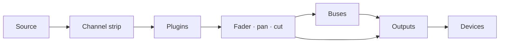

# Manual de usuario de Faider

[English](../FAIDER-MANUAL.md)

**Versión 0.1 · Windows 10 (2004) o posterior**

Faider es un enrutador de audio y mezclador en directo para Windows, construido en torno a
una consola de gran formato. Toma el sonido de tu interfaz de audio, de tus dispositivos de Windows
y de cada programa, lo hace pasar por strips de canal, buses y salidas, y reproduce el resultado en
los dispositivos que elijas: tus auriculares, tus altavoces, un stream, un micrófono virtual para
llamadas y juegos.

Este manual cubre todo lo que hace la aplicación, te guía paso a paso en las tareas habituales y te
dice qué hacer cuando algo va mal.

---

## Contenido

1. [Antes de empezar](#1-before-you-start)
2. [Primera configuración](#2-first-time-setup)
3. [La ventana](#3-the-window)
4. [Cómo funciona el enrutamiento](#4-how-routing-works)
5. [La consola](#5-the-console)
6. [El strip de canal, sección por sección](#6-the-channel-strip-section-by-section)
7. [Strips en bruto: aplicaciones, pads, cinta y combinadores](#7-raw-strips-apps-pads-tape-and-combinators)
8. [Salidas](#8-outputs)
9. [Plugins](#9-plugins)
10. [La página Routing](#10-the-routing-page)
11. [Herramientas: Pads](#11-tools-pads)
12. [Herramientas: Tape, grabadora y Replay](#12-tools-tape-recorder-and-replay)
13. [Dispositivos](#13-devices)
14. [Escenas, deshacer y sesiones](#14-scenes-undo-and-sessions)
15. [Ajustes](#15-settings)
16. [Control remoto, overlay y bandeja](#16-remote-control-overlay-and-tray)
17. [Guías prácticas](#17-how-to-guides)
18. [Solución de problemas](#18-troubleshooting)
19. [Referencia](#19-reference)

---

## 1. Antes de empezar

### Lo que necesitas

| | |
|---|---|
| **Windows** | Windows 10 versión 2004 o posterior, o Windows 11. Para capturar el sonido de un solo programa hace falta la versión 2004 o posterior |
| **Una interfaz de audio** | Opcional. Con su controlador ASIO instalado, Faider funciona con el reloj de la interfaz para tener el menor retardo. Sin ella funciona con tu dispositivo de reproducción de Windows, o con su reloj integrado (consulta [Sincronización](#clocking)) |
| **Auriculares** | Conectados a tu interfaz (o a cualquier dispositivo de reproducción de Windows) para oír tu mezcla |
| **VB-CABLE** | Opcional y gratuito (vb-audio.com/Cable). Un micrófono virtual, para que aplicaciones como Discord, los juegos y OBS oigan tu mezcla |
| **ffmpeg** | Opcional. Con `ffmpeg.exe` en tu PATH, la grabadora también puede escribir MP3, AAC, Opus y ALAC |

### Palabras usadas en este manual

| Palabra | Significado |
|---|---|
| **Canal** (entrada) | Una fuente en la mesa: un micrófono, un dispositivo, un programa, los pads, la cinta |
| **Strip** | La columna de la consola que controla un canal, un bus o una salida |
| **Ruta** | Una conexión que envía un canal o un bus a algún sitio: a un bus o a una salida |
| **Bus** | Una submezcla. Todo lo que se enruta a él se suma, se procesa junto y se enruta más adelante |
| **Combinador** | Un bus que divide su sonido en caminos paralelos, cada uno con sus propios plugins, y luego los suma |
| **Salida** | Una mezcla final que suena en un dispositivo (tus auriculares, tus altavoces, un cable virtual) |
| **Interfaz** | Tu interfaz de audio ASIO, si tienes una |
| **Reloj** | Aquello con lo que todo va al compás: tu interfaz, si no tu dispositivo de reproducción de Windows, si no el reloj integrado |

## 2. Primera configuración

Este capítulo te lleva del instalador a una configuración que funciona: tu micrófono en tus
auriculares, aplicaciones que oyen tu micro y el sonido de un programa en su propio canal. Sigue los
pasos en orden. Cada uno lleva un minuto o dos.

### Paso 1: instalar Faider

1. Ejecuta el instalador, `Faider-<version>-Setup.exe`.
2. Windows SmartScreen puede avisar de una aplicación no reconocida, porque el instalador no está
   firmado. Haz clic en **Más información** y luego en **Ejecutar de todas formas**.
3. Acepta la licencia y permite el aviso de administrador. Si quieres un acceso directo en el
   escritorio, márcalo durante el proceso (está desmarcado por defecto).
4. El instalador pone la aplicación en `C:\Program Files\Faider` y añade **Faider
   Console** al menú Inicio. Todo lo que necesita viene incluido.
5. En la última página puedes iniciar Faider de inmediato. Si no hay ningún VB-CABLE
   instalado, también ofrece abrir la página de descarga de VB-CABLE.

Tu mezcla y tus ajustes están en `%APPDATA%\Faider`, separados del programa. Al desinstalar
se quedan donde están.

### Paso 2: instalar VB-CABLE (opcional)

VB-CABLE te da un micrófono virtual que otras aplicaciones pueden elegir. Salta este paso si solo
quieres mezclar para tus propios auriculares.

1. Descarga VB-CABLE de vb-audio.com/Cable y ejecuta su instalador como administrador.
2. Reinicia Windows cuando lo pida.
3. Windows tiene ahora dos dispositivos nuevos. **CABLE Input** es un dispositivo de reproducción:
   lo que suena en él sale por **CABLE Output**, un dispositivo de grabación que las aplicaciones
   pueden elegir como micrófono.

> **Windows cambia tu sonido al cable.** Al instalar un cable virtual, Windows suele convertirlo en
> el predeterminado: **CABLE Input** como altavoces y **CABLE Output** como micrófono. Entonces no
> oyes nada de Windows, y las aplicaciones que usan el micro predeterminado oyen el cable. Vuelve a
> cambiar los dos justo después de instalar.

**Devuelve tus dispositivos a su sitio:**

1. Abre **Configuración > Sistema > Sonido** (o haz clic derecho en el icono del altavoz de la barra
   de tareas > **Configuración de sonido**).
2. En **Salida**, elige tus auriculares o altavoces (o las salidas de tu interfaz), no **CABLE
   Input**.
3. En **Entrada**, elige tu micrófono real, no **CABLE Output**.
4. Windows guarda un dispositivo predeterminado aparte para las llamadas. Desplázate hasta **More
   sound settings**. En la pestaña **Reproducción**, haz clic derecho en tus auriculares o altavoces
   > **Establecer como dispositivo de comunicación predeterminado**. En la pestaña **Grabación**,
   haz lo mismo con tu micrófono.

Una forma más rápida de fijar la salida: haz clic en el icono del altavoz de la barra de tareas, haz
clic en el **>** junto al control de volumen y elige tu dispositivo.

Mantén tus dispositivos reales como predeterminados de Windows. Faider solo reproduce en
el cable donde tú lo enrutas, y cada aplicación elige **CABLE Output** como micrófono por sí misma
(paso 6). Si el altavoz predeterminado de Windows es el cable, PRE-FLIGHT lo indica en **HEARD
ONCE**.

### Paso 3: iniciar Faider

Abre el menú Inicio y haz clic en **Faider** (o usa el acceso directo del escritorio, si
creaste uno). La primera vez, **SETUP** se abre en su propia ventana.

### Paso 4: responder las cuatro preguntas de SETUP

SETUP hace cuatro preguntas, una por página, y construye tu mezcla con tus respuestas. Haz clic en
las tarjetas para elegir. En todas las páginas salvo la tercera puedes elegir más de una. **NEXT**
avanza, **BACK** retrocede.

1. **WHERE YOU LISTEN**: elige tus auriculares o altavoces. El predeterminado de Windows ya está
   elegido.
2. **MICROPHONES**: elige los micrófonos en los que hablas. Son las entradas de tu interfaz
   (**IN 1**, **IN 2** …) y tus dispositivos de grabación de Windows.
3. **APPS HEAR YOU**: elige el cable virtual que las aplicaciones usan como micro (**CABLE Input**,
   después del paso 2), o **NOT NOW**.
4. **PROGRAMS**: elige los programas que están reproduciendo sonido ahora y que quieres en la mesa.
5. Haz clic en **BUILD THE MIX**. **DONE** enumera lo que se creó.
6. Haz clic en **OPEN THE MIXER** para verlo.

Lo que crea cada respuesta:

| Página | Lo que crea |
|---|---|
| **WHERE YOU LISTEN** | Una salida en cada dispositivo. La primera se llama **HEADPHONES**, las demás llevan el nombre de su dispositivo |
| **MICROPHONES** | Un canal para cada uno, llamado **MICROPHONE** (MICROPHONE 2 …) |
| **APPS HEAR YOU** | Una salida llamada **MIC FOR APPS** en el cable. Todos los micrófonos se enrutan a ella |
| **PROGRAMS** | Un canal en bruto para cada uno, enrutado a donde escuchas, más una regla de aplicación que lo trae de vuelta solo cada vez que el programa suena |

Tus micrófonos no se enrutan a tus propios auriculares, así que no oyes un eco retardado de tu voz.
Para oírte, enciende la tecla **HEADPHONES** del micro (paso 6).

SETUP no es una página: vuelve a ejecutarlo desde **FIND** (**SETUP: BUILD A MIX**) o desde la tecla
**SETUP** de SIMPLE cada vez que añadas un dispositivo o un programa. Añade lo que falta y nunca quita nada.

### Paso 5: comprobar que el audio funciona

Mira la **luz de estado** arriba a la derecha.

- **Verde** con un porcentaje: el audio funciona. Pasa al paso 6.
- **Rojo, con OFF**: el audio no funciona. Puede que otro programa tenga tu interfaz (un DAW, el
  panel de control del controlador). Ciérralo y reinicia Faider. Consulta
  [18.4](#184-the-interface-wont-start-or-stopped).

Haz clic en la luz para abrir **DEVICES**. **STREAMS** muestra el reloj en uso (ASIO, Windows o el
reloj integrado; consulta [Sincronización](#clocking)), y **BUFFER** fija su tamaño de búfer. El
tamaño más pequeño que suena sin chasquidos te da el menor retardo. 256 o 512 muestras sirven para
la mayoría de los sistemas.

### Paso 6: oírte y dejar que las aplicaciones te oigan

El Mixer se abre en **SIMPLE**. Cada canal muestra su nombre, lo que escucha, una tecla por cada
salida, su fader y su medidor, **CUT** y **SOLO**. Cada salida muestra el dispositivo en el que
suena, su fader y su medidor.

| Tecla de un canal | Significado |
|---|---|
| Gris liso | No enrutado a esa salida |
| Rellena con el color de la salida | Enrutado ahí. Haz clic para desactivarlo |
| Solo borde de color, **VIA BUS** | Llega ahí a través de un bus (configurado en PRO). Haz clic para enrutarlo también directamente |

1. Habla y mira cómo se mueve el medidor de tu micrófono.
2. Para oírte, haz clic en la tecla **HEADPHONES** del micro.
3. En Discord, tu juego, OBS o cualquier otra aplicación, elige **CABLE Output** como micrófono.
4. Comprueba lo que reciben: **FIND** (Ctrl+K) > **HEAR WHAT THEY HEAR** graba 5 segundos de lo que
   reciben las aplicaciones y te lo reproduce.

Si oyes un programa dos veces, consulta [18.7](#187-i-hear-something-twice-or-an-echo).

**+ CHANNEL** y **+ APP** añaden canales. **+ OUTPUT** añade una salida en un dispositivo que no
tiene ninguna. La tecla de dispositivo bajo el nombre de una salida cambia dónde suena. Haz clic
derecho en un nombre para **Rename...**, el color y **Remove**. Quitar el canal de un programa
también quita su regla de aplicación, para que el canal no vuelva solo.

### Paso 7: PRO, para toda la consola

El conmutador **SIMPLE / PRO** de la barra superior muestra la misma mezcla en ambos casos. **PRO**
es la consola entera: la entrada de cada canal, los filtros, la dinámica y el EQ, los buses y los
combinadores, los plugins.

Para dar forma a tu micrófono, consulta [17.1](#171-hear-yourself-set-up-a-microphone). Todos los
controles están en [6](#6-the-channel-strip-section-by-section). Los ajustes que haces en PRO siguen
funcionando en SIMPLE.

### Paso 8: ejecutar PRE-FLIGHT

Unos segundos después del inicio, **PRE-FLIGHT** comprueba la configuración y solo se abre si algo
necesita atención (no en el primerísimo inicio, cuando SETUP va primero). Ejecútalo cuando quieras
desde **SETTINGS > GENERAL > PRE-FLIGHT NOW...** o **FIND** (Ctrl+K). Todas las filas deben estar en
verde. Consulta [18.1](#181-pre-flight).

### Paso 9: terminar

- **Tu mezcla se guarda sola** en el plazo de un segundo tras cualquier cambio. Para conservar una
  versión con un nombre, usa **SETTINGS > GENERAL > SAVE SESSION AS...**.
- **Iniciar con Windows**: **SETTINGS > GENERAL > WINDOWS** inicia Faider en la bandeja
  cuando inicias sesión, para que tu micro funcione desde el principio.
- **Cerrar la ventana no detiene el audio.** Faider sigue funcionando en la bandeja del
  sistema para que tu micro y tus auriculares sigan funcionando. Para detenerlo, haz clic derecho en
  el icono de la bandeja y elige **Quit Faider**. Iniciar el programa mientras está en la
  bandeja trae de vuelta la ventana.

La primera vez que se abre cada página, un breve consejo la explica. Desactiva los consejos en
**SETTINGS > GENERAL > ON START**.

Con esto la configuración está lista. El resto de este manual cubre cada parte en detalle.

## 3. La ventana

### La barra lateral

Las páginas son tarjetas a lo largo de la izquierda: **MIXER**, **ROUTING**, **TOOLS**,
**DEVICES**, **SETTINGS**. La página que se muestra tiene un borde azul encendido. Mientras se
muestra el Mixer, la barra lateral también tiene estas tarjetas (en SIMPLE, solo **ADD CHANNEL** y
**ADD APP**):

| Grupo | Tarjeta | Qué hace |
|---|---|---|
| **DESK** | **ADD CHANNEL** | Abre el menú de entradas: entradas de la interfaz, dispositivos de Windows, aplicaciones, ventanas de programas y pestañas del navegador, pads, cinta |
| | **ADD APP** | Enumera los programas que están reproduciendo sonido ahora. Elige uno para darle un canal |
| | **ADD BUS** | Un bus, o un combinador (dos caminos al empezar) |
| | **PLUGINS** | Hace subir el panel de plugins bajo los strips (consulta [9](#9-plugins)) |
| **SELECT** | **AUTO** | Tocar cualquier control de un strip selecciona ese strip |
| | **FOLLOW** | La mesa se desliza hasta el strip seleccionado, también cuando se elige desde otro sitio (FIND, un atajo de teclado) |
| **METER** | **IN** / **OUT** | Los medidores de los canales muestran la señal que entra (antes del procesamiento) o la que sale |
| **SECTIONS** | HEADER … FADER | Las secciones del strip. Las encendidas están en pantalla. Haz clic en una para deslizarte hasta ella |

Las opciones de SELECT y METER se recuerdan.

### La barra superior

Desde la derecha:

| Control | Qué hace |
|---|---|
| **+ 100% -** | Zoom. Pasa por 100, 125 y 150 %. Haz clic en el porcentaje para volver a 100 %. Ctrl + / Ctrl - / Ctrl 0 hacen lo mismo |
| **FIND** (Ctrl+K) | Busca por nombre en todas las páginas, canales, escenas, macros, pads y comandos |
| **HISTORY** (Ctrl+H) | Todos los cambios que has hecho. Elige uno para volver a él |
| **MINI** | Una pequeña ventana de mezclador siempre encima |
| **Luz de estado** | Verde: el audio va bien. Ámbar: la carga de audio es alta o a un dispositivo le faltaron datos hace poco. Rojo: un fallo audible en los últimos 10 segundos, o no hay audio en marcha. El número es la carga de audio. Haz clic para ir a DEVICES |
| **SCENES** | Tus mezclas guardadas. **+** guarda una nueva (consulta [14.1](#141-scenes)) |
| **SIMPLE / PRO** | La misma mezcla, simple o como la consola entera (consulta el [paso 7](#step-7-pro-for-the-whole-console)) |

En una ventana estrecha desaparece primero la luz de estado, luego MINI, luego HISTORY. FIND llega
a todos.

### El transporte

Bajo la barra superior, en cada vista del Mixer, tienes el tiempo de la cinta (transcurrido y
duración de la pista), el nombre de la pista y sus teclas: **rebobinar 10 s**, **parar**,
**reproducir/pausa**, **avanzar 10 s**, **grabar**, **bucle**.

- **Grabar** graba la primera salida en un archivo (en el formato y la carpeta de la grabadora).
  Pulsa otra vez para parar.
- **Bucle** recorre **repetir todo** → **repetir uno** (marcado **1**) → **desactivado**.

---

## 4. Cómo funciona el enrutamiento

El enrutamiento decide adónde va cada sonido. No se oye nada hasta que se enruta, y cualquier cosa
puede enrutarse a tantos sitios como quieras.

### El camino de un sonido

1. **Un canal** toma una fuente y la hace pasar por su strip (entrada, filtros, dinámica y EQ, en el
   orden que muestra su cabecera), luego por sus plugins, luego por su fader, su pan y su cut.
2. **Las rutas** envían el canal más allá, a cualquiera de los buses y salidas a la vez (hasta 8 de
   cada). Cada ruta lleva el canal después de su fader, así que el fader y **CUT** afectan a todos
   los sitios a los que está enrutado.
3. **Un bus** suma todo lo que se enruta a él, pasa por su propio strip y sus plugins, y se enruta a
   salidas (o a otros buses) de la misma forma.
4. **Una salida** suma todo lo que se enruta a ella, pasa por su compresor de bus, su EQ de mezcla y
   su limitador **SAFE**, y suena en su dispositivo.

### Las salidas son dispositivos

Cada salida suena en un dispositivo: las salidas de tu interfaz, unos auriculares USB, altavoces,
**CABLE Input**. No creas las salidas a mano. Enruta algo a un dispositivo y se crea una salida en
él. Por eso las casillas de enrutamiento enumeran dispositivos además de buses.

- Hay una salida por dispositivo. Enruta varios canales al mismo dispositivo y se encuentran en su
  salida.
- Salidas distintas llevan mezclas distintas. Tus auriculares pueden oír juego, música y voz
  mientras la salida del stream recibe solo música y voz.
- Desconecta un dispositivo y su salida queda en silencio hasta que vuelva.

### Tres sitios donde enrutar

Los tres cambian las mismas rutas. Usa el que tengas más a mano.

| Dónde | Cómo |
|---|---|
| **Casillas de enrutamiento** (cabecera de cada strip) | Una casilla por bus y por dispositivo de salida. Encendida: enrutado ahí. Haz clic para cambiar |
| **Route to** (clic derecho en un strip) | La misma lista como menú, marcada donde está enrutado |
| **La página Routing** | Cada strip es un bloque, cada ruta una línea. Haz clic en un bloque y luego en otro (consulta [10](#10-the-routing-page)) |

### Buses

Usa un bus cuando varios canales necesitan el mismo tratamiento o un solo fader. Enruta los canales
al bus y el bus a la salida. Después quita las rutas directas de los canales a esa salida, o llegan
a ella dos veces (una directa, otra por el bus). Un bus puede alimentar a otro bus, y eso no añade
retardo.

### Combinadores

Un combinador es un bus dividido en **caminos** paralelos (dos al empezar). Cada camino tiene sus
propios plugins, y los caminos se suman en el fader del combinador. Enruta una fuente a un camino o
a varios (consulta [7](#7-raw-strips-apps-pads-tape-and-combinators)).

### Reglas que lo mantienen seguro

- **Se rechazan los bucles de realimentación.** Una ruta que devolvería un sonido al lugar de donde
  vino (un bus a un bus que lo alimenta, el sonido de una salida devuelto a su propia entrada) se
  desactiva de inmediato, y el registro de eventos nombra el bucle.
- **Solo** en cualquier strip silencia todos los strips que no están en solo, salvo los marcados
  como solo safe.
- **Canales de aplicaciones y duplicación.** Un programa suena en su propio dispositivo además de en
  su canal (consulta [18.7](#187-i-hear-something-twice-or-an-echo)).

### Sincronización

Un dispositivo fija el reloj. Faider lo elige en este orden al iniciar:

1. **ASIO**: tu interfaz de audio, mediante su controlador ASIO. El menor retardo.
2. **Windows**: sin controlador ASIO, tu dispositivo de reproducción predeterminado de Windows (un
   cable virtual, los altavoces de una pantalla o unas gafas de VR solo cuando no hay otra cosa).
   Las salidas de tu interfaz pasan a ser salidas de ese dispositivo, y los micrófonos se añaden
   como dispositivos de Windows.
3. **Reloj integrado**: sin ningún dispositivo de reproducción. Todos los dispositivos, tus
   auriculares incluidos, lo siguen.

Todos los demás dispositivos y todos los programas capturados funcionan con su propio reloj y se
unen mediante un pequeño búfer que corrige la deriva, así que los relojes que se separan nunca
producen un chasquido. **DEVICES > STREAMS** muestra cada uno, y el reloj en uso.

Si el dispositivo de Windows que fija el reloj se desconecta, se desactiva o deja de funcionar, el
siguiente reloj toma el relevo solo y un aviso te dice cuál. Un dispositivo que no arranca (porque
otro programa lo tiene) se omite hasta que tus dispositivos cambien, y entonces se vuelve a
intentar. Con el reloj integrado, un dispositivo de reproducción que se conecte toma el relevo.

## 5. La consola

### Disposición

La mesa muestra todos los strips de izquierda a derecha: los **canales**, luego los **buses** (barra
de nombre violeta), luego las **salidas** (barra de nombre ámbar). Cada strip tiene siete
secciones, de arriba abajo:

| Sección | Contiene |
|---|---|
| **HEADER** | Las barras de nivel, las teclas FILT / EQ / EXT, el orden de procesamiento, las casillas de enrutamiento, el número del strip |
| **INPUT** | Trim, polaridad (y en el Dark strip, el drive del micro y el conmutador de entrada) |
| **DYNAMICS** | Compresor y gate |
| **FILTERS** | Paso bajo y paso alto |
| **EQ** | Cuatro bandas |
| **NAME** | La barra de nombre y el conmutador de encendido |
| **FADER** | Pan, SOLO, CUT, SEL, el fader y su lectura |

### Ratón y teclado

| Acción | Resultado |
|---|---|
| **Arrastrar** una perilla o un fader hacia arriba/abajo | Lo cambia. Su valor se muestra a su lado mientras arrastras o pasas el cursor |
| **Doble clic** en una perilla o un fader | Vuelve a su valor predeterminado |
| **Clic** en una tecla o un conmutador | Activado / desactivado |
| **Clic** en la barra de nombre | Selecciona el strip |
| **Arrastrar** de lado la barra de nombre de un strip | Lo mueve entre los de su tipo: canales, buses o salidas (consulta [17.4](#174-reorder-channels)) |
| **Clic** en el símbolo de encendido de la barra de nombre | Apaga o enciende el strip |
| **Clic derecho** en un strip | El menú del strip |
| **Rueda del ratón** | Desplaza la mesa hacia los lados. **Mayús + rueda** desplaza arriba y abajo |
| **Ctrl + / Ctrl -** | Zoom de toda la ventana |

Un clic izquierdo nunca abre un menú. Los menús siempre están en el botón derecho.

### Seleccionar un strip

El strip seleccionado se resalta con un contorno azul. Selecciona un strip haciendo clic en su barra
de nombre o en su tecla **SEL**, o tocando cualquiera de sus controles con **AUTO** activado. El
strip seleccionado es el que muestra el panel de plugins, y aquel sobre el que actúan FIND, los
atajos de teclado y los controles remotos.

Con la mesa enfocada (haz clic en ella primero): **Izquierda / Derecha** seleccionan el strip
anterior / siguiente, **M** lo corta, **S** lo pone en solo, y **Arriba / Abajo** mueven su fader
0,5 dB (3 dB con **Mayús**).

### Apagar un strip

Haz clic en el símbolo de encendido a la izquierda de la barra de nombre. El strip se atenúa y se
pone gris. No se procesa, y su dispositivo o programa se libera. Mientras está apagado, **no se
puede cambiar nada en él**: las perillas, las teclas y el panel de plugins ignoran los clics, y su
menú solo ofrece **Turn on** y separadores. Haz clic otra vez en el símbolo de encendido para
recuperarlo.

### Tipos de strip

Cada canal puede usar el **Light strip** o el **Dark strip**: clic derecho > **Strip type** >
**Light strip** / **Dark strip**. Las entradas de la interfaz, los dispositivos de grabación
(micrófonos) y los buses empiezan oscuros. Todo lo demás empieza claro. El Dark strip añade el
**drive** del micro y el conmutador de entrada, y quita el ataque rápido del compresor y el hold
del gate. Tu elección se recuerda para cada canal.

### Separadores

Los separadores son strips en blanco que te dan espacio entre grupos. Clic derecho en un strip >
**Add spacer before** / **Add spacer after**. Clic derecho en un separador para **Narrow**, **Add
another** y **Remove spacer**. Un separador se queda con el strip al que sigue cuando ese strip se
mueve.

### El menú del strip (clic derecho)

| Elemento | |
|---|---|
| **Input** | Cambia la fuente: entradas de **Interface**, **Windows devices** (o Windows default), **What an output plays** (loopback), **Test tone**, **Nothing** |
| **Route to** | Cada bus y cada dispositivo de salida, marcado donde se envía |
| **Plugins** | Abrir uno, **Add plugin...**, **Remove** |
| **Make mono / Make stereo** | Solo canales |
| **Strip type** | **Light strip** o **Dark strip** |
| **Colour** | El color del canal, que se muestra a lo largo de su barra de nombre y en su bloque de Routing |
| **Add spacer before / after** | |
| **Rename...** | |
| **Remove** | Elimina el canal o el bus |

---

## 6. El strip de canal, sección por sección

### HEADER

| Control | Qué hace |
|---|---|
| **Barras de nivel** | El nivel del canal, izquierda y derecha (IN u OUT, según lo elegido en METER) |
| **FILT** | Envía los filtros al detector del gate/compresor (filtrado de la señal de control) |
| **EQ** | El EQ dentro o fuera |
| **EXT** | La dinámica escucha una señal de control externa (sidechain) en lugar del propio canal |
| **Orden de procesamiento** | Tres bloques (FILT, EQ, DYN), de arriba abajo en el orden en que el canal los ejecuta. **Haz clic en un bloque** para subirlo un puesto. El de arriba pasa al final. Los bloques encendidos están en uso |
| **Casillas de enrutamiento** | Una casilla por bus y por dispositivo de salida. Encendida: el canal se envía ahí. Haz clic para cambiar (consulta [Las salidas son dispositivos](#outputs-are-devices)) |
| **Número** | El lugar del strip en la mesa |

### INPUT

| Control | |
|---|---|
| **in trim** | Ganancia de entrada |
| **ø** | Inversión de polaridad |
| **WIDTH** (Light strip) | Anchura estéreo: 0 % mono, 100 % tal cual, 200 % el doble de ancho. Atenuado en un canal mono |
| **mic** (Dark strip) | Drive: añade calidez y nivel (se muestra como porcentaje) |
| **pre** (Dark strip) | La etapa de entrada dentro o fuera |

### DYNAMICS

El conmutador **IN** (con el símbolo de encendido) activa o desactiva juntos el compresor y el gate.

**Compresor**

| Control | |
|---|---|
| **MIX** | Mezcla seco/procesado (compresión paralela). Arrastra la lectura verde |
| **ratio**, **thresh**, **rel** | Ratio, umbral y liberación |
| **fast** | Ataque rápido (3 ms). Desactivado es 10 ms |
| **pk** | Detección de picos. Activado (el valor predeterminado), el compresor reacciona a los picos. Desactivado, reacciona al nivel medio (RMS), que es más suave |
| **LED de reducción de ganancia** | 3, 6, 10, 14 y 20 dB de reducción |

**Gate / expansor**

| Control | |
|---|---|
| **range**, **thresh**, **rel**, **hold** | Cuánto se cierra, dónde se abre, con qué rapidez se cierra, cuánto tiempo aguanta |
| **exp** | Modo expansor (un gate más suave) |
| **fast** | Ataque rápido (0,1 ms). Desactivado es 1,5 ms |
| **LED del gate** | Cuánto se está cerrando el gate |

Los LED muestran lo que el compresor y el gate *harían* incluso mientras están desactivados, para
que puedas ajustarlos antes de activarlos.

### FILTERS

**lp** (paso bajo) y **hp** (paso alto). Girado del todo hacia abajo, el paso alto queda fuera.
Girado del todo hacia arriba, el paso bajo queda fuera.

### EQ

| Banda | Controles |
|---|---|
| **HF** | gain, freq, **bell** (shelf si está desactivado) |
| **HMF** | gain, freq, q |
| **LMF** | gain, freq, q |
| **LF** | gain, freq, **bell** (shelf si está desactivado) |

El conmutador **EQ IN** activa o desactiva todo el EQ (igual que la tecla EQ de la cabecera).

### FADER

| Control | |
|---|---|
| **PAN** | Izquierda/derecha. Doble clic para centrar |
| **SOLO** | Solo en el sitio |
| **CUT** | Silenciar |
| **SEL** | Seleccionar este strip |
| **Fader** | Nivel, de +12 dB a off. La lectura de abajo muestra el nivel en dB |
| **safe** | Solo safe: este canal sigue audible cuando otros están en solo |
| **listen** | Escuchar la señal de control de la dinámica |

### Efectos de voz

Además del procesamiento del strip, cada canal lleva sus propios efectos de voz:

| Efecto | Qué hace |
|---|---|
| **ROBOT** | Modulación en anillo: la voz se multiplica por un tono y suena metálica |
| **ECHO** | Un retardo, hasta un segundo |
| **RADIO** | Limitado a 300 Hz - 3 kHz y saturado, suena como un altavoz pequeño |
| **PITCH** | La voz sube o baja, hasta una octava en cada dirección |

Se cambian con una macro: la acción **FX ON**, **FX OFF** o **FX TOGGLE**, con el canal como
destino ([15](#15-settings)). Un pad, una tecla de atajo, un activador o el control remoto puede
disparar esa macro, así que los efectos entran y salen con la mezcla.

---

## 7. Strips en bruto: aplicaciones, pads, cinta y combinadores

Algunos canales llevan sonido que ya está terminado: el audio de un programa, los pads, la cinta.
Reciben un **strip en bruto**, con enrutamiento, plugins si los quieres, pan, fader y teclas, y sin
efectos integrados. Cuando uno aparece en la mesa, sus efectos integrados se desactivan una vez (y
se anota en el registro de eventos). Sus plugins se conservan.

| Strip | Sus secciones centrales contienen |
|---|---|
| **App** | La lista de plugins (haz clic en uno para abrirlo) y **ADD PLUGIN** |
| **Pads** | Teclas de banco **A–D**, los pads 4×4 (pulsa para reproducir; un pad GATE suena mientras se mantiene) y **STOP ALL** |
| **Tape** | La pantalla de la pletina y la barra de búsqueda, el transporte (anterior, rebobinar, parar, reproducir, pausa, avanzar, siguiente), **SHUFFLE**, **ADD...**, y la lista de reproducción (haz clic en una pista para reproducirla) |
| **Combinator** | Para cada camino: **FROM**, los canales y buses que lo alimentan (haz clic en uno para ir a su strip), y **PLUGINS** de ese camino (haz clic en uno para abrirlo). **EDIT IN ROUTING** abre la página Routing |

Un combinador no tiene efectos propios. Su sonido viene de lo que lo alimenta y de los plugins de
cada camino. Clic derecho en él > **Paths** para añadir un camino y, para cada camino, abrir, añadir
o quitar sus plugins, renombrarlo o eliminarlo.

---

## 8. Salidas

Cada salida (master) tiene su propio strip oscuro:

| Control | |
|---|---|
| **DEVICE** | El dispositivo en el que suena. Haz clic para elegir otro |
| **SAFE** | Un limitador después del fader: nada sale por encima de -1 dBFS |
| **MON** | Monitorizar esta salida |
| **LUFS** | Sonoridad a corto plazo de lo que sale («-- LUFS» en silencio) |
| **WIDTH** | Anchura estéreo |
| **BUS COMP** | Conmutador de activación, medidor de reducción de ganancia tipo VU, **threshold**, **ratio**, **attack**, **release**, **make-up**, **mix** |
| **MIX EQ** | Conmutador de activación, ganancia y frecuencia HF, ganancia y frecuencia LF |
| **CUT**, **SEL**, fader | Como en un canal |

Clic derecho en una salida para **Device...**, separadores, **Rename...** y **Remove**.

Las salidas se crean por ti, una por dispositivo (consulta
[Las salidas son dispositivos](#outputs-are-devices)).

**FIND > MIX-MINUS AND STEMS** construye un envío por invitado (todo menos su propia voz) y stems de
voz, música y juego.

---

## 9. Plugins

Faider aloja plugins **VST3** en canales, buses y caminos de combinador, con compensación
automática de la latencia.

### Añadir un plugin

- En un canal: clic derecho > **Plugins > Add plugin...**, o **ADD PLUGIN** en un strip en bruto, o
  **ADD** en el panel de plugins.
- En un camino de combinador: clic derecho en el combinador > **Paths > PATH n > Add plugin...**.
  Haz clic en el plugin de un camino en el strip del combinador para abrirlo.

Cada plugin se **prueba primero en una copia aparte del programa**, así que un plugin que se cuelga
o se bloquea al cargarse no puede tumbar tu mezcla. El resultado se recuerda hasta que el archivo
del plugin cambie.

### El panel de plugins

Haz clic en **PLUGINS** en la barra lateral. Un panel sube bajo los strips con los plugins del
**strip seleccionado** en el orden en que se ejecutan. **FIND** > **PLUGINS: name** lo abre en ese
strip, y cambia a PRO si SIMPLE está a la vista. Cada tarjeta muestra:

- **CPU**: la parte del tiempo de procesamiento que usa el plugin (verde, ámbar por encima del 2 %,
  rojo por encima del 5 %)
- **Latency**: el retardo que añade
- **BYPASSED**: apagado pero todavía cargado (sigue usando memoria)
- **HEAVY**: inusualmente costoso

Teclas de cada tarjeta: **BYPASS**, **OPEN** (su ventana), **REMOVE**, y flechas para moverlo antes
o después. **ADD** al final añade otro.

---

## 10. La página Routing

La página Routing muestra toda la mezcla como un mapa: cada strip es un bloque y cada ruta una
línea. Úsala para ver adónde va todo, y para enrutar haciendo clic en dos bloques.

### Leer la página

- **Tres filas:** **INPUTS** arriba, **BUSES** en medio, **OUTPUTS** abajo. Los dispositivos de
  salida que aún no tienen salida están en el extremo derecho de la fila OUTPUTS, en gris.
- **Cada bloque está bajo su strip.** Un bloque está en la misma posición horizontal que su strip en
  la mesa, separadores incluidos, y la página se desplaza lateralmente con la mesa (rueda del
  ratón). Reorganiza la mesa y el mapa la sigue.
- **Cada bloque muestra** el nombre y el número del strip. Un strip apagado aparece atenuado. Un
  canal con color propio lo muestra como un tinte y una banda a la izquierda.
- **Las líneas son rutas.** Cada una baja recta desde su origen, entra en un carril propio en el
  hueco bajo su fila, cruza, y baja hasta el bloque al que alimenta, terminando en una flecha. Las
  rutas de entrada son turquesa, las de bus violeta. Varias líneas que salen de un bloque o llegan
  a él se reparten por él en orden, así que nunca se apilan.
- **Los combinadores** muestran sus caminos como celdas **P1, P2, …** en la parte inferior del
  bloque. Las líneas terminan en el camino que alimentan.

### Enrutar de bloque a bloque

1. **Haz clic en un bloque.** Se ilumina en azul y pulsa. Los bloques a los que está enrutado, o
   desde los que lo está, reciben un borde resaltado, sus líneas se aclaran y todo lo demás se
   atenúa.
2. **Haz clic en otro bloque.** La ruta entre ellos se activa (aparece una línea) o se desactiva (la
   línea desaparece). Vale cualquiera de los dos órdenes: origen y luego destino, o destino y luego
   origen.
3. El primer bloque **sigue seleccionado**, así que sigue haciendo clic para enrutarlo a varios
   sitios, o para quitar varias rutas.
4. **Haz clic otra vez en él**, haz clic en un espacio vacío, o pulsa **Esc** para soltarlo.

Si los dos bloques no se pueden enrutar (dos salidas, por ejemplo), se selecciona el segundo.

### Ejemplos

| Para | Haz clic en |
|---|---|
| Oír tu micro | MIC, luego la salida de los auriculares |
| Dejar que las aplicaciones oigan tu micro | MIC, luego **CABLE Input** (en la fila de salidas, en gris hasta que tenga una salida) |
| Enviar un grupo por un bus | El bus, luego cada canal; después el bus, luego su salida |
| Sacar un canal del stream | El canal, luego la salida del stream (la línea desaparece) |
| Alimentar un camino de combinador | La fuente, luego la celda del camino (P1, P2…). Haz clic en más celdas para alimentar varios caminos. Hacer clic en el combinador fuera de sus celdas alimenta su primer camino |

Hacer clic en un bloque de dispositivo gris crea su salida, y la nueva salida aparece de inmediato
en la mesa.

Arrastra un bloque de lado a lo largo de su fila para mover su strip (consulta
[17.4](#174-reorder-channels)). Una ruta que se desactiva de inmediato crearía un bucle de
realimentación (consulta [18.8](#188-a-route-wont-switch-on)).

## 11. Herramientas: Pads

**TOOLS > PADS** te da cuatro bancos (**A–D**) de 16 pads: 64 sonidos, hasta 32 sonando a la vez.

### Sacar el sonido

Los pads suenan en un **canal PADS**. Haz clic en **CREATE PADS CHANNEL** (entonces dice **PADS
CHANNEL ACTIVE**), o elige otra entrada en el menú **PLAY INTO** para reproducir los pads a través
de los plugins y las rutas de ese canal. Sin un canal de pads, se ignoran las pulsaciones.

### Cargar y reproducir

| Acción | |
|---|---|
| Clic en un pad **vacío** | Elegir un archivo de sonido |
| Clic en un pad cargado | Reproducirlo |
| Clic derecho en un pad | Seleccionarlo para editarlo sin reproducirlo |
| Soltar archivos en un pad | Los carga en ese pad y en los siguientes del banco |
| **Ctrl + arrastrar** sobre otro pad | Intercambia los dos pads |
| **STOP ALL** | Funde a silencio todos los pads |

Formatos: WAV, FLAC, AIFF, OGG, MP3. Un pad cuyo archivo se ha movido muestra **MISSING: FILE**.

### El editor de pad

| Ajuste | |
|---|---|
| Nombre | Doble clic para renombrar |
| **LOAD**, **CLEAR**, **COLOUR** | |
| **REPLAY** | El búfer de repetición instantánea pasa a ser el sonido de este pad (guardado como WAV en la carpeta de grabaciones). Arma antes replay en TOOLS > TAPE |
| **MODE** | **ONE-SHOT** suena hasta el final (pulsar otra vez lo reinicia). **GATE** suena mientras se mantiene. **LOOP** empieza con una pulsación y se detiene con la siguiente |
| **CHOKE** | OFF o grupo 1–8. Los pads de un mismo grupo se detienen entre sí |
| **LEVEL** | De -INF a +12 dB |
| **HOTKEY** | Haz clic (**LEARN...**), luego pulsa las teclas (consulta [HOTKEYS](#hotkeys)) |
| **MACRO** | Una macro que se ejecuta con el pad (un pad puede tener una macro y ningún sonido) |
| **TRIM** | Arrastra las líneas de inicio y fin sobre la forma de onda. Doble clic para el archivo entero |
| **FADE IN / FADE OUT** | 0–5 s |

---

## 12. Herramientas: Tape, grabadora y Replay

### La pletina Tape

**TOOLS > TAPE** reproduce una lista de reproducción en un **canal TAPE**. Haz clic en **CREATE TAPE
CHANNEL** para crear uno.

- **ADD FILES**, **ADD FOLDER**, o suelta archivos y carpetas en cualquier parte de la página.
  **EJECT** vacía la lista de reproducción.
- Haz doble clic en una pista para reproducirla, arrastra una para reordenar, y pulsa Supr para
  quitar las pistas seleccionadas.
- Transporte: **PREV**, **REW** (atrás 10 s; mantén pulsado para rebobinar rápido), **PLAY**,
  **PAUSE**, **STOP**, **FF** (adelante 10 s; mantén pulsado para avanzar rápido), **NEXT**. También
  **SHUFFLE**, **REPEAT** (todo / uno / desactivado) y **LEVEL**.
- Las pistas suenan sin pausa entre ellas. Las pausas y los saltos se funden en 30 ms para que
  nunca produzcan un chasquido.

El transporte de la barra superior y el strip de la cinta en la mesa controlan la misma pletina.

### La grabadora

| | |
|---|---|
| **Source** | Cualquier salida, bus o entrada, o **ALL CHANNELS, ONE FILE EACH** (multipista: cada entrada, o solo las que tienen DIRECT encendido, más cada salida, alineadas a la muestra) |
| **Format** | WAV 24 bits (predeterminado), 16 bits, 32 bits, 32 bits en coma flotante; FLAC 24/16 bits; AIFF 24/16 bits; OGG Vorbis 128–320k. Con ffmpeg: MP3, AAC (M4A), Opus, ALAC. Cada uno muestra cuánto tiempo cabe en el disco |
| **REC** | Inicia y detiene. La pantalla muestra el tiempo, el tamaño, el tiempo restante y los bloques perdidos, si los hay |
| **PATH** / **REVEAL** | Elegir la carpeta / abrirla en el Explorador |

Las grabaciones van a `Music\Faider Recordings` salvo que elijas una carpeta. Los formatos
de ffmpeg graban primero un WAV y lo convierten al detener (el WAV se conserva si la conversión
falla). La grabación se detiene sola cuando queda menos de 1 GB libre.

### Repetición instantánea

**ARM** conserva los últimos **30 s**, **1**, **2** o **5 minutos** de la fuente de la grabadora.
**SAVE** los escribe en un archivo (clic derecho en SAVE para darle un atajo de teclado global). Con
multipista elegido, replay usa la primera salida.

---

## 13. Dispositivos

**DEVICES** enumera cada dispositivo de audio de Windows y cada controlador ASIO.

| Columna | |
|---|---|
| **I/O** | ASIO, OUT o IN |
| **DEVICE**, **HARDWARE** | Su nombre y el adaptador en el que está |
| **FORMAT** | Canales y frecuencia de muestreo |
| **STATE** | Activo, desconectado, deshabilitado, u **off in Faider** |
| **TAGS** | DEFAULT y CALLS para los dispositivos predeterminados de Windows |

Haz clic en una cabecera para ordenar. Selecciona dispositivos (Ctrl/Mayús para varios) y usa:

| Tecla | |
|---|---|
| **EXCLUDE / INCLUDE** | Faider deja de usar (o vuelve a usar) el dispositivo. Los dispositivos excluidos nunca se abren y no aparecen en las listas |
| **DISABLE / ENABLE IN WINDOWS** | Apaga o enciende el dispositivo en el propio Windows |
| **RENAME** | Tu propio nombre para el dispositivo, usado en todo Faider (o haz doble clic en una fila) |

### Streams

Bajo la lista, **STREAMS** muestra la salud del motor de audio:

- **CALLBACK LOAD** (y pico), **OVERLOADS**, **BLOCKS SKIPPED**. Cambian a un color de aviso si
  ocurrió alguno
- **BUFFER**: el tamaño de búfer de tu interfaz (más pequeño significa menos retardo y más carga)
- Por dispositivo: audio en búfer, latencia total, **DRIFT** (la corrección de reloj en ppm),
  **UNDER** (se quedó sin datos, se reprodujo silencio), **OVER** (se desbordó, se perdió audio),
  **RESYNC** (recentrado). Una fila que perdió audio aparece en rojo
- **RESET STATS** pone los contadores a cero

### VB-CABLE

Si VB-CABLE está instalado, una barra arriba fija su **frecuencia de muestreo** y su **latencia
máxima**. **APPLY** pide un único aviso de administrador y reinicia el cable.

El registro de eventos de abajo anota cada dispositivo conectado, retirado o recuperado.

---

## 14. Escenas, deshacer y sesiones

### 14.1 Escenas

Una escena guarda el fader, el pan, el cut, el solo, el encendido y las rutas de cada canal (y, si
lo eliges, los ajustes de los plugins).

- **Guardar:** haz clic en **+** en la barra superior y ponle un nombre.
- **Recuperar:** haz clic en su tecla. Los faders y los pans se deslizan durante medio segundo. Lo
  demás cambia de golpe.
- **Clic derecho en una escena** para: recuperar solo los silencios / solo los niveles, guardar en
  ella, incluir los ajustes de los plugins, renombrar, un atajo de teclado global, **Recall on
  device** (cuando aparece un dispositivo; vuelve atrás cuando se va), **Auto-scene** (cuando una
  aplicación empieza a sonar, se conecta un dispositivo, o a una hora del día), aprendizaje MIDI,
  mover, eliminar.

Los dispositivos y los propios canales no forman parte de una escena.

### 14.2 Deshacer e historial

**Ctrl+Z** deshace, **Ctrl+Y** (o Ctrl+Mayús+Z) rehace. **HISTORY** (Ctrl+H) enumera cada cambio.
Elige uno para saltar a él.

### 14.3 Sesiones

Tu mezcla se guarda sola en el plazo de un segundo tras cualquier cambio, y al salir.

| | |
|---|---|
| **Restore session** | Menú de la bandeja: versiones anteriores de tu mezcla por fecha (Faider se reinicia con ella) |
| **SESSION TIMELINE** | FIND: cada versión conservada. **Restore everything**, o **PUT ONE CHANNEL BACK** (su nivel, pan, silencio y rack) sin reiniciar |
| **SAVE SESSION AS...** | SETTINGS > GENERAL > SESSIONS: conservar la mezcla con un nombre |
| **OPEN, EXPORT OR IMPORT...** | Abrir una mezcla con nombre (reinicia), guardar la mezcla en un archivo, o cargar una desde un archivo |

Se conservan hasta 60 versiones anteriores (como máximo una cada 5 minutos). Si tu mezcla no se
puede cargar nunca (falta la interfaz, el archivo está dañado), se **aparta** en lugar de perderse,
y empieza una mezcla nueva. Consulta [18.2](#182-my-mix-is-gone-a-fresh-mix-started).

---

## 15. Ajustes

**SETTINGS** tiene cuatro secciones, como tarjetas a lo largo de la izquierda: **GENERAL**,
**MACROS**, **HOTKEYS**, **CONTROL**. Los ajustes de activado/desactivado son conmutadores
cuadrados que brillan en color crema cuando están activados.

### GENERAL

| Tarjeta | Ajustes |
|---|---|
| **LOOK** | **LOOK...**: los colores y el tipo de letra de la mesa, desde un archivo LOOK (ver [LOOKS](#looks)) |
| **WINDOWS** | **START WITH WINDOWS**: se abre en la bandeja cuando inicias sesión |
| **DESK** | **WARN IF I TALK WHILE MUTED** (un aviso cuando un micro silenciado supera -30 dBFS) |
| **APPS** | **APP RULES...**: a qué bus o salida va un programa cuando empieza a sonar (también en **FIND**). Quitar el canal de un programa quita su regla |
| **SESSIONS** | **SAVE SESSION AS...**; **OPEN, EXPORT OR IMPORT...** |
| **ON START** | **PRE-FLIGHT: CHECK THE SETUP**; **PRE-FLIGHT NOW...**; **TIPS**; **SHOW THE TIPS AGAIN** |
| **NOTICES (IN THE CORNER)** | Dispositivos conectados o desaparecidos, un canal saturando (su fuente o su salida a fondo de escala), escenas recuperadas, macros ejecutadas, deshacer y rehacer |
| **ZOOM** | 100 %, 125 %, 150 %, **CUSTOM...** (75–200 %) |
| **METER STANDARD** | Cómo leen los medidores (pico de muestra con caída rápida por defecto; IEC y otros) |
| **CHANNEL METER POINT** | **PRE HPF** (fuente en bruto), **PRE FADER** (tras los efectos), **POST ON** (tras el fader, predeterminado) |
| **ABOUT** | Versión y créditos |

### LOOKS

Un **LOOK** es cada color con el que se dibuja la mesa, junto con el tipo de letra y los tamaños que lo
acompañan. Los strips, las lecturas, los mandos, las teclas y las lámparas se dibujan todas desde el LOOK
en vigor, así que un LOOK cambia la mesa entera de golpe.

**LOOK...** lista los LOOK que tienes y pone en vigor el que elijas; la mesa se dibuja de nuevo en cuanto
cambia. **SAVE THIS LOOK AS...** escribe el LOOK en vigor en un archivo nuevo con el nombre que le des.

Un LOOK es un archivo en `%APPDATA%\Faider\looks`, escrito como JSON, así que puedes escribirlo a mano y
copiarlo a otra máquina. Un archivo que falta o está roto deja en su sitio el LOOK integrado, y lo que un
archivo omita vuelve al valor integrado: un archivo escrito a medias sigue funcionando.

| | |
|---|---|
| `name` | El nombre del LOOK, tal como aparece en la lista |
| `font` | Un tipo de letra que Windows incluye, para que se vea nítido en los tamaños pequeños |
| `keyRadius` | Lo redondeadas que son las esquinas de una tecla, en píxeles |
| `fontSizes` | `legend`, `caption`, `readout`: los tres tamaños de texto |
| `colours` | Cada color, como `#rrggbb`, o `#rrggbbaa` donde una parte es transparente |

Los colores llevan el nombre de la parte que pintan: los campos y la impresión, las teclas, la placa de
los faders, las lecturas, los mandos por función, las lámparas, los cuerpos de los strips, el aspecto de
un canal, un bus y una salida, el acento, los huecos y el sombreado. **SAVE THIS LOOK AS...** escribe
todos los nombres que tiene el LOOK; lo más rápido es cambiar algo en la mesa, guardarlo y editar ese
archivo.

Un grupo `palette` nombra los colores que un archivo de disposición puede poner en una parte: `red`,
`green`, `blue`, `black`, `white`, `violet`, `grey`, `cream`, `orange`, `amber`, `teal`, `salmon`.

### MACROS

Una macro es una lista de **acciones** que se ejecutan desde un atajo de teclado, un pad, un
disparador o un control remoto.

1. Haz clic en **+ NEW** y ponle nombre (doble clic en el nombre).
2. **+ ACTION**: MUTE ON/OFF/TOGGLE, SET FADER (dB, tiempo de fundido), ASSIGN ON/OFF/TOGGLE (una
   ruta), CHANNEL ON/OFF, TRIGGER PAD, STOP PAD, ALL NOTES OFF, TRANSPORT PLAY/PAUSE, TRANSPORT
   NEXT, RECORD START/STOP, WAIT, SCENE RECALL, FX ON/OFF/TOGGLE (un efecto de voz, ver [Efectos de voz](#voice-effects)), WINDOWS DEFAULT OUTPUT/INPUT,
   PLUGIN SETTING.
3. Opcionalmente, **+ TRIGGER**: APP STARTS, APP STOPS, DEVICE CONNECTED, DEVICE DISCONNECTED,
   MASTER SILENT (durante n segundos), MASTER HAS SOUND, TIME (24 horas).
4. Opcionalmente, un **HOTKEY**, y **MOMENTARY** (las acciones se deshacen cuando se suelta la
   tecla, para push-to-talk).
5. **FIRE** la ejecuta ahora.

### HOTKEYS

Todos los atajos de teclado asignables están en un solo sitio: **PADS**, **MACROS**, **SCENES** y
**SAVE INSTANT REPLAY** bajo **TAPE**. Haz clic en uno y pulsa las teclas nuevas (Esc cancela, Supr
borra). Los atajos deben incluir Ctrl, Alt o una tecla F, y funcionan mientras un juego tiene el
foco. Las teclas fijas también aparecen ([19.1](#191-keyboard-shortcuts)). Las teclas ON THE MIXER
de la página también funcionan en la consola ([5](#5-the-console)).

### CONTROL

| Tarjeta | |
|---|---|
| **MIDI** | **MIDI MAP** (Ctrl+L); entradas y asignaciones; un conmutador por entrada MIDI |
| **OSC** | **OSC ON (PORT 9000)**, para programas de este PC |

---

## 16. Control remoto, overlay y bandeja

| | |
|---|---|
| **MIDI MAP** (Ctrl+L) | Haz clic en un control en pantalla y luego mueve una perilla o una tecla de tu controlador. Se pueden asignar el fader, el pan, CUT, SOLO, el encendido y las teclas de enrutamiento de cada strip, en SIMPLE y en PRO, así como las escenas, los pads y la cinta. La rueda del ratón desplaza la mesa mientras asignas (Mayús+rueda arriba y abajo) |
| **OSC** | Los programas de este PC pueden enviar al puerto 9000 (nunca escucha la red): `/faider/input/NAME/fader -12` (dB), `/faider/output/NAME/mute 1`, `/faider/bus/NAME/pan -0.5`, `/faider/input/NAME/solo 1`, `/faider/scene NAME`, `/faider/macro/NAME 1` (0 la suelta). Escribe los espacios de los nombres como `_` |
| **Overlay en el juego** (Ctrl+Mayús+O) | La luz de voz de cada canal de micro, LIVE / MUTED y el nivel, más hasta cuatro teclas de escena. Nunca le quita el foco a un juego. Arrástralo adonde quieras |
| **MINI** | Un pequeño mezclador encima de todo. **OPEN** vuelve a la ventana principal |
| **Bandeja** | Haz clic en el icono para el mezclador de la bandeja, doble clic para abrir la ventana. Clic derecho: Show, recuperar escena, Restore session, Start with Windows, About, Quit. El icono parpadea en ámbar durante una alerta |

Faider siempre se ejecuta con tus derechos de usuario normales, incluso si se inicia desde una
ventana de administrador. Se reinicia solo con derechos normales, porque el overlay en el juego no
puede alcanzar un programa que se ejecuta como administrador. Los pocos pasos que necesitan un
administrador (aplicar los ajustes de VB-CABLE, volver a habilitar un dispositivo que Windows ha
apagado) piden permiso por sí mismos.

---

## 17. Guías prácticas

### 17.1 Oírte: configurar un micrófono

1. **ADD CHANNEL** > la entrada de tu interfaz (o un dispositivo de grabación de Windows). Aparece
   con un Dark strip.
2. Habla, y ajusta **in trim** para que las barras de nivel lleguen a unos -12 a -6 dB.
3. Enrútalo: haz clic en la casilla de enrutamiento de la salida de tus auriculares (o usa la página
   Routing).
4. Límpialo: **hp** para quitar los retumbos (hacia 80–100 Hz), luego el gate y el compresor
   (**IN** en DYNAMICS), luego el EQ.

### 17.2 Dejar que las aplicaciones oigan tu micro (Discord, juegos, OBS)

1. Instala **VB-CABLE** (PRE-FLIGHT ofrece un enlace) y vuelve a poner tus altavoces y tu micro
   reales como predeterminados de Windows ([paso 2](#step-2-install-vb-cable-optional)).
2. Enruta el canal de tu micro al dispositivo **CABLE Input**. Se crea una salida en él.
3. En la aplicación, elige **CABLE Output** como su micrófono.
4. Ejecuta **PRE-FLIGHT NOW...** para comprobar que nada del camino está silenciado y que nada
   forma un bucle.

### 17.3 Llevar un programa a la mezcla

1. Inicia el programa y haz que reproduzca sonido.
2. **ADD APP** > elígelo. Recibe un canal en bruto (sin efectos).
3. Enrútalo adonde quieras oírlo. Si lo oyes dos veces, consulta
   [18.7](#187-i-hear-something-twice-or-an-echo).

### 17.4 Reordenar canales

Arrastra de lado la **barra de nombre** de un canal en el Mixer (desplázate hacia abajo hasta la
sección NAME), o arrastra su bloque en la página Routing. Una barra azul muestra dónde caerá, y los
strips se deslizan a su sitio. Los separadores se mueven con el strip al que siguen. Los buses y las
salidas se mueven igual, cada uno entre los de su tipo, y sus rutas van con ellos. SIMPLE muestra
las salidas en el mismo orden.

### 17.5 Agrupar canales en un bus

1. **ADD BUS**, y luego renómbralo (clic derecho > Rename...).
2. En la página Routing, haz clic en el bus y luego en cada canal para enrutarlo a él.
3. Haz clic en el bus y luego en su salida, para enrutar el bus más allá.
4. Si quieres que esos canales pasen solo por el bus, quita sus rutas directas a la salida.

### 17.6 Procesamiento paralelo con un combinador

1. **ADD BUS > COMBINATOR**. Empieza con dos caminos. Clic derecho en él > **Paths > Add path** para
   tener más.
2. En la página Routing, enruta fuentes a las celdas de camino (**P1**, **P2**…).
3. Clic derecho > **Paths > PATH n > Add plugin...** para cada camino.

### 17.7 Hacer una mezcla para el stream y otra para los auriculares

1. Envía tus canales a dos salidas, por ejemplo tus auriculares y el dispositivo que captura tu
   software de streaming.
2. Cada salida tiene su propio fader, compresor de bus, EQ y limitador **SAFE**. Activa **SAFE** en
   la salida del stream.
3. Para dejar algo fuera del stream, quita la ruta de ese canal a la salida del stream (con su
   casilla de enrutamiento o en la página Routing).

### 17.8 Grabar

1. TOOLS > TAPE > **RECORDER**: elige la fuente y el formato.
2. Pulsa **REC** (o la tecla de grabar de la barra superior). Pulsa otra vez para parar.
3. **REVEAL** abre la carpeta.

### 17.9 Crear una tecla push-to-talk

1. SETTINGS > MACROS > **+ NEW**.
2. **+ ACTION** > **MUTE OFF** > el canal de tu micro.
3. Activa **MOMENTARY** y fija un **HOTKEY**. Mientras lo mantienes el micro está abierto, y al
   soltarlo se silencia otra vez. Empieza con el micro silenciado.

---

## 18. Solución de problemas

### 18.1 PRE-FLIGHT

PRE-FLIGHT se ejecuta unos segundos después del inicio (y desde **PRE-FLIGHT NOW...** o FIND) y solo
aparece si algo va mal. Cada fila tiene una luz, el hallazgo y una solución:

| Comprobación | Problema | Solución |
|---|---|---|
| **AUDIO** | No arrancó (puede que otra aplicación lo tenga) | **DEVICES** |
| **MIC CABLE** | No hay VB-CABLE: las aplicaciones no pueden oír tu mezcla como un micro | **GET VB-CABLE** |
| **MIC MASTER** | Ninguna salida suena en el cable del micro | **ROUTING** |
| **MIC CHANNELS** | Algo del camino hacia el micro está silenciado | **UNMUTE** |
| **HEARD ONCE** | Un bucle de realimentación, o algo que se oye dos veces | **SOUND SETTINGS** |

### 18.2 Mi mezcla ha desaparecido, empezó una mezcla nueva

Tu mezcla no se ha perdido. Cuando no se puede usar al iniciar, se **aparta** como
`session-unloaded-<date>.xml`. El registro de eventos dice por qué:

| Motivo | Qué hacer |
|---|---|
| La interfaz guardada no está conectada | Conéctala y luego **Restore session** (bandeja) > la versión «kept:» |
| La interfaz guardada no se pudo abrir (otro programa la tiene) | Cierra el otro programa y reinicia Faider. Mientras tanto no se guarda nada sobre tu mezcla |
| No se pudo leer session.xml | **Restore session** > una versión reciente |

### 18.3 No hay sonido

Sigue el camino de la señal:

1. **Luz de estado** roja con OFF: el audio no funciona. Consulta
   [18.2](#182-my-mix-is-gone-a-fresh-mix-started) y [18.4](#184-the-interface-wont-start-or-stopped).
2. **El medidor del canal** (METER: IN): si no se mueve, revisa su **Input** (clic derecho) y que la
   fuente esté sonando. Un strip apagado no deja pasar nada.
3. **CUT** está desactivado, el fader está subido, y nada más está en solo (el **SOLO** de otro
   strip silencia todo lo demás).
4. **Enrutamiento:** al menos una casilla de enrutamiento está encendida, o hay una línea en la
   página Routing.
5. **La salida**: sin CUT, fader subido, y **DEVICE** muestra el dispositivo correcto (no «NO
   DEVICE» ni «(OFF)»).
6. **El dispositivo** está conectado y no está excluido en DEVICES.

### 18.4 La interfaz no arranca, o se detuvo

- Puede que otro programa la tenga (un DAW, el panel de control del controlador). Ciérralo y
  reinicia.
- **INTERFACE DOWN** en la bandeja: la interfaz se reinició sola y no quiso volver a abrirse. Cambia
  su tamaño de búfer en DEVICES o reinicia Faider.
- Los cambios de frecuencia o de búfer hechos en el panel de control de la propia interfaz se
  detectan solos.
- Para funcionar un tiempo sin la interfaz, inicia Faider con
  `"C:\Program Files\Faider\Faider.exe" --clock windows` (tu dispositivo de
  reproducción de Windows) o `--clock builtin` (el reloj integrado). `--clock` con parte del nombre
  de un controlador ASIO (`--clock focusrite`) elige ese controlador. Tu mezcla va contigo y sigue
  guardada para tu interfaz: el siguiente inicio normal vuelve a ella.

### 18.5 Chasquidos, crepitaciones o cortes

1. Mira la **luz de estado** y **DEVICES > STREAMS**.
2. **CALLBACK LOAD** alto u OVERLOADS: sube el **BUFFER**, o busca plugins costosos en el panel de
   plugins (**HEAVY**, CPU alta) y ponlos en bypass o quítalos.
3. **UNDER / OVER** subiendo en un dispositivo: ese dispositivo va justo. Prueba otro puerto USB,
   cierra otros programas que lo usen, o exclúyelo si no lo usas.
4. Una **DRIFT** estable es normal. Es la corrección que mantiene los relojes a compás.

### 18.6 Una aplicación no aparece en ADD APP

- El programa debe estar **reproduciendo sonido** ahora mismo. Inicia la reproducción y abre el menú
  otra vez.
- Los programas que ya tienen un canal aparecen en gris (**ON THE DESK**).
- Las versiones de Windows anteriores a 10 versión 2004 no pueden capturar un solo programa
  («Windows refused app capture»).

### 18.7 Oigo algo dos veces, o un eco

- Un programa sigue sonando en su propio dispositivo además de en su canal. Si su canal está
  enrutado a una salida de ese mismo dispositivo, lo oyes directamente y a través de Faider.
  Desactiva esa ruta (en SIMPLE, la tecla de la salida en el canal), o pasa el programa a otro
  dispositivo. PRE-FLIGHT avisa de esto.
- El altavoz predeterminado de Windows está puesto en el cable virtual. PRE-FLIGHT > **HEARD ONCE**
  lo nombra.

### 18.8 Una ruta no se activa

Crearía un **bucle de realimentación** (consulta
[Reglas que lo mantienen seguro](#rules-that-keep-it-safe)). El registro de eventos nombra el bucle.
Quita la ruta que realimenta.

### 18.9 No puedo cambiar nada en un strip

El strip está **apagado** (atenuado y gris). Haz clic en el símbolo de encendido de su barra de
nombre.

### 18.10 Arrastrar un canal no hace nada

Arrastra por la **barra de nombre** (la sección NAME, cerca de la parte inferior; desplázate hacia
abajo si hace falta), o arrastra el bloque en la página Routing. Un strip solo se mueve entre los de
su tipo: un bus no puede ir entre los canales.

### 18.11 Un plugin no se carga

Cada plugin se prueba primero en una copia aparte del programa, y se informa del motivo del fallo:
no terminó de cargarse en 30 s, se colgó durante la prueba, o no hay ningún plugin VST3 en el
archivo. Actualiza o reinstala el plugin. En cuanto su archivo cambie, se prueba de nuevo.

### 18.12 El programa se cerró por un error

Se escribe un informe en `%APPDATA%\Faider\crash.log`, con un minivolcado `crash.dmp`. Tu
mezcla se guarda en el plazo de un segundo tras cualquier cambio, así que pierdes como mucho los
cambios del último instante.

### 18.13 La grabación se detuvo sola

La grabación se detiene cuando queda menos de 1 GB de espacio en disco (o está cerca el límite de
tamaño del formato). La bandeja muestra **RECORDING STOPPED, NO ROOM**. Libera espacio o elige otro
**PATH**.

### 18.14 Windows no suena después de instalar VB-CABLE

Windows ha hecho del cable su dispositivo predeterminado. Vuelve a poner tus auriculares o altavoces
como salida predeterminada, y tu micrófono real como entrada predeterminada, tanto en
**Configuración > Sistema > Sonido** como como dispositivos de comunicación predeterminados.
Consulta el [paso 2](#step-2-install-vb-cable-optional).

---

## 19. Referencia

### 19.1 Atajos de teclado

| Teclas | |
|---|---|
| **Ctrl+K** | FIND |
| **Ctrl+Z / Ctrl+Y** (Ctrl+Mayús+Z) | Deshacer / rehacer |
| **Ctrl+H** | Historial |
| **Ctrl+L** | MIDI MAP |
| **Ctrl + / Ctrl - / Ctrl 0** | Acercar / alejar / 100 % |
| **Ctrl+Mayús+O** | Mostrar / ocultar el overlay en el juego (funciona en cualquier sitio) |
| **Izquierda / Derecha** | Seleccionar el strip anterior / siguiente (mesa enfocada) |
| **M / S** | Cortar / poner en solo el strip seleccionado |
| **Arriba / Abajo** | Fader seleccionado ±0,5 dB (±3 dB con Mayús) |
| **Esc** | Soltar el bloque seleccionado (Routing) |

### 19.2 Línea de comandos

| | |
|---|---|
| `--minimised` | Iniciar en la bandeja |
| `--quit` | Cerrar la copia en ejecución |

### 19.3 Archivos

En `%APPDATA%\Faider`:

| Archivo | |
|---|---|
| `session.xml` | Tu mezcla |
| `history\` | Versiones anteriores (hasta 60) |
| `sessions\` | Mezclas con nombre |
| `session-unloaded-*.xml` | Mezclas apartadas al iniciar |
| `settings.xml` | Preferencias |
| `looks\` | Los LOOKS: un archivo JSON cada uno (ver [LOOKS](#looks)) |
| `console.xml` | Tipos de strip, separadores, opciones de SELECT y METER |
| `plugins.xml` | Los plugins encontrados y cómo salió la prueba de cada uno |
| `events.log` | Todo lo que ha pasado (rota a los 5 MB) |
| `status.txt` | Una instantánea del motor cada pocos segundos: dispositivos, niveles, búferes, deriva |
| `crash.log`, `crash.dmp` | Informes de cierre por error |

El programa en sí está en `C:\Program Files\Faider`. Las grabaciones van a
`Music\Faider Recordings` salvo que elijas otra carpeta.

### 19.4 Colores

| Color | Significado |
|---|---|
| Contorno azul | Seleccionado |
| Barra de nombre gris | Canal |
| Violeta | Bus |
| Ámbar | Salida |
| Línea turquesa | Ruta de un canal |
| Línea violeta | Ruta de un bus |
| Luz de estado verde | Audio bien; ámbar: bajo esfuerzo; rojo: fallo o sin funcionar |
