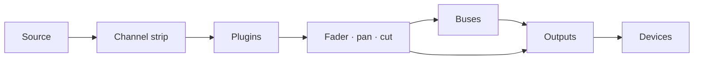

# Manuel d'utilisation de Faider

[English](../FAIDER-MANUAL.md)

**Version 0.1 · Windows 10 (2004) ou version ultérieure**

Faider est un routeur audio et une table de mixage en direct pour Windows, construits
autour d'une grande console. Il prend le son de votre interface audio, de vos périphériques Windows
et de chaque programme, le fait passer par des tranches de canal, des bus et des sorties, puis le
joue sur les périphériques de votre choix : votre casque, vos enceintes, un stream, un microphone
virtuel pour les appels et les jeux.

Ce manuel décrit tout ce que fait l'application, vous guide pas à pas dans les tâches courantes et
vous dit quoi faire quand quelque chose ne va pas.

---

## Sommaire

1. [Avant de commencer](#1-before-you-start)
2. [Première configuration](#2-first-time-setup)
3. [La fenêtre](#3-the-window)
4. [Comment fonctionne le routage](#4-how-routing-works)
5. [La console](#5-the-console)
6. [La tranche de canal, section par section](#6-the-channel-strip-section-by-section)
7. [Tranches brutes : applications, pads, bande et combinateurs](#7-raw-strips-apps-pads-tape-and-combinators)
8. [Sorties](#8-outputs)
9. [Plugins](#9-plugins)
10. [La page Routing](#10-the-routing-page)
11. [Outils : Pads](#11-tools-pads)
12. [Outils : Tape, enregistreur et Replay](#12-tools-tape-recorder-and-replay)
13. [Périphériques](#13-devices)
14. [Scènes, annulation et sessions](#14-scenes-undo-and-sessions)
15. [Réglages](#15-settings)
16. [Télécommande, overlay et zone de notification](#16-remote-control-overlay-and-tray)
17. [Guides pratiques](#17-how-to-guides)
18. [Dépannage](#18-troubleshooting)
19. [Référence](#19-reference)

---

## 1. Avant de commencer

### Ce qu'il vous faut

| | |
|---|---|
| **Windows** | Windows 10 version 2004 ou ultérieure, ou Windows 11. Pour capturer le son d'un seul programme, il faut la version 2004 ou ultérieure |
| **Une interface audio** | Facultatif. Avec son pilote ASIO installé, Faider fonctionne sur l'horloge de l'interface pour avoir le moins de retard possible. Sans interface, il fonctionne sur votre périphérique de lecture Windows, ou sur son horloge intégrée (voir [Synchronisation](#clocking)) |
| **Un casque** | Branché sur votre interface (ou sur n'importe quel périphérique de lecture Windows) pour entendre votre mix |
| **VB-CABLE** | Facultatif et gratuit (vb-audio.com/Cable). Un microphone virtuel, pour que des applications comme Discord, les jeux et OBS entendent votre mix |
| **ffmpeg** | Facultatif. Avec `ffmpeg.exe` dans votre PATH, l'enregistreur peut aussi écrire du MP3, de l'AAC, de l'Opus et de l'ALAC |

### Mots utilisés dans ce manuel

| Mot | Signification |
|---|---|
| **Canal** (entrée) | Une source sur la console : un micro, un périphérique, un programme, les pads, la bande |
| **Tranche** | La colonne de la console qui commande un canal, un bus ou une sortie |
| **Liaison** | Une connexion qui envoie un canal ou un bus quelque part : vers un bus ou vers une sortie |
| **Bus** | Un sous-mix. Tout ce qui y est envoyé est additionné, traité ensemble, puis envoyé plus loin |
| **Combinateur** | Un bus qui divise son signal en chemins parallèles, chacun avec ses propres plugins, puis les additionne |
| **Sortie** | Un mix final qui est joué sur un périphérique (votre casque, vos enceintes, un câble virtuel) |
| **Interface** | Votre interface audio ASIO, si vous en avez une |
| **Horloge** | Ce sur quoi tout se règle : votre interface, sinon votre périphérique de lecture Windows, sinon l'horloge intégrée |

## 2. Première configuration

Ce chapitre vous mène de l'installateur à une configuration qui fonctionne : votre microphone dans
votre casque, des applications qui entendent votre micro et le son d'un programme sur son propre
canal. Suivez les étapes dans l'ordre. Chacune prend une minute ou deux.

### Étape 1 : installer Faider

1. Lancez l'installateur, `Faider-<version>-Setup.exe`.
2. Windows SmartScreen peut vous avertir qu'il s'agit d'une application non reconnue, car
   l'installateur n'est pas signé. Cliquez sur **Informations complémentaires**, puis sur
   **Exécuter quand même**.
3. Acceptez la licence et autorisez l'invite d'administrateur. Si vous voulez un raccourci sur le
   bureau, cochez-le au passage (il est décoché par défaut).
4. L'installateur place l'application dans `C:\Program Files\Faider` et ajoute
   **Faider** au menu Démarrer. Tout ce dont elle a besoin est fourni avec.
5. Sur la dernière page, vous pouvez lancer Faider tout de suite. Si VB-CABLE n'est pas
   installé, l'installateur propose aussi d'ouvrir la page de téléchargement de VB-CABLE.

Votre mix et vos réglages se trouvent dans `%APPDATA%\Faider`, séparés du programme. La
désinstallation les laisse en place.

### Étape 2 : installer VB-CABLE (facultatif)

VB-CABLE vous donne un microphone virtuel que d'autres applications peuvent choisir. Passez cette
étape si vous voulez seulement mixer pour votre propre casque.

1. Téléchargez VB-CABLE sur vb-audio.com/Cable et lancez son installateur en tant
   qu'administrateur.
2. Redémarrez Windows quand il le demande.
3. Windows a maintenant deux nouveaux périphériques. **CABLE Input** est un périphérique de
   lecture : ce qui est joué dedans ressort par **CABLE Output**, un périphérique d'enregistrement
   que les applications peuvent choisir comme microphone.

> **Windows bascule votre son sur le câble.** L'installation d'un câble virtuel en fait souvent le
> choix par défaut de Windows : **CABLE Input** comme haut-parleurs et **CABLE Output** comme
> microphone. Vous n'entendez alors plus rien de Windows, et les applications qui utilisent le micro
> par défaut entendent le câble. Remettez les deux comme avant juste après l'installation.

**Remettez vos périphériques :**

1. Ouvrez **Paramètres > Système > Son** (ou faites un clic droit sur l'icône du haut-parleur dans
   la barre des tâches > **Paramètres du son**).
2. Sous **Sortie**, choisissez votre casque ou vos enceintes (ou les sorties de votre interface),
   pas **CABLE Input**.
3. Sous **Entrée**, choisissez votre vrai microphone, pas **CABLE Output**.
4. Windows garde un périphérique par défaut distinct pour les appels. Descendez jusqu'à **More sound
   settings**. Dans l'onglet **Lecture**, faites un clic droit sur votre casque ou vos enceintes >
   **Définir comme périphérique de communication par défaut**. Dans l'onglet **Enregistrement**,
   faites de même pour votre microphone.

Une façon plus rapide de régler la sortie : cliquez sur l'icône du haut-parleur dans la barre des
tâches, cliquez sur le **>** à côté du curseur de volume et choisissez votre périphérique.

Gardez vos vrais périphériques comme périphériques par défaut de Windows. Faider ne joue
dans le câble que là où vous le routez, et chaque application choisit elle-même **CABLE Output**
comme microphone (étape 6). Si le haut-parleur par défaut de Windows est le câble, PRE-FLIGHT le
signale sous **HEARD ONCE**.

### Étape 3 : démarrer Faider

Ouvrez le menu Démarrer et cliquez sur **Faider** (ou utilisez le raccourci du bureau, si
vous en avez créé un). La première fois, **SETUP** s'ouvre dans sa propre fenêtre.

### Étape 4 : répondre aux quatre questions de SETUP

SETUP pose quatre questions, une par page, et construit votre mix d'après vos réponses. Cliquez sur
les cartes pour choisir. Sur toutes les pages sauf la troisième, vous pouvez en choisir plusieurs.
**NEXT** passe à la suite, **BACK** revient en arrière.

1. **WHERE YOU LISTEN** : choisissez votre casque ou vos enceintes. Le périphérique par défaut de
   Windows est déjà choisi.
2. **MICROPHONES** : choisissez les microphones dans lesquels vous parlez. Ce sont les entrées de
   votre interface (**IN 1**, **IN 2** …) et vos périphériques d'enregistrement Windows.
3. **APPS HEAR YOU** : choisissez le câble virtuel que les applications utilisent comme micro
   (**CABLE Input**, après l'étape 2), ou **NOT NOW**.
4. **PROGRAMS** : choisissez les programmes qui jouent du son en ce moment et que vous voulez sur
   la console.
5. Cliquez sur **BUILD THE MIX**. **DONE** liste ce qui a été créé.
6. Cliquez sur **OPEN THE MIXER** pour le voir.

Ce que crée chaque réponse :

| Page | Ce qu'elle crée |
|---|---|
| **WHERE YOU LISTEN** | Une sortie sur chaque périphérique. La première s'appelle **HEADPHONES**, les autres portent le nom de leur périphérique |
| **MICROPHONES** | Un canal pour chacun, appelé **MICROPHONE** (MICROPHONE 2 …) |
| **APPS HEAR YOU** | Une sortie appelée **MIC FOR APPS** sur le câble. Chaque microphone y est routé |
| **PROGRAMS** | Un canal brut pour chacun, routé vers l'endroit où vous écoutez, plus une règle d'application qui le ramène tout seul chaque fois que le programme joue |

Vos microphones ne sont pas routés vers votre propre casque, donc vous n'entendez pas d'écho
retardé de votre voix. Pour vous entendre, allumez la touche **HEADPHONES** du micro (étape 6).

SETUP n'est pas une page : relancez-le depuis **FIND** (**SETUP: BUILD A MIX**) ou la touche **SETUP**
de SIMPLE chaque fois que vous ajoutez un périphérique ou un programme. Il ajoute ce qui manque et n'enlève jamais rien.

### Étape 5 : vérifier que l'audio fonctionne

Regardez le **voyant d'état** en haut à droite.

- **Vert** avec un pourcentage : l'audio fonctionne. Passez à l'étape 6.
- **Rouge, avec OFF** : l'audio ne fonctionne pas. Un autre programme a peut-être votre interface
  (un logiciel de MAO, le panneau de contrôle du pilote). Fermez-le et redémarrez Faider
  Console. Voir [18.4](#184-the-interface-wont-start-or-stopped).

Cliquez sur le voyant pour ouvrir **DEVICES**. **STREAMS** montre l'horloge utilisée (ASIO, Windows
ou l'horloge intégrée ; voir [Synchronisation](#clocking)), et **BUFFER** règle sa taille de
tampon. La plus petite taille qui joue sans craquements vous donne le moins de retard. 256 ou 512
échantillons conviennent à la plupart des systèmes.

### Étape 6 : vous entendre et laisser les applications vous entendre

Le Mixer s'ouvre en **SIMPLE**. Chaque canal montre son nom, ce qu'il écoute, une touche par sortie,
son fader et son vumètre, **CUT** et **SOLO**. Chaque sortie montre le périphérique sur lequel elle
joue, son fader et son vumètre.

| Touche d'un canal | Signification |
|---|---|
| Gris uni | Pas routé vers cette sortie |
| Remplie de la couleur de la sortie | Routé vers cette sortie. Cliquez pour le désactiver |
| Bord coloré seulement, **VIA BUS** | Il y arrive par un bus (réglé dans PRO). Cliquez pour le router aussi directement |

1. Parlez et regardez bouger le vumètre de votre microphone.
2. Pour vous entendre, cliquez sur la touche **HEADPHONES** du micro.
3. Dans Discord, votre jeu, OBS ou toute autre application, choisissez **CABLE Output** comme
   microphone.
4. Vérifiez ce qu'elles reçoivent : **FIND** (Ctrl+K) > **HEAR WHAT THEY HEAR** enregistre 5
   secondes de ce que reçoivent les applications et vous le rejoue.

Si vous entendez un programme deux fois, voir [18.7](#187-i-hear-something-twice-or-an-echo).

**+ CHANNEL** et **+ APP** ajoutent des canaux. **+ OUTPUT** ajoute une sortie sur un périphérique
qui n'en a pas. La touche de périphérique sous le nom d'une sortie change l'endroit où elle joue.
Faites un clic droit sur un nom pour **Rename...**, la couleur et **Remove**. Retirer le canal d'un
programme retire aussi sa règle d'application, de sorte que le canal ne revient pas tout seul.

### Étape 7 : PRO, pour toute la console

Le commutateur **SIMPLE / PRO** de la barre du haut montre le même mix dans les deux cas. **PRO**
est la console complète : l'entrée de chaque canal, les filtres, la dynamique et l'égaliseur, les
bus et les combinateurs, les plugins.

Pour façonner votre microphone, voir [17.1](#171-hear-yourself-set-up-a-microphone). Chaque
commande est décrite en [6](#6-the-channel-strip-section-by-section). Les réglages faits en PRO continuent à
fonctionner en SIMPLE.

### Étape 8 : lancer PRE-FLIGHT

Quelques secondes après le démarrage, **PRE-FLIGHT** vérifie la configuration et ne s'ouvre que si
quelque chose demande votre attention (pas au tout premier démarrage, où SETUP passe d'abord).
Lancez-le à tout moment depuis **SETTINGS > GENERAL > PRE-FLIGHT NOW...** ou **FIND** (Ctrl+K).
Chaque ligne doit être verte. Voir [18.1](#181-pre-flight).

### Étape 9 : terminer

- **Votre mix s'enregistre tout seul** dans la seconde qui suit chaque modification. Pour garder
  une version sous un nom, utilisez **SETTINGS > GENERAL > SAVE SESSION AS...**.
- **Démarrer avec Windows** : **SETTINGS > GENERAL > WINDOWS** lance Faider dans la zone
  de notification quand vous ouvrez votre session, pour que votre micro fonctionne dès le début.
- **Fermer la fenêtre n'arrête pas l'audio.** Faider continue de tourner dans la zone de
  notification pour que votre micro et votre casque continuent de fonctionner. Pour l'arrêter,
  faites un clic droit sur l'icône de la zone de notification et choisissez **Quit Faider
  Console**. Lancer le programme alors qu'il est dans la zone de notification ramène la fenêtre.

La première fois que chaque page s'ouvre, une courte astuce l'explique. Désactivez les astuces sous
**SETTINGS > GENERAL > ON START**.

La configuration est terminée. Le reste de ce manuel décrit chaque partie en détail.

## 3. La fenêtre

### La barre latérale

Les pages sont des cartes le long de la gauche : **MIXER**, **ROUTING**, **TOOLS**,
**DEVICES**, **SETTINGS**. La page affichée a un bord bleu allumé. Pendant que le Mixer est
affiché, la barre latérale a aussi ces cartes (en SIMPLE, seulement **ADD CHANNEL** et **ADD APP**) :

| Groupe | Carte | Ce qu'elle fait |
|---|---|---|
| **DESK** | **ADD CHANNEL** | Ouvre le menu des entrées : entrées de l'interface, périphériques Windows, applications, fenêtres de programmes et onglets de navigateur, pads, bande |
| | **ADD APP** | Liste les programmes qui jouent du son en ce moment. Choisissez-en un pour lui donner un canal |
| | **ADD BUS** | Un bus, ou un combinateur (deux chemins au départ) |
| | **PLUGINS** | Fait monter le panneau des plugins sous les tranches (voir [9](#9-plugins)) |
| **SELECT** | **AUTO** | Toucher une commande d'une tranche sélectionne cette tranche |
| | **FOLLOW** | Le pupitre glisse jusqu'à la tranche sélectionnée, y compris quand elle est choisie ailleurs (FIND, un raccourci clavier) |
| **METER** | **IN** / **OUT** | Les vumètres des canaux montrent le signal qui entre (avant traitement) ou qui sort |
| **SECTIONS** | HEADER … FADER | Les sections de la tranche. Celles qui sont allumées sont à l'écran. Cliquez sur l'une pour y glisser |

Les choix de SELECT et de METER sont mémorisés.

### La barre du haut

En partant de la droite :

| Commande | Ce qu'elle fait |
|---|---|
| **+ 100% -** | Zoom. Passe par 100, 125 et 150 %. Cliquez sur le pourcentage pour revenir à 100 %. Ctrl + / Ctrl - / Ctrl 0 font la même chose |
| **FIND** (Ctrl+K) | Cherche par nom dans toutes les pages, canaux, scènes, macros, pads et commandes |
| **HISTORY** (Ctrl+H) | Toutes les modifications que vous avez faites. Choisissez-en une pour y revenir |
| **MINI** | Une petite fenêtre de mixage toujours au premier plan |
| **Voyant d'état** | Vert : l'audio va bien. Orange : la charge audio est élevée ou un périphérique a manqué de données récemment. Rouge : un accroc audible dans les 10 dernières secondes, ou aucun audio en marche. Le nombre est la charge audio. Cliquez dessus pour ouvrir DEVICES |
| **SCENES** | Vos mix enregistrés. **+** en enregistre un nouveau (voir [14.1](#141-scenes)) |
| **SIMPLE / PRO** | Le même mix, en simple ou en console complète (voir l'[étape 7](#step-7-pro-for-the-whole-console)) |

Dans une fenêtre étroite, le voyant d'état disparaît en premier, puis MINI, puis HISTORY. FIND
permet d'atteindre tout cela.

### Le transport

Sous la barre du haut, sur chaque vue du Mixer, vous trouvez le temps du lecteur Tape (écoulé et
durée de la piste), le nom de la piste et ses touches : **retour de 10 s**, **stop**,
**lecture/pause**, **avance de 10 s**, **enregistrement**, **boucle**.

- **Enregistrement** enregistre la première sortie dans un fichier (au format et dans le dossier de
  l'enregistreur). Appuyez de nouveau pour arrêter.
- **Boucle** passe de **tout répéter** → **répéter un** (marqué **1**) → **désactivé**.

---

## 4. Comment fonctionne le routage

Le routage décide où va chaque son. Rien n'est entendu tant que ce n'est pas routé, et tout peut
être routé vers autant d'endroits que vous voulez.

### Le chemin d'un son

1. **Un canal** prend une source et la fait passer par sa tranche (entrée, filtres, dynamique et
   égaliseur, dans l'ordre indiqué par son en-tête), puis par ses plugins, puis par son fader, son
   panoramique et son cut.
2. **Les liaisons** envoient le canal plus loin, vers autant de bus et de sorties que vous voulez en
   même temps (jusqu'à 8 de chaque). Chaque liaison transporte le canal après son fader, donc le
   fader et **CUT** agissent partout où il est routé.
3. **Un bus** additionne tout ce qui lui est envoyé, passe par sa propre tranche et ses plugins, et
   est routé vers des sorties (ou vers d'autres bus) de la même façon.
4. **Une sortie** additionne tout ce qui lui est envoyé, passe par son compresseur de bus, son EQ de
   mix et son limiteur **SAFE**, et joue sur son périphérique.

### Les sorties sont des périphériques

Chaque sortie joue sur un seul périphérique : les sorties de votre interface, un casque USB, des
enceintes, **CABLE Input**. Vous ne créez pas les sorties à la main. Routez quelque chose vers un
périphérique et une sortie est créée dessus. C'est pourquoi les cases de routage listent les
périphériques en plus des bus.

- Il y a une sortie par périphérique. Routez plusieurs canaux vers le même périphérique et ils se
  rejoignent dans sa sortie.
- Des sorties différentes portent des mix différents. Votre casque peut entendre le jeu, la musique
  et la voix pendant que la sortie du stream n'a que la musique et la voix.
- Débranchez un périphérique et sa sortie devient silencieuse jusqu'à son retour.

### Trois endroits pour router

Les trois modifient les mêmes liaisons. Utilisez celui qui est le plus proche.

| Où | Comment |
|---|---|
| **Cases de routage** (en-tête de chaque tranche) | Une case par bus et par périphérique de sortie. Allumée : routé là. Cliquez pour basculer |
| **Route to** (clic droit sur une tranche) | La même liste sous forme de menu, cochée là où c'est routé |
| **La page Routing** | Chaque tranche est un bloc, chaque liaison une ligne. Cliquez sur un bloc, puis sur un autre (voir [10](#10-the-routing-page)) |

### Bus

Utilisez un bus quand plusieurs canaux ont besoin du même traitement ou d'un seul fader. Routez les
canaux vers le bus et le bus vers la sortie. Retirez ensuite les liaisons directes des canaux vers
cette sortie, sinon ils y arrivent deux fois (une fois en direct, une fois par le bus). Un bus peut
alimenter un autre bus, sans ajouter de retard.

### Combinateurs

Un combinateur est un bus divisé en **chemins** parallèles (deux au départ). Chaque chemin a ses
propres plugins, et les chemins sont additionnés au fader du combinateur. Routez une source vers un
chemin ou vers plusieurs (voir [7](#7-raw-strips-apps-pads-tape-and-combinators)).

### Les règles qui assurent la sécurité

- **Les boucles de rétroaction sont refusées.** Une liaison qui ramènerait un son à son point de
  départ (un bus vers un bus qui l'alimente, le son d'une sortie renvoyé dans sa propre entrée) est
  immédiatement désactivée, et le journal des événements nomme la boucle.
- **Solo** sur n'importe quelle tranche rend muette toute tranche qui n'est pas en solo, sauf celles
  marquées solo safe.
- **Canaux d'applications et doublon.** Un programme joue sur son propre périphérique en même temps
  que dans son canal (voir [18.7](#187-i-hear-something-twice-or-an-echo)).

### Synchronisation

Un seul périphérique donne l'horloge. Faider le choisit dans cet ordre au démarrage :

1. **ASIO** : votre interface audio, par son pilote ASIO. Le retard le plus faible.
2. **Windows** : sans pilote ASIO, votre périphérique de lecture par défaut de Windows (un câble
   virtuel, les haut-parleurs d'un écran ou un casque VR seulement quand il n'y a rien d'autre). Les
   sorties de votre interface deviennent les sorties de ce périphérique, et les microphones sont
   ajoutés comme périphériques Windows.
3. **Horloge intégrée** : sans aucun périphérique de lecture. Tous les périphériques, votre casque
   compris, la suivent.

Tout autre périphérique et tout programme capturé tourne sur sa propre horloge et se joint par un
petit tampon qui corrige la dérive, donc des horloges qui s'écartent ne produisent jamais de clic.
**DEVICES > STREAMS** montre chacun d'eux, et l'horloge utilisée.

Si le périphérique Windows qui donne l'horloge est débranché, désactivé ou cesse de fonctionner,
l'horloge suivante prend le relais toute seule et un avis vous dit laquelle. Un périphérique qui ne
démarre pas (parce qu'un autre programme l'occupe) est ignoré jusqu'à ce que vos périphériques
changent, puis réessayé. Sur l'horloge intégrée, un périphérique de lecture qu'on branche en prend
le relais.

## 5. La console

### Disposition

Le pupitre montre toutes les tranches de gauche à droite : les **canaux**, puis les **bus** (barre de
nom violette), puis les **sorties** (barre de nom ambre). Chaque tranche a sept sections, de haut
en bas :

| Section | Contient |
|---|---|
| **HEADER** | Les barres de niveau, les touches FILT / EQ / EXT, l'ordre de traitement, les cases de routage, le numéro de la tranche |
| **INPUT** | Trim, polarité (et sur la Dark strip, le drive du micro et le commutateur d'entrée) |
| **DYNAMICS** | Compresseur et gate |
| **FILTERS** | Passe-bas et passe-haut |
| **EQ** | Quatre bandes |
| **NAME** | La barre de nom et le commutateur d'alimentation |
| **FADER** | Pan, SOLO, CUT, SEL, le fader et son affichage |

### Souris et clavier

| Action | Résultat |
|---|---|
| **Faire glisser** un potentiomètre ou un fader vers le haut/bas | Le modifie. Sa valeur s'affiche à côté pendant que vous le faites glisser ou le survolez |
| **Double-clic** sur un potentiomètre ou un fader | Retour à sa valeur par défaut |
| **Clic** sur une touche ou un commutateur | Activé / désactivé |
| **Clic** sur la barre de nom | Sélectionne la tranche |
| **Faire glisser** latéralement la barre de nom d'une tranche | La déplace parmi les tranches de son type : canaux, bus ou sorties (voir [17.4](#174-reorder-channels)) |
| **Clic** sur le symbole d'alimentation de la barre de nom | Désactive ou active la tranche |
| **Clic droit** sur une tranche | Le menu de la tranche |
| **Molette de la souris** | Fait défiler le pupitre horizontalement. **Maj + molette** le fait défiler de haut en bas |
| **Ctrl + / Ctrl -** | Zoome toute la fenêtre |

Un clic gauche n'ouvre jamais de menu. Les menus sont toujours sur le bouton droit.

### Sélectionner une tranche

La tranche sélectionnée est entourée de bleu. Sélectionnez une tranche en cliquant sur sa barre de
nom ou sur sa touche **SEL**, ou en touchant l'une de ses commandes quand **AUTO** est activé. La
tranche sélectionnée est celle que montre le panneau des plugins, et celle sur laquelle agissent
FIND, les raccourcis clavier et les télécommandes.

Quand le pupitre a le focus (cliquez d'abord dessus) : **Gauche / Droite** sélectionnent la tranche
précédente / suivante, **M** la coupe, **S** la met en solo, et **Haut / Bas** déplacent son fader de
0,5 dB (3 dB avec **Maj**).

### Désactiver une tranche

Cliquez sur le symbole d'alimentation à gauche de la barre de nom. La tranche s'estompe et devient
grise. Elle n'est pas traitée, et son périphérique ou son programme est libéré. Tant qu'elle est
désactivée, **rien ne peut y être modifié** : les potentiomètres, les touches et le panneau des
plugins ignorent les clics, et son menu ne propose que **Turn on** et des espaceurs. Cliquez de
nouveau sur le symbole d'alimentation pour la réactiver.

### Types de tranche

Chaque canal peut utiliser la **Light strip** ou la **Dark strip** : clic droit > **Strip type** >
**Light strip** / **Dark strip**. Les entrées de l'interface, les périphériques d'enregistrement
(microphones) et les bus démarrent en sombre. Tout le reste démarre en clair. La Dark strip ajoute le
**drive** du micro et le commutateur d'entrée, et retire l'attaque rapide du compresseur et le hold
du gate. Votre choix est mémorisé pour chaque canal.

### Espaceurs

Les espaceurs sont des tranches vides qui vous donnent de la place entre des groupes. Clic droit sur
une tranche > **Add spacer before** / **Add spacer after**. Clic droit sur un espaceur pour
**Narrow**, **Add another** et **Remove spacer**. Un espaceur reste avec la tranche qu'il suit
quand cette tranche bouge.

### Le menu de la tranche (clic droit)

| Élément | |
|---|---|
| **Input** | Change la source : entrées **Interface**, **Windows devices** (ou Windows default), **What an output plays** (loopback), **Test tone**, **Nothing** |
| **Route to** | Chaque bus et chaque périphérique de sortie, coché là où le signal est envoyé |
| **Plugins** | En ouvrir un, **Add plugin...**, **Remove** |
| **Make mono / Make stereo** | Canaux seulement |
| **Strip type** | **Light strip** ou **Dark strip** |
| **Colour** | La couleur du canal, affichée le long de sa barre de nom et sur son bloc de la page Routing |
| **Add spacer before / after** | |
| **Rename...** | |
| **Remove** | Supprime le canal ou le bus |

---

## 6. La tranche de canal, section par section

### HEADER

| Commande | Ce qu'elle fait |
|---|---|
| **Barres de niveau** | Le niveau du canal, gauche et droite (IN ou OUT, selon le choix sous METER) |
| **FILT** | Envoie les filtres dans le détecteur du gate/compresseur (filtrage de la clé) |
| **EQ** | L'égaliseur activé ou désactivé |
| **EXT** | La dynamique écoute une clé externe (sidechain) au lieu du canal lui-même |
| **Ordre de traitement** | Trois blocs (FILT, EQ, DYN), de haut en bas dans l'ordre où le canal les exécute. **Cliquez sur un bloc** pour le monter d'un cran. Celui du haut passe à la fin. Les blocs allumés sont utilisés |
| **Cases de routage** | Une case par bus et par périphérique de sortie. Allumée : le canal y est envoyé. Cliquez pour basculer (voir [Les sorties sont des périphériques](#outputs-are-devices)) |
| **Numéro** | La place de la tranche sur le pupitre |

### INPUT

| Commande | |
|---|---|
| **in trim** | Gain d'entrée |
| **ø** | Inversion de polarité |
| **WIDTH** (Light strip) | Largeur stéréo : 0 % mono, 100 % telle quelle, 200 % deux fois plus large. Estompée sur un canal mono |
| **mic** (Dark strip) | Drive : ajoute de la chaleur et du niveau (affiché en pourcentage) |
| **pre** (Dark strip) | L'étage d'entrée activé ou désactivé |

### DYNAMICS

Le commutateur **IN** (avec le symbole d'alimentation) active ou désactive ensemble le compresseur
et le gate.

**Compresseur**

| Commande | |
|---|---|
| **MIX** | Mélange sec/traité (compression parallèle). Faites glisser l'affichage vert |
| **ratio**, **thresh**, **rel** | Ratio, seuil et relâchement |
| **fast** | Attaque rapide (3 ms). Désactivé : 10 ms |
| **pk** | Détection des crêtes. Activé (par défaut), le compresseur réagit aux crêtes. Désactivé, il réagit au niveau moyen (RMS), ce qui est plus doux |
| **LED de réduction de gain** | 3, 6, 10, 14 et 20 dB de réduction |

**Gate / expandeur**

| Commande | |
|---|---|
| **range**, **thresh**, **rel**, **hold** | De combien il se ferme, où il s'ouvre, à quelle vitesse il se ferme, combien de temps il tient |
| **exp** | Mode expandeur (un gate plus doux) |
| **fast** | Attaque rapide (0,1 ms). Désactivé : 1,5 ms |
| **LED du gate** | De combien le gate se ferme |

Les LED montrent ce que le compresseur et le gate *feraient*, même quand ils sont désactivés, pour
que vous puissiez les régler avant de les activer.

### FILTERS

**lp** (passe-bas) et **hp** (passe-haut). Tourné à fond vers le bas, le passe-haut est désactivé.
Tourné à fond vers le haut, le passe-bas est désactivé.

### EQ

| Bande | Commandes |
|---|---|
| **HF** | gain, freq, **bell** (plateau quand il est désactivé) |
| **HMF** | gain, freq, q |
| **LMF** | gain, freq, q |
| **LF** | gain, freq, **bell** (plateau quand il est désactivé) |

Le commutateur **EQ IN** active ou désactive tout l'égaliseur (comme la touche EQ de l'en-tête).

### FADER

| Commande | |
|---|---|
| **PAN** | Gauche/droite. Double-clic pour centrer |
| **SOLO** | Solo sur place |
| **CUT** | Muet |
| **SEL** | Sélectionner cette tranche |
| **Fader** | Niveau, de +12 dB à off. L'affichage dessous montre le niveau en dB |
| **safe** | Solo safe : ce canal reste audible quand d'autres sont en solo |
| **listen** | Écouter le signal de clé de la dynamique |

### Effets vocaux

Outre le traitement de la tranche, chaque canal porte ses propres effets vocaux :

| Effet | Ce qu'il fait |
|---|---|
| **ROBOT** | Modulation en anneau : la voix est multipliée par un ton et devient métallique |
| **ECHO** | Un délai, jusqu'à une seconde |
| **RADIO** | Limité à 300 Hz - 3 kHz et saturé, il sonne comme un petit haut-parleur |
| **PITCH** | La voix monte ou descend, jusqu'à une octave dans chaque sens |

Ils s'activent avec une macro : l'action **FX ON**, **FX OFF** ou **FX TOGGLE**, avec le canal pour
cible ([15](#15-settings)). Un pad, un raccourci clavier, un déclencheur ou la télécommande peut
lancer cette macro, si bien que les effets vont et viennent avec le mixage.

---

## 7. Tranches brutes : applications, pads, bande et combinateurs

Certains canaux portent un son déjà terminé : le son d'un programme, les pads, la bande. Ils ont une
**tranche brute**, avec routage, plugins si vous en voulez, pan, fader et touches, et sans effets
intégrés. Quand l'une d'elles apparaît sur le pupitre, ses effets intégrés sont désactivés une
fois (et notés dans le journal des événements). Ses plugins sont conservés.

| Tranche | Ses sections du milieu contiennent |
|---|---|
| **App** | La liste des plugins (cliquez sur l'un pour l'ouvrir) et **ADD PLUGIN** |
| **Pads** | Les touches de banque **A–D**, les pads 4×4 (appuyez pour jouer ; un pad GATE joue tant qu'on le maintient) et **STOP ALL** |
| **Tape** | L'écran du lecteur et la barre de recherche, le transport (précédent, retour, stop, lecture, pause, avance, suivant), **SHUFFLE**, **ADD...**, et la liste de lecture (cliquez sur une piste pour la jouer) |
| **Combinator** | Pour chaque chemin : **FROM**, les canaux et bus qui l'alimentent (cliquez sur l'un pour aller à sa tranche), et **PLUGINS** de ce chemin (cliquez sur l'un pour l'ouvrir). **EDIT IN ROUTING** ouvre la page Routing |

Un combinateur n'a pas d'effets propres. Son son vient de ce qui l'alimente et des plugins de chaque
chemin. Clic droit dessus > **Paths** pour ajouter un chemin et, pour chaque chemin, ouvrir, ajouter
ou retirer ses plugins, le renommer ou le supprimer.

---

## 8. Sorties

Chaque sortie (master) a sa propre tranche sombre :

| Commande | |
|---|---|
| **DEVICE** | Le périphérique sur lequel elle joue. Cliquez pour en choisir un autre |
| **SAFE** | Un limiteur après le fader : rien ne sort au-dessus de -1 dBFS |
| **MON** | Écouter cette sortie |
| **LUFS** | Sonie à court terme de ce qui sort (« -- LUFS » en cas de silence) |
| **WIDTH** | Largeur stéréo |
| **BUS COMP** | Commutateur d'activation, indicateur de réduction de gain de type VU, **threshold**, **ratio**, **attack**, **release**, **make-up**, **mix** |
| **MIX EQ** | Commutateur d'activation, gain et fréquence HF, gain et fréquence LF |
| **CUT**, **SEL**, fader | Comme sur un canal |

Clic droit sur une sortie pour **Device...**, les espaceurs, **Rename...** et **Remove**.

Les sorties sont créées pour vous, une par périphérique (voir
[Les sorties sont des périphériques](#outputs-are-devices)).

**FIND > MIX-MINUS AND STEMS** construit un retour par invité (tout sauf sa propre voix) et des
stems voix, musique et jeu.

---

## 9. Plugins

Faider héberge des plugins **VST3** sur les canaux, les bus et les chemins des
combinateurs, avec compensation automatique de la latence.

### Ajouter un plugin

- Sur un canal : clic droit > **Plugins > Add plugin...**, ou **ADD PLUGIN** sur une tranche brute,
  ou **ADD** dans le panneau des plugins.
- Sur un chemin de combinateur : clic droit sur le combinateur > **Paths > PATH n > Add plugin...**.
  Cliquez sur le plugin d'un chemin sur la tranche du combinateur pour l'ouvrir.

Chaque plugin est **d'abord testé dans une copie séparée du programme**, donc un plugin qui plante
ou se bloque au chargement ne peut pas faire tomber votre mix. Le résultat est mémorisé jusqu'à ce
que le fichier du plugin change.

### Le panneau des plugins

Cliquez sur **PLUGINS** dans la barre latérale. Un panneau monte sous les tranches avec les plugins
de la **tranche sélectionnée** dans l'ordre où ils s'exécutent. **FIND** > **PLUGINS: name** l'ouvre
sur cette tranche, et passe en PRO si SIMPLE est affiché. Chaque carte montre :

- **CPU** : la part du plugin dans le temps de traitement (vert, orange au-delà de 2 %, rouge
  au-delà de 5 %)
- **Latency** : le retard qu'il ajoute
- **BYPASSED** : désactivé mais toujours chargé (il utilise encore de la mémoire)
- **HEAVY** : anormalement coûteux

Touches de chaque carte : **BYPASS**, **OPEN** (sa fenêtre), **REMOVE**, et des flèches pour le
placer plus tôt ou plus tard. **ADD** à la fin en ajoute un autre.

---

## 10. La page Routing

La page Routing montre tout le mix sous forme de plan : chaque tranche est un bloc et chaque liaison
une ligne. Servez-vous-en pour voir où va chaque chose, et pour router en cliquant sur deux blocs.

### Lire la page

- **Trois rangées :** **INPUTS** en haut, **BUSES** au milieu, **OUTPUTS** en bas. Les
  périphériques de sortie qui n'ont pas encore de sortie sont à l'extrémité droite de la rangée
  OUTPUTS, en gris.
- **Chaque bloc est sous sa tranche.** Un bloc est à la même position horizontale que sa tranche sur
  le pupitre, espaceurs compris, et la page défile horizontalement avec le pupitre (molette de la
  souris). Réorganisez le pupitre et le plan suit.
- **Chaque bloc montre** le nom et le numéro de la tranche. Une tranche désactivée est estompée. Un
  canal qui a sa propre couleur la montre sous forme de teinte et de bande à gauche.
- **Les lignes sont des liaisons.** Chacune descend droit depuis sa source, entre dans une voie à
  elle dans l'espace sous sa rangée, traverse, puis redescend dans le bloc qu'elle alimente, et se
  termine par une flèche. Les liaisons d'entrée sont turquoise, celles des bus violettes. Plusieurs
  lignes qui partent d'un bloc ou y arrivent sont réparties dessus dans l'ordre, donc elles ne se
  superposent jamais.
- **Les combinateurs** montrent leurs chemins sous forme de cellules **P1, P2, …** au bas du bloc.
  Les lignes se terminent dans le chemin qu'elles alimentent.

### Router d'un bloc à l'autre

1. **Cliquez sur un bloc.** Il s'allume en bleu et pulse. Les blocs vers lesquels il est routé, ou
   depuis lesquels il l'est, reçoivent une bordure mise en valeur, leurs lignes s'éclaircissent, et
   tout le reste s'estompe.
2. **Cliquez sur un autre bloc.** La liaison entre eux s'active (une ligne apparaît) ou se désactive
   (la ligne disparaît). Les deux ordres fonctionnent : source puis destination, ou destination
   puis source.
3. Le premier bloc **reste sélectionné**, donc continuez à cliquer pour le router vers plusieurs
   endroits, ou pour retirer plusieurs liaisons.
4. **Cliquez de nouveau dessus**, cliquez dans le vide, ou appuyez sur **Échap** pour le relâcher.

Si les deux blocs ne peuvent pas être routés (deux sorties, par exemple), c'est le second qui est
sélectionné à la place.

### Exemples

| Pour | Cliquez sur |
|---|---|
| Vous entendre | MIC, puis la sortie du casque |
| Laisser les applications entendre votre micro | MIC, puis **CABLE Input** (dans la rangée des sorties, grisé tant qu'il n'a pas de sortie) |
| Envoyer un groupe par un bus | Le bus, puis chaque canal ; puis le bus, puis sa sortie |
| Sortir un canal du stream | Le canal, puis la sortie du stream (la ligne disparaît) |
| Alimenter un chemin de combinateur | La source, puis la cellule du chemin (P1, P2…). Cliquez sur d'autres cellules pour alimenter plusieurs chemins. Cliquer sur le combinateur en dehors de ses cellules alimente son premier chemin |

Cliquer sur un bloc de périphérique grisé crée sa sortie, et la nouvelle sortie apparaît aussitôt
sur le pupitre.

Faites glisser un bloc latéralement le long de sa rangée pour déplacer sa tranche (voir
[17.4](#174-reorder-channels)). Une liaison qui se désactive aussitôt créerait une boucle de
rétroaction (voir [18.8](#188-a-route-wont-switch-on)).

## 11. Outils : Pads

**TOOLS > PADS** vous donne quatre banques (**A–D**) de 16 pads : 64 sons, jusqu'à 32 joués en même
temps.

### Faire sortir le son

Les pads jouent dans un **canal PADS**. Cliquez sur **CREATE PADS CHANNEL** (il indique ensuite
**PADS CHANNEL ACTIVE**), ou choisissez une autre entrée dans le menu **PLAY INTO** pour jouer les
pads à travers les plugins et les liaisons de ce canal. Sans canal de pads, les appuis sont ignorés.

### Charger et jouer

| Action | |
|---|---|
| Cliquer sur un pad **vide** | Choisir un fichier son |
| Cliquer sur un pad chargé | Le jouer |
| Clic droit sur un pad | Le sélectionner pour l'éditer sans le jouer |
| Déposer des fichiers sur un pad | Les charge dans ce pad et dans les suivants de la banque |
| **Ctrl + glisser** sur un autre pad | Échange les deux pads |
| **STOP ALL** | Fait disparaître en fondu tous les pads |

Formats : WAV, FLAC, AIFF, OGG, MP3. Un pad dont le fichier a été déplacé affiche **MISSING: FILE**.

### L'éditeur de pad

| Réglage | |
|---|---|
| Nom | Double-clic pour renommer |
| **LOAD**, **CLEAR**, **COLOUR** | |
| **REPLAY** | Le tampon de relecture instantanée devient le son de ce pad (enregistré en WAV dans le dossier des enregistrements). Armez d'abord replay dans TOOLS > TAPE |
| **MODE** | **ONE-SHOT** joue jusqu'au bout (appuyer de nouveau le relance). **GATE** joue tant qu'on le maintient. **LOOP** démarre à un appui et s'arrête au suivant |
| **CHOKE** | OFF ou groupe 1–8. Les pads d'un même groupe s'arrêtent les uns les autres |
| **LEVEL** | De -INF à +12 dB |
| **HOTKEY** | Cliquez (**LEARN...**), puis appuyez sur les touches (voir [HOTKEYS](#hotkeys)) |
| **MACRO** | Une macro à lancer avec le pad (un pad peut avoir une macro et pas de son) |
| **TRIM** | Faites glisser les lignes de début et de fin sur la forme d'onde. Double-clic pour le fichier entier |
| **FADE IN / FADE OUT** | 0–5 s |

---

## 12. Outils : Tape, enregistreur et Replay

### Le lecteur Tape

**TOOLS > TAPE** joue une liste de lecture dans un **canal TAPE**. Cliquez sur **CREATE TAPE
CHANNEL** pour en créer un.

- **ADD FILES**, **ADD FOLDER**, ou déposez des fichiers et des dossiers n'importe où sur la page.
  **EJECT** vide la liste de lecture.
- Double-cliquez sur une piste pour la jouer, faites-en glisser une pour réordonner, et appuyez sur
  Suppr pour retirer les pistes sélectionnées.
- Transport : **PREV**, **REW** (retour de 10 s ; maintenez pour un retour rapide), **PLAY**,
  **PAUSE**, **STOP**, **FF** (avance de 10 s ; maintenez pour une avance rapide), **NEXT**. Aussi
  **SHUFFLE**, **REPEAT** (tout / un / désactivé) et **LEVEL**.
- Les pistes s'enchaînent sans coupure. Les pauses et les sauts se font en fondu sur 30 ms pour ne
  jamais produire de clic.

Le transport de la barre du haut et la tranche tape du pupitre commandent le même lecteur.

### L'enregistreur

| | |
|---|---|
| **Source** | N'importe quelle sortie, n'importe quel bus ou n'importe quelle entrée, ou **ALL CHANNELS, ONE FILE EACH** (multipiste : chaque entrée, ou seulement celles dont DIRECT est allumé, plus chaque sortie, alignées à l'échantillon) |
| **Format** | WAV 24 bits (par défaut), 16 bits, 32 bits, 32 bits flottant ; FLAC 24/16 bits ; AIFF 24/16 bits ; OGG Vorbis 128–320k. Avec ffmpeg : MP3, AAC (M4A), Opus, ALAC. Chacun indique combien de temps tient sur le disque |
| **REC** | Démarre et arrête. L'écran montre le temps, la taille, le temps restant et les éventuels blocs perdus |
| **PATH** / **REVEAL** | Choisir le dossier / l'ouvrir dans l'Explorateur |

Les enregistrements vont dans `Music\Faider Recordings` sauf si vous choisissez un
dossier. Les formats ffmpeg enregistrent d'abord un WAV et le convertissent à l'arrêt (le WAV est
conservé si la conversion échoue). L'enregistrement s'arrête tout seul quand il reste moins de 1 Go
libre.

### Relecture instantanée

**ARM** conserve les derniers **30 s**, **1**, **2** ou **5 minutes** de la source de
l'enregistreur. **SAVE** les écrit dans un fichier (clic droit sur SAVE pour lui donner un raccourci
clavier global). Avec le multipiste choisi, replay utilise la première sortie.

---

## 13. Périphériques

**DEVICES** liste chaque périphérique audio Windows et chaque pilote ASIO.

| Colonne | |
|---|---|
| **I/O** | ASIO, OUT ou IN |
| **DEVICE**, **HARDWARE** | Son nom et l'adaptateur sur lequel il se trouve |
| **FORMAT** | Canaux et fréquence d'échantillonnage |
| **STATE** | Actif, débranché, désactivé, ou **off in Faider** |
| **TAGS** | DEFAULT et CALLS pour les périphériques par défaut de Windows |

Cliquez sur un en-tête pour trier. Sélectionnez des périphériques (Ctrl/Maj pour plusieurs), puis
utilisez :

| Touche | |
|---|---|
| **EXCLUDE / INCLUDE** | Faider cesse (ou reprend) d'utiliser le périphérique. Les périphériques exclus ne sont jamais ouverts et sont absents des listes |
| **DISABLE / ENABLE IN WINDOWS** | Désactive ou active le périphérique dans Windows lui-même |
| **RENAME** | Votre propre nom pour le périphérique, utilisé partout dans Faider (ou double-cliquez sur une ligne) |

### Streams

Sous la liste, **STREAMS** montre la santé du moteur audio :

- **CALLBACK LOAD** (et crête), **OVERLOADS**, **BLOCKS SKIPPED**. Ils prennent une couleur
  d'avertissement si l'un d'eux s'est produit
- **BUFFER** : la taille du tampon de votre interface (plus petit signifie moins de retard et plus
  de charge)
- Par périphérique : audio en tampon, latence totale, **DRIFT** (la correction d'horloge en ppm),
  **UNDER** (à sec, du silence a été joué), **OVER** (débordement, de l'audio a été perdu),
  **RESYNC** (recentré). Une ligne qui a perdu de l'audio s'affiche en rouge
- **RESET STATS** remet les compteurs à zéro

### VB-CABLE

Si VB-CABLE est installé, une barre en haut règle sa **fréquence d'échantillonnage** et sa **latence
maximale**. **APPLY** demande une seule invite d'administrateur et redémarre le câble.

Le journal des événements en bas note chaque périphérique branché, retiré ou rétabli.

---

## 14. Scènes, annulation et sessions

### 14.1 Scènes

Une scène mémorise le fader, le pan, le cut, le solo, l'alimentation et les liaisons de chaque canal
(et, si vous le choisissez, les réglages des plugins).

- **Enregistrer :** cliquez sur **+** dans la barre du haut et donnez-lui un nom.
- **Rappeler :** cliquez sur sa touche. Les faders et les pans glissent en une demi-seconde. Le
  reste change aussitôt.
- **Clic droit sur une scène** pour : rappeler seulement les muets / seulement les niveaux,
  enregistrer dedans, inclure les réglages des plugins, renommer, un raccourci clavier global,
  **Recall on device** (quand un périphérique apparaît ; retour quand il disparaît), **Auto-scene**
  (quand une application se met à jouer, qu'un périphérique se connecte, ou à une heure du jour),
  apprentissage MIDI, déplacer, supprimer.

Les périphériques et les canaux eux-mêmes ne font pas partie d'une scène.

### 14.2 Annuler et historique

**Ctrl+Z** annule, **Ctrl+Y** (ou Ctrl+Maj+Z) rétablit. **HISTORY** (Ctrl+H) liste chaque
modification. Choisissez-en une pour y revenir.

### 14.3 Sessions

Votre mix s'enregistre tout seul dans la seconde qui suit chaque modification, et à la fermeture.

| | |
|---|---|
| **Restore session** | Menu de la zone de notification : les versions antérieures de votre mix par date (Faider redémarre avec) |
| **SESSION TIMELINE** | FIND : chaque version conservée. **Restore everything**, ou **PUT ONE CHANNEL BACK** (son niveau, son pan, son muet et son rack) sans redémarrer |
| **SAVE SESSION AS...** | SETTINGS > GENERAL > SESSIONS : garder le mix sous un nom |
| **OPEN, EXPORT OR IMPORT...** | Ouvrir un mix nommé (redémarre), enregistrer le mix dans un fichier, ou en charger un depuis un fichier |

Jusqu'à 60 versions antérieures sont conservées (au plus une toutes les 5 minutes). Si votre mix ne
peut jamais être chargé (l'interface est absente, le fichier est endommagé), il est **mis de côté**
au lieu d'être perdu, et un nouveau mix démarre. Voir
[18.2](#182-my-mix-is-gone-a-fresh-mix-started).

---

## 15. Réglages

**SETTINGS** a quatre sections, sous forme de cartes le long de la gauche : **GENERAL**, **MACROS**,
**HOTKEYS**, **CONTROL**. Les réglages activé/désactivé sont des commutateurs carrés qui brillent
en crème quand ils sont activés.

### GENERAL

| Carte | Réglages |
|---|---|
| **LOOK** | **LOOK...** : les couleurs et le type de lettres du pupitre, depuis un fichier LOOK (voir [LOOKS](#looks)) |
| **WINDOWS** | **START WITH WINDOWS** : s'ouvre dans la zone de notification quand vous ouvrez votre session |
| **DESK** | **WARN IF I TALK WHILE MUTED** (un avis quand un micro coupé dépasse -30 dBFS) |
| **APPS** | **APP RULES...** : vers quel bus ou quelle sortie va un programme quand il se met à jouer (aussi dans **FIND**). Retirer le canal d'un programme retire sa règle |
| **SESSIONS** | **SAVE SESSION AS...** ; **OPEN, EXPORT OR IMPORT...** |
| **ON START** | **PRE-FLIGHT: CHECK THE SETUP** ; **PRE-FLIGHT NOW...** ; **TIPS** ; **SHOW THE TIPS AGAIN** |
| **NOTICES (IN THE CORNER)** | Périphériques connectés ou disparus, un canal qui sature (sa source ou sa sortie à pleine échelle), scènes rappelées, macros lancées, annuler et rétablir |
| **ZOOM** | 100 %, 125 %, 150 %, **CUSTOM...** (75–200 %) |
| **METER STANDARD** | Comment les vumètres lisent le niveau (crête d'échantillon avec une chute rapide par défaut ; IEC et autres) |
| **CHANNEL METER POINT** | **PRE HPF** (source brute), **PRE FADER** (après les effets), **POST ON** (après le fader, par défaut) |
| **ABOUT** | Version et crédits |

### LOOKS

Un **LOOK** est chaque couleur dont le pupitre se dessine, avec le type de lettres et les tailles qui
vont avec. Les tranches, les affichages, les boutons, les touches et les lampes se dessinent tous depuis
le LOOK en vigueur : un seul LOOK change donc tout le pupitre à la fois.

**LOOK...** liste les LOOK que vous avez et met en vigueur celui que vous choisissez ; le pupitre est
redessiné dès qu'il change. **SAVE THIS LOOK AS...** écrit le LOOK en vigueur dans un nouveau fichier,
sous le nom que vous lui donnez.

Un LOOK est un fichier dans `%APPDATA%\Faider\looks`, écrit en JSON : vous pouvez donc l'écrire à la
main et le copier sur une autre machine. Un fichier absent ou abîmé laisse en place le LOOK intégré, et
ce qu'un fichier omet revient à la valeur intégrée : un fichier écrit à moitié fonctionne quand même.

| | |
|---|---|
| `name` | Le nom du LOOK, tel qu'il apparaît dans la liste |
| `font` | Un type de lettres fourni par Windows, net aux petites tailles du pupitre |
| `keyRadius` | L'arrondi des coins d'une touche, en pixels |
| `fontSizes` | `legend`, `caption`, `readout` : les trois tailles de texte |
| `colours` | Chaque couleur, en `#rrggbb`, ou `#rrggbbaa` quand une partie est transparente |

Les couleurs portent le nom de la partie qu'elles dessinent : les champs et l'impression, les touches,
la plaque des faders, les affichages, les boutons par fonction, les lampes, les corps des tranches,
l'aspect d'un canal, d'un bus et d'une sortie, l'accent, les creux et l'ombrage. **SAVE THIS LOOK AS...**
écrit chacun des noms que le LOOK possède ; le plus simple est de changer un point sur le pupitre, de le
sauvegarder, puis d'éditer ce fichier.

Un groupe `palette` nomme les couleurs qu'un fichier de disposition peut poser sur une partie : `red`,
`green`, `blue`, `black`, `white`, `violet`, `grey`, `cream`, `orange`, `amber`, `teal`, `salmon`.

### MACROS

Une macro est une liste d'**actions** lancées depuis un raccourci clavier, un pad, un déclencheur ou
une télécommande.

1. Cliquez sur **+ NEW**, puis nommez-la (double-clic sur le nom).
2. **+ ACTION** : MUTE ON/OFF/TOGGLE, SET FADER (dB, durée du fondu), ASSIGN ON/OFF/TOGGLE (une
   liaison), CHANNEL ON/OFF, TRIGGER PAD, STOP PAD, ALL NOTES OFF, TRANSPORT PLAY/PAUSE, TRANSPORT
   NEXT, RECORD START/STOP, WAIT, SCENE RECALL, FX ON/OFF/TOGGLE (un effet vocal, voir [Effets vocaux](#voice-effects)), WINDOWS DEFAULT OUTPUT/INPUT,
   PLUGIN SETTING.
3. Facultativement, **+ TRIGGER** : APP STARTS, APP STOPS, DEVICE CONNECTED, DEVICE DISCONNECTED,
   MASTER SILENT (pendant n secondes), MASTER HAS SOUND, TIME (24 heures).
4. Facultativement, un **HOTKEY**, et **MOMENTARY** (les actions sont annulées quand la touche est
   relâchée, pour le push-to-talk).
5. **FIRE** la lance maintenant.

### HOTKEYS

Tous les raccourcis clavier assignables sont au même endroit : **PADS**, **MACROS**, **SCENES**, et
**SAVE INSTANT REPLAY** sous **TAPE**. Cliquez sur l'un, puis appuyez sur les nouvelles touches
(Échap annule, Suppr efface). Les raccourcis doivent comporter Ctrl, Alt ou une touche F, et ils
fonctionnent pendant qu'un jeu a le focus. Les touches fixes sont listées aussi
([19.1](#191-keyboard-shortcuts)). Les touches ON THE MIXER de la page fonctionnent aussi sur la
console ([5](#5-the-console)).

### CONTROL

| Carte | |
|---|---|
| **MIDI** | **MIDI MAP** (Ctrl+L) ; entrées et assignations ; un commutateur par entrée MIDI |
| **OSC** | **OSC ON (PORT 9000)**, pour les programmes de ce PC |

---

## 16. Télécommande, overlay et zone de notification

| | |
|---|---|
| **MIDI MAP** (Ctrl+L) | Cliquez sur une commande à l'écran, puis bougez un potentiomètre ou une touche de votre contrôleur. Le fader, le pan, CUT, SOLO, l'alimentation et les touches de routage de chaque tranche peuvent être assignés, en SIMPLE et en PRO, de même que les scènes, les pads et la bande. La molette de la souris fait défiler le pupitre pendant l'assignation (Maj+molette de haut en bas) |
| **OSC** | Les programmes de ce PC peuvent envoyer vers le port 9000 (il n'écoute jamais le réseau) : `/faider/input/NAME/fader -12` (dB), `/faider/output/NAME/mute 1`, `/faider/bus/NAME/pan -0.5`, `/faider/input/NAME/solo 1`, `/faider/scene NAME`, `/faider/macro/NAME 1` (0 la relâche). Écrivez les espaces des noms sous la forme `_` |
| **Overlay en jeu** (Ctrl+Maj+O) | Pour chaque canal micro, le voyant de parole, LIVE / MUTED et le niveau, plus jusqu'à quatre touches de scène. Ne prend jamais le focus à un jeu. Faites-le glisser où vous voulez |
| **MINI** | Un petit mixeur au premier plan de tout. **OPEN** revient à la fenêtre principale |
| **Zone de notification** | Cliquez sur l'icône pour le mixeur de la zone de notification, double-cliquez pour ouvrir la fenêtre. Clic droit : Show, rappel de scène, Restore session, Start with Windows, About, Quit. L'icône clignote en orange pendant une alerte |

Faider tourne toujours avec vos droits d'utilisateur ordinaires, même s'il est lancé depuis une
fenêtre d'administrateur. Il se relance avec des droits ordinaires, parce que l'overlay en jeu ne
peut pas atteindre un programme exécuté en administrateur. Les rares étapes qui exigent un
administrateur (appliquer les réglages de VB-CABLE, réactiver un périphérique que Windows a
désactivé) demandent elles-mêmes la permission.

---

## 17. Guides pratiques

### 17.1 Vous entendre : configurer un microphone

1. **ADD CHANNEL** > l'entrée de votre interface (ou un périphérique d'enregistrement Windows). Il
   apparaît avec une Dark strip.
2. Parlez, et réglez **in trim** pour que les barres de niveau culminent vers -12 à -6 dB.
3. Routez-le : cliquez sur la case de routage de la sortie de votre casque (ou utilisez la page
   Routing).
4. Nettoyez-le : **hp** pour retirer les grondements (vers 80–100 Hz), puis le gate et le
   compresseur (**IN** sur DYNAMICS), puis l'EQ.

### 17.2 Laisser les applications entendre votre micro (Discord, jeux, OBS)

1. Installez **VB-CABLE** (PRE-FLIGHT propose un lien), puis remettez vos vrais haut-parleurs et
   votre vrai micro comme périphériques par défaut de Windows ([étape 2](#step-2-install-vb-cable-optional)).
2. Routez le canal de votre micro vers le périphérique **CABLE Input**. Une sortie est créée dessus.
3. Dans l'application, choisissez **CABLE Output** comme microphone.
4. Lancez **PRE-FLIGHT NOW...** pour vérifier que rien n'est coupé sur le chemin et que rien ne
   reboucle.

### 17.3 Amener un programme dans le mix

1. Lancez le programme et faites-le jouer du son.
2. **ADD APP** > choisissez-le. Il reçoit un canal brut (sans effets).
3. Routez-le là où vous voulez l'entendre. Si vous l'entendez deux fois, voir
   [18.7](#187-i-hear-something-twice-or-an-echo).

### 17.4 Réordonner les canaux

Faites glisser la **barre de nom** d'un canal latéralement dans le Mixer (descendez jusqu'à la
section NAME), ou faites glisser son bloc sur la page Routing. Une barre bleue montre où il
atterrira, et les tranches glissent à leur place. Les espaceurs suivent la tranche qu'ils suivent. Les
bus et les sorties se déplacent de la même façon, chacun parmi ceux de son type, et leurs
liaisons les suivent. SIMPLE montre les sorties dans le même ordre.

### 17.5 Grouper des canaux dans un bus

1. **ADD BUS**, puis renommez-le (clic droit > Rename...).
2. Sur la page Routing, cliquez sur le bus, puis sur chaque canal pour le router dedans.
3. Cliquez sur le bus, puis sur sa sortie, pour router le bus plus loin.
4. Si vous voulez que ces canaux passent seulement par le bus, retirez leurs liaisons directes vers
   la sortie.

### 17.6 Traitement parallèle avec un combinateur

1. **ADD BUS > COMBINATOR**. Il démarre avec deux chemins. Clic droit dessus > **Paths > Add path**
   pour en avoir plus.
2. Sur la page Routing, routez des sources vers les cellules de chemin (**P1**, **P2**…).
3. Clic droit > **Paths > PATH n > Add plugin...** pour chaque chemin.

### 17.7 Faire un mix de stream et un mix de casque

1. Envoyez vos canaux vers deux sorties, par exemple votre casque et le périphérique que capte
   votre logiciel de streaming.
2. Chaque sortie a son propre fader, son compresseur de bus, son EQ et son limiteur **SAFE**.
   Activez **SAFE** sur la sortie du stream.
3. Pour garder quelque chose hors du stream, retirez la liaison de ce canal vers la sortie du
   stream (avec sa case de routage ou sur la page Routing).

### 17.8 Enregistrer

1. TOOLS > TAPE > **RECORDER** : choisissez la source et le format.
2. Appuyez sur **REC** (ou sur la touche d'enregistrement de la barre du haut). Appuyez de nouveau
   pour arrêter.
3. **REVEAL** ouvre le dossier.

### 17.9 Créer une touche push-to-talk

1. SETTINGS > MACROS > **+ NEW**.
2. **+ ACTION** > **MUTE OFF** > le canal de votre micro.
3. Activez **MOMENTARY** et réglez un **HOTKEY**. Tant que vous le maintenez, le micro est ouvert, et
   au relâchement il se coupe de nouveau. Commencez avec le micro coupé.

---

## 18. Dépannage

### 18.1 PRE-FLIGHT

PRE-FLIGHT se lance quelques secondes après le démarrage (et depuis **PRE-FLIGHT NOW...** ou FIND)
et n'apparaît que si quelque chose ne va pas. Chaque ligne a un voyant, le constat et un remède :

| Vérification | Problème | Remède |
|---|---|---|
| **AUDIO** | Il n'a pas démarré (une autre application l'a peut-être) | **DEVICES** |
| **MIC CABLE** | Pas de VB-CABLE : les applications ne peuvent pas entendre votre mix comme un micro | **GET VB-CABLE** |
| **MIC MASTER** | Aucune sortie ne joue dans le câble micro | **ROUTING** |
| **MIC CHANNELS** | Quelque chose est coupé sur le chemin vers le micro | **UNMUTE** |
| **HEARD ONCE** | Une boucle de rétroaction, ou quelque chose entendu deux fois | **SOUND SETTINGS** |

### 18.2 Mon mix a disparu, un nouveau mix a démarré

Votre mix n'est pas perdu. Quand il est inutilisable au démarrage, il est **mis de côté** sous le
nom `session-unloaded-<date>.xml`. Le journal des événements dit pourquoi :

| Raison | Que faire |
|---|---|
| L'interface enregistrée n'est pas connectée | Connectez-la, puis **Restore session** (zone de notification) > la version « kept: » |
| L'interface enregistrée n'a pas pu être ouverte (un autre programme l'a) | Fermez l'autre programme et redémarrez Faider. Rien n'est enregistré par-dessus votre mix entre-temps |
| session.xml n'a pas pu être lu | **Restore session** > une version récente |

### 18.3 Pas de son

Suivez le chemin du signal :

1. **Voyant d'état** rouge avec OFF : l'audio ne fonctionne pas. Voir
   [18.2](#182-my-mix-is-gone-a-fresh-mix-started) et [18.4](#184-the-interface-wont-start-or-stopped).
2. **Le vumètre du canal** (METER : IN) : s'il ne bouge pas, vérifiez son **Input** (clic droit) et
   que la source joue. Une tranche désactivée ne laisse rien passer.
3. **CUT** est désactivé, le fader est monté, et rien d'autre n'est en solo (le **SOLO** d'une autre
   tranche rend muet tout le reste).
4. **Routage :** au moins une case de routage est allumée, ou il y a une ligne sur la page Routing.
5. **La sortie** : pas en CUT, fader monté, et **DEVICE** indique le bon périphérique (pas « NO
   DEVICE » ni « (OFF) »).
6. **Le périphérique** est branché et n'est pas exclu dans DEVICES.

### 18.4 L'interface ne démarre pas, ou s'est arrêtée

- Un autre programme l'occupe peut-être (un logiciel de MAO, le panneau de contrôle du pilote).
  Fermez-le et redémarrez.
- **INTERFACE DOWN** dans la zone de notification : l'interface s'est réinitialisée toute seule et
  ne se rouvre pas. Changez sa taille de tampon dans DEVICES ou redémarrez Faider.
- Les changements de fréquence ou de tampon faits dans le panneau de contrôle de l'interface sont pris
  en compte tout seuls.
- Pour fonctionner un moment sans l'interface, lancez Faider avec
  `"C:\Program Files\Faider\Faider.exe" --clock windows` (votre périphérique de
  lecture Windows) ou `--clock builtin` (l'horloge intégrée). `--clock` avec une partie du nom d'un
  pilote ASIO (`--clock focusrite`) choisit ce pilote. Votre mix vous suit et reste enregistré pour
  votre interface : le prochain démarrage normal la retrouve.

### 18.5 Clics, craquements ou coupures

1. Regardez le **voyant d'état** et **DEVICES > STREAMS**.
2. **CALLBACK LOAD** élevé ou OVERLOADS : augmentez **BUFFER**, ou repérez les plugins coûteux dans
   le panneau des plugins (**HEAVY**, CPU élevé) et mettez-les en bypass ou retirez-les.
3. **UNDER / OVER** qui montent sur un périphérique : ce périphérique peine. Essayez un autre port
   USB, fermez les autres programmes qui l'utilisent, ou excluez-le si vous ne vous en servez pas.
4. Une **DRIFT** stable est normale. C'est la correction qui garde les horloges en phase.

### 18.6 Une application n'apparaît pas dans ADD APP

- Le programme doit **jouer du son** en ce moment. Lancez la lecture, puis rouvrez le menu.
- Les programmes qui ont déjà un canal sont grisés (**ON THE DESK**).
- Les versions de Windows antérieures à 10 version 2004 ne peuvent pas capturer un seul programme
  (« Windows refused app capture »).

### 18.7 J'entends quelque chose deux fois, ou un écho

- Un programme continue de jouer sur son propre périphérique en même temps que dans son canal. Si
  son canal est routé vers une sortie de ce même périphérique, vous l'entendez directement et par
  Faider. Désactivez cette liaison (en SIMPLE, la touche de la sortie sur le canal), ou déplacez le
  programme vers un autre périphérique. PRE-FLIGHT vous en avertit.
- Le haut-parleur par défaut de Windows est réglé sur le câble virtuel. PRE-FLIGHT > **HEARD ONCE**
  le nomme.

### 18.8 Une liaison ne s'active pas

Elle créerait une **boucle de rétroaction** (voir
[Les règles qui assurent la sécurité](#rules-that-keep-it-safe)). Le journal des événements nomme
la boucle. Retirez la liaison qui reboucle.

### 18.9 Je ne peux rien changer sur une tranche

La tranche est **désactivée** (estompée et grise). Cliquez sur le symbole d'alimentation de sa barre
de nom.

### 18.10 Faire glisser un canal ne fait rien

Faites glisser par la **barre de nom** (la section NAME, près du bas ; descendez si besoin), ou
faites glisser le bloc sur la page Routing. Une tranche ne se déplace que parmi celles de son type :
un bus ne peut pas aller parmi les canaux.

### 18.11 Un plugin ne se charge pas

Chaque plugin est d'abord testé dans une copie séparée du programme, et la raison d'un échec est
indiquée : il n'a pas fini de se charger en 30 s, il a planté pendant le test, ou il n'y a aucun
plugin VST3 dans le fichier. Mettez à jour ou réinstallez le plugin. Dès que son fichier change, il
est testé de nouveau.

### 18.12 Le programme a planté

Un rapport est écrit dans `%APPDATA%\Faider\crash.log`, avec un minidump `crash.dmp`. Votre
mix est enregistré dans la seconde qui suit chaque modification, donc vous perdez au plus les
changements du dernier instant.

### 18.13 L'enregistrement s'est arrêté tout seul

L'enregistrement s'arrête quand il reste moins de 1 Go d'espace disque (ou que la limite de taille
du format approche). La zone de notification affiche **RECORDING STOPPED, NO ROOM**. Libérez de la
place ou choisissez un autre **PATH**.

### 18.14 Plus de son de Windows après l'installation de VB-CABLE

Windows a fait du câble son périphérique par défaut. Remettez votre casque ou vos enceintes comme
sortie par défaut, et votre vrai microphone comme entrée par défaut, à la fois dans **Paramètres >
Système > Son** et comme périphériques de communication par défaut. Voir
l'[étape 2](#step-2-install-vb-cable-optional).

---

## 19. Référence

### 19.1 Raccourcis clavier

| Touches | |
|---|---|
| **Ctrl+K** | FIND |
| **Ctrl+Z / Ctrl+Y** (Ctrl+Maj+Z) | Annuler / rétablir |
| **Ctrl+H** | Historique |
| **Ctrl+L** | MIDI MAP |
| **Ctrl + / Ctrl - / Ctrl 0** | Zoom avant / arrière / 100 % |
| **Ctrl+Maj+O** | Afficher / masquer l'overlay en jeu (fonctionne partout) |
| **Gauche / Droite** | Sélectionner la tranche précédente / suivante (pupitre avec le focus) |
| **M / S** | Couper / mettre en solo la tranche sélectionnée |
| **Haut / Bas** | Fader sélectionné ±0,5 dB (±3 dB avec Maj) |
| **Échap** | Relâcher le bloc sélectionné (Routing) |

### 19.2 Ligne de commande

| | |
|---|---|
| `--minimised` | Démarrer dans la zone de notification |
| `--quit` | Quitter la copie en cours d'exécution |

### 19.3 Fichiers

Dans `%APPDATA%\Faider` :

| Fichier | |
|---|---|
| `session.xml` | Votre mix |
| `history\` | Versions antérieures (jusqu'à 60) |
| `sessions\` | Mix nommés |
| `session-unloaded-*.xml` | Mix mis de côté au démarrage |
| `settings.xml` | Préférences |
| `looks\` | Les LOOKS : un fichier JSON chacun (voir [LOOKS](#looks)) |
| `console.xml` | Types de tranche, espaceurs, choix de SELECT et de METER |
| `plugins.xml` | Les plugins trouvés et le résultat du test de chacun |
| `events.log` | Tout ce qui s'est passé (rotation à 5 Mo) |
| `status.txt` | Un instantané du moteur toutes les quelques secondes : périphériques, niveaux, tampons, dérive |
| `crash.log`, `crash.dmp` | Rapports de plantage |

Le programme lui-même est dans `C:\Program Files\Faider`. Les enregistrements vont dans
`Music\Faider Recordings` sauf si vous choisissez un autre dossier.

### 19.4 Couleurs

| Couleur | Signification |
|---|---|
| Contour bleu | Sélectionné |
| Barre de nom grise | Canal |
| Violet | Bus |
| Ambre | Sortie |
| Ligne turquoise | Liaison d'un canal |
| Ligne violette | Liaison d'un bus |
| Voyant d'état vert | Audio correct ; orange : sous tension ; rouge : accroc ou arrêt |
