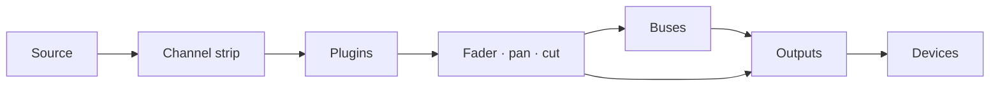

# Faider ユーザーマニュアル

[English](../FAIDER-MANUAL.md)

**バージョン 0.1 · Windows 10 (2004) 以降**

Faider は、大型コンソールをモデルにした Windows 用のライブオーディオルーター兼ミキサーです。
オーディオインターフェース、Windows のデバイス、個々のプログラムから音を受け取り、チャンネルストリップ、バス、出力に通して、選んだデバイスで再生します。ヘッドホン、スピーカー、配信、通話やゲーム用の仮想マイクなど、行き先は自由です。

このマニュアルでは、アプリの機能をすべて説明し、よくある作業を手順に沿って案内し、困ったときの対処も紹介します。

---

## 目次

1. [始める前に](#1-before-you-start)
2. [初回セットアップ](#2-first-time-setup)
3. [ウィンドウ](#3-the-window)
4. [ルーティングの仕組み](#4-how-routing-works)
5. [コンソール](#5-the-console)
6. [チャンネルストリップを部分ごとに](#6-the-channel-strip-section-by-section)
7. [ロー(RAW)ストリップ: アプリ、パッド、テープ、コンバイネーター](#7-raw-strips-apps-pads-tape-and-combinators)
8. [出力](#8-outputs)
9. [プラグイン](#9-plugins)
10. [ROUTING ページ](#10-the-routing-page)
11. [ツール: パッド](#11-tools-pads)
12. [ツール: テープ、レコーダー、リプレイ](#12-tools-tape-recorder-and-replay)
13. [デバイス](#13-devices)
14. [シーン、元に戻す、セッション](#14-scenes-undo-and-sessions)
15. [設定](#15-settings)
16. [リモート操作、オーバーレイ、トレイ](#16-remote-control-overlay-and-tray)
17. [操作ガイド](#17-how-to-guides)
18. [トラブルシューティング](#18-troubleshooting)
19. [リファレンス](#19-reference)

---

## 1. 始める前に

### 必要なもの

| | |
|---|---|
| **Windows** | Windows 10 バージョン 2004 以降、または Windows 11。単一プログラムの音のキャプチャには 2004 以降が必要です |
| **オーディオインターフェース** | 必須ではありません。ASIO ドライバーをインストールすると、Faider はインターフェースのクロックで動作し、遅延が最小になります。インターフェースがない場合は、Windows の再生デバイス、または内蔵クロックで動作します([クロック](#clocking)を参照) |
| **ヘッドホン** | ミックスを聞くために、インターフェース(または任意の Windows 再生デバイス)につなぎます |
| **VB-CABLE** | 必須ではなく、無料です (vb-audio.com/Cable)。仮想マイクとして、Discord、ゲーム、OBS などのアプリがあなたのミックスを聞けるようになります |
| **ffmpeg** | 必須ではありません。`ffmpeg.exe` が PATH にあると、レコーダーは MP3、AAC、Opus、ALAC でも書き出せます |

### このマニュアルで使う言葉

| 言葉 | 意味 |
|---|---|
| **チャンネル**(入力) | 卓上の 1 つの音源。マイク、デバイス、プログラム、パッド、テープ |
| **ストリップ** | チャンネル、バス、出力を操作する、コンソール上の縦の列 |
| **ルート** | チャンネルやバスの音を、バスや出力へ送る接続 |
| **バス** | サブミックス。送られてきた音を合計し、まとめて処理して、さらに先へ送ります |
| **コンバイネーター** | 音を並列の経路に分け、経路ごとのプラグインで処理してから合計するバス |
| **出力** | デバイス(ヘッドホン、スピーカー、仮想ケーブル)で再生される最終ミックス |
| **インターフェース** | お使いの ASIO オーディオインターフェース(ある場合) |
| **クロック** | すべてが同期して動く基準。インターフェース、なければ Windows の再生デバイス、それもなければ内蔵クロック |

## 2. 初回セットアップ

この章では、インストーラーから、動作するセットアップまでを案内します。マイクの音がヘッドホンから聞こえ、アプリがあなたのマイクを聞き取り、プログラムの音が専用のチャンネルに入る状態です。手順は順番に進めてください。各手順は 1、2 分です。

### ステップ 1: Faider をインストールする

1. インストーラー `Faider-<version>-Setup.exe` を実行します。
2. インストーラーにコード署名がないため、Windows SmartScreen が未認識のアプリとして警告することがあります。**詳細情報**をクリックし、**実行**をクリックします。
3. 使用許諾に同意し、管理者権限の確認を許可します。デスクトップのショートカットが必要な場合は、途中でチェックを入れてください(初期状態ではオフです)。
4. インストーラーはアプリを `C:\Program Files\Faider` に置き、スタートメニューに **Faider** を追加します。必要なものはすべて同梱されています。
5. 最後のページで、すぐに Faider を起動できます。VB-CABLE がインストールされていない場合は、VB-CABLE のダウンロードページを開くかどうかも尋ねられます。

ミックスと設定は、プログラムとは別に `%APPDATA%\Faider` に保存されます。アンインストールしても、これらは残ります。

### ステップ 2: VB-CABLE をインストールする(任意)

VB-CABLE を使うと、他のアプリが選べる仮想マイクができます。自分のヘッドホン用にミックスするだけなら、この手順は飛ばしてかまいません。

1. vb-audio.com/Cable から VB-CABLE をダウンロードし、インストーラーを管理者として実行します。
2. 再起動を求められたら、Windows を再起動します。
3. Windows に新しいデバイスが 2 つ増えます。**CABLE Input** は再生デバイスで、ここに再生した音が、録音デバイスの **CABLE Output** から出てきます。アプリは **CABLE Output** をマイクとして選べます。

> **Windows が音をケーブルに切り替えます。** 仮想ケーブルをインストールすると、多くの場合、Windows の既定のデバイスになります。スピーカーが **CABLE Input**、マイクが **CABLE Output** になります。すると Windows の音が聞こえなくなり、既定のマイクを使うアプリにはケーブルの音が届きます。インストール後すぐに、両方を元に戻してください。

**デバイスを元に戻す:**

1. **設定 > システム > サウンド**を開きます(またはタスクバーのスピーカーアイコンを右クリックして**サウンドの設定**を選びます)。
2. **出力**で、**CABLE Input** ではなく、ヘッドホンまたはスピーカー(またはインターフェースの出力)を選びます。
3. **入力**で、**CABLE Output** ではなく、本物のマイクを選びます。
4. Windows には通話用の既定が別にあります。**その他のサウンド設定**までスクロールします。**再生**タブで、ヘッドホンまたはスピーカーを右クリックして**既定の通信デバイスとして設定**を選びます。**録音**タブで、マイクについても同じ操作をします。

出力をすばやく設定する方法もあります。タスクバーのスピーカーアイコンをクリックし、音量スライダーの横の **>** をクリックして、デバイスを選びます。

本物のデバイスを Windows の既定のままにしておいてください。Faider は、ルーティングした先でだけケーブルに再生します。各アプリは自分で **CABLE Output** をマイクとして選びます(ステップ 6)。Windows の既定のスピーカーがケーブルになっていると、PRE-FLIGHT が **HEARD ONCE** の下で知らせます。

### ステップ 3: Faider を起動する

スタートメニューを開いて **Faider** をクリックします(作成した場合はデスクトップのショートカットでも起動できます)。初回は **SETUP** が別のウィンドウで開きます。

### ステップ 4: SETUP の 4 つの質問に答える

SETUP は 1 ページに 1 つ、4 つの質問をして、答えに合わせてミックスを作ります。カードをクリックして選びます。3 ページ目以外は、複数選べます。**NEXT** で進み、**BACK** で戻ります。

1. **WHERE YOU LISTEN**: ヘッドホンまたはスピーカーを選びます。Windows の既定がすでに選ばれています。
2. **MICROPHONES**: 話しかけるマイクを選びます。インターフェースの入力(**IN 1**、**IN 2** …)と、Windows の録音デバイスです。
3. **APPS HEAR YOU**: アプリがマイクとして使う仮想ケーブルを選びます(ステップ 2 の後なら **CABLE Input**)。または **NOT NOW** を選びます。
4. **PROGRAMS**: 今音を出していて、卓に入れたいプログラムを選びます。
5. **BUILD THE MIX** をクリックします。**DONE** に、作られたものが一覧されます。
6. **OPEN THE MIXER** をクリックして、ミキサーを見ます。

各答えで作られるもの:

| ページ | 作られるもの |
|---|---|
| **WHERE YOU LISTEN** | 各デバイスの出力。最初のものは **HEADPHONES**、他はデバイス名で呼ばれます |
| **MICROPHONES** | それぞれのチャンネル。**MICROPHONE** (MICROPHONE 2 …) と呼ばれます |
| **APPS HEAR YOU** | ケーブル上の **MIC FOR APPS** という出力。すべてのマイクがここにルーティングされます |
| **PROGRAMS** | それぞれのロー(RAW)チャンネル。聞く場所にルーティングされ、プログラムが音を出すたびに自動で戻ってくるアプリルールも作られます |

マイクは自分のヘッドホンにはルーティングされないので、遅れて返ってくる自分の声のエコーは聞こえません。自分の声を聞きたいときは、マイクの **HEADPHONES** キーを点灯させます(ステップ 6)。

SETUP はページではありません。デバイスやプログラムを追加したら、**FIND**(**SETUP: BUILD A MIX**) や SIMPLE の **SETUP** キーからいつでも実行し直せます。足りないものを追加するだけで、何も削除しません。

### ステップ 5: オーディオが動いているか確認する

右上の**ヘルスライト**を見ます。

- パーセント表示のある**緑**: オーディオは動いています。ステップ 6 に進みます。
- **赤で OFF と表示**: オーディオが動いていません。他のプログラム(DAW、ドライバーのコントロールパネルなど)がインターフェースを使っている可能性があります。それを閉じて、Faider を再起動してください。[18.4](#184-the-interface-wont-start-or-stopped) を参照してください。

ライトをクリックすると **DEVICES** が開きます。**STREAMS** には使用中のクロック(ASIO、Windows、内蔵クロック。[クロック](#clocking)を参照)が表示され、**BUFFER** でそのバッファサイズを設定します。ノイズなしで再生できる最小のサイズが、最も遅延の少ない設定です。多くの環境では 256 または 512 サンプルが適しています。

### ステップ 6: 自分の声を聞き、アプリにも聞かせる

ミキサーは **SIMPLE** で開きます。各チャンネルには、名前、聞いている音源、出力ごとのキー、フェーダーとメーター、**CUT** と **SOLO** が表示されます。各出力には、再生しているデバイス、フェーダー、メーターが表示されます。

| チャンネル上のキー | 意味 |
|---|---|
| 無地のグレー | その出力にはルーティングされていません |
| 出力の色で塗りつぶし | そこにルーティングされています。クリックでオフになります |
| 縁だけ色付き、**VIA BUS** | バス経由で届いています(PRO で設定)。クリックすると、そこへ直接もルーティングします |

1. 話して、マイクのメーターが動くのを確認します。
2. 自分の声を聞くには、マイクの **HEADPHONES** キーをクリックします。
3. Discord、ゲーム、OBS など、他のアプリで、マイクとして **CABLE Output** を選びます。
4. アプリに何が届いているか確認します。**FIND** (Ctrl+K) > **HEAR WHAT THEY HEAR** で、アプリが受け取っている音を 5 秒間録音して、再生します。

プログラムが二重に聞こえるときは、[18.7](#187-i-hear-something-twice-or-an-echo) を参照してください。

**+ CHANNEL** と **+ APP** でチャンネルを追加します。**+ OUTPUT** は、出力がまだないデバイスに出力を追加します。出力名の下にあるデバイスキーで、再生先を変更できます。名前を右クリックすると、**Rename...**、色、**Remove** が使えます。プログラムのチャンネルを削除すると、そのアプリルールも削除されるので、チャンネルが自動で戻ることはありません。

### ステップ 7: PRO で、コンソール全体を使う

上部バーの **SIMPLE / PRO** スイッチは、どちらでも同じミックスを表示します。**PRO** はコンソール全体です。各チャンネルの入力、フィルター、ダイナミクス、EQ、バスとコンバイネーター、プラグインを操作できます。

マイクの音を整えるには、[17.1](#171-hear-yourself-set-up-a-microphone) を参照してください。すべてのコントロールは [6](#6-the-channel-strip-section-by-section) にあります。PRO で行った設定は、SIMPLE でも有効です。

### ステップ 8: PRE-FLIGHT を実行する

起動の数秒後に、**PRE-FLIGHT** がセットアップを確認し、対処が必要なときだけ開きます(最初の起動では SETUP が先なので開きません)。いつでも **SETTINGS > GENERAL > PRE-FLIGHT NOW...** または **FIND** (Ctrl+K) から実行できます。すべての行が緑になるはずです。[18.1](#181-pre-flight) を参照してください。

### ステップ 9: 仕上げ

- **ミックスは自動で保存されます。** 変更から 1 秒以内に保存されます。名前を付けてバージョンを残すには、**SETTINGS > GENERAL > SAVE SESSION AS...** を使います。
- **Windows と一緒に起動:** **SETTINGS > GENERAL > WINDOWS** で、サインイン時に Faider がトレイで起動し、最初からマイクが使えます。
- **ウィンドウを閉じても、オーディオは止まりません。** Faider はシステムトレイで動き続けるので、マイクとヘッドホンはそのまま使えます。止めるには、トレイアイコンを右クリックして **Quit Faider** を選びます。トレイにある間にプログラムを起動すると、ウィンドウが戻ります。

各ページを初めて開くと、短いヒントが表示されます。ヒントは **SETTINGS > GENERAL > ON START** でオフにできます。

これでセットアップは完了です。残りの章では、各部分を詳しく説明します。

## 3. ウィンドウ

### サイドバー

ページは左に縦に並んだカードです。**MIXER**、**ROUTING**、**TOOLS**、**DEVICES**、**SETTINGS**。表示中のページは、青く光る縁が付きます。MIXER を表示している間は、サイドバーに次のカードも並びます(SIMPLE では **ADD CHANNEL** と **ADD APP** だけです)。

| グループ | カード | 働き |
|---|---|---|
| **DESK** | **ADD CHANNEL** | 入力メニューを開きます。インターフェースの入力、Windows のデバイス、アプリ、プログラムのウィンドウとブラウザーのタブ、パッド、テープ |
| | **ADD APP** | 今音を出しているプログラムを一覧します。1 つ選ぶと、チャンネルが作られます |
| | **ADD BUS** | バス、またはコンバイネーター(最初は 2 経路) |
| | **PLUGINS** | ストリップの下にプラグインパネルをスライドして表示します([9](#9-plugins) を参照) |
| **SELECT** | **AUTO** | ストリップのどのコントロールに触れても、そのストリップが選択されます |
| | **FOLLOW** | 卓が、選択したストリップへ滑らかに移動します。FIND やホットキーなど、他の場所で選んだときも同様です |
| **METER** | **IN** / **OUT** | チャンネルのメーターに、入ってくる信号(処理の前)か、出ていく信号を表示します |
| **SECTIONS** | HEADER … FADER | ストリップの各セクション。点灯しているものが画面に出ています。クリックすると、そこへ滑らかに移動します |

SELECT と METER の選択は記憶されます。

### 上部バー

右から順に:

| コントロール | 働き |
|---|---|
| **+ 100% -** | ズーム。100、125、150% の順に切り替わります。パーセント表示をクリックすると 100% に戻ります。Ctrl + / Ctrl - / Ctrl 0 でも同じです |
| **FIND** (Ctrl+K) | すべてのページ、チャンネル、シーン、マクロ、パッド、コマンドを名前で検索します |
| **HISTORY** (Ctrl+H) | これまでの変更をすべて表示します。1 つ選ぶと、その時点に戻ります |
| **MINI** | 常に最前面に表示される小さなミキサーウィンドウ |
| **ヘルスライト** | 緑: オーディオは正常です。琥珀色: オーディオ負荷が高いか、最近デバイスで不足がありました。赤: 直近 10 秒に聞こえるグリッチがあったか、オーディオが動いていません。数字はオーディオ負荷です。クリックすると DEVICES が開きます |
| **SCENES** | 保存したミックス。**+** で新しく保存します([14.1](#141-scenes) を参照) |
| **SIMPLE / PRO** | 同じミックスを、シンプルに、またはコンソール全体として表示します([ステップ 7](#step-7-pro-for-the-whole-console) を参照) |

ウィンドウが狭いときは、ヘルスライト、MINI、HISTORY の順に隠れます。FIND からはすべてに届きます。

### トランスポート

上部バーの下の、MIXER のどの表示にも、テープデッキの時間(経過時間とトラックの長さ)、トラック名、そのキーがあります。**巻き戻し 10 秒**、**停止**、**再生/一時停止**、**早送り 10 秒**、**録音**、**ループ**です。

- **録音**は、最初の出力をファイルに録音します(レコーダーの形式とフォルダーで)。もう一度押すと止まります。
- **ループ**は、**全曲リピート** → **1 曲リピート**(**1** の印) → **オフ**の順に切り替わります。

---

## 4. ルーティングの仕組み

ルーティングは、それぞれの音がどこへ行くかを決めます。ルーティングするまで何も聞こえません。ひとつの音を、いくつでも好きなだけ行き先にルーティングできます。

### 音の通り道

1. **チャンネル**は 1 つの音源を受け取り、ストリップ(入力、フィルター、ダイナミクス、EQ。順番はヘッダーに表示されます)に通し、次にプラグイン、そしてフェーダー、パン、カットを通します。
2. **ルート**は、チャンネルをバスや出力のいくつにでも同時に送ります(それぞれ最大 8 つまで)。どのルートも、フェーダーを通った後のチャンネルを運ぶので、フェーダーと **CUT** は、ルーティングされたすべての先に効きます。
3. **バス**は、送られてきたものをすべて合計し、自分のストリップとプラグインを通して、同じ方法で出力(または他のバス)へ送ります。
4. **出力**は、送られてきたものをすべて合計し、バスコンプレッサー、ミックス EQ、**SAFE** リミッターを通して、そのデバイスで再生します。

### 出力はデバイス

出力は、それぞれ 1 つのデバイスで再生されます。インターフェースの出力、USB ヘッドセット、スピーカー、**CABLE Input** などです。出力を手作業で作る必要はありません。デバイスに何かをルーティングすると、そのデバイスに出力が作られます。ルーティングのボックスにバスだけでなくデバイスも並ぶのは、そのためです。

- デバイスごとに出力は 1 つです。複数のチャンネルを同じデバイスにルーティングすると、その出力で合流します。
- 出力ごとに、別のミックスを運べます。ヘッドホンではゲーム、音楽、声が聞こえ、配信の出力には音楽と声だけを送る、といったことができます。
- デバイスを抜くと、デバイスが戻るまで、その出力は無音になります。

### ルーティングする 3 つの場所

3 つとも、同じルートを変更します。いちばん近いものを使ってください。

| 場所 | 方法 |
|---|---|
| **ルーティングボックス**(各ストリップのヘッダー) | バスと出力デバイスごとに 1 つのボックス。点灯: そこにルーティング済み。クリックで切り替え |
| **Route to**(ストリップを右クリック) | 同じ一覧をメニューにしたもの。ルーティング済みの先にチェックが付きます |
| **ROUTING ページ** | 各ストリップがブロック、各ルートが線。ブロックを 1 つクリックし、次に別のブロックをクリックします([10](#10-the-routing-page) を参照) |

### バス

複数のチャンネルに同じ処理をかけたいとき、または 1 本のフェーダーで扱いたいときは、バスを使います。チャンネルをバスにルーティングし、バスを出力にルーティングします。その後、チャンネルからその出力への直接のルートを外してください。外さないと、直接とバス経由の 2 回、同じ出力に届きます。バスは別のバスに送ることもでき、遅延は増えません。

### コンバイネーター

コンバイネーターは、並列の**経路**に分かれたバスです(最初は 2 経路)。経路ごとに自分のプラグインがあり、経路はコンバイネーターのフェーダーで合計されます。音源は、1 つの経路にも複数の経路にもルーティングできます([7](#7-raw-strips-apps-pads-tape-and-combinators) を参照)。

### 安全のためのルール

- **フィードバックループは拒否されます。** 音が元の場所に戻ってしまうルート(自分に送っているバスへのバス、出力の音を自分の入力に戻すなど)は、すぐにオフに戻され、イベントログにループが記録されます。
- どのストリップでも**ソロ**にすると、ソロセーフの印があるものを除いて、ソロになっていないすべてのストリップが無音になります。
- **アプリのチャンネルと二重再生。** プログラムは、自分のデバイスでも、チャンネルにも再生されます([18.7](#187-i-hear-something-twice-or-an-echo) を参照)。

### クロック

クロックを決めるデバイスは 1 つです。Faider は、起動時に次の順で選びます。

1. **ASIO**: オーディオインターフェース。ASIO ドライバー経由です。最も遅延が少なくなります。
2. **Windows**: ASIO ドライバーがないとき、Windows の既定の再生デバイスを使います(仮想ケーブル、ディスプレイのスピーカー、VR ヘッドセットは、他に何もないときだけ)。インターフェースの出力はそのデバイスの出力になり、マイクは Windows デバイスとして追加されます。
3. **内蔵クロック**: 再生デバイスがまったくないとき。ヘッドホンを含むすべてのデバイスが、これに従います。

他のデバイスと、キャプチャしたプログラムはすべて、それぞれのクロックで動き、ずれを補正する小さなバッファを通して合流するので、クロックがずれてもクリック音は出ません。**DEVICES > STREAMS** に、それぞれと、使用中のクロックが表示されます。

クロックを決めている Windows デバイスが抜かれたり、オフになったり、動かなくなったりすると、次のクロックが自動で引き継ぎ、どれになったかが通知されます。起動できないデバイス(他のプログラムが使用中など)は、デバイスの構成が変わるまで飛ばされ、その後で再度試されます。内蔵クロックで動作中に再生デバイスが接続されると、そちらに引き継がれます。

## 5. コンソール

### レイアウト

卓には、すべてのストリップが左から右へ並びます。**チャンネル**、次に**バス**(紫の名前バー)、次に**出力**(琥珀色の名前バー)。各ストリップには、上から下へ 7 つのセクションがあります。

| セクション | 内容 |
|---|---|
| **HEADER** | レベルバー、FILT / EQ / EXT キー、処理順、ルーティングボックス、ストリップ番号 |
| **INPUT** | トリム、極性(Dark strip では、マイクドライブと入力スイッチも) |
| **DYNAMICS** | コンプレッサーとゲート |
| **FILTERS** | ローパスとハイパス |
| **EQ** | 4 バンド |
| **NAME** | 名前バーと電源スイッチ |
| **FADER** | パン、SOLO、CUT、SEL、フェーダーとその数値表示 |

### マウスとキーボード

| 操作 | 結果 |
|---|---|
| ノブやフェーダーを上下に**ドラッグ** | 値を変更します。ドラッグ中とホバー中は、横に値が表示されます |
| ノブやフェーダーを**ダブルクリック** | 既定値に戻ります |
| キーやスイッチを**クリック** | オン / オフ |
| 名前バーを**クリック** | ストリップを選択します |
| ストリップの名前バーを横に**ドラッグ** | 同じ種類(チャンネル、バス、出力)の中で移動します([17.4](#174-reorder-channels) を参照) |
| 名前バーの電源マークを**クリック** | ストリップをオフ / オンにします |
| ストリップを**右クリック** | そのストリップのメニュー |
| **マウスホイール** | 卓を横にスクロールします。**Shift + ホイール**で上下にスクロールします |
| **Ctrl + / Ctrl -** | ウィンドウ全体のズーム |

左クリックでメニューが開くことはありません。メニューは常に右ボタンです。

### ストリップを選択する

選択中のストリップは青い枠で囲まれます。ストリップを選ぶには、名前バーか **SEL** キーをクリックするか、**AUTO** がオンのときにいずれかのコントロールに触れます。選択中のストリップは、プラグインパネルに表示されるストリップであり、FIND、ホットキー、リモート操作の対象になるストリップです。

卓にフォーカスがあるとき(先にクリックしておきます): **Left / Right** で前 / 次のストリップを選択し、**M** でカット、**S** でソロ、**Up / Down** でフェーダーを 0.5 dB(**Shift** を押すと 3 dB)動かします。

### ストリップをオフにする

名前バーの左にある電源マークをクリックします。ストリップは薄くなり、グレーになります。処理されなくなり、そのデバイスやプログラムは解放されます。オフの間は、**ストリップ上では何も変更できません。** ノブ、キー、プラグインパネルはクリックを無視し、メニューには **Turn on** とスペーサーだけが出ます。もう一度電源マークをクリックすると戻ります。

### ストリップの種類

チャンネルごとに、**Light strip** か **Dark strip** を使えます。右クリック > **Strip type** > **Light strip** / **Dark strip**。インターフェースの入力、録音デバイス(マイク)、バスは Dark で始まり、それ以外は Light で始まります。Dark strip では、マイクの **drive** と入力スイッチが加わり、コンプレッサーの fast アタックとゲートの hold がなくなります。選択はチャンネルごとに記憶されます。

### スペーサー

スペーサーは、グループの間に余白を作る空のストリップです。ストリップを右クリック > **Add spacer before** / **Add spacer after**。スペーサーを右クリックすると、**Narrow**、**Add another**、**Remove spacer** が使えます。スペーサーは、直前のストリップが移動するときに一緒に動きます。

### ストリップのメニュー(右クリック)

| 項目 | |
|---|---|
| **Input** | 音源を変更: **Interface** の入力、**Windows devices**(または Windows の既定)、**What an output plays**(ループバック)、**Test tone**、**Nothing** |
| **Route to** | すべてのバスと出力デバイス。送っている先にチェックが付きます |
| **Plugins** | 1 つを開く、**Add plugin...**、**Remove** |
| **Make mono / Make stereo** | チャンネルのみ |
| **Strip type** | **Light strip** か **Dark strip** |
| **Colour** | チャンネルの色。名前バーに沿って、また ROUTING のブロックに表示されます |
| **Add spacer before / after** | |
| **Rename...** | |
| **Remove** | チャンネルまたはバスを削除します |

---

## 6. チャンネルストリップを部分ごとに

### HEADER

| コントロール | 働き |
|---|---|
| **レベルバー** | チャンネルのレベル。左右別(METER の選択に応じて IN または OUT) |
| **FILT** | フィルターを、ゲート / コンプレッサーの検出器に通します(キーフィルタリング) |
| **EQ** | EQ のオン / オフ |
| **EXT** | ダイナミクスが、チャンネル自身ではなく外部のキー(サイドチェイン)を聞きます |
| **処理順** | 3 つのブロック(FILT、EQ、DYN)が、チャンネルが処理する順に上から並びます。**ブロックをクリック**すると 1 つ上に移動します。一番上のものは最後に回ります。点灯しているブロックが使用中です |
| **ルーティングボックス** | バスと出力デバイスごとに 1 つのボックス。点灯: チャンネルはそこへ送られています。クリックで切り替え([出力はデバイス](#outputs-are-devices) を参照) |
| **番号** | 卓上でのストリップの位置 |

### INPUT

| コントロール | |
|---|---|
| **in trim** | 入力ゲイン |
| **ø** | 極性の反転 |
| **WIDTH** (Light strip) | ステレオ幅: 0 % はモノラル、100 % はそのまま、200 % は 2 倍の幅。モノラルのチャンネルでは薄く表示されます |
| **mic** (Dark strip) | ドライブ: 温かみとレベルを加えます(パーセントで表示) |
| **pre** (Dark strip) | 入力段のオン / オフ |

### DYNAMICS

**IN** スイッチ(電源マーク付き)で、コンプレッサーとゲートをまとめてオン / オフにします。

**コンプレッサー**

| コントロール | |
|---|---|
| **MIX** | ウェット/ドライのブレンド(パラレルコンプレッション)。緑の数値をドラッグします |
| **ratio**、**thresh**、**rel** | レシオ、スレッショルド、リリース |
| **fast** | 速いアタック(3 ms)。オフなら 10 ms |
| **pk** | ピーク検出。オン(既定)では、コンプレッサーはピークに反応します。オフでは平均(RMS)レベルに反応し、より滑らかです |
| **ゲインリダクション LED** | 3、6、10、14、20 dB のリダクション |

**ゲート / エキスパンダー**

| コントロール | |
|---|---|
| **range**、**thresh**、**rel**、**hold** | どこまで閉じるか、どこで開くか、閉じる速さ、保持する長さ |
| **exp** | エキスパンダーモード(より穏やかなゲート) |
| **fast** | 速いアタック(0.1 ms)。オフなら 1.5 ms |
| **ゲート LED** | ゲートがどこまで閉じているか |

LED は、コンプレッサーとゲートがオフの間も、オンなら*どう動くか*を示します。オンにする前に設定を決められます。

### FILTERS

**lp**(ローパス)と **hp**(ハイパス)。ハイパスは、いちばん下まで回すとオフになります。ローパスは、いちばん上まで回すとオフになります。

### EQ

| バンド | コントロール |
|---|---|
| **HF** | gain、freq、**bell**(オフならシェルフ) |
| **HMF** | gain、freq、q |
| **LMF** | gain、freq、q |
| **LF** | gain、freq、**bell**(オフならシェルフ) |

**EQ IN** スイッチで、EQ 全体をオン / オフにします(ヘッダーの EQ キーと同じです)。

### FADER

| コントロール | |
|---|---|
| **PAN** | 左右。ダブルクリックで中央 |
| **SOLO** | その場でソロ |
| **CUT** | ミュート |
| **SEL** | このストリップを選択 |
| **フェーダー** | レベル、+12 dB からオフまで。下の数値に dB でレベルが表示されます |
| **safe** | ソロセーフ: 他がソロのとき、このチャンネルは聞こえたままです |
| **listen** | ダイナミクスのキー信号を聞きます |

### 音声エフェクト

ストリップ自身の処理に加え、各チャンネルには独自の音声エフェクトが4つあります。

| エフェクト | 働き |
|---|---|
| **ROBOT** | リングモジュレーション: 声にトーンを掛け、金属的な音にします |
| **ECHO** | 最大1秒のディレイ |
| **RADIO** | 300 Hz - 3 kHz に帯域制限し、歪ませて小さなスピーカー처럼します |
| **PITCH** | 声を上下、最高1オクターブまで変えます |

これらはマクロで切り替えます: アクション **FX ON**、**FX OFF**、**FX TOGGLE** にチャンネルを対象にします
([15](#15-settings))。パッド、ホットキー、トリガー、リモート操作からマクロを呼べるので、エフェクトはミックスと
一緒に切り替えられます。

---

## 7. ロー(RAW)ストリップ: アプリ、パッド、テープ、コンバイネーター

チャンネルの中には、すでに仕上がった音を運ぶものがあります。プログラムの音声、パッド、テープです。これらには**ロー(RAW)ストリップ**が使われます。ルーティング、必要ならプラグイン、パン、フェーダー、キーはありますが、内蔵エフェクトはありません。卓に現れたときに、内蔵エフェクトは一度オフにされます(イベントログにも記録されます)。プラグインは残ります。

| ストリップ | 中央のセクションの内容 |
|---|---|
| **App** | プラグイン一覧(クリックで開く)と **ADD PLUGIN** |
| **Pads** | バンクキー **A–D**、4×4 のパッド(押すと再生。GATE パッドは押している間再生)、**STOP ALL** |
| **Tape** | デッキの画面とシークバー、トランスポート(前へ、巻き戻し、停止、再生、一時停止、早送り、次へ)、**SHUFFLE**、**ADD...**、プレイリスト(トラックをクリックで再生) |
| **Combinator** | 経路ごとに: **FROM**(入力しているチャンネルとバス。クリックでそのストリップへ移動)と、その経路の **PLUGINS**(クリックで開く)。**EDIT IN ROUTING** で ROUTING ページが開きます |

コンバイネーター自体にはエフェクトがありません。その音は、入力しているものと、各経路のプラグインから生まれます。右クリック > **Paths** で経路を追加できます。また、経路ごとに、プラグインを開く、追加する、削除する、名前を変える、経路を削除する、ができます。

---

## 8. 出力

各出力(マスター)には、専用の Dark strip があります。

| コントロール | |
|---|---|
| **DEVICE** | 再生しているデバイス。クリックで別のデバイスを選びます |
| **SAFE** | フェーダーの後ろのリミッター: -1 dBFS を超える音は出ません |
| **MON** | この出力をモニターします |
| **LUFS** | 出ていく音の短期ラウドネス(無音のときは「-- LUFS」) |
| **WIDTH** | ステレオ幅 |
| **BUS COMP** | In スイッチ、VU 形式のゲインリダクションメーター、**threshold**、**ratio**、**attack**、**release**、**make-up**、**mix** |
| **MIX EQ** | In スイッチ、HF のゲインと周波数、LF のゲインと周波数 |
| **CUT**、**SEL**、フェーダー | チャンネルと同じ |

出力を右クリックすると、**Device...**、スペーサー、**Rename...**、**Remove** が使えます。

出力は、デバイスごとに 1 つ、自動で作られます([出力はデバイス](#outputs-are-devices) を参照)。

**FIND > MIX-MINUS AND STEMS** は、ゲストごとのフィード(本人の声以外のすべて)と、声、音楽、ゲームのステムを作ります。

---

## 9. プラグイン

Faider は、チャンネル、バス、コンバイネーターの経路で **VST3** プラグインをホストし、遅延を自動で補正します。

### プラグインを追加する

- チャンネルで: 右クリック > **Plugins > Add plugin...**、またはローストリップの **ADD PLUGIN**、またはプラグインパネルの **ADD**。
- コンバイネーターの経路で: コンバイネーターを右クリック > **Paths > PATH n > Add plugin...**。コンバイネーターのストリップ上で経路のプラグインをクリックすると開きます。

どのプラグインも、**まず、プログラムの別のコピーでテスト**されるので、読み込み中にクラッシュしたり止まったりするプラグインがミックスを巻き込むことはありません。結果は、プラグインのファイルが変わるまで記憶されます。

### プラグインパネル

サイドバーの **PLUGINS** をクリックします。ストリップの下にパネルがスライドして現れ、**選択中のストリップ**のプラグインが、処理される順に並びます。**FIND** > **PLUGINS: name** は、そのストリップでパネルを開き、SIMPLE を表示中なら PRO に切り替えます。各カードには次が表示されます。

- **CPU**: プラグインが処理時間に占める割合(緑、2 % を超えると琥珀色、5 % を超えると赤)
- **Latency**: 加わる遅延
- **BYPASSED**: オフにしてあるが、まだ読み込まれている状態(メモリは使っています)
- **HEAVY**: 負荷が特に大きい

各カードのキー: **BYPASS**、**OPEN**(そのウィンドウ)、**REMOVE**、前後に動かす矢印。最後の **ADD** でもう 1 つ追加します。

---

## 10. ROUTING ページ

ROUTING ページは、ミックス全体を地図として表示します。各ストリップがブロック、各ルートが線です。すべてがどこへ行くかを見るため、そして 2 つのブロックをクリックしてルーティングするために使います。

### ページの見方

- **3 つの行:** 上に **INPUTS**、中央に **BUSES**、下に **OUTPUTS**。まだ出力がない出力デバイスは、OUTPUTS 行の右端に、グレーで並びます。
- **各ブロックは、自分のストリップの下にあります。** ブロックは、卓上のストリップと同じ横位置にあり、スペーサーも含みます。ページは卓と一緒に横にスクロールします(マウスホイール)。卓を並べ替えると、地図もそれに従います。
- **各ブロックには**、ストリップの名前と番号が表示されます。オフのストリップは薄く表示されます。独自の色があるチャンネルは、色合いと左端の帯で示されます。
- **線がルートです。** 線はそれぞれ、音源から真下に降り、その行の下の隙間にある専用のレーンに入り、横に進んで、入力先のブロックへ降り、矢印で終わります。入力のルートは青緑、バスのルートは紫です。1 つのブロックから出る、またはブロックに入る複数の線は、順番にブロック上に並ぶので、重なりません。
- **コンバイネーター**は、経路をブロックの下端に **P1、P2、…** のセルで表示します。線は、入力先の経路で終わります。

### ブロックからブロックへルーティングする

1. **ブロックをクリックします。** 青く光り、脈打ちます。そのブロックの行き先、または入力元のブロックは枠が強調され、線が明るくなり、それ以外は暗くなります。
2. **別のブロックをクリックします。** 2 つの間のルートがオン(線が現れる)またはオフ(線が消える)になります。順序はどちらでもかまいません。音源から行き先でも、行き先から音源でも同じです。
3. 最初のブロックは**選択されたまま**なので、続けてクリックすれば、複数の行き先にルーティングしたり、複数のルートを外したりできます。
4. **もう一度クリック**するか、何もない場所をクリックするか、**Esc** を押すと、選択が解除されます。

2 つのブロックをルーティングできない場合(出力どうしなど)は、代わりに 2 つ目が選択されます。

### 例

| 目的 | クリックするもの |
|---|---|
| 自分のマイクを聞く | MIC、次にヘッドホンの出力 |
| アプリにマイクを聞かせる | MIC、次に **CABLE Input**(出力の行にあり、出力ができるまではグレー) |
| グループをバス経由で送る | バス、次に各チャンネル。続いてバス、次にその出力 |
| チャンネルを配信から外す | チャンネル、次に配信の出力(線が消えます) |
| コンバイネーターの 1 つの経路に入力する | 音源、次に経路のセル (P1、P2…)。他のセルもクリックすると、複数の経路に入力できます。セルの外側でコンバイネーターをクリックすると、最初の経路に入力されます |

グレーのデバイスのブロックをクリックすると、その出力が作られ、新しい出力はすぐに卓に現れます。

ブロックを、その行に沿って横にドラッグすると、そのストリップが移動します([17.4](#174-reorder-channels) を参照)。すぐにオフに戻るルートは、フィードバックループになるルートです([18.8](#188-a-route-wont-switch-on) を参照)。

## 11. ツール: パッド

**TOOLS > PADS** には、16 個のパッドのバンクが 4 つ(**A–D**)あり、合計 64 の音、同時に最大 32 まで再生できます。

### 音を出す

パッドは **PADS チャンネル**に再生されます。**CREATE PADS CHANNEL** をクリックします(その後、**PADS CHANNEL ACTIVE** と表示されます)。または、**PLAY INTO** メニューで別の入力を選ぶと、パッドがそのチャンネルのプラグインとルートを通って再生されます。パッドのチャンネルがないと、押しても無視されます。

### 読み込みと再生

| 操作 | |
|---|---|
| **空の**パッドをクリック | 音のファイルを選びます |
| 読み込み済みのパッドをクリック | 再生します |
| パッドを右クリック | 再生せずに、編集用に選択します |
| パッドにファイルをドロップ | そのパッドと、バンク内の次のパッドに読み込みます |
| 別のパッドに **Ctrl + ドラッグ** | 2 つのパッドを入れ替えます |
| **STOP ALL** | すべてのパッドをフェードアウトします |

対応形式: WAV、FLAC、AIFF、OGG、MP3。ファイルが移動したパッドには **MISSING: FILE** と表示されます。

### パッドエディター

| 設定 | |
|---|---|
| 名前 | ダブルクリックで名前を変更 |
| **LOAD**、**CLEAR**、**COLOUR** | |
| **REPLAY** | インスタントリプレイのバッファが、このパッドの音になります(録音フォルダーに WAV として保存)。先に TOOLS > TAPE でリプレイを待機状態にしてください |
| **MODE** | **ONE-SHOT** は最後まで再生します(もう一度押すと最初から)。**GATE** は押している間再生します。**LOOP** は 1 回押すと開始し、次に押すと止まります |
| **CHOKE** | OFF またはグループ 1〜8。同じグループのパッドは互いを止めます |
| **LEVEL** | -INF から +12 dB |
| **HOTKEY** | クリック(**LEARN...**)してから、キーを押します([HOTKEYS](#hotkeys) を参照) |
| **MACRO** | パッドと一緒に実行するマクロ(パッドにマクロだけを設定し、音を設定しないこともできます) |
| **TRIM** | 波形の開始線と終了線をドラッグします。ダブルクリックでファイル全体 |
| **FADE IN / FADE OUT** | 0〜5 秒 |

---

## 12. ツール: テープ、レコーダー、リプレイ

### テープデッキ

**TOOLS > TAPE** は、プレイリストを **TAPE チャンネル**に再生します。**CREATE TAPE CHANNEL** をクリックして作ります。

- **ADD FILES**、**ADD FOLDER**、またはページのどこにでもファイルやフォルダーをドロップします。**EJECT** でプレイリストを空にします。
- トラックをダブルクリックして再生し、ドラッグして並べ替え、Delete で選択したトラックを削除します。
- トランスポート: **PREV**、**REW**(10 秒戻る。押し続けると速く巻き戻す)、**PLAY**、**PAUSE**、**STOP**、**FF**(10 秒進む。押し続けると速く送る)、**NEXT**。ほかに **SHUFFLE**、**REPEAT**(全曲 / 1 曲 / オフ)、**LEVEL**。
- トラックはギャップレスで再生されます。一時停止とスキップは 30 ms でフェードするので、クリック音は出ません。

上部バーのトランスポートと、卓上のテープストリップは、同じデッキを操作します。

### レコーダー

| | |
|---|---|
| **Source** | 任意の出力、バス、入力、または **ALL CHANNELS, ONE FILE EACH**(マルチトラック: すべての入力、または DIRECT が点灯しているものだけと、すべての出力。サンプル単位で揃います) |
| **Format** | WAV 24-bit(既定)、16-bit、32-bit、32-bit float。FLAC 24/16-bit。AIFF 24/16-bit。OGG Vorbis 128–320k。ffmpeg があれば MP3、AAC (M4A)、Opus、ALAC。それぞれ、ディスクに入る時間が表示されます |
| **REC** | 開始と停止。画面に、時間、サイズ、残り時間、落ちたブロックがあれば表示されます |
| **PATH** / **REVEAL** | フォルダーを選ぶ / エクスプローラーで開く |

録音は、フォルダーを選ばない限り `Music\Faider Recordings` に保存されます。ffmpeg の形式は、まず WAV で録音し、停止したときに変換します(変換に失敗しても WAV は残ります)。空き容量が 1 GB 未満になると、録音は自動で止まります。

### インスタントリプレイ

**ARM** は、レコーダーのソースの直近の **30 秒**、**1**、**2**、または **5 分**を保持します。**SAVE** でファイルに書き出します(SAVE を右クリックすると、グローバルホットキーを設定できます)。マルチトラックを選んでいる場合、リプレイは最初の出力を使います。

---

## 13. デバイス

**DEVICES** は、すべての Windows オーディオデバイスと ASIO ドライバーを一覧します。

| 列 | |
|---|---|
| **I/O** | ASIO、OUT、IN |
| **DEVICE**、**HARDWARE** | 名前と、接続されているアダプター |
| **FORMAT** | チャンネル数とサンプルレート |
| **STATE** | 有効、取り外し済み、無効、または **off in Faider** |
| **TAGS** | Windows の既定デバイスに付く DEFAULT と CALLS |

ヘッダーをクリックして並べ替えます。デバイスを選択し(Ctrl/Shift で複数選択)、次を使います。

| キー | |
|---|---|
| **EXCLUDE / INCLUDE** | Faider がそのデバイスの使用をやめる(または再開する)。除外したデバイスは開かれず、一覧にも出ません |
| **DISABLE / ENABLE IN WINDOWS** | Windows 自体でデバイスをオフ / オンにします |
| **RENAME** | デバイスに付ける独自の名前。Faider のあらゆる場所で使われます(行をダブルクリックでも可) |

### Streams

一覧の下の **STREAMS** に、オーディオエンジンの状態が表示されます。

- **CALLBACK LOAD**(とそのピーク)、**OVERLOADS**、**BLOCKS SKIPPED**。1 つでも発生すると警告色になります
- **BUFFER**: インターフェースのバッファサイズ(小さいほど遅延が小さく、負荷が高くなります)
- デバイスごと: バッファ内のオーディオ、合計遅延、**DRIFT**(ppm 単位のクロック補正)、**UNDER**(空になり、無音が再生された)、**OVER**(あふれて、オーディオが破棄された)、**RESYNC**(中央に戻した)。オーディオが落ちた行は赤く表示されます
- **RESET STATS** でカウンターをクリアします

### VB-CABLE

VB-CABLE がインストールされていると、上部のバーでその**サンプルレート**と**最大遅延**を設定できます。**APPLY** は管理者権限の確認を 1 回求め、ケーブルを再起動します。

下部のイベントログには、デバイスの接続、取り外し、復旧がすべて記録されます。

---

## 14. シーン、元に戻す、セッション

### 14.1 シーン

シーンには、各チャンネルのフェーダー、パン、カット、ソロ、電源、ルートが保存されます(選べば、プラグインの設定も)。

- **保存:** 上部バーの **+** をクリックし、名前を付けます。
- **呼び出し:** そのキーをクリックします。フェーダーとパンは 0.5 秒かけて滑らかに動きます。それ以外はすぐに切り替わります。
- **シーンを右クリック**すると: ミュートだけ / レベルだけ呼び出す、上書き保存、プラグイン設定を含める、名前の変更、グローバルホットキー、**Recall on device**(デバイスが現れたとき。なくなったときは元に戻る)、**Auto-scene**(アプリが再生を始めたとき、デバイスが接続されたとき、または決めた時刻)、MIDI ラーン、移動、削除。

デバイスとチャンネル自体は、シーンに含まれません。

### 14.2 元に戻す、履歴

**Ctrl+Z** で元に戻し、**Ctrl+Y**(または Ctrl+Shift+Z)でやり直します。**HISTORY** (Ctrl+H) にすべての変更が一覧されます。1 つ選ぶと、その時点に戻ります。

### 14.3 セッション

ミックスは、変更から 1 秒以内と、終了時に自動で保存されます。

| | |
|---|---|
| **Restore session** | トレイメニュー: 日付別の以前のミックス(Faider はそのミックスで再起動します) |
| **SESSION TIMELINE** | FIND: 保存されているすべてのバージョン。**Restore everything**、または、再起動せずに **PUT ONE CHANNEL BACK**(そのレベル、パン、ミュート、ラック) |
| **SAVE SESSION AS...** | SETTINGS > GENERAL > SESSIONS: ミックスに名前を付けて残します |
| **OPEN, EXPORT OR IMPORT...** | 名前付きのミックスを開く(再起動します)、ミックスをファイルに保存する、ファイルから読み込む |

以前のバージョンは最大 60 個まで保持されます(5 分に 1 回まで)。ミックスを読み込めないとき(インターフェースがない、ファイルが壊れているなど)は、失われずに**別に保管**され、新しいミックスで始まります。[18.2](#182-my-mix-is-gone-a-fresh-mix-started) を参照してください。

---

## 15. 設定

**SETTINGS** には 4 つのセクションがあり、左にカードとして並びます。**GENERAL**、**MACROS**、**HOTKEYS**、**CONTROL**。オン/オフの設定は四角いスイッチで、オンのときはクリーム色に光ります。

### GENERAL

| カード | 設定 |
|---|---|
| **LOOK** | **LOOK...**: 卓の色と書体を LOOK ファイルから取ります(下記 [LOOKS](#looks)) |
| **WINDOWS** | **START WITH WINDOWS**: サインイン時にトレイで開きます |
| **DESK** | **WARN IF I TALK WHILE MUTED**(ミュート中のマイクが -30 dBFS を超えたときの通知) |
| **APPS** | **APP RULES...**: プログラムが再生を始めたとき、どのバスや出力へ送るか(**FIND** からも開けます)。プログラムのチャンネルを削除すると、そのルールも削除されます |
| **SESSIONS** | **SAVE SESSION AS...**、**OPEN, EXPORT OR IMPORT...** |
| **ON START** | **PRE-FLIGHT: CHECK THE SETUP**、**PRE-FLIGHT NOW...**、**TIPS**、**SHOW THE TIPS AGAIN** |
| **NOTICES (IN THE CORNER)** | デバイスの接続と取り外し、チャンネルのクリップ(音源または出力がフルスケール)、シーンの呼び出し、マクロの実行、元に戻す / やり直し |
| **ZOOM** | 100%、125%、150%、**CUSTOM...**(75〜200%) |
| **METER STANDARD** | メーターの表示方式(既定は速く落ちるサンプルピーク。IEC など) |
| **CHANNEL METER POINT** | **PRE HPF**(元の音源)、**PRE FADER**(エフェクトの後)、**POST ON**(フェーダーの後、既定) |
| **ABOUT** | バージョンとクレジット |

### LOOKS

**LOOK** は、卓が描くのに使うすべての色に、書体と、それに見えるサイズまで含めたものです。ストリップも、数値表示も、ノブも、キーも、ランプも、有効な LOOK から描くので、LOOK を一つ変えると卓全体が同時に変わります。

**LOOK...** は手元にある LOOK を並べ、選んだものを有効にします。変わった瞬間に卓は描き直されます。**SAVE THIS LOOK AS...** は、有効な LOOK を、あなたが付けた名前で新しいファイルに書き出します。

LOOK は `%APPDATA%\Faider\looks` にある JSON のファイル 1 つです。手で書いて、別のマシンにコピーすることもできます。ファイルが無かったり壊れていたりすれば組み込みの LOOK がそのまま残り、ファイルに書かれていない項目は組み込みの値に戻ります。途中でやめたファイルでも使えます。

| | |
|---|---|
| `name` | 一覧に表われる LOOK の名前 |
| `font` | Windows に添付されている書体。卓の小さいサイズでもくっきりします |
| `keyRadius` | キーの角の丸さ。ピクセル数 |
| `fontSizes` | `legend`、`caption`、`readout`: 文字の 3 つのサイズ |
| `colours` | すべての色。`#rrggbb`、半透明の箇所があるときは `#rrggbbaa` |

色は、描く部分の名前で付いています。面と印刷、キー、フェーダーの盤面、数値表示、機能別のノブ、ランプ、ストリップの胴体、チャンネル・バス・出力の見え方、アクセント、くぼみ、それに陰影です。**SAVE THIS LOOK AS...** は LOOK が持つ名前をすべて書き出します。いちばん手軽なのは、卓で何かを変えてそれを保存し、そのファイルを編集することです。

`palette` のグループは、レイアウト ファイルが部分に指定できる色を名前で並べます: `red`、`green`、`blue`、`black`、`white`、`violet`、`grey`、`cream`、`orange`、`amber`、`teal`、`salmon`。

### MACROS

マクロは、ホットキー、パッド、トリガー、リモート操作から実行される**アクション**のリストです。

1. **+ NEW** をクリックし、名前を付けます(名前をダブルクリック)。
2. **+ ACTION**: MUTE ON/OFF/TOGGLE、SET FADER (dB、フェード時間)、ASSIGN ON/OFF/TOGGLE (ルート)、CHANNEL ON/OFF、TRIGGER PAD、STOP PAD、ALL NOTES OFF、TRANSPORT PLAY/PAUSE、TRANSPORT NEXT、RECORD START/STOP、WAIT、SCENE RECALL、FX ON/OFF/TOGGLE (音声エフェクト、[音声エフェクト](#voice-effects) を参照)、WINDOWS DEFAULT OUTPUT/INPUT、PLUGIN SETTING。
3. 必要なら **+ TRIGGER**: APP STARTS、APP STOPS、DEVICE CONNECTED、DEVICE DISCONNECTED、MASTER SILENT (n 秒間)、MASTER HAS SOUND、TIME (24 時間制)。
4. 必要なら **HOTKEY** と、**MOMENTARY**(キーを離したときにアクションが取り消されます。プッシュトゥトーク用)。
5. **FIRE** で今すぐ実行します。

### HOTKEYS

割り当てられるホットキーはすべてここにまとまっています。**PADS**、**MACROS**、**SCENES**、そして **TAPE** の下の **SAVE INSTANT REPLAY**。1 つクリックして、新しいキーを押します(Esc で取り消し、Delete で消去)。ホットキーには Ctrl、Alt、F キーのいずれかを含める必要があり、ゲームがフォーカスしていても動作します。固定キーも一覧されています([19.1](#191-keyboard-shortcuts))。ページの ON THE MIXER のキーは、コンソールでも使えます([5](#5-the-console))。

### CONTROL

| カード | |
|---|---|
| **MIDI** | **MIDI MAP** (Ctrl+L)、入力とバインド、MIDI 入力ごとのスイッチ |
| **OSC** | **OSC ON (PORT 9000)**。この PC 上のプログラム用 |

---

## 16. リモート操作、オーバーレイ、トレイ

| | |
|---|---|
| **MIDI MAP** (Ctrl+L) | 画面上のコントロールをクリックし、コントローラーのノブやキーを動かします。各ストリップのフェーダー、パン、CUT、SOLO、電源、ルーティングのキーを、SIMPLE でも PRO でもマップでき、シーン、パッド、テープもマップできます。マップ中は、マウスホイールで卓がスクロールします(Shift+ホイールで上下) |
| **OSC** | この PC 上のプログラムからポート 9000 に送信できます(ネットワークからは一切受け付けません): `/faider/input/NAME/fader -12` (dB)、`/faider/output/NAME/mute 1`、`/faider/bus/NAME/pan -0.5`、`/faider/input/NAME/solo 1`、`/faider/scene NAME`、`/faider/macro/NAME 1` (0 で解除)。名前のスペースは `_` と書きます |
| **In-game overlay** (Ctrl+Shift+O) | 各マイクチャンネルのトーキングライト、LIVE / MUTED とレベル、さらに最大 4 つのシーンキー。ゲームからフォーカスを奪いません。好きな位置にドラッグできます |
| **MINI** | すべての上に表示される小さなミキサー。**OPEN** でメインウィンドウに戻ります |
| **Tray** | アイコンをクリックするとトレイミキサー、ダブルクリックするとウィンドウが開きます。右クリック: Show、シーンの呼び出し、Restore session、Start with Windows、About、Quit。警告中は、アイコンが琥珀色に点滅します |

Faider は、管理者のウィンドウから起動された場合でも、常に通常のユーザー権限で動作します。自分で通常の権限で再起動します。ゲーム内オーバーレイは、管理者として動いているプログラムに届かないためです。管理者権限が必要な少数の操作(VB-CABLE の設定の適用、Windows がオフにしたデバイスの再有効化)は、自分で許可を求めます。

---

## 17. 操作ガイド

### 17.1 自分の声を聞く: マイクを設定する

1. **ADD CHANNEL** > インターフェースの入力(または Windows の録音デバイス)。Dark strip で現れます。
2. 話して、レベルバーのピークが -12〜-6 dB あたりになるように **in trim** を設定します。
3. ルーティングします。ヘッドホンの出力のルーティングボックスをクリックします(または ROUTING ページを使います)。
4. 音を整えます。**hp** で低いノイズを除き(80〜100 Hz あたり)、次にゲートとコンプレッサー(DYNAMICS の **IN**)、そして EQ。

### 17.2 アプリにマイクを聞かせる(Discord、ゲーム、OBS)

1. **VB-CABLE** をインストールし(PRE-FLIGHT がリンクを案内します)、本物のスピーカーとマイクを Windows の既定に戻します([ステップ 2](#step-2-install-vb-cable-optional))。
2. マイクのチャンネルを **CABLE Input** デバイスにルーティングします。そのデバイスに出力が作られます。
3. アプリで、マイクとして **CABLE Output** を選びます。
4. **PRE-FLIGHT NOW...** を実行して、途中でミュートされているものがないか、ループしていないかを確認します。

### 17.3 プログラムをミックスに入れる

1. プログラムを起動し、音を出します。
2. **ADD APP** > そのプログラムを選びます。ロー(RAW)チャンネル(エフェクトなし)が作られます。
3. 聞きたい場所にルーティングします。二重に聞こえるときは、[18.7](#187-i-hear-something-twice-or-an-echo) を参照してください。

### 17.4 チャンネルを並べ替える

MIXER でチャンネルの**名前バー**を横にドラッグするか(NAME セクションまで下にスクロールします)、ROUTING ページでそのブロックをドラッグします。青いバーが移動先を示し、ストリップは滑らかにその位置へ動きます。スペーサーは、直前のストリップと一緒に動きます。バスと出力も、それぞれ同じ種類の中で同じように動き、ルートも一緒に動きます。SIMPLE でも出力は同じ順番で表示されます。

### 17.5 チャンネルをバスにまとめる

1. **ADD BUS** をクリックし、名前を変更します(右クリック > Rename...)。
2. ROUTING ページで、バスをクリックし、次に各チャンネルをクリックして、バスに入力します。
3. バスをクリックし、次にその出力をクリックして、バスを先へルーティングします。
4. それらのチャンネルをバス経由だけにしたい場合は、出力への直接のルートを外します。

### 17.6 コンバイネーターでパラレル処理をする

1. **ADD BUS > COMBINATOR**。最初は 2 つの経路があります。さらに追加するには、右クリック > **Paths > Add path**。
2. ROUTING ページで、音源を経路のセル(**P1**、**P2**…)にルーティングします。
3. 各経路について、右クリック > **Paths > PATH n > Add plugin...**。

### 17.7 配信用ミックスとヘッドホン用ミックスを作る

1. チャンネルを 2 つの出力に送ります。たとえば、ヘッドホンと、配信ソフトがキャプチャするデバイスです。
2. 各出力には、専用のフェーダー、バスコンプレッサー、EQ、**SAFE** リミッターがあります。配信用の出力では **SAFE** をオンにします。
3. 何かを配信に入れたくない場合は、そのチャンネルから配信の出力へのルートを外します(ルーティングボックス、または ROUTING ページで)。

### 17.8 録音する

1. TOOLS > TAPE > **RECORDER**: ソースと形式を選びます。
2. **REC**(または上部バーの録音キー)を押します。もう一度押すと止まります。
3. **REVEAL** でフォルダーが開きます。

### 17.9 プッシュトゥトークのキーを作る

1. SETTINGS > MACROS > **+ NEW**。
2. **+ ACTION** > **MUTE OFF** > マイクのチャンネル。
3. **MOMENTARY** をオンにし、**HOTKEY** を設定します。押している間はマイクがオンになり、離すとまたミュートされます。マイクをミュートにした状態から始めてください。

---

## 18. トラブルシューティング

### 18.1 PRE-FLIGHT

PRE-FLIGHT は、起動の数秒後(および **PRE-FLIGHT NOW...** または FIND から)に実行され、問題があるときだけ表示されます。各行には、ライト、確認結果、対処があります。

| チェック | 問題 | 対処 |
|---|---|---|
| **AUDIO** | 起動しませんでした(他のアプリが使っている可能性があります) | **DEVICES** |
| **MIC CABLE** | VB-CABLE がありません。アプリがミックスをマイクとして聞けません | **GET VB-CABLE** |
| **MIC MASTER** | マイクのケーブルに再生する出力がありません | **ROUTING** |
| **MIC CHANNELS** | マイクまでの途中で、ミュートされているものがあります | **UNMUTE** |
| **HEARD ONCE** | フィードバックループ、または二重に聞こえるもの | **SOUND SETTINGS** |

### 18.2 ミックスが消えて、新しいミックスで始まった

ミックスは失われていません。起動時に使えなかったときは、`session-unloaded-<date>.xml` として**別に保管**されます。イベントログに理由が記録されています。

| 理由 | 対処 |
|---|---|
| 保存されたインターフェースが接続されていない | 接続してから、**Restore session**(トレイ)> "kept:" のバージョン |
| 保存されたインターフェースを開けなかった(他のプログラムが使用中) | 他のプログラムを閉じて、Faider を再起動します。その間、ミックスは上書き保存されません |
| session.xml を読み込めなかった | **Restore session** > 最近のバージョン |

### 18.3 音が出ない

信号の通り道に沿って確認します。

1. **ヘルスライト**が赤で OFF と表示: オーディオが動いていません。[18.2](#182-my-mix-is-gone-a-fresh-mix-started) と [18.4](#184-the-interface-wont-start-or-stopped) を参照してください。
2. **チャンネルのメーター**(METER: IN): 動いていなければ、**Input**(右クリック)と、音源が再生中かを確認します。オフのストリップは何も通しません。
3. **CUT** がオフで、フェーダーが上がっていて、他にソロになっているものがない(別のストリップの **SOLO** は、他のすべてを無音にします)。
4. **ルーティング:** ルーティングボックスが少なくとも 1 つ点灯しているか、ROUTING ページに線がある。
5. **出力**: CUT でなく、フェーダーが上がっていて、**DEVICE** に正しいデバイスが表示されている("NO DEVICE" や "(OFF)" ではない)。
6. **デバイス**が接続されていて、DEVICES で除外されていない。

### 18.4 インターフェースが起動しない、または止まった

- 他のプログラム(DAW、ドライバーのコントロールパネル)が使用中の可能性があります。閉じて、再起動してください。
- トレイに **INTERFACE DOWN**: インターフェースが自分でリセットされ、再び開けませんでした。DEVICES でバッファサイズを変更するか、Faider を再起動してください。
- インターフェース自身のコントロールパネルで行ったレートやバッファの変更は、自動で反映されます。
- しばらくインターフェースなしで動かすには、次のように Faider を起動します: `"C:\Program Files\Faider\Faider.exe" --clock windows`(Windows の再生デバイス)または `--clock builtin`(内蔵クロック)。`--clock` に ASIO ドライバー名の一部(`--clock focusrite`)を付けると、そのドライバーが選ばれます。ミックスはそのまま引き継がれ、インターフェース用として保存されたままなので、次の通常の起動では元に戻ります。

### 18.5 クリック音、ノイズ、音切れ

1. **ヘルスライト**と **DEVICES > STREAMS** を見ます。
2. **CALLBACK LOAD** が高い、または OVERLOADS がある場合: **BUFFER** を上げるか、プラグインパネル(**HEAVY**、高い CPU)で負荷の大きいプラグインを見つけて、バイパスまたは削除します。
3. 1 つのデバイスで **UNDER / OVER** が増え続ける: そのデバイスが苦しんでいます。別の USB ポートを試すか、それを使っている他のプログラムを閉じるか、使わないなら除外します。
4. **DRIFT** が一定なのは正常です。クロックをそろえるための補正です。

### 18.6 アプリが ADD APP に表示されない

- プログラムが今**音を出している**必要があります。再生を始めてから、もう一度メニューを開いてください。
- すでにチャンネルがあるプログラムはグレーで表示されます(**ON THE DESK**)。
- Windows 10 バージョン 2004 より古い Windows では、単一のプログラムをキャプチャできません("Windows refused app capture")。

### 18.7 二重に聞こえる、またはエコーがある

- プログラムは、チャンネルに入るだけでなく、自分のデバイスでも再生され続けます。そのチャンネルが同じデバイスの出力にルーティングされていると、直接と Faider 経由の両方で聞こえます。そのルートをオフにする(SIMPLE では、チャンネル上のその出力のキー)か、プログラムを別のデバイスに移してください。PRE-FLIGHT がこれを警告します。
- Windows の既定のスピーカーが仮想ケーブルになっています。PRE-FLIGHT > **HEARD ONCE** がそれを示します。

### 18.8 ルートがオンにならない

**フィードバックループ**になるためです([安全のためのルール](#rules-that-keep-it-safe) を参照)。イベントログにループが記録されます。フィードバックしているルートを外してください。

### 18.9 ストリップで何も変更できない

そのストリップは**オフ**です(薄く、グレー)。名前バーの電源マークをクリックしてください。

### 18.10 チャンネルをドラッグしても何も起きない

**名前バー**(下の方にある NAME セクション。必要なら下にスクロール)をドラッグするか、ROUTING ページでブロックをドラッグします。ストリップは同じ種類の中でしか動きません。バスをチャンネルの間に移すことはできません。

### 18.11 プラグインが読み込まれない

どのプラグインも、まずプログラムの別のコピーでテストされ、失敗の理由が報告されます。30 秒以内に読み込みが終わらなかった、テスト中にクラッシュした、またはファイルに VST3 プラグインがない、のいずれかです。プラグインを更新するか、再インストールしてください。ファイルが変わると、再度テストされます。

### 18.12 プログラムがクラッシュした

レポートが `%APPDATA%\Faider\crash.log` に書かれ、ミニダンプ `crash.dmp` も作られます。ミックスは変更から 1 秒以内に保存されているので、失うのは最後の一瞬の変更だけです。

### 18.13 録音が自動で止まった

ディスクの空きが 1 GB 未満になると(または形式のサイズ上限が近づくと)、録音は止まります。トレイに **RECORDING STOPPED, NO ROOM** と表示されます。空き容量を作るか、別の **PATH** を選んでください。

### 18.14 VB-CABLE のインストール後、Windows の音が出ない

Windows がケーブルを既定のデバイスにしています。ヘッドホンまたはスピーカーを既定の出力に、本物のマイクを既定の入力に、もう一度設定してください。**設定 > システム > サウンド**と、既定の通信デバイスの両方で行います。[ステップ 2](#step-2-install-vb-cable-optional) を参照してください。

---

## 19. リファレンス

### 19.1 キーボードショートカット

| キー | |
|---|---|
| **Ctrl+K** | FIND |
| **Ctrl+Z / Ctrl+Y** (Ctrl+Shift+Z) | 元に戻す / やり直し |
| **Ctrl+H** | 履歴 |
| **Ctrl+L** | MIDI MAP |
| **Ctrl + / Ctrl - / Ctrl 0** | ズームイン / アウト / 100% |
| **Ctrl+Shift+O** | ゲーム内オーバーレイの表示 / 非表示(どこでも動作) |
| **Left / Right** | 前 / 次のストリップを選択(卓にフォーカスがあるとき) |
| **M / S** | 選択中のストリップをカット / ソロ |
| **Up / Down** | 選択中のフェーダー ±0.5 dB(Shift で ±3 dB) |
| **Esc** | 選択したブロックの解除 (ROUTING) |

### 19.2 コマンドライン

| | |
|---|---|
| `--minimised` | トレイで起動 |
| `--quit` | 実行中のコピーを終了 |

### 19.3 ファイル

`%APPDATA%\Faider` 内:

| ファイル | |
|---|---|
| `session.xml` | ミックス |
| `history\` | 以前のバージョン(最大 60) |
| `sessions\` | 名前付きのミックス |
| `session-unloaded-*.xml` | 起動時に別に保管されたミックス |
| `settings.xml` | 環境設定 |
| `looks\` | LOOK(一つにつき JSON ファイル 1 つ、下記 [LOOKS](#looks)) |
| `console.xml` | ストリップの種類、スペーサー、SELECT と METER の選択 |
| `plugins.xml` | 見つかったプラグインと、それぞれのテスト結果 |
| `events.log` | 起こったことすべて(5 MB でローテーション) |
| `status.txt` | 数秒ごとのエンジンのスナップショット: デバイス、レベル、バッファ、ドリフト |
| `crash.log`、`crash.dmp` | クラッシュレポート |

プログラム本体は `C:\Program Files\Faider` にあります。録音は、別のフォルダーを選ばない限り `Music\Faider Recordings` に保存されます。

### 19.4 色

| 色 | 意味 |
|---|---|
| 青い枠 | 選択中 |
| グレーの名前バー | チャンネル |
| 紫 | バス |
| 琥珀色 | 出力 |
| 青緑の線 | チャンネルのルート |
| 紫の線 | バスのルート |
| 緑のヘルスライト | オーディオ正常。琥珀色: 負荷が高い。赤: グリッチ、または動いていない |
