# Faider Gebruikershandleiding

[English](../FAIDER-MANUAL.md)

**Versie {version} · Windows 10 (2004) of later**

Faider is een live audiorouter en mixer voor Windows, opgebouwd rond een grote mengtafel.
Het haalt geluid van je audio-interface, je Windows-apparaten en afzonderlijke programma's, stuurt het
door kanaalstrips, bussen en uitgangen en speelt het resultaat af op de apparaten die je kiest: je
koptelefoon, je speakers, een stream, een virtuele microfoon voor gesprekken en games.

Deze handleiding behandelt alles wat de app doet, loopt de gewone klussen stap voor stap met je door
en vertelt wat je kunt doen als er iets misgaat.

---

## Inhoud

1. [Voordat je begint](#1-before-you-start)
2. [Eerste installatie](#2-first-time-setup)
3. [Het venster](#3-the-window)
4. [Hoe routing werkt](#4-how-routing-works)
5. [De console](#5-the-console)
6. [De kanaalstrip, sectie voor sectie](#6-the-channel-strip-section-by-section)
7. [Raw-strips: apps, pads, tape en combinators](#7-raw-strips-apps-pads-tape-and-combinators)
8. [Uitgangen](#8-outputs)
9. [Plugins](#9-plugins)
10. [De pagina Routing](#10-the-routing-page)
11. [Tools: Pads](#11-tools-pads)
12. [Tools: Tape, Recorder en Replay](#12-tools-tape-recorder-and-replay)
13. [Apparaten](#13-devices)
14. [Scènes, ongedaan maken en sessies](#14-scenes-undo-and-sessions)
15. [Instellingen](#15-settings)
16. [Afstandsbediening, overlay en systeemvak](#16-remote-control-overlay-and-tray)
17. [Handleidingen](#17-how-to-guides)
18. [Problemen oplossen](#18-troubleshooting)
19. [Naslag](#19-reference)

---

## 1. Voordat je begint

### Wat je nodig hebt

| | |
|---|---|
| **Windows** | Windows 10 versie 2004 of later, of Windows 11. Om het geluid van één programma op te vangen is 2004 of later nodig |
| **Een audio-interface** | Optioneel. Met het ASIO-stuurprogramma geïnstalleerd draait Faider op de klok van de interface, voor de laagste vertraging. Zonder interface draait het op je Windows-afspeelapparaat, of op zijn ingebouwde klok (zie [Klokken](#clocking)) |
| **Koptelefoon** | Aangesloten op je interface (of op een willekeurig Windows-afspeelapparaat) zodat je je mix hoort |
| **VB-CABLE** | Optioneel en gratis (vb-audio.com/Cable). Een virtuele microfoon, zodat apps zoals Discord, games en OBS je mix kunnen horen |
| **ffmpeg** | Optioneel. Met `ffmpeg.exe` in je PATH, of gekozen in **SETTINGS > Recording > FFmpeg**, kan de recorder ook MP3, AAC, Opus en ALAC schrijven |

### Woorden in deze handleiding

| Woord | Betekenis |
|---|---|
| **Kanaal** (ingang) | Eén bron op de tafel: een microfoon, een apparaat, een programma, de pads, de tape |
| **Strip** | De kolom op de console die een kanaal, bus of uitgang bedient |
| **Route** | Een verbinding die een kanaal of bus ergens heen stuurt: naar een bus of een uitgang |
| **Bus** | Een submix. Alles wat erheen wordt gerouteerd, wordt opgeteld, samen bewerkt en verder gerouteerd |
| **Combinator** | Een bus die zijn geluid splitst in parallelle paden, elk met eigen plugins, en ze daarna optelt |
| **Uitgang** | Een eindmix die op een apparaat wordt afgespeeld (je koptelefoon, speakers, een virtuele kabel) |
| **Interface** | Je ASIO-audio-interface, als je er een hebt |
| **Klok** | Waar alles mee in de pas loopt: je interface, anders je Windows-afspeelapparaat, anders de ingebouwde klok |

## 2. Eerste installatie

Dit hoofdstuk brengt je van het installatieprogramma naar een werkende opstelling: je microfoon in je
koptelefoon, apps die je microfoon horen en het geluid van een programma op een eigen kanaal. Doe de
stappen in volgorde. Elke stap kost een of twee minuten.

### Stap 1: Faider installeren

1. Start het installatieprogramma, `Faider-<version>-Setup.exe`.
2. Windows SmartScreen kan waarschuwen voor een onbekende app, omdat het installatieprogramma niet
   met een code is ondertekend. Klik op **Meer info** en dan op **Toch uitvoeren**.
3. Kies **Install for all users** (aanbevolen; sta de beheerdersvraag toe) of **Install for
   me only** (geen beheerder nodig) en accepteer dan de licentie. Wil je een bureaubladsnelkoppeling,
   vink die dan onderweg aan (standaard staat hij uit). Een update wordt op dezelfde manier
   geïnstalleerd als de kopie die er al staat, zonder het te vragen.
4. Het installatieprogramma zet de app in `C:\Program Files\Faider` (alleen voor jou:
   `%LOCALAPPDATA%\Programs\Faider`) en voegt **Faider** toe aan het Startmenu. Alles wat de app nodig
   heeft, zit erbij.
5. Op de laatste pagina kun je Faider meteen starten. Is er geen VB-CABLE geïnstalleerd, dan
   biedt het ook aan de downloadpagina van VB-CABLE te openen.

Je mix en instellingen staan in `%APPDATA%\Faider`, los van het programma. Bij het
verwijderen wordt gevraagd of ze ook weg moeten, en ze blijven staan tenzij je ja zegt.

**Installeren zonder de wizard.** Voor scripts en uitroltools neemt het installatieprogramma de
schakelopties van Inno Setup aan:

| Schakeloptie | |
|---|---|
| `/SILENT` | Geen wizard, alleen het voortgangsvenster |
| `/VERYSILENT` | Er wordt niets getoond |
| `/SUPPRESSMSGBOXES` | Samen met een van die twee: berichtvensters krijgen hun standaardantwoord |
| `/NORESTART` | Windows wordt na de installatie nooit opnieuw gestart |
| `/TASKS="desktopicon"` | Maakt de bureaubladsnelkoppeling |
| `/ALLUSERS`, `/CURRENTUSER` | Voor alle gebruikers (de standaard: Windows vraagt om een beheerder, tenzij het al als beheerder wordt uitgevoerd) of voor de gebruiker die het uitvoert |
| `/LOG="file"` | Schrijft het logboek naar dat bestand. Er wordt altijd een logboek geschreven: zonder deze optie is dat `Setup Log <date>.txt` in `%TEMP%` |

Bijvoorbeeld: `Faider-<version>-Setup.exe /VERYSILENT /SUPPRESSMSGBOXES /NORESTART /CURRENTUSER`.
Een stille installatie sluit eerst een draaiende Faider af, en start Faider daarna niet en biedt ook
de pagina van VB-CABLE niet aan. Het verwijderprogramma (`unins000.exe` in de map van het programma)
neemt ook `/SILENT` en `/VERYSILENT` aan. Bij stil verwijderen worden je mix en instellingen nooit
verwijderd.

### Stap 2: VB-CABLE installeren (optioneel)

VB-CABLE geeft je een virtuele microfoon die andere apps kunnen kiezen. Sla deze stap over als je alleen
voor je eigen koptelefoon wilt mixen.

1. Download VB-CABLE van vb-audio.com/Cable en start het installatieprogramma als beheerder.
2. Start Windows opnieuw op als daarom wordt gevraagd.
3. Windows heeft nu twee nieuwe apparaten. **CABLE Input** is een afspeelapparaat: alles wat erin
   wordt afgespeeld, komt uit **CABLE Output**, een opnameapparaat dat apps als microfoon kunnen kiezen.

> **Windows schakelt je geluid om naar de kabel.** Na het installeren van een virtuele kabel maakt
> Windows hem vaak de standaard: **CABLE Input** als je speakers en **CABLE Output** als je
> microfoon. Dan hoor je niets meer van Windows en horen apps die de standaardmicrofoon gebruiken
> de kabel. Zet beide meteen na het installeren terug. Faider kan het voor je doen.

**Zet je apparaten terug met Faider:** klik op **SET MY DEFAULTS**: op de pagina **APPS HEAR YOU** van SETUP
(stap 4), op de rij **WINDOWS DEFAULTS** van PRE-FLIGHT, of **WINDOWS DEFAULTS** in FIND. Het toont je
echte speakers en microfoons. Kies je koptelefoon of speakers, klik er dan nog eens op en kies je
microfoon. Elk wordt de standaard van Windows en zijn standaard voor gesprekken.

**Of zet ze terug in Windows:**

1. Open **Instellingen > Systeem > Geluid** (of klik met rechts op het luidsprekerpictogram in de taakbalk >
   **Geluidsinstellingen**).
2. Kies onder **Uitvoer** je koptelefoon of speakers (of de uitgangen van je interface), niet
   **CABLE Input**.
3. Kies onder **Invoer** je echte microfoon, niet **CABLE Output**.
4. Windows houdt een aparte standaard bij voor gesprekken. Scrol omlaag naar **Meer geluidsinstellingen**. Klik op het tabblad
   **Afspelen** met rechts op je koptelefoon of speakers > **Instellen als standaardcommunicatieapparaat**.
   Doe op het tabblad **Opnemen** hetzelfde voor je microfoon.

Sneller voor de uitvoer: klik op het luidsprekerpictogram in de taakbalk, klik op de **>** naast de
volumeschuif en kies je apparaat.

Laat je echte apparaten de standaard van Windows blijven. Faider speelt alleen in de kabel waar jij
naartoe routeert, en elke app kiest zelf **CABLE Output** als microfoon (stap 6). Is een van de standaarden
van Windows de kabel, dan meldt PRE-FLIGHT dat onder **WINDOWS DEFAULTS**.

### Stap 3: Faider starten

Open het Startmenu en klik op **Faider** (of gebruik de bureaubladsnelkoppeling, als je die hebt gemaakt).
De eerste keer opent **SETUP** in een eigen venster.

### Stap 4: De vier vragen van SETUP beantwoorden

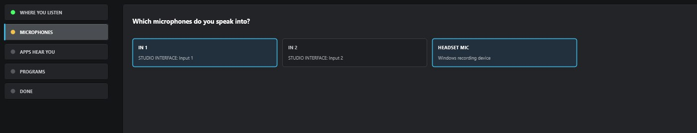

SETUP stelt vier vragen, één per pagina, en bouwt je mix uit je antwoorden. Klik op de kaarten om
te kiezen. Op elke pagina behalve de derde kun je meer dan één kiezen. **NEXT** gaat verder, **BACK**
gaat terug.

1. **WHERE YOU LISTEN**: kies je koptelefoon of speakers. De standaard van Windows is al gekozen.
2. **MICROPHONES**: kies de microfoons waar je in spreekt. Dat zijn de ingangen van je interface
   (**IN 1**, **IN 2** …) en je Windows-opnameapparaten.
3. **APPS HEAR YOU**: kies de virtuele kabel die apps als microfoon gebruiken (**CABLE Input**, na stap 2),
   of **NOT NOW**. Speelt of neemt Windows nog op via de kabel, dan zet **SET MY DEFAULTS**
   onderaan je echte speakers en microfoon terug (stap 2).
4. **PROGRAMS**: kies de programma's die je op de tafel wilt hebben: de programma's die nu geluid afspelen, en de draaiende die "Not playing yet" zijn (opgevangen zodra ze spelen).
5. Klik op **BUILD THE MIX**. **DONE** toont wat er is gemaakt.
6. Klik op **OPEN THE MIXER** om het te zien.

Wat elk antwoord maakt:

| Pagina | Wat het maakt |
|---|---|
| **WHERE YOU LISTEN** | Een uitgang op elk apparaat. De eerste heet **HEADPHONES**, de andere dragen de naam van hun apparaat |
| **MICROPHONES** | Een kanaal voor elk, genaamd **MICROPHONE** (MICROPHONE 2 …) |
| **APPS HEAR YOU** | Een uitgang genaamd **MIC FOR APPS** op de kabel. Elke microfoon wordt erheen gerouteerd |
| **PROGRAMS** | Een raw-kanaal voor elk, gerouteerd naar waar je luistert, plus een app-regel die het vanzelf terugbrengt zodra het programma speelt |

Je microfoons worden niet naar je eigen koptelefoon gerouteerd, zodat je geen vertraagde echo van je
stem hoort. Om jezelf te horen, routeer je de microfoon naar je koptelefoon (stap 6).

SETUP is geen pagina: start het opnieuw via **Run setup** in SETTINGS > Startup & checks, of **FIND** (**SETUP: BUILD A MIX**), als je een apparaat
of programma toevoegt. Het voegt toe wat ontbreekt en verwijdert nooit iets.

### Stap 5: Controleren of de audio draait

Kijk naar het **gezondheidslicht** rechtsboven.

- **Groen** met een percentage: de audio draait. Ga verder met stap 6.
- **Rood, met OFF**: de audio draait niet. Misschien heeft een ander programma je interface in gebruik (een DAW,
  het configuratiescherm van het stuurprogramma). Sluit het en start Faider opnieuw. Zie
  [18.4](#184-the-interface-wont-start-or-stopped).

Klik op het licht om **DEVICES** te openen. **STREAMS** toont de klok die wordt gebruikt (ASIO, Windows of de
ingebouwde klok; zie [Klokken](#clocking)), en met **BUFFER** stel je de buffergrootte in. De kleinste grootte
die zonder gekraak speelt, geeft je de minste vertraging. 256 of 512 samples past bij de meeste systemen.

### Stap 6: Jezelf horen en apps jou laten horen

De Mixer toont een strip voor elk kanaal, elke bus en elke uitgang. De **routeringsvakjes** in de header
van elke strip tonen waar hij heen gaat: één vakje per bus en uitvoerapparaat, verlicht waar hij
heen gerouteerd is (zie [4](#4-how-routing-works)).

1. Spreek en kijk hoe de niveaumeter van je microfoon beweegt.
2. Om jezelf te horen, zet je het vakje van je koptelefoon aan in de routeringsvakjes van de microfoon.
3. Kies in Discord, je game, OBS of een andere app **CABLE Output** als microfoon.
4. Controleer wat ze krijgen: **HEAR WHAT THEY HEAR** (op de rij **MIC OUTPUT** van PRE-FLIGHT, of in **FIND**, Ctrl+K) neemt 5 seconden op van wat apps
   ontvangen en speelt het voor je af.

Hoor je een programma dubbel, zie dan [18.7](#187-i-hear-something-twice-or-an-echo).

**ADD CHANNEL** en **ADD APP** in de zijbalk voegen kanalen toe (**ADD APP** toont ook draaiende programma's die **NOT PLAYING YET** zijn). Routeer iets naar een apparaat zonder uitgang en er wordt een uitgang op gemaakt.
Rechtsklik op een uitgang voor **DEVICE...** (waar hij speelt) en **HEADPHONE EQ**. Rechtsklik op een strip voor **RENAME...**,
**COLOUR**, **IN THE MINI MIXER** en **REMOVE**. Als je het kanaal van een
programma verwijdert, verdwijnt ook zijn app-regel, zodat het kanaal niet vanzelf terugkomt.

### Stap 7: De hele console, of COMPACT

De Mixer is de hele console: de ingang, filters, dynamiek en EQ van elk kanaal, bussen en
combinators, plugins. Voor een kleinere weergave vouwt **COMPACT** in de zijbalk elke strip op tot
zijn naambalk en fadersectie. Klik er nog eens op voor de hele strips (zie [De zijbalk](#the-sidebar)).

Om je microfoon te vormen, zie [17.1](#171-hear-yourself-set-up-a-microphone). Elke knop staat in
[6](#6-the-channel-strip-section-by-section).

### Stap 8: PRE-FLIGHT uitvoeren

Een paar seconden na het starten controleert **PRE-FLIGHT** de opstelling en opent alleen als er iets aandacht nodig heeft
(niet bij de allereerste start, wanneer SETUP eerst komt). Start het op elk moment via
**Run pre-flight** in **SETTINGS > Startup & checks**, of **FIND** (Ctrl+K). Elke rij moet groen zijn. Zie
[18.1](#181-pre-flight).

### Stap 9: Afronden

- **Je mix slaat zichzelf op** binnen een seconde na elke wijziging. Om een versie onder een naam te bewaren, gebruik je
  **Save as…** in **SETTINGS > Sessions**.
- **Met Windows starten**: de schakelaar ervan in **SETTINGS > General** start Faider in het systeemvak wanneer
  je je aanmeldt, zodat je microfoon vanaf het begin werkt.
- **Het venster sluiten stopt de audio niet.** Faider blijft in het systeemvak draaien,
  zodat je microfoon en koptelefoon blijven werken. Om te stoppen, klik je met rechts op het pictogram in het systeemvak en kies je
  **Quit Faider**. Start je het programma terwijl het in het systeemvak draait, dan komt het venster terug.

De eerste keer dat elke pagina opent, legt een korte tip uit waar het om gaat. Zet tips uit met **Tips** in
**SETTINGS > General**.

Daarmee is de installatie klaar. De rest van deze handleiding behandelt elk onderdeel in detail.

## 3. Het venster

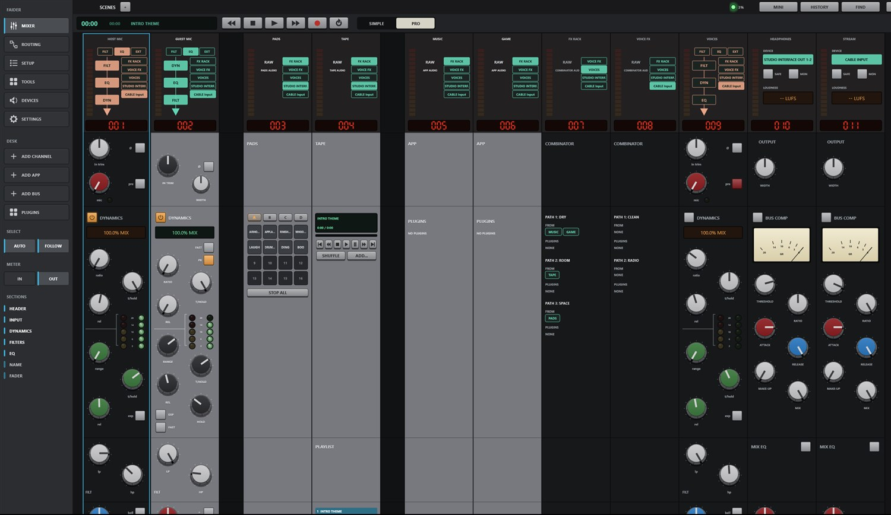

### De zijbalk

De pagina's zijn kaarten langs de linkerkant: **MIXER**, **ROUTING**, **TOOLS**, **DEVICES**,
**SETTINGS**. De pagina die je ziet, heeft een oplichtende blauwe rand. Zolang de Mixer zichtbaar is, heeft de zijbalk ook
deze kaarten:

| Groep | Kaart | Wat het doet |
|---|---|---|
| **DESK** | **ADD CHANNEL** | Opent het ingangenmenu: interface-ingangen, Windows-apparaten, apps die spelen, programma's die nog niet spelen, een browser (geheel, of één tabblad geïsoleerd), de testtoon. Pads en tape krijgen hun kanaal via hun eigen pagina's (**TOOLS**) |
| | **ADD APP** | Toont de programma's die nu geluid afspelen, en daarna, onder **NOT PLAYING YET**, de draaiende programma's met een venster die stil zijn. Kies er een om het een kanaal te geven; een programma dat niet speelt, wordt opgevangen vanaf het moment dat het dat wel doet |
| | **ADD BUS** | Een bus, of een combinator (om mee te beginnen twee paden) |
| | **PLUGINS** | Schuift het pluginpaneel omhoog onder de strips (zie [9](#9-plugins)) |
| | **COMPACT** | Vouwt elke strip op tot zijn naambalk en zijn fadersectie (pan, SOLO, CUT, SEL, de fader en zijn uitlezing); de tafel krimpt mee en gaat naar boven. Licht op zolang de tafel compact is; klik nog eens voor de hele strips. Ook **COMPACT DESK** / **FULL DESK** in FIND |
| **SELECT** | **AUTO** | Een willekeurige knop op een strip aanraken selecteert die strip |
| | **FOLLOW** | De tafel glijdt naar de geselecteerde strip, ook als die elders is gekozen (FIND, een sneltoets) |
| **SECTIONS** | HEADER … FADER | De secties van de strip (bij COMPACT alleen NAME en FADER). Oplichtende staan in beeld. Klik op een sectie om erheen te glijden |

De keuzes bij SELECT en COMPACT worden onthouden. Waar de kanaalmeters meten (**IN**, **PRE** of **POST**), stel je in bij
**SETTINGS > Audio > Channel meter point**.

### De bovenbalk

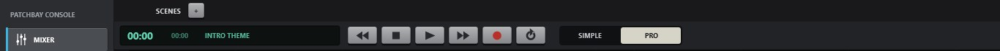

Van rechts:

| Bediening | Wat het doet |
|---|---|
| **+ 100% -** | Zoom. Springt tussen 100, 125 en 150%. Klik op het percentage voor 100%. Ctrl + / Ctrl - / Ctrl 0 doen hetzelfde |
| **FIND** (Ctrl+K) | Zoekt op naam door elke pagina, elke instelling, elk kanaal, elke scène, macro, pad en opdracht |
| **HISTORY** (Ctrl+H) | Elke wijziging die je hebt gemaakt. Kies er een om ernaar terug te gaan |
| **MINI** | De mini-mixer: een klein mixervenster (het pictogram in het systeemvak opent hem ook). Met **PIN** erop blijft hij bovenop |
| **Gezondheidslicht** | Groen: de audio is in orde. Oranje: de audiobelasting is hoog of een apparaat kwam onlangs tekort. Rood: een hoorbare storing in de laatste 10 seconden, of er draait geen audio. Het getal is de audiobelasting. Klik erop voor DEVICES |
| **SCENES** | Je opgeslagen mixen. Met **+** sla je een nieuwe op (zie [14.1](#141-scenes)) |

In een smal venster verdwijnt eerst het gezondheidslicht, dan MINI, dan HISTORY. Met FIND bereik je ze allemaal.

### Het transport

Onder de bovenbalk krijg je in elke Mixer-weergave de tijd van het Tape-deck (verstreken en lengte van het nummer),
de nummernaam en de toetsen: **10 s terug**, **stop**, **afspelen/pauze**, **10 s vooruit**,
**opnemen**, **herhalen**.

- **Opnemen** is de **REC** van de Recorder: hij neemt de bron op die bij TOOLS > TAPE is gekozen, in het formaat en de map daarvan, en blijft branden zolang die opname loopt. Druk nogmaals om te stoppen.
- **Herhalen** schakelt door **alles herhalen** → **één herhalen** (gemarkeerd met **1**) → **uit**.

---

## 4. Hoe routing werkt

Routing bepaalt waar elk geluid heen gaat. Er is niets te horen tot het gerouteerd is, en alles kan naar
zoveel plekken gerouteerd worden als je wilt.

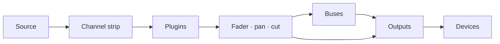

### De weg van een geluid

1. **Een kanaal** neemt één bron en voert die door zijn strip (ingang, filters, dynamiek en EQ,
   in de volgorde die zijn header toont), dan door zijn plugins, dan door zijn fader, pan en cut.
2. **Routes** sturen het kanaal verder, naar een willekeurig aantal bussen en uitgangen tegelijk (tot 8 van elk). Elke
   route draagt het kanaal na zijn fader, dus de fader en **CUT** werken overal waar het
   naartoe is gerouteerd.
3. **Een bus** telt alles op wat erheen is gerouteerd, doorloopt zijn eigen strip en plugins en wordt op dezelfde manier
   doorgerouteerd naar uitgangen (of naar andere bussen).
4. **Een uitgang** telt alles op wat erheen is gerouteerd, doorloopt zijn buscompressor, mix-EQ en
   limiter (**LIMIT**) en speelt af op zijn apparaat.

### Uitgangen zijn apparaten

Elke uitgang speelt op één apparaat: de uitgangen van je interface, een USB-headset, speakers, **CABLE
Input**. Je maakt uitgangen niet met de hand. Routeer iets naar een apparaat en er wordt een uitgang op gemaakt.
Daarom noemen de routeringsvakjes zowel apparaten als bussen.

- Er is één uitgang per apparaat. Routeer je meerdere kanalen naar hetzelfde apparaat, dan komen ze samen in zijn
  uitgang.
- Verschillende uitgangen voeren verschillende mixen. Je koptelefoon kan game, muziek en stem horen terwijl
  de streamuitgang alleen muziek en stem krijgt.
- Haal je een apparaat los, dan wordt zijn uitgang stil tot het apparaat terugkomt.

### Drie plekken om te routeren

Alle drie wijzigen dezelfde routes. Gebruik wat het dichtstbij is.

| Waar | Hoe |
|---|---|
| **Routeringsvakjes** (header van elke strip) | Eén vakje per bus en uitvoerapparaat. Verlicht: daarheen gerouteerd. Klik om te schakelen |
| **ROUTE TO** (rechtsklik op een strip) | Dezelfde lijst als menu, aangevinkt waar gerouteerd is |
| **De pagina Routing** | Elke strip als blok, elke route als lijn. Klik op het ene blok en dan op een ander (zie [10](#10-the-routing-page)) |

### Bussen

Gebruik een bus wanneer meerdere kanalen dezelfde behandeling of één fader nodig hebben. Routeer de kanalen naar de
bus en de bus naar de uitgang. Zet dan de directe routes van de kanalen naar die uitgang uit, anders
komen ze er dubbel aan (één keer direct, één keer via de bus). Een bus kan een andere bus voeden, en dat voegt geen
vertraging toe.

### Combinators

Een combinator is een bus die in parallelle **paden** is gesplitst (om mee te beginnen twee). Elk pad heeft eigen plugins,
en de paden worden opgeteld bij de fader van de combinator. Routeer een bron naar één pad of naar meerdere (zie
[7](#7-raw-strips-apps-pads-tape-and-combinators)).

### Regels die het veilig houden

- **Feedbacklussen worden geweigerd.** Een route die een geluid terug zou brengen naar waar het vandaan kwam (een
  bus naar een bus die hem voedt, het geluid van een uitgang terug in zijn eigen ingang) wordt meteen
  weer uitgezet, en het gebeurtenissenlogboek noemt de lus.
- **Solo** op een willekeurige strip maakt elke strip stil die niet op solo staat, behalve de strips die als solo safe zijn gemarkeerd.
- **Appkanalen en verdubbeling.** Een programma speelt op zijn eigen apparaat en ook in zijn kanaal
  (zie [18.7](#187-i-hear-something-twice-or-an-echo)).

### Klokken

Eén apparaat bepaalt de klok. Faider kiest hem bij het starten in deze volgorde:

1. **ASIO**: je audio-interface, via zijn ASIO-stuurprogramma. De laagste vertraging.
2. **Windows**: zonder ASIO-stuurprogramma je standaardafspeelapparaat van Windows (een virtuele kabel, de speakers van een
   beeldscherm of een VR-headset alleen als er niets anders is). De uitgangen van je interface
   worden de uitgangen van dat apparaat, en microfoons worden als Windows-apparaten toegevoegd.
3. **Ingebouwde klok**: zonder enig afspeelapparaat. Elk apparaat, ook je koptelefoon, volgt hem.

Elk ander apparaat en elk opgevangen programma draait op zijn eigen klok en sluit aan via een kleine
buffer die afwijkingen corrigeert, zodat uiteenlopende klokken nooit klikken. **DEVICES > STREAMS** toont
ze allemaal, en de klok die wordt gebruikt.

Wordt het Windows-apparaat dat de klok bepaalt losgehaald, uitgezet of valt het uit, dan neemt de volgende klok
het vanzelf over en een melding vertelt je welke. Een apparaat dat niet wil starten (omdat een ander
programma het vasthoudt) wordt overgeslagen tot je apparaten veranderen, en dan opnieuw geprobeerd. Op de ingebouwde klok neemt een
aangesloten afspeelapparaat het van hem over.

Wil je de klok zelf kiezen, gebruik dan **Clock** in **SETTINGS > Audio**: **The interface (ASIO)** (de
volgorde hierboven, de standaard), een Windows-afspeelapparaat op naam, of **The built-in clock**. De
keuze geldt zodra Faider opnieuw start, en **RESTART NOW** doet dat meteen. Je mix gaat mee en blijft
opgeslagen voor je interface. Kies je de ingebouwde klok, dan neemt geen apparaat het van hem over.

## 5. De console

### Indeling

De tafel toont alle strips van links naar rechts: **kanalen**, dan **bussen** (violette naambalk), dan
**uitgangen** (oranje naambalk). Elke strip heeft zeven secties, van boven naar beneden:

| Sectie | Bevat |
|---|---|
| **HEADER** | De niveaumeter, de toetsen FILT / EQ / EXT, de bewerkingsvolgorde, de routeringsvakjes, het stripnummer |
| **INPUT** | Trim, polariteit, microfoon-drive, de ingangsschakelaar en stereobreedte |
| **DYNAMICS** | Compressor en gate |
| **FILTERS** | Low-pass, high-pass en de NOISE-schakelaar |
| **EQ** | Vier banden |
| **NAME** | De naambalk en de aan/uit-schakelaar |
| **FADER** | Pan, SOLO, CUT, SEL, de fader en zijn uitlezing, het DUCK-lampje |

### Muis en toetsenbord

| Actie | Resultaat |
|---|---|
| **Slepen** aan een knop of fader omhoog/omlaag | Verandert hem. Zijn waarde verschijnt ernaast terwijl je sleept of erboven zweeft |
| **Dubbelklikken** op een knop of fader | Terug naar de standaardwaarde |
| **Klikken** op een toets of schakelaar | Aan / uit |
| **Klikken** op de naambalk | Selecteert de strip |
| **Slepen** van de naambalk van een strip opzij | Verplaatst hem tussen zijn eigen soort: kanalen, bussen of uitgangen (zie [17.4](#174-reorder-channels)) |
| **Klikken** op het aan/uit-symbool in de naambalk | Zet de strip uit of aan |
| **Rechtsklikken** op een strip | Het menu van de strip |
| **Muiswiel** | Scrolt de tafel opzij. **Shift + wiel** scrolt omhoog en omlaag |
| **Ctrl + / Ctrl -** | Zoomt het hele venster |

Een linkerklik opent nooit een menu. Menu's zitten altijd op de rechterknop.

### Een strip selecteren

De geselecteerde strip heeft een blauwe omlijning. Selecteer een strip door op zijn naambalk of zijn toets **SEL** te klikken,
of met **AUTO** aan een van zijn bedieningen aan te raken. De geselecteerde strip is degene die het pluginpaneel
toont en waarop FIND, sneltoetsen en afstandsbedieningen werken.

Met de tafel in focus (klik er eerst op): **Left / Right** selecteren de vorige / volgende strip,
**M** zet hem op cut, **S** zet hem op solo, en **Up / Down** verplaatsen zijn fader 0,5 dB (3 dB met **Shift**).

### Een strip uitzetten

Klik op het aan/uit-symbool links van de naambalk. De strip vervaagt en wordt grijs. Hij wordt niet
bewerkt en zijn apparaat of programma wordt losgelaten. Zolang hij uit staat, **kan er niets aan hem worden veranderd**:
knoppen, toetsen en het pluginpaneel negeren klikken, en zijn menu biedt alleen **TURN ON** en spacers aan.
Klik nogmaals op het aan/uit-symbool om hem terug te halen.

### Spacers

Spacers zijn lege strips die je ruimte geven tussen groepen. Rechtsklik op een strip > **ADD SPACER
BEFORE** / **ADD SPACER AFTER**. Rechtsklik op een spacer voor **NARROW**, **ADD ANOTHER** en **REMOVE
SPACER**. Een spacer blijft bij de strip die hij volgt wanneer die strip verhuist.

### Het stripmenu (rechtsklik)

| Item | |
|---|---|
| **INPUT** | De bron wijzigen: **INTERFACE**-ingangen, **WINDOWS DEVICES** (of WINDOWS DEFAULT), **WHAT AN OUTPUT PLAYS** (loopback), **TEST TONE**, **NOTHING** |
| **ROUTE TO** | Elke bus en elk uitvoerapparaat, aangevinkt waarheen verzonden wordt |
| **PLUGINS** | Er een openen, **ADD PLUGIN...**, **REMOVE** |
| **MAKE MONO / MAKE STEREO** | Alleen kanalen |
| **NOISE** | Ruisonderdrukking: **ON** (zoals de NOISE-schakelaar van de strip), **NEURAL** of **SPECTRAL**, en de **DEPTH** (-6 tot -30 dB) |
| **KEY FROM** | Het kanaal waarnaar de **EXT**-key van de strip luistert (de sidechain), of **NONE**. Niet op een app-, pads-, tape- of combinator-strip |
| **DUCK UNDER** | Een ander kanaal waaronder dit kanaal wegzakt zolang dat kanaal te horen is, of **NONE**, en hoe ver het wegzakt (**DEPTH**, -6 tot -24 dB). Werkt ook op een app-kanaal, zodat muziek wegzakt terwijl je praat |
| **COLOUR** | De kleur van het kanaal, te zien langs zijn naambalk en op zijn Routing-blok |
| **IN THE MINI MIXER** | Aangevinkt: de strip heeft een fader in de mini-mixer (zie [16](#16-remote-control-overlay-and-tray)) |
| **ADD SPACER BEFORE / AFTER** | |
| **RENAME...** | |
| **REMOVE** | Verwijdert het kanaal of de bus |

---

## 6. De kanaalstrip, sectie voor sectie

### HEADER

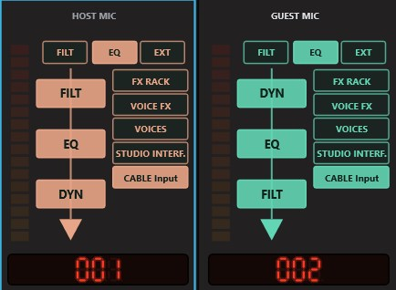

| Bediening | Wat het doet |
|---|---|
| **Level meter** | Het niveau van het kanaal als een kolom ronde leds (de luidste kant), waarbij de hoogste brandende even blijft staan. Hij leest volgens de meterstandaard die in SETTINGS > Audio > Meter standard is gekozen: met diens eigen leds, kleuren en markeringen (een VU-kolom leest -20 tot +3, een PPM BBC-kolom 1 tot 7), op het punt dat SETTINGS > Audio > Channel meter point aangeeft (IN, PRE of POST). De meters van uitgangen lezen op dezelfde manier |
| **FILT** | Stuurt de filters naar de detector van de gate/compressor (key-filtering) |
| **EQ** | De EQ in of uit |
| **EXT** | De dynamiek luistert naar een externe key (sidechain) in plaats van naar het kanaal zelf: het kanaal dat onder rechtsklik > **KEY FROM** is gekozen. Druk je erop voordat er een is gekozen, dan opent het die lijst |
| **Processing order** | Drie blokken (FILT, EQ, DYN), van boven naar beneden in de volgorde waarin het kanaal ze doorloopt. **Klik op een blok** om het één plek omhoog te zetten. Het bovenste gaat naar het einde. Oplichtende blokken zijn in gebruik |
| **Routing boxes** | Eén vakje per bus en uitvoerapparaat. Verlicht: het kanaal wordt daarheen gestuurd. Klik om te schakelen (zie [Uitgangen zijn apparaten](#outputs-are-devices)) |
| **Number** | De plaats van de strip op de tafel |

### INPUT

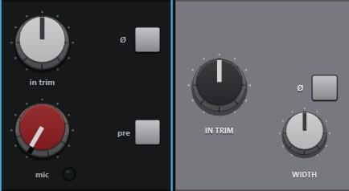

| Bediening | |
|---|---|
| **IN TRIM** | Ingangsversterking |
| **ø** | Polariteit omkeren |
| **MIC** | Drive: voegt warmte en niveau toe (getoond als percentage). Het groene lampje ernaast brandt zolang de bron signaal heeft |
| **PRE** | De ingangstrap in of uit (uit: trim, polariteit en drive worden overgeslagen) |
| **WIDTH** | Stereobreedte: 0 % mono, 100 % zoals het is, 200 % twee keer zo breed. Vaag op een monokanaal |

### DYNAMICS

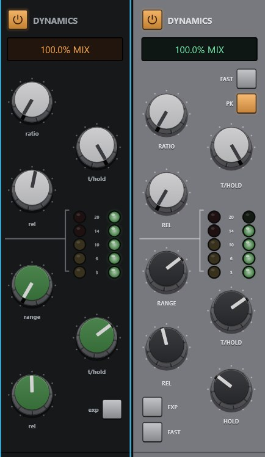

De schakelaar **IN** (met het aan/uit-symbool) zet de compressor en gate samen in of uit.

**Compressor**

| Bediening | |
|---|---|
| **MIX** | Wet/dry-mix (parallelle compressie). Sleep aan de groene uitlezing |
| **ratio**, **thresh**, **rel** | Ratio, threshold en release |
| **fast** | Snelle attack (3 ms). Uit is 10 ms |
| **pk** | Piekdetectie. Aan (de standaard) reageert de compressor op pieken. Uit reageert hij op het gemiddelde (RMS) niveau, wat zachter klinkt |
| **Gain reduction LEDs** | 3, 6, 10, 14 en 20 dB reductie |

**Gate / expander**

| Bediening | |
|---|---|
| **range**, **thresh**, **rel**, **hold** | Hoe ver hij sluit, waar hij opent, hoe snel hij sluit, hoe lang hij vasthoudt |
| **exp** | Expandermodus (een mildere gate) |
| **fast** | Snelle attack (0,1 ms). Uit is 1,5 ms |
| **Gate LEDs** | Hoe ver de gate dichtgaat |

De LED's tonen wat de compressor en gate *zouden* doen, ook als ze uit staan, zodat je ze kunt instellen
voordat je ze inschakelt.

### FILTERS

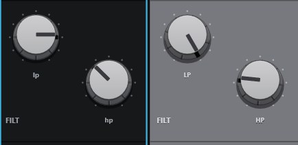

**lp** (low-pass) en **hp** (high-pass). Helemaal omlaag gedraaid is de high-pass uit. Helemaal omhoog gedraaid
is de low-pass uit.

**NOISE** zet ruisonderdrukking in of uit: ruis, brom en kamergeluid gaan omlaag terwijl de stem
blijft. Rechtsklik op de strip > **NOISE** voor **NEURAL** (de standaard, op 48 kHz; op andere
frequenties werkt hij als SPECTRAL) of **SPECTRAL**, en voor hoe diep hij gaat. Uit kost hij niets.

### EQ

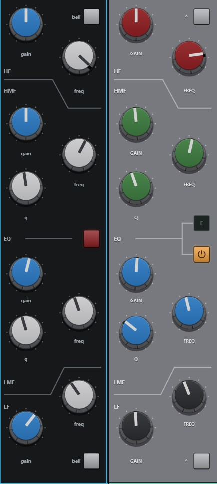

| Band | Bedieningen |
|---|---|
| **HF** | gain, freq, **bell** (shelf als uit) |
| **HMF** | gain, freq, q |
| **LMF** | gain, freq, q |
| **LF** | gain, freq, **bell** (shelf als uit) |

De schakelaar **EQ IN** zet de hele EQ in of uit (hetzelfde als de EQ-toets in de header).

### FADER

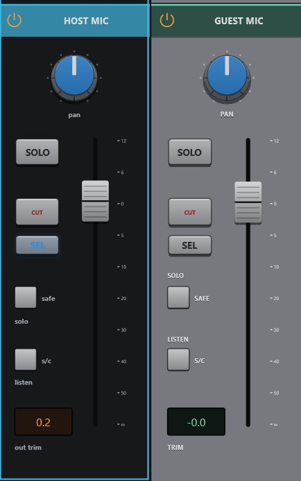

| Bediening | |
|---|---|
| **PAN** | Links/rechts. Dubbelklik om te centreren |
| **SOLO** | Solo in place |
| **CUT** | Maakt het kanaal stil (de toets **M** op de tafel) |
| **SEL** | Deze strip selecteren |
| **Fader** | Niveau, +12 dB tot uit. De uitlezing eronder toont het niveau in dB |
| **safe** | Solo safe: dit kanaal blijft hoorbaar als andere op solo staan |
| **listen** | Luisteren naar het key-signaal van de dynamiek |
| **duck** | Licht op zolang het kanaal onder een ander wegzakt (rechtsklik > **DUCK UNDER**) |

### Stem effecten

Naast de verwerking van de strip heeft elk kanaal zijn eigen stem effecten:

| Effect | Wat het doet |
|---|---|
| **ROBOT** | Ringmodulatie: de stem wordt met een toon vermenigvuldigd en klinkt metaalachtig |
| **ECHO** | Een vertraging, tot een seconde |
| **RADIO** | Begrensd tot 300 Hz - 3 kHz en overstuurd, het klinkt als een kleine speaker |
| **PITCH** | De stem omhoog of omlaag, tot een octaaf elke kant op |

Ze worden met een macro geschakeld: de actie **FX ON**, **FX OFF** of **FX TOGGLE**, met het kanaal
als doel ([15](#15-settings)). Een pad, een sneltoets, een trigger of de afstandsbediening kan die
macro starten, zodat de effecten met de mix mee komen en gaan.

---

## 7. Raw-strips: apps, pads, tape en combinators

Sommige kanalen voeren geluid dat al af is: het geluid van een programma, de pads, de tape. Ze krijgen
een **raw-strip**, met routing, plugins als je die wilt, pan, fader en toetsen, maar zonder ingebouwde
effecten. Verschijnt er een op de tafel, dan worden zijn ingebouwde effecten eenmalig uitgezet (en vastgelegd in
het gebeurtenissenlogboek). Zijn plugins blijven behouden.

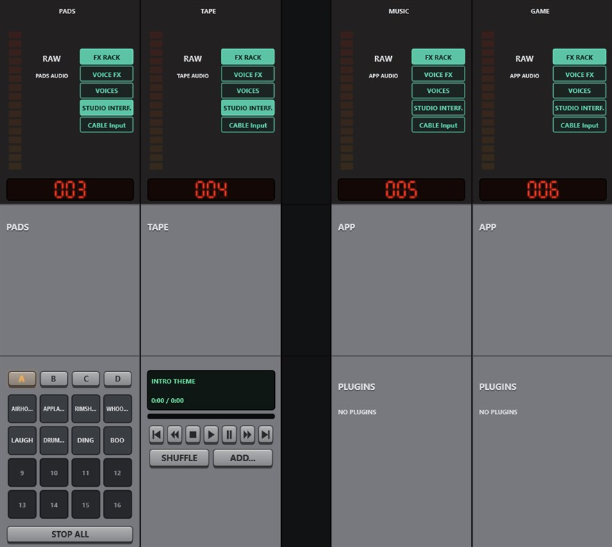

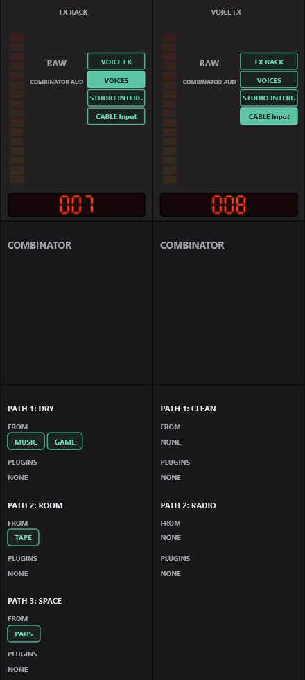

| Strip | Zijn middelste secties bevatten |
|---|---|
| **App** | De pluginlijst (klik op een plugin om hem te openen) en **ADD PLUGIN** |
| **Pads** | Banktoetsen **A–D**, de 4×4-pads (indrukken om af te spelen; een HOLD-pad speelt zolang het wordt ingedrukt) en **STOP ALL** |
| **Tape** | Het scherm en de zoekbalk van het deck, het transport (vorige, terugspoelen, stop, afspelen, pauze, vooruitspoelen, volgende), **SHUFFLE**, **ADD...** en de afspeellijst (klik op een nummer om het af te spelen) |
| **Combinator** | Per pad: **FROM**, de kanalen en bussen die het voeden (klik op een om naar zijn strip te gaan), en **PLUGINS** op dat pad (klik op een plugin om hem te openen). **EDIT IN ROUTING** opent de pagina Routing |

Een combinator heeft geen eigen effecten. Zijn geluid komt van wat hem voedt en van de plugins van elk pad.
Rechtsklik erop > **PATHS** om een pad toe te voegen en om per pad de plugins te openen, toe te voegen of te verwijderen,
het pad te hernoemen of te verwijderen.

---

## 8. Uitgangen

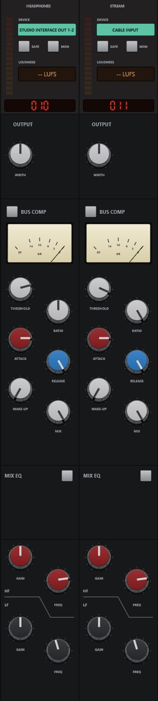

Elke uitgang heeft zijn eigen donkere strip:

| Bediening | |
|---|---|
| **DEVICE** | Het apparaat waarop hij speelt. Klik om een ander te kiezen |
| **LIMIT** | Een limiter na de fader: niets verlaat hem boven -1 dBFS |
| **MON** | Deze uitgang monitoren |
| **LUFS** | Kortetermijn-luidheid van wat eruit gaat ("-- LUFS" bij stilte) |
| **WIDTH** | Stereobreedte |
| **BUS COMP** | Aan-schakelaar, de gain-reduction-meter in VU-stijl, **threshold**, **ratio**, **attack**, **release**, **make-up**, **mix** |
| **MIX EQ** | Aan-schakelaar, HF-gain en -freq, LF-gain en -freq |
| **CUT**, **SEL**, fader | Zoals op een kanaal |

Rechtsklik op een uitgang voor **DEVICE...**, **HEADPHONE EQ** (koptelefooncorrectie: **NONE**, of je
model, op merk gesorteerd), **ALERT IF SILENT** (onder -60 dBFS gedurende **10 S**, **30 S**, **1 MIN** of **5 MIN**, of **OFF**) en **ALERT IF CLIPPING**
(zolang LIMIT uit staat), die het pictogram in het systeemvak laten knipperen en in het
gebeurtenissenlogboek schrijven, **IN THE MINI MIXER**, **MIX-MINUS AND STEMS...**, spacers,
**COLOUR** (langs zijn naambalk en op zijn Routing-blok), **RENAME...** en **REMOVE**.

Uitgangen worden voor je gemaakt, één per apparaat (zie [Uitgangen zijn apparaten](#outputs-are-devices)).

**MIX-MINUS AND STEMS...** (in het rechtsklikmenu van een uitgang, of in FIND) bouwt een feed per gast (alles behalve hun eigen stem) en
stems voor stem, muziek en game.

---

## 9. Plugins

Faider host **VST3**-plugins op kanalen, bussen en combinatorpaden, met automatische
latentiecompensatie.

### Een plugin toevoegen

- Op een kanaal: rechtsklik > **PLUGINS > ADD PLUGIN...**, of **ADD PLUGIN** op een raw-strip, of
  **ADD** in het pluginpaneel.
- Op een combinatorpad: rechtsklik op de combinator > **PATHS > PATH n > ADD PLUGIN...**. Klik op de plugin
  van een pad op de combinatorstrip om hem te openen.

Elke plugin wordt **eerst getest in een aparte kopie van het programma**, zodat een plugin die tijdens het laden crasht of
vastloopt je mix niet kan meetrekken. Hij krijgt 30 seconden om te laden (**Plugin test time** in
SETTINGS > Audio geeft trage plugins 60 of 120). Het resultaat wordt onthouden tot het pluginbestand
verandert.

### Het pluginpaneel

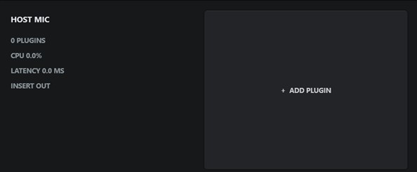

Klik op **PLUGINS** in de zijbalk. Een paneel schuift omhoog onder de strips met de plugins van de **geselecteerde strip**
in de volgorde waarin ze draaien. **FIND** > **PLUGINS: name** opent het op die strip. Elke kaart
toont:

- **CPU**: het aandeel van de plugin in de verwerkingstijd (groen, oranje boven 2 %, rood boven 5 %)
- **Latency**: de vertraging die hij toevoegt
- **BYPASSED**: uitgezet maar nog geladen (gebruikt nog geheugen)
- **HEAVY**: ongewoon duur

Toetsen op elke kaart: **BYPASS**, **OPEN** (zijn venster), **REMOVE** en pijlen om hem eerder of
later te zetten. **ADD** aan het einde voegt er nog een toe.

---

## 10. De pagina Routing

De pagina Routing toont de hele mix als kaart: elke strip als blok en elke route als lijn.
Gebruik hem om te zien waar alles heen gaat en om te routeren door twee blokken aan te klikken.

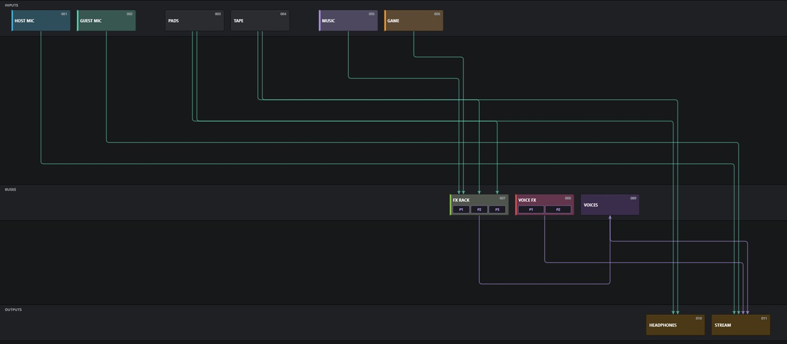

### De pagina lezen

- **Drie rijen:** **INPUTS** bovenaan, **BUSES** in het midden, **OUTPUTS** onderaan. Uitvoerapparaten
  die nog geen uitgang hebben, staan aan het rechteruiteinde van de rij OUTPUTS, in grijs.
- **Elk blok staat onder zijn strip.** Een blok staat op de pagina op dezelfde positie als zijn strip
  op de tafel, spacers meegerekend, en de pagina scrolt opzij mee met de tafel (muiswiel). Zet
  de tafel anders in en de kaart volgt.
- **Elk blok toont** de naam en het nummer van de strip. Een uitgeschakelde strip is gedimd. Een kanaal met
  een eigen kleur toont die als tint en als band links.
- **Lijnen zijn routes.** Elk loopt recht omlaag vanaf zijn bron naar een eigen baan in de
  ruimte onder zijn rij, dwars over en omlaag naar het blok dat hij voedt, en eindigt in een pijl. Ingangsroutes
  zijn blauwgroen, busroutes violet. Meerdere lijnen die een blok verlaten of bereiken, worden op volgorde
  over het blok verdeeld, zodat ze nooit op elkaar liggen.
- **Combinators** tonen hun paden als cellen **P1, P2, …** langs de onderkant van het blok. Lijnen eindigen
  in het pad dat ze voeden.

### Routeren van blok naar blok

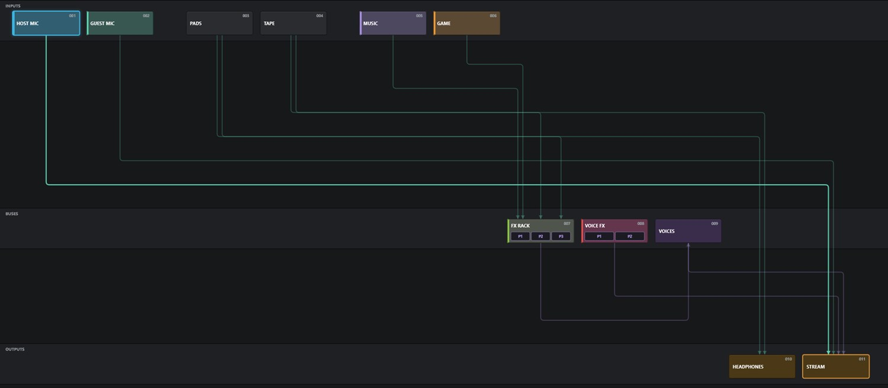

1. **Klik op een blok.** Het licht blauw op en pulseert. De blokken waarheen het gerouteerd is, of waarvandaan het gerouteerd wordt, krijgen een
   gemarkeerde rand, hun lijnen worden helderder en al het andere wordt gedimd.
2. **Klik op een ander blok.** De route ertussen gaat aan (er verschijnt een lijn) of uit (de lijn
   verdwijnt). Beide volgordes werken: eerst bron, dan bestemming, of eerst bestemming, dan bron.
3. Het eerste blok **blijft geselecteerd**, dus blijf klikken om het naar meerdere plekken te routeren of om
   meerdere routes uit te zetten.
4. **Klik er nogmaals op**, klik op lege ruimte of druk op **Esc** om los te laten.

Kunnen de twee blokken niet worden gerouteerd (twee uitgangen, bijvoorbeeld), dan wordt het tweede geselecteerd.

### Voorbeelden

| Om | Klik |
|---|---|
| Je microfoon te horen | MIC, dan de uitgang van de koptelefoon |
| Apps je microfoon te laten horen | MIC, dan **CABLE Input** (in de rij met uitgangen, grijs tot hij een uitgang heeft) |
| Een groep via een bus te sturen | De bus, dan elk kanaal; dan de bus, dan zijn uitgang |
| Een kanaal uit de stream te halen | Het kanaal, dan de uitgang van de stream (de lijn verdwijnt) |
| Eén combinatorpad te voeden | De bron, dan de padcel (P1, P2…). Klik op meer cellen om meerdere paden te voeden. Op de combinator klikken buiten zijn cellen voedt zijn eerste pad |

Een grijs apparaatblok aanklikken maakt zijn uitgang, en de nieuwe uitgang verschijnt meteen op de tafel.

Sleep een blok opzij langs zijn rij om zijn strip te verplaatsen (zie [17.4](#174-reorder-channels)). Een route
die meteen weer uitgaat, zou een feedbacklus maken (zie [18.8](#188-a-route-wont-switch-on)).

## 11. Tools: Pads

**TOOLS > PADS** geeft je vier banken (**A–D**) van 16 pads: 64 geluiden, tot 32 tegelijk spelend.

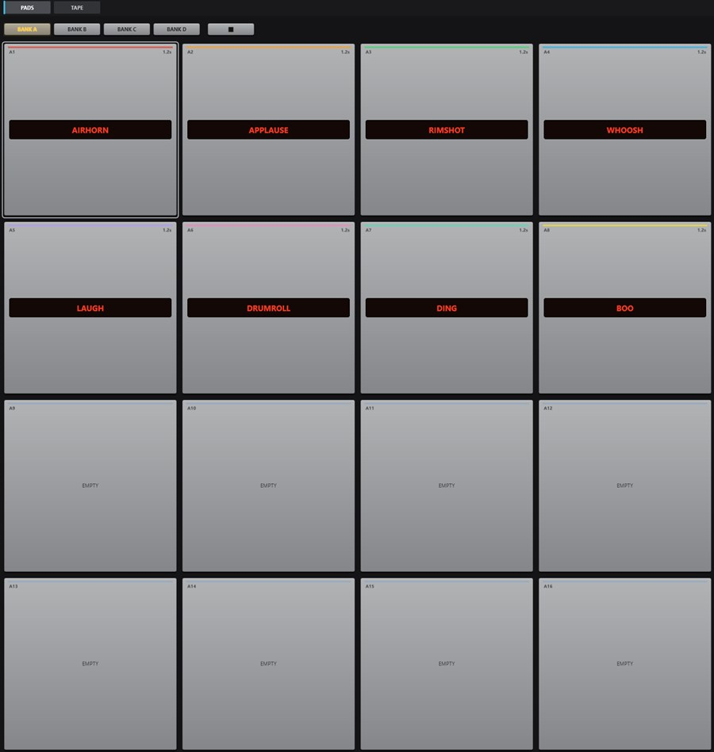

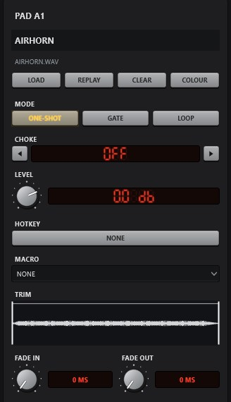

### Geluid eruit krijgen

Pads spelen in een **PADS-kanaal**. Klik op **CREATE PADS CHANNEL** (daarna staat er **PADS CHANNEL
ACTIVE**), of kies een andere ingang in het menu **PLAY INTO** om de pads via de plugins en routes van dat
kanaal te spelen. Zonder padskanaal worden aanslagen genegeerd.

### Laden en spelen

| Actie | |
|---|---|
| Klik op een **leeg** pad | Kies een geluidsbestand |
| Klik op een geladen pad | Speel het af |
| Rechtsklik op een pad | Selecteer het om te bewerken zonder af te spelen |
| Bestanden op een pad laten vallen | Laadt ze in dat pad en de volgende in de bank |
| **Ctrl + slepen** naar een ander pad | Wisselt de twee pads om |
| **STOP ALL** | Laat elk pad uitfaden |

Formaten: WAV, FLAC, AIFF, OGG, MP3. Een pad waarvan het bestand is verplaatst, toont **MISSING: FILE**.

### De padeditor

| Instelling | |
|---|---|
| Naam | Dubbelklik om te hernoemen |
| **LOAD**, **CLEAR**, **COLOUR** | |
| **REPLAY** | De instant-replaybuffer wordt het geluid van dit pad (opgeslagen als WAV in de opnamemap). Schakel replay eerst in via TOOLS > TAPE |
| **MODE** | **ONE-SHOT** speelt tot het einde (nogmaals indrukken start opnieuw). **HOLD** speelt zolang het wordt ingedrukt. **LOOP** start met één druk en stopt bij de volgende |
| **CHOKE** | OFF of groep 1–8. Pads in één groep stoppen elkaar |
| **LEVEL** | -INF tot +12 dB |
| **HOTKEY** | Klik (**LEARN...**) en druk dan op de toetsen (zie [HOTKEYS](#hotkeys)) |
| **MACRO** | Een macro die met het pad wordt uitgevoerd (een pad kan een macro hebben en geen geluid) |
| **TRIM** | Sleep de start- en eindlijn op de golfvorm. Dubbelklik voor het hele bestand |
| **FADE IN / FADE OUT** | 0–5 s |

---

## 12. Tools: Tape, Recorder en Replay

### Het tape-deck

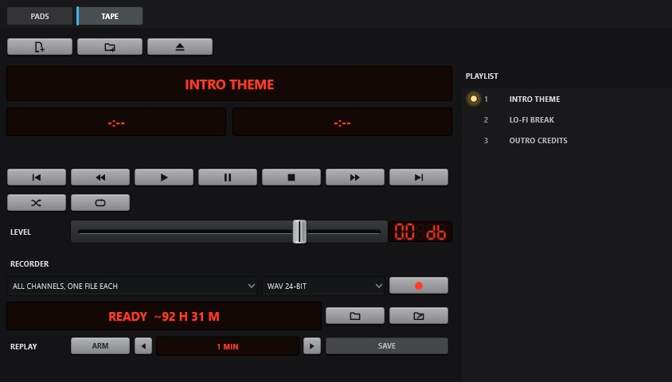

**TOOLS > TAPE** speelt een afspeellijst in een **TAPE-kanaal**. Klik op **CREATE TAPE CHANNEL** om er een te maken.

- **ADD FILES**, **ADD FOLDER**, of laat bestanden en mappen ergens op de pagina vallen. **EJECT** maakt
  de afspeellijst leeg.
- Dubbelklik op een nummer om het af te spelen, sleep er een om te herschikken en druk op Delete om geselecteerde nummers te verwijderen.
- Transport: **PREV**, **REW** (10 s terug; ingedrukt houden om snel terug te spoelen), **PLAY**, **PAUSE**, **STOP**,
  **FF** (10 s vooruit; ingedrukt houden om snel vooruit te spoelen), **NEXT**. Ook **SHUFFLE**, **REPEAT** (alles / één /
  uit) en **LEVEL**.
- Nummers spelen naadloos. Pauzes en sprongen faden over 30 ms, zodat ze nooit klikken.

Het transport van de bovenbalk en de tapestrip op de tafel bedienen hetzelfde deck.

### De recorder

| | |
|---|---|
| **Source** | Elke uitgang, bus of ingang, of **ALL CHANNELS, ONE FILE EACH** (multitrack: elke ingang en elke uitgang, sample-uitgelijnd) |
| **Format** | WAV 24-bit (standaard), 16-bit, 32-bit, 32-bit float; FLAC 24/16-bit; AIFF 24/16-bit; OGG Vorbis 128–320k. Met ffmpeg: MP3, AAC (M4A), Opus, ALAC. Elk toont hoeveel tijd er op de schijf past |
| **REC** | Start en stopt (de opnametoets in de bovenbalk doet hetzelfde). Het scherm toont tijd, grootte, resterende tijd en eventuele gemiste blokken |
| **PATH** / **REVEAL** | Kies de map / open hem in Verkenner |

Opnamen gaan naar `Music\Faider Recordings` tenzij je een map kiest. ffmpeg-formaten nemen eerst
een WAV op en zetten die om wanneer je stopt (de WAV blijft behouden als het omzetten mislukt). Faider gebruikt de
`ffmpeg.exe` die is gekozen in **SETTINGS > Recording > FFmpeg**, anders die in je PATH. Opnemen stopt
vanzelf als er minder dan 1 GB vrij is.

### Instant replay

**ARM** bewaart de laatste **30 s**, **1**, **2** of **5 minuten** van de bron van de recorder.
**SAVE** schrijft het naar een bestand (rechtsklik op SAVE om er een globale sneltoets aan te geven). Met multitrack gekozen
gebruikt replay de eerste uitgang.

---

## 13. Apparaten

**DEVICES** toont alle Windows-audioapparaten en ASIO-stuurprogramma's. Wat de klok bepaalt, kies je in
**SETTINGS > Audio > Clock** (zie [Klokken](#clocking)).

**Windows audio**, ook in **SETTINGS > Audio**, toont de prioriteit van de audio-engine van Windows
(audiodg.exe, die elk Windows-apparaat en elke opgevangen app draagt): **Normal priority** is de standaard van
Windows, **Priority unknown** als hij niet gelezen kan worden. Ernaast:

- **Boost** zet hem op High, wat op sommige pc's gekraak op Windows-apparaten en opgevangen apps kan stoppen.
  Daar zijn beheerdersrechten voor nodig, dus Windows vraagt het eerst; zeg je nee, dan verandert er niets.
  Het overleeft geen herstart van Windows-audio of van de pc: Faider houdt het in de gaten, meldt je één keer
  via het systeemvak wanneer hij weer op Normal staat, en **Boost Windows audio again...** in het menu van het
  systeemvak (of **Boost** hier, of **BOOST WINDOWS AUDIO** in FIND) boost hem opnieuw. Zolang hij geboost is,
  heet de toets **Stop boosting**, en die stopt het in de gaten houden; hij blijft op High tot Windows-audio
  opnieuw start of je **Back to normal** kiest.
- **Pin to one core** (de schakelaar eronder, uit tenzij je het kiest) houdt hem ook vast aan je laatste
  processorkern, vanaf de volgende Boost. Het beperkt alleen waar hij draait en voegt nooit kernen toe: gebruik
  het alleen bij gekraak op een USB-headset.
- **Back to normal** (als hij niet op Normal staat, of vastgezet is) zet hem nu terug op Normal-prioriteit op alle
  kernen, zonder op een herstart te wachten. Windows vraagt het eerst, net als bij Boost, en Faider stopt met in de gaten houden.

**Boost** en **Back to normal** hebben een Faider nodig die voor alle gebruikers is geïnstalleerd (in Program Files). Een kopie die alleen voor jou is geïnstalleerd, of die uit de broncode is gebouwd, toont **Needs Faider installed for all users** onder de rij en vraagt Windows niets: elk programma zou de bestanden in zo'n map kunnen wijzigen, en die zouden dan als administrator draaien.

Het heeft geen invloed op ASIO-interfaces, die niet via Windows-audio gaan.

| Kolom | |
|---|---|
| **I/O** | ASIO, OUT of IN |
| **DEVICE**, **HARDWARE** | Zijn naam en de adapter waarop hij zit |
| **FORMAT** | Kanalen en samplefrequentie |
| **STATE** | Actief, losgehaald, uitgeschakeld of **off in Faider** |
| **TAGS** | DEFAULT en CALLS voor de standaardapparaten van Windows |

Klik op een kop om te sorteren. Selecteer apparaten (Ctrl/Shift voor meerdere) en gebruik dan:

| Toets | |
|---|---|
| **EXCLUDE / INCLUDE** | Faider stopt (of hervat) het gebruik van het apparaat. Uitgesloten apparaten worden nooit geopend en uit lijsten weggelaten |
| **DISABLE / ENABLE IN WINDOWS** | Zet het apparaat in Windows zelf uit of aan |
| **RENAME** | Je eigen naam voor het apparaat, overal in Faider gebruikt (of dubbelklik op een rij) |

### Streams

Onder de lijst toont **STREAMS** de gezondheid van de audio-engine:

- **CALLBACK LOAD** (en piek), **OVERLOADS**, **BLOCKS SKIPPED**. Deze krijgen een waarschuwingskleur als er iets van is gebeurd
- **BUFFER**: de buffergrootte van je interface (kleiner betekent minder vertraging en meer belasting)
- Per apparaat: gebufferde audio, totale latentie, **DRIFT** (de klokcorrectie in ppm), **UNDER**
  (leeggelopen, stilte gespeeld), **OVER** (overgelopen, audio weggegooid), **RESYNC** (opnieuw gecentreerd). Een rij
  die audio heeft weggegooid, wordt rood
- **RESET STATS** wist de tellers

### VB-CABLE

Is VB-CABLE geïnstalleerd, dan stelt een balk bovenaan zijn **sample rate** en **max latency** in. **APPLY**
vraagt eenmaal om beheerdersrechten en start de kabel opnieuw.

Het gebeurtenissenlogboek onderaan legt elk apparaat vast dat is aangesloten, verwijderd of hersteld.

---

## 14. Scènes, ongedaan maken en sessies

### 14.1 Scènes

Een scène slaat van elk kanaal fader, pan, cut, solo, aan/uit en routes op (en, als je wilt, de
pluginsinstellingen).

- **Opslaan:** klik op **+** in de bovenbalk en geef haar een naam.
- **Oproepen:** klik op haar toets. Faders en pans glijden in een halve seconde. De rest schakelt meteen.
- **Rechtsklik op een scène** voor: alleen CUTs / alleen niveaus oproepen, erin opslaan, pluginsinstellingen
  opnemen, hernoemen, een globale sneltoets, **Recall on device** (als een apparaat verschijnt; terug als het
  verdwijnt), **Auto-scene** (als een app begint te spelen, een apparaat verbindt, of op een tijdstip), MIDI
  learn, verplaatsen, verwijderen.

Apparaten en de kanalen zelf maken geen deel uit van een scène.

### 14.2 Ongedaan maken en geschiedenis

**Ctrl+Z** maakt ongedaan, **Ctrl+Y** (of Ctrl+Shift+Z) maakt opnieuw. **HISTORY** (Ctrl+H) toont elke wijziging.
Kies er een om ernaar terug te springen.

### 14.3 Sessies

Je mix slaat zichzelf op binnen een seconde na elke wijziging, en bij het afsluiten.

| | |
|---|---|
| **SESSION TIMELINE** | **Open timeline** in SETTINGS > Sessions, FIND, of **Session timeline...** in het menu van het systeemvak: elke bewaarde versie op datum. **RESTORE EVERYTHING** (Faider start ermee opnieuw), of **PUT ONE CHANNEL BACK** (niveau, pan, CUT en rack) zonder opnieuw te starten |
| **Save as…** | SETTINGS > Sessions > This mix (of **SAVE SESSION AS...** in FIND): bewaar de mix onder een naam. **Export…** ernaast slaat de mix op in een bestand |
| **Saved sessions** | SETTINGS > Sessions: een benoemde mix openen met **Open** (Faider start ermee opnieuw) of met **Export** in een bestand opslaan; **Import…** laadt er een uit een bestand |

Tot 60 eerdere versies worden bewaard (hoogstens één per 5 minuten). Kan je mix ooit niet worden geladen
(de interface ontbreekt, het bestand is beschadigd), dan wordt hij **opzijgezet** in plaats van verloren, en begint er een
verse mix. Zie [18.2](#182-my-mix-is-gone-a-fresh-mix-started).

---

## 15. Instellingen

**SETTINGS** heeft een zijbalk langs de linkerkant: bovenaan een zoekvak, daaronder de pagina's in vier groepen.
**APP**: **General**, **Notifications**, **Startup & checks**, **Updates & about**. **AUDIO**:
**Audio**, **Recording**. **MIX**: **Apps**, **Sessions**. **CONTROL**: **MIDI & OSC**, **Hotkeys**,
**Macros**. De pagina die je kiest vult de rest als één kolom: de titel, een regel over waar hij voor is, dan
een rij voor elke instelling met de naam, eronder wat hij doet, en rechts de bediening.
Aan/uit-instellingen zijn schakelaars die crèmekleurig gloeien als ze aan staan; een keuze uit een paar opties
toont ze naast elkaar, de gekozen in crème; een waarde met een menu opent dat als je erop klikt.

Typ in het zoekvak om de instellingen te zien die overeenkomen, van elke pagina, elk onder de naam van zijn
pagina (Esc wist het). **FIND** (Ctrl+K) vindt ook elke instelling op naam, en opent de pagina ervan met de rij
even opgelicht. Een pagina waarvan de naam of trefwoorden overeenkomen ("hotkey", "shortcut", "macro") staat bovenaan, met **Open**.

### GENERAL

De **APP**-pagina's:

| Pagina | Instelling | Wat het doet |
|---|---|---|
| **General** | **Language** | De taal van de interface: English, Deutsch, Español, Français, Italiano, 日本語, 한국어, Nederlands, Polski, Português (Brasil), Svenska, Türkçe, 简体中文, elk in zijn eigen naam. De eerste start volgt de weergavetaal van Windows als het daar een van is, anders Engels. Na een update vanaf een versie van vóór de talen blijft het Engels. Een wijziging geldt vanaf de volgende start: **RESTART NOW** start Faider meteen opnieuw, **LATER** bewaart het tot dan. De toetsen van de desk, het gebeurtenislogboek en productnamen blijven Engels |
| | **Start with Windows** | Opent Faider in het systeemvak wanneer je je aanmeldt |
| | **Zoom** | **100%**, **125%**, **150%**, of **Custom…** voor elke grootte van 75 tot 200%. Ctrl + en Ctrl - stappen tussen de eerste drie |
| | **Look** | De kleuren en het lettertype van de tafel; het menu toont je LOOKS en **Save as…** (zie [LOOKS](#looks)) |
| | **Tips** | Een tip over elke pagina, de eerste keer dat die getoond wordt. **Show again** toont de tip van elke pagina nog één keer |
| **Notifications** | **Warn if I talk while cut** | Een melding als een microfoon op CUT boven -30 dBFS komt |
| | Meldingen in de hoek | Elk een schakelaar: apparaten verbonden of weg, een kanaal dat clipt (zijn bron of zijn uitgang op volle schaal), scènes opgeroepen, macro's uitgevoerd, ongedaan maken en opnieuw. Het gebeurtenissenlogboek heeft hoe dan ook alles |
| **Startup & checks** | **Pre-flight on start** | PRE-FLIGHT een paar seconden na het starten, alleen getoond als er iets mis is |
| | **Pre-flight**, **Zero the desk** | **Run pre-flight** en **Check** voeren ze nu uit (zie [18.1](#181-pre-flight)) |
| | **Setup: build a mix** | **Run setup** stelt de vier vragen van SETUP opnieuw (zie [2](#2-first-time-setup)): het voegt toe wat ontbreekt en verwijdert nooit iets |
| **Updates & about** | **Check for updates** | Standaard aan: hooguit één keer per dag (een halve minuut na het starten, of als er een dag voorbij is terwijl het blijft draaien) stuurt Faider één verzoek naar GitHub met de vraag naar zijn nieuwste release. Het verzoek bevat alleen de naam en versie van de app (bijvoorbeeld `Faider/0.2.0`); er wordt niets gedownload of geïnstalleerd. Is er een nieuwere versie, dan meldt het systeemvak dat, en **Get Faider x.y.z...** in het menu van het systeemvak, **GET FAIDER x.y.z** in FIND of **Get Faider x.y.z…** hier opent de pagina ervan. Zet het uit en Faider vraagt het nooit. |
| | **Version** | De versie die nu draait. **Check now** (of **CHECK FOR UPDATES NOW** in FIND) vraagt het meteen en zegt wanneer je up-to-date bent |
| | **About Faider** | Versie en dankbetuigingen |
| | **Privacy** | **Read policy** opent het privacybeleid van Faider op GitHub |
| | **Problem report** | **Save report…** slaat de logs, de laatste crash en de versies op in een .zip die je kunt opsturen. Er wordt niets vanzelf verzonden |

De **AUDIO**- en **MIX**-pagina's:

| Pagina | Instelling | Wat het doet |
|---|---|---|
| **Audio** | **Clock** | Wat de klok bepaalt, vanaf de volgende start: **The interface (ASIO)**, een Windows-afspeelapparaat op naam, of **The built-in clock** (zie [Klokken](#clocking)). Eronder, wat hem nu bepaalt |
| | **Windows audio** | De prioriteit van de audio-engine van Windows, met **Boost** en **Back to normal** (zie [13](#13-devices)) |
| | **Pin to one core** | Met Boost wordt Windows-audio vastgehouden aan de laatste kern: alleen bij gekraak op een USB-headset |
| | **Channel meter point** | Waar de meter van elk kanaal meet: **IN** (ruwe bron), **PRE** (na de effecten) of **POST** (na de fader, de standaard) |
| | **Meter standard** | Hoe meters aflezen, en de leds, kleuren en markeringen van de niveaumeters van de tafel: **Peak** (de standaard: sample peak in dBFS met snelle terugval), **Peak IEC**, **True Peak** (dBTP, ITU-R BS.1770: 4x oversampled, dus hij toont ook pieken tussen de samples; zijn schaal loopt tot +3), **RMS**, **VU**, **PPM** (EBU, BBC, DIN, Nordic), **K-20**, **K-14**, **K-12** en **LUFS M** (momentane luidheid, EBU R128) |
| | **Plugin test time** | **30 S** (standaard), **60 S** of **120 S**: hoe lang een nieuwe plugin in zijn test heeft om te laden voordat hij mislukt |
| **Recording** | **FFmpeg** | Waar `ffmpeg.exe` staat, of **Not found**. **Pick…** kiest hem (gebruikt vóór die in je PATH); **Use PATH** vergeet de gekozen en gebruikt die van de PATH |
| **Apps** | **App rules** | Een tabel: elk programma, waar het naartoe gaat, **Change** en **Delete**. **Add rule** kiest een programma dat nu speelt (of een met een kanaal), dan een bus of uitgang. Het kanaal van een programma verwijderen verwijdert zijn regel. **APP RULES** in FIND brengt je naar deze tabel |
| **Sessions** | **This mix** | **Save as…** bewaart de mix onder een naam; **Export…** slaat hem op in een bestand |
| | **Saved sessions** | De mixen die onder een naam bewaard zijn, met wanneer elk is opgeslagen: **Open** (Faider start ermee opnieuw) of **Export** naar een bestand. **Import…** opent een sessie uit een bestand |
| | **Session timeline** | **Open timeline**: elke bewaarde versie op datum (zie [14.3](#143-sessions)) |

### LOOKS

Een **LOOK** is elke kleur waarmee de tafel tekent, met het lettertype en de maten erbij. De strips, de
schermen, de knoppen, de toetsen en de lampjes tekenen allemaal vanuit de LOOK die geldt: één LOOK
verandert dus de hele tafel tegelijk.

**Look** (SETTINGS > General) toont de LOOKS die je hebt en zet de LOOK in werking die jij kiest; de tafel
wordt meteen opnieuw getekend. **Save as…** aan het eind van de lijst schrijft de geldende LOOK naar een nieuw
bestand, onder een naam die jij geeft.

Een LOOK is één bestand in `%APPDATA%\Faider\looks`, geschreven als JSON, dus je kunt het met de hand
schrijven en naar een andere machine kopiëren. Een ontbrekend of kapot bestand laat de ingebouwde LOOK
staan, en wat een bestand overslaat valt terug op de ingebouwde waarde: een half geschreven bestand werkt
nog steeds.

| | |
|---|---|
| `name` | De naam van de LOOK, zoals hij in de lijst staat |
| `font` | Eén lettertype dat Windows meelevert, scherp op de kleine maten van de tafel |
| `keyRadius` | Hoe rond de hoeken van een toets zijn, in pixels |
| `fontSizes` | `legend`, `caption`, `readout`: de drie lettergroottes |
| `colours` | Elke kleur, als `#rrggbb` of `#rrggbbaa` waar een deel doorzichtig is |

De kleuren dragen de naam van het deel dat ze tekenen: de velden en de print, de toetsen, de plaat van de
faders, de schermen, de knoppen per functie, de lampjes, de lichamen van de strips, hoe een kanaal, een
bus en een uitgang eruitzien, het accent, de uitsparingen en de shading. **Save as…** schrijft
elke naam die de LOOK heeft; het snelst begin je door iets op de tafel te veranderen, het op te slaan en
dat bestand te bewerken.

Een groep `palette` noemt de kleuren die een lay-outbestand op een deel kan leggen: `red`, `green`, `blue`,
`black`, `white`, `violet`, `grey`, `cream`, `orange`, `amber`, `teal`, `salmon`.

### MACROS

Een macro is een lijst **acties** die wordt uitgevoerd via een sneltoets, een pad, een trigger of afstandsbediening.

1. Klik op **+ NEW** en geef hem een naam (dubbelklik op de naam).
2. **+ ACTION**: CUT, UNCUT, CUT TOGGLE, SET FADER (dB, fadetijd), ASSIGN ON/OFF/TOGGLE (een route),
   CHANNEL ON/OFF, TRIGGER PAD, STOP PAD, ALL NOTES OFF, TRANSPORT PLAY/PAUSE, TRANSPORT NEXT,
   RECORD START/STOP, WAIT, SCENE RECALL, FX ON/OFF/TOGGLE (een stem effect, zie [Stem effecten](#voice-effects)), WINDOWS DEFAULT OUTPUT/INPUT, PLUGIN
   SETTING.
3. Optioneel **+ TRIGGER**: APP STARTS, APP STOPS, DEVICE CONNECTED, DEVICE DISCONNECTED, OUTPUT
   SILENT (gedurende n seconden), OUTPUT HAS SOUND, TIME (24 uur).
4. Optioneel een **HOTKEY**, en **MOMENTARY** (de acties worden ongedaan gemaakt als de toets wordt losgelaten,
   voor push-to-talk).
5. **FIRE** voert hem nu uit.

### HOTKEYS

Elke toewijsbare sneltoets staat op de pagina **Hotkeys**, in twee tabellen. **Assigned** toont de pads, de
macro's, de scènes en **Save instant replay** (de tape), elk met waar hij nog meer kan worden ingesteld en zijn
toets. Klik op een toets en druk dan op de nieuwe toetsen (Esc annuleert, Delete wist). Sneltoetsen moeten Ctrl,
Alt of een F-toets bevatten en werken terwijl een game focus heeft. Een toets die iets anders in Faider al heeft
(een pad, een macro, een scène, instant replay of een vaste toets) wordt geweigerd, hier en overal waar je een
sneltoets instelt, en de melding bovenaan zegt wie hem heeft. Een toets die Windows heeft geweigerd (misschien
heeft een andere app hem), of die twee dingen nog delen in een mix uit een eerdere versie, is onder zijn regel
rood gemarkeerd: maar één van beide werkt. **Fixed** toont de toetsen die altijd hetzelfde zijn, en waar ze
werken ([19.1](#191-keyboard-shortcuts)). De toetsen onder **On the mixer** werken ook op de console
([5](#5-the-console)).

### CONTROL

De pagina **MIDI & OSC**:

| Instelling | |
|---|---|
| **MIDI map** | **Start mapping** start MIDI MAP (zie [16](#16-remote-control-overlay-and-tray)). Ctrl+L start het overal; Esc of **Finish mapping** beëindigt het |
| **Inputs and bindings** | **Open**: elke MIDI-ingang aan- of uitgezet, en elke toewijzing. Eronder, hoeveel toewijzingen er zijn |
| **OSC** | Een schakelaar: luisteren naar OSC van programma's op deze pc. Eronder, de poort waarop hij luistert |
| **OSC port** | De poort (1024–65535, 9000 om mee te beginnen): typ hem in en klik op **Apply**. Staat OSC aan, dan gaat hij er meteen naartoe |

---

## 16. Afstandsbediening, overlay en systeemvak

| | |
|---|---|
| **MIDI MAP** (Ctrl+L) | Ctrl+L, of **Start mapping** in SETTINGS > MIDI & OSC, start het; Esc beëindigt het. Klik op een bediening op het scherm en beweeg dan een knop of toets op je controller. Fader, pan, CUT, SOLO, aan/uit en routeringstoetsen van elke strip kunnen worden toegewezen, evenals scènes, pads en de tape. Het muiswiel scrolt de tafel tijdens het toewijzen (Shift+wiel omhoog en omlaag) |
| **OSC** | Programma's op deze pc kunnen naar poort 9000 sturen, of naar de poort die is ingesteld in **OSC port** (SETTINGS > MIDI & OSC; hij luistert nooit naar het netwerk): `/faider/input/NAME/fader -12` (dB), `/faider/output/NAME/mute 1`, `/faider/bus/NAME/pan -0.5`, `/faider/input/NAME/solo 1`, `/faider/scene NAME`, `/faider/macro/NAME 1` (0 laat hem los). Schrijf spaties in namen als `_`. Elk adres: [OSC-referentie](https://github.com/dayztoolsforu/faider/blob/main/docs/OSC.md) (Engels) |
| **In-game overlay** (Ctrl+Shift+O) | Het praatlampje, LIVE / CUT en niveau van elk microfoonkanaal, plus tot vier scènetoetsen. Neemt nooit de focus over van een game. Sleep hem overal heen |
| **MINI** | De mini-mixer: een klein venster met een fader, meter en **CUT** voor elke strip die **IN THE MINI MIXER** aangevinkt heeft in zijn rechtsklikmenu (van elke uitgang zolang er geen is). De meters zijn kolommen ronde leds volgens SETTINGS > Audio > Meter standard, net als op de desk. **PIN** houdt hem bovenop alles. **OPEN** brengt je terug naar het hoofdvenster |
| **Tray** | Klik op het pictogram voor de mini-mixer (hij opent een ogenblik later, als er geen tweede klik is gevolgd); dubbelklik om het venster te openen, zonder de mini-mixer. Rechtsklik: Show, scène oproepen, Session timeline, Get Faider x.y.z... (als er een nieuwere versie is), Boost Windows audio again... (als een boost ongedaan is gemaakt), Start with Windows, Save a problem report..., About, Quit. Het pictogram knippert oranje bij een waarschuwing |

Faider draait altijd met je gewone gebruikersrechten, ook als het vanuit een beheerdersvenster wordt gestart.
Het start zichzelf opnieuw met gewone rechten, omdat de in-game overlay een programma dat als beheerder draait
niet kan bereiken. De paar stappen die een beheerder nodig hebben
(VB-CABLE-instellingen toepassen, een door Windows uitgezet apparaat weer inschakelen) vragen zelf om toestemming.

---

## 17. Handleidingen

### 17.1 Jezelf horen: een microfoon instellen

1. **ADD CHANNEL** > je interface-ingang (of een Windows-opnameapparaat). Hij verschijnt als een nieuwe
   kanaalstrip.
2. Spreek en stel **IN TRIM** zo in dat de niveaumeter piekt rond -12 tot -6 dB.
3. Routeer hem: klik op het routeringsvakje voor de uitgang van je koptelefoon (of gebruik de pagina Routing).
4. Maak hem schoon: **hp** om gerommel weg te halen (rond 80–100 Hz), dan de gate en compressor (**IN**
   op DYNAMICS), dan EQ.

### 17.2 Apps je microfoon laten horen (Discord, games, OBS)

1. Installeer **VB-CABLE** (PRE-FLIGHT biedt een link aan) en zet dan je echte speakers en microfoon weer als
   standaard van Windows ([Stap 2](#step-2-install-vb-cable-optional)).
2. Routeer je microfoonkanaal naar het apparaat **CABLE Input**. Er wordt een uitgang op gemaakt.
3. Kies in de app **CABLE Output** als microfoon.
4. Voer **Run pre-flight** uit om te controleren dat er onderweg niets op CUT staat en niets een lus vormt.

### 17.3 Een programma in de mix brengen

1. Start het programma.
2. **ADD APP** > kies het (onder **NOT PLAYING YET** als het nu stil is). Het krijgt een raw-kanaal (zonder effecten).
3. Routeer het waar je het wilt horen. Hoor je het dubbel, zie dan
   [18.7](#187-i-hear-something-twice-or-an-echo).

### 17.4 Kanalen herschikken

Sleep de **naambalk** van een kanaal opzij op de Mixer (scrol omlaag naar de sectie NAME), of sleep zijn
blok op de pagina Routing. Een blauwe balk toont waar het terechtkomt, en de strips glijden op hun plek.
Spacers verhuizen met de strip die ze volgen. Bussen en uitgangen verplaatsen op dezelfde manier, elk onder zijn eigen
soort, en hun routes gaan mee.

### 17.5 Kanalen groeperen in een bus

1. **ADD BUS**, en hernoem hem dan (rechtsklik > **RENAME...**).
2. Klik op de pagina Routing op de bus en klik dan op elk kanaal om het erin te routeren.
3. Klik op de bus en dan op zijn uitgang om de bus verder te routeren.
4. Wil je die kanalen alleen via de bus laten lopen, zet dan hun directe routes naar de uitgang uit.

### 17.6 Parallelle bewerking met een combinator

1. **ADD BUS > COMBINATOR**. Hij begint met twee paden. Rechtsklik erop > **PATHS > ADD PATH** voor
   meer.
2. Routeer op de pagina Routing bronnen naar de padcellen (**P1**, **P2**…).
3. Rechtsklik > **PATHS > PATH n > ADD PLUGIN...** voor elk pad.

### 17.7 Een streammix en een koptelefoonmix maken

1. Stuur je kanalen naar twee uitgangen, bijvoorbeeld je koptelefoon en het apparaat dat je streamingsoftware
   opvangt.
2. Elke uitgang heeft zijn eigen fader, buscompressor, EQ en limiter (**LIMIT**). Zet **LIMIT** aan voor de
   streamuitgang.
3. Om iets uit de stream te houden, zet je de route van dat kanaal naar de streamuitgang uit (met
   zijn routeringsvakje of op de pagina Routing).

### 17.8 Opnemen

1. TOOLS > TAPE > **RECORDER**: kies de bron en het formaat.
2. Druk op **REC** (of de opnametoets in de bovenbalk). Druk nogmaals om te stoppen.
3. **REVEAL** opent de map.

### 17.9 Een push-to-talk-toets maken

1. SETTINGS > **Macros** > **+ NEW**.
2. **+ ACTION** > **UNCUT** > je microfoonkanaal.
3. Zet **MOMENTARY** aan en stel een **HOTKEY** in. Zolang je hem ingedrukt houdt, is de microfoon live, en bij het loslaten
   staat hij weer op CUT. Begin met de microfoon op CUT.

---

## 18. Problemen oplossen

Als de overlay, een MIDI-controller of OSC niet reageert:

| Probleem | Controleer |
|---|---|
| **De overlay verschijnt niet** | Ctrl+Shift+O is een sneltoets voor heel Windows. Heeft een andere app hem, dan markeert SETTINGS > Hotkeys hem rood en meldt het gebeurtenissenlogboek het: **SHOW OVERLAY** in FIND opent de overlay zonder de toets. De overlay is een venster dat bovenop blijft, gemaakt voor een game in een randloos venster, dus zet de game op randloos of in een venster. Hij toont alleen microfoonkanalen (interface-ingangen en Windows-apparaten), en meldt **NO MIC CHANNELS** als die er niet zijn |
| **Een MIDI-controller doet niets** | Elke MIDI-ingang staat uit tot je hem aanzet in SETTINGS > MIDI & OSC > **Inputs and bindings**. Een controller die is aangesloten nadat Faider is gestart, wordt niet vanzelf geopend: druk daar op **REFRESH** en zet zijn ingang uit en weer aan, of start Faider opnieuw. Beweeg een bediening en **LAST** onderaan die lijst toont wat er binnenkwam. Een bediening doet niets tot hij is toegewezen in **MIDI MAP** (Ctrl+L). Alleen control changes en noten worden gelezen: faders en pans volgen een knop of fader, geen toets, en toetsen schakelen CUT, SOLO en dergelijke |
| **OSC doet niets** | OSC staat uit tot de schakelaar ervan aan staat (SETTINGS > MIDI & OSC). De afzender moet de poort gebruiken die eronder staat (9000, tenzij je hem hebt veranderd) en op deze pc draaien: Faider luistert alleen op `127.0.0.1`, dus een telefoon of een andere pc kan er niet bij. Kon de poort niet worden geopend (misschien heeft een ander programma hem), dan zegt Faider dat en blijft OSC uit: typ een andere in **OSC port** en klik op **Apply**. Controleer daarna het adres: de naam van de strip, met `_` voor spaties (zie de [OSC-referentie](https://github.com/dayztoolsforu/faider/blob/main/docs/OSC.md) (Engels)) |

### 18.1 PRE-FLIGHT

PRE-FLIGHT draait een paar seconden na het starten (en via **Run pre-flight** in SETTINGS > Startup & checks, of FIND) en verschijnt alleen
als er iets mis is. Elke rij heeft een lampje, de bevinding en een oplossing:

| Check | Probleem | Oplossing |
|---|---|---|
| **AUDIO** | Het is niet gestart (misschien heeft een andere app het) | **DEVICES** |
| **MIC CABLE** | Geen VB-CABLE: apps kunnen je mix niet als microfoon horen | **GET VB-CABLE** |
| **MIC OUTPUT** | Geen uitgang speelt in de microfoonkabel | **ROUTING** (zolang het in orde is, is zijn toets **HEAR WHAT THEY HEAR**) |
| **MIC CHANNELS** | Iets op de weg naar de microfoon staat op CUT | **UNCUT** |
| **WINDOWS DEFAULTS** | De standaardspeaker of -microfoon van Windows (of zijn standaard voor gesprekken) is de virtuele kabel | **SET MY DEFAULTS** |
| **HEARD ONCE** | Een feedbacklus, of iets wordt dubbel gehoord | **SOUND SETTINGS** |
| **WINDOWS AUDIO** | Windows-apparaten of opgevangen apps zitten in de mix en de audio-engine van Windows staat op Normal-prioriteit: geel, alleen een suggestie; rood als je boost door een herstart ongedaan is gemaakt. Groen als alleen ASIO wordt gebruikt | **BOOST** |

**ZERO THE DESK** (linksonder; ook **Zero the desk** in SETTINGS > Startup & checks, en **ZERO DESK** in FIND) controleert wat een vorige sessie ingesteld kan laten:
solo's, key listen, gain trims van meer dan 12 dB afwijking, en uitgangen op CUT. Elk heeft een **FIX**.

### 18.2 Mijn mix is weg, er is een verse mix begonnen

Je mix is niet verloren. Als hij bij het starten niet gebruikt kan worden, wordt hij **opzijgezet** als
`session-unloaded-<date>.xml`. Het gebeurtenissenlogboek vertelt waarom:

| Reden | Wat te doen |
|---|---|
| De opgeslagen interface is niet aangesloten | Sluit hem aan, dan **SESSION TIMELINE** (SETTINGS > Sessions, FIND of het systeemvak) > de versie met "kept:" > **RESTORE EVERYTHING** |
| De opgeslagen interface kon niet worden geopend (een ander programma heeft hem) | Sluit het andere programma en start Faider opnieuw. Ondertussen wordt er niets over je mix heen opgeslagen |
| session.xml kon niet worden gelezen | **SESSION TIMELINE** > een recente versie > **RESTORE EVERYTHING** |

### 18.3 Geen geluid

Loop het signaalpad af:

1. **Gezondheidslicht** rood met OFF: de audio draait niet. Zie
   [18.2](#182-my-mix-is-gone-a-fresh-mix-started) en [18.4](#184-the-interface-wont-start-or-stopped).
2. **De meter van het kanaal** (Channel meter point: IN): beweegt hij niet, controleer dan zijn **Input** (rechtsklik) en
   of de bron speelt. Een strip die uit staat, laat niets door.
3. **CUT** is uit, de fader staat omhoog en niets anders staat op solo (de **SOLO** van een andere strip dempt
   al het andere).
4. **Routing:** minstens één routeringsvakje is verlicht, of er is een lijn op de pagina Routing.
5. **De uitgang**: niet op CUT, fader omhoog, en **DEVICE** toont het juiste apparaat (niet "NO DEVICE" of
   "(OFF)").
6. **Het apparaat** is aangesloten en niet uitgesloten onder DEVICES.

### 18.4 De interface start niet, of is gestopt

- Een ander programma kan hem vasthouden (een DAW, het configuratiescherm van het stuurprogramma). Sluit het en start opnieuw.
- **INTERFACE DOWN** in het systeemvak: de interface heeft zichzelf gereset en wilde niet meer openen. Wijzig zijn buffergrootte
  onder DEVICES of start Faider opnieuw.
- Wijzigingen in samplefrequentie of buffer in het eigen configuratiescherm van de interface worden vanzelf opgepikt.
- Om een tijdje zonder de interface te werken, kies je een Windows-afspeelapparaat of de ingebouwde klok
  in **SETTINGS > Audio > Clock** en klik je op **RESTART NOW**. Je mix gaat mee en blijft opgeslagen voor je
  interface: kies je weer **The interface (ASIO)**, dan ga je er weer naartoe.
- Of start Faider met `"C:\Program Files\Faider\Faider.exe" --clock windows` (je Windows-afspeelapparaat)
  of `--clock builtin` (de ingebouwde klok). `--clock` met een deel van de naam van een ASIO-stuurprogramma
  (`--clock focusrite`) kiest dat stuurprogramma. Het wint voor die keer van SETTINGS > Audio > Clock, en de volgende
  start zonder gaat terug naar jouw keuze.

### 18.5 Klikken, gekraak of uitvallen

1. Kijk naar het **gezondheidslicht** en **DEVICES > STREAMS**.
2. Hoge **CALLBACK LOAD** of OVERLOADS: verhoog de **BUFFER**, of zoek dure plugins in het pluginpaneel
   (**HEAVY**, hoge CPU) en zet ze op bypass of verwijder ze.
3. **UNDER / OVER** loopt op bij één apparaat: dat apparaat heeft het moeilijk. Probeer een andere USB-poort, sluit
   andere programma's die het gebruiken, of sluit het uit als je het niet gebruikt.
4. Een gestage **DRIFT** is normaal. Het is de correctie die de klokken in de pas houdt.
5. Gekraak alleen op Windows-apparaten of opgevangen apps: probeer **Boost** (SETTINGS > Audio >
   Windows audio, of **BOOST WINDOWS AUDIO** in FIND). Het zet de audio-engine van Windows van Normal, de standaard van Windows, op High.
   Windows vraagt om goedkeuring als beheerder, en een herstart van Windows-audio of van de pc maakt het ongedaan
   (Faider meldt het je). Het heeft geen invloed op ASIO-interfaces. Voor een USB-headset die blijft kraken is
   **Pin to one core** optioneel, en het beperkt hem alleen tot één kern.

### 18.6 Een app verschijnt niet in ADD APP

- Het programma moet **geluid spelen**, of draaien met een eigen venster (dan staat het onder **NOT PLAYING YET**). Een programma dat zonder venster draait, of een Microsoft Store-app waarvan Windows het venster host, staat er pas bij als het speelt: start het afspelen en open het menu dan opnieuw.
- Programma's die al een kanaal hebben, zijn grijs (**ON THE DESK**).
- Windows ouder dan 10 versie 2004 kan geen enkel programma opvangen ("Windows refused app capture").

### 18.7 Ik hoor iets dubbel, of een echo

- Een programma blijft op zijn eigen apparaat spelen en ook in zijn kanaal. Is zijn kanaal gerouteerd naar
  een uitgang op datzelfde apparaat, dan hoor je het rechtstreeks en via Faider. Zet die route uit (zijn
  routeringsvakje op het kanaal), of verplaats het programma naar een ander apparaat. PRE-FLIGHT
  waarschuwt hiervoor.
- De standaardspeaker van Windows staat op de virtuele kabel. PRE-FLIGHT > **WINDOWS DEFAULTS** noemt hem,
  en **SET MY DEFAULTS** zet je speakers terug.

### 18.8 Een route gaat niet aan

Hij zou een **feedbacklus** maken (zie [Regels die het veilig houden](#rules-that-keep-it-safe)). Het
gebeurtenissenlogboek noemt de lus. Verwijder de route die terugvoert.

### 18.9 Ik kan niets veranderen aan een strip

De strip staat **uit** (gedimd en grijs). Klik op het aan/uit-symbool op zijn naambalk.

### 18.10 Een kanaal slepen doet niets

Sleep aan de **naambalk** (de sectie NAME, onderaan; scrol omlaag als dat nodig is), of sleep het
blok op de pagina Routing. Een strip verplaatst alleen tussen zijn eigen soort: een bus kan niet tussen de
kanalen.

### 18.11 Een plugin laadt niet

Elke plugin wordt eerst in een aparte kopie van het programma getest, en de reden van een mislukking wordt
gemeld: hij was niet op tijd klaar met laden (30 s, tenzij **Plugin test time** in SETTINGS > Audio
hem 60 of 120 geeft), hij crashte tijdens het testen, of er zit geen VST3-plugin in het bestand. Werk de plugin bij of installeer hem opnieuw. Zodra zijn bestand verandert, wordt hij opnieuw getest.

### 18.12 Het programma is gecrasht

Er wordt een rapport geschreven naar `%APPDATA%\Faider\crash.log`, met een minidump `crash.dmp`. Je mix
wordt binnen een seconde na elke wijziging opgeslagen, dus je verliest hooguit de wijzigingen van het laatste moment.

Om een probleem te melden: rechtsklik op het pictogram in het systeemvak > **Save a problem report...** (of **SAVE A PROBLEM
REPORT** in FIND). Het zet het crashrapport, het gebeurtenissenlogboek en de statussnapshot (voor zover ze bestaan),
met de versies van Faider en Windows, in één .zip waar jij kiest (eerst het bureaublad), en toont
het dan in Verkenner. Er wordt nergens iets naartoe gestuurd: voeg het bestand zelf toe.

### 18.13 Opnemen is vanzelf gestopt

Opnemen stopt als er minder dan 1 GB schijfruimte over is (of de groottelimiet van het formaat nadert).
Het systeemvak toont **RECORDING STOPPED, NO ROOM**. Maak ruimte vrij of kies een andere **PATH**.

### 18.14 Geen geluid van Windows na het installeren van VB-CABLE

Windows heeft de kabel zijn standaardapparaat gemaakt. **SET MY DEFAULTS** (de rij **WINDOWS
DEFAULTS** van PRE-FLIGHT, of **WINDOWS DEFAULTS** in FIND) zet je koptelefoon of speakers weer als standaard
uitvoer en je echte microfoon als standaard invoer, elk ook voor gesprekken. Of doe het in
**Instellingen > Systeem > Geluid**. Zie [Stap 2](#step-2-install-vb-cable-optional).

---

## 19. Naslag

### 19.1 Sneltoetsen

| Toetsen | |
|---|---|
| **Ctrl+K** | FIND |
| **Ctrl+Z / Ctrl+Y** (Ctrl+Shift+Z) | Ongedaan maken / opnieuw |
| **Ctrl+H** | History |
| **Ctrl+L** | MIDI MAP |
| **Ctrl + / Ctrl - / Ctrl 0** | Inzoomen / uitzoomen / 100% |
| **Ctrl+Shift+O** | De in-game overlay tonen / verbergen (werkt overal) |
| **Left / Right** | De vorige / volgende strip selecteren (tafel in focus) |
| **M / S** | De geselecteerde strip op cut / solo zetten |
| **Up / Down** | Geselecteerde fader ±0,5 dB (±3 dB met Shift) |
| **Esc** | Het geselecteerde blok loslaten (Routing) |

### 19.2 Opdrachtregel

| | |
|---|---|
| `--minimised` | Starten in het systeemvak (wat **Start with Windows** gebruikt) |
| `--quit` | De draaiende kopie afsluiten, zoals **Quit** in het systeemvak doet. Draait er geen, dan gebeurt er niets |
| `--allow-admin` | Als beheerder gestart, zo blijven. Zonder deze optie start Faider zichzelf opnieuw met gewone rechten (zie [16](#16-remote-control-overlay-and-tray)) |
| `--clock windows`, `--clock builtin`, `--clock <driver>` | Voor deze keer is de klok je Windows-afspeelapparaat, de ingebouwde klok, of het ASIO-stuurprogramma waarvan de naam `<driver>` bevat. Het wint van SETTINGS > Audio > Clock (zie [Klokken](#clocking)) |
| `--boost-audiodg [--pin-core N]`, `--unboost-audiodg` | Wat **Boost** en **Back to normal** (SETTINGS > Audio > Windows audio) starten, als beheerder: de audio-engine van Windows op High-prioriteit (alleen vastgezet op kern N als die is opgegeven), of terug op Normal op alle kernen, daarna sluit het af. 0: klaar; 2: ongeldige argumenten; 3: audiodg niet gevonden; 4: toegang geweigerd; 5: prioriteit geweigerd; 6: High ingesteld maar vastzetten geweigerd; 7: Normal ingesteld maar alle kernen vrijgeven geweigerd |
| `--scan <plugin> --out <file>` | Intern: de test die Faider in een aparte kopie draait voordat een plugin laadt (zie [9](#9-plugins)). Geen venster, geen audio |
| `--after <process id>` | Intern: toegevoegd wanneer Faider zichzelf opnieuw start (**RESTORE EVERYTHING**, **RESTART NOW**, beheerdersrechten opgeven). De nieuwe kopie wacht, tot een minuut, tot dat proces is beëindigd |

### 19.3 Bestanden

In `%APPDATA%\Faider`:

| Bestand | |
|---|---|
| `session.xml` | Je mix |
| `history\` | Eerdere versies (tot 60) |
| `sessions\` | Benoemde mixen |
| `session-unloaded-*.xml` | Bij het starten opzijgezette mixen |
| `settings.xml` | Voorkeuren |
| `looks\` | De LOOKS, elk één JSON-bestand (zie [LOOKS](#looks)) |
| `console.xml` | Spacers en keuzes bij SELECT |
| `plugins.xml` | De gevonden plugins en hoe elk is getest |
| `events.log` | Alles wat er is gebeurd (roteert bij 5 MB) |
| `status.txt` | Een momentopname van de engine om de paar seconden: apparaten, niveaus, buffers, drift |
| `crash.log`, `crash.dmp` | Crashrapporten |

Het programma zelf staat in `C:\Program Files\Faider` (alleen voor jou geïnstalleerd:
`%LOCALAPPDATA%\Programs\Faider`). Opnamen gaan naar
`Music\Faider Recordings` tenzij je een andere map kiest.

### 19.4 Kleuren

| Kleur | Betekent |
|---|---|
| Blauwe omlijning | Geselecteerd |
| Grijze naambalk | Kanaal |
| Violet | Bus |
| Oranje | Uitgang |
| Blauwgroene lijn | De route van een kanaal |
| Violette lijn | De route van een bus |
| Groen gezondheidslicht | Audio in orde; oranje: onder druk; rood: storing of draait niet |
