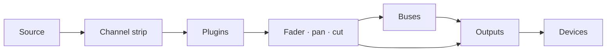

# Podręcznik użytkownika Faider

[English](../FAIDER-MANUAL.md)

**Wersja 0.1 · Windows 10 (2004) lub nowszy**

Faider to mikser i router audio na żywo dla Windows, zbudowany wokół dużej konsoli.
Bierze dźwięk z twojego interfejsu audio, z urządzeń Windows i z poszczególnych programów, przepuszcza
go przez paski kanałów, busy i wyjścia, a wynik odtwarza na wybranych urządzeniach: w słuchawkach,
w głośnikach, w streamie, w wirtualnym mikrofonie do rozmów i gier.

Ten podręcznik opisuje wszystko, co robi aplikacja, krok po kroku prowadzi przez typowe zadania
i mówi, co zrobić, gdy coś nie działa.

---

## Spis treści

1. [Zanim zaczniesz](#1-before-you-start)
2. [Pierwsza konfiguracja](#2-first-time-setup)
3. [Okno](#3-the-window)
4. [Jak działa routing](#4-how-routing-works)
5. [Konsola](#5-the-console)
6. [Pasek kanału, sekcja po sekcji](#6-the-channel-strip-section-by-section)
7. [Paski raw: aplikacje, pady, tape i kombinatory](#7-raw-strips-apps-pads-tape-and-combinators)
8. [Wyjścia](#8-outputs)
9. [Wtyczki](#9-plugins)
10. [Strona Routing](#10-the-routing-page)
11. [Narzędzia: Pads](#11-tools-pads)
12. [Narzędzia: Tape, Recorder i Replay](#12-tools-tape-recorder-and-replay)
13. [Urządzenia](#13-devices)
14. [Sceny, cofanie i sesje](#14-scenes-undo-and-sessions)
15. [Ustawienia](#15-settings)
16. [Zdalne sterowanie, nakładka i zasobnik](#16-remote-control-overlay-and-tray)
17. [Poradniki krok po kroku](#17-how-to-guides)
18. [Rozwiązywanie problemów](#18-troubleshooting)
19. [Dodatek](#19-reference)

---

## 1. Zanim zaczniesz

### Czego potrzebujesz

| | |
|---|---|
| **Windows** | Windows 10 w wersji 2004 lub nowszej albo Windows 11. Przechwytywanie dźwięku pojedynczego programu wymaga wersji 2004 lub nowszej |
| **Interfejs audio** | Opcjonalny. Z zainstalowanym sterownikiem ASIO Faider pracuje na zegarze interfejsu, co daje najmniejsze opóźnienie. Bez niego pracuje na twoim urządzeniu odtwarzającym Windows albo na wbudowanym zegarze (zobacz [Zegar](#clocking)) |
| **Słuchawki** | Podłączone do interfejsu (lub do dowolnego urządzenia odtwarzającego Windows), żeby było słychać twój miks |
| **VB-CABLE** | Opcjonalny i darmowy (vb-audio.com/Cable). Wirtualny mikrofon, dzięki któremu aplikacje takie jak Discord, gry i OBS słyszą twój miks |
| **ffmpeg** | Opcjonalny. Gdy `ffmpeg.exe` jest w PATH, rejestrator zapisuje też MP3, AAC, Opus i ALAC |

### Słowa użyte w tym podręczniku

| Słowo | Znaczenie |
|---|---|
| **Kanał** (wejście) | Jedno źródło na konsoli: mikrofon, urządzenie, program, pady, tape |
| **Pasek** | Kolumna na konsoli, która steruje kanałem, busem lub wyjściem |
| **Trasa** | Połączenie, które wysyła kanał lub bus dalej: do busa albo na wyjście |
| **Bus** | Podmiks. Wszystko, co do niego skierowano, jest sumowane, przetwarzane razem i kierowane dalej |
| **Kombinator** | Bus, który dzieli swój dźwięk na równoległe ścieżki, każdą z własnymi wtyczkami, a potem je sumuje |
| **Wyjście** | Końcowy miks odtwarzany na urządzeniu (twoich słuchawkach, głośnikach, wirtualnym kablu) |
| **Interfejs** | Twój interfejs audio ASIO, jeśli go masz |
| **Zegar** | To, z czym wszystko działa w czasie: twój interfejs, a w jego braku urządzenie odtwarzające Windows, a w jego braku zegar wbudowany |

## 2. Pierwsza konfiguracja

Ten rozdział prowadzi od instalatora do działającej konfiguracji: twój mikrofon w słuchawkach,
aplikacje słyszące twój mikrofon i dźwięk programu na osobnym kanale. Wykonuj kroki po kolei.
Każdy zajmuje minutę lub dwie.

### Krok 1: Zainstaluj Faider

1. Uruchom instalator, `Faider-<version>-Setup.exe`.
2. Windows SmartScreen może ostrzec o nierozpoznanej aplikacji, bo instalator nie jest podpisany.
   Kliknij **Więcej informacji**, a potem **Uruchom mimo to**.
3. Zaakceptuj licencję i zezwól na monit administratora. Jeśli chcesz skrót na pulpicie, zaznacz go
   po drodze (domyślnie jest wyłączony).
4. Instalator umieszcza aplikację w `C:\Program Files\Faider` i dodaje **Faider**
   do menu Start. Wszystko, czego aplikacja potrzebuje, jest w zestawie.
5. Na ostatniej stronie możesz od razu uruchomić Faider. Jeśli VB-CABLE nie jest
   zainstalowany, instalator proponuje też otwarcie jego strony pobierania.

Twój miks i ustawienia są w `%APPDATA%\Faider`, osobno od programu. Odinstalowanie
zostawia je na miejscu.

### Krok 2: Zainstaluj VB-CABLE (opcjonalnie)

VB-CABLE daje wirtualny mikrofon, który mogą wybrać inne aplikacje. Pomiń ten krok, jeśli chcesz
miksować tylko do własnych słuchawek.

1. Pobierz VB-CABLE z vb-audio.com/Cable i uruchom jego instalator jako administrator.
2. Uruchom ponownie Windows, gdy o to poprosi.
3. Windows ma teraz dwa nowe urządzenia. **CABLE Input** to urządzenie odtwarzające: wszystko, co
   do niego trafia, wychodzi z **CABLE Output**, urządzenia nagrywającego, które aplikacje mogą
   wybrać jako mikrofon.

> **Windows przełącza twój dźwięk na kabel.** Instalacja wirtualnego kabla często robi z niego
> urządzenie domyślne Windows: **CABLE Input** jako głośniki i **CABLE Output** jako mikrofon.
> Wtedy nie słyszysz nic z Windows, a aplikacje używające domyślnego mikrofonu słyszą kabel.
> Przełącz oba z powrotem zaraz po instalacji.

**Przywróć swoje urządzenia:**

1. Otwórz **Ustawienia > System > Dźwięk** (albo kliknij prawym przyciskiem ikonę głośnika na pasku
   zadań > **Ustawienia dźwięku**).
2. W sekcji **Wyjście** wybierz swoje słuchawki lub głośniki (albo wyjścia interfejsu), a nie
   **CABLE Input**.
3. W sekcji **Wejście** wybierz swój prawdziwy mikrofon, a nie **CABLE Output**.
4. Windows trzyma osobne ustawienie domyślne dla rozmów. Przewiń do **Więcej ustawień dźwięku**.
   Na karcie **Odtwarzanie** kliknij prawym przyciskiem słuchawki lub głośniki > **Ustaw jako
   domyślne urządzenie komunikacji**. Na karcie **Nagrywanie** zrób to samo dla mikrofonu.

Szybszy sposób ustawienia wyjścia: kliknij ikonę głośnika na pasku zadań, kliknij **>** obok suwaka
głośności i wybierz swoje urządzenie.

Zostaw swoje prawdziwe urządzenia jako domyślne w Windows. Faider gra do kabla tylko tam,
gdzie go skierujesz, a każda aplikacja sama wybiera **CABLE Output** jako mikrofon (krok 6). Jeśli
domyślnym głośnikiem Windows jest kabel, PRE-FLIGHT zgłosi to w **HEARD ONCE**.

### Krok 3: Uruchom Faider

Otwórz menu Start i kliknij **Faider** (albo użyj skrótu na pulpicie, jeśli go utworzono).
Za pierwszym razem otwiera się na **SETUP**.

### Krok 4: Odpowiedz na cztery pytania SETUP

SETUP zadaje cztery pytania, po jednym na stronie, i buduje twój miks z odpowiedzi. Klikaj karty,
żeby wybierać. Na każdej stronie oprócz trzeciej możesz wybrać więcej niż jedną. **NEXT** idzie
dalej, **BACK** wraca.

1. **WHERE YOU LISTEN**: wybierz słuchawki lub głośniki. Domyślne urządzenie Windows jest już wybrane.
2. **MICROPHONES**: wybierz mikrofony, do których mówisz. To wejścia twojego interfejsu
   (**IN 1**, **IN 2** …) i urządzenia nagrywające Windows.
3. **APPS HEAR YOU**: wybierz wirtualny kabel, którego aplikacje używają jako mikrofonu
   (**CABLE Input**, po kroku 2), albo **NOT NOW**.
4. **PROGRAMS**: wybierz programy, które teraz grają i które chcesz mieć na konsoli.
5. Kliknij **BUILD THE MIX**. **DONE** wylicza, co powstało.
6. Kliknij **OPEN THE MIXER**, żeby to zobaczyć.

Co tworzy każda odpowiedź:

| Strona | Co tworzy |
|---|---|
| **WHERE YOU LISTEN** | Wyjście na każdym urządzeniu. Pierwsze nazywa się **HEADPHONES**, pozostałe noszą nazwy swoich urządzeń |
| **MICROPHONES** | Kanał dla każdego, nazwany **MICROPHONE** (MICROPHONE 2 …) |
| **APPS HEAR YOU** | Wyjście o nazwie **MIC FOR APPS** na kablu. Każdy mikrofon jest do niego skierowany |
| **PROGRAMS** | Kanał raw dla każdego, skierowany tam, gdzie słuchasz, plus reguła aplikacji, która przywraca go sama, gdy tylko program zagra |

Twoje mikrofony nie są skierowane do twoich słuchawek, więc nie słyszysz opóźnionego echa własnego
głosu. Żeby usłyszeć siebie, zapal klawisz **HEADPHONES** mikrofonu (krok 6).

SETUP zostaje na panelu bocznym. Uruchom go ponownie, gdy dodasz urządzenie lub program. Dodaje to,
czego brakuje, i niczego nie usuwa.

### Krok 5: Sprawdź, czy audio działa

Spójrz na **kontrolkę stanu** w prawym górnym rogu.

- **Zielona** z procentem: audio działa. Przejdź do kroku 6.
- **Czerwona, z napisem OFF**: audio nie działa. Twój interfejs może mieć inny program (DAW,
  panel sterowania sterownika). Zamknij go i uruchom Faider ponownie. Zobacz
  [18.4](#184-the-interface-wont-start-or-stopped).

Kliknij kontrolkę, żeby otworzyć **DEVICES**. **STREAMS** pokazuje używany zegar (ASIO, Windows albo
zegar wbudowany; zobacz [Zegar](#clocking)), a **BUFFER** ustawia jego rozmiar bufora. Najmniejszy
rozmiar, przy którym nie ma trzasków, daje najmniejsze opóźnienie. 256 lub 512 próbek pasuje do
większości systemów.

### Krok 6: Usłysz siebie i pozwól aplikacjom usłyszeć ciebie

Mixer otwiera się w **SIMPLE**. Każdy kanał pokazuje swoją nazwę, czego słucha, klawisz dla każdego
wyjścia, swój fader i miernik, **CUT** i **SOLO**. Każde wyjście pokazuje urządzenie, na którym gra,
swój fader i miernik.

| Klawisz na kanale | Znaczy |
|---|---|
| Zwykły szary | Nie skierowany na to wyjście |
| Wypełniony kolorem wyjścia | Skierowany tam. Kliknij, żeby wyłączyć |
| Tylko kolorowa krawędź, **VIA BUS** | Dociera tam przez bus (ustawiony w PRO). Kliknij, żeby skierować go tam też bezpośrednio |

1. Mów i patrz, jak rusza się miernik twojego mikrofonu.
2. Żeby usłyszeć siebie, kliknij klawisz **HEADPHONES** mikrofonu.
3. W Discordzie, w grze, w OBS lub w dowolnej innej aplikacji wybierz **CABLE Output** jako mikrofon.
4. Sprawdź, co dostają: **FIND** (Ctrl+K) > **HEAR WHAT THEY HEAR** nagrywa 5 sekund tego, co
   odbierają aplikacje, i odtwarza ci to.

Program gra też nadal na własnym urządzeniu. Jeśli to urządzenie, na którym słuchasz, wyłącz klawisz
**HEADPHONES** jego kanału, bo inaczej słyszysz go dwa razy (PRE-FLIGHT ostrzega o tym).

**+ CHANNEL** i **+ APP** dodają kanały. **+ OUTPUT** dodaje wyjście na urządzeniu, które go nie ma.
Klawisz urządzenia pod nazwą wyjścia zmienia, gdzie ono gra. Kliknij nazwę prawym przyciskiem, żeby
dostać **Rename...**, kolor i **Remove**. Usunięcie kanału programu usuwa też jego regułę aplikacji,
więc kanał nie wraca sam.

### Krok 7: PRO, czyli cała konsola

Przełącznik **SIMPLE / PRO** na górnym pasku pokazuje ten sam miks w obu trybach. **PRO** to cała
konsola: wejście, filtry, dynamika i EQ każdego kanału, busy i kombinatory, wtyczki.

Żeby ukształtować swój mikrofon w PRO:

1. Podnieś **hp** do około 80–100 Hz, żeby usunąć dudnienie.
2. Włącz **DYNAMICS** (przełącznik z symbolem zasilania) i ustaw bramkę oraz kompresor.
3. Ustaw **EQ**.

Zobacz [6](#6-the-channel-strip-section-by-section). Ustawienia zrobione w PRO nadal działają w SIMPLE.

### Krok 8: Uruchom PRE-FLIGHT

Kilka sekund po starcie **PRE-FLIGHT** sprawdza konfigurację i otwiera się tylko wtedy, gdy coś
wymaga uwagi (nie przy pierwszym starcie, kiedy najpierw jest SETUP). Uruchom go kiedy chcesz z
**SETTINGS > GENERAL > PRE-FLIGHT NOW...** albo z **FIND** (Ctrl+K). Każdy wiersz powinien być zielony.
Zobacz [18.1](#181-pre-flight).

### Krok 9: Koniec

- **Twój miks zapisuje się sam** w ciągu sekundy od każdej zmiany. Żeby zachować wersję pod nazwą,
  użyj **SETTINGS > GENERAL > SAVE SESSION AS...**.
- **Start z Windows**: **SETTINGS > GENERAL > WINDOWS** uruchamia Faider w zasobniku
  przy logowaniu, więc twój mikrofon działa od początku.
- **Zamknięcie okna nie zatrzymuje audio.** Faider działa dalej w zasobniku systemowym,
  żeby mikrofon i słuchawki nadal działały. Żeby go zatrzymać, kliknij ikonę w zasobniku prawym
  przyciskiem i wybierz **Quit Faider**. Uruchomienie programu, gdy jest w zasobniku,
  przywraca okno.

Za pierwszym razem, gdy otwiera się każda strona, krótka wskazówka ją wyjaśnia. Wyłącz wskazówki w
**SETTINGS > GENERAL > ON START**.

To koniec konfiguracji. Reszta podręcznika omawia każdą część szczegółowo.

## 3. Okno

### Panel boczny

Strony są kartami po lewej stronie: **MIXER**, **ROUTING**, **SETUP**, **TOOLS**, **DEVICES**,
**SETTINGS**. Widoczna strona ma jasnoniebieską krawędź. Gdy widać Mixer, panel boczny ma też te
karty (w SIMPLE tylko **ADD CHANNEL** i **ADD APP**):

| Grupa | Karta | Co robi |
|---|---|---|
| **DESK** | **ADD CHANNEL** | Otwiera menu wejść: wejścia interfejsu, urządzenia Windows, aplikacje, okna programów i karty przeglądarki, pady, tape |
| | **ADD APP** | Wylicza programy, które teraz grają. Wybranie jednego daje mu kanał |
| | **ADD BUS** | Bus albo kombinator (na początek dwie ścieżki) |
| | **PLUGINS** | Wysuwa panel wtyczek pod paski (zobacz [9](#9-plugins)) |
| **SELECT** | **AUTO** | Dotknięcie dowolnego elementu paska zaznacza ten pasek |
| | **FOLLOW** | Konsola płynie do zaznaczonego paska, także gdy zaznaczono go gdzie indziej (FIND, skrót klawiszowy) |
| **METER** | **IN** / **OUT** | Mierniki kanałów pokazują sygnał wchodzący (przed przetwarzaniem) albo wychodzący |
| **SECTIONS** | HEADER … FADER | Sekcje paska. Zapalone są na ekranie. Kliknij jedną, żeby do niej popłynąć |

Wybory SELECT i METER są zapamiętywane.

Nad paskami są wyświetlacz czasu, transport decku Tape (przewiń wstecz, stop, odtwórz / pauza,
przewiń do przodu, nagrywaj, pętla) i przełącznik **SIMPLE / PRO** (zobacz [Krok 7](#step-7-pro-for-the-whole-console)).

### Górny pasek

Od prawej:

| Element | Co robi |
|---|---|
| **+ 100% -** | Zoom. Przeskakuje między 100, 125 i 150%. Kliknij procent, żeby wrócić do 100%. Ctrl + / Ctrl - / Ctrl 0 robią to samo |
| **FIND** (Ctrl+K) | Szuka po nazwie na każdej stronie, w kanałach, scenach, makrach, padach i poleceniach |
| **HISTORY** (Ctrl+H) | Każda zmiana, którą zrobiłeś. Wybierz jedną, żeby do niej wrócić |
| **MINI** | Małe okno miksera zawsze na wierzchu |
| **Kontrolka stanu** | Zielona: audio jest w porządku. Bursztynowa: obciążenie audio jest wysokie albo urządzeniu niedawno zabrakło danych. Czerwona: słyszalny zgrzyt w ostatnich 10 sekundach albo audio nie działa. Liczba to obciążenie audio. Kliknij, żeby otworzyć DEVICES |
| **SCENES** | Twoje zapisane miksy. **+** zapisuje nowy (zobacz [14.1](#141-scenes)) |

W wąskim oknie najpierw znika kontrolka stanu, potem MINI, potem HISTORY. FIND dosięga ich wszystkich.

### Transport

Pod górnym paskiem, w każdym widoku Mixera, widać czas decku Tape (upłynięty i długość utworu),
nazwę utworu i jego klawisze: **rewind 10 s**, **stop**, **play/pause**, **forward 10 s**,
**record**, **loop**.

- **Record** nagrywa pierwsze wyjście do pliku (w formacie i folderze Recordera). Naciśnij ponownie, żeby zatrzymać.
- **Loop** przechodzi przez **repeat all** → **repeat one** (oznaczone **1**) → **off**.

---

## 4. Jak działa routing

Routing decyduje, dokąd trafia każdy dźwięk. Nic nie słychać, dopóki nie jest skierowane, a wszystko
można skierować w tyle miejsc, ile chcesz.

### Droga dźwięku

1. **Kanał** bierze jedno źródło i przepuszcza je przez swój pasek (wejście, filtry, dynamika i EQ,
   w kolejności pokazanej w nagłówku), potem przez swoje wtyczki, potem przez fader, pan i cut.
2. **Trasy** wysyłają kanał dalej, do dowolnej liczby busów i wyjść naraz (do 8 każdego rodzaju).
   Każda trasa niesie kanał po jego faderze, więc fader i **CUT** działają wszędzie, dokąd kanał
   jest skierowany.
3. **Bus** sumuje wszystko, co do niego skierowano, przepuszcza to przez własny pasek i wtyczki i
   jest kierowany dalej na wyjścia (albo do innych busów) tak samo.
4. **Wyjście** sumuje wszystko, co do niego skierowano, przepuszcza przez swój kompresor busa, EQ
   miksu i limiter **SAFE**, i gra na swoim urządzeniu.

### Wyjścia to urządzenia

Każde wyjście gra na jednym urządzeniu: na wyjściach twojego interfejsu, w zestawie słuchawkowym
USB, w głośnikach, w **CABLE Input**. Wyjść nie tworzysz ręcznie. Skieruj coś na urządzenie, a
powstanie na nim wyjście. Dlatego pola routingu wymieniają urządzenia tak samo jak busy.

- Na urządzenie przypada jedno wyjście. Skieruj kilka kanałów na to samo urządzenie, a spotkają się
  w jego wyjściu.
- Różne wyjścia niosą różne miksy. Twoje słuchawki mogą słyszeć grę, muzykę i głos, podczas gdy
  wyjście streamu dostaje tylko muzykę i głos.
- Odłącz urządzenie, a jego wyjście milknie, dopóki urządzenie nie wróci.

### Trzy miejsca do routingu

Wszystkie trzy zmieniają te same trasy. Używaj tego, które masz najbliżej.

| Gdzie | Jak |
|---|---|
| **Pola routingu** (nagłówek każdego paska) | Jedno pole na każdy bus i urządzenie wyjściowe. Zapalone: skierowane tam. Kliknij, żeby przełączyć |
| **Route to** (prawy przycisk na pasku) | Ta sama lista jako menu, z zaznaczeniem tam, gdzie jest skierowane |
| **Strona Routing** | Każdy pasek jako blok, każda trasa jako linia. Kliknij jeden blok, potem drugi (zobacz [10](#10-the-routing-page)) |

### Busy

Użyj busa, gdy kilka kanałów potrzebuje tej samej obróbki albo jednego fadera. Skieruj kanały do
busa, a busa na wyjście. Potem wyłącz bezpośrednie trasy kanałów na to wyjście, bo inaczej dotrą na
nie dwa razy (raz bezpośrednio, raz przez bus). Bus może zasilać inny bus i nie dodaje to opóźnienia.

### Kombinatory

Kombinator to bus podzielony na równoległe **ścieżki** (na początek dwie). Każda ścieżka ma własne
wtyczki, a ścieżki są sumowane na faderze kombinatora. Skieruj źródło do jednej ścieżki albo do
kilku. Pasek kombinatora pokazuje, jakie źródła zasilają każdą ścieżkę.

### Zasady, które chronią przed kłopotami

- **Pętle sprzężenia zwrotnego są odrzucane.** Trasa, która przywiodłaby dźwięk z powrotem tam, skąd
  przyszedł (bus do busa, który go zasila, dźwięk wyjścia podany z powrotem na jego własne wejście),
  jest od razu wyłączana, a dziennik zdarzeń podaje nazwę pętli.
- **Solo** na dowolnym pasku wycisza każdy pasek, który nie jest w solo, oprócz oznaczonych jako solo safe.
- **Wyłączony pasek** niczego nie przepuszcza, dokądkolwiek jest skierowany.
- **Kanały aplikacji i podwajanie.** Program gra na własnym urządzeniu, a także do swojego kanału.
  Nie kieruj jego kanału na wyjście na urządzeniu, na którym już go słyszysz.

### Zegar

Zegar ustawia jedno urządzenie. Faider wybiera je przy starcie w tej kolejności:

1. **ASIO**: twój interfejs audio, przez jego sterownik ASIO. Najmniejsze opóźnienie.
2. **Windows**: bez sterownika ASIO, domyślne urządzenie odtwarzające Windows (wirtualny kabel,
   głośniki monitora albo headset VR tylko wtedy, gdy nie ma niczego innego). Wyjścia twojego
   interfejsu stają się wyjściami tego urządzenia, a mikrofony są dodawane jako urządzenia Windows.
3. **Zegar wbudowany**: gdy nie ma żadnego urządzenia odtwarzającego. Wszystkie urządzenia, także
   twoje słuchawki, idą za nim.

Każde inne urządzenie i każdy przechwytywany program pracuje na własnym zegarze i dołącza przez mały
bufor korygujący dryf, więc rozjeżdżające się zegary nigdy nie powodują trzasków.
**DEVICES > STREAMS** pokazuje każdy z nich i używany zegar.

Jeśli urządzenie Windows ustawiające zegar zostanie odłączone, wyłączone lub przestanie działać,
następny zegar przejmuje to sam, a komunikat mówi który. Urządzenie, które nie chce wystartować
(bo zajmuje je inny program), jest pomijane, dopóki twoje urządzenia się nie zmienią, a potem
próbowane ponownie. Na zegarze wbudowanym podłączone urządzenie odtwarzające przejmuje od niego zegar.

## 5. Konsola

### Układ

Konsola pokazuje wszystkie paski od lewej do prawej: **kanały**, potem **busy** (fioletowy pasek
nazwy), potem **wyjścia** (bursztynowy pasek nazwy). Każdy pasek ma siedem sekcji, od góry do dołu:

| Sekcja | Zawiera |
|---|---|
| **HEADER** | Słupki poziomu, klawisze FILT / EQ / EXT, kolejność przetwarzania, pola routingu, numer paska |
| **INPUT** | Trim, polaryzacja (a na Dark strip także drive mikrofonu i przełącznik wejścia) |
| **DYNAMICS** | Kompresor i bramka |
| **FILTERS** | Filtr dolnoprzepustowy i górnoprzepustowy |
| **EQ** | Cztery pasma |
| **NAME** | Pasek nazwy i przełącznik zasilania |
| **FADER** | Pan, SOLO, CUT, SEL, fader i jego odczyt |

### Mysz i klawiatura

| Czynność | Skutek |
|---|---|
| **Przeciągnięcie** pokrętła lub fadera w górę/w dół | Zmienia je. Jego wartość pojawia się obok, gdy przeciągasz lub najeżdżasz |
| **Dwukrotne kliknięcie** pokrętła lub fadera | Powrót do wartości domyślnej |
| **Kliknięcie** klawisza lub przełącznika | Włączony / wyłączony |
| **Kliknięcie** paska nazwy | Zaznacza pasek |
| **Przeciągnięcie** paska nazwy w bok | Przenosi pasek wśród jego własnego rodzaju: kanałów, busów lub wyjść (zobacz [17.4](#174-reorder-channels)) |
| **Kliknięcie** symbolu zasilania na pasku nazwy | Wyłącza lub włącza pasek |
| **Prawy przycisk** na pasku | Menu paska |
| **Kółko myszy** | Przewija konsolę w bok. **Shift + kółko** przewija w górę i w dół |
| **Ctrl + / Ctrl -** | Zoom całego okna |

Lewy przycisk nigdy nie otwiera menu. Menu są zawsze pod prawym przyciskiem.

### Zaznaczanie paska

Zaznaczony pasek ma niebieski obrys. Pasek zaznaczasz, klikając jego pasek nazwy lub klawisz **SEL**,
albo dotykając dowolnego z jego elementów przy włączonym **AUTO**. Zaznaczony pasek to ten, który
pokazuje panel wtyczek i na którym działają FIND, skróty klawiszowe i zdalne sterowanie.

Gdy konsola ma fokus (najpierw w nią kliknij): **Left / Right** zaznaczają poprzedni / następny
pasek, **M** go wycisza, **S** daje mu solo, a **Up / Down** przesuwają jego fader o 0,5 dB (3 dB z **Shift**).

### Wyłączanie paska

Kliknij symbol zasilania po lewej stronie paska nazwy. Pasek blednie i szarzeje. Nie jest
przetwarzany, a jego urządzenie lub program zostaje zwolniony. Dopóki jest wyłączony, **nic na nim
nie da się zmienić**: pokrętła, klawisze i panel wtyczek ignorują kliknięcia, a jego menu oferuje
tylko **Turn on** i odstępy. Kliknij symbol zasilania ponownie, żeby go przywrócić.

### Rodzaje pasków

Każdy kanał może używać **Light strip** albo **Dark strip**: prawy przycisk > **Strip type** >
**Light strip** / **Dark strip**. Wejścia interfejsu, urządzenia nagrywające (mikrofony) i busy
zaczynają jako ciemne. Wszystko inne zaczyna jako jasne. Dark strip dodaje **drive** mikrofonu i
przełącznik wejścia, a zabiera szybki atak kompresora i hold bramki. Twój wybór jest zapamiętywany
dla każdego kanału.

### Odstępy

Odstępy to puste paski, które dają miejsce między grupami. Prawy przycisk na pasku > **Add spacer
before** / **Add spacer after**. Prawy przycisk na odstępie daje **Narrow**, **Add another** i
**Remove spacer**. Odstęp zostaje przy pasku, za którym stoi, gdy ten pasek się przesuwa.

### Menu paska (prawy przycisk)

| Pozycja | |
|---|---|
| **Input** | Zmienia źródło: wejścia **Interface**, **Windows devices** (lub domyślne Windows), **What an output plays** (loopback), **Test tone**, **Nothing** |
| **Route to** | Każdy bus i urządzenie wyjściowe, z zaznaczeniem tam, gdzie jest wysyłany |
| **Plugins** | Otwórz jedną, **Add plugin...**, **Remove** |
| **Make mono / Make stereo** | Tylko kanały |
| **Strip type** | **Light strip** lub **Dark strip** |
| **Colour** | Kolor kanału, widoczny wzdłuż jego paska nazwy i na jego bloku w Routing |
| **Add spacer before / after** | |
| **Rename...** | |
| **Remove** | Usuwa kanał lub bus |

---

## 6. Pasek kanału, sekcja po sekcji

### HEADER

| Element | Co robi |
|---|---|
| **Słupki poziomu** | Poziom kanału, lewy i prawy (IN lub OUT, zgodnie z wyborem w METER) |
| **FILT** | Wysyła filtry do detektora bramki/kompresora (key filtering) |
| **EQ** | EQ włączony lub wyłączony |
| **EXT** | Dynamika słucha zewnętrznego klucza (sidechain) zamiast samego kanału |
| **Kolejność przetwarzania** | Trzy bloki (FILT, EQ, DYN), od góry do dołu w kolejności, w jakiej kanał je wykonuje. **Kliknij blok**, żeby przesunąć go o jedno miejsce w górę. Ten na górze trafia na koniec. Zapalone bloki są w użyciu |
| **Pola routingu** | Jedno pole na każdy bus i urządzenie wyjściowe. Zapalone: kanał jest tam wysyłany. Kliknij, żeby przełączyć. Wysłanie na urządzenie, które nie ma jeszcze wyjścia, tworzy to wyjście |
| **Numer** | Miejsce paska na konsoli |

### INPUT

| Element | |
|---|---|
| **in trim** | Wzmocnienie wejścia |
| **ø** | Odwrócenie polaryzacji |
| **WIDTH** (Light strip) | Szerokość stereo: 0 % mono, 100 % bez zmian, 200 % dwa razy szerzej. Przyciemniona na kanale mono |
| **mic** (Dark strip) | Drive: dodaje ciepła i poziomu (pokazany w procentach) |
| **pre** (Dark strip) | Stopień wejściowy włączony lub wyłączony |

### DYNAMICS

Przełącznik **IN** (z symbolem zasilania) włącza lub wyłącza razem kompresor i bramkę.

**Kompresor**

| Element | |
|---|---|
| **MIX** | Mieszanka wet/dry (kompresja równoległa). Przeciągnij zielony odczyt |
| **ratio**, **thresh**, **rel** | Współczynnik, próg i zwolnienie |
| **fast** | Szybki atak (3 ms). Wyłączony to 10 ms |
| **pk** | Detekcja szczytów. Włączona (domyślnie) kompresor reaguje na szczyty. Wyłączona reaguje na poziom średni (RMS), co jest łagodniejsze |
| **Diody redukcji wzmocnienia** | 3, 6, 10, 14 i 20 dB redukcji |

**Bramka / ekspander**

| Element | |
|---|---|
| **range**, **thresh**, **rel**, **hold** | Jak głęboko się zamyka, gdzie się otwiera, jak szybko się zamyka, jak długo trzyma |
| **exp** | Tryb ekspandera (łagodniejsza bramka) |
| **fast** | Szybki atak (0,1 ms). Wyłączony to 1,5 ms |
| **Diody bramki** | Jak bardzo bramka się zamyka |

Diody pokazują, co kompresor i bramka *zrobiłyby*, nawet gdy są wyłączone, więc możesz je ustawić
przed włączeniem.

### FILTERS

**lp** (dolnoprzepustowy) i **hp** (górnoprzepustowy). Przekręcony do końca w dół, filtr
górnoprzepustowy jest wyłączony. Przekręcony do końca w górę, wyłączony jest dolnoprzepustowy.

### EQ

| Pasmo | Elementy |
|---|---|
| **HF** | gain, freq, **bell** (shelf, gdy wyłączony) |
| **HMF** | gain, freq, q |
| **LMF** | gain, freq, q |
| **LF** | gain, freq, **bell** (shelf, gdy wyłączony) |

Przełącznik **EQ IN** włącza lub wyłącza cały EQ (tak samo jak klawisz EQ w nagłówku).

### FADER

| Element | |
|---|---|
| **PAN** | Lewo/prawo. Dwukrotne kliknięcie centruje |
| **SOLO** | Solo na miejscu |
| **CUT** | Wyciszenie |
| **SEL** | Zaznacza ten pasek |
| **Fader** | Poziom, od +12 dB do wyłączenia. Odczyt poniżej pokazuje poziom w dB |
| **safe** | Solo safe: ten kanał pozostaje słyszalny, gdy inne są w solo |
| **listen** | Odsłuch sygnału klucza dynamiki |

---

## 7. Paski raw: aplikacje, pady, tape i kombinatory

Niektóre kanały niosą dźwięk już gotowy: audio programu, pady, tape. Dostają **pasek raw**, z
routingiem, wtyczkami, jeśli chcesz, panem, faderem i klawiszami, a bez wbudowanych efektów. Gdy taki
pasek pojawia się na konsoli, jego wbudowane efekty są jednorazowo wyłączane (i zapisywane w dzienniku
zdarzeń). Jego wtyczki zostają.

| Pasek | Jego środkowe sekcje zawierają |
|---|---|
| **App** | Listę wtyczek (kliknij jedną, żeby ją otworzyć) i **ADD PLUGIN** |
| **Pads** | Klawisze banków **A–D**, pady 4×4 (naciśnij, żeby zagrać; pad GATE gra, dopóki jest przytrzymany) i **STOP ALL** |
| **Tape** | Ekran decku i pasek przewijania, transport (poprzedni, rewind, stop, play, pauza, do przodu, następny), **SHUFFLE**, **ADD...** i playlistę (kliknij utwór, żeby go odtworzyć) |
| **Kombinator** | Dla każdej ścieżki: **FROM**, kanały i busy, które ją zasilają (kliknij jeden, żeby przejść do jego paska), i **PLUGINS** na tej ścieżce (kliknij jedną, żeby ją otworzyć). **EDIT IN ROUTING** otwiera stronę Routing |

Kombinator nie ma własnych efektów. Jego dźwięk pochodzi z tego, co go zasila, i z wtyczek każdej
ścieżki. Prawy przycisk > **Paths**, żeby dodać ścieżkę oraz dla każdej ścieżki otworzyć, dodać lub
usunąć jej wtyczki, zmienić jej nazwę albo ją usunąć.

---

## 8. Wyjścia

Każde wyjście (master) ma własny ciemny pasek:

| Element | |
|---|---|
| **DEVICE** | Urządzenie, na którym gra. Kliknij, żeby wybrać inne |
| **SAFE** | Limiter po faderze: nic nie wychodzi powyżej -1 dBFS |
| **MON** | Monitoruj to wyjście |
| **LUFS** | Krótkoterminowa głośność tego, co wychodzi ("-- LUFS", gdy jest cisza) |
| **WIDTH** | Szerokość stereo |
| **BUS COMP** | Przełącznik In, miernik redukcji wzmocnienia w stylu VU, **threshold**, **ratio**, **attack**, **release**, **make-up**, **mix** |
| **MIX EQ** | Przełącznik In, gain i freq HF, gain i freq LF |
| **CUT**, **SEL**, fader | Tak jak na kanale |

Prawy przycisk na wyjściu daje **Device...**, odstępy, **Rename...** i **Remove**.

**Wyjścia tworzą się same.** Wyślij kanał na urządzenie (polem routingu, stroną Routing albo
**Route to**), a jeśli nie ma na nim wyjścia, zostanie ono utworzone.

**Brakujące urządzenie.** Jeśli urządzenie wyjścia zostanie odłączone, to wyjście milknie, dopóki
urządzenie nie wróci. Nic samo nie przenosi się na inne urządzenie.

**FIND > MIX-MINUS AND STEMS** buduje osobny feed dla każdego gościa (wszystko poza jego własnym
głosem) oraz stemy głosu, muzyki i gry.

---

## 9. Wtyczki

Faider obsługuje wtyczki **VST3** na kanałach, busach i ścieżkach kombinatorów, z
automatyczną kompensacją opóźnienia.

### Dodawanie wtyczki

- Na kanale: prawy przycisk > **Plugins > Add plugin...**, albo **ADD PLUGIN** na pasku raw, albo
  **ADD** w panelu wtyczek.
- Na ścieżce kombinatora: prawy przycisk na kombinatorze > **Paths > PATH n > Add plugin...**.
  Kliknij wtyczkę ścieżki na pasku kombinatora, żeby ją otworzyć.

Każda wtyczka jest **najpierw testowana w osobnej kopii programu**, więc wtyczka, która się
wysypuje lub zawiesza podczas ładowania, nie położy twojego miksu. Wynik jest zapamiętywany, dopóki
plik wtyczki się nie zmieni.

### Panel wtyczek

Kliknij **PLUGINS** na panelu bocznym. Pod paskami wysuwa się panel z wtyczkami **zaznaczonego
paska** w kolejności, w jakiej działają. **FIND** > **PLUGINS: name** otwiera go na tym pasku i
przełącza na PRO, jeśli widać SIMPLE. Każda karta pokazuje:

- **CPU**: udział wtyczki w czasie przetwarzania (zielony, bursztynowy powyżej 2 %, czerwony powyżej 5 %)
- **Latency**: opóźnienie, które dodaje
- **BYPASSED**: wyłączona, ale nadal załadowana (nadal zajmuje pamięć)
- **HEAVY**: niezwykle kosztowna

Klawisze na każdej karcie: **BYPASS**, **OPEN** (jej okno), **REMOVE** oraz strzałki, które przesuwają
ją wcześniej lub później. **ADD** na końcu dodaje kolejną. Nic nie da się zmienić, gdy pasek jest wyłączony.

---

## 10. Strona Routing

Strona Routing pokazuje cały miks jako mapę: każdy pasek jako blok, a każdą trasę jako linię.
Używaj jej, żeby zobaczyć, dokąd wszystko idzie, i żeby kierować dźwięk, klikając dwa bloki.

### Czytanie strony

- **Trzy rzędy:** **INPUTS** na górze, **BUSES** pośrodku, **OUTPUTS** na dole. Urządzenia
  wyjściowe, które nie mają jeszcze wyjścia, stoją na prawym końcu rzędu OUTPUTS, na szaro.
- **Każdy blok stoi pod swoim paskiem.** Blok jest w tym samym miejscu w poziomie co jego pasek na
  konsoli, razem z odstępami, a strona przewija się w bok razem z konsolą (kółko myszy). Przestaw
  konsolę, a mapa podąży za nią.
- **Każdy blok pokazuje** nazwę i numer paska. Wyłączony pasek jest przyciemniony. Kanał z własnym
  kolorem pokazuje go jako odcień i pasek po lewej stronie.
- **Linie to trasy.** Każda biegnie prosto w dół od swojego źródła do własnego toru w przerwie pod
  jego rzędem, w poprzek i w dół do bloku, który zasila, kończąc się strzałką. Trasy wejść są
  turkusowe, trasy busów fioletowe. Kilka linii wychodzących z jednego bloku lub do niego dochodzących
  jest rozłożonych wzdłuż niego po kolei, więc nigdy się nie nakładają.
- **Kombinatory** pokazują swoje ścieżki jako komórki **P1, P2, …** wzdłuż dołu bloku. Linie kończą
  się w ścieżce, którą zasilają.

### Routing z bloku do bloku

1. **Kliknij blok.** Zapala się na niebiesko i pulsuje. Bloki, do których jest skierowany lub z
   których dostaje dźwięk, dostają podświetlone obramowanie, ich linie jaśnieją, a wszystko inne ciemnieje.
2. **Kliknij inny blok.** Trasa między nimi włącza się (pojawia się linia) lub wyłącza (linia
   znika). Obie kolejności działają: źródło, potem cel, albo cel, potem źródło.
3. Pierwszy blok **pozostaje zaznaczony**, więc klikaj dalej, żeby skierować go w kilka miejsc albo
   zdjąć kilka tras.
4. **Kliknij go ponownie**, kliknij puste miejsce albo naciśnij **Esc**, żeby go puścić.

Jeśli tych dwóch bloków nie da się połączyć (na przykład dwa wyjścia), zaznaczany jest drugi.

### Przykłady

| Aby | Kliknij |
|---|---|
| Usłyszeć swój mikrofon | MIC, potem wyjście słuchawek |
| Pozwolić aplikacjom słyszeć twój mikrofon | MIC, potem **CABLE Input** (w rzędzie wyjść, szary, dopóki nie ma wyjścia) |
| Wysłać grupę przez bus | Bus, potem każdy kanał; potem bus, potem jego wyjście |
| Zdjąć kanał ze streamu | Kanał, potem wyjście streamu (linia znika) |
| Zasilić jedną ścieżkę kombinatora | Źródło, potem komórka ścieżki (P1, P2…) |

Kliknięcie szarego bloku urządzenia tworzy jego wyjście, a nowe wyjście od razu pojawia się na konsoli.

### Kombinatory

Kliknij źródło, potem **komórkę ścieżki**. Źródło może zasilać kilka ścieżek: kliknij kolejno każdą
komórkę. Kliknięcie kombinatora poza jego komórkami kieruje dźwięk do jego pierwszej ścieżki. Żeby
dodać ścieżki lub ich wtyczki, kliknij kombinator na konsoli prawym przyciskiem > **Paths**.

### Przesuwanie kanałów

Przeciągnij blok w bok wzdłuż jego rzędu. Niebieski pasek pokazuje, gdzie wyląduje, a konsola
zmienia się odpowiednio. Kanały przesuwają się wśród kanałów, busy wśród busów, wyjścia wśród wyjść.

### Gdy trasa nie chce zostać włączona

Trasa utworzyłaby pętlę sprzężenia zwrotnego, więc jest od razu wyłączana. Dziennik zdarzeń podaje
nazwę pętli. Usuń trasę, która sprzęga zwrotnie. Zobacz [18.8](#188-a-route-wont-switch-on).

## 11. Narzędzia: Pads

**TOOLS > PADS** daje cztery banki (**A–D**) po 16 padów: 64 dźwięki, do 32 grających jednocześnie.

### Wydobywanie dźwięku

Pady grają do **kanału PADS**. Kliknij **CREATE PADS CHANNEL** (potem pokazuje **PADS CHANNEL
ACTIVE**) albo wybierz inne wejście w menu **PLAY INTO**, żeby pady grały przez wtyczki i trasy tego
kanału. Bez kanału padów naciśnięcia są ignorowane.

### Ładowanie i granie

| Czynność | |
|---|---|
| Kliknięcie **pustego** pada | Wybierz plik dźwiękowy |
| Kliknięcie załadowanego pada | Odtwarza go |
| Prawy przycisk na padzie | Zaznacza go do edycji bez odtwarzania |
| Upuszczenie plików na pad | Ładuje je do tego pada i kolejnych w banku |
| **Ctrl + przeciągnięcie** na inny pad | Zamienia oba pady miejscami |
| **STOP ALL** | Wycisza płynnie wszystkie pady |

Formaty: WAV, FLAC, AIFF, OGG, MP3. Pad, którego plik został przeniesiony, pokazuje **MISSING: FILE**.

### Edytor padów

| Ustawienie | |
|---|---|
| Nazwa | Dwukrotne kliknięcie zmienia nazwę |
| **LOAD**, **CLEAR**, **COLOUR** | |
| **REPLAY** | Bufor natychmiastowego odtwarzania staje się dźwiękiem tego pada (zapisany jako WAV w folderze nagrań). Najpierw włącz replay w TOOLS > TAPE |
| **MODE** | **ONE-SHOT** gra do końca (ponowne naciśnięcie zaczyna od nowa). **GATE** gra, dopóki jest przytrzymany. **LOOP** startuje po jednym naciśnięciu i zatrzymuje się po następnym |
| **CHOKE** | OFF albo grupa 1–8. Pady jednej grupy zatrzymują się nawzajem |
| **LEVEL** | Od -INF do +12 dB |
| **HOTKEY** | Kliknij (**LEARN...**), potem naciśnij klawisze. Musi zawierać Ctrl, Alt albo klawisz F. Działa, gdy fokus mają inne programy. Esc anuluje, Delete czyści |
| **MACRO** | Makro uruchamiane z padem (pad może mieć makro i żadnego dźwięku) |
| **TRIM** | Przeciągnij linie początku i końca na przebiegu fali. Dwukrotne kliknięcie wybiera cały plik |
| **FADE IN / FADE OUT** | 0–5 s |

---

## 12. Narzędzia: Tape, Recorder i Replay

### Deck Tape

**TOOLS > TAPE** odtwarza playlistę do **kanału TAPE**. Kliknij **CREATE TAPE CHANNEL**, żeby go utworzyć.

- **ADD FILES**, **ADD FOLDER** albo upuść pliki i foldery w dowolnym miejscu strony. **EJECT**
  czyści playlistę.
- Kliknij utwór dwukrotnie, żeby go odtworzyć, przeciągnij, żeby zmienić kolejność, i naciśnij
  Delete, żeby usunąć zaznaczone utwory.
- Transport: **PREV**, **REW** (10 s wstecz; przytrzymaj, żeby przewijać szybko), **PLAY**, **PAUSE**,
  **STOP**, **FF** (10 s do przodu; przytrzymaj, żeby przewijać szybko), **NEXT**. Do tego **SHUFFLE**,
  **REPEAT** (all / one / off) i **LEVEL**.
- Utwory grają bez przerw. Pauzy i przeskoki wyciszają się w 30 ms, więc nigdy nie trzaskają.

Transport na górnym pasku i pasek tape na konsoli sterują tym samym deckiem.

### Rejestrator

| | |
|---|---|
| **Source** | Dowolne wyjście, bus lub wejście albo **ALL CHANNELS, ONE FILE EACH** (wielościeżkowo: każde wejście lub tylko te z zapalonym DIRECT, plus każde wyjście, zsynchronizowane co do próbki) |
| **Format** | WAV 24-bit (domyślnie), 16-bit, 32-bit, 32-bit float; FLAC 24/16-bit; AIFF 24/16-bit; OGG Vorbis 128–320k. Z ffmpeg: MP3, AAC (M4A), Opus, ALAC. Każdy pokazuje, ile czasu mieści się na dysku |
| **REC** | Rozpoczyna i zatrzymuje. Ekran pokazuje czas, rozmiar, pozostały czas i ewentualne utracone bloki |
| **PATH** / **REVEAL** | Wybierz folder / otwórz go w Eksploratorze |

Nagrania trafiają do `Music\Faider Recordings`, chyba że wybierzesz folder. Formaty ffmpeg
najpierw nagrywają WAV i konwertują go po zatrzymaniu (WAV zostaje, jeśli konwersja się nie uda).
Nagrywanie zatrzymuje się samo, gdy zostaje mniej niż 1 GB wolnego miejsca.

### Instant replay

**ARM** zachowuje ostatnie **30 s**, **1**, **2** lub **5 minut** ze źródła rejestratora.
**SAVE** zapisuje je do pliku (prawy przycisk na SAVE, żeby nadać mu globalny skrót klawiszowy).
Przy wybranym trybie wielościeżkowym replay używa pierwszego wyjścia.

---

## 13. Urządzenia

**DEVICES** wylicza każde urządzenie audio Windows i każdy sterownik ASIO.

| Kolumna | |
|---|---|
| **I/O** | ASIO, OUT lub IN |
| **DEVICE**, **HARDWARE** | Jego nazwa i adapter, na którym działa |
| **FORMAT** | Kanały i częstotliwość próbkowania |
| **STATE** | Aktywne, odłączone, wyłączone albo **off in Faider** |
| **TAGS** | DEFAULT i CALLS dla domyślnych urządzeń Windows |

Kliknij nagłówek, żeby posortować. Zaznacz urządzenia (Ctrl/Shift dla kilku), a potem użyj:

| Klawisz | |
|---|---|
| **EXCLUDE / INCLUDE** | Faider przestaje (lub zaczyna znów) używać urządzenia. Wykluczone urządzenia nigdy nie są otwierane i nie ma ich na listach |
| **DISABLE / ENABLE IN WINDOWS** | Wyłącza lub włącza urządzenie w samym Windows |
| **RENAME** | Twoja własna nazwa urządzenia, używana w całym Faider (albo dwukrotne kliknięcie wiersza) |

### Streams

Pod listą **STREAMS** pokazuje stan silnika audio:

- **CALLBACK LOAD** (i szczyt), **OVERLOADS**, **BLOCKS SKIPPED**. Przybierają kolor ostrzegawczy, jeśli cokolwiek się zdarzyło
- **BUFFER**: rozmiar bufora twojego interfejsu (mniejszy oznacza mniejsze opóźnienie i większe obciążenie)
- Dla każdego urządzenia: zbuforowane audio, całkowite opóźnienie, **DRIFT** (korekcja zegara w ppm), **UNDER**
  (zabrakło danych, odtworzono ciszę), **OVER** (przepełnienie, audio odrzucone), **RESYNC** (wyśrodkowano
  ponownie). Wiersz, w którym audio zostało utracone, jest czerwony
- **RESET STATS** zeruje liczniki

### VB-CABLE

Jeśli VB-CABLE jest zainstalowany, pasek u góry ustawia jego **częstotliwość próbkowania** i **maksymalne
opóźnienie**. **APPLY** prosi o jedno potwierdzenie administratora i restartuje kabel.

Dziennik zdarzeń na dole zapisuje każde urządzenie podłączone, usunięte lub odzyskane.

---

## 14. Sceny, cofanie i sesje

### 14.1 Sceny

Scena zapisuje fader, pan, cut, solo, zasilanie i trasy każdego kanału (a jeśli chcesz, także
ustawienia wtyczek).

- **Zapis:** kliknij **+** na górnym pasku i nadaj jej nazwę.
- **Przywołanie:** kliknij jej klawisz. Fadery i pany płyną przez pół sekundy. Reszta przełącza się od razu.
- **Prawy przycisk na scenie** daje: przywołanie tylko wyciszeń / tylko poziomów, zapis do niej,
  uwzględnienie ustawień wtyczek, zmianę nazwy, globalny skrót klawiszowy, **Recall on device**
  (gdy pojawi się urządzenie; z powrotem, gdy zniknie), **Auto-scene** (gdy aplikacja zaczyna grać,
  podłącza się urządzenie albo o określonej porze dnia), MIDI learn, przesunięcie, usunięcie.

Urządzenia i same kanały nie są częścią sceny.

### 14.2 Cofanie i historia

**Ctrl+Z** cofa, **Ctrl+Y** (albo Ctrl+Shift+Z) ponawia. **HISTORY** (Ctrl+H) wylicza każdą zmianę.
Wybierz jedną, żeby do niej skoczyć.

### 14.3 Sesje

Twój miks zapisuje się sam w ciągu sekundy od każdej zmiany i przy wyjściu.

| | |
|---|---|
| **Restore session** | Menu zasobnika: wcześniejsze wersje twojego miksu według daty (Faider uruchamia się ponownie z nią) |
| **SESSION TIMELINE** | FIND: każda zachowana wersja. **Restore everything** albo **PUT ONE CHANNEL BACK** (jego poziom, pan, wyciszenie i rack) bez restartu |
| **SAVE SESSION AS...** | SETTINGS > GENERAL > SESSIONS: zachowaj miks pod nazwą |
| **OPEN, EXPORT OR IMPORT...** | Otwórz nazwany miks (restart), zapisz miks do pliku albo wczytaj go z pliku |

Zachowywanych jest do 60 wcześniejszych wersji (co najwyżej jedna na 5 minut). Jeśli twojego miksu
nie da się wczytać (brakuje interfejsu, plik jest uszkodzony), jest **odkładany na bok**, a nie
tracony, i startuje nowy miks. Zobacz [18.2](#182-my-mix-is-gone-a-fresh-mix-started).

---

## 15. Ustawienia

**SETTINGS** ma cztery sekcje jako karty po lewej stronie: **GENERAL**, **MACROS**, **HOTKEYS**,
**CONTROL**. Ustawienia włącz/wyłącz to kwadratowe przełączniki, które po włączeniu świecą kremowo.

### GENERAL

| Karta | Ustawienia |
|---|---|
| **WINDOWS** | **START WITH WINDOWS**: otwiera się w zasobniku przy logowaniu |
| **DESK** | **WARN IF I TALK WHILE MUTED** (komunikat, gdy wyciszony mikrofon przekracza -30 dBFS). Zaznaczanie paska po dotknięciu to **SELECT > AUTO** na panelu bocznym |
| **APPS** | **APP RULES...**: do którego busa lub wyjścia trafia program, gdy zaczyna grać (także w **FIND**). Usunięcie kanału programu usuwa jego regułę |
| **SESSIONS** | **SAVE SESSION AS...**; **OPEN, EXPORT OR IMPORT...** |
| **ON START** | **PRE-FLIGHT: CHECK THE SETUP**; **PRE-FLIGHT NOW...**; **TIPS**; **SHOW THE TIPS AGAIN** |
| **NOTICES (IN THE CORNER)** | Urządzenia podłączone lub zniknięte, kanał w clipie (jego źródło lub wyjście na pełnej skali), przywołane sceny, uruchomione makra, cofnięcie i ponowienie |
| **ZOOM** | 100%, 125%, 150%, **CUSTOM...** (75–200%) |
| **METER STANDARD** | Jak odczytują mierniki (domyślnie szczyt próbki z szybkim opadaniem; IEC i inne) |
| **CHANNEL METER POINT** | **PRE HPF** (surowe źródło), **PRE FADER** (po efektach), **POST ON** (po faderze, domyślnie) |
| **ABOUT** | Wersja i autorzy |

### MACROS

Makro to lista **akcji** uruchamianych skrótem klawiszowym, padem, wyzwalaczem albo zdalnym sterowaniem.

1. Kliknij **+ NEW**, potem nazwij je (dwukrotne kliknięcie nazwy).
2. **+ ACTION**: MUTE ON/OFF/TOGGLE, SET FADER (dB, czas zanikania), ASSIGN ON/OFF/TOGGLE (trasa),
   CHANNEL ON/OFF, TRIGGER PAD, STOP PAD, ALL NOTES OFF, TRANSPORT PLAY/PAUSE, TRANSPORT NEXT,
   RECORD START/STOP, WAIT, SCENE RECALL, FX ON/OFF/TOGGLE, WINDOWS DEFAULT OUTPUT/INPUT, PLUGIN
   SETTING.
3. Opcjonalnie **+ TRIGGER**: APP STARTS, APP STOPS, DEVICE CONNECTED, DEVICE DISCONNECTED, MASTER
   SILENT (przez n sekund), MASTER HAS SOUND, TIME (24-godzinny).
4. Opcjonalnie **HOTKEY** i **MOMENTARY** (akcje są cofane po puszczeniu klawisza, do push-to-talk).
5. **FIRE** uruchamia je teraz.

### HOTKEYS

Każdy przypisywalny skrót klawiszowy jest w jednym miejscu: **PADS**, **MACROS**, **SCENES** i
**SAVE INSTANT REPLAY** w **TAPE**. Kliknij jeden, potem naciśnij nowe klawisze (Esc anuluje, Delete
czyści). Skróty muszą zawierać Ctrl, Alt albo klawisz F i działają, gdy fokus ma gra. Stałe klawisze
też są wymienione ([19.1](#191-keyboard-shortcuts)). Klawisze ON THE MIXER ze strony działają także
na konsoli ([5](#5-the-console)).

### CONTROL

| Karta | |
|---|---|
| **SET UP A CONTROLLER** | Prowadzona konfiguracja dla Loupedeck, Stream Deck, MIDI, OSC i strony na telefon |
| **MIDI** | **MIDI MAP** (Ctrl+L); wejścia i powiązania; przełącznik dla każdego wejścia MIDI |
| **OSC** | **OSC ON (PORT 9000)**; zezwól innym urządzeniom (tablet, telefon) |
| **DECK PLUGINS (LOCAL API)** | **API ON (127.0.0.1:9123)**, dla wtyczek Stream Deck i Loupedeck |
| **PHONE CONTROL (WEB PAGE)** | Strona sterowania na telefon (wymaga włączonego API). Pokazuje kod QR |

---

## 16. Zdalne sterowanie, nakładka i zasobnik

| | |
|---|---|
| **MIDI MAP** (Ctrl+L) | Kliknij element na ekranie, potem ruszaj pokrętłem lub klawiszem kontrolera. Można przypisać fader, pan, CUT, SOLO, zasilanie i klawisze routingu każdego paska, w SIMPLE i w PRO, a także sceny, pady i tape. Podczas przypisywania kółko myszy przewija konsolę (Shift+kółko w górę i w dół) |
| **Stream Deck / Loupedeck** | Wtyczki z miernikami na żywo na klawiszach. Najpierw włącz API |
| **Telefon** | Zeskanuj kod QR z SETTINGS > CONTROL > PHONE CONTROL |
| **Nakładka w grze** (Ctrl+Shift+O) | Kontrolka mówienia każdego kanału mikrofonu, LIVE / MUTED i poziom, plus do czterech klawiszy scen. Nigdy nie odbiera fokusu grze. Przeciągnij ją gdziekolwiek |
| **MINI** | Mały mikser nad wszystkim. **OPEN** wraca do głównego okna |
| **Zasobnik** | Kliknij ikonę, żeby zobaczyć mikser w zasobniku, kliknij dwukrotnie, żeby otworzyć okno. Prawy przycisk: Show, przywołanie sceny, Restore session, Start with Windows, About, Quit. Ikona miga na bursztynowo podczas alarmu |

Faider zawsze działa z twoimi zwykłymi uprawnieniami użytkownika, nawet gdy uruchomiono go z okna
administratora. Uruchamia się wtedy ponownie ze zwykłymi uprawnieniami, bo nakładka w grze nie sięga
do programu działającego jako administrator. Te nieliczne kroki, które wymagają administratora
(zastosowanie ustawień VB-CABLE, ponowne włączenie urządzenia wyłączonego przez Windows), same
proszą o zgodę.

---

## 17. Poradniki krok po kroku

### 17.1 Usłysz siebie: ustaw mikrofon

1. **ADD CHANNEL** > wejście twojego interfejsu (albo urządzenie nagrywające Windows). Pojawia się z
   Dark strip.
2. Mów i ustaw **in trim** tak, żeby słupki poziomu dochodziły do szczytu około -12 do -6 dB.
3. Skieruj go: kliknij pole routingu dla wyjścia słuchawek (albo użyj strony Routing).
4. Oczyść go: **hp**, żeby usunąć dudnienie (około 80–100 Hz), potem bramka i kompresor (**IN**
   w DYNAMICS), potem EQ.

### 17.2 Pozwól aplikacjom słyszeć twój mikrofon (Discord, gry, OBS)

1. Zainstaluj **VB-CABLE** (PRE-FLIGHT proponuje link), potem przywróć swoje prawdziwe głośniki i
   mikrofon jako domyślne w Windows ([Krok 2](#step-2-install-vb-cable-optional)).
2. Skieruj kanał swojego mikrofonu na urządzenie **CABLE Input**. Powstaje na nim wyjście.
3. W aplikacji wybierz **CABLE Output** jako jej mikrofon.
4. Uruchom **PRE-FLIGHT NOW...**, żeby sprawdzić, że nic po drodze nie jest wyciszone i nic nie tworzy pętli.

### 17.3 Wprowadź program do miksu

1. Uruchom program i spraw, żeby grał dźwięk.
2. **ADD APP** > wybierz go. Dostaje kanał raw (bez efektów).
3. Skieruj go tam, gdzie chcesz go słyszeć. Program gra też nadal na własnym urządzeniu, więc jeśli
   słyszysz także to urządzenie, nie kieruj kanału aplikacji w to samo miejsce (PRE-FLIGHT ostrzega
   przed takim podwojeniem).

### 17.4 Zmień kolejność kanałów

Przeciągnij **pasek nazwy** kanału w bok w Mixerze (przewiń w dół do sekcji NAME) albo przeciągnij
jego blok na stronie Routing. Niebieski pasek pokazuje, gdzie wyląduje, a paski płynnie wskakują na
miejsce. Odstępy przesuwają się z paskiem, za którym stoją. Busy i wyjścia przesuwa się tak samo,
każde wśród swojego rodzaju, a ich trasy idą z nimi. SIMPLE pokazuje wyjścia w tej samej kolejności.

### 17.5 Zgrupuj kanały w bus

1. **ADD BUS**, potem zmień jego nazwę (prawy przycisk > Rename...).
2. Na stronie Routing kliknij bus, potem każdy kanał, żeby go do niego skierować.
3. Kliknij bus, potem jego wyjście, żeby skierować busa dalej.
4. Jeśli chcesz, żeby te kanały szły tylko przez bus, wyłącz ich bezpośrednie trasy na wyjście.

### 17.6 Przetwarzanie równoległe z kombinatorem

1. **ADD BUS > COMBINATOR**. Zaczyna z dwiema ścieżkami. Prawy przycisk > **Paths > Add path**, żeby
   dodać więcej.
2. Na stronie Routing skieruj źródła do komórek ścieżek (**P1**, **P2**…).
3. Prawy przycisk > **Paths > PATH n > Add plugin...** dla każdej ścieżki. Ścieżki są sumowane na
   faderze kombinatora. Pasek kombinatora pokazuje, co zasila każdą ścieżkę, i otwiera jej wtyczki.

### 17.7 Zrób miks do streamu i miks do słuchawek

1. Wyślij swoje kanały na dwa wyjścia, na przykład do słuchawek i na urządzenie, które przechwytuje
   twoje oprogramowanie do streamingu.
2. Każde wyjście ma własny fader, kompresor busa, EQ i limiter **SAFE**. Włącz **SAFE** dla wyjścia streamu.
3. Żeby coś zostało poza streamem, wyłącz trasę tego kanału na wyjście streamu (jego polem routingu
   albo na stronie Routing).

### 17.8 Nagrywanie

1. TOOLS > TAPE > **RECORDER**: wybierz źródło i format.
2. Naciśnij **REC** (albo klawisz nagrywania na górnym pasku). Naciśnij ponownie, żeby zatrzymać.
3. **REVEAL** otwiera folder.

### 17.9 Zrób klawisz push-to-talk

1. SETTINGS > MACROS > **+ NEW**.
2. **+ ACTION** > **MUTE OFF** > kanał twojego mikrofonu.
3. Włącz **MOMENTARY** i ustaw **HOTKEY**. Dopóki go trzymasz, mikrofon jest otwarty, a po puszczeniu
   znów się wycisza. Zacznij z wyciszonym mikrofonem.

---

## 18. Rozwiązywanie problemów

### 18.1 PRE-FLIGHT

PRE-FLIGHT uruchamia się kilka sekund po starcie (oraz z **PRE-FLIGHT NOW...** albo z FIND) i
pokazuje się tylko wtedy, gdy coś jest nie tak. Każdy wiersz ma kontrolkę, ustalenie i rozwiązanie:

| Sprawdzenie | Problem | Rozwiązanie |
|---|---|---|
| **AUDIO** | Nie wystartowało (może zajmuje je inna aplikacja) | **DEVICES** |
| **MIC CABLE** | Brak VB-CABLE: aplikacje nie słyszą twojego miksu jako mikrofonu | **GET VB-CABLE** |
| **MIC MASTER** | Żadne wyjście nie gra do kabla mikrofonu | **ROUTING** |
| **MIC CHANNELS** | Coś na drodze do mikrofonu jest wyciszone | **UNMUTE** |
| **HEARD ONCE** | Pętla sprzężenia zwrotnego albo coś słychać dwa razy | **SOUND SETTINGS** |

### 18.2 Mój miks zniknął, wystartował nowy

Twój miks nie przepadł. Gdy nie da się go użyć przy starcie, jest **odkładany na bok** jako
`session-unloaded-<date>.xml`. Dziennik zdarzeń mówi dlaczego:

| Powód | Co zrobić |
|---|---|
| Zapisany interfejs nie jest podłączony | Podłącz go, potem **Restore session** (zasobnik) > wersja "kept:" |
| Zapisanego interfejsu nie dało się otworzyć (zajmuje go inny program) | Zamknij ten program i uruchom Faider ponownie. W międzyczasie nic nie jest zapisywane nad twoim miksem |
| Nie dało się odczytać session.xml | **Restore session** > niedawna wersja |

### 18.3 Brak dźwięku

Idź wzdłuż drogi sygnału:

1. **Kontrolka stanu** czerwona z napisem OFF: audio nie działa. Zobacz
   [18.2](#182-my-mix-is-gone-a-fresh-mix-started) i [18.4](#184-the-interface-wont-start-or-stopped).
2. **Miernik kanału** (METER: IN): jeśli się nie rusza, sprawdź jego **Input** (prawy przycisk) i
   czy źródło gra. Wyłączony pasek niczego nie przepuszcza.
3. **CUT** jest wyłączony, fader podniesiony i nic innego nie jest w solo (**SOLO** innego paska
   wycisza wszystko pozostałe).
4. **Routing:** przynajmniej jedno pole routingu jest zapalone albo na stronie Routing jest linia.
5. **Wyjście**: nie w CUT, fader podniesiony, a **DEVICE** pokazuje właściwe urządzenie (nie "NO DEVICE"
   ani "(OFF)").
6. **Urządzenie** jest podłączone i nie jest wykluczone w DEVICES.

### 18.4 Interfejs nie startuje albo się zatrzymał

- Może go zajmować inny program (DAW, panel sterowania sterownika). Zamknij go i uruchom ponownie.
- **INTERFACE DOWN** w zasobniku: interfejs sam się zresetował i nie chciał się ponownie otworzyć.
  Zmień rozmiar jego bufora w DEVICES albo uruchom Faider ponownie.
- Zmiany częstotliwości lub bufora zrobione w panelu sterowania samego interfejsu są wychwytywane same.
- Żeby przez jakiś czas pracować bez interfejsu, uruchom Faider poleceniem
  `"C:\Program Files\Faider\Faider.exe" --clock windows` (twoje urządzenie
  odtwarzające Windows) albo `--clock builtin` (zegar wbudowany). `--clock` z fragmentem nazwy
  sterownika ASIO (`--clock focusrite`) wybiera ten sterownik. Twój miks idzie razem z tobą i
  pozostaje zapisany dla twojego interfejsu: następny normalny start do niego wraca.

### 18.5 Trzaski, chrobotanie lub zaniki

1. Spójrz na **kontrolkę stanu** i **DEVICES > STREAMS**.
2. Wysokie **CALLBACK LOAD** albo OVERLOADS: zwiększ **BUFFER** albo znajdź kosztowne wtyczki w
   panelu wtyczek (**HEAVY**, wysokie CPU) i je obejdź lub usuń.
3. **UNDER / OVER** rosną na jednym urządzeniu: to urządzenie sobie nie radzi. Spróbuj innego portu
   USB, zamknij inne programy, które go używają, albo wyklucz je, jeśli go nie używasz.
4. Stały **DRIFT** jest normalny. To korekcja, która utrzymuje zegary w zgodzie.

### 18.6 Aplikacja nie pojawia się w ADD APP

- Program musi **grać dźwięk** właśnie teraz. Uruchom odtwarzanie, potem otwórz menu ponownie.
- Programy, które mają już kanał, są wyszarzone (**ON THE DESK**).
- Windows starszy niż 10 w wersji 2004 nie potrafi przechwycić pojedynczego programu ("Windows refused app capture").

### 18.7 Słyszę coś dwa razy albo echo

- Kanał aplikacji jest skierowany na wyjście na tym samym urządzeniu, na którym aplikacja już gra,
  więc słyszysz ją bezpośrednio i przez Faider. Skieruj kanał aplikacji gdzie indziej albo
  przenieś aplikację na inne urządzenie.
- Domyślny głośnik Windows jest ustawiony na wirtualny kabel. PRE-FLIGHT > **HEARD ONCE** go wskazuje.

### 18.8 Trasa nie chce się włączyć

Utworzyłaby **pętlę sprzężenia zwrotnego** (dźwięk wracający tam, skąd przyszedł), więc jest od
razu wyłączana. Dziennik zdarzeń podaje nazwę pętli. Przerwij ją, usuwając trasę, która sprzęga zwrotnie.

### 18.9 Nie mogę nic zmienić na pasku

Pasek jest **wyłączony** (przyciemniony i szary). Kliknij symbol zasilania na jego pasku nazwy.

### 18.10 Przeciąganie kanału nic nie robi

Przeciągaj za **pasek nazwy** (sekcja NAME, blisko dołu; w razie potrzeby przewiń w dół) albo
przeciągnij blok na stronie Routing. Pasek przesuwa się tylko wśród swojego rodzaju: bus nie może
trafić między kanały.

### 18.11 Wtyczka się nie ładuje

Każda wtyczka jest najpierw testowana w osobnej kopii programu, a powód niepowodzenia jest
zgłaszany: nie skończyła się ładować w 30 s, wysypała się podczas testu albo w pliku nie ma wtyczki
VST3. Zaktualizuj lub zainstaluj ponownie wtyczkę. Gdy jej plik się zmieni, jest testowana ponownie.

### 18.12 Program się wysypał

Raport jest zapisywany w `%APPDATA%\Faider\crash.log`, razem z minidumpem `crash.dmp`. Twój
miks zapisuje się w ciągu sekundy od każdej zmiany, więc tracisz co najwyżej zmiany z ostatniej chwili.

### 18.13 Nagrywanie samo się zatrzymało

Nagrywanie zatrzymuje się, gdy zostaje mniej niż 1 GB miejsca na dysku (albo zbliża się limit
rozmiaru formatu). Zasobnik pokazuje **RECORDING STOPPED, NO ROOM**. Zwolnij miejsce albo wybierz
inny **PATH**.

### 18.14 Brak dźwięku z Windows po instalacji VB-CABLE

Windows ustawił kabel jako swoje urządzenie domyślne. Ustaw ponownie słuchawki lub głośniki jako
domyślne wyjście, a swój prawdziwy mikrofon jako domyślne wejście, zarówno w **Ustawienia > System > Dźwięk**,
jak i jako domyślne urządzenia komunikacji. Zobacz [Krok 2](#step-2-install-vb-cable-optional).

---

## 19. Dodatek

### 19.1 Skróty klawiszowe

| Klawisze | |
|---|---|
| **Ctrl+K** | FIND |
| **Ctrl+Z / Ctrl+Y** (Ctrl+Shift+Z) | Cofnij / ponów |
| **Ctrl+H** | Historia |
| **Ctrl+L** | MIDI MAP |
| **Ctrl + / Ctrl - / Ctrl 0** | Powiększ / pomniejsz / 100% |
| **Ctrl+Shift+O** | Pokaż / ukryj nakładkę w grze (działa wszędzie) |
| **Left / Right** | Zaznacz poprzedni / następny pasek (konsola z fokusem) |
| **M / S** | Wycisz / solo zaznaczonego paska |
| **Up / Down** | Zaznaczony fader ±0,5 dB (±3 dB z Shift) |
| **Esc** | Puść zaznaczony blok (Routing) |

### 19.2 Wiersz poleceń

| | |
|---|---|
| `--minimised` | Uruchom w zasobniku |
| `--quit` | Zamknij działającą kopię |

### 19.3 Pliki

W `%APPDATA%\Faider`:

| Plik | |
|---|---|
| `session.xml` | Twój miks |
| `history\` | Wcześniejsze wersje (do 60) |
| `sessions\` | Nazwane miksy |
| `session-unloaded-*.xml` | Miksy odłożone na bok przy starcie |
| `settings.xml` | Preferencje |
| `console.xml` | Rodzaje pasków, odstępy, wybory SELECT i METER |
| `plugins.xml` | Znalezione wtyczki i wynik testu każdej z nich |
| `events.log` | Wszystko, co się wydarzyło (rotuje przy 5 MB) |
| `status.txt` | Migawka silnika co kilka sekund: urządzenia, poziomy, bufory, dryf |
| `crash.log`, `crash.dmp` | Raporty awarii |

Sam program jest w `C:\Program Files\Faider`. Nagrania trafiają do
`Music\Faider Recordings`, chyba że wybierzesz inny folder.

### 19.4 Kolory

| Kolor | Znaczy |
|---|---|
| Niebieski obrys | Zaznaczony |
| Szary pasek nazwy | Kanał |
| Fioletowy | Bus |
| Bursztynowy | Wyjście |
| Turkusowa linia | Trasa kanału |
| Fioletowa linia | Trasa busa |
| Zielona kontrolka stanu | Audio w porządku; bursztynowa: pod obciążeniem; czerwona: zgrzyt albo nie działa |

