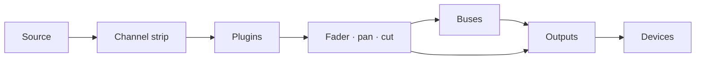

# Manual do usuário do Faider

[English](../FAIDER-MANUAL.md)

**Versão 0.1 · Windows 10 (2004) ou posterior**

O Faider é um roteador de áudio e mixer ao vivo para Windows, construído em torno de um
console de grande formato. Ele pega o som da sua interface de áudio, dos seus dispositivos do
Windows e de cada programa, passa tudo por strips de canal, buses e saídas, e toca o resultado nos
dispositivos que você escolher: seus fones de ouvido, suas caixas de som, uma transmissão, um
microfone virtual para chamadas e jogos.

Este manual cobre tudo o que o app faz, guia você passo a passo nas tarefas comuns e diz o que fazer
quando algo dá errado.

---

## Conteúdo

1. [Antes de começar](#1-before-you-start)
2. [Primeira configuração](#2-first-time-setup)
3. [A janela](#3-the-window)
4. [Como funciona o roteamento](#4-how-routing-works)
5. [O console](#5-the-console)
6. [O strip de canal, seção por seção](#6-the-channel-strip-section-by-section)
7. [Strips brutos: apps, pads, fita e combinadores](#7-raw-strips-apps-pads-tape-and-combinators)
8. [Saídas](#8-outputs)
9. [Plugins](#9-plugins)
10. [A página Routing](#10-the-routing-page)
11. [Ferramentas: Pads](#11-tools-pads)
12. [Ferramentas: Tape, gravador e Replay](#12-tools-tape-recorder-and-replay)
13. [Dispositivos](#13-devices)
14. [Cenas, desfazer e sessões](#14-scenes-undo-and-sessions)
15. [Configurações](#15-settings)
16. [Controle remoto, overlay e bandeja](#16-remote-control-overlay-and-tray)
17. [Guias práticos](#17-how-to-guides)
18. [Solução de problemas](#18-troubleshooting)
19. [Referência](#19-reference)

---

## 1. Antes de começar

### O que você precisa

| | |
|---|---|
| **Windows** | Windows 10 versão 2004 ou posterior, ou Windows 11. Capturar o som de um único programa exige a versão 2004 ou posterior |
| **Uma interface de áudio** | Opcional. Com o driver ASIO dela instalado, o Faider roda no clock da interface para ter o menor atraso. Sem ela, roda no seu dispositivo de reprodução do Windows, ou no clock interno (veja [Sincronização](#clocking)) |
| **Fones de ouvido** | Ligados à sua interface (ou a qualquer dispositivo de reprodução do Windows) para você ouvir a sua mixagem |
| **VB-CABLE** | Opcional e gratuito (vb-audio.com/Cable). Um microfone virtual, para que apps como Discord, jogos e OBS ouçam a sua mixagem |
| **ffmpeg** | Opcional. Com `ffmpeg.exe` no seu PATH, o gravador também pode gravar MP3, AAC, Opus e ALAC |

### Palavras usadas neste manual

| Palavra | Significado |
|---|---|
| **Canal** (entrada) | Uma fonte na mesa: um microfone, um dispositivo, um programa, os pads, a fita |
| **Strip** | A coluna do console que controla um canal, um bus ou uma saída |
| **Rota** | Uma conexão que envia um canal ou um bus para algum lugar: para um bus ou para uma saída |
| **Bus** | Uma submixagem. Tudo o que é roteado para ele é somado, processado junto e roteado adiante |
| **Combinador** | Um bus que divide o som em caminhos paralelos, cada um com seus próprios plugins, e depois soma tudo |
| **Saída** | Uma mixagem final que toca em um dispositivo (seus fones, suas caixas de som, um cabo virtual) |
| **Interface** | Sua interface de áudio ASIO, se você tiver uma |
| **Clock** | Aquilo com que tudo anda no mesmo compasso: sua interface, senão seu dispositivo de reprodução do Windows, senão o clock interno |

## 2. Primeira configuração

Este capítulo leva você do instalador a uma configuração funcionando: seu microfone nos seus fones,
apps ouvindo o seu mic e o som de um programa em um canal próprio. Siga os passos na ordem. Cada um
leva um ou dois minutos.

### Passo 1: instalar o Faider

1. Execute o instalador, `Faider-<version>-Setup.exe`.
2. O Windows SmartScreen pode avisar sobre um app não reconhecido, porque o instalador não é
   assinado. Clique em **Mais informações** e depois em **Executar assim mesmo**.
3. Aceite a licença e permita o aviso de administrador. Se quiser um atalho na área de trabalho,
   marque a opção durante a instalação (ela vem desmarcada).
4. O instalador coloca o app em `C:\Program Files\Faider` e adiciona o **Faider
   Console** ao menu Iniciar. Tudo o que ele precisa já vem incluído.
5. Na última página você pode iniciar o Faider na hora. Se não houver nenhum VB-CABLE
   instalado, ele também oferece abrir a página de download do VB-CABLE.

Sua mixagem e suas configurações ficam em `%APPDATA%\Faider`, separadas do programa. Ao
desinstalar, elas continuam lá.

### Passo 2: instalar o VB-CABLE (opcional)

O VB-CABLE dá a você um microfone virtual que outros apps podem escolher. Pule este passo se você só
quer mixar para os seus próprios fones.

1. Baixe o VB-CABLE em vb-audio.com/Cable e execute o instalador como administrador.
2. Reinicie o Windows quando ele pedir.
3. O Windows agora tem dois dispositivos novos. **CABLE Input** é um dispositivo de reprodução: o
   que toca nele sai por **CABLE Output**, um dispositivo de gravação que os apps podem escolher
   como microfone.

> **O Windows muda o seu som para o cabo.** Instalar um cabo virtual muitas vezes o torna o padrão
> do Windows: **CABLE Input** como alto-falantes e **CABLE Output** como microfone. Aí você não ouve
> nada do Windows, e os apps que usam o mic padrão ouvem o cabo. Volte os dois ao normal logo depois
> de instalar.

**Coloque seus dispositivos de volta:**

1. Abra **Configurações > Sistema > Som** (ou clique com o botão direito no ícone do alto-falante na
   barra de tarefas > **Configurações de som**).
2. Em **Saída**, escolha seus fones ou suas caixas de som (ou as saídas da sua interface), não o
   **CABLE Input**.
3. Em **Entrada**, escolha o seu microfone de verdade, não o **CABLE Output**.
4. O Windows guarda um padrão separado para chamadas. Role até **More sound settings**. Na aba
   **Reprodução**, clique com o botão direito nos seus fones ou caixas de som > **Definir como
   Dispositivo de Comunicação Padrão**. Na aba **Gravação**, faça o mesmo com o seu microfone.

Um jeito mais rápido de definir a saída: clique no ícone do alto-falante na barra de tarefas, clique
no **>** ao lado do controle de volume e escolha o seu dispositivo.

Mantenha seus dispositivos reais como padrão do Windows. O Faider só toca no cabo onde
você o roteia, e cada app escolhe o **CABLE Output** como microfone por conta própria (passo 6). Se o
alto-falante padrão do Windows for o cabo, o PRE-FLIGHT avisa em **HEARD ONCE**.

### Passo 3: iniciar o Faider

Abra o menu Iniciar e clique em **Faider** (ou use o atalho da área de trabalho, se você
criou um). Na primeira vez, ele abre em **SETUP**.

### Passo 4: responder às quatro perguntas do SETUP

O SETUP faz quatro perguntas, uma por página, e monta a sua mixagem a partir das respostas. Clique
nos cartões para escolher. Em todas as páginas, exceto a terceira, você pode escolher mais de um.
**NEXT** avança, **BACK** volta.

1. **WHERE YOU LISTEN**: escolha seus fones ou suas caixas de som. O padrão do Windows já vem
   escolhido.
2. **MICROPHONES**: escolha os microfones em que você fala. São as entradas da sua interface
   (**IN 1**, **IN 2** …) e os seus dispositivos de gravação do Windows.
3. **APPS HEAR YOU**: escolha o cabo virtual que os apps usam como mic (**CABLE Input**, depois do
   passo 2), ou **NOT NOW**.
4. **PROGRAMS**: escolha os programas que estão tocando som agora e que você quer na mesa.
5. Clique em **BUILD THE MIX**. **DONE** lista o que foi criado.
6. Clique em **OPEN THE MIXER** para ver.

O que cada resposta cria:

| Página | O que ela cria |
|---|---|
| **WHERE YOU LISTEN** | Uma saída em cada dispositivo. A primeira se chama **HEADPHONES**, as outras levam o nome do dispositivo |
| **MICROPHONES** | Um canal para cada um, chamado **MICROPHONE** (MICROPHONE 2 …) |
| **APPS HEAR YOU** | Uma saída chamada **MIC FOR APPS** no cabo. Todo microfone é roteado para ela |
| **PROGRAMS** | Um canal bruto para cada um, roteado para onde você ouve, mais uma regra de app que o traz de volta sozinha sempre que o programa tocar |

Seus microfones não são roteados para os seus próprios fones, então você não ouve um eco atrasado da
sua voz. Para se ouvir, acenda a tecla **HEADPHONES** do mic (passo 6).

O SETUP fica na barra lateral. Execute-o de novo sempre que adicionar um dispositivo ou um programa.
Ele adiciona o que falta e nunca remove nada.

### Passo 5: conferir se o áudio está funcionando

Olhe a **luz de status** no canto superior direito.

- **Verde** com uma porcentagem: o áudio está funcionando. Vá para o passo 6.
- **Vermelha, com OFF**: o áudio não está funcionando. Outro programa pode estar com a sua interface
  (um DAW, o painel de controle do driver). Feche-o e reinicie o Faider. Veja
  [18.4](#184-the-interface-wont-start-or-stopped).

Clique na luz para abrir **DEVICES**. **STREAMS** mostra o clock em uso (ASIO, Windows ou o clock
interno; veja [Sincronização](#clocking)), e **BUFFER** define o tamanho do buffer. O menor tamanho
que toca sem estalos dá o menor atraso. 256 ou 512 amostras servem para a maioria dos sistemas.

### Passo 6: se ouvir e deixar os apps ouvirem você

O Mixer abre em **SIMPLE**. Cada canal mostra seu nome, o que ele escuta, uma tecla para cada saída,
seu fader e seu medidor, **CUT** e **SOLO**. Cada saída mostra o dispositivo em que toca, seu fader
e seu medidor.

| Tecla de um canal | Significado |
|---|---|
| Cinza liso | Não roteado para essa saída |
| Preenchida com a cor da saída | Roteado para lá. Clique para desligar |
| Só a borda colorida, **VIA BUS** | Chega lá por um bus (configurado no PRO). Clique para rotear também direto para lá |

1. Fale e veja o medidor do seu microfone se mexer.
2. Para se ouvir, clique na tecla **HEADPHONES** do mic.
3. No Discord, no seu jogo, no OBS ou em qualquer outro app, escolha **CABLE Output** como
   microfone.
4. Confira o que eles recebem: **FIND** (Ctrl+K) > **HEAR WHAT THEY HEAR** grava 5 segundos do que
   os apps recebem e toca para você.

Se você ouvir um programa duas vezes, veja [18.7](#187-i-hear-something-twice-or-an-echo).

**+ CHANNEL** e **+ APP** adicionam canais. **+ OUTPUT** adiciona uma saída em um dispositivo que não
tem nenhuma. A tecla de dispositivo sob o nome de uma saída muda onde ela toca. Clique com o botão
direito em um nome para **Rename...**, a cor e **Remove**. Remover o canal de um programa também
remove a regra de app dele, para o canal não voltar sozinho.

### Passo 7: PRO, para o console inteiro

A chave **SIMPLE / PRO** na barra superior mostra a mesma mixagem nos dois casos. O **PRO** é o
console inteiro: a entrada de cada canal, filtros, dinâmica e EQ, buses e combinadores, plugins.

Para dar forma ao seu microfone, veja [17.1](#171-hear-yourself-set-up-a-microphone). Todos os
controles estão em [6](#6-the-channel-strip-section-by-section). As configurações que você faz no
PRO continuam valendo no SIMPLE.

### Passo 8: executar o PRE-FLIGHT

Alguns segundos depois de iniciar, o **PRE-FLIGHT** confere a configuração e só abre se algo
precisar de atenção (não no primeiríssimo início, quando o SETUP vem primeiro). Execute-o a qualquer
momento em **SETTINGS > GENERAL > PRE-FLIGHT NOW...** ou em **FIND** (Ctrl+K). Todas as linhas devem
estar verdes. Veja [18.1](#181-pre-flight).

### Passo 9: concluir

- **Sua mixagem se salva sozinha** em até um segundo depois de qualquer mudança. Para guardar uma
  versão com um nome, use **SETTINGS > GENERAL > SAVE SESSION AS...**.
- **Iniciar com o Windows**: **SETTINGS > GENERAL > WINDOWS** inicia o Faider na bandeja
  quando você entra no Windows, para que o seu mic funcione desde o começo.
- **Fechar a janela não para o áudio.** O Faider continua rodando na bandeja do sistema
  para que o seu mic e os seus fones continuem funcionando. Para parar, clique com o botão direito no
  ícone da bandeja e escolha **Quit Faider**. Iniciar o programa enquanto ele está na
  bandeja traz a janela de volta.

Na primeira vez que cada página abre, uma dica curta a explica. Desligue as dicas em
**SETTINGS > GENERAL > ON START**.

Com isso a configuração está pronta. O resto deste manual cobre cada parte em detalhe.

## 3. A janela

### A barra lateral

As páginas são cartões ao longo da esquerda: **MIXER**, **ROUTING**, **SETUP**, **TOOLS**,
**DEVICES**, **SETTINGS**. A página exibida tem uma borda azul acesa. Enquanto o Mixer está
aparecendo, a barra lateral também tem estes cartões (no SIMPLE, só **ADD CHANNEL** e **ADD APP**):

| Grupo | Cartão | O que faz |
|---|---|---|
| **DESK** | **ADD CHANNEL** | Abre o menu de entradas: entradas da interface, dispositivos do Windows, apps, janelas de programas e abas do navegador, pads, fita |
| | **ADD APP** | Lista os programas que estão tocando som agora. Escolha um para dar um canal a ele |
| | **ADD BUS** | Um bus, ou um combinador (dois caminhos para começar) |
| | **PLUGINS** | Sobe o painel de plugins sob os strips (veja [9](#9-plugins)) |
| **SELECT** | **AUTO** | Tocar em qualquer controle de um strip seleciona esse strip |
| | **FOLLOW** | A mesa desliza até o strip selecionado, também quando ele é escolhido em outro lugar (FIND, uma tecla de atalho) |
| **METER** | **IN** / **OUT** | Os medidores dos canais mostram o sinal que entra (antes do processamento) ou o que sai |
| **SECTIONS** | HEADER … FADER | As seções do strip. As acesas estão na tela. Clique em uma para deslizar até ela |

As escolhas de SELECT e METER são lembradas.

### A barra superior

Da direita para a esquerda:

| Controle | O que faz |
|---|---|
| **+ 100% -** | Zoom. Passa por 100, 125 e 150%. Clique na porcentagem para voltar a 100%. Ctrl + / Ctrl - / Ctrl 0 fazem o mesmo |
| **FIND** (Ctrl+K) | Procura por nome em todas as páginas, canais, cenas, macros, pads e comandos |
| **HISTORY** (Ctrl+H) | Todas as mudanças que você fez. Escolha uma para voltar a ela |
| **MINI** | Uma pequena janela de mixer sempre por cima |
| **Luz de status** | Verde: o áudio está bem. Âmbar: a carga de áudio está alta ou um dispositivo ficou sem dados há pouco. Vermelha: uma falha audível nos últimos 10 segundos, ou nenhum áudio rodando. O número é a carga de áudio. Clique nela para ir a DEVICES |
| **SCENES** | Suas mixagens guardadas. **+** guarda uma nova (veja [14.1](#141-scenes)) |
| **SIMPLE / PRO** | A mesma mixagem, simples ou como o console inteiro (veja o [passo 7](#step-7-pro-for-the-whole-console)) |

Em uma janela estreita, a luz de status some primeiro, depois o MINI, depois o HISTORY. O FIND chega
a todos.

### O transporte

Sob a barra superior, em toda visão do Mixer, você tem o tempo da fita (decorrido e duração da
faixa), o nome da faixa e as teclas dela: **voltar 10 s**, **parar**, **tocar/pausar**, **avançar
10 s**, **gravar**, **repetir**.

- **Gravar** grava a primeira saída em um arquivo (no formato e na pasta do gravador). Aperte de
  novo para parar.
- **Repetir** passa por **repetir tudo** → **repetir uma** (marcado com **1**) → **desligado**.

---

## 4. Como funciona o roteamento

O roteamento decide para onde vai cada som. Nada é ouvido até ser roteado, e qualquer coisa pode ser
roteada para quantos lugares você quiser.

### O caminho de um som

1. **Um canal** pega uma fonte e a passa pelo seu strip (entrada, filtros, dinâmica e EQ, na ordem
   que o cabeçalho mostra), depois pelos seus plugins, depois pelo fader, pelo pan e pelo cut.
2. **As rotas** enviam o canal adiante, para quantos buses e saídas você quiser ao mesmo tempo (até 8
   de cada). Cada rota leva o canal depois do fader, então o fader e o **CUT** afetam todos os
   lugares para onde ele é roteado.
3. **Um bus** soma tudo o que é roteado para ele, passa pelo seu próprio strip e pelos seus plugins,
   e é roteado para saídas (ou para outros buses) do mesmo jeito.
4. **Uma saída** soma tudo o que é roteado para ela, passa pelo seu compressor de bus, pelo EQ da
   mixagem e pelo limitador **SAFE**, e toca no seu dispositivo.

### Saídas são dispositivos

Cada saída toca em um dispositivo: as saídas da sua interface, um headset USB, caixas de som, o
**CABLE Input**. Você não cria saídas à mão. Roteie algo para um dispositivo e uma saída é criada
nele. É por isso que as caixas de roteamento listam dispositivos além de buses.

- Há uma saída por dispositivo. Roteie vários canais para o mesmo dispositivo e eles se encontram na
  saída dele.
- Saídas diferentes levam mixagens diferentes. Seus fones podem ouvir jogo, música e voz, enquanto a
  saída da transmissão recebe só música e voz.
- Desconecte um dispositivo e a saída dele fica em silêncio até ele voltar.

### Três lugares para rotear

Os três mudam as mesmas rotas. Use o que estiver mais perto.

| Onde | Como |
|---|---|
| **Caixas de roteamento** (cabeçalho de cada strip) | Uma caixa por bus e por dispositivo de saída. Acesa: roteado para lá. Clique para alternar |
| **Route to** (botão direito em um strip) | A mesma lista como menu, marcada onde está roteado |
| **A página Routing** | Cada strip é um bloco, cada rota é uma linha. Clique em um bloco e depois em outro (veja [10](#10-the-routing-page)) |

### Buses

Use um bus quando vários canais precisam do mesmo tratamento ou de um só fader. Roteie os canais
para o bus e o bus para a saída. Depois tire as rotas diretas dos canais para essa saída, ou eles
chegam a ela duas vezes (uma direto, outra pelo bus). Um bus pode alimentar outro bus, e isso não
adiciona atraso.

### Combinadores

Um combinador é um bus dividido em **caminhos** paralelos (dois para começar). Cada caminho tem seus
próprios plugins, e os caminhos são somados no fader do combinador. Roteie uma fonte para um caminho
ou para vários (veja [7](#7-raw-strips-apps-pads-tape-and-combinators)).

### Regras que mantêm tudo seguro

- **Loops de realimentação são recusados.** Uma rota que traria um som de volta para onde ele veio
  (um bus para um bus que o alimenta, o som de uma saída realimentado na própria entrada) é
  desligada na hora, e o registro de eventos nomeia o loop.
- **Solo** em qualquer strip silencia todo strip que não está em solo, exceto os marcados como solo
  safe.
- **Canais de apps e duplicação.** Um programa toca no próprio dispositivo além de tocar no canal
  dele (veja [18.7](#187-i-hear-something-twice-or-an-echo)).

### Sincronização

Um dispositivo define o clock. O Faider o escolhe nesta ordem ao iniciar:

1. **ASIO**: sua interface de áudio, pelo driver ASIO dela. O menor atraso.
2. **Windows**: sem driver ASIO, o seu dispositivo de reprodução padrão do Windows (um cabo virtual,
   as caixas de um monitor ou um headset de VR só quando não houver mais nada). As saídas da sua
   interface passam a ser saídas desse dispositivo, e os microfones são adicionados como
   dispositivos do Windows.
3. **Clock interno**: sem nenhum dispositivo de reprodução. Todos os dispositivos, seus fones
   inclusive, o seguem.

Todo outro dispositivo e todo programa capturado roda no próprio clock e entra por um pequeno buffer
que corrige a deriva, então clocks que se afastam nunca causam estalo. **DEVICES > STREAMS** mostra
cada um, e o clock em uso.

Se o dispositivo do Windows que define o clock for desconectado, desligado ou parar de funcionar, o
próximo clock assume sozinho e um aviso diz qual. Um dispositivo que não inicia (porque outro
programa o está usando) é pulado até seus dispositivos mudarem, e então é tentado de novo. No clock
interno, um dispositivo de reprodução que for conectado assume o lugar dele.

## 5. O console

### Disposição

A mesa mostra todos os strips da esquerda para a direita: os **canais**, depois os **buses** (barra
de nome violeta), depois as **saídas** (barra de nome âmbar). Cada strip tem sete seções, de cima
para baixo:

| Seção | Contém |
|---|---|
| **HEADER** | As barras de nível, as teclas FILT / EQ / EXT, a ordem de processamento, as caixas de roteamento, o número do strip |
| **INPUT** | Trim, polaridade (e no Dark strip, o drive do mic e a chave de entrada) |
| **DYNAMICS** | Compressor e gate |
| **FILTERS** | Passa-baixa e passa-alta |
| **EQ** | Quatro bandas |
| **NAME** | A barra de nome e a chave de energia |
| **FADER** | Pan, SOLO, CUT, SEL, o fader e a leitura dele |

### Mouse e teclado

| Ação | Resultado |
|---|---|
| **Arrastar** um knob ou fader para cima/baixo | Muda o valor. O valor aparece ao lado enquanto você arrasta ou passa o mouse |
| **Clique duplo** em um knob ou fader | Volta ao padrão |
| **Clique** em uma tecla ou chave | Liga / desliga |
| **Clique** na barra de nome | Seleciona o strip |
| **Arrastar** a barra de nome de um strip para o lado | Move o strip entre os do mesmo tipo: canais, buses ou saídas (veja [17.4](#174-reorder-channels)) |
| **Clique** no símbolo de energia da barra de nome | Desliga ou liga o strip |
| **Botão direito** em um strip | O menu do strip |
| **Roda do mouse** | Rola a mesa para os lados. **Shift + roda** rola para cima e para baixo |
| **Ctrl + / Ctrl -** | Dá zoom na janela inteira |

Um clique esquerdo nunca abre um menu. Os menus ficam sempre no botão direito.

### Selecionar um strip

O strip selecionado fica com contorno azul. Selecione um strip clicando na barra de nome ou na tecla
**SEL** dele, ou tocando em qualquer um dos controles dele com o **AUTO** ligado. O strip
selecionado é o que o painel de plugins mostra, e aquele sobre o qual o FIND, as teclas de atalho e
os controles remotos agem.

Com a mesa em foco (clique nela antes): **Esquerda / Direita** selecionam o strip anterior /
seguinte, **M** corta o som dele, **S** põe em solo, e **Cima / Baixo** movem o fader dele em 0,5 dB
(3 dB com **Shift**).

### Desligar um strip

Clique no símbolo de energia à esquerda da barra de nome. O strip esmaece e fica cinza. Ele não é
processado, e o dispositivo ou programa dele é liberado. Enquanto estiver desligado, **nada nele
pode ser mudado**: knobs, teclas e o painel de plugins ignoram cliques, e o menu dele só oferece
**Turn on** e espaçadores. Clique no símbolo de energia de novo para trazê-lo de volta.

### Tipos de strip

Cada canal pode usar o **Light strip** ou o **Dark strip**: botão direito > **Strip type** >
**Light strip** / **Dark strip**. Entradas da interface, dispositivos de gravação (microfones) e
buses começam escuros. Todo o resto começa claro. O Dark strip adiciona o **drive** do mic e a chave
de entrada, e tira o ataque rápido do compressor e o hold do gate. Sua escolha é lembrada para cada
canal.

### Espaçadores

Espaçadores são strips em branco que dão espaço entre grupos. Botão direito em um strip > **Add
spacer before** / **Add spacer after**. Botão direito em um espaçador para **Narrow**, **Add
another** e **Remove spacer**. Um espaçador fica com o strip que ele segue quando esse strip se
move.

### O menu do strip (botão direito)

| Item | |
|---|---|
| **Input** | Muda a fonte: entradas da **Interface**, **Windows devices** (ou Windows default), **What an output plays** (loopback), **Test tone**, **Nothing** |
| **Route to** | Cada bus e cada dispositivo de saída, marcado onde o sinal é enviado |
| **Plugins** | Abrir um, **Add plugin...**, **Remove** |
| **Make mono / Make stereo** | Só canais |
| **Strip type** | **Light strip** ou **Dark strip** |
| **Colour** | A cor do canal, mostrada ao longo da barra de nome e no bloco dele em Routing |
| **Add spacer before / after** | |
| **Rename...** | |
| **Remove** | Exclui o canal ou o bus |

---

## 6. O strip de canal, seção por seção

### HEADER

| Controle | O que faz |
|---|---|
| **Barras de nível** | O nível do canal, esquerdo e direito (IN ou OUT, conforme a escolha em METER) |
| **FILT** | Envia os filtros ao detector do gate/compressor (filtragem da chave) |
| **EQ** | O EQ ligado ou desligado |
| **EXT** | A dinâmica escuta uma chave externa (sidechain) em vez do próprio canal |
| **Ordem de processamento** | Três blocos (FILT, EQ, DYN), de cima para baixo na ordem em que o canal os executa. **Clique em um bloco** para subi-lo uma posição. O de cima vai para o fim. Blocos acesos estão em uso |
| **Caixas de roteamento** | Uma caixa por bus e por dispositivo de saída. Acesa: o canal é enviado para lá. Clique para alternar (veja [Saídas são dispositivos](#outputs-are-devices)) |
| **Número** | O lugar do strip na mesa |

### INPUT

| Controle | |
|---|---|
| **in trim** | Ganho de entrada |
| **ø** | Inversão de polaridade |
| **WIDTH** (Light strip) | Largura estéreo: 0% mono, 100% como está, 200% o dobro de largura. Esmaecido em um canal mono |
| **mic** (Dark strip) | Drive: adiciona calor e nível (mostrado em porcentagem) |
| **pre** (Dark strip) | O estágio de entrada ligado ou desligado |

### DYNAMICS

A chave **IN** (com o símbolo de energia) liga ou desliga o compressor e o gate juntos.

**Compressor**

| Controle | |
|---|---|
| **MIX** | Mistura seco/processado (compressão paralela). Arraste a leitura verde |
| **ratio**, **thresh**, **rel** | Razão, limiar e release |
| **fast** | Ataque rápido (3 ms). Desligado é 10 ms |
| **pk** | Detecção de picos. Ligado (o padrão), o compressor reage aos picos. Desligado, reage ao nível médio (RMS), que é mais suave |
| **LEDs de redução de ganho** | 3, 6, 10, 14 e 20 dB de redução |

**Gate / expansor**

| Controle | |
|---|---|
| **range**, **thresh**, **rel**, **hold** | Quanto ele fecha, onde abre, com que rapidez fecha, por quanto tempo segura |
| **exp** | Modo expansor (um gate mais suave) |
| **fast** | Ataque rápido (0,1 ms). Desligado é 1,5 ms |
| **LEDs do gate** | Quanto o gate está fechando |

Os LEDs mostram o que o compressor e o gate *fariam* mesmo enquanto estão desligados, para que você
possa ajustá-los antes de ligá-los.

### FILTERS

**lp** (passa-baixa) e **hp** (passa-alta). Girado todo para baixo, o passa-alta fica de fora. Girado
todo para cima, o passa-baixa fica de fora.

### EQ

| Banda | Controles |
|---|---|
| **HF** | gain, freq, **bell** (shelf quando desligado) |
| **HMF** | gain, freq, q |
| **LMF** | gain, freq, q |
| **LF** | gain, freq, **bell** (shelf quando desligado) |

A chave **EQ IN** liga ou desliga o EQ inteiro (o mesmo que a tecla EQ do cabeçalho).

### FADER

| Controle | |
|---|---|
| **PAN** | Esquerda/direita. Clique duplo para centralizar |
| **SOLO** | Solo no lugar |
| **CUT** | Mudo |
| **SEL** | Selecionar este strip |
| **Fader** | Nível, de +12 dB até off. A leitura abaixo mostra o nível em dB |
| **safe** | Solo safe: este canal continua audível quando outros estão em solo |
| **listen** | Ouvir o sinal de chave da dinâmica |

---

## 7. Strips brutos: apps, pads, fita e combinadores

Alguns canais levam um som que já está pronto: o áudio de um programa, os pads, a fita. Eles recebem
um **strip bruto**, com roteamento, plugins se você quiser, pan, fader e teclas, e sem efeitos
embutidos. Quando um deles aparece na mesa, os efeitos embutidos dele são desligados uma vez (e
anotados no registro de eventos). Os plugins dele são mantidos.

| Strip | Suas seções do meio contêm |
|---|---|
| **App** | A lista de plugins (clique em um para abrir) e **ADD PLUGIN** |
| **Pads** | Teclas de banco **A–D**, os pads 4×4 (aperte para tocar; um pad GATE toca enquanto é segurado) e **STOP ALL** |
| **Tape** | A tela do deck e a barra de busca, o transporte (anterior, voltar, parar, tocar, pausar, avançar, próxima), **SHUFFLE**, **ADD...**, e a playlist (clique em uma faixa para tocá-la) |
| **Combinator** | Para cada caminho: **FROM**, os canais e buses que o alimentam (clique em um para ir ao strip dele), e **PLUGINS** desse caminho (clique em um para abrir). **EDIT IN ROUTING** abre a página Routing |

Um combinador não tem efeitos próprios. O som dele vem do que o alimenta e dos plugins de cada
caminho. Botão direito nele > **Paths** para adicionar um caminho e, para cada caminho, abrir,
adicionar ou remover seus plugins, renomeá-lo ou removê-lo.

---

## 8. Saídas

Cada saída (master) tem o seu próprio strip escuro:

| Controle | |
|---|---|
| **DEVICE** | O dispositivo em que ela toca. Clique para escolher outro |
| **SAFE** | Um limitador depois do fader: nada sai acima de -1 dBFS |
| **MON** | Monitorar esta saída |
| **LUFS** | Sonoridade de curto prazo do que sai («-- LUFS» quando em silêncio) |
| **WIDTH** | Largura estéreo |
| **BUS COMP** | Chave de ativação, medidor de redução de ganho estilo VU, **threshold**, **ratio**, **attack**, **release**, **make-up**, **mix** |
| **MIX EQ** | Chave de ativação, ganho e frequência HF, ganho e frequência LF |
| **CUT**, **SEL**, fader | Como em um canal |

Botão direito em uma saída para **Device...**, espaçadores, **Rename...** e **Remove**.

As saídas são criadas para você, uma por dispositivo (veja [Saídas são dispositivos](#outputs-are-devices)).

**FIND > MIX-MINUS AND STEMS** monta um retorno por convidado (tudo menos a própria voz dele) e
stems de voz, música e jogo.

---

## 9. Plugins

O Faider hospeda plugins **VST3** em canais, buses e caminhos de combinador, com
compensação automática de latência.

### Adicionar um plugin

- Em um canal: botão direito > **Plugins > Add plugin...**, ou **ADD PLUGIN** em um strip bruto, ou
  **ADD** no painel de plugins.
- Em um caminho de combinador: botão direito no combinador > **Paths > PATH n > Add plugin...**.
  Clique no plugin de um caminho no strip do combinador para abri-lo.

Todo plugin é **testado primeiro em uma cópia separada do programa**, então um plugin que trava ou
congela ao carregar não consegue derrubar a sua mixagem. O resultado é lembrado até o arquivo do
plugin mudar.

### O painel de plugins

Clique em **PLUGINS** na barra lateral. Um painel sobe sob os strips com os plugins do **strip
selecionado** na ordem em que rodam. **FIND** > **PLUGINS: name** o abre nesse strip, e muda para o
PRO se o SIMPLE estiver aparecendo. Cada cartão mostra:

- **CPU**: a parte do tempo de processamento que o plugin usa (verde, âmbar acima de 2%, vermelho
  acima de 5%)
- **Latency**: o atraso que ele adiciona
- **BYPASSED**: desligado mas ainda carregado (ainda usa memória)
- **HEAVY**: incomumente pesado

Teclas de cada cartão: **BYPASS**, **OPEN** (a janela dele), **REMOVE**, e setas para movê-lo para
antes ou depois. **ADD** no fim adiciona outro.

---

## 10. A página Routing

A página Routing mostra a mixagem inteira como um mapa: cada strip é um bloco e cada rota é uma
linha. Use-a para ver para onde tudo vai, e para rotear clicando em dois blocos.

### Lendo a página

- **Três fileiras:** **INPUTS** em cima, **BUSES** no meio, **OUTPUTS** embaixo. Os dispositivos de
  saída que ainda não têm uma saída ficam na ponta direita da fileira OUTPUTS, em cinza.
- **Cada bloco fica sob o seu strip.** Um bloco está na mesma posição horizontal que o strip dele na
  mesa, espaçadores incluídos, e a página rola para os lados junto com a mesa (roda do mouse).
  Reorganize a mesa e o mapa acompanha.
- **Cada bloco mostra** o nome e o número do strip. Um strip desligado fica esmaecido. Um canal com
  cor própria mostra essa cor como um tom e uma faixa à esquerda.
- **As linhas são rotas.** Cada uma desce reta a partir da origem, entra em uma faixa só dela no
  espaço abaixo da fileira, atravessa, e desce até o bloco que alimenta, terminando em uma seta.
  Rotas de entrada são verde-azuladas, rotas de bus são violeta. Várias linhas que saem de um bloco
  ou chegam a ele se espalham por ele em ordem, então nunca se empilham.
- **Combinadores** mostram seus caminhos como células **P1, P2, …** na parte de baixo do bloco. As
  linhas terminam no caminho que alimentam.

### Roteando de bloco em bloco

1. **Clique em um bloco.** Ele acende em azul e pulsa. Os blocos para os quais ele é roteado, ou dos
   quais ele recebe, ganham uma borda destacada, as linhas deles ficam mais claras e todo o resto
   esmaece.
2. **Clique em outro bloco.** A rota entre eles liga (aparece uma linha) ou desliga (a linha some).
   Qualquer ordem funciona: origem e depois destino, ou destino e depois origem.
3. O primeiro bloco **continua selecionado**, então continue clicando para rotear para vários
   lugares, ou para tirar várias rotas.
4. **Clique nele de novo**, clique em um espaço vazio, ou aperte **Esc** para soltá-lo.

Se os dois blocos não podem ser roteados (duas saídas, por exemplo), o segundo é selecionado no lugar.

### Exemplos

| Para | Clique em |
|---|---|
| Ouvir seu mic | MIC, depois a saída dos fones |
| Deixar os apps ouvirem seu mic | MIC, depois **CABLE Input** (na fileira de saídas, em cinza até ter uma saída) |
| Mandar um grupo por um bus | O bus, depois cada canal; depois o bus, depois a saída dele |
| Tirar um canal da transmissão | O canal, depois a saída da transmissão (a linha some) |
| Alimentar um caminho de combinador | A fonte, depois a célula do caminho (P1, P2…). Clique em mais células para alimentar vários caminhos. Clicar no combinador fora das células alimenta o primeiro caminho |

Clicar em um bloco de dispositivo cinza cria a saída dele, e a nova saída aparece na mesa na hora.

Arraste um bloco para o lado ao longo da fileira dele para mover o strip (veja [17.4](#174-reorder-channels)).
Uma rota que é desligada na hora criaria um loop de realimentação (veja [18.8](#188-a-route-wont-switch-on)).

## 11. Ferramentas: Pads

**TOOLS > PADS** dá quatro bancos (**A–D**) de 16 pads: 64 sons, até 32 tocando ao mesmo tempo.

### Fazendo o som sair

Os pads tocam em um **canal PADS**. Clique em **CREATE PADS CHANNEL** (ele passa a dizer **PADS
CHANNEL ACTIVE**), ou escolha outra entrada no menu **PLAY INTO** para tocar os pads pelos plugins
e rotas desse canal. Sem um canal de pads, os toques são ignorados.

### Carregando e tocando

| Ação | |
|---|---|
| Clicar em um pad **vazio** | Escolher um arquivo de som |
| Clicar em um pad carregado | Tocá-lo |
| Botão direito em um pad | Selecioná-lo para editar sem tocar |
| Soltar arquivos em um pad | Carrega-os nesse pad e nos seguintes do banco |
| **Ctrl + arrastar** sobre outro pad | Troca os dois pads |
| **STOP ALL** | Faz todos os pads sumirem em fade |

Formatos: WAV, FLAC, AIFF, OGG, MP3. Um pad cujo arquivo foi movido mostra **MISSING: FILE**.

### O editor de pad

| Configuração | |
|---|---|
| Nome | Clique duplo para renomear |
| **LOAD**, **CLEAR**, **COLOUR** | |
| **REPLAY** | O buffer de replay instantâneo passa a ser o som deste pad (salvo como WAV na pasta de gravações). Arme o replay antes em TOOLS > TAPE |
| **MODE** | **ONE-SHOT** toca até o fim (apertar de novo reinicia). **GATE** toca enquanto é segurado. **LOOP** começa com um toque e para no próximo |
| **CHOKE** | OFF ou grupo 1–8. Pads de um mesmo grupo se param entre si |
| **LEVEL** | De -INF a +12 dB |
| **HOTKEY** | Clique (**LEARN...**), depois aperte as teclas (veja [HOTKEYS](#hotkeys)) |
| **MACRO** | Uma macro para executar com o pad (um pad pode ter uma macro e nenhum som) |
| **TRIM** | Arraste as linhas de início e fim sobre a forma de onda. Clique duplo para o arquivo inteiro |
| **FADE IN / FADE OUT** | 0–5 s |

---

## 12. Ferramentas: Tape, gravador e Replay

### O deck Tape

**TOOLS > TAPE** toca uma playlist em um **canal TAPE**. Clique em **CREATE TAPE CHANNEL** para criar
um.

- **ADD FILES**, **ADD FOLDER**, ou solte arquivos e pastas em qualquer lugar da página. **EJECT**
  limpa a playlist.
- Clique duas vezes em uma faixa para tocá-la, arraste uma para reordenar, e aperte Delete para
  remover as faixas selecionadas.
- Transporte: **PREV**, **REW** (volta 10 s; segure para voltar rápido), **PLAY**, **PAUSE**,
  **STOP**, **FF** (avança 10 s; segure para avançar rápido), **NEXT**. Também **SHUFFLE**,
  **REPEAT** (tudo / uma / desligado) e **LEVEL**.
- As faixas tocam sem intervalo. Pausas e saltos fazem fade em 30 ms para nunca estalar.

O transporte da barra superior e o strip da fita na mesa controlam o mesmo deck.

### O gravador

| | |
|---|---|
| **Source** | Qualquer saída, bus ou entrada, ou **ALL CHANNELS, ONE FILE EACH** (multipista: cada entrada, ou só as com DIRECT aceso, mais cada saída, alinhadas por amostra) |
| **Format** | WAV 24 bits (padrão), 16 bits, 32 bits, 32 bits float; FLAC 24/16 bits; AIFF 24/16 bits; OGG Vorbis 128–320k. Com ffmpeg: MP3, AAC (M4A), Opus, ALAC. Cada um mostra quanto tempo cabe no disco |
| **REC** | Inicia e para. A tela mostra o tempo, o tamanho, o tempo restante e quaisquer blocos perdidos |
| **PATH** / **REVEAL** | Escolher a pasta / abri-la no Explorador |

As gravações vão para `Music\Faider Recordings`, a menos que você escolha uma pasta. Os
formatos do ffmpeg gravam um WAV primeiro e o convertem quando você para (o WAV é mantido se a
conversão falhar). A gravação para sozinha quando restam menos de 1 GB livres.

### Replay instantâneo

**ARM** guarda os últimos **30 s**, **1**, **2** ou **5 minutos** da fonte do gravador. **SAVE**
grava isso em um arquivo (botão direito em SAVE para dar a ele uma tecla de atalho global). Com
multipista escolhido, o replay usa a primeira saída.

---

## 13. Dispositivos

**DEVICES** lista todo dispositivo de áudio do Windows e todo driver ASIO.

| Coluna | |
|---|---|
| **I/O** | ASIO, OUT ou IN |
| **DEVICE**, **HARDWARE** | O nome dele e o adaptador em que está |
| **FORMAT** | Canais e taxa de amostragem |
| **STATE** | Ativo, desconectado, desativado, ou **off in Faider** |
| **TAGS** | DEFAULT e CALLS para os dispositivos padrão do Windows |

Clique em um cabeçalho para ordenar. Selecione dispositivos (Ctrl/Shift para vários) e use:

| Tecla | |
|---|---|
| **EXCLUDE / INCLUDE** | O Faider para de usar (ou volta a usar) o dispositivo. Dispositivos excluídos nunca são abertos e ficam fora das listas |
| **DISABLE / ENABLE IN WINDOWS** | Desliga ou liga o dispositivo no próprio Windows |
| **RENAME** | Seu próprio nome para o dispositivo, usado em todo o Faider (ou clique duas vezes em uma linha) |

### Streams

Sob a lista, **STREAMS** mostra a saúde do motor de áudio:

- **CALLBACK LOAD** (e pico), **OVERLOADS**, **BLOCKS SKIPPED**. Eles ficam com cor de alerta se
  algum aconteceu
- **BUFFER**: o tamanho do buffer da sua interface (menor significa menos atraso e mais carga)
- Por dispositivo: áudio em buffer, latência total, **DRIFT** (a correção de clock em ppm),
  **UNDER** (ficou sem dados, tocou silêncio), **OVER** (transbordou, áudio descartado), **RESYNC**
  (recentralizado). Uma linha que descartou áudio fica vermelha
- **RESET STATS** zera os contadores

### VB-CABLE

Se o VB-CABLE estiver instalado, uma barra no topo define a **taxa de amostragem** e a **latência
máxima** dele. **APPLY** pede um único aviso de administrador e reinicia o cabo.

O registro de eventos, embaixo, anota cada dispositivo conectado, removido ou recuperado.

---

## 14. Cenas, desfazer e sessões

### 14.1 Cenas

Uma cena guarda o fader, o pan, o cut, o solo, a energia e as rotas de cada canal (e, se você
escolher, as configurações dos plugins).

- **Guardar:** clique em **+** na barra superior e dê um nome.
- **Recuperar:** clique na tecla dela. Faders e pans deslizam por meio segundo. O resto muda de uma
  vez.
- **Botão direito em uma cena** para: recuperar só os mudos / só os níveis, guardar nela, incluir as
  configurações dos plugins, renomear, uma tecla de atalho global, **Recall on device** (quando um
  dispositivo aparece; volta quando ele some), **Auto-scene** (quando um app começa a tocar, um
  dispositivo se conecta, ou em um horário do dia), aprendizado MIDI, mover, excluir.

Dispositivos e os próprios canais não fazem parte de uma cena.

### 14.2 Desfazer e histórico

**Ctrl+Z** desfaz, **Ctrl+Y** (ou Ctrl+Shift+Z) refaz. **HISTORY** (Ctrl+H) lista cada mudança.
Escolha uma para voltar a ela.

### 14.3 Sessões

Sua mixagem se salva sozinha em até um segundo depois de qualquer mudança, e ao sair.

| | |
|---|---|
| **Restore session** | Menu da bandeja: versões anteriores da sua mixagem por data (o Faider reinicia com ela) |
| **SESSION TIMELINE** | FIND: cada versão guardada. **Restore everything**, ou **PUT ONE CHANNEL BACK** (nível, pan, mudo e rack dele) sem reiniciar |
| **SAVE SESSION AS...** | SETTINGS > GENERAL > SESSIONS: guardar a mixagem com um nome |
| **OPEN, EXPORT OR IMPORT...** | Abrir uma mixagem nomeada (reinicia), salvar a mixagem em um arquivo, ou carregar uma de um arquivo |

Até 60 versões anteriores são guardadas (no máximo uma a cada 5 minutos). Se a sua mixagem não puder
ser carregada (a interface está ausente, o arquivo está danificado), ela é **separada** em vez de
perdida, e uma mixagem nova começa. Veja [18.2](#182-my-mix-is-gone-a-fresh-mix-started).

---

## 15. Configurações

**SETTINGS** tem quatro seções, como cartões ao longo da esquerda: **GENERAL**, **MACROS**,
**HOTKEYS**, **CONTROL**. As configurações de ligar/desligar são chaves quadradas que brilham em
creme quando ligadas.

### GENERAL

| Cartão | Configurações |
|---|---|
| **WINDOWS** | **START WITH WINDOWS**: abre na bandeja quando você entra no Windows |
| **DESK** | **WARN IF I TALK WHILE MUTED** (um aviso quando um mic mudo passa de -30 dBFS) |
| **APPS** | **APP RULES...**: para qual bus ou saída um programa vai quando começa a tocar (também em **FIND**). Remover o canal de um programa remove a regra dele |
| **SESSIONS** | **SAVE SESSION AS...**; **OPEN, EXPORT OR IMPORT...** |
| **ON START** | **PRE-FLIGHT: CHECK THE SETUP**; **PRE-FLIGHT NOW...**; **TIPS**; **SHOW THE TIPS AGAIN** |
| **NOTICES (IN THE CORNER)** | Dispositivos conectados ou sumidos, um canal saturando (a fonte ou a saída dele em escala máxima), cenas recuperadas, macros executadas, desfazer e refazer |
| **ZOOM** | 100%, 125%, 150%, **CUSTOM...** (75–200%) |
| **METER STANDARD** | Como os medidores leem (pico de amostra com queda rápida por padrão; IEC e outros) |
| **CHANNEL METER POINT** | **PRE HPF** (fonte bruta), **PRE FADER** (depois dos efeitos), **POST ON** (depois do fader, padrão) |
| **ABOUT** | Versão e créditos |

### MACROS

Uma macro é uma lista de **ações** executadas por uma tecla de atalho, um pad, um gatilho ou um
controle remoto.

1. Clique em **+ NEW** e dê um nome (clique duplo no nome).
2. **+ ACTION**: MUTE ON/OFF/TOGGLE, SET FADER (dB, tempo de fade), ASSIGN ON/OFF/TOGGLE (uma rota),
   CHANNEL ON/OFF, TRIGGER PAD, STOP PAD, ALL NOTES OFF, TRANSPORT PLAY/PAUSE, TRANSPORT NEXT,
   RECORD START/STOP, WAIT, SCENE RECALL, FX ON/OFF/TOGGLE, WINDOWS DEFAULT OUTPUT/INPUT, PLUGIN
   SETTING.
3. Opcionalmente, **+ TRIGGER**: APP STARTS, APP STOPS, DEVICE CONNECTED, DEVICE DISCONNECTED,
   MASTER SILENT (por n segundos), MASTER HAS SOUND, TIME (24 horas).
4. Opcionalmente, uma **HOTKEY**, e **MOMENTARY** (as ações são desfeitas quando a tecla é solta,
   para push-to-talk).
5. **FIRE** a executa agora.

### HOTKEYS

Todas as teclas de atalho atribuíveis ficam em um só lugar: **PADS**, **MACROS**, **SCENES**, e
**SAVE INSTANT REPLAY** em **TAPE**. Clique em uma e aperte as novas teclas (Esc cancela, Delete
apaga). As teclas de atalho devem incluir Ctrl, Alt ou uma tecla F, e funcionam enquanto um jogo
está em foco. As teclas fixas também estão listadas ([19.1](#191-keyboard-shortcuts)). As teclas ON
THE MIXER da página também funcionam no console ([5](#5-the-console)).

### CONTROL

| Cartão | |
|---|---|
| **MIDI** | **MIDI MAP** (Ctrl+L); entradas e atribuições; uma chave por entrada MIDI |
| **OSC** | **OSC ON (PORT 9000)**, para programas neste PC |

---

## 16. Controle remoto, overlay e bandeja

| | |
|---|---|
| **MIDI MAP** (Ctrl+L) | Clique em um controle na tela e mexa em um knob ou tecla do seu controlador. O fader, o pan, CUT, SOLO, a energia e as teclas de roteamento de cada strip podem ser mapeados, no SIMPLE e no PRO, assim como cenas, pads e a fita. A roda do mouse rola a mesa durante o mapeamento (Shift+roda para cima e para baixo) |
| **OSC** | Programas neste PC podem enviar para a porta 9000 (ele nunca escuta a rede): `/faider/input/NAME/fader -12` (dB), `/faider/output/NAME/mute 1`, `/faider/bus/NAME/pan -0.5`, `/faider/input/NAME/solo 1`, `/faider/scene NAME`, `/faider/macro/NAME 1` (0 a solta). Escreva os espaços nos nomes como `_` |
| **Overlay no jogo** (Ctrl+Shift+O) | A luz de fala de cada canal de mic, LIVE / MUTED e o nível, mais até quatro teclas de cena. Nunca tira o foco de um jogo. Arraste para onde quiser |
| **MINI** | Um pequeno mixer por cima de tudo. **OPEN** volta para a janela principal |
| **Bandeja** | Clique no ícone para o mixer da bandeja, clique duas vezes para abrir a janela. Botão direito: Show, recuperar cena, Restore session, Start with Windows, About, Quit. O ícone pisca em âmbar durante um alerta |

O Faider sempre roda com os seus direitos de usuário comuns, mesmo quando é iniciado de uma janela
de administrador. Ele se reinicia com direitos comuns, porque o overlay no jogo não consegue
alcançar um programa rodando como administrador. Os poucos passos que exigem um administrador
(aplicar as configurações do VB-CABLE, reativar um dispositivo que o Windows desligou) pedem
permissão por conta própria.

---

## 17. Guias práticos

### 17.1 Se ouvir: configurar um microfone

1. **ADD CHANNEL** > a entrada da sua interface (ou um dispositivo de gravação do Windows). Ele
   aparece com um Dark strip.
2. Fale e ajuste o **in trim** para que as barras de nível cheguem a uns -12 a -6 dB.
3. Roteie: clique na caixa de roteamento da saída dos seus fones (ou use a página Routing).
4. Limpe o som: **hp** para tirar o ruído grave (por volta de 80–100 Hz), depois o gate e o
   compressor (**IN** em DYNAMICS), depois o EQ.

### 17.2 Deixar os apps ouvirem o seu mic (Discord, jogos, OBS)

1. Instale o **VB-CABLE** (o PRE-FLIGHT oferece um link) e volte suas caixas de som e seu mic reais
   a ser o padrão do Windows ([Passo 2](#step-2-install-vb-cable-optional)).
2. Roteie o canal do seu mic para o dispositivo **CABLE Input**. Uma saída é criada nele.
3. No app, escolha **CABLE Output** como microfone.
4. Execute **PRE-FLIGHT NOW...** para conferir que nada no caminho está mudo e que nada forma loop.

### 17.3 Trazer um programa para a mixagem

1. Inicie o programa e faça-o tocar som.
2. **ADD APP** > escolha-o. Ele ganha um canal bruto (sem efeitos).
3. Roteie para onde quiser ouvi-lo. Se você o ouvir duas vezes, veja
   [18.7](#187-i-hear-something-twice-or-an-echo).

### 17.4 Reordenar canais

Arraste a **barra de nome** de um canal para o lado no Mixer (role para baixo até a seção NAME), ou
arraste o bloco dele na página Routing. Uma barra azul mostra onde ele vai cair, e os strips
deslizam para o lugar. Espaçadores se movem com o strip que seguem. Buses e saídas se movem do mesmo
jeito, cada um entre os do seu tipo, e as rotas deles vão junto. O SIMPLE mostra as saídas na mesma
ordem.

### 17.5 Agrupar canais em um bus

1. **ADD BUS** e depois renomeie (botão direito > Rename...).
2. Na página Routing, clique no bus e depois em cada canal para rotear para ele.
3. Clique no bus e depois na saída dele, para rotear o bus adiante.
4. Se você quer esses canais só pelo bus, tire as rotas diretas deles para a saída.

### 17.6 Processamento paralelo com um combinador

1. **ADD BUS > COMBINATOR**. Ele começa com dois caminhos. Botão direito nele > **Paths > Add path**
   para ter mais.
2. Na página Routing, roteie fontes para as células de caminho (**P1**, **P2**…).
3. Botão direito > **Paths > PATH n > Add plugin...** para cada caminho.

### 17.7 Fazer uma mixagem para a transmissão e outra para os fones

1. Envie seus canais para duas saídas, por exemplo seus fones e o dispositivo que o seu software de
   transmissão captura.
2. Cada saída tem o seu próprio fader, compressor de bus, EQ e limitador **SAFE**. Ligue o **SAFE**
   na saída da transmissão.
3. Para deixar algo fora da transmissão, tire a rota desse canal para a saída da transmissão (com a
   caixa de roteamento dele ou na página Routing).

### 17.8 Gravar

1. TOOLS > TAPE > **RECORDER**: escolha a fonte e o formato.
2. Aperte **REC** (ou a tecla de gravar da barra superior). Aperte de novo para parar.
3. **REVEAL** abre a pasta.

### 17.9 Criar uma tecla push-to-talk

1. SETTINGS > MACROS > **+ NEW**.
2. **+ ACTION** > **MUTE OFF** > o canal do seu mic.
3. Ligue **MOMENTARY** e defina uma **HOTKEY**. Enquanto você a segura o mic fica aberto, e ao soltar
   ele volta ao mudo. Comece com o mic no mudo.

---

## 18. Solução de problemas

### 18.1 PRE-FLIGHT

O PRE-FLIGHT roda alguns segundos depois do início (e por **PRE-FLIGHT NOW...** ou FIND) e só
aparece se algo estiver errado. Cada linha tem uma luz, o achado e uma correção:

| Verificação | Problema | Correção |
|---|---|---|
| **AUDIO** | Não iniciou (outro app pode estar com ele) | **DEVICES** |
| **MIC CABLE** | Sem VB-CABLE: os apps não conseguem ouvir sua mixagem como mic | **GET VB-CABLE** |
| **MIC MASTER** | Nenhuma saída toca no cabo do mic | **ROUTING** |
| **MIC CHANNELS** | Algo no caminho até o mic está mudo | **UNMUTE** |
| **HEARD ONCE** | Um loop de realimentação, ou algo ouvido duas vezes | **SOUND SETTINGS** |

### 18.2 Minha mixagem sumiu, uma mixagem nova começou

Sua mixagem não foi perdida. Quando ela não pode ser usada ao iniciar, é **separada** como
`session-unloaded-<date>.xml`. O registro de eventos diz por quê:

| Motivo | O que fazer |
|---|---|
| A interface salva não está conectada | Conecte-a e depois **Restore session** (bandeja) > a versão «kept:» |
| A interface salva não pôde ser aberta (outro programa está com ela) | Feche o outro programa e reinicie o Faider. Nada é salvo por cima da sua mixagem nesse meio-tempo |
| O session.xml não pôde ser lido | **Restore session** > uma versão recente |

### 18.3 Sem som

Siga o caminho do sinal:

1. **Luz de status** vermelha com OFF: o áudio não está funcionando. Veja
   [18.2](#182-my-mix-is-gone-a-fresh-mix-started) e [18.4](#184-the-interface-wont-start-or-stopped).
2. **O medidor do canal** (METER: IN): se não se mexe, confira o **Input** dele (botão direito) e se
   a fonte está tocando. Um strip desligado não deixa passar nada.
3. **CUT** está desligado, o fader está alto, e nada mais está em solo (o **SOLO** de outro strip
   silencia todo o resto).
4. **Roteamento:** pelo menos uma caixa de roteamento está acesa, ou há uma linha na página Routing.
5. **A saída**: sem CUT, fader alto, e **DEVICE** mostra o dispositivo certo (não «NO DEVICE» nem
   «(OFF)»).
6. **O dispositivo** está conectado e não está excluído em DEVICES.

### 18.4 A interface não inicia, ou parou

- Outro programa pode estar com ela (um DAW, o painel de controle do driver). Feche-o e reinicie.
- **INTERFACE DOWN** na bandeja: a interface se reiniciou sozinha e não quis abrir de novo. Mude o
  tamanho do buffer dela em DEVICES ou reinicie o Faider.
- Mudanças de taxa ou de buffer feitas no painel de controle da própria interface são percebidas
  sozinhas.
- Para rodar um tempo sem a interface, inicie o Faider com
  `"C:\Program Files\Faider\Faider.exe" --clock windows` (seu dispositivo de
  reprodução do Windows) ou `--clock builtin` (o clock interno). `--clock` com parte do nome de um
  driver ASIO (`--clock focusrite`) escolhe esse driver. Sua mixagem vai junto e continua salva para
  a sua interface: o próximo início normal volta a ela.

### 18.5 Estalos, chiados ou falhas

1. Olhe a **luz de status** e **DEVICES > STREAMS**.
2. **CALLBACK LOAD** alto ou OVERLOADS: aumente o **BUFFER**, ou encontre plugins pesados no painel
   de plugins (**HEAVY**, CPU alta) e coloque-os em bypass ou remova-os.
3. **UNDER / OVER** subindo em um dispositivo: esse dispositivo está sofrendo. Tente outra porta
   USB, feche outros programas que o usam, ou exclua-o se você não o usa.
4. Um **DRIFT** estável é normal. É a correção que mantém os clocks no mesmo passo.

### 18.6 Um app não aparece em ADD APP

- O programa precisa estar **tocando som** agora. Comece a reprodução e abra o menu de novo.
- Programas que já têm um canal aparecem em cinza (**ON THE DESK**).
- Versões do Windows anteriores ao 10 versão 2004 não conseguem capturar um único programa
  («Windows refused app capture»).

### 18.7 Ouço algo duas vezes, ou um eco

- Um programa continua tocando no próprio dispositivo além de tocar no canal dele. Se o canal dele
  estiver roteado para uma saída nesse mesmo dispositivo, você o ouve direto e pelo Faider. Desligue
  essa rota (no SIMPLE, a tecla da saída no canal), ou mude o programa para outro dispositivo. O
  PRE-FLIGHT avisa sobre isso.
- O alto-falante padrão do Windows está definido como o cabo virtual. O PRE-FLIGHT > **HEARD ONCE**
  o nomeia.

### 18.8 Uma rota não liga

Ela criaria um **loop de realimentação** (veja [Regras que mantêm tudo seguro](#rules-that-keep-it-safe)).
O registro de eventos nomeia o loop. Remova a rota que realimenta.

### 18.9 Não consigo mudar nada em um strip

O strip está **desligado** (esmaecido e cinza). Clique no símbolo de energia da barra de nome dele.

### 18.10 Arrastar um canal não faz nada

Arraste pela **barra de nome** (a seção NAME, perto da parte de baixo; role para baixo se
precisar), ou arraste o bloco na página Routing. Um strip só se move entre os do seu tipo: um bus
não pode ir para o meio dos canais.

### 18.11 Um plugin não carrega

Todo plugin é testado primeiro em uma cópia separada do programa, e o motivo de uma falha é
informado: ele não terminou de carregar em 30 s, travou durante o teste, ou não há plugin VST3 no
arquivo. Atualize ou reinstale o plugin. Assim que o arquivo dele mudar, ele é testado de novo.

### 18.12 O programa travou

Um relatório é gravado em `%APPDATA%\Faider\crash.log`, com um minidump `crash.dmp`. Sua
mixagem é salva em até um segundo depois de qualquer mudança, então você perde no máximo as mudanças
do último instante.

### 18.13 A gravação parou sozinha

A gravação para quando restam menos de 1 GB de espaço em disco (ou o limite de tamanho do formato
está perto). A bandeja mostra **RECORDING STOPPED, NO ROOM**. Libere espaço ou escolha outro
**PATH**.

### 18.14 Sem som do Windows depois de instalar o VB-CABLE

O Windows tornou o cabo o dispositivo padrão. Defina de novo seus fones ou caixas de som como a saída
padrão, e seu microfone de verdade como a entrada padrão, tanto em **Configurações > Sistema > Som**
quanto como dispositivos de comunicação padrão. Veja o [Passo 2](#step-2-install-vb-cable-optional).

---

## 19. Referência

### 19.1 Atalhos de teclado

| Teclas | |
|---|---|
| **Ctrl+K** | FIND |
| **Ctrl+Z / Ctrl+Y** (Ctrl+Shift+Z) | Desfazer / refazer |
| **Ctrl+H** | Histórico |
| **Ctrl+L** | MIDI MAP |
| **Ctrl + / Ctrl - / Ctrl 0** | Aumentar / diminuir / 100% |
| **Ctrl+Shift+O** | Mostrar / ocultar o overlay no jogo (funciona em qualquer lugar) |
| **Esquerda / Direita** | Selecionar o strip anterior / seguinte (mesa em foco) |
| **M / S** | Cortar / pôr em solo o strip selecionado |
| **Cima / Baixo** | Fader selecionado ±0,5 dB (±3 dB com Shift) |
| **Esc** | Soltar o bloco selecionado (Routing) |

### 19.2 Linha de comando

| | |
|---|---|
| `--minimised` | Iniciar na bandeja |
| `--quit` | Encerrar a cópia em execução |

### 19.3 Arquivos

Em `%APPDATA%\Faider`:

| Arquivo | |
|---|---|
| `session.xml` | Sua mixagem |
| `history\` | Versões anteriores (até 60) |
| `sessions\` | Mixagens nomeadas |
| `session-unloaded-*.xml` | Mixagens separadas ao iniciar |
| `settings.xml` | Preferências |
| `console.xml` | Tipos de strip, espaçadores, escolhas de SELECT e METER |
| `plugins.xml` | Os plugins encontrados e como cada um foi no teste |
| `events.log` | Tudo o que aconteceu (rotaciona em 5 MB) |
| `status.txt` | Um instantâneo do motor a cada poucos segundos: dispositivos, níveis, buffers, deriva |
| `crash.log`, `crash.dmp` | Relatórios de travamento |

O programa em si fica em `C:\Program Files\Faider`. As gravações vão para
`Music\Faider Recordings`, a menos que você escolha outra pasta.

### 19.4 Cores

| Cor | Significado |
|---|---|
| Contorno azul | Selecionado |
| Barra de nome cinza | Canal |
| Violeta | Bus |
| Âmbar | Saída |
| Linha verde-azulada | Rota de um canal |
| Linha violeta | Rota de um bus |
| Luz de status verde | Áudio bem; âmbar: sob esforço; vermelha: falha ou parado |
