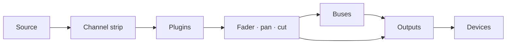

# Faider Användarhandbok

[English](../FAIDER-MANUAL.md)

**Version {version} · Windows 10 (2004) eller senare**

Faider är en liveljudrouter och mixer för Windows, byggd kring ett stort mixerbord.
Den tar ljud från ditt ljudgränssnitt, dina Windows-enheter och enskilda program, skickar det
genom kanalstrippar, bussar och utgångar och spelar upp resultatet på de enheter du väljer: dina
hörlurar, dina högtalare, en stream, en virtuell mikrofon för samtal och spel.

Den här handboken går igenom allt appen gör, leder dig steg för steg genom de vanliga uppgifterna
och berättar vad du ska göra när något går fel.

---

## Innehåll

1. [Innan du börjar](#1-before-you-start)
2. [Första installationen](#2-first-time-setup)
3. [Fönstret](#3-the-window)
4. [Så fungerar routing](#4-how-routing-works)
5. [Konsolen](#5-the-console)
6. [Kanalstrippen, avsnitt för avsnitt](#6-the-channel-strip-section-by-section)
7. [Raw-strippar: appar, pads, tape och combinators](#7-raw-strips-apps-pads-tape-and-combinators)
8. [Utgångar](#8-outputs)
9. [Plugins](#9-plugins)
10. [Sidan Routing](#10-the-routing-page)
11. [Tools: Pads](#11-tools-pads)
12. [Tools: Tape, Recorder och Replay](#12-tools-tape-recorder-and-replay)
13. [Enheter](#13-devices)
14. [Scener, ångra och sessioner](#14-scenes-undo-and-sessions)
15. [Inställningar](#15-settings)
16. [Fjärrstyrning, overlay och aktivitetsfält](#16-remote-control-overlay-and-tray)
17. [Guider](#17-how-to-guides)
18. [Felsökning](#18-troubleshooting)
19. [Referens](#19-reference)

---

## 1. Innan du börjar

### Det här behöver du

| | |
|---|---|
| **Windows** | Windows 10 version 2004 eller senare, eller Windows 11. För att fånga ljudet från ett enskilt program krävs 2004 eller senare |
| **Ett ljudgränssnitt** | Valfritt. Med dess ASIO-drivrutin installerad går Faider på gränssnittets klocka, för lägst fördröjning. Utan ett går det på din Windows-uppspelningsenhet eller på sin inbyggda klocka (se [Klockor](#clocking)) |
| **Hörlurar** | Anslutna till ditt gränssnitt (eller till valfri Windows-uppspelningsenhet) så att du hör din mix |
| **VB-CABLE** | Valfri och gratis (vb-audio.com/Cable). En virtuell mikrofon, så att appar som Discord, spel och OBS kan höra din mix |
| **ffmpeg** | Valfritt. Med `ffmpeg.exe` i din PATH, eller valt i **SETTINGS > GENERAL > FFMPEG**, kan recordern också skriva MP3, AAC, Opus och ALAC |

### Ord som används i den här handboken

| Ord | Betydelse |
|---|---|
| **Kanal** (ingång) | En källa på bordet: en mikrofon, en enhet, ett program, padsen, tapen |
| **Strip** | Kolumnen på konsolen som styr en kanal, buss eller utgång |
| **Rutt** | En koppling som skickar en kanal eller buss någonstans: till en buss eller en utgång |
| **Buss** | En submix. Allt som routas dit summeras, bearbetas tillsammans och routas vidare |
| **Combinator** | En buss som delar upp sitt ljud i parallella vägar, var och en med egna plugins, och sedan summerar dem |
| **Utgång** | En slutmix som spelas upp på en enhet (dina hörlurar, högtalare, en virtuell kabel) |
| **Gränssnitt** | Ditt ASIO-ljudgränssnitt, om du har ett |
| **Klocka** | Det som allt går i takt med: ditt gränssnitt, annars din Windows-uppspelningsenhet, annars den inbyggda klockan |

## 2. Första installationen

Det här kapitlet tar dig från installationsprogrammet till en fungerande uppsättning: din mikrofon
i dina hörlurar, appar som hör din mikrofon och ett programs ljud på en egen kanal. Gör stegen i
ordning. Varje steg tar en eller två minuter.

### Steg 1: Installera Faider

1. Kör installationsprogrammet, `Faider-<version>-Setup.exe`.
2. Windows SmartScreen kan varna för en okänd app, eftersom installationsprogrammet inte är
   kodsignerat. Klicka på **Mer information** och sedan på **Kör ändå**.
3. Godkänn licensen och tillåt administratörsfrågan. Vill du ha en genväg på skrivbordet, kryssa i den
   på vägen (den är avstängd som standard).
4. Installationsprogrammet lägger appen i `C:\Program Files\Faider` och lägger till **Faider**
   i Start-menyn. Allt som appen behöver följer med.
5. På sista sidan kan du starta Faider direkt. Om ingen VB-CABLE är installerad
   erbjuder det också att öppna nedladdningssidan för VB-CABLE.

Din mix och dina inställningar finns i `%APPDATA%\Faider`, skilda från programmet. Avinstallation
lämnar dem kvar.

### Steg 2: Installera VB-CABLE (valfritt)

VB-CABLE ger dig en virtuell mikrofon som andra appar kan välja. Hoppa över det här steget om du bara vill
mixa för dina egna hörlurar.

1. Ladda ner VB-CABLE från vb-audio.com/Cable och kör dess installationsprogram som administratör.
2. Starta om Windows när du blir ombedd.
3. Windows har nu två nya enheter. **CABLE Input** är en uppspelningsenhet: allt som spelas
   in i den kommer ut ur **CABLE Output**, en inspelningsenhet som appar kan välja som mikrofon.

> **Windows byter ditt ljud till kabeln.** När du installerar en virtuell kabel gör
> Windows ofta den till standard: **CABLE Input** som dina högtalare och **CABLE Output** som din
> mikrofon. Då hör du ingenting från Windows, och appar som använder standardmikrofonen hör
> kabeln. Byt tillbaka båda direkt efter installationen. Faider kan göra det åt dig.

**Sätt tillbaka dina enheter med Faider:** klicka på **SET MY DEFAULTS**: på SETUPs sida **APPS HEAR YOU**
(steg 4), på PRE-FLIGHTs rad **WINDOWS DEFAULTS** eller **WINDOWS DEFAULTS** i FIND. Den listar dina
riktiga högtalare och mikrofoner. Välj dina hörlurar eller högtalare, klicka sedan på den igen och välj din
mikrofon. Var och en blir Windows standard och dess standard för samtal.

**Eller sätt tillbaka dem i Windows:**

1. Öppna **Inställningar > System > Ljud** (eller högerklicka på högtalarikonen i aktivitetsfältet >
   **Ljudinställningar**).
2. Välj under **Utdata** dina hörlurar eller högtalare (eller ditt gränssnitts utgångar), inte
   **CABLE Input**.
3. Välj under **Indata** din riktiga mikrofon, inte **CABLE Output**.
4. Windows har en separat standard för samtal. Bläddra ned till **Fler ljudinställningar**. På fliken
   **Uppspelning** högerklickar du på dina hörlurar eller högtalare > **Använd som standardkommunikationsenhet**.
   På fliken **Inspelning** gör du samma sak för din mikrofon.

Ett snabbare sätt att ställa in utdata: klicka på högtalarikonen i aktivitetsfältet, klicka på **>** bredvid
volymreglaget och välj din enhet.

Låt dina riktiga enheter vara Windows standard. Faider spelar bara in i kabeln dit du
routar, och varje app väljer själv **CABLE Output** som sin mikrofon (steg 6). Om någon av Windows
standardenheter är kabeln rapporterar PRE-FLIGHT det under **WINDOWS DEFAULTS**.

### Steg 3: Starta Faider

Öppna Start-menyn och klicka på **Faider** (eller använd genvägen på skrivbordet, om du skapade en).
Första gången öppnas **SETUP** i ett eget fönster.

### Steg 4: Svara på SETUPs fyra frågor

SETUP ställer fyra frågor, en per sida, och bygger din mix av svaren. Klicka på korten för att
välja. På varje sida utom den tredje kan du välja mer än ett. **NEXT** går vidare, **BACK**
går tillbaka.

1. **WHERE YOU LISTEN**: välj dina hörlurar eller högtalare. Windows standard är redan vald.
2. **MICROPHONES**: välj de mikrofoner du pratar i. Det är ditt gränssnitts ingångar
   (**IN 1**, **IN 2** …) och dina Windows-inspelningsenheter.
3. **APPS HEAR YOU**: välj den virtuella kabel som appar använder som mikrofon (**CABLE Input**, efter steg 2),
   eller **NOT NOW**. Medan Windows fortfarande spelar eller spelar in via kabeln sätter **SET MY DEFAULTS**
   längst ned tillbaka dina riktiga högtalare och din mikrofon (steg 2).
4. **PROGRAMS**: välj de program som spelar ljud nu och som du vill ha på bordet.
5. Klicka på **BUILD THE MIX**. **DONE** listar vad som skapades.
6. Klicka på **OPEN THE MIXER** för att se den.

Vad varje svar skapar:

| Sida | Vad den skapar |
|---|---|
| **WHERE YOU LISTEN** | En utgång på varje enhet. Den första heter **HEADPHONES**, de andra får namn efter sin enhet |
| **MICROPHONES** | En kanal för varje, kallad **MICROPHONE** (MICROPHONE 2 …) |
| **APPS HEAR YOU** | En utgång kallad **MIC FOR APPS** på kabeln. Varje mikrofon routas dit |
| **PROGRAMS** | En raw-kanal för varje, routad dit du lyssnar, plus en appregel som för tillbaka den av sig själv när programmet spelar |

Dina mikrofoner routas inte till dina egna hörlurar, så du hör inget fördröjt eko av din
röst. För att höra dig själv tänder du mikrofonens tangent **HEADPHONES** (steg 6).

SETUP är ingen sida: kör den igen från **FIND** (**SETUP: BUILD A MIX**) eller **SETUP**-tangenten i SIMPLE
när du lägger till en enhet eller ett program. Den lägger till det som saknas och tar aldrig bort något.

### Steg 5: Kontrollera att ljudet går

Titta på **hälsolampan** uppe till höger.

- **Grön** med en procentsats: ljudet går. Fortsätt till steg 6.
- **Röd, med OFF**: ljudet går inte. Ett annat program kan ha ditt gränssnitt (en DAW,
  drivrutinens kontrollpanel). Stäng det och starta om Faider. Se
  [18.4](#184-the-interface-wont-start-or-stopped).

Klicka på lampan för att öppna **DEVICES**. **STREAMS** visar vilken klocka som används (ASIO, Windows eller den
inbyggda klockan; se [Klockor](#clocking)), och **BUFFER** ställer in dess buffertstorlek. Den minsta storlek
som spelar utan knaster ger dig minst fördröjning. 256 eller 512 samplingar passar de flesta system.

### Steg 6: Hör dig själv och låt appar höra dig

Mixern öppnas i **SIMPLE**. Varje kanal visar sitt namn, vad den lyssnar på, en tangent för varje
utgång, sin fader och mätare, **CUT** och **SOLO**. Varje utgång visar enheten den spelar på,
sin fader och mätare.

| Tangent på en kanal | Betyder |
|---|---|
| Vanlig grå | Inte routad till den utgången |
| Fylld i utgångens färg | Routad dit. Klicka för att stänga av |
| Bara färgad kant, **VIA BUS** | Den kommer dit via en buss (inställd i PRO). Klicka för att routa den direkt dit också |

1. Prata och se hur mikrofonens mätare rör sig.
2. För att höra dig själv klickar du på mikrofonens tangent **HEADPHONES**.
3. Välj **CABLE Output** som mikrofon i Discord, ditt spel, OBS eller vilken annan app som helst.
4. Kontrollera vad de får: **FIND** (Ctrl+K) > **HEAR WHAT THEY HEAR** spelar in 5 sekunder av vad appar
   tar emot och spelar upp det för dig.

Om du hör ett program dubbelt, se [18.7](#187-i-hear-something-twice-or-an-echo).

**+ CHANNEL** och **+ APP** lägger till kanaler. **+ OUTPUT** lägger till en utgång på en enhet som saknar en.
Enhetstangenten under en utgångs namn ändrar var den spelar. Högerklicka på ett namn för **RENAME...**,
färgen, **HEADPHONE EQ** (en utgång), **IN THE MINI MIXER** och **REMOVE**. När du tar bort ett programs
kanal försvinner också dess appregel, så kanalen kommer inte tillbaka av sig själv.

### Steg 7: PRO, för hela konsolen

Omkopplaren **SIMPLE / PRO** i den övre raden visar samma mix i båda lägena. **PRO** är hela
konsolen: varje kanals ingång, filter, dynamik och EQ, bussar och combinators, plugins.

För att forma din mikrofon, se [17.1](#171-hear-yourself-set-up-a-microphone). Varje kontroll finns i
[6](#6-the-channel-strip-section-by-section). Inställningar du gör i PRO fortsätter gälla i SIMPLE.

### Steg 8: Kör PRE-FLIGHT

Några sekunder efter start kontrollerar **PRE-FLIGHT** uppsättningen och öppnas bara om något behöver uppmärksamhet
(inte vid allra första starten, då SETUP kommer först). Kör den när som helst via
**SETTINGS > GENERAL > PRE-FLIGHT NOW...** eller **FIND** (Ctrl+K). Varje rad ska vara grön. Se
[18.1](#181-pre-flight).

### Steg 9: Klart

- **Din mix sparas av sig själv** inom en sekund efter varje ändring. För att behålla en version under ett namn, använd
  **SETTINGS > GENERAL > SAVE SESSION AS...**.
- **Starta med Windows**: **SETTINGS > GENERAL > WINDOWS** startar Faider i aktivitetsfältets notisyta när
  du loggar in, så att din mikrofon fungerar från början.
- **Att stänga fönstret stoppar inte ljudet.** Faider fortsätter köra i aktivitetsfältets notisyta
  så att din mikrofon och dina hörlurar fortsätter fungera. För att stänga av, högerklicka på ikonen och välj
  **Quit Faider**. Startar du programmet medan det ligger i notisytan kommer fönstret tillbaka.

Första gången varje sida öppnas förklarar ett kort tips den. Stäng av tips under
**SETTINGS > GENERAL > ON START**.

Det var installationen. Resten av den här handboken går igenom varje del i detalj.

## 3. Fönstret

### Sidofältet

Sidorna är kort längs vänster kant: **MIXER**, **ROUTING**, **TOOLS**, **DEVICES**,
**SETTINGS**. Sidan som visas har en lysande blå kant. Medan Mixer visas har sidofältet också
de här korten (i SIMPLE bara **ADD CHANNEL** och **ADD APP**):

| Grupp | Kort | Vad det gör |
|---|---|---|
| **DESK** | **ADD CHANNEL** | Öppnar ingångsmenyn: gränssnittets ingångar, Windows-enheter, appar, programfönster, en webbläsare (hela, eller en enskild flik isolerad), testtonen. Pads och tape får sin kanal från sina egna sidor (**TOOLS**) |
| | **ADD APP** | Listar programmen som spelar ljud nu. Välj ett för att ge det en kanal |
| | **ADD BUS** | En buss, eller en combinator (två vägar till att börja med) |
| | **PLUGINS** | Skjuter upp pluginpanelen under strippar (se [9](#9-plugins)) |
| **SELECT** | **AUTO** | Att röra vid vilken kontroll som helst på en strip väljer den stripen |
| | **FOLLOW** | Bordet glider till den valda stripen, även när den väljs någon annanstans (FIND, ett kortkommando) |
| **METER** | **IN** / **PRE** / **POST** | Var kanalmätarna mäter: källan som den kommer in (före bearbetning), efter effekterna (före fadern) eller efter fadern. Samma inställning som **SETTINGS > GENERAL > CHANNEL METER POINT** |
| **SECTIONS** | HEADER … FADER | Stripens avsnitt. Tända är i bild. Klicka på ett för att glida dit |

Valen under SELECT och METER kommer ihåg.

### Den övre raden

Från höger:

| Kontroll | Vad den gör |
|---|---|
| **+ 100% -** | Zoom. Stegar mellan 100, 125 och 150 %. Klicka på procenttalet för 100 %. Ctrl + / Ctrl - / Ctrl 0 gör detsamma |
| **FIND** (Ctrl+K) | Söker i varje sida, kanal, scen, makro, pad och kommando efter namn |
| **HISTORY** (Ctrl+H) | Varje ändring du har gjort. Välj en för att gå tillbaka till den |
| **MINI** | Minimixern: ett litet mixerfönster (ikonen i aktivitetsfältet öppnar det också). **PIN** på det håller det överst |
| **Hälsolampa** | Grön: ljudet är bra. Gul: ljudbelastningen är hög eller en enhet fick nyligen för lite. Röd: ett hörbart glapp under de senaste 10 sekunderna, eller inget ljud går. Talet är ljudbelastningen. Klicka på den för DEVICES |
| **SCENES** | Dina sparade mixar. **+** sparar en ny (se [14.1](#141-scenes)) |
| **SIMPLE / PRO** | Samma mix, enkel eller som hela konsolen (se [Steg 7](#step-7-pro-for-the-whole-console)) |

I ett smalt fönster försvinner hälsolampan först, sedan MINI, sedan HISTORY. FIND når dem alla.

### Transporten

Under den övre raden får du, i varje Mixer-vy, Tape-däckets tid (förfluten och spårets längd),
spårets namn och dess tangenter: **10 s bakåt**, **stopp**, **spela/paus**, **10 s framåt**,
**spela in**, **loop**.

- **Spela in** är Recorderns **REC**: den spelar in källan som valts under TOOLS > TAPE, i dess format och mapp, och lyser så länge den inspelningen pågår. Tryck igen för att stoppa.
- **Loop** stegar genom **upprepa alla** → **upprepa en** (markerad med **1**) → **av**.

---

## 4. Så fungerar routing

Routing avgör vart varje ljud tar vägen. Inget hörs förrän det är routat, och allt kan routas till
hur många ställen du vill.

### Ett ljuds väg

1. **En kanal** tar en källa och kör den genom sin strip (ingång, filter, dynamik och EQ,
   i den ordning dess header visar), sedan genom sina plugins, sedan genom sin fader, pan och cut.
2. **Rutter** skickar kanalen vidare, till valfritt antal bussar och utgångar samtidigt (upp till 8 av varje). Varje
   rutt för kanalen efter dess fader, så fadern och **CUT** påverkar överallt dit den är
   routad.
3. **En buss** summerar allt som routas till den, kör sin egen strip och sina plugins och routas vidare till
   utgångar (eller in i andra bussar) på samma sätt.
4. **En utgång** summerar allt som routas till den, kör sin busskompressor, mix-EQ och
   limiter (**LIMIT**) och spelar på sin enhet.

### Utgångar är enheter

Varje utgång spelar på en enhet: ditt gränssnitts utgångar, ett USB-headset, högtalare, **CABLE
Input**. Du skapar inte utgångar för hand. Routa något till en enhet så skapas en utgång på den.
Därför listar routingrutorna enheter såväl som bussar.

- Det finns en utgång per enhet. Routar du flera kanaler till samma enhet möts de i dess
  utgång.
- Olika utgångar bär olika mixar. Dina hörlurar kan höra spel, musik och röst medan
  streamutgången bara får musik och röst.
- Dra ut en enhet så blir dess utgång tyst tills enheten kommer tillbaka.

### Tre ställen att routa på

Alla tre ändrar samma rutter. Använd det som är närmast.

| Var | Hur |
|---|---|
| **Routingrutor** (varje strips header) | En ruta per buss och utgångsenhet. Tänd: routad dit. Klicka för att växla |
| **ROUTE TO** (högerklicka på en strip) | Samma lista som meny, ikryssad där den är routad |
| **Sidan Routing** | Varje strip som ett block, varje rutt som en linje. Klicka på ett block, sedan på ett annat (se [10](#10-the-routing-page)) |

### Bussar

Använd en buss när flera kanaler behöver samma behandling eller en fader. Routa kanalerna till
bussen och bussen till utgången. Ta sedan bort kanalernas direkta rutter till den utgången, annars
når de den två gånger (en gång direkt, en gång via bussen). En buss kan mata en annan buss, och det lägger inte till
någon fördröjning.

### Combinators

En combinator är en buss uppdelad i parallella **vägar** (två till att börja med). Varje väg har egna plugins,
och vägarna summeras vid combinatorns fader. Routa en källa till en väg eller flera (se
[7](#7-raw-strips-apps-pads-tape-and-combinators)).

### Regler som håller det säkert

- **Återkopplingsslingor nekas.** En rutt som skulle föra ett ljud tillbaka dit det kom ifrån (en
  buss in i en buss som matar den, en utgångs ljud tillbaka in i dess egen ingång) stängs genast
  av igen, och händelseloggen nämner slingan.
- **Solo** på vilken strip som helst tystar varje strip som inte är på solo, utom de som är markerade solo safe.
- **Appkanaler och dubbling.** Ett program spelar på sin egen enhet och även in i sin kanal
  (se [18.7](#187-i-hear-something-twice-or-an-echo)).

### Klockor

En enhet sätter klockan. Faider väljer den i den här ordningen vid start:

1. **ASIO**: ditt ljudgränssnitt, via dess ASIO-drivrutin. Lägst fördröjning.
2. **Windows**: utan ASIO-drivrutin din standarduppspelningsenhet i Windows (en virtuell kabel, en
   skärms högtalare eller ett VR-headset bara när inget annat finns). Ditt gränssnitts utgångar
   blir den enhetens utgångar, och mikrofoner läggs till som Windows-enheter.
3. **Inbyggd klocka**: utan någon uppspelningsenhet alls. Varje enhet, dina hörlurar inräknade,
   följer den.

Varje annan enhet och varje fångat program går på sin egen klocka och ansluter via en liten
buffert som korrigerar drift, så att klockor som glider isär aldrig knäpper. **DEVICES > STREAMS** visar
var och en, och vilken klocka som används.

Om Windows-enheten som sätter klockan dras ut, stängs av eller slutar fungera tar nästa klocka
över av sig själv och en notis berättar vilken. En enhet som inte vill starta (för att ett annat
program håller den) hoppas över tills dina enheter ändras och försöks sedan igen. På den inbyggda klockan tar en
ansluten uppspelningsenhet över från den.

För att välja klockan själv använder du **CLOCK** högst upp i **DEVICES**: **THE INTERFACE (ASIO)** (ordningen
ovan, standard), **A WINDOWS PLAYBACK DEVICE** efter namn, eller **THE BUILT-IN CLOCK**. Valet gäller när
Faider startar igen, och **RESTART NOW** gör det direkt. Din mix följer med och förblir sparad för ditt
gränssnitt. När du väljer den inbyggda klockan tar ingen enhet över från den.

## 5. Konsolen

### Layout

Bordet visar varje strip från vänster till höger: **kanaler**, sedan **bussar** (violett namnlist), sedan
**utgångar** (bärnstensfärgad namnlist). Varje strip har sju avsnitt, uppifrån och ned:

| Avsnitt | Innehåller |
|---|---|
| **HEADER** | Nivåstaplar, tangenterna FILT / EQ / EXT, bearbetningsordningen, routingrutorna, stripnumret |
| **INPUT** | Trim, polaritet, mikrofon-drive, ingångsomkopplaren och stereobredd |
| **DYNAMICS** | Kompressor och gate |
| **FILTERS** | Lågpass, högpass och NOISE-brytaren |
| **EQ** | Fyra band |
| **NAME** | Namnlisten och strömbrytaren |
| **FADER** | Pan, SOLO, CUT, SEL, fadern och dess avläsning, DUCK-lampan |

### Mus och tangentbord

| Åtgärd | Resultat |
|---|---|
| **Dra** en ratt eller fader upp/ned | Ändrar den. Dess värde visas bredvid medan du drar eller håller muspekaren över |
| **Dubbelklicka** på en ratt eller fader | Tillbaka till standardvärdet |
| **Klicka** på en tangent eller omkopplare | På / av |
| **Klicka** på namnlisten | Väljer stripen |
| **Dra** en strips namnlist i sidled | Flyttar den bland sin egen sort: kanaler, bussar eller utgångar (se [17.4](#174-reorder-channels)) |
| **Klicka** på strömsymbolen på namnlisten | Stänger av eller slår på stripen |
| **Högerklicka** på en strip | Stripens meny |
| **Mushjul** | Rullar bordet i sidled. **Shift + hjul** rullar uppåt och nedåt |
| **Ctrl + / Ctrl -** | Zoomar hela fönstret |

Ett vänsterklick öppnar aldrig en meny. Menyer ligger alltid på höger knapp.

### Välja en strip

Den valda stripen har en blå kontur. Välj en strip genom att klicka på dess namnlist eller dess tangent **SEL**,
eller genom att röra vid någon av dess kontroller med **AUTO** på. Den valda stripen är den som pluginpanelen
visar och den som FIND, kortkommandon och fjärrkontroller verkar på.

Med bordet i fokus (klicka på det först): **Left / Right** väljer föregående / nästa strip,
**M** cuttar den, **S** soloar den och **Up / Down** flyttar dess fader 0,5 dB (3 dB med **Shift**).

### Stänga av en strip

Klicka på strömsymbolen till vänster om namnlisten. Stripen tonas ned och blir grå. Den bearbetas inte,
och dess enhet eller program släpps. Medan den är avstängd **kan ingenting på den ändras**:
rattar, tangenter och pluginpanelen ignorerar klick, och dess meny erbjuder bara **TURN ON** och spacers.
Klicka på strömsymbolen igen för att få tillbaka den.

### Spacers

Spacers är tomma strippar som ger dig utrymme mellan grupper. Högerklicka på en strip > **ADD SPACER
BEFORE** / **ADD SPACER AFTER**. Högerklicka på en spacer för **NARROW**, **ADD ANOTHER** och **REMOVE
SPACER**. En spacer stannar kvar vid stripen den följer när den stripen flyttas.

### Stripmenyn (högerklick)

| Post | |
|---|---|
| **INPUT** | Byt källa: **INTERFACE**-ingångar, **WINDOWS DEVICES** (eller WINDOWS DEFAULT), **WHAT AN OUTPUT PLAYS** (loopback), **TEST TONE**, **NOTHING** |
| **ROUTE TO** | Varje buss och utgångsenhet, ikryssad där den skickas |
| **PLUGINS** | Öppna ett, **ADD PLUGIN...**, **REMOVE** |
| **MAKE MONO / MAKE STEREO** | Bara kanaler |
| **NOISE** | Brusreducering: **ON** (som stripens NOISE-brytare), **NEURAL** eller **SPECTRAL**, och dess **DEPTH** (-6 till -30 dB) |
| **DUCK UNDER** | En annan kanal som den här sänks under medan den kanalen hörs, eller **NONE**, och hur mycket den sänks (**DEPTH**, -6 till -24 dB). Inte på en appkanal |
| **COLOUR** | Kanalens färg, visad längs dess namnlist och på dess Routing-block |
| **IN THE MINI MIXER** | Ikryssad: stripen har en fader i minimixern (se [16](#16-remote-control-overlay-and-tray)) |
| **ADD SPACER BEFORE / AFTER** | |
| **RENAME...** | |
| **REMOVE** | Tar bort kanalen eller bussen |

---

## 6. Kanalstrippen, avsnitt för avsnitt

### HEADER

| Kontroll | Vad den gör |
|---|---|
| **Level bars** | Kanalens nivå, vänster och höger (IN, PRE eller POST, enligt valet under METER) |
| **FILT** | Skickar filtren till gatens/kompressorns detektor (key-filtrering) |
| **EQ** | EQ:n in eller ut |
| **EXT** | Dynamiken lyssnar på en extern key (sidechain) i stället för på kanalen själv |
| **Processing order** | Tre block (FILT, EQ, DYN), uppifrån och ned i den ordning kanalen kör dem. **Klicka på ett block** för att flytta det upp ett steg. Översta går till slutet. Tända block används |
| **Routing boxes** | En ruta per buss och utgångsenhet. Tänd: kanalen skickas dit. Klicka för att växla (se [Utgångar är enheter](#outputs-are-devices)) |
| **Number** | Stripens plats på bordet |

### INPUT

| Kontroll | |
|---|---|
| **IN TRIM** | Ingångsförstärkning |
| **ø** | Vänd polariteten |
| **MIC** | Drive: lägger till värme och nivå (visas som procent). Den gröna lampan bredvid lyser medan källan har signal |
| **PRE** | Ingångssteget in eller ut (ut: trim, polaritet och drive förbikopplas) |
| **WIDTH** | Stereobredd: 0 % mono, 100 % som den är, 200 % dubbelt så bred. Svag på en monokanal |

### DYNAMICS

Omkopplaren **IN** (med strömsymbolen) slår på eller av kompressorn och gaten tillsammans.

**Kompressor**

| Kontroll | |
|---|---|
| **MIX** | Wet/dry-blandning (parallellkompression). Dra i den gröna avläsningen |
| **ratio**, **thresh**, **rel** | Ratio, threshold och release |
| **fast** | Snabb attack (3 ms). Av är 10 ms |
| **pk** | Toppdetektering. På (standard) reagerar kompressorn på toppar. Av reagerar den på medelnivån (RMS), vilket är mjukare |
| **Gain reduction LEDs** | 3, 6, 10, 14 och 20 dB reduktion |

**Gate / expander**

| Kontroll | |
|---|---|
| **range**, **thresh**, **rel**, **hold** | Hur långt den stänger, var den öppnar, hur snabbt den stänger, hur länge den håller |
| **exp** | Expanderläge (en mildare gate) |
| **fast** | Snabb attack (0,1 ms). Av är 1,5 ms |
| **Gate LEDs** | Hur långt gaten stänger |

LED:erna visar vad kompressorn och gaten *skulle* göra även när de är frånkopplade, så att du kan ställa in dem
innan du kopplar in dem.

### FILTERS

**lp** (lågpass) och **hp** (högpass). Helt nedvriden är högpasset ur. Helt uppvriden
är lågpasset ur.

**NOISE** kopplar in eller ur brusreducering: brus, brum och rumsljud dras ned medan rösten
stannar kvar. Högerklicka på stripen > **NOISE** för **NEURAL** (standard, vid 48 kHz; vid andra
frekvenser körs den som SPECTRAL) eller **SPECTRAL**, och för hur djupt den går. Avstängd kostar den ingenting.

### EQ

| Band | Kontroller |
|---|---|
| **HF** | gain, freq, **bell** (shelf när av) |
| **HMF** | gain, freq, q |
| **LMF** | gain, freq, q |
| **LF** | gain, freq, **bell** (shelf när av) |

Omkopplaren **EQ IN** slår hela EQ:n in eller ut (samma som headerns EQ-tangent).

### FADER

| Kontroll | |
|---|---|
| **PAN** | Vänster/höger. Dubbelklicka för att centrera |
| **SOLO** | Solo in place |
| **CUT** | Tystar kanalen (tangenten **M** på bordet) |
| **SEL** | Välj den här stripen |
| **Fader** | Nivå, +12 dB till av. Avläsningen under visar nivån i dB |
| **safe** | Solo safe: den här kanalen förblir hörbar när andra soloas |
| **listen** | Lyssna på dynamikens key-signal |
| **duck** | Lyser medan kanalen är sänkt under en annan (högerklick > **DUCK UNDER**) |

### Rösteffekter

Utöver stripens egen bearbetning bär varje kanal sina egna rösteffekter:

| Effekt | Vad det gör |
|---|---|
| **ROBOT** | Ringmodulering: rösten multipliceras med en ton och låter metallisk |
| **ECHO** | En fördröjning, upp till en sekund |
| **RADIO** | Begränsad till 300 Hz - 3 kHz och överstyrd, den låter som en liten högtalare |
| **PITCH** | Rösten flyttas uppåt eller nedåt, upp till en oktav åt båda håll |

De kopplas med ett makro: åtgärden **FX ON**, **FX OFF** eller **FX TOGGLE**, med kanalen som mål
([15](#15-settings)). En pad, ett kortkommando, en trigger eller fjärrstyrningen kan köra makrot,
så effekterna kommer och går med mixen.

---

## 7. Raw-strippar: appar, pads, tape och combinators

Vissa kanaler bär ljud som redan är färdigt: ett programs ljud, padsen, tapen. De får
en **raw-strip**, med routing, plugins om du vill ha dem, pan, fader och tangenter, och inga inbyggda
effekter. När en dyker upp på bordet stängs dess inbyggda effekter av en gång (och noteras i
händelseloggen). Dess plugins behålls.

| Strip | Dess mellersta avsnitt innehåller |
|---|---|
| **App** | Pluginlistan (klicka på ett för att öppna det) och **ADD PLUGIN** |
| **Pads** | Banktangenter **A–D**, 4×4-padsen (tryck för att spela; en HOLD-pad spelar medan den hålls nere) och **STOP ALL** |
| **Tape** | Däckets skärm och sökfält, transporten (föregående, spola tillbaka, stopp, spela, paus, spola fram, nästa), **SHUFFLE**, **ADD...** och spellistan (klicka på ett spår för att spela det) |
| **Combinator** | För varje väg: **FROM**, kanalerna och bussarna som matar den (klicka på en för att gå till dess strip) och **PLUGINS** på den vägen (klicka på ett för att öppna det). **EDIT IN ROUTING** öppnar sidan Routing |

En combinator har inga egna effekter. Dess ljud kommer från det som matar den och från varje vägs plugins.
Högerklicka på den > **PATHS** för att lägga till en väg och, för varje väg, öppna, lägga till eller ta bort dess
plugins, byta namn på den eller ta bort den.

---

## 8. Utgångar

Varje utgång har sin egen mörka strip:

| Kontroll | |
|---|---|
| **DEVICE** | Enheten den spelar på. Klicka för att välja en annan |
| **LIMIT** | En limiter efter fadern: ingenting lämnar den över -1 dBFS |
| **MON** | Monitorera den här utgången |
| **LUFS** | Kortsiktig ljudstyrka för det som lämnar ("-- LUFS" vid tystnad) |
| **WIDTH** | Stereobredd |
| **BUS COMP** | Inkopplingsomkopplare, VU-liknande gain reduction-mätare, **threshold**, **ratio**, **attack**, **release**, **make-up**, **mix** |
| **MIX EQ** | Inkopplingsomkopplare, HF gain och freq, LF gain och freq |
| **CUT**, **SEL**, fader | Som på en kanal |

Högerklicka på en utgång för **DEVICE...**, **HEADPHONE EQ** (hörlurskorrigering: **NONE**, eller din
modell, listad efter märke), **ALERT IF SILENT** (10 sekunder under -60 dBFS) och **ALERT IF CLIPPING**
(medan LIMIT är av), som får ikonen i aktivitetsfältet att blinka och skriver till händelseloggen,
**IN THE MINI MIXER**, spacers, **RENAME...** och **REMOVE**.

Utgångar skapas åt dig, en per enhet (se [Utgångar är enheter](#outputs-are-devices)).

**FIND > MIX-MINUS AND STEMS** bygger en feed per gäst (allt utom deras egen röst) och
stems för röst, musik och spel.

---

## 9. Plugins

Faider är värd för **VST3**-plugins på kanaler, bussar och combinator-vägar, med automatisk
latenskompensation.

### Lägga till ett plugin

- På en kanal: högerklicka > **PLUGINS > ADD PLUGIN...**, eller **ADD PLUGIN** på en raw-strip, eller
  **ADD** i pluginpanelen.
- På en combinator-väg: högerklicka på combinatorn > **PATHS > PATH n > ADD PLUGIN...**. Klicka på en vägs plugin
  på combinatorstripen för att öppna det.

Varje plugin **testas först i en separat kopia av programmet**, så att ett plugin som kraschar eller
hänger sig vid inläsning inte kan dra ned din mix. Det har 30 sekunder på sig att läsas in (**PLUGIN TEST TIME** i
SETTINGS > GENERAL ger långsamma plugins 60 eller 120). Resultatet kommer ihåg tills pluginfilen
ändras.

### Pluginpanelen

Klicka på **PLUGINS** i sidofältet. En panel skjuts upp under strippar med den **valda stripens**
plugins i den ordning de körs. **FIND** > **PLUGINS: name** öppnar den på den stripen och byter till
PRO om SIMPLE visas. Varje kort visar:

- **CPU**: pluginets andel av bearbetningstiden (grön, gul över 2 %, röd över 5 %)
- **Latency**: fördröjningen det lägger till
- **BYPASSED**: avstängt men fortfarande inläst (använder fortfarande minne)
- **HEAVY**: ovanligt dyrt

Tangenter på varje kort: **BYPASS**, **OPEN** (dess fönster), **REMOVE** och pilar för att flytta det tidigare eller
senare. **ADD** på slutet lägger till ett till.

---

## 10. Sidan Routing

Sidan Routing visar hela mixen som en karta: varje strip som ett block och varje rutt som en linje.
Använd den för att se vart allt går och för att routa genom att klicka på två block.

### Läsa sidan

- **Tre rader:** **INPUTS** överst, **BUSES** i mitten, **OUTPUTS** längst ned. Utgångsenheter
  som inte har någon utgång än sitter längst till höger i raden OUTPUTS, i grått.
- **Varje block sitter under sin strip.** Ett block står på samma plats tvärs över sidan som sin strip
  på bordet, spacers inräknade, och sidan rullar i sidled med bordet (mushjul). Ordna om
  bordet så följer kartan med.
- **Varje block visar** stripens namn och nummer. En avstängd strip är nedtonad. En kanal med
  egen färg visar den som en nyans och ett band till vänster.
- **Linjer är rutter.** Var och en löper rakt ned från sin källa till en egen bana i
  mellanrummet under sin rad, tvärs över och ned i blocket den matar, och slutar i en pil. Ingångsrutter
  är blågröna, bussrutter violetta. Flera linjer som lämnar eller når ett block sprids ut över det
  i ordning, så att de aldrig hamnar ovanpå varandra.
- **Combinators** visar sina vägar som celler **P1, P2, …** längs blockets nederkant. Linjer slutar
  i vägen de matar.

### Routa från block till block

1. **Klicka på ett block.** Det lyser blått och pulserar. Blocken det är routat till, eller routat från, får en
   markerad kant, deras linjer blir ljusare och allt annat tonas ned.
2. **Klicka på ett annat block.** Rutten mellan dem slås på (en linje dyker upp) eller av (linjen
   försvinner). Båda ordningarna fungerar: källa och sedan mål, eller mål och sedan källa.
3. Det första blocket **förblir valt**, så fortsätt klicka för att routa det till flera ställen eller för att ta bort
   flera rutter.
4. **Klicka på det igen**, klicka på tom yta eller tryck **Esc** för att släppa.

Om de två blocken inte kan routas (två utgångar, till exempel) väljs det andra i stället.

### Exempel

| För att | Klicka |
|---|---|
| Höra din mikrofon | MIC, sedan hörlurarnas utgång |
| Låta appar höra din mikrofon | MIC, sedan **CABLE Input** (i raden med utgångar, grå tills den har en utgång) |
| Skicka en grupp genom en buss | Bussen, sedan varje kanal; sedan bussen, sedan dess utgång |
| Ta en kanal ur streamen | Kanalen, sedan streamens utgång (linjen försvinner) |
| Mata en combinator-väg | Källan, sedan vägcellen (P1, P2…). Klicka på fler celler för att mata flera vägar. Att klicka på combinatorn utanför dess celler matar dess första väg |

Att klicka på ett grått enhetsblock skapar dess utgång, och den nya utgången dyker upp på bordet direkt.

Dra ett block i sidled längs sin rad för att flytta dess strip (se [17.4](#174-reorder-channels)). En rutt
som genast stängs av igen skulle skapa en återkopplingsslinga (se [18.8](#188-a-route-wont-switch-on)).

## 11. Tools: Pads

**TOOLS > PADS** ger dig fyra banker (**A–D**) med 16 pads: 64 ljud, upp till 32 som spelar samtidigt.

### Få ut ljud

Pads spelar in i en **PADS-kanal**. Klicka på **CREATE PADS CHANNEL** (den visar sedan **PADS CHANNEL
ACTIVE**), eller välj en annan ingång i menyn **PLAY INTO** för att spela padsen genom den kanalens
plugins och rutter. Utan padskanal ignoreras tryck.

### Ladda och spela

| Åtgärd | |
|---|---|
| Klicka på en **tom** pad | Välj en ljudfil |
| Klicka på en laddad pad | Spela den |
| Högerklicka på en pad | Välj den för redigering utan att spela |
| Släpp filer på en pad | Laddar dem i den paden och de följande i banken |
| **Ctrl + dra** till en annan pad | Byter plats på de två padsen |
| **STOP ALL** | Tonar ut varje pad |

Format: WAV, FLAC, AIFF, OGG, MP3. En pad vars fil har flyttats visar **MISSING: FILE**.

### Padeditorn

| Inställning | |
|---|---|
| Namn | Dubbelklicka för att byta namn |
| **LOAD**, **CLEAR**, **COLOUR** | |
| **REPLAY** | Instant replay-bufferten blir den här padens ljud (sparas som en WAV i inspelningsmappen). Aktivera replay först i TOOLS > TAPE |
| **MODE** | **ONE-SHOT** spelar till slutet (att trycka igen startar om). **HOLD** spelar medan den hålls nere. **LOOP** startar vid ett tryck och stoppar vid nästa |
| **CHOKE** | OFF eller grupp 1–8. Pads i en grupp stoppar varandra |
| **LEVEL** | -INF till +12 dB |
| **HOTKEY** | Klicka (**LEARN...**) och tryck sedan på tangenterna (se [HOTKEYS](#hotkeys)) |
| **MACRO** | Ett makro som körs med paden (en pad kan ha ett makro och inget ljud) |
| **TRIM** | Dra start- och slutlinjerna på vågformen. Dubbelklicka för hela filen |
| **FADE IN / FADE OUT** | 0–5 s |

---

## 12. Tools: Tape, Recorder och Replay

### Tape-däcket

**TOOLS > TAPE** spelar en spellista in i en **TAPE-kanal**. Klicka på **CREATE TAPE CHANNEL** för att skapa en.

- **ADD FILES**, **ADD FOLDER**, eller släpp filer och mappar var som helst på sidan. **EJECT** rensar
  spellistan.
- Dubbelklicka på ett spår för att spela det, dra ett för att ordna om och tryck Delete för att ta bort valda spår.
- Transport: **PREV**, **REW** (10 s bakåt; håll in för att spola snabbt bakåt), **PLAY**, **PAUSE**, **STOP**,
  **FF** (10 s framåt; håll in för att spola snabbt framåt), **NEXT**. Också **SHUFFLE**, **REPEAT** (alla / ett /
  av) och **LEVEL**.
- Spår spelas utan glapp. Pauser och hopp tonas över 30 ms så att de aldrig knäpper.

Den övre radens transport och tapestripen på bordet styr samma däck.

### Recordern

| | |
|---|---|
| **Source** | Valfri utgång, buss eller ingång, eller **ALL CHANNELS, ONE FILE EACH** (flerspår: varje ingång, eller bara de med DIRECT tänd, plus varje utgång, samplingsexakt synkade) |
| **Format** | WAV 24-bitars (standard), 16-bitars, 32-bitars, 32-bitars float; FLAC 24/16-bitars; AIFF 24/16-bitars; OGG Vorbis 128–320k. Med ffmpeg: MP3, AAC (M4A), Opus, ALAC. Varje visar hur mycket tid som ryms på disken |
| **REC** | Startar och stoppar (inspelningstangenten i den övre raden gör samma sak). Skärmen visar tid, storlek, återstående tid och eventuella tappade block |
| **PATH** / **REVEAL** | Välj mappen / öppna den i Utforskaren |

Inspelningar hamnar i `Music\Faider Recordings` om du inte väljer en mapp. ffmpeg-format spelar först in
en WAV och konverterar den när du stoppar (WAV-filen behålls om konverteringen misslyckas). Faider använder den
`ffmpeg.exe` som är vald i **SETTINGS > GENERAL > FFMPEG**, annars den i din PATH. Inspelningen stoppar
av sig själv när mindre än 1 GB är ledigt.

### Instant replay

**ARM** behåller de senaste **30 s**, **1**, **2** eller **5 minuterna** av recorderns källa.
**SAVE** skriver det till en fil (högerklicka på SAVE för att ge den ett globalt kortkommando). Med flerspår valt
använder replay den första utgången.

---

## 13. Enheter

**DEVICES** listar varje Windows-ljudenhet och ASIO-drivrutin. **CLOCK** högst upp visar vad som styr
klockan nu, och dess tangent väljer den (se [Klockor](#clocking)).

**WINDOWS AUDIO**, under den, visar prioriteten för Windows ljudmotor (audiodg.exe, som bär varje
Windows-enhet och fångad app): **NORMAL** är Windows standard, **UNKNOWN** om den inte kan läsas. Dess
tangent, **BOOST WINDOWS AUDIO** (**BOOSTED** medan den är på High), öppnar en meny:

- **BOOST (HIGH PRIORITY)** höjer den till High, vilket på vissa datorer kan stoppa knaster på Windows-enheter och fångade
  appar. Det kräver administratörsrättigheter, så Windows frågar först; säger du nej ändras ingenting.
  Det överlever inte en omstart av Windows-ljudet eller datorn: Faider bevakar det, säger till en gång
  från aktivitetsfältet när den är tillbaka på Normal, och **Boost Windows audio again...** i menyn i aktivitetsfältet (eller
  BOOST här, eller **BOOST WINDOWS AUDIO** i FIND) höjer den igen. Klickar du på BOOST medan den är höjd
  slutar bevakningen; den stannar på High tills Windows-ljudet startar om.
- **PIN TO ONE CORE** (av om du inte väljer det) låser den också till din sista processorkärna, från nästa
  BOOST. Det begränsar bara var den körs och lägger aldrig till kärnor: använd det bara mot knaster i ett
  USB-headset.

Det påverkar inte ASIO-gränssnitt, som inte går via Windows-ljudet.

| Kolumn | |
|---|---|
| **I/O** | ASIO, OUT eller IN |
| **DEVICE**, **HARDWARE** | Dess namn och adaptern den sitter på |
| **FORMAT** | Kanaler och samplingsfrekvens |
| **STATE** | Aktiv, utdragen, inaktiverad eller **off in Faider** |
| **TAGS** | DEFAULT och CALLS för Windows standardenheter |

Klicka på en rubrik för att sortera. Markera enheter (Ctrl/Shift för flera) och använd sedan:

| Tangent | |
|---|---|
| **EXCLUDE / INCLUDE** | Faider slutar (eller börjar igen) använda enheten. Uteslutna enheter öppnas aldrig och utelämnas från listor |
| **DISABLE / ENABLE IN WINDOWS** | Stänger av eller slår på enheten i själva Windows |
| **RENAME** | Ditt eget namn på enheten, som används överallt i Faider (eller dubbelklicka på en rad) |

### Streams

Under listan visar **STREAMS** ljudmotorns hälsa:

- **CALLBACK LOAD** (och topp), **OVERLOADS**, **BLOCKS SKIPPED**. Dessa får varningsfärg om något av dem har hänt
- **BUFFER**: ditt gränssnitts buffertstorlek (mindre betyder mindre fördröjning och mer belastning)
- Per enhet: buffrat ljud, total latens, **DRIFT** (klockkorrigeringen i ppm), **UNDER**
  (gick tom, tystnad spelades), **OVER** (svämmade över, ljud kastades), **RESYNC** (centrerades om). En rad
  som tappade ljud blir röd
- **RESET STATS** nollställer räknarna

### VB-CABLE

Om VB-CABLE är installerat ställer en list högst upp in dess **sample rate** och **max latency**. **APPLY**
ber om en administratörsfråga och startar om kabeln.

Händelseloggen längst ned noterar varje enhet som ansluts, tas bort eller återhämtas.

---

## 14. Scener, ångra och sessioner

### 14.1 Scener

En scen sparar varje kanals fader, pan, cut, solo, ström och rutter (och, om du väljer det,
plugininställningar).

- **Spara:** klicka på **+** i den övre raden och ge den ett namn.
- **Återkalla:** klicka på dess tangent. Faders och pans glider över en halv sekund. Resten växlar direkt.
- **Högerklicka på en scen** för: återkalla bara CUT / bara nivåer, spara till den, ta med plugininställningar,
  byt namn, ett globalt kortkommando, **Recall on device** (när en enhet dyker upp; tillbaka när den
  försvinner), **Auto-scene** (när en app börjar spela, en enhet ansluts eller vid en tid på dagen), MIDI
  learn, flytta, ta bort.

Enheter och själva kanalerna ingår inte i en scen.

### 14.2 Ångra och historik

**Ctrl+Z** ångrar, **Ctrl+Y** (eller Ctrl+Shift+Z) gör om. **HISTORY** (Ctrl+H) listar varje ändring.
Välj en för att hoppa tillbaka till den.

### 14.3 Sessioner

Din mix sparas av sig själv inom en sekund efter varje ändring, och vid avslut.

| | |
|---|---|
| **SESSION TIMELINE** | FIND, eller **Session timeline...** i menyn i aktivitetsfältet: varje sparad version efter datum. **RESTORE EVERYTHING** (Faider startar om med den), eller **PUT ONE CHANNEL BACK** (dess nivå, pan, CUT och rack) utan omstart |
| **SAVE SESSION AS...** | SETTINGS > GENERAL > SESSIONS: behåll mixen under ett namn |
| **OPEN, EXPORT OR IMPORT...** | Öppna en namngiven mix (startar om), spara mixen till en fil eller läs in en från en fil |

Upp till 60 tidigare versioner behålls (högst en var 5:e minut). Om din mix någonsin inte kan läsas in
(gränssnittet saknas, filen är skadad) **läggs den åt sidan** i stället för att gå förlorad, och en ny
mix startar. Se [18.2](#182-my-mix-is-gone-a-fresh-mix-started).

---

## 15. Inställningar

**SETTINGS** har fyra avsnitt, som kort längs vänster kant: **GENERAL**, **MACROS**, **HOTKEYS**,
**CONTROL**. På/av-inställningar är fyrkantiga omkopplare som lyser cremefärgade när de är på.

### GENERAL

| Kort | Inställningar |
|---|---|
| **LOOK** | **LOOK...**: bordets färger och typsnitt, från en LOOK-fil (se [LOOKS](#looks)) |
| **WINDOWS** | **START WITH WINDOWS**: öppnas i aktivitetsfältets notisyta när du loggar in |
| **DESK** | **WARN IF I TALK WHILE CUT** (en notis när en mikrofon på CUT ligger över -30 dBFS) |
| **APPS** | **APP RULES...**: vilken buss eller utgång ett program går till när det börjar spela (finns också i **FIND**). Att ta bort ett programs kanal tar bort dess regel |
| **SESSIONS** | **SAVE SESSION AS...**; **OPEN, EXPORT OR IMPORT...** |
| **ON START** | **PRE-FLIGHT: CHECK THE SETUP**; **PRE-FLIGHT NOW...**; **TIPS**; **SHOW THE TIPS AGAIN** |
| **NOTICES (IN THE CORNER)** | Enheter anslutna eller borta, en kanal som klipper (dess källa eller dess utgång på full skala), scener återkallade, makron körda, ångra och gör om |
| **ZOOM** | 100%, 125%, 150%, **CUSTOM...** (75–200%) |
| **METER STANDARD** | Hur mätare läser (sample peak med snabbt fall som standard; IEC och andra) |
| **CHANNEL METER POINT** | **IN** (rå källa), **PRE** (efter effekterna), **POST** (efter fadern, standard). Sidofältets **METER**-kort ställer in samma sak |
| **RECORDING** | **FFMPEG**: var `ffmpeg.exe` finns, eller **NOT FOUND**. Klicka på den för att välja `ffmpeg.exe` (används före den i din PATH); när en är vald erbjuder den också att gå tillbaka till den i PATH |
| **PLUGIN TEST TIME** | **30 S** (standard), **60 S** eller **120 S**: hur lång tid ett nytt plugin har på sig att läsas in i sitt test innan det misslyckas |
| **UPDATES** | **CHECK FOR UPDATES** (på som standard): en halv minut efter start, högst en gång om dagen, skickar Faider en förfrågan till GitHub om sin senaste release. Förfrågan innehåller bara appens namn och version (till exempel `Faider/0.1.5`); ingenting laddas ned eller installeras. Finns en nyare version säger aktivitetsfältet det, och **Get Faider x.y.z...** i menyn i aktivitetsfältet, **GET FAIDER x.y.z** i FIND eller tangenten här öppnar dess sida. Stäng av det så frågar Faider aldrig. **CHECK NOW** (eller **CHECK FOR UPDATES NOW** i FIND) frågar direkt och säger till när du är uppdaterad |
| **ABOUT** | Version och tack |

### LOOKS

En **LOOK** är varje färg bordet ritar med, tillsammans med typsnittet och de storlekar som hör till.
Stripsarna, displayerna, reglagen, tangenterna och lamporna ritar alla från den LOOK som gäller, så en
LOOK ändrar hela bordet på en gång.

**LOOK...** listar de LOOK:ar du har och sätter den du väljer i kraft; bordet ritas om i det ögonblick den
ändras. **SAVE THIS LOOK AS...** skriver LOOK:en som gäller till en ny fil med ett namn du ger den.

En LOOK är en fil i `%APPDATA%\Faider\looks`, skriven som JSON, så du kan skriva den för hand och kopiera
den till en annan dator. En fil som saknas eller är trasig låter den inbyggda LOOK:en stå kvar, och det en
fil utelämnar faller tillbaka på det inbyggda värdet: en halvskriven fil fungerar ändå.

| | |
|---|---|
| `name` | LOOK:ens namn, som det visas i listan |
| `font` | Ett typsnitt Windows levererar med, så det håller sig skarpt på bordets små storlekar |
| `keyRadius` | Hur rundade en tangents hörn är, i pixlar |
| `fontSizes` | `legend`, `caption`, `readout`: de tre textstorlekarna |
| `colours` | Varje färg, som `#rrggbb`, eller `#rrggbbaa` där en del är genomskinlig |

Färgerna bär namn efter den del de ritar: fälten och trycken, tangenterna, plattan under faderna,
displayerna, reglagen efter funktion, lamporna, striparnas kroppar, hur en kanal, en buss och en utgång
ser ut, accenten, urtagen och nyanseringen. **SAVE THIS LOOK AS...** skriver varje namn som LOOK:en har;
det snabbaste är att ändra något på bordet, spara det och redigera den filen.

En grupp `palette` namnger de färger en layoutfil kan lägga på en del: `red`, `green`, `blue`, `black`,
`white`, `violet`, `grey`, `cream`, `orange`, `amber`, `teal`, `salmon`.

### MACROS

Ett makro är en lista med **åtgärder** som körs från ett kortkommando, en pad, en trigger eller fjärrstyrning.

1. Klicka på **+ NEW** och ge det ett namn (dubbelklicka på namnet).
2. **+ ACTION**: CUT, UNCUT, CUT TOGGLE, SET FADER (dB, tonningstid), ASSIGN ON/OFF/TOGGLE (en rutt),
   CHANNEL ON/OFF, TRIGGER PAD, STOP PAD, ALL NOTES OFF, TRANSPORT PLAY/PAUSE, TRANSPORT NEXT,
   RECORD START/STOP, WAIT, SCENE RECALL, FX ON/OFF/TOGGLE (en rösteffekt, se [Rösteffekter](#voice-effects)), WINDOWS DEFAULT OUTPUT/INPUT, PLUGIN
   SETTING.
3. Valfritt **+ TRIGGER**: APP STARTS, APP STOPS, DEVICE CONNECTED, DEVICE DISCONNECTED, OUTPUT
   SILENT (i n sekunder), OUTPUT HAS SOUND, TIME (24 timmar).
4. Valfritt ett **HOTKEY**, och **MOMENTARY** (åtgärderna ångras när tangenten släpps,
   för push-to-talk).
5. **FIRE** kör det nu.

### HOTKEYS

Varje tilldelbart kortkommando finns på ett ställe: **PADS**, **MACROS**, **SCENES** och **SAVE INSTANT REPLAY**
under **TAPE**. Klicka på ett och tryck sedan på de nya tangenterna (Esc avbryter, Delete rensar). Kortkommandon måste innehålla
Ctrl, Alt eller en F-tangent, och de fungerar medan ett spel har fokus. De fasta tangenterna listas också
([19.1](#191-keyboard-shortcuts)). Sidans tangenter under ON THE MIXER fungerar också på konsolen
([5](#5-the-console)).

### CONTROL

| Kort | |
|---|---|
| **MIDI** | **MIDI MAP** (Ctrl+L); **INPUTS AND BINDINGS**, där varje MIDI-ingång slås på eller av |
| **OSC** | **OSC ON (PORT 9000)**, för program på den här datorn. **PORT...** ställer in porten (1024–65535); är OSC på flyttar den dit direkt |

---

## 16. Fjärrstyrning, overlay och aktivitetsfält

| | |
|---|---|
| **MIDI MAP** (Ctrl+L) | Klicka på en kontroll på skärmen och rör sedan en ratt eller tangent på din kontroller. Varje strips fader, pan, CUT, SOLO, ström och routingtangenter kan mappas, i SIMPLE och PRO, liksom scener, pads och tapen. Mushjulet rullar bordet under mappningen (Shift+hjul uppåt och nedåt) |
| **OSC** | Program på den här datorn kan skicka till port 9000, eller den port som ställts in med **PORT...** i SETTINGS > CONTROL (den lyssnar aldrig på nätverket): `/faider/input/NAME/fader -12` (dB), `/faider/output/NAME/mute 1`, `/faider/bus/NAME/pan -0.5`, `/faider/input/NAME/solo 1`, `/faider/scene NAME`, `/faider/macro/NAME 1` (0 släpper det). Skriv mellanslag i namn som `_` |
| **In-game overlay** (Ctrl+Shift+O) | Varje mikrofonkanals pratlampa, LIVE / CUT och nivå, plus upp till fyra scentangenter. Tar aldrig fokus från ett spel. Dra den vart du vill |
| **MINI** | Minimixern: ett litet fönster med en fader, mätare och **CUT** för varje strip som har **IN THE MINI MIXER** ikryssat i sin högerklicksmeny (varje utgångs medan ingen har det). **PIN** håller det ovanpå allt. **OPEN** tar dig tillbaka till huvudfönstret |
| **Tray** | Klicka på ikonen för minimixern, dubbelklicka för att öppna fönstret. Högerklick: Show, scenåterkallning, Session timeline, Get Faider x.y.z... (när en nyare version finns), Start with Windows, Save a problem report..., About, Quit. Ikonen blinkar gult vid ett larm |

Faider körs alltid med dina vanliga användarrättigheter, även när det startas från ett administratörsfönster.
Det startar om sig själv med vanliga rättigheter, eftersom in-game overlay inte kan nå ett program som körs som administratör.
De få steg som kräver en administratör
(tillämpa VB-CABLE-inställningar, aktivera igen en enhet som Windows har stängt av) ber själva om tillstånd.

---

## 17. Guider

### 17.1 Hör dig själv: ställ in en mikrofon

1. **ADD CHANNEL** > din gränssnittsingång (eller en Windows-inspelningsenhet). Den dyker upp som en ny
   kanalstrip.
2. Prata och ställ in **IN TRIM** så att nivåstaplarna toppar kring -12 till -6 dB.
3. Routa den: klicka på routingrutan för dina hörlurars utgång (eller använd sidan Routing).
4. Rensa upp den: **hp** för att ta bort buller (runt 80–100 Hz), sedan gate och kompressor (**IN**
   på DYNAMICS), sedan EQ.

### 17.2 Låt appar höra din mikrofon (Discord, spel, OBS)

1. Installera **VB-CABLE** (PRE-FLIGHT erbjuder en länk) och ställ sedan tillbaka dina riktiga högtalare och din mikrofon som
   Windows standard ([Steg 2](#step-2-install-vb-cable-optional)).
2. Routa din mikrofonkanal till enheten **CABLE Input**. En utgång skapas på den.
3. Välj **CABLE Output** som mikrofon i appen.
4. Kör **PRE-FLIGHT NOW...** för att kontrollera att inget på vägen är på CUT och att inget bildar en slinga.

### 17.3 Ta in ett program i mixen

1. Starta programmet och få det att spela ljud.
2. **ADD APP** > välj det. Det får en raw-kanal (inga effekter).
3. Routa den dit du vill höra den. Om du hör den dubbelt, se
   [18.7](#187-i-hear-something-twice-or-an-echo).

### 17.4 Ordna om kanaler

Dra en kanals **namnlist** i sidled i Mixern (rulla ned till avsnittet NAME), eller dra dess
block på sidan Routing. En blå list visar var den landar, och strippar glider på plats.
Spacers flyttas med stripen de följer. Bussar och utgångar flyttas på samma sätt, var och en bland sin egen
sort, och deras rutter följer med. SIMPLE visar utgångarna i samma ordning.

### 17.5 Gruppera kanaler i en buss

1. **ADD BUS**, och byt sedan namn på den (högerklicka > **RENAME...**).
2. Klicka på bussen på sidan Routing och klicka sedan på varje kanal för att routa in den.
3. Klicka på bussen och sedan på dess utgång för att routa bussen vidare.
4. Om du bara vill ha de kanalerna genom bussen, ta bort deras direkta rutter till utgången.

### 17.6 Parallell bearbetning med en combinator

1. **ADD BUS > COMBINATOR**. Den börjar med två vägar. Högerklicka på den > **PATHS > ADD PATH** för
   fler.
2. Routa källor till vägcellerna (**P1**, **P2**…) på sidan Routing.
3. Högerklicka > **PATHS > PATH n > ADD PLUGIN...** för varje väg.

### 17.7 Gör en streammix och en hörlursmix

1. Skicka dina kanaler till två utgångar, till exempel dina hörlurar och enheten som din streamingprogramvara
   fångar.
2. Varje utgång har sin egen fader, busskompressor, EQ och limiter (**LIMIT**). Slå på **LIMIT** för
   streamutgången.
3. För att hålla något utanför streamen, ta bort den kanalens rutt till streamutgången (med
   dess routingruta eller på sidan Routing).

### 17.8 Spela in

1. TOOLS > TAPE > **RECORDER**: välj källa och format.
2. Tryck på **REC** (eller inspelningstangenten i den övre raden). Tryck igen för att stoppa.
3. **REVEAL** öppnar mappen.

### 17.9 Gör en push-to-talk-tangent

1. SETTINGS > MACROS > **+ NEW**.
2. **+ ACTION** > **UNCUT** > din mikrofonkanal.
3. Slå på **MOMENTARY** och ställ in ett **HOTKEY**. Medan du håller den är mikrofonen live, och när du släpper
   hamnar den på CUT igen. Börja med mikrofonen på CUT.

---

## 18. Felsökning

### 18.1 PRE-FLIGHT

PRE-FLIGHT körs några sekunder efter start (och från **PRE-FLIGHT NOW...** eller FIND) och dyker bara
upp om något är fel. Varje rad har en lampa, resultatet och en åtgärd:

| Check | Problem | Åtgärd |
|---|---|---|
| **AUDIO** | Det startade inte (en annan app kan ha det) | **DEVICES** |
| **MIC CABLE** | Ingen VB-CABLE: appar kan inte höra din mix som en mikrofon | **GET VB-CABLE** |
| **MIC OUTPUT** | Ingen utgång spelar in i mikrofonkabeln | **ROUTING** |
| **MIC CHANNELS** | Något på vägen till mikrofonen är på CUT | **UNCUT** |
| **WINDOWS DEFAULTS** | Windows standardhögtalare eller -mikrofon (eller dess standard för samtal) är den virtuella kabeln | **SET MY DEFAULTS** |
| **HEARD ONCE** | En återkopplingsslinga, eller något hörs två gånger | **SOUND SETTINGS** |
| **WINDOWS AUDIO** | Windows-enheter eller fångade appar finns i mixen och Windows ljudmotor har Normal-prioritet: gul, bara ett förslag; röd om din höjning togs bort av en omstart. Grön när bara ASIO används | **BOOST** |

**ZERO THE DESK** (nere till vänster; även **ZERO DESK** i FIND) kontrollerar vad en tidigare session kan lämna
inställt: solo, key listen, gain trims som ligger mer än 12 dB från noll, och utgångar på CUT. Var och en har en **FIX**.

### 18.2 Min mix är borta, en ny mix startade

Din mix är inte förlorad. När den inte kan användas vid start **läggs den åt sidan** som
`session-unloaded-<date>.xml`. Händelseloggen berättar varför:

| Orsak | Vad du ska göra |
|---|---|
| Det sparade gränssnittet är inte anslutet | Anslut det, sedan **SESSION TIMELINE** (FIND eller aktivitetsfältet) > versionen med "kept:" > **RESTORE EVERYTHING** |
| Det sparade gränssnittet kunde inte öppnas (ett annat program har det) | Stäng det andra programmet och starta om Faider. Ingenting sparas över din mix under tiden |
| session.xml kunde inte läsas | **SESSION TIMELINE** > en ny version > **RESTORE EVERYTHING** |

### 18.3 Inget ljud

Följ signalvägen:

1. **Hälsolampan** röd med OFF: ljudet går inte. Se
   [18.2](#182-my-mix-is-gone-a-fresh-mix-started) och [18.4](#184-the-interface-wont-start-or-stopped).
2. **Kanalens mätare** (METER: IN): rör den sig inte, kontrollera dess **Input** (högerklicka) och
   att källan spelar. En strip som är avstängd släpper igenom ingenting.
3. **CUT** är av, fadern är uppe och inget annat soloas (en annan strips **SOLO** tystar
   allt annat).
4. **Routing:** minst en routingruta är tänd, eller så finns det en linje på sidan Routing.
5. **Utgången**: inte på CUT, fadern uppe, och **DEVICE** visar rätt enhet (inte "NO DEVICE" eller
   "(OFF)").
6. **Enheten** är ansluten och inte utesluten under DEVICES.

### 18.4 Gränssnittet startar inte, eller stannade

- Ett annat program kan ha det (en DAW, drivrutinens kontrollpanel). Stäng det och starta om.
- **INTERFACE DOWN** i aktivitetsfältet: gränssnittet återställde sig självt och ville inte öppnas igen. Ändra dess buffertstorlek
  under DEVICES eller starta om Faider.
- Ändringar av samplingsfrekvens eller buffert i gränssnittets egen kontrollpanel plockas upp av sig själva.
- För att köra utan gränssnittet en stund, välj en Windows-uppspelningsenhet eller den inbyggda klockan
  i **DEVICES > CLOCK** och klicka på **RESTART NOW**. Din mix följer med och förblir sparad för ditt
  gränssnitt: väljer du **THE INTERFACE (ASIO)** igen går du tillbaka till det.
- Eller starta Faider med `"C:\Program Files\Faider\Faider.exe" --clock windows` (din Windows-uppspelningsenhet)
  eller `--clock builtin` (den inbyggda klockan). `--clock` med en del av en ASIO-drivrutins namn
  (`--clock focusrite`) väljer den drivrutinen. Det går före DEVICES > CLOCK för den körningen, och nästa
  start utan det går tillbaka till ditt val.

### 18.5 Klick, knaster eller avbrott

1. Titta på **hälsolampan** och **DEVICES > STREAMS**.
2. Hög **CALLBACK LOAD** eller OVERLOADS: höj **BUFFER**, eller hitta dyra plugins i pluginpanelen
   (**HEAVY**, hög CPU) och sätt dem på bypass eller ta bort dem.
3. **UNDER / OVER** stiger på en enhet: den enheten har det svårt. Prova en annan USB-port, stäng
   andra program som använder den, eller uteslut den om du inte använder den.
4. Jämn **DRIFT** är normalt. Det är korrigeringen som håller klockorna i takt.
5. Knaster bara på Windows-enheter eller fångade appar: prova **BOOST WINDOWS AUDIO** (DEVICES >
   WINDOWS AUDIO, eller FIND). Det höjer Windows ljudmotor från Normal, Windows standard, till High.
   Windows ber om administratörsgodkännande, och en omstart av Windows-ljudet eller datorn tar bort det
   (Faider säger till). Det påverkar inte ASIO-gränssnitt. För ett USB-headset som fortfarande knastrar är
   **PIN TO ONE CORE** valfritt och begränsar den bara till en kärna.

### 18.6 En app dyker inte upp i ADD APP

- Programmet måste **spela ljud** just nu. Starta uppspelningen och öppna sedan menyn igen.
- Program som redan har en kanal är gråa (**ON THE DESK**).
- Windows äldre än 10 version 2004 kan inte fånga ett enskilt program ("Windows refused app capture").

### 18.7 Jag hör något två gånger, eller ett eko

- Ett program fortsätter spela på sin egen enhet och även in i sin kanal. Om dess kanal är routad
  till en utgång på samma enhet hör du det direkt och via Faider. Stäng av den rutten (i SIMPLE,
  utgångens tangent på kanalen), eller flytta programmet till en annan enhet. PRE-FLIGHT
  varnar för detta.
- Windows standardhögtalare är inställd på den virtuella kabeln. PRE-FLIGHT > **WINDOWS DEFAULTS** pekar ut den,
  och **SET MY DEFAULTS** sätter tillbaka dina högtalare.

### 18.8 En rutt går inte att slå på

Den skulle skapa en **återkopplingsslinga** (se [Regler som håller det säkert](#rules-that-keep-it-safe)).
Händelseloggen nämner slingan. Ta bort rutten som matar tillbaka.

### 18.9 Jag kan inte ändra något på en strip

Stripen är **avstängd** (nedtonad och grå). Klicka på strömsymbolen på dess namnlist.

### 18.10 Att dra en kanal gör ingenting

Dra i **namnlisten** (avsnittet NAME, nära botten; rulla ned vid behov), eller dra
blocket på sidan Routing. En strip flyttas bara bland sin egen sort: en buss kan inte hamna bland
kanalerna.

### 18.11 Ett plugin går inte att läsa in

Varje plugin testas först i en separat kopia av programmet, och orsaken till ett fel
rapporteras: det blev inte färdigt med inläsningen i tid (30 s, om inte **PLUGIN TEST TIME** i SETTINGS > GENERAL
ger det 60 eller 120), det kraschade under testet, eller så finns det inget VST3-plugin i filen. Uppdatera eller installera om pluginet. När dess fil ändras testas det igen.

### 18.12 Programmet kraschade

En rapport skrivs till `%APPDATA%\Faider\crash.log`, med en minidump `crash.dmp`. Din mix
sparas inom en sekund efter varje ändring, så du förlorar högst det sista ögonblickets ändringar.

För att rapportera ett problem, högerklicka på ikonen i aktivitetsfältet > **Save a problem report...** (eller **SAVE A PROBLEM
REPORT** i FIND). Den lägger kraschrapporten, händelseloggen och statusögonblicksbilden (de som finns),
med Faiders och Windows versioner, i en .zip där du väljer (skrivbordet till att börja med), och visar den
sedan i Utforskaren. Ingenting skickas någonstans: bifoga filen själv.

### 18.13 Inspelningen stoppade av sig själv

Inspelningen stoppar när mindre än 1 GB diskutrymme är kvar (eller formatets storleksgräns närmar sig).
Aktivitetsfältet visar **RECORDING STOPPED, NO ROOM**. Frigör utrymme eller välj en annan **PATH**.

### 18.14 Inget ljud från Windows efter installation av VB-CABLE

Windows har gjort kabeln till sin standardenhet. **SET MY DEFAULTS** (PRE-FLIGHTs rad **WINDOWS
DEFAULTS**, eller **WINDOWS DEFAULTS** i FIND) ställer in dina hörlurar eller högtalare som standard-
utdata igen, och din riktiga mikrofon som standardindata, var och en även för samtal. Eller gör det i
**Inställningar > System > Ljud**. Se [Steg 2](#step-2-install-vb-cable-optional).

---

## 19. Referens

### 19.1 Kortkommandon

| Tangenter | |
|---|---|
| **Ctrl+K** | FIND |
| **Ctrl+Z / Ctrl+Y** (Ctrl+Shift+Z) | Ångra / gör om |
| **Ctrl+H** | History |
| **Ctrl+L** | MIDI MAP |
| **Ctrl + / Ctrl - / Ctrl 0** | Zooma in / ut / 100% |
| **Ctrl+Shift+O** | Visa / dölj in-game overlay (fungerar överallt) |
| **Left / Right** | Välj föregående / nästa strip (bordet i fokus) |
| **M / S** | Cutta / soloa den valda stripen |
| **Up / Down** | Vald fader ±0,5 dB (±3 dB med Shift) |
| **Esc** | Släpp det valda blocket (Routing) |

### 19.2 Kommandorad

| | |
|---|---|
| `--minimised` | Starta i aktivitetsfältets notisyta |
| `--quit` | Avsluta den körande kopian |
| `--clock windows`, `--clock builtin`, `--clock <driver>` | För den här körningen är klockan din Windows-uppspelningsenhet, den inbyggda klockan, eller den ASIO-drivrutin vars namn innehåller `<driver>`. Det går före DEVICES > CLOCK (se [Klockor](#clocking)) |
| `--boost-audiodg [--pin-core N]` | Det som **BOOST WINDOWS AUDIO** startar, som administratör: Windows ljudmotor till High-prioritet (låst till kärna N bara om den anges), sedan avslutas det. 0: klart; 2: felaktiga argument; 3: audiodg hittades inte; 4: åtkomst nekad; 5: prioriteten nekades; 6: High satt men låsningen nekades |

### 19.3 Filer

I `%APPDATA%\Faider`:

| Fil | |
|---|---|
| `session.xml` | Din mix |
| `history\` | Tidigare versioner (upp till 60) |
| `sessions\` | Namngivna mixar |
| `session-unloaded-*.xml` | Mixar som lagts åt sidan vid start |
| `settings.xml` | Inställningar |
| `looks\` | LOOK:arna, en JSON-fil vardera (se [LOOKS](#looks)) |
| `console.xml` | Spacers och val under SELECT |
| `plugins.xml` | Pluginen som hittats och hur vart och ett testades |
| `events.log` | Allt som hände (roterar vid 5 MB) |
| `status.txt` | En ögonblicksbild av motorn med några sekunders mellanrum: enheter, nivåer, buffertar, drift |
| `crash.log`, `crash.dmp` | Kraschrapporter |

Själva programmet finns i `C:\Program Files\Faider`. Inspelningar hamnar i
`Music\Faider Recordings` om du inte väljer en annan mapp.

### 19.4 Färger

| Färg | Betyder |
|---|---|
| Blå kontur | Vald |
| Grå namnlist | Kanal |
| Violett | Buss |
| Bärnsten | Utgång |
| Blågrön linje | Rutten för en kanal |
| Violett linje | Rutten för en buss |
| Grön hälsolampa | Ljudet är bra; gul: under belastning; röd: glapp eller går inte |
