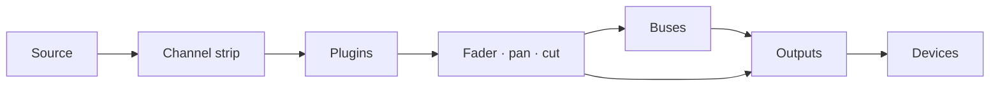

# Faider Kullanım Kılavuzu

[English](../FAIDER-MANUAL.md)

**Sürüm {version} · Windows 10 (2004) veya üstü**

Faider, büyük bir konsol etrafında kurulmuş, Windows için canlı bir ses yönlendiricisi ve
mikserdir. Sesi ses arabiriminden, Windows aygıtlarından ve tek tek programlardan alır, kanal
şeritlerinden, bus'lardan ve çıkışlardan geçirir ve sonucu seçtiğin aygıtlarda çalar: kulaklığın,
hoparlörlerin, bir yayın, görüşmeler ve oyunlar için sanal bir mikrofon.

Bu kılavuz uygulamanın yaptığı her şeyi anlatır, yaygın işlerde adım adım yol gösterir ve bir şey
ters gittiğinde ne yapacağını söyler.

---

## İçindekiler

1. [Başlamadan önce](#1-before-you-start)
2. [İlk kurulum](#2-first-time-setup)
3. [Pencere](#3-the-window)
4. [Yönlendirme nasıl çalışır](#4-how-routing-works)
5. [Konsol](#5-the-console)
6. [Kanal şeridi, bölüm bölüm](#6-the-channel-strip-section-by-section)
7. [Raw şeritler: uygulamalar, pad'ler, tape ve kombinatörler](#7-raw-strips-apps-pads-tape-and-combinators)
8. [Çıkışlar](#8-outputs)
9. [Eklentiler](#9-plugins)
10. [Routing sayfası](#10-the-routing-page)
11. [Araçlar: Pads](#11-tools-pads)
12. [Araçlar: Tape, Recorder ve Replay](#12-tools-tape-recorder-and-replay)
13. [Aygıtlar](#13-devices)
14. [Sahneler, geri alma ve oturumlar](#14-scenes-undo-and-sessions)
15. [Ayarlar](#15-settings)
16. [Uzaktan kontrol, kaplama ve tepsi](#16-remote-control-overlay-and-tray)
17. [Nasıl yapılır kılavuzları](#17-how-to-guides)
18. [Sorun giderme](#18-troubleshooting)
19. [Başvuru](#19-reference)

---

## 1. Başlamadan önce

### Neye ihtiyacın var

| | |
|---|---|
| **Windows** | Windows 10 sürüm 2004 veya üstü ya da Windows 11. Tek bir programın sesini yakalamak için 2004 veya üstü gerekir |
| **Bir ses arabirimi** | İsteğe bağlı. ASIO sürücüsü kuruluysa Faider en düşük gecikme için arabirimin saatiyle çalışır. Arabirim yoksa Windows oynatma aygıtınla ya da yerleşik saatiyle çalışır ([Saat](#clocking) bölümüne bak) |
| **Kulaklık** | Karışımını duyabilmek için arabirimine (veya herhangi bir Windows oynatma aygıtına) takılı |
| **VB-CABLE** | İsteğe bağlı ve ücretsiz (vb-audio.com/Cable). Discord, oyunlar ve OBS gibi uygulamaların karışımını duyabilmesi için sanal bir mikrofon |
| **ffmpeg** | İsteğe bağlı. `ffmpeg.exe` PATH'inde olursa ya da **SETTINGS > GENERAL > FFMPEG**'de seçilirse kaydedici MP3, AAC, Opus ve ALAC de yazabilir |

### Bu kılavuzda kullanılan sözcükler

| Sözcük | Anlamı |
|---|---|
| **Kanal** (giriş) | Konsoldaki tek bir kaynak: bir mikrofon, bir aygıt, bir program, pad'ler, tape |
| **Şerit** | Konsolda bir kanalı, bus'ı veya çıkışı kontrol eden sütun |
| **Yönlendirme** | Bir kanalı veya bus'ı bir yere gönderen bağlantı: bir bus'a ya da bir çıkışa |
| **Bus** | Bir alt karışım. Ona yönlendirilen her şey toplanır, birlikte işlenir ve ileri yönlendirilir |
| **Kombinatör** | Sesini paralel yollara bölen, her yolun kendi eklentileri olan ve sonra hepsini toplayan bir bus |
| **Çıkış** | Bir aygıtta çalan nihai karışım (kulaklığın, hoparlörlerin, sanal bir kablo) |
| **Arabirim** | Varsa ASIO ses arabirimin |
| **Saat** | Her şeyin zamanını ayarlayan şey: arabirimin, o yoksa Windows oynatma aygıtın, o da yoksa yerleşik saat |

## 2. İlk kurulum

Bu bölüm seni yükleyiciden çalışan bir düzene götürür: mikrofonun kulaklığında, uygulamalar
mikrofonunu duyuyor ve bir programın sesi kendi kanalında. Adımları sırayla yap. Her biri bir iki
dakika sürer.

### Adım 1: Faider'i kur

1. Yükleyiciyi çalıştır, `Faider-<version>-Setup.exe`.
2. Yükleyici kod imzalı olmadığı için Windows SmartScreen tanınmayan bir uygulama diye uyarabilir.
   **Daha fazla bilgi**'ye, sonra **Yine de çalıştır**'a tıkla.
3. Lisansı kabul et ve yönetici istemine izin ver. Masaüstü kısayolu istiyorsan yol boyunca
   işaretle (varsayılan olarak kapalıdır).
4. Yükleyici uygulamayı `C:\Program Files\Faider` içine koyar ve **Faider**'u
   Başlat menüsüne ekler. Uygulamanın ihtiyaç duyduğu her şey onunla birlikte gelir.
5. Son sayfada Faider'i hemen başlatabilirsin. VB-CABLE kurulu değilse VB-CABLE'ın indirme
   sayfasını açmayı da önerir.

Karışımın ve ayarların programdan ayrı olarak `%APPDATA%\Faider` içinde durur. Kaldırma
işlemi onlara dokunmaz.

### Adım 2: VB-CABLE'ı kur (isteğe bağlı)

VB-CABLE sana diğer uygulamaların seçebileceği sanal bir mikrofon verir. Yalnızca kendi kulaklığın
için karışım yapacaksan bu adımı atla.

1. VB-CABLE'ı vb-audio.com/Cable adresinden indir ve yükleyicisini yönetici olarak çalıştır.
2. İstediğinde Windows'u yeniden başlat.
3. Windows'ta artık iki yeni aygıt var. **CABLE Input** bir oynatma aygıtıdır: içine çalan her şey,
   uygulamaların mikrofon olarak seçebileceği bir kayıt aygıtı olan **CABLE Output**'tan çıkar.

> **Windows sesini kabloya alır.** Sanal bir kablo kurmak çoğu zaman onu Windows'un varsayılanı yapar:
> hoparlör olarak **CABLE Input**, mikrofon olarak **CABLE Output**. O zaman Windows'tan hiçbir şey
> duymazsın ve varsayılan mikrofonu kullanan uygulamalar kabloyu duyar. Kurulumdan hemen sonra ikisini
> de geri değiştir. Faider bunu senin için yapabilir.

**Aygıtlarını Faider ile yerine koy:** **SET MY DEFAULTS**'a tıkla: SETUP'ın **APPS HEAR YOU**
sayfasında (adım 4), PRE-FLIGHT'ın **WINDOWS DEFAULTS** satırında ya da FIND'da **WINDOWS DEFAULTS**.
Gerçek hoparlörlerini ve mikrofonlarını listeler. Kulaklığını veya hoparlörlerini seç, sonra yeniden
tıkla ve mikrofonunu seç. Her biri Windows'un varsayılanı ve görüşmeler için varsayılanı olur.

**Ya da Windows'ta yerine koy:**

1. **Ayarlar > Sistem > Ses**'i aç (ya da görev çubuğundaki hoparlör simgesine sağ tıkla >
   **Ses ayarları**).
2. **Çıkış** altında kulaklığını veya hoparlörlerini (ya da arabiriminin çıkışlarını) seç,
   **CABLE Input**'u değil.
3. **Giriş** altında gerçek mikrofonunu seç, **CABLE Output**'u değil.
4. Windows görüşmeler için ayrı bir varsayılan tutar. **Daha fazla ses ayarı**'na kadar aşağı kaydır.
   **Oynatma** sekmesinde kulaklığına veya hoparlörlerine sağ tıkla > **Varsayılan İletişim Aygıtı
   Olarak Ayarla**. **Kayıt** sekmesinde mikrofonun için aynısını yap.

Çıkışı ayarlamanın daha hızlı yolu: görev çubuğundaki hoparlör simgesine tıkla, ses kaydırıcısının
yanındaki **>**'e tıkla ve aygıtını seç.

Gerçek aygıtlarını Windows'un varsayılanı olarak bırak. Faider kabloya yalnızca senin
yönlendirdiğin yerde çalar ve her uygulama mikrofon olarak **CABLE Output**'u kendisi seçer (adım 6).
Windows'un varsayılanlarından biri kablo ise PRE-FLIGHT bunu **WINDOWS DEFAULTS** altında bildirir.

### Adım 3: Faider'i başlat

Başlat menüsünü aç ve **Faider**'a tıkla (ya da yaptıysan masaüstü kısayolunu kullan).
İlk seferde **SETUP** kendi penceresinde açılır.

### Adım 4: SETUP'ın dört sorusunu yanıtla

SETUP, her sayfada bir tane olmak üzere dört soru sorar ve karışımını yanıtlarından kurar. Seçmek
için kartlara tıkla. Üçüncü sayfa dışındaki her sayfada birden fazlasını seçebilirsin. **NEXT**
ilerler, **BACK** geri döner.

1. **WHERE YOU LISTEN**: kulaklığını veya hoparlörlerini seç. Windows'un varsayılanı zaten seçilidir.
2. **MICROPHONES**: konuştuğun mikrofonları seç. Bunlar arabiriminin girişleri (**IN 1**, **IN 2** …)
   ve Windows kayıt aygıtlarındır.
3. **APPS HEAR YOU**: uygulamaların mikrofon olarak kullandığı sanal kabloyu seç (2. adımdan sonra
   **CABLE Input**) ya da **NOT NOW**. Windows hâlâ kabloda çalıyor veya kaydediyorsa, alttaki
   **SET MY DEFAULTS** gerçek hoparlörlerini ve mikrofonunu yerine koyar (adım 2).
4. **PROGRAMS**: şu anda ses çalan ve konsolda olmasını istediğin programları seç.
5. **BUILD THE MIX**'e tıkla. **DONE**, yapılanları listeler.
6. Görmek için **OPEN THE MIXER**'a tıkla.

Her yanıtın yaptığı şey:

| Sayfa | Ne yapar |
|---|---|
| **WHERE YOU LISTEN** | Her aygıtta bir çıkış. İlkinin adı **HEADPHONES**, diğerleri aygıtlarının adını alır |
| **MICROPHONES** | Her biri için bir kanal, adı **MICROPHONE** (MICROPHONE 2 …) |
| **APPS HEAR YOU** | Kablo üzerinde **MIC FOR APPS** adlı bir çıkış. Her mikrofon ona yönlendirilir |
| **PROGRAMS** | Her biri için, dinlediğin yere yönlendirilmiş bir raw kanal, ayrıca program her çaldığında onu kendiliğinden geri getiren bir uygulama kuralı |

Mikrofonların kendi kulaklığına yönlendirilmez, böylece sesinin gecikmeli bir yankısını duymazsın.
Kendini duymak için mikrofonun **HEADPHONES** tuşunu yak (adım 6).

SETUP bir sayfa değil: bir aygıt ya da program eklediğinde **FIND** (**SETUP: BUILD A MIX**) üzerinden ya da
SIMPLE'daki **SETUP** tuşuyla yeniden çalıştır. Eksik olanı ekler, hiçbir şeyi silmez.

### Adım 5: Sesin çalıştığını kontrol et

Sağ üstteki **durum ışığına** bak.

- Yüzdeli **Yeşil**: ses çalışıyor. 6. adıma geç.
- **Kırmızı, OFF yazıyor**: ses çalışmıyor. Arabirimini başka bir program tutuyor olabilir (bir DAW,
  sürücünün denetim masası). Onu kapat ve Faider'i yeniden başlat. Bkz.
  [18.4](#184-the-interface-wont-start-or-stopped).

**DEVICES**'ı açmak için ışığa tıkla. **STREAMS** kullanımdaki saati gösterir (ASIO, Windows ya da
yerleşik saat; bkz. [Saat](#clocking)), **BUFFER** ise tampon boyutunu ayarlar. Çıtırtısız çalan en
küçük boyut sana en düşük gecikmeyi verir. Çoğu sistem için 256 veya 512 örnek uygundur.

### Adım 6: Kendini duy ve uygulamaların seni duymasını sağla

Mixer **SIMPLE**'da açılır. Her kanal adını, neyi dinlediğini, her çıkış için bir tuşu, fader'ını ve
ölçerini, **CUT** ve **SOLO**'yu gösterir. Her çıkış, çaldığı aygıtı, fader'ını ve ölçerini gösterir.

| Bir kanaldaki tuş | Anlamı |
|---|---|
| Düz gri | O çıkışa yönlendirilmemiş |
| Çıkışın renginde dolu | Oraya yönlendirilmiş. Kapatmak için tıkla |
| Yalnızca renkli kenar, **VIA BUS** | Oraya bir bus üzerinden ulaşıyor (PRO'da kurulur). Doğrudan da yönlendirmek için tıkla |

1. Konuş ve mikrofonunun ölçerinin hareket etmesini izle.
2. Kendini duymak için mikrofonun **HEADPHONES** tuşuna tıkla.
3. Discord'da, oyununda, OBS'te veya başka herhangi bir uygulamada mikrofon olarak **CABLE Output**'u seç.
4. Onların ne aldığını kontrol et: **FIND** (Ctrl+K) > **HEAR WHAT THEY HEAR**, uygulamaların aldığı
   sesin 5 saniyesini kaydeder ve sana çalar.

Bir programı iki kez duyuyorsan bkz. [18.7](#187-i-hear-something-twice-or-an-echo).

**+ CHANNEL** ve **+ APP** kanal ekler. **+ OUTPUT**, çıkışı olmayan bir aygıta çıkış ekler. Bir
çıkışın adının altındaki aygıt tuşu nerede çaldığını değiştirir. **RENAME...**, renk, **HEADPHONE EQ**
(bir çıkışta), **IN THE MINI MIXER** ve **REMOVE** için bir ada sağ tıkla. Bir programın kanalını kaldırmak uygulama kuralını da kaldırır, böylece kanal
kendiliğinden geri gelmez.

### Adım 7: PRO, konsolun tamamı için

Üst çubuktaki **SIMPLE / PRO** anahtarı aynı karışımı iki halde de gösterir. **PRO** konsolun
tamamıdır: her kanalın girişi, filtreleri, dinamikleri ve EQ'su, bus'lar ve kombinatörler, eklentiler.

Mikrofonunu şekillendirmek için bkz. [17.1](#171-hear-yourself-set-up-a-microphone). Her kontrol
[6](#6-the-channel-strip-section-by-section) içinde. PRO'da yaptığın ayarlar SIMPLE'da da çalışmaya devam eder.

### Adım 8: PRE-FLIGHT'ı çalıştır

Başlangıçtan birkaç saniye sonra **PRE-FLIGHT** düzeni kontrol eder ve yalnızca bir şeyin dikkat
istemesi halinde açılır (SETUP'ın önce geldiği ilk başlangıçta değil). İstediğin zaman
**SETTINGS > GENERAL > PRE-FLIGHT NOW...** veya **FIND** (Ctrl+K) ile çalıştırabilirsin. Her satır yeşil
olmalı. Bkz. [18.1](#181-pre-flight).

### Adım 9: Bitir

- **Karışımın kendiliğinden kaydedilir**, her değişiklikten sonra bir saniye içinde. Bir sürümü adla
  saklamak için **SETTINGS > GENERAL > SAVE SESSION AS...** kullan.
- **Windows ile başlat**: **SETTINGS > GENERAL > WINDOWS**, oturum açtığında Faider'i
  tepsiyde başlatır, böylece mikrofonun en baştan çalışır.
- **Pencereyi kapatmak sesi durdurmaz.** Faider sistem tepsisinde çalışmaya devam eder,
  böylece mikrofonun ve kulaklığın çalışmayı sürdürür. Durdurmak için tepsi simgesine sağ tıkla ve
  **Quit Faider**'u seç. Program tepsideyken onu yeniden başlatmak pencereyi geri getirir.

Her sayfa ilk açıldığında kısa bir ipucu onu açıklar. İpuçlarını **SETTINGS > GENERAL > ON START**
altından kapat.

Kurulum bu kadar. Kılavuzun geri kalanı her bölümü ayrıntılı anlatır.

## 3. Pencere

### Kenar çubuğu

Sayfalar solda aşağı doğru kartlardır: **MIXER**, **ROUTING**, **TOOLS**, **DEVICES**,
**SETTINGS**. Görünen sayfanın kenarı parlak mavidir. Mixer görünürken kenar çubuğunda şu kartlar da
bulunur (SIMPLE'da yalnızca **ADD CHANNEL** ve **ADD APP**):

| Grup | Kart | Ne yapar |
|---|---|---|
| **DESK** | **ADD CHANNEL** | Giriş menüsünü açar: arabirim girişleri, Windows aygıtları, uygulamalar, program pencereleri, bir tarayıcı (tamamı ya da tek bir sekme yalıtılmış olarak), test tonu. Pad'ler ve tape kanallarını kendi sayfalarından (**TOOLS**) alır |
| | **ADD APP** | Şu anda ses çalan programları listeler. Birini seçmek ona bir kanal verir |
| | **ADD BUS** | Bir bus ya da bir kombinatör (başlangıçta iki yol) |
| | **PLUGINS** | Eklenti panelini şeritlerin altından yukarı kaydırır (bkz. [9](#9-plugins)) |
| **SELECT** | **AUTO** | Bir şeritteki herhangi bir kontrole dokunmak o şeridi seçer |
| | **FOLLOW** | Konsol seçili şeride kayar, şerit başka yerden seçildiğinde de (FIND, bir kısayol) |
| **METER** | **IN** / **PRE** / **POST** | Kanal ölçerlerinin nereyi okuduğu: gelen kaynak (işlemeden önce), efektlerden sonra (fader'dan önce) ya da fader'dan sonra. **SETTINGS > GENERAL > CHANNEL METER POINT** ile aynı ayardır |
| **SECTIONS** | HEADER … FADER | Şeridin bölümleri. Yanık olanlar ekrandadır. Birine kaymak için tıkla |

SELECT ve METER seçimleri hatırlanır.

### Üst çubuk

Sağdan başlayarak:

| Kontrol | Ne yapar |
|---|---|
| **+ 100% -** | Yakınlaştırma. 100, 125 ve 150% arasında geçer. %100 için yüzdeye tıkla. Ctrl + / Ctrl - / Ctrl 0 aynısını yapar |
| **FIND** (Ctrl+K) | Her sayfayı, kanalı, sahneyi, makroyu, pad'i ve komutu ada göre arar |
| **HISTORY** (Ctrl+H) | Yaptığın her değişiklik. Birini seçip ona geri dön |
| **MINI** | Mini mikser: küçük bir mikser penceresi (tepsi simgesi de onu açar). Üzerindeki **PIN** onu üstte tutar |
| **Durum ışığı** | Yeşil: ses iyi. Kehribar: ses yükü yüksek ya da bir aygıtın verisi yakın zamanda yetmedi. Kırmızı: son 10 saniyede duyulur bir aksama ya da çalışan ses yok. Sayı ses yüküdür. DEVICES için tıkla |
| **SCENES** | Kayıtlı karışımların. **+** yeni birini kaydeder (bkz. [14.1](#141-scenes)) |
| **SIMPLE / PRO** | Aynı karışım, sade ya da konsolun tamamı olarak (bkz. [Adım 7](#step-7-pro-for-the-whole-console)) |

Dar bir pencerede önce durum ışığı gider, sonra MINI, sonra HISTORY. FIND hepsine ulaşır.

### Transport

Üst çubuğun altında, her Mixer görünümünde, Tape deck'in zamanını (geçen ve parça uzunluğu), parça
adını ve tuşlarını görürsün: **rewind 10 s**, **stop**, **play/pause**, **forward 10 s**,
**record**, **loop**.

- **Record**, Recorder'ın **REC**'idir: TOOLS > TAPE'te seçilen kaynağı onun biçiminde ve klasöründe kaydeder ve o kayıt sürdükçe yanık kalır. Durdurmak için tekrar bas.
- **Loop**, **repeat all** → **repeat one** (**1** ile işaretli) → **off** arasında geçer.

---

## 4. Yönlendirme nasıl çalışır

Yönlendirme, her sesin nereye gideceğine karar verir. Yönlendirilene kadar hiçbir şey duyulmaz ve
her şey istediğin kadar yere yönlendirilebilir.

### Bir sesin yolu

1. **Bir kanal** tek bir kaynağı alır ve kendi şeridinden geçirir (giriş, filtreler, dinamikler ve
   EQ, başlığının gösterdiği sırayla), sonra eklentilerinden, sonra fader'ından, pan'ından ve cut'ından.
2. **Yönlendirmeler** kanalı ileri gönderir, istediğin kadar bus ve çıkışa aynı anda (her birinden 8'e
   kadar). Her yönlendirme kanalı fader'ından sonra taşır, bu yüzden fader ve **CUT** kanalın
   yönlendirildiği her yeri etkiler.
3. **Bir bus**, kendisine yönlendirilen her şeyi toplar, kendi şeridinden ve eklentilerinden geçirir ve
   aynı şekilde çıkışlara (veya başka bus'lara) yönlendirilir.
4. **Bir çıkış**, kendisine yönlendirilen her şeyi toplar, bus kompresöründen, karışım EQ'sundan ve
   limiter'ından (**LIMIT**) geçirir ve kendi aygıtında çalar.

### Çıkışlar aygıttır

Her çıkış bir aygıtta çalar: arabiriminin çıkışları, bir USB kulaklık, hoparlörler, **CABLE Input**.
Çıkışları elle oluşturmazsın. Bir aygıta bir şey yönlendirirsin ve üzerinde bir çıkış oluşur. Bu
yüzden yönlendirme kutuları bus'ların yanı sıra aygıtları da listeler.

- Aygıt başına bir çıkış vardır. Birkaç kanalı aynı aygıta yönlendirirsen çıkışında buluşurlar.
- Farklı çıkışlar farklı karışımlar taşır. Kulaklığın oyunu, müziği ve sesi duyabilirken yayın çıkışı
  yalnızca müziği ve sesi alır.
- Bir aygıtı çıkarırsan çıkışı aygıt geri gelene kadar sessiz kalır.

### Yönlendirmenin üç yeri

Üçü de aynı yönlendirmeleri değiştirir. Hangisi yakınsa onu kullan.

| Nerede | Nasıl |
|---|---|
| **Yönlendirme kutuları** (her şeridin başlığı) | Her bus ve çıkış aygıtı için bir kutu. Yanık: oraya yönlendirilmiş. Değiştirmek için tıkla |
| **ROUTE TO** (bir şeride sağ tıkla) | Aynı liste bir menü olarak, yönlendirildiği yerlerde işaretli |
| **Routing sayfası** | Her şerit bir blok, her yönlendirme bir çizgi. Bir bloğa, sonra başka bir bloğa tıkla (bkz. [10](#10-the-routing-page)) |

### Bus'lar

Birkaç kanalın aynı işleme ya da tek bir fader'a ihtiyacı varsa bir bus kullan. Kanalları bus'a,
bus'ı çıkışa yönlendir. Sonra kanalların o çıkışa giden doğrudan yönlendirmelerini kapat, yoksa
çıkışa iki kez ulaşırlar (bir kez doğrudan, bir kez bus üzerinden). Bir bus başka bir bus'ı
besleyebilir ve bu gecikme eklemez.

### Kombinatörler

Kombinatör, paralel **yollara** bölünmüş bir bus'tır (başlangıçta iki). Her yolun kendi eklentileri
vardır ve yollar kombinatörün fader'ında toplanır. Bir kaynağı bir yola ya da birkaçına yönlendir
(bkz. [7](#7-raw-strips-apps-pads-tape-and-combinators)).

### Her şeyi güvende tutan kurallar

- **Geri besleme döngüleri reddedilir.** Bir sesi geldiği yere geri getirecek bir yönlendirme (bir
  bus'ın kendisini besleyen bir bus'a gitmesi, bir çıkışın sesinin kendi girişine geri verilmesi)
  hemen kapatılır ve olay günlüğü döngünün adını verir.
- Herhangi bir şeritteki **Solo**, solo olmayan her şeridi susturur, solo safe işaretlenmiş olanlar
  hariç.
- **Uygulama kanalları ve çiftlenme.** Bir program hem kendi aygıtında hem de kanalına çalar
  (bkz. [18.7](#187-i-hear-something-twice-or-an-echo)).

### Saat

Saati bir aygıt belirler. Faider başlarken onu şu sırayla seçer:

1. **ASIO**: ses arabirimin, ASIO sürücüsü üzerinden. En düşük gecikme.
2. **Windows**: ASIO sürücüsü yoksa, Windows varsayılan oynatma aygıtın (sanal bir kablo, bir ekranın
   hoparlörleri ya da bir VR başlığı yalnızca başka bir şey yokken). Arabiriminin çıkışları o
   aygıtın çıkışları olur ve mikrofonlar Windows aygıtları olarak eklenir.
3. **Yerleşik saat**: hiç oynatma aygıtı yoksa. Kulaklığın dahil her aygıt onu izler.

Diğer her aygıt ve yakalanan her program kendi saatiyle çalışır ve kaymayı düzelten küçük bir
tampon aracılığıyla katılır, böylece birbirinden ayrılan saatler asla tıkırtı yapmaz.
**DEVICES > STREAMS** her birini ve kullanımdaki saati gösterir.

Saati belirleyen Windows aygıtı çıkarılırsa, kapatılırsa ya da çalışmayı bırakırsa sıradaki saat
kendiliğinden devralır ve bir bildirim hangisi olduğunu söyler. Başlamayan bir aygıt (başka bir
program onu tuttuğu için) aygıt listen değişene kadar atlanır, sonra yeniden denenir. Yerleşik saatteyken
takılan bir oynatma aygıtı saati ondan devralır.

Saati kendin seçmek için **DEVICES**'ın üstündeki **CLOCK**'u kullan: **THE INTERFACE (ASIO)** (yukarıdaki
sıra, varsayılan), adıyla **A WINDOWS PLAYBACK DEVICE** ya da **THE BUILT-IN CLOCK**. Seçim Faider
yeniden başladığında geçerli olur; **RESTART NOW** bunu hemen yapar. Karışımın seninle gelir ve
arabirimin için kayıtlı kalır. Yerleşik saati seçtiğinde hiçbir aygıt saati ondan devralmaz.

## 5. Konsol

### Yerleşim

Konsol tüm şeritleri soldan sağa gösterir: **kanallar**, sonra **bus'lar** (mor ad çubuğu), sonra
**çıkışlar** (kehribar ad çubuğu). Her şeridin yukarıdan aşağıya yedi bölümü vardır:

| Bölüm | İçeriği |
|---|---|
| **HEADER** | Seviye çubukları, FILT / EQ / EXT tuşları, işleme sırası, yönlendirme kutuları, şerit numarası |
| **INPUT** | Trim, polarite, mikrofon drive'ı, giriş anahtarı ve stereo genişlik |
| **DYNAMICS** | Kompresör ve gate |
| **FILTERS** | Alçak geçiren, yüksek geçiren ve NOISE anahtarı |
| **EQ** | Dört bant |
| **NAME** | Ad çubuğu ve güç anahtarı |
| **FADER** | Pan, SOLO, CUT, SEL, fader ve değer göstergesi, DUCK lambası |

### Fare ve klavye

| Eylem | Sonuç |
|---|---|
| Bir düğmeyi veya fader'ı yukarı/aşağı **sürüklemek** | Değiştirir. Sürüklerken veya üzerine gelirken değeri yanında görünür |
| Bir düğmeye veya fader'a **çift tıklamak** | Varsayılana döner |
| Bir tuşa veya anahtara **tıklamak** | Açık / kapalı |
| Ad çubuğuna **tıklamak** | Şeridi seçer |
| Bir şeridin ad çubuğunu yana **sürüklemek** | Şeridi kendi türü arasında taşır: kanallar, bus'lar veya çıkışlar (bkz. [17.4](#174-reorder-channels)) |
| Ad çubuğundaki güç simgesine **tıklamak** | Şeridi kapatır veya açar |
| Bir şeride **sağ tıklamak** | Şeridin menüsü |
| **Fare tekerleği** | Konsolu yana kaydırır. **Shift + tekerlek** yukarı ve aşağı kaydırır |
| **Ctrl + / Ctrl -** | Tüm pencereyi yakınlaştırır |

Sol tık hiçbir zaman menü açmaz. Menüler her zaman sağ tuştadır.

### Şerit seçmek

Seçili şerit mavi çerçevelidir. Bir şeridi ad çubuğuna ya da **SEL** tuşuna tıklayarak veya **AUTO**
açıkken kontrollerinden herhangi birine dokunarak seçersin. Seçili şerit, eklenti panelinin gösterdiği
şerittir ve FIND, kısayollar ve uzaktan kontroller onun üzerinde çalışır.

Konsol odaktayken (önce üzerine tıkla): **Left / Right** önceki / sonraki şeridi seçer, **M** onu
susturur, **S** solo yapar ve **Up / Down** fader'ını 0,5 dB oynatır (**Shift** ile 3 dB).

### Bir şeridi kapatmak

Ad çubuğunun solundaki güç simgesine tıkla. Şerit solar ve griye döner. İşlenmez ve aygıtı ya da
programı serbest bırakılır. Kapalıyken **üzerinde hiçbir şey değiştirilemez**: düğmeler, tuşlar ve
eklenti paneli tıklamaları yok sayar ve menüsü yalnızca **TURN ON** ile boşlukları sunar. Geri
getirmek için güç simgesine yeniden tıkla.

### Boşluklar

Boşluklar, gruplar arasında yer açan boş şeritlerdir. Bir şeride sağ tık > **ADD SPACER BEFORE** /
**ADD SPACER AFTER**. Bir boşluğa sağ tıklayınca **NARROW**, **ADD ANOTHER** ve **REMOVE SPACER**
çıkar. Bir boşluk, şerit taşındığında takip ettiği şeritle birlikte kalır.

### Şerit menüsü (sağ tık)

| Öğe | |
|---|---|
| **INPUT** | Kaynağı değiştirir: **INTERFACE** girişleri, **WINDOWS DEVICES** (veya WINDOWS DEFAULT), **WHAT AN OUTPUT PLAYS** (loopback), **TEST TONE**, **NOTHING** |
| **ROUTE TO** | Her bus ve çıkış aygıtı, gönderildiği yerlerde işaretli |
| **PLUGINS** | Birini aç, **ADD PLUGIN...**, **REMOVE** |
| **MAKE MONO / MAKE STEREO** | Yalnızca kanallar |
| **NOISE** | Gürültü azaltma: **ON** (şeridin NOISE anahtarı gibi), **NEURAL** ya da **SPECTRAL** ve **DEPTH**'i (-6 ile -30 dB arası) |
| **KEY FROM** | Şeridin **EXT** key'inin dinlediği kanal (sidechain'i) ya da **NONE**. Uygulama, pad, tape ya da kombinatör şeridinde yok |
| **DUCK UNDER** | Bu kanalın, duyulduğu sürece altına indiği başka bir kanal ya da **NONE**, ve ne kadar indiği (**DEPTH**, -6 ile -24 dB arası). Uygulama kanalında da çalışır, böylece sen konuşurken müzik iner |
| **COLOUR** | Kanalın rengi, ad çubuğu boyunca ve Routing'deki bloğunda gösterilir |
| **IN THE MINI MIXER** | İşaretliyse şeridin mini mikserde bir fader'ı olur (bkz. [16](#16-remote-control-overlay-and-tray)) |
| **ADD SPACER BEFORE / AFTER** | |
| **RENAME...** | |
| **REMOVE** | Kanalı veya bus'ı siler |

---

## 6. Kanal şeridi, bölüm bölüm

### HEADER

| Kontrol | Ne yapar |
|---|---|
| **Seviye çubukları** | Kanalın sol ve sağ seviyesi (METER altında seçildiği gibi IN, PRE veya POST) |
| **FILT** | Filtreleri gate/kompresörün dedektörüne gönderir (key filtering) |
| **EQ** | EQ devrede veya devre dışı |
| **EXT** | Dinamikler kanalın kendisi yerine harici bir key'i dinler (sidechain): sağ tık > **KEY FROM** altında seçilen kanalı. Henüz biri seçilmeden basılırsa o listeyi açar |
| **İşleme sırası** | Üç blok (FILT, EQ, DYN), kanalın onları çalıştırdığı sırayla yukarıdan aşağıya. Bir bloğu bir basamak yukarı taşımak için **üzerine tıkla**. En üstteki sona gider. Yanık bloklar kullanımdadır |
| **Yönlendirme kutuları** | Her bus ve çıkış aygıtı için bir kutu. Yanık: kanal oraya gönderiliyor. Değiştirmek için tıkla (bkz. [Çıkışlar aygıttır](#outputs-are-devices)) |
| **Numara** | Şeridin konsoldaki yeri |

### INPUT

| Kontrol | |
|---|---|
| **IN TRIM** | Giriş kazancı |
| **ø** | Polarite ters çevirme |
| **MIC** | Drive: sıcaklık ve seviye ekler (yüzde olarak gösterilir). Yanındaki yeşil LED, kaynakta sinyal varken yanar |
| **PRE** | Giriş katı devrede veya devre dışı (devre dışıyken trim, polarite ve drive atlanır) |
| **WIDTH** | Stereo genişlik: %0 mono, %100 olduğu gibi, %200 iki kat geniş. Mono kanalda soluk |

### DYNAMICS

**IN** anahtarı (güç simgeli) kompresörü ve gate'i birlikte devreye alır veya devreden çıkarır.

**Kompresör**

| Kontrol | |
|---|---|
| **MIX** | Wet/dry karışımı (paralel sıkıştırma). Yeşil göstergeyi sürükle |
| **ratio**, **thresh**, **rel** | Oran, eşik ve bırakma |
| **fast** | Hızlı atak (3 ms). Kapalıyken 10 ms |
| **pk** | Tepe algılama. Açıkken (varsayılan) kompresör tepelere tepki verir. Kapalıyken ortalama (RMS) seviyeye tepki verir, bu daha yumuşaktır |
| **Kazanç azaltma LED'leri** | 3, 6, 10, 14 ve 20 dB azaltma |

**Gate / expander**

| Kontrol | |
|---|---|
| **range**, **thresh**, **rel**, **hold** | Ne kadar kapandığı, nerede açıldığı, ne kadar hızlı kapandığı, ne kadar tuttuğu |
| **exp** | Expander modu (daha yumuşak bir gate) |
| **fast** | Hızlı atak (0,1 ms). Kapalıyken 1,5 ms |
| **Gate LED'leri** | Gate'in ne kadar kapandığı |

LED'ler, kompresör ve gate devre dışıyken bile ne *yapacaklarını* gösterir, böylece onları devreye
almadan önce ayarlayabilirsin.

### FILTERS

**lp** (alçak geçiren) ve **hp** (yüksek geçiren). Sonuna kadar aşağı çevrilince yüksek geçiren
devre dışıdır. Sonuna kadar yukarı çevrilince alçak geçiren devre dışıdır.

**NOISE** gürültü azaltmayı devreye alır ya da çıkarır: ses korunurken hışırtı, uğultu ve oda
gürültüsü bastırılır. **NEURAL** (varsayılan, 48 kHz'de; diğer hızlarda SPECTRAL olarak çalışır) ya da
**SPECTRAL** ve ne kadar derine indiği için şeride sağ tıkla > **NOISE**. Kapalıyken hiçbir yük getirmez.

### EQ

| Bant | Kontroller |
|---|---|
| **HF** | gain, freq, **bell** (kapalıyken shelf) |
| **HMF** | gain, freq, q |
| **LMF** | gain, freq, q |
| **LF** | gain, freq, **bell** (kapalıyken shelf) |

**EQ IN** anahtarı tüm EQ'yu devreye alır veya devreden çıkarır (başlıktaki EQ tuşuyla aynı).

### FADER

| Kontrol | |
|---|---|
| **PAN** | Sol/sağ. Ortalamak için çift tıkla |
| **SOLO** | Yerinde solo |
| **CUT** | Kanalı susturur (konsoldaki **M** tuşu) |
| **SEL** | Bu şeridi seç |
| **Fader** | Seviye, +12 dB'den kapalıya. Alttaki gösterge seviyeyi dB olarak gösterir |
| **safe** | Solo safe: başkaları solodayken bu kanal duyulur kalır |
| **listen** | Dinamiklerin key sinyalini dinle |
| **duck** | Kanal başka bir kanalın altına indirildiği sürece yanar (sağ tık > **DUCK UNDER**) |

### Ses efektleri

Stripler kendi işlemesine ek olarak, her kanal kendi ses efektlerini taşır:

| Efekt | Ne yapar |
|---|---|
| **ROBOT** | Halka modülasyonu: ses bir tonla çarpılır ve metalik duyulur |
| **ECHO** | Bir gecikme, en fazla bir saniye |
| **RADIO** | 300 Hz - 3 kHz ile sınırlanır ve sürülür, küçük bir hoparlör gibi duyulur |
| **PITCH** | Ses yukarı veya aşağı gider, her iki yönde de bir oktava kadar |

Bir makro ile açılıp kapanırlar: **FX ON**, **FX OFF** veya **FX TOGGLE** eylemi, hedefi kanal olmak
üzere ([15](#15-settings)). Bir pad, bir kısayol, bir tetikleyici ya da uzaktan kontrol bu makroyu
çalıştırabilir, böylece efektler mixle birlikte gelip gider.

---

## 7. Raw şeritler: uygulamalar, pad'ler, tape ve kombinatörler

Bazı kanallar zaten bitmiş ses taşır: bir programın sesi, pad'ler, tape. Bunlar yönlendirme, istersen
eklentiler, pan, fader ve tuşları olan, yerleşik efekti olmayan bir **raw şerit** alır. Biri konsolda
belirdiğinde yerleşik efektleri bir kez devre dışı bırakılır (ve olay günlüğüne yazılır). Eklentileri
korunur.

| Şerit | Orta bölümlerinde ne var |
|---|---|
| **App** | Eklenti listesi (açmak için birine tıkla) ve **ADD PLUGIN** |
| **Pads** | **A–D** banka tuşları, 4×4 pad'ler (çalmak için bas; HOLD pad basılı tutulduğu sürece çalar) ve **STOP ALL** |
| **Tape** | Deck'in ekranı ve arama çubuğu, transport (önceki, rewind, stop, play, pause, forward, sonraki), **SHUFFLE**, **ADD...** ve çalma listesi (çalmak için bir parçaya tıkla) |
| **Combinator** | Her yol için: **FROM**, onu besleyen kanallar ve bus'lar (şeridine gitmek için birine tıkla) ve o yoldaki **PLUGINS** (açmak için birine tıkla). **EDIT IN ROUTING** Routing sayfasını açar |

Bir kombinatörün kendi efekti yoktur. Sesi, onu besleyenden ve her yolun eklentilerinden gelir. Yol
eklemek ve her yol için eklentilerini açmak, eklemek ya da kaldırmak, yeniden adlandırmak veya
kaldırmak için ona sağ tık > **PATHS**.

---

## 8. Çıkışlar

Her çıkışın kendi koyu şeridi vardır:

| Kontrol | |
|---|---|
| **DEVICE** | Çaldığı aygıt. Başka birini seçmek için tıkla |
| **LIMIT** | Fader'dan sonra bir limiter: hiçbir şey -1 dBFS'in üzerinde çıkmaz |
| **MON** | Bu çıkışı izle |
| **LUFS** | Çıkan sesin kısa süreli gürlüğü (sessizken "-- LUFS") |
| **WIDTH** | Stereo genişlik |
| **BUS COMP** | In anahtarı, VU tarzı kazanç azaltma göstergesi, **threshold**, **ratio**, **attack**, **release**, **make-up**, **mix** |
| **MIX EQ** | In anahtarı, HF gain ve freq, LF gain ve freq |
| **CUT**, **SEL**, fader | Bir kanaldaki gibi |

Bir çıkışa sağ tıklayınca **DEVICE...**, **HEADPHONE EQ** (kulaklık düzeltmesi: **NONE** ya da markaya
göre listelenmiş modelin), **ALERT IF SILENT** (**10 S**, **30 S**, **1 MIN** ya da **5 MIN** boyunca -60 dBFS'nin altında, ya da **OFF**) ve **ALERT IF CLIPPING**
(LIMIT kapalıyken), ki bunlar tepsi simgesini yanıp söndürür ve olay günlüğüne yazar, **IN THE MINI
MIXER**, boşluklar, **RENAME...** ve **REMOVE** çıkar.

Çıkışlar senin için, aygıt başına bir tane oluşturulur (bkz. [Çıkışlar aygıttır](#outputs-are-devices)).

**FIND > MIX-MINUS AND STEMS**, her konuk için bir besleme (kendi sesi dışındaki her şey) ve ses,
müzik ve oyun stem'leri oluşturur.

---

## 9. Eklentiler

Faider kanallarda, bus'larda ve kombinatör yollarında **VST3** eklentileri barındırır ve
gecikmeyi otomatik telafi eder.

### Eklenti eklemek

- Bir kanalda: sağ tık > **PLUGINS > ADD PLUGIN...**, ya da bir raw şeritte **ADD PLUGIN**, ya da
  eklenti panelinde **ADD**.
- Bir kombinatör yolunda: kombinatöre sağ tık > **PATHS > PATH n > ADD PLUGIN...**. Açmak için
  kombinatör şeridindeki yolun eklentisine tıkla.

Her eklenti **önce programın ayrı bir kopyasında sınanır**, böylece yüklenirken çöken ya da donan bir
eklenti karışımını düşüremez. Yüklenmek için 30 saniyesi vardır (SETTINGS > GENERAL'daki **PLUGIN TEST
TIME** yavaş eklentilere 60 ya da 120 verir). Sonuç, eklenti dosyası değişene kadar hatırlanır.

### Eklenti paneli

Kenar çubuğunda **PLUGINS**'e tıkla. Şeritlerin altından, **seçili şeridin** eklentilerini çalıştıkları
sırayla gösteren bir panel kayar. **FIND** > **PLUGINS: name** onu o şeritte açar ve SIMPLE
görünüyorsa PRO'ya geçer. Her kart şunları gösterir:

- **CPU**: eklentinin işlem süresindeki payı (yeşil, %2 üzerinde kehribar, %5 üzerinde kırmızı)
- **Latency**: eklediği gecikme
- **BYPASSED**: kapalı ama hâlâ yüklü (hâlâ bellek kullanıyor)
- **HEAVY**: alışılmadık ölçüde pahalı

Her karttaki tuşlar: **BYPASS**, **OPEN** (penceresi), **REMOVE** ve onu daha erken ya da daha geç
taşımak için oklar. Sondaki **ADD** bir tane daha ekler.

---

## 10. Routing sayfası

Routing sayfası tüm karışımı bir harita olarak gösterir: her şerit bir blok, her yönlendirme bir
çizgi. Her şeyin nereye gittiğini görmek ve iki bloğa tıklayarak yönlendirmek için kullan.

### Sayfayı okumak

- **Üç satır:** üstte **INPUTS**, ortada **BUSES**, altta **OUTPUTS**. Henüz çıkışı olmayan çıkış
  aygıtları OUTPUTS satırının sağ ucunda, gri olarak durur.
- **Her blok kendi şeridinin altında durur.** Bir blok, sayfada konsoldaki şeridiyle aynı yatay
  konumdadır, boşluklar dahil, ve sayfa konsolla birlikte yana kayar (fare tekerleği). Konsolu yeniden
  düzenlersen harita onu izler.
- **Her blok** şeridin adını ve numarasını gösterir. Kapalı bir şerit soluktur. Kendi rengi olan bir
  kanal onu bir ton ve solda bir bant olarak gösterir.
- **Çizgiler yönlendirmelerdir.** Her biri kaynağından satırının altındaki aralıkta kendi şeridine dümdüz
  iner, karşıya geçer ve beslediği bloğa bir okla biter. Giriş yönlendirmeleri turkuaz, bus
  yönlendirmeleri mordur. Bir bloktan çıkan veya ona gelen birkaç çizgi sırayla onun boyunca
  yayılır, böylece hiç üst üste binmez.
- **Kombinatörler** yollarını bloğun altı boyunca **P1, P2, …** hücreleri olarak gösterir. Çizgiler
  beslediği yolda biter.

### Bloktan bloğa yönlendirme

1. **Bir bloğa tıkla.** Mavi yanar ve atar. Yönlendirildiği ya da yönlendirme aldığı bloklar vurgulu
   bir kenar alır, çizgileri parlar ve geri kalan her şey söner.
2. **Başka bir bloğa tıkla.** Aralarındaki yönlendirme açılır (bir çizgi belirir) ya da kapanır
   (çizgi kaybolur). İki sıra da olur: kaynak sonra hedef, ya da hedef sonra kaynak.
3. İlk blok **seçili kalır**, bu yüzden onu birkaç yere yönlendirmek ya da birkaç yönlendirmeyi
   kaldırmak için tıklamaya devam et.
4. Bırakmak için **ona yeniden tıkla**, boş bir yere tıkla ya da **Esc**'ye bas.

İki blok yönlendirilemiyorsa (örneğin iki çıkış) bunun yerine ikincisi seçilir.

### Örnekler

| Amaç | Tıkla |
|---|---|
| Mikrofonunu duymak | MIC, sonra kulaklığın çıkışı |
| Uygulamaların mikrofonunu duymasını sağlamak | MIC, sonra **CABLE Input** (çıkışlar satırında, çıkışı olana kadar gri) |
| Bir grubu bir bus'tan geçirmek | Bus, sonra her kanal; sonra bus, sonra çıkışı |
| Bir kanalı yayından çıkarmak | Kanal, sonra yayının çıkışı (çizgi kaybolur) |
| Bir kombinatör yolunu beslemek | Kaynak, sonra yol hücresi (P1, P2…). Birkaç yolu beslemek için başka hücrelere de tıkla. Kombinatöre hücrelerinin dışında tıklamak ilk yolunu besler |

Gri bir aygıt bloğuna tıklamak onun çıkışını oluşturur ve yeni çıkış hemen konsolda belirir.

Şeridini taşımak için bir bloğu satırı boyunca yana sürükle (bkz. [17.4](#174-reorder-channels)). Hemen
yeniden kapanan bir yönlendirme bir geri besleme döngüsü oluştururdu (bkz. [18.8](#188-a-route-wont-switch-on)).

## 11. Araçlar: Pads

**TOOLS > PADS** sana dört banka (**A–D**) 16'şar pad verir: 64 ses, aynı anda 32'ye kadarı çalar.

### Sesi çıkarmak

Pad'ler bir **PADS kanalına** çalar. **CREATE PADS CHANNEL**'a tıkla (sonra **PADS CHANNEL ACTIVE**
yazar) ya da pad'leri o kanalın eklentileri ve yönlendirmeleri üzerinden çalmak için **PLAY INTO**
menüsünden başka bir giriş seç. Pad kanalı yoksa basışlar yok sayılır.

### Yüklemek ve çalmak

| Eylem | |
|---|---|
| **Boş** bir pad'e tıkla | Bir ses dosyası seç |
| Yüklü bir pad'e tıkla | Çalar |
| Bir pad'e sağ tıkla | Çalmadan düzenlemek için seçer |
| Bir pad'in üzerine dosya bırak | Onları o pad'e ve bankadaki sonrakilere yükler |
| Başka bir pad'in üzerine **Ctrl + sürükle** | İki pad'in yerini değiştirir |
| **STOP ALL** | Tüm pad'leri yavaşça kısarak durdurur |

Biçimler: WAV, FLAC, AIFF, OGG, MP3. Dosyası taşınmış bir pad **MISSING: FILE** gösterir.

### Pad düzenleyicisi

| Ayar | |
|---|---|
| Ad | Yeniden adlandırmak için çift tıkla |
| **LOAD**, **CLEAR**, **COLOUR** | |
| **REPLAY** | Anlık tekrar tamponu bu pad'in sesi olur (kayıt klasöründe WAV olarak kaydedilir). Önce TOOLS > TAPE'te replay'i kur |
| **MODE** | **ONE-SHOT** sonuna kadar çalar (yeniden basmak baştan başlatır). **HOLD** basılı tutulduğu sürece çalar. **LOOP** bir basışta başlar, sonrakinde durur |
| **CHOKE** | OFF veya grup 1–8. Aynı gruptaki pad'ler birbirini durdurur |
| **LEVEL** | -INF ile +12 dB arası |
| **HOTKEY** | Tıkla (**LEARN...**), sonra tuşlara bas (bkz. [HOTKEYS](#hotkeys)) |
| **MACRO** | Pad ile birlikte çalıştırılacak bir makro (bir pad'in makrosu olup sesi olmayabilir) |
| **TRIM** | Dalga biçimi üzerinde başlangıç ve bitiş çizgilerini sürükle. Tüm dosya için çift tıkla |
| **FADE IN / FADE OUT** | 0–5 s |

---

## 12. Araçlar: Tape, Recorder ve Replay

### Tape deck

**TOOLS > TAPE** bir çalma listesini bir **TAPE kanalına** çalar. Bir tane oluşturmak için **CREATE
TAPE CHANNEL**'a tıkla.

- **ADD FILES**, **ADD FOLDER** ya da dosya ve klasörleri sayfanın herhangi bir yerine bırak. **EJECT**
  çalma listesini temizler.
- Çalmak için bir parçaya çift tıkla, sırayı değiştirmek için sürükle ve seçili parçaları kaldırmak için
  Delete'e bas.
- Transport: **PREV**, **REW** (10 s geri; hızlı geri sarmak için basılı tut), **PLAY**, **PAUSE**,
  **STOP**, **FF** (10 s ileri; hızlı ileri sarmak için basılı tut), **NEXT**. Ayrıca **SHUFFLE**,
  **REPEAT** (all / one / off) ve **LEVEL**.
- Parçalar boşluksuz çalar. Duraklatmalar ve atlamalar 30 ms'de kısılır, böylece asla tıkırdamaz.

Üst çubuğun transportu ve konsoldaki tape şeridi aynı deck'i kontrol eder.

### Kaydedici

| | |
|---|---|
| **Source** | Herhangi bir çıkış, bus veya giriş ya da **ALL CHANNELS, ONE FILE EACH** (çok izli: her giriş ya da yalnızca DIRECT yanık olanlar, artı her çıkış, örnek hizalı) |
| **Format** | WAV 24 bit (varsayılan), 16 bit, 32 bit, 32 bit float; FLAC 24/16 bit; AIFF 24/16 bit; OGG Vorbis 128–320k. ffmpeg ile: MP3, AAC (M4A), Opus, ALAC. Her biri diske ne kadar süre sığacağını gösterir |
| **REC** | Başlatır ve durdurur (üst çubuktaki kayıt tuşu da aynısını yapar). Ekran süreyi, boyutu, kalan süreyi ve düşen blokları gösterir |
| **PATH** / **REVEAL** | Klasörü seç / Gezgin'de aç |

Kayıtlar, bir klasör seçmezsen `Music\Faider Recordings` içine gider. ffmpeg biçimleri önce
bir WAV kaydeder ve durdurduğunda dönüştürür (dönüştürme başarısız olursa WAV saklanır). Faider
**SETTINGS > GENERAL > FFMPEG**'de seçilen `ffmpeg.exe`'yi, yoksa PATH'teki olanı kullanır. Kayıt,
1 GB'tan az yer kaldığında kendiliğinden durur.

### Anlık tekrar

**ARM**, kaydedicinin kaynağının son **30 s**, **1**, **2** veya **5 dakikasını** tutar. **SAVE** onu
bir dosyaya yazar (genel kısayol atamak için SAVE'e sağ tıkla). Çok izli seçiliyken replay ilk çıkışı
kullanır.

---

## 13. Aygıtlar

**DEVICES** her Windows ses aygıtını ve ASIO sürücüsünü listeler. Üstteki **CLOCK** saati şu anda neyin
belirlediğini gösterir ve tuşu onu seçer (bkz. [Saat](#clocking)).

Onun altındaki **WINDOWS AUDIO**, Windows'un ses motorunun (her Windows aygıtını ve yakalanan her
uygulamayı taşıyan audiodg.exe) önceliğini gösterir: **NORMAL** Windows'un varsayılanıdır, okunamazsa
**UNKNOWN**. Tuşu, **BOOST WINDOWS AUDIO** (High iken **BOOSTED**), bir menü açar:

- **BOOST (HIGH PRIORITY)** onu High'a çıkarır; bu, bazı bilgisayarlarda Windows aygıtlarındaki ve
  yakalanan uygulamalardaki çıtırtıyı durdurabilir. Yönetici hakları gerektirir, bu yüzden Windows önce
  sorar; hayır demek hiçbir şeyi değiştirmez. Windows sesinin ya da bilgisayarın yeniden başlatılmasından
  sonra kalmaz: Faider onu izler, Normal'e döndüğünde tepsiden bir kez söyler ve tepsi menüsündeki
  **Boost Windows audio again...** (ya da buradaki BOOST veya FIND'daki **BOOST WINDOWS AUDIO**) onu
  yeniden yükseltir. Yükseltilmişken BOOST'a tıklamak izlemeyi durdurur; Windows sesi yeniden başlayana
  ya da sen BACK TO NORMAL'ı seçene kadar High kalır.
- **PIN TO ONE CORE** (sen seçmedikçe kapalı) bir sonraki BOOST'tan itibaren onu son işlemci çekirdeğine
  de bağlar. Yalnızca nerede çalıştığını kısıtlar, asla çekirdek eklemez: yalnızca bir USB kulaklıktaki
  çıtırtı için kullan.
- **BACK TO NORMAL** (Normal'de değilken ya da bağlıyken) onu yeniden başlatmayı beklemeden hemen tüm
  çekirdeklerde Normal önceliğe geri alır. Windows, BOOST'ta olduğu gibi önce sorar ve Faider izlemeyi
  bırakır.

Windows sesinden geçmeyen ASIO arabirimlerini etkilemez.

| Sütun | |
|---|---|
| **I/O** | ASIO, OUT veya IN |
| **DEVICE**, **HARDWARE** | Adı ve bağlı olduğu adaptör |
| **FORMAT** | Kanallar ve örnekleme hızı |
| **STATE** | Etkin, çıkarılmış, devre dışı ya da **off in Faider** |
| **TAGS** | Windows'un varsayılan aygıtları için DEFAULT ve CALLS |

Sıralamak için bir başlığa tıkla. Aygıtları seç (birkaçı için Ctrl/Shift), sonra şunları kullan:

| Tuş | |
|---|---|
| **EXCLUDE / INCLUDE** | Faider aygıtı kullanmayı bırakır (veya sürdürür). Dışlanan aygıtlar hiç açılmaz ve listelerden çıkarılır |
| **DISABLE / ENABLE IN WINDOWS** | Aygıtı Windows'un kendisinde kapatır veya açar |
| **RENAME** | Aygıt için kendi adın, Faider boyunca kullanılır (ya da bir satıra çift tıkla) |

### Streams

Listenin altında **STREAMS** ses motorunun sağlığını gösterir:

- **CALLBACK LOAD** (ve tepe), **OVERLOADS**, **BLOCKS SKIPPED**. Biri olduysa uyarı rengine döner
- **BUFFER**: arabiriminin tampon boyutu (küçük olması daha az gecikme ve daha çok yük demektir)
- Aygıt başına: tamponlanmış ses, toplam gecikme, **DRIFT** (ppm olarak saat düzeltmesi), **UNDER**
  (kuruyup sessizlik çalındı), **OVER** (taştı, ses atıldı), **RESYNC** (yeniden ortalandı). Ses
  düşüren satır kırmızı görünür
- **RESET STATS** sayaçları temizler

### VB-CABLE

VB-CABLE kuruluysa üstteki bir çubuk onun **örnekleme hızını** ve **en yüksek gecikmesini** ayarlar.
**APPLY** bir yönetici istemi ister ve kabloyu yeniden başlatır.

Alttaki olay günlüğü takılan, çıkarılan veya geri gelen her aygıtı kaydeder.

---

## 14. Sahneler, geri alma ve oturumlar

### 14.1 Sahneler

Bir sahne her kanalın fader, pan, cut, solo, güç ve yönlendirmelerini saklar (ve istersen eklenti
ayarlarını).

- **Saklamak:** üst çubukta **+**'ya tıkla ve ona bir ad ver.
- **Geri çağırmak:** tuşuna tıkla. Fader'lar ve pan'lar yarım saniyede kayar. Gerisi hemen değişir.
- **Bir sahneye sağ tık**: yalnızca CUT'ları / yalnızca seviyeleri geri çağırma, ona kaydetme,
  eklenti ayarlarını dahil etme, yeniden adlandırma, genel kısayol, **Recall on device** (bir aygıt
  belirdiğinde; gittiğinde geri), **Auto-scene** (bir uygulama çalmaya başladığında, bir aygıt
  bağlandığında ya da günün belirli bir saatinde), MIDI learn, taşıma, silme.

Aygıtlar ve kanalların kendileri bir sahnenin parçası değildir.

### 14.2 Geri alma ve geçmiş

**Ctrl+Z** geri alır, **Ctrl+Y** (veya Ctrl+Shift+Z) yineler. **HISTORY** (Ctrl+H) her değişikliği
listeler. Birini seçip ona atla.

### 14.3 Oturumlar

Karışımın her değişiklikten sonra bir saniye içinde ve çıkışta kendiliğinden kaydedilir.

| | |
|---|---|
| **SESSION TIMELINE** | FIND ya da tepsi menüsündeki **Session timeline...**: tarihe göre saklanan her sürüm. **RESTORE EVERYTHING** (Faider onunla yeniden başlar), ya da yeniden başlatmadan **PUT ONE CHANNEL BACK** (seviyesi, pan'ı, CUT'ı ve rack'i) |
| **SAVE SESSION AS...** | SETTINGS > GENERAL > SESSIONS: karışımı bir adla sakla |
| **OPEN, EXPORT OR IMPORT...** | Adlı bir karışımı aç (yeniden başlatır), karışımı bir dosyaya kaydet ya da bir dosyadan yükle |

60'a kadar önceki sürüm saklanır (en fazla 5 dakikada bir). Karışımın yüklenemezse (arabirim yok,
dosya bozuk), kaybolmak yerine **bir kenara ayrılır** ve yeni bir karışım başlar. Bkz.
[18.2](#182-my-mix-is-gone-a-fresh-mix-started).

---

## 15. Ayarlar

**SETTINGS**'in solda aşağı doğru kartlar olarak dört bölümü vardır: **GENERAL**, **MACROS**,
**HOTKEYS**, **CONTROL**. Açık/kapalı ayarlar, açıkken krem renkte parlayan kare anahtarlardır.

### GENERAL

| Kart | Ayarlar |
|---|---|
| **LOOK** | **LOOK...**: konsolun renkleri ve yazı tipi, bir LOOK dosyasından (bkz. [LOOKS](#looks)) |
| **WINDOWS** | **START WITH WINDOWS**: oturum açtığında tepside açılır |
| **DESK** | **WARN IF I TALK WHILE CUT** (CUT durumundaki bir mikrofon -30 dBFS'in üzerindeyken bir bildirim) |
| **APPS** | **APP RULES...**: bir program çalmaya başladığında hangi bus'a veya çıkışa gideceği (**FIND**'da da). Bir programın kanalını kaldırmak kuralını kaldırır |
| **SESSIONS** | **SAVE SESSION AS...**; **OPEN, EXPORT OR IMPORT...** |
| **ON START** | **PRE-FLIGHT: CHECK THE SETUP**; **PRE-FLIGHT NOW...**; **TIPS**; **SHOW THE TIPS AGAIN** |
| **NOTICES (IN THE CORNER)** | Bağlanan veya giden aygıtlar, clip yapan bir kanal (kaynağı veya çıkışı tam ölçekte), geri çağrılan sahneler, çalışan makrolar, geri alma ve yineleme |
| **ZOOM** | 100%, 125%, 150%, **CUSTOM...** (75–200%) |
| **METER STANDARD** | Ölçerlerin nasıl okuduğu (varsayılan olarak hızlı düşüşlü örnek tepesi; IEC ve diğerleri) |
| **CHANNEL METER POINT** | **IN** (ham kaynak), **PRE** (efektlerden sonra), **POST** (fader'dan sonra, varsayılan). Kenar çubuğundaki **METER** kartları aynı ayarı yapar |
| **RECORDING** | **FFMPEG**: `ffmpeg.exe`'nin yeri ya da **NOT FOUND**. `ffmpeg.exe`'yi seçmek için tıkla (PATH'teki olandan önce kullanılır); biri seçildikten sonra PATH'tekine dönmeyi de önerir |
| **PLUGIN TEST TIME** | **30 S** (varsayılan), **60 S** ya da **120 S**: yeni bir eklentinin sınamada başarısız sayılmadan önce yüklenmek için ne kadar süresi olduğu |
| **UPDATES** | **CHECK FOR UPDATES** (varsayılan olarak açık): başlangıçtan yarım dakika sonra, günde en fazla bir kez, Faider en yeni sürümünü sormak için GitHub'a tek bir istek gönderir. İstek yalnızca uygulamanın adını ve sürümünü taşır (örneğin `Faider/0.1.5`); hiçbir şey indirilmez veya kurulmaz. Daha yeni bir sürüm çıkmışsa tepsi bunu söyler ve tepsi menüsündeki **Get Faider x.y.z...**, FIND'daki **GET FAIDER x.y.z** ya da buradaki tuş sayfasını açar. Kapatırsan Faider asla sormaz. **CHECK NOW** (ya da FIND'daki **CHECK FOR UPDATES NOW**) hemen sorar ve güncelsen bunu söyler |
| **ABOUT** | Sürüm ve emeği geçenler |

### LOOKS

Bir **LOOK**, konsolün boyadığı her renk, yanında yazı tipi ve ona eşlik eden ölçüler demektir. Şeritler,
göstergeler, düğmeler, tuşlar ve lambalar hepsi yürürlükteki LOOK'tan çizer; bir LOOK bütün konsolu birden
değiştirir.

**LOOK...**, sahip olduğun LOOK'ları listeler ve seçtiğini yürürlüğe koyar; değiştiği anda konsol baştan
çizilir. **SAVE THIS LOOK AS...**, yürürlükteki LOOK'u senin verdiğin bir adla yeni bir dosyaya yazar.

Bir LOOK, `%APPDATA%\Faider\looks` içinde JSON olarak yazılmış tek bir dosyadır; yani elle yazıp başka bir
makineye kopyalayabilirsin. Eksik ya da bozuk bir dosya yerleşik LOOK'u yerinde bırakır ve bir dosyanın
atladığı şey yerleşik değere döner: yarısı yazılmış bir dosya yine çalışır.

| | |
|---|---|
| `name` | LOOK'un adı, listede göründüğü gibi |
| `font` | Windows'un birlikte verdiği bir yazı tipi, ki konsolun küçük ölçülerinde net kalsın |
| `keyRadius` | Bir tuşun köşelerinin ne kadar yuvarlak olduğu, piksel olarak |
| `fontSizes` | `legend`, `caption`, `readout`: üç baskı ölçüsü |
| `colours` | Her renk, `#rrggbb` olarak, ya da bir bölüm şeffafsa `#rrggbbaa` olarak |

Renkler, boyadıkları parçanın adını taşır: alanlar ve baskı, tuşlar, faderların plakası, göstergeler,
işlev göre düğmeler, lambalar, şeritlerin gövdeleri, bir kanalın, bus'ın ve çıkışın görünüşü, vurgu,
çukurlar ve gölgelendirme. **SAVE THIS LOOK AS...**, LOOK'un sahip olduğu her adı yazar; en hızlısı
masada bir şeyi değiştirip kaydetmek ve sonra o dosyayı düzenlemek.

Bir `palette` grubu, bir yerleşim dosyasının bir parçaya verebileceği renkleri adlandırır: `red`,
`green`, `blue`, `black`, `white`, `violet`, `grey`, `cream`, `orange`, `amber`, `teal`, `salmon`.

### MACROS

Bir makro, bir kısayoldan, bir pad'den, bir tetikleyiciden veya uzaktan kontrolden çalıştırılan
**eylemler** listesidir.

1. **+ NEW**'e tıkla, sonra ona ad ver (adına çift tıkla).
2. **+ ACTION**: CUT, UNCUT, CUT TOGGLE, SET FADER (dB, geçiş süresi), ASSIGN ON/OFF/TOGGLE (bir
   yönlendirme), CHANNEL ON/OFF, TRIGGER PAD, STOP PAD, ALL NOTES OFF, TRANSPORT PLAY/PAUSE,
   TRANSPORT NEXT, RECORD START/STOP, WAIT, SCENE RECALL, FX ON/OFF/TOGGLE (bir ses efekti, bkz. [Ses efektleri](#voice-effects)), WINDOWS DEFAULT
   OUTPUT/INPUT, PLUGIN SETTING.
3. İsteğe bağlı olarak **+ TRIGGER**: APP STARTS, APP STOPS, DEVICE CONNECTED, DEVICE DISCONNECTED,
   OUTPUT SILENT (n saniye), OUTPUT HAS SOUND, TIME (24 saat).
4. İsteğe bağlı olarak bir **HOTKEY** ve **MOMENTARY** (tuş bırakıldığında eylemler geri alınır,
   push-to-talk için).
5. **FIRE** onu şimdi çalıştırır.

### HOTKEYS

Atanabilir her kısayol tek bir yerdedir: **PADS**, **MACROS**, **SCENES** ve **TAPE** altında **SAVE
INSTANT REPLAY**. Birine tıkla, sonra yeni tuşlara bas (Esc iptal eder, Delete temizler). Kısayollar
Ctrl, Alt veya bir F tuşu içermelidir ve bir oyun odaktayken de çalışır. Sabit tuşlar da listelenir
([19.1](#191-keyboard-shortcuts)). Sayfadaki ON THE MIXER tuşları konsolda da çalışır
([5](#5-the-console)).

### CONTROL

| Kart | |
|---|---|
| **MIDI** | **MIDI MAP** (Ctrl+L); her MIDI girişinin açılıp kapatıldığı **INPUTS AND BINDINGS** |
| **OSC** | Bu bilgisayardaki programlar için **OSC ON (PORT 9000)**. **PORT...** portu ayarlar (1024–65535); OSC açıksa hemen oraya taşınır |

---

## 16. Uzaktan kontrol, kaplama ve tepsi

| | |
|---|---|
| **MIDI MAP** (Ctrl+L) | Ekrandaki bir kontrole tıkla, sonra kontrol cihazındaki bir düğmeyi veya tuşu oynat. Her şeridin fader'ı, pan'ı, CUT, SOLO, güç ve yönlendirme tuşları, SIMPLE ve PRO'da, ayrıca sahneler, pad'ler ve tape atanabilir. Atama sırasında fare tekerleği konsolu kaydırır (Shift+tekerlek yukarı ve aşağı) |
| **OSC** | Bu bilgisayardaki programlar 9000 numaralı porta ya da SETTINGS > CONTROL'deki **PORT...** ile ayarlanan porta gönderebilir (ağı asla dinlemez): `/faider/input/NAME/fader -12` (dB), `/faider/output/NAME/mute 1`, `/faider/bus/NAME/pan -0.5`, `/faider/input/NAME/solo 1`, `/faider/scene NAME`, `/faider/macro/NAME 1` (0 bırakır). Adlardaki boşlukları `_` olarak yaz |
| **Oyun içi kaplama** (Ctrl+Shift+O) | Her mikrofon kanalının konuşma ışığı, LIVE / CUT ve seviye, artı dört sahne tuşuna kadar. Bir oyundan odağı asla almaz. İstediğin yere sürükle |
| **MINI** | Mini mikser: sağ tık menüsünde **IN THE MINI MIXER** işaretli her şerit için bir fader, ölçer ve **CUT** olan küçük bir pencere (hiçbiri işaretli değilken her çıkışınki). **PIN** onu her şeyin üstünde tutar. **OPEN** ana pencereye döner |
| **Tepsi** | Mini mikser için simgeye tıkla, pencereyi açmak için çift tıkla. Sağ tık: Show, sahne geri çağırma, Session timeline, Get Faider x.y.z... (daha yeni bir sürüm çıktığında), Start with Windows, Save a problem report..., About, Quit. Simge bir uyarı sırasında kehribar yanıp söner |

Faider, bir yönetici penceresinden başlatılsa bile her zaman sıradan kullanıcı haklarınla çalışır.
Oyun içi kaplama yönetici olarak çalışan bir programa erişemediği için kendini sıradan haklarla
yeniden başlatır. Yönetici gerektiren birkaç adım (VB-CABLE ayarlarını uygulamak, Windows'un
kapattığı bir aygıtı yeniden etkinleştirmek) izni kendileri ister.

---

## 17. Nasıl yapılır kılavuzları

### 17.1 Kendini duy: bir mikrofon kur

1. **ADD CHANNEL** > arabirim girişin (veya bir Windows kayıt aygıtı). Yeni bir kanal şeridi olarak görünür.
2. Konuş ve seviye çubukları -12 ile -6 dB civarında tepe yapacak şekilde **IN TRIM**'i ayarla.
3. Yönlendir: kulaklığının çıkışı için yönlendirme kutusuna tıkla (ya da Routing sayfasını kullan).
4. Temizle: uğultuyu gidermek için **hp** (80–100 Hz civarı), sonra gate ve kompresör (DYNAMICS'te
   **IN**), sonra EQ.

### 17.2 Uygulamaların mikrofonunu duymasını sağla (Discord, oyunlar, OBS)

1. **VB-CABLE**'ı kur (PRE-FLIGHT bir bağlantı sunar), sonra gerçek hoparlörlerini ve mikrofonunu
   Windows'un varsayılanı olarak geri koy ([Adım 2](#step-2-install-vb-cable-optional)).
2. Mikrofon kanalını **CABLE Input** aygıtına yönlendir. Üzerinde bir çıkış oluşturulur.
3. Uygulamada mikrofon olarak **CABLE Output**'u seç.
4. Yol üzerinde hiçbir şeyin CUT durumunda olmadığını ve hiçbir şeyin döngü yapmadığını kontrol etmek için
   **PRE-FLIGHT NOW...**'u çalıştır.

### 17.3 Bir programı karışıma kat

1. Programı başlat ve ses çaldır.
2. **ADD APP** > onu seç. Bir raw kanal alır (efektsiz).
3. Duyulmasını istediğin yere yönlendir. Onu iki kez duyuyorsan bkz.
   [18.7](#187-i-hear-something-twice-or-an-echo).

### 17.4 Kanalların sırasını değiştir

Bir kanalın **ad çubuğunu** Mixer'da yana sürükle (NAME bölümüne kadar aşağı kaydır) ya da Routing
sayfasında bloğunu sürükle. Mavi bir çubuk nereye ineceğini gösterir ve şeritler yerlerine kayar.
Boşluklar takip ettikleri şeritle birlikte taşınır. Bus'lar ve çıkışlar aynı şekilde, her biri kendi
türü arasında taşınır ve yönlendirmeleri onlarla gider. SIMPLE çıkışları aynı sırayla gösterir.

### 17.5 Kanalları bir bus'ta grupla

1. **ADD BUS**, sonra yeniden adlandır (sağ tık > **RENAME...**).
2. Routing sayfasında bus'a tıkla, sonra içine yönlendirmek için her kanala tıkla.
3. Bus'ı ileri yönlendirmek için bus'a, sonra çıkışına tıkla.
4. O kanalları yalnızca bus üzerinden istiyorsan çıkışa giden doğrudan yönlendirmelerini kapat.

### 17.6 Kombinatörle paralel işleme

1. **ADD BUS > COMBINATOR**. İki yolla başlar. Daha fazlası için sağ tık > **PATHS > ADD PATH**.
2. Routing sayfasında kaynakları yol hücrelerine (**P1**, **P2**…) yönlendir.
3. Her yol için sağ tık > **PATHS > PATH n > ADD PLUGIN...**.

### 17.7 Bir yayın karışımı ve bir kulaklık karışımı yap

1. Kanallarını iki çıkışa gönder, örneğin kulaklığına ve yayın yazılımının yakaladığı aygıta.
2. Her çıkışın kendi fader'ı, bus kompresörü, EQ'su ve limiter'ı (**LIMIT**) vardır. Yayın çıkışı için
   **LIMIT**'i aç.
3. Bir şeyi yayının dışında tutmak için o kanalın yayın çıkışına giden yönlendirmesini kapat
   (yönlendirme kutusuyla ya da Routing sayfasında).

### 17.8 Kayıt

1. TOOLS > TAPE > **RECORDER**: kaynağı ve biçimi seç.
2. **REC**'e bas (ya da üst çubuktaki kayıt tuşuna). Durdurmak için tekrar bas.
3. **REVEAL** klasörü açar.

### 17.9 Bir bas-konuş tuşu yap

1. SETTINGS > MACROS > **+ NEW**.
2. **+ ACTION** > **UNCUT** > mikrofon kanalın.
3. **MOMENTARY**'yi aç ve bir **HOTKEY** ata. Basılı tuttuğun sürece mikrofon açıktır, bırakınca
   yeniden CUT olur. Mikrofon CUT durumundayken başla.

---

## 18. Sorun giderme

### 18.1 PRE-FLIGHT

PRE-FLIGHT başlangıçtan birkaç saniye sonra (ve **PRE-FLIGHT NOW...** veya FIND'dan) çalışır ve yalnızca
bir şey ters olduğunda görünür. Her satırın bir ışığı, bulgusu ve bir çözümü vardır:

| Kontrol | Sorun | Çözüm |
|---|---|---|
| **AUDIO** | Başlamadı (başka bir uygulama tutuyor olabilir) | **DEVICES** |
| **MIC CABLE** | VB-CABLE yok: uygulamalar karışımını mikrofon olarak duyamaz | **GET VB-CABLE** |
| **MIC OUTPUT** | Mikrofon kablosuna çalan çıkış yok | **ROUTING** |
| **MIC CHANNELS** | Mikrofona giden yolda bir şey CUT durumunda | **UNCUT** |
| **WINDOWS DEFAULTS** | Windows'un varsayılan hoparlörü veya mikrofonu (ya da görüşmeler için varsayılanı) sanal kablo | **SET MY DEFAULTS** |
| **HEARD ONCE** | Bir geri besleme döngüsü ya da iki kez duyulan bir şey | **SOUND SETTINGS** |
| **WINDOWS AUDIO** | Karışımda Windows aygıtları veya yakalanan uygulamalar var ve Windows'un ses motoru Normal öncelikte: sarı, yalnızca bir öneri; yükseltmen bir yeniden başlatmayla geri alındıysa kırmızı. Yalnızca ASIO kullanılırken yeşil | **BOOST** |

**ZERO THE DESK** (sol altta; FIND'da **ZERO DESK** olarak da) bir önceki oturumun açık
bırakabileceklerini kontrol eder: solo'lar, key listen, 12 dB'den fazla kaymış gain trim'leri ve CUT
durumundaki çıkışlar. Her birinin bir **FIX**'i vardır.

### 18.2 Karışımım gitti, yeni bir karışım başladı

Karışımın kaybolmadı. Başlangıçta kullanılamadığında `session-unloaded-<date>.xml` olarak **bir
kenara ayrılır**. Olay günlüğü nedenini söyler:

| Neden | Ne yapmalı |
|---|---|
| Kayıtlı arabirim bağlı değil | Bağla, sonra **SESSION TIMELINE** (FIND ya da tepsi) > "kept:" sürümü > **RESTORE EVERYTHING** |
| Kayıtlı arabirim açılamadı (başka bir program tutuyor) | Diğer programı kapat ve Faider'i yeniden başlat. Bu sırada karışımının üzerine hiçbir şey kaydedilmez |
| session.xml okunamadı | **SESSION TIMELINE** > yakın tarihli bir sürüm > **RESTORE EVERYTHING** |

### 18.3 Ses yok

Sinyal yolu boyunca ilerle:

1. **Durum ışığı** kırmızı ve OFF yazıyor: ses çalışmıyor. Bkz.
   [18.2](#182-my-mix-is-gone-a-fresh-mix-started) ve [18.4](#184-the-interface-wont-start-or-stopped).
2. **Kanalın ölçeri** (METER: IN): hareket etmiyorsa **Input**'una (sağ tık) ve kaynağın çalıp
   çalmadığına bak. Kapalı bir şerit hiçbir şey geçirmez.
3. **CUT** kapalı, fader yukarıda ve başka hiçbir şey solo değil (başka bir şeridin **SOLO**'su
   diğer her şeyi susturur).
4. **Yönlendirme:** en az bir yönlendirme kutusu yanık ya da Routing sayfasında bir çizgi var.
5. **Çıkış**: CUT değil, fader yukarıda ve **DEVICE** doğru aygıtı gösteriyor ("NO DEVICE" ya da
   "(OFF)" değil).
6. **Aygıt** takılı ve DEVICES'ta dışlanmamış.

### 18.4 Arabirim başlamıyor ya da durdu

- Başka bir program onu tutuyor olabilir (bir DAW, sürücünün denetim masası). Kapat ve yeniden başlat.
- Tepsideki **INTERFACE DOWN**: arabirim kendini sıfırladı ve yeniden açılmadı. DEVICES'ta tampon
  boyutunu değiştir ya da Faider'i yeniden başlat.
- Arabirimin kendi denetim masasında yapılan hız veya tampon değişiklikleri kendiliğinden algılanır.
- Bir süre arabirimsiz çalışmak için **DEVICES > CLOCK**'ta bir Windows oynatma aygıtı ya da yerleşik
  saati seç ve **RESTART NOW**'a tıkla. Karışımın seninle gelir ve arabirimin için kayıtlı kalır:
  **THE INTERFACE (ASIO)**'yu yeniden seçmek ona döner.
- Ya da Faider'i `"C:\Program Files\Faider\Faider.exe" --clock windows` (Windows oynatma
  aygıtın) ya da `--clock builtin` (yerleşik saat) ile başlat. Bir ASIO sürücüsünün adının bir
  kısmıyla `--clock` (`--clock focusrite`) o sürücüyü seçer. O çalışma için DEVICES > CLOCK'un önüne
  geçer ve onsuz bir sonraki başlangıç senin seçimine döner.

### 18.5 Tıkırtılar, çıtırtılar veya kesilmeler

1. **Durum ışığına** ve **DEVICES > STREAMS**'e bak.
2. Yüksek **CALLBACK LOAD** veya OVERLOADS: **BUFFER**'ı artır ya da eklenti panelinde pahalı
   eklentileri bul (**HEAVY**, yüksek CPU) ve bypass et veya kaldır.
3. Bir aygıtta **UNDER / OVER** artıyor: o aygıt zorlanıyor. Başka bir USB girişi dene, onu kullanan
   diğer programları kapat ya da kullanmıyorsan dışla.
4. Sabit **DRIFT** normaldir. Saatleri adım adım tutan düzeltmedir.
5. Çıtırtı yalnızca Windows aygıtlarında veya yakalanan uygulamalarda: **BOOST WINDOWS AUDIO**'yu dene
   (DEVICES > WINDOWS AUDIO ya da FIND). Windows'un ses motorunu Windows'un varsayılanı olan Normal'den
   High'a çıkarır. Windows yönetici onayı ister ve Windows sesinin ya da bilgisayarın yeniden
   başlatılması bunu geri alır (Faider sana söyler). ASIO arabirimlerini etkilemez. Hâlâ çıtırtı yapan
   bir USB kulaklık için **PIN TO ONE CORE** isteğe bağlıdır ve onu yalnızca tek bir çekirdekle kısıtlar.

### 18.6 Bir uygulama ADD APP'te görünmüyor

- Programın şu anda **ses çalıyor** olması gerekir. Çalmayı başlat, sonra menüyü yeniden aç.
- Zaten kanalı olan programlar grileşir (**ON THE DESK**).
- Windows 10 sürüm 2004'ten eski Windows tek bir programı yakalayamaz ("Windows refused app capture").

### 18.7 Bir şeyi iki kez veya yankı olarak duyuyorum

- Bir program hem kendi aygıtında hem de kanalına çalmaya devam eder. Kanalı aynı aygıttaki bir
  çıkışa yönlendirilmişse onu hem doğrudan hem Faider üzerinden duyarsın. O yönlendirmeyi kapat
  (SIMPLE'da kanaldaki o çıkışın tuşu) ya da programı başka bir aygıta taşı. PRE-FLIGHT bu konuda
  uyarır.
- Windows'un varsayılan hoparlörü sanal kablo olarak ayarlı. PRE-FLIGHT > **WINDOWS DEFAULTS** bunu adıyla
  söyler ve **SET MY DEFAULTS** hoparlörlerini yerine koyar.

### 18.8 Bir yönlendirme açılmıyor

Bir **geri besleme döngüsü** oluştururdu (bkz. [Her şeyi güvende tutan kurallar](#rules-that-keep-it-safe)).
Olay günlüğü döngünün adını verir. Geri besleme yapan yönlendirmeyi kaldır.

### 18.9 Bir şeritte hiçbir şeyi değiştiremiyorum

Şerit **kapalı** (soluk ve gri). Ad çubuğundaki güç simgesine tıkla.

### 18.10 Bir kanalı sürüklemek bir şey yapmıyor

**Ad çubuğundan** sürükle (NAME bölümü, altın yakınında; gerekirse aşağı kaydır) ya da Routing
sayfasında bloğu sürükle. Bir şerit yalnızca kendi türü arasında taşınır: bir bus kanalların arasına
giremez.

### 18.11 Bir eklenti yüklenmiyor

Her eklenti önce programın ayrı bir kopyasında sınanır ve hatanın nedeni bildirilir: zamanında
yüklemeyi bitirmedi (30 s; SETTINGS > GENERAL'daki **PLUGIN TEST TIME** ona 60 ya da 120 vermedikçe),
sınanırken çöktü ya da dosyada VST3 eklentisi yok. Eklentiyi güncelle veya yeniden kur. Dosyası
değiştiğinde yeniden sınanır.

### 18.12 Program çöktü

`%APPDATA%\Faider\crash.log` içine bir rapor yazılır, yanında `crash.dmp` mini dökümü
bulunur. Karışımın her değişiklikten sonra bir saniye içinde kaydedildiği için en çok son anın
değişikliklerini kaybedersin.

Bir sorunu bildirmek için tepsi simgesine sağ tıkla > **Save a problem report...** (ya da FIND'da **SAVE A
PROBLEM REPORT**). Çökme raporunu, olay günlüğünü ve durum anlık görüntüsünü (var olanları), Faider'in ve
Windows'un sürümleriyle birlikte, seçtiğin yere (başta masaüstü) tek bir .zip olarak koyar, sonra onu
Gezgin'de gösterir. Hiçbir yere hiçbir şey gönderilmez: dosyayı kendin ekle.

### 18.13 Kayıt kendiliğinden durdu

Kayıt, 1 GB'tan az disk alanı kaldığında (ya da biçimin boyut sınırı yaklaştığında) durur. Tepsi
**RECORDING STOPPED, NO ROOM** gösterir. Yer aç ya da başka bir **PATH** seç.

### 18.14 VB-CABLE kurulduktan sonra Windows'tan ses gelmiyor

Windows kabloyu varsayılan aygıtı yapmış. **SET MY DEFAULTS** (PRE-FLIGHT'ın **WINDOWS
DEFAULTS** satırı ya da FIND'da **WINDOWS DEFAULTS**) kulaklığını veya hoparlörlerini yeniden varsayılan
çıkış, gerçek mikrofonunu varsayılan giriş olarak ayarlar, her birini görüşmeler için de. Ya da bunu
**Ayarlar > Sistem > Ses**'te yap. Bkz. [Adım 2](#step-2-install-vb-cable-optional).

---

## 19. Başvuru

### 19.1 Klavye kısayolları

| Tuşlar | |
|---|---|
| **Ctrl+K** | FIND |
| **Ctrl+Z / Ctrl+Y** (Ctrl+Shift+Z) | Geri al / yinele |
| **Ctrl+H** | Geçmiş |
| **Ctrl+L** | MIDI MAP |
| **Ctrl + / Ctrl - / Ctrl 0** | Yakınlaştır / uzaklaştır / %100 |
| **Ctrl+Shift+O** | Oyun içi kaplamayı göster / gizle (her yerde çalışır) |
| **Left / Right** | Önceki / sonraki şeridi seç (konsol odakta) |
| **M / S** | Seçili şeridi sustur / solo yap |
| **Up / Down** | Seçili fader ±0,5 dB (Shift ile ±3 dB) |
| **Esc** | Seçili bloğu bırak (Routing) |

### 19.2 Komut satırı

| | |
|---|---|
| `--minimised` | Tepside başlat |
| `--quit` | Çalışan kopyayı kapat |
| `--clock windows`, `--clock builtin`, `--clock <driver>` | Bu çalışma için saat, Windows oynatma aygıtın, yerleşik saat ya da adında `<driver>` geçen ASIO sürücüsüdür. DEVICES > CLOCK'un önüne geçer (bkz. [Saat](#clocking)) |
| `--boost-audiodg [--pin-core N]`, `--unboost-audiodg` | **BOOST WINDOWS AUDIO** ve **BACK TO NORMAL**'ın yönetici olarak başlattığı şey: Windows'un ses motorunu High önceliğe alır (yalnızca verilirse N çekirdeğine bağlar) ya da tüm çekirdeklerde Normal'e geri alır, sonra çıkar. 0: tamam; 2: hatalı argümanlar; 3: audiodg bulunamadı; 4: erişim reddedildi; 5: öncelik reddedildi; 6: High ayarlandı ama bağlama reddedildi; 7: Normal ayarlandı ama tüm çekirdeklere dönüş reddedildi |

### 19.3 Dosyalar

`%APPDATA%\Faider` içinde:

| Dosya | |
|---|---|
| `session.xml` | Karışımın |
| `history\` | Önceki sürümler (60'a kadar) |
| `sessions\` | Adlı karışımlar |
| `session-unloaded-*.xml` | Başlangıçta kenara ayrılan karışımlar |
| `settings.xml` | Tercihler |
| `looks\` | LOOK'lar: her biri bir JSON dosyası (bkz. [LOOKS](#looks)) |
| `console.xml` | Boşluklar ve SELECT seçimleri |
| `plugins.xml` | Bulunan eklentiler ve her birinin sınav sonucu |
| `events.log` | Olan her şey (5 MB'ta döner) |
| `status.txt` | Motorun birkaç saniyede bir anlık görüntüsü: aygıtlar, seviyeler, tamponlar, drift |
| `crash.log`, `crash.dmp` | Çökme raporları |

Program `C:\Program Files\Faider` içindedir. Kayıtlar, başka bir klasör seçmezsen
`Music\Faider Recordings` içine gider.

### 19.4 Renkler

| Renk | Anlamı |
|---|---|
| Mavi çerçeve | Seçili |
| Gri ad çubuğu | Kanal |
| Mor | Bus |
| Kehribar | Çıkış |
| Turkuaz çizgi | Bir kanalın yönlendirmesi |
| Mor çizgi | Bir bus'ın yönlendirmesi |
| Yeşil durum ışığı | Ses iyi; kehribar: zorlanıyor; kırmızı: aksama var ya da çalışmıyor |

