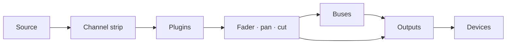

# Faider 用户手册

[English](../FAIDER-MANUAL.md)

**版本 0.1 · Windows 10 (2004) 或更高版本**

Faider 是一款 Windows 实时音频路由器兼调音台，以大型调音台为蓝本。
它从你的音频接口、Windows 设备和各个程序获取声音，经过通道条、总线和输出处理，再从你选择的任何设备播放：耳机、音箱、直播，或是用于通话和游戏的虚拟麦克风。

本手册涵盖应用的全部功能，带你一步步完成常见任务，并告诉你出问题时该怎么办。

---

## 目录

1. [开始之前](#1-before-you-start)
2. [首次设置](#2-first-time-setup)
3. [窗口](#3-the-window)
4. [路由的工作原理](#4-how-routing-works)
5. [调音台](#5-the-console)
6. [通道条，逐段介绍](#6-the-channel-strip-section-by-section)
7. [RAW 通道条：应用、打击垫、磁带和组合器](#7-raw-strips-apps-pads-tape-and-combinators)
8. [输出](#8-outputs)
9. [插件](#9-plugins)
10. [ROUTING 页面](#10-the-routing-page)
11. [工具：打击垫](#11-tools-pads)
12. [工具：磁带、录音机和回放](#12-tools-tape-recorder-and-replay)
13. [设备](#13-devices)
14. [场景、撤销和会话](#14-scenes-undo-and-sessions)
15. [设置](#15-settings)
16. [远程控制、悬浮层和托盘](#16-remote-control-overlay-and-tray)
17. [操作指南](#17-how-to-guides)
18. [故障排除](#18-troubleshooting)
19. [参考](#19-reference)

---

## 1. 开始之前

### 你需要什么

| | |
|---|---|
| **Windows** | Windows 10 2004 版或更高版本，或 Windows 11。捕获单个程序的声音需要 2004 或更高版本 |
| **音频接口** | 可选。安装其 ASIO 驱动后，Faider 会使用接口的时钟运行，延迟最低。没有接口时，它使用你的 Windows 播放设备，或内置时钟运行(见[时钟](#clocking)) |
| **耳机** | 接到音频接口(或任何 Windows 播放设备)上，这样你才能听到自己的混音 |
| **VB-CABLE** | 可选，免费 (vb-audio.com/Cable)。一个虚拟麦克风，让 Discord、游戏、OBS 等应用能听到你的混音 |
| **ffmpeg** | 可选。PATH 中有 `ffmpeg.exe`，或在 **SETTINGS > GENERAL > FFMPEG** 中选好了它时，录音机还能写出 MP3、AAC、Opus 和 ALAC |

### 本手册用到的词

| 词 | 含义 |
|---|---|
| **通道**(输入) | 调音台上的一个声源：麦克风、设备、程序、打击垫、磁带 |
| **通道条** | 调音台上控制一个通道、总线或输出的那一列 |
| **路由** | 把通道或总线送往某处的连接：送到总线或输出 |
| **总线** | 子混音。送入它的声音会被求和、一起处理，然后继续送出 |
| **组合器** | 把声音分成并行路径的总线，每条路径有自己的插件，最后再求和 |
| **输出** | 在某个设备(耳机、音箱、虚拟线缆)上播放的最终混音 |
| **接口** | 你的 ASIO 音频接口(如果有) |
| **时钟** | 一切运行时所依据的节拍：你的接口，没有则用 Windows 播放设备，再没有则用内置时钟 |

## 2. 首次设置

本章带你从安装程序一直走到一套可用的设置：你的麦克风声音进入耳机，应用能听到你的麦克风，某个程序的声音有自己的通道。请按顺序操作。每一步只需一两分钟。

### 步骤 1：安装 Faider

1. 运行安装程序 `Faider-<version>-Setup.exe`。
2. 由于安装程序没有代码签名，Windows SmartScreen 可能会提示这是无法识别的应用。点击**更多信息**，然后点击**仍要运行**。
3. 接受许可协议，并允许管理员权限提示。如果想要桌面快捷方式，请在安装过程中勾选(默认不勾选)。
4. 安装程序会把应用放到 `C:\Program Files\Faider`，并在开始菜单中添加 **Faider**。所需的一切都已包含在内。
5. 在最后一页，你可以立即启动 Faider。如果没有安装 VB-CABLE，它还会提示是否打开 VB-CABLE 的下载页面。

你的混音和设置保存在 `%APPDATA%\Faider`，与程序本身分开。卸载时这些内容会保留。

### 步骤 2：安装 VB-CABLE(可选)

VB-CABLE 提供一个其他应用可以选用的虚拟麦克风。如果你只想为自己的耳机做混音，可以跳过这一步。

1. 从 vb-audio.com/Cable 下载 VB-CABLE，并以管理员身份运行其安装程序。
2. 提示时重启 Windows。
3. Windows 现在多了两个设备。**CABLE Input** 是播放设备：播放到它里面的声音会从 **CABLE Output** 出来，后者是录制设备，应用可以把它选作麦克风。

> **Windows 会把你的声音切换到线缆上。** 安装虚拟线缆后，它常常会成为 Windows 的默认设备：**CABLE Input** 成为你的扬声器，**CABLE Output** 成为你的麦克风。这样你就听不到 Windows 的任何声音，而使用默认麦克风的应用听到的是线缆。安装后请马上把两者都切换回来。Faider 可以替你完成。

**用 Faider 把你的设备改回来**：点击 **SET MY DEFAULTS**：它在 SETUP 的 **APPS HEAR YOU** 页面(步骤 4)、PRE-FLIGHT 的 **WINDOWS DEFAULTS** 行，或 FIND 中的 **WINDOWS DEFAULTS**。它会列出你真正的扬声器和麦克风。选择你的耳机或音箱，然后再点一次并选择你的麦克风。每一个都会成为 Windows 的默认设备，以及它的默认通信设备。

**或在 Windows 中改回来：**

1. 打开**设置 > 系统 > 声音**(或右键点击任务栏的扬声器图标 > **声音设置**)。
2. 在**输出**下，选择你的耳机或音箱(或你的接口的输出)，而不是 **CABLE Input**。
3. 在**输入**下，选择你真正的麦克风，而不是 **CABLE Output**。
4. Windows 为通话单独保留一个默认设备。向下滚动到**更多声音设置**。在**播放**选项卡上，右键点击你的耳机或音箱 > **设为默认通信设备**。在**录制**选项卡上，对你的麦克风做同样的操作。

设置输出还有更快的办法：点击任务栏的扬声器图标，点击音量滑块旁边的 **>**，再选择你的设备。

请让真实设备保持为 Windows 的默认设备。Faider 只会把声音播放到你设置了路由的线缆上，而每个应用会自己选择 **CABLE Output** 作为麦克风(步骤 6)。如果 Windows 的任何一个默认设备是线缆，PRE-FLIGHT 会在 **WINDOWS DEFAULTS** 下报告。

### 步骤 3：启动 Faider

打开开始菜单，点击 **Faider**(或者使用桌面快捷方式，如果你创建了的话)。第一次启动时，**SETUP** 会在自己的窗口中打开。

### 步骤 4：回答 SETUP 的四个问题

SETUP 每页问一个问题，共四个，并根据你的回答建立混音。点击卡片进行选择。除第三页外，每页都可以多选。**NEXT** 继续，**BACK** 返回。

1. **WHERE YOU LISTEN**：选择你的耳机或音箱。Windows 的默认设备已被选中。
2. **MICROPHONES**：选择你对着说话的麦克风。它们是接口的输入(**IN 1**、**IN 2** …)和 Windows 录制设备。
3. **APPS HEAR YOU**：选择应用用作麦克风的虚拟线缆(完成步骤 2 后是 **CABLE Input**)，或选 **NOT NOW**。如果 Windows 仍在用线缆播放或录音，底部的 **SET MY DEFAULTS** 会把你真正的扬声器和麦克风改回来(步骤 2)。
4. **PROGRAMS**：选择现在正在发声、并且你想放到调音台上的程序。
5. 点击 **BUILD THE MIX**。**DONE** 会列出所创建的内容。
6. 点击 **OPEN THE MIXER** 查看。

每个回答会创建什么：

| 页面 | 创建的内容 |
|---|---|
| **WHERE YOU LISTEN** | 每个设备上的一个输出。第一个叫 **HEADPHONES**，其他的以设备名命名 |
| **MICROPHONES** | 每个麦克风一个通道，名为 **MICROPHONE** (MICROPHONE 2 …) |
| **APPS HEAR YOU** | 线缆上名为 **MIC FOR APPS** 的输出。每个麦克风都路由到它 |
| **PROGRAMS** | 每个程序一个 RAW 通道，路由到你的收听位置，外加一条应用规则，每当该程序发声时自动把它带回来 |

你的麦克风不会路由到你自己的耳机，所以你不会听到自己声音的延迟回声。想听到自己，请点亮麦克风的 **HEADPHONES** 键(步骤 6)。

SETUP 不再是一个页面：每当你添加设备或程序时，都可以从 **FIND**(**SETUP: BUILD A MIX**) 或 SIMPLE 中的 **SETUP** 按键再次运行它。它会补上缺少的内容，不会删除任何东西。

### 步骤 5：检查音频是否在运行

看右上角的**状态灯**。

- 带百分比的**绿色**：音频正在运行。继续步骤 6。
- **红色，显示 OFF**：音频没有运行。可能有其他程序占用了你的接口(DAW、驱动的控制面板)。关闭它并重新启动 Faider。见 [18.4](#184-the-interface-wont-start-or-stopped)。

点击状态灯打开 **DEVICES**。**STREAMS** 显示正在使用的时钟(ASIO、Windows 或内置时钟；见[时钟](#clocking))，**BUFFER** 设置其缓冲区大小。不产生爆音的最小值延迟最低。256 或 512 个采样适合大多数系统。

### 步骤 6：听到自己，也让应用听到你

调音台以 **SIMPLE** 打开。每个通道显示它的名称、它收听的内容、每个输出一个键、推子和电平表，以及 **CUT** 和 **SOLO**。每个输出显示它播放所在的设备、推子和电平表。

| 通道上的键 | 含义 |
|---|---|
| 普通灰色 | 没有路由到该输出 |
| 填充为输出的颜色 | 已路由到那里。点击可关闭 |
| 只有彩色边缘，**VIA BUS** | 通过总线到达(在 PRO 中设置)。点击可同时直接路由过去 |

1. 说话，看你的麦克风电平表跳动。
2. 想听到自己，点击麦克风的 **HEADPHONES** 键。
3. 在 Discord、游戏、OBS 或任何其他应用中，选择 **CABLE Output** 作为麦克风。
4. 检查它们收到了什么：**FIND** (Ctrl+K) > **HEAR WHAT THEY HEAR** 会录下应用收到的 5 秒声音并回放给你。

如果你听到某个程序两遍，见 [18.7](#187-i-hear-something-twice-or-an-echo)。

**+ CHANNEL** 和 **+ APP** 添加通道。**+ OUTPUT** 在还没有输出的设备上添加输出。输出名称下方的设备键用于更改播放位置。右键点击名称可使用 **RENAME...**、颜色、**HEADPHONE EQ**(输出)、**IN THE MINI MIXER** 和 **REMOVE**。删除程序的通道也会删除它的应用规则，所以通道不会自己回来。

### 步骤 7：PRO，整个调音台

顶部栏的 **SIMPLE / PRO** 开关无论在哪一边显示的都是同一个混音。**PRO** 是整个调音台：每个通道的输入、滤波器、动态和 EQ、总线和组合器、插件。

要调整你的麦克风，见 [17.1](#171-hear-yourself-set-up-a-microphone)。每个控件都在 [6](#6-the-channel-strip-section-by-section) 中。你在 PRO 中所做的设置，在 SIMPLE 中同样有效。

### 步骤 8：运行 PRE-FLIGHT

启动几秒后，**PRE-FLIGHT** 会检查设置，只在有需要注意的地方时才打开(首次启动时不会，因为先出现的是 SETUP)。你可以随时从 **SETTINGS > GENERAL > PRE-FLIGHT NOW...** 或 **FIND** (Ctrl+K) 运行它。每一行都应该是绿色。见 [18.1](#181-pre-flight)。

### 步骤 9：完成

- **你的混音会自动保存**，任何改动后一秒内就会保存。若要以名称保留一个版本，请使用 **SETTINGS > GENERAL > SAVE SESSION AS...**。
- **随 Windows 启动：** **SETTINGS > GENERAL > WINDOWS** 会在你登录时让 Faider 在托盘中启动，这样你的麦克风从一开始就能工作。
- **关闭窗口不会停止音频。** Faider 会继续在系统托盘中运行，所以你的麦克风和耳机保持工作。要停止它，请右键点击托盘图标并选择 **Quit Faider**。程序在托盘中时再次启动它，会让窗口重新出现。

每个页面第一次打开时，都会有一条简短的提示进行说明。可在 **SETTINGS > GENERAL > ON START** 下关闭提示。

设置到此完成。本手册的其余部分详细介绍每个部分。

## 3. 窗口

### 侧边栏

页面是左侧自上而下排列的卡片：**MIXER**、**ROUTING**、**TOOLS**、**DEVICES**、**SETTINGS**。当前显示的页面带有亮起的蓝色边缘。显示 MIXER 时，侧边栏还会出现下列卡片(在 SIMPLE 中只有 **ADD CHANNEL** 和 **ADD APP**)：

| 分组 | 卡片 | 作用 |
|---|---|---|
| **DESK** | **ADD CHANNEL** | 打开输入菜单：接口输入、Windows 设备、应用、程序窗口、浏览器（整个浏览器，或单独隔离一个标签页）、测试音。打击垫和磁带的通道在它们各自的页面（**TOOLS**）中添加 |
| | **ADD APP** | 列出现在正在发声的程序。选一个，就会给它一个通道 |
| | **ADD BUS** | 一条总线，或一个组合器(起始为两条路径) |
| | **PLUGINS** | 把插件面板从通道条下方滑出(见 [9](#9-plugins)) |
| **SELECT** | **AUTO** | 触碰通道条上的任何控件都会选中该通道条 |
| | **FOLLOW** | 调音台平滑滚动到所选通道条，在别处选中时(FIND、快捷键)也一样 |
| **METER** | **IN** / **PRE** / **POST** | 通道电平表的测量位置：进入的声源(处理前)、效果之后(推子之前)，或推子之后。与 **SETTINGS > GENERAL > CHANNEL METER POINT** 是同一个设置 |
| **SECTIONS** | HEADER … FADER | 通道条的各个部分。亮着的就是屏幕上显示的。点击其一可滑动过去 |

SELECT 和 METER 的选择会被记住。

### 顶部栏

从右往左：

| 控件 | 作用 |
|---|---|
| **+ 100% -** | 缩放。在 100%、125% 和 150% 之间切换。点击百分比回到 100%。Ctrl + / Ctrl - / Ctrl 0 效果相同 |
| **FIND** (Ctrl+K) | 按名称搜索每个页面、通道、场景、宏、打击垫和命令 |
| **HISTORY** (Ctrl+H) | 你做过的每一次更改。选一个就能回到那一刻 |
| **MINI** | 迷你调音台：一个小调音台窗口(点击托盘图标也能打开)。它上面的 **PIN** 让它保持置顶 |
| **状态灯** | 绿色：音频正常。琥珀色：音频负载很高，或最近有设备数据不足。红色：最近 10 秒内有可听见的故障，或没有音频在运行。数字是音频负载。点击它进入 DEVICES |
| **SCENES** | 你保存的混音。**+** 保存一个新的(见 [14.1](#141-scenes)) |
| **SIMPLE / PRO** | 同一个混音，以简单方式或整个调音台显示(见[步骤 7](#step-7-pro-for-the-whole-console)) |

窗口变窄时，状态灯最先消失，然后是 MINI，再是 HISTORY。FIND 可以找到它们全部。

### 走带控制

在顶部栏下方，每个 Mixer 视图都会显示磁带机的时间(已播放时间和曲目长度)、曲目名称及其按键：**倒带 10 秒**、**停止**、**播放/暂停**、**快进 10 秒**、**录音**、**循环**。

- **录音**就是录音机的 **REC**：它按录音机的格式和文件夹，录制在 TOOLS > TAPE 上选择的声源，录音进行期间保持点亮。再按一次停止。
- **循环**依次切换：**全部重复** → **单曲重复**(标有 **1**) → **关闭**。

---

## 4. 路由的工作原理

路由决定每个声音去往何处。路由之前什么都听不到，而且任何声音都可以路由到你想要的任意多个地方。

### 声音的路径

1. **通道**接收一个声源，让它通过自己的通道条(输入、滤波器、动态和 EQ，顺序由其 HEADER 显示)，然后经过插件，再经过推子、声像和静音。
2. **路由**把通道同时送往任意数量的总线和输出(各最多 8 个)。每条路由携带的都是通过推子之后的通道，所以推子和 **CUT** 会影响它被路由到的所有地方。
3. **总线**把送入它的所有声音求和，经过自己的通道条和插件，并以同样的方式继续路由到输出(或其他总线)。
4. **输出**把送入它的所有声音求和，经过它的总线压缩器、混音 EQ 和限幅器(**LIMIT**)，然后在它的设备上播放。

### 输出就是设备

每个输出在一个设备上播放：你接口的输出、USB 耳麦、音箱、**CABLE Input**。你不用手动创建输出。把某个声音路由到一个设备，就会在该设备上建立输出。这就是路由框既列出总线也列出设备的原因。

- 每个设备只有一个输出。把多个通道路由到同一个设备，它们会在它的输出中汇合。
- 不同的输出可以携带不同的混音。你的耳机可以听到游戏、音乐和人声，而直播输出只获得音乐和人声。
- 拔掉设备后，它的输出会静音，直到设备回来。

### 三个路由的位置

这三处修改的是同一组路由。哪个离你最近就用哪个。

| 位置 | 方式 |
|---|---|
| **路由框**(每个通道条的 HEADER) | 每条总线和每个输出设备一个框。亮起：已路由到那里。点击切换 |
| **ROUTE TO**(右键点击通道条) | 同一份列表，做成菜单，已路由的地方打勾 |
| **ROUTING 页面** | 每个通道条是一个方块，每条路由是一条线。先点一个方块，再点另一个(见 [10](#10-the-routing-page)) |

### 总线

当几个通道需要同样的处理，或需要共用一个推子时，用总线。把通道路由到总线，再把总线路由到输出。然后关掉这些通道到该输出的直接路由，否则它们会到达两次(一次直达，一次经过总线)。总线可以送到另一条总线，而且不增加延迟。

### 组合器

组合器是一条被分成并行**路径**的总线(起始为两条)。每条路径有自己的插件，各路径在组合器的推子处求和。你可以把声源路由到一条路径或多条路径(见 [7](#7-raw-strips-apps-pads-tape-and-combinators))。

### 保证安全的规则

- **反馈回路会被拒绝。** 会让声音回到它来源处的路由(一条总线进入送给它自己的总线，或把输出的声音送回它自己的输入)会立刻被再次关闭，并且事件日志会指出这个回路。
- 任何通道条上的 **Solo** 会让所有没有被独奏的通道条静音，已标记为独奏安全的除外。
- **应用通道与重复。** 程序除了送入它的通道，也会在自己的设备上播放(见 [18.7](#187-i-hear-something-twice-or-an-echo))。

### 时钟

由一个设备决定时钟。Faider 启动时按以下顺序选择：

1. **ASIO**：你的音频接口，通过其 ASIO 驱动。延迟最低。
2. **Windows**：没有 ASIO 驱动时，使用你的 Windows 默认播放设备(虚拟线缆、显示器扬声器或 VR 头显，仅在没有其他设备时才用)。你接口的输出会成为该设备的输出，麦克风则作为 Windows 设备添加。
3. **内置时钟**：完全没有播放设备时。所有设备，包括你的耳机，都跟随它。

其他每个设备和每个被捕获的程序都按自己的时钟运行，并通过一个修正漂移的小缓冲区加入，所以时钟漂移也绝不会产生爆音。**DEVICES > STREAMS** 会显示每一个，以及正在使用的时钟。

如果决定时钟的 Windows 设备被拔出、被关闭或停止工作，下一个时钟会自动接替，并有通知告诉你是哪一个。无法启动的设备(因为被其他程序占用)会被跳过，直到你的设备发生变化，然后再次尝试。使用内置时钟时，只要接入了播放设备，它就会从内置时钟那里接替。

若要自己选择时钟，请使用 **DEVICES** 顶部的 **CLOCK**：**THE INTERFACE (ASIO)**(上面的顺序，默认)、按名称选择的 **A WINDOWS PLAYBACK DEVICE**，或 **THE BUILT-IN CLOCK**。选择在 Faider 下次启动时生效，**RESTART NOW** 会立即重启。你的混音会随之带过去，并仍为你的接口保存。选择内置时钟时，不会有设备从它那里接替。

## 5. 调音台

### 布局

调音台从左到右显示所有通道条：**通道**，然后是**总线**(紫色名称栏)，然后是**输出**(琥珀色名称栏)。每个通道条从上到下有七个部分：

| 部分 | 内容 |
|---|---|
| **HEADER** | 电平条、FILT / EQ / EXT 键、处理顺序、路由框、通道条编号 |
| **INPUT** | 输入微调、极性、麦克风驱动、输入开关和立体声宽度 |
| **DYNAMICS** | 压缩器和门限 |
| **FILTERS** | 低通、高通和 NOISE 开关 |
| **EQ** | 四个频段 |
| **NAME** | 名称栏和电源开关 |
| **FADER** | 声像、SOLO、CUT、SEL、推子及其读数、DUCK 指示灯 |

### 鼠标和键盘

| 操作 | 结果 |
|---|---|
| 上下**拖动**旋钮或推子 | 改变它。拖动或悬停时，它的值会显示在旁边 |
| **双击**旋钮或推子 | 恢复默认值 |
| **点击**按键或开关 | 开 / 关 |
| **点击**名称栏 | 选中该通道条 |
| 左右**拖动**通道条的名称栏 | 在同类中移动：通道、总线或输出(见 [17.4](#174-reorder-channels)) |
| **点击**名称栏上的电源符号 | 关闭或打开该通道条 |
| **右键点击**通道条 | 该通道条的菜单 |
| **鼠标滚轮** | 横向滚动调音台。**Shift + 滚轮**上下滚动 |
| **Ctrl + / Ctrl -** | 缩放整个窗口 |

左键单击从不打开菜单。菜单始终在右键上。

### 选中通道条

被选中的通道条带有蓝色轮廓。点击名称栏或它的 **SEL** 键，或在 **AUTO** 开启时触碰它的任何控件，都能选中通道条。被选中的通道条就是插件面板所显示的通道条，也是 FIND、快捷键和远程控制所作用的通道条。

调音台获得焦点时(先点击它)：**Left / Right** 选择上一个 / 下一个通道条，**M** 将其静音，**S** 将其独奏，**Up / Down** 把它的推子移动 0.5 dB(按住 **Shift** 为 3 dB)。

### 关闭通道条

点击名称栏左边的电源符号。通道条会淡出并变灰。它不再被处理，它的设备或程序也会被释放。关闭期间，**它上面的任何东西都不能更改**：旋钮、按键和插件面板都会忽略点击，它的菜单只提供 **TURN ON** 和间隔条。再次点击电源符号即可恢复。

### 间隔条

间隔条是在分组之间留出空间的空白通道条。右键点击一个通道条 > **ADD SPACER BEFORE** / **ADD SPACER AFTER**。右键点击间隔条可使用 **NARROW**、**ADD ANOTHER** 和 **REMOVE SPACER**。当它前面的通道条移动时，间隔条会跟随它。

### 通道条菜单(右键点击)

| 项目 | |
|---|---|
| **INPUT** | 更换声源：**INTERFACE** 输入、**WINDOWS DEVICES**(或 WINDOWS DEFAULT)、**WHAT AN OUTPUT PLAYS**(环回)、**TEST TONE**、**NOTHING** |
| **ROUTE TO** | 每条总线和每个输出设备，已发送的地方打勾 |
| **PLUGINS** | 打开一个、**ADD PLUGIN...**、**REMOVE** |
| **MAKE MONO / MAKE STEREO** | 仅限通道 |
| **NOISE** | 降噪：**ON**(同通道条上的 NOISE 开关)、**NEURAL** 或 **SPECTRAL**，以及它的 **DEPTH**(-6 到 -30 dB) |
| **DUCK UNDER** | 另一个通道被听到时，这个通道压低到它下面；选择那个通道或 **NONE**，以及压低多少(**DEPTH**，-6 到 -24 dB)。应用通道上没有此项 |
| **COLOUR** | 通道的颜色，显示在它的名称栏上和它的 ROUTING 方块上 |
| **IN THE MINI MIXER** | 勾选后，该通道条在迷你调音台中有一个推子(见 [16](#16-remote-control-overlay-and-tray)) |
| **ADD SPACER BEFORE / AFTER** | |
| **RENAME...** | |
| **REMOVE** | 删除通道或总线 |

---

## 6. 通道条，逐段介绍

### HEADER

| 控件 | 作用 |
|---|---|
| **电平条** | 通道的电平，左和右(IN、PRE 或 POST，按 METER 的选择) |
| **FILT** | 把滤波器送入门限/压缩器的检测器(键控滤波) |
| **EQ** | 接入或旁路 EQ |
| **EXT** | 动态处理收听外部键控信号(侧链)，而不是通道本身 |
| **处理顺序** | 三个块(FILT、EQ、DYN)，自上而下是通道运行它们的顺序。**点击一个块**让它上移一位。最上面的会移到末尾。亮着的块在使用中 |
| **路由框** | 每条总线和每个输出设备一个框。亮起：通道被送到那里。点击切换(见[输出就是设备](#outputs-are-devices)) |
| **编号** | 该通道条在调音台上的位置 |

### INPUT

| 控件 | |
|---|---|
| **IN TRIM** | 输入增益 |
| **ø** | 极性反转 |
| **MIC** | 驱动：增加温暖感和电平(以百分比显示)。信号源有信号时，它旁边的绿色 LED 会亮起 |
| **PRE** | 接入或旁路输入级(旁路时，输入微调、极性和驱动都被绕过) |
| **WIDTH** | 立体声宽度：0 % 为单声道，100 % 保持原样，200 % 为两倍宽。在单声道通道上显示为淡色 |

### DYNAMICS

**IN** 开关(带电源符号)同时接入或旁路压缩器和门限。

**压缩器**

| 控件 | |
|---|---|
| **MIX** | 湿/干混合(并行压缩)。拖动绿色读数 |
| **ratio**、**thresh**、**rel** | 压缩比、阈值和释放 |
| **fast** | 快速起音 (3 ms)。关闭为 10 ms |
| **pk** | 峰值检测。开启(默认)时，压缩器对峰值做出反应。关闭时，它对平均 (RMS) 电平做出反应，更平滑 |
| **增益衰减 LED** | 衰减 3、6、10、14 和 20 dB |

**门限 / 扩展器**

| 控件 | |
|---|---|
| **range**、**thresh**、**rel**、**hold** | 关闭多少、在哪里打开、关闭多快、保持多久 |
| **exp** | 扩展器模式(更柔和的门限) |
| **fast** | 快速起音 (0.1 ms)。关闭为 1.5 ms |
| **门限 LED** | 门限正在关闭的程度 |

即使压缩器和门限被旁路，LED 也会显示它们*将会*怎么做，所以你可以在接入之前先设置好。

### FILTERS

**lp**(低通)和 **hp**(高通)。完全拧到最小时，高通关闭。完全拧到最大时，低通关闭。

**NOISE** 开启或关闭降噪：嘶声、嗡声和房间噪声会被压低，而人声保持不变。右键点击通道条 > **NOISE** 可选择 **NEURAL**(默认，在 48 kHz 下运行；在其他采样率下按 SPECTRAL 运行)或 **SPECTRAL**，以及降噪的深度。关闭时不占用任何资源。

### EQ

| 频段 | 控件 |
|---|---|
| **HF** | gain、freq、**bell**(关闭时为搁架式) |
| **HMF** | gain、freq、q |
| **LMF** | gain、freq、q |
| **LF** | gain、freq、**bell**(关闭时为搁架式) |

**EQ IN** 开关接入或旁路整个 EQ(与 HEADER 上的 EQ 键相同)。

### FADER

| 控件 | |
|---|---|
| **PAN** | 左/右。双击回到中间 |
| **SOLO** | 原位独奏 |
| **CUT** | 让通道静音(调音台上的 **M** 键) |
| **SEL** | 选中此通道条 |
| **推子** | 电平，从 +12 dB 到关闭。下方的读数以 dB 显示电平 |
| **safe** | 独奏安全：其他通道被独奏时，该通道仍可听见 |
| **listen** | 监听动态处理的键控信号 |
| **duck** | 通道被压低到另一个通道下面时亮起(右键点击 > **DUCK UNDER**) |

### 语音特效

除了推子条自身的处理，每个通道还带有自己的语音特效：

| 特效 | 作用 |
|---|---|
| **ROBOT** | 环形调制：声音与一个音调相乘，听起来像金属声 |
| **ECHO** | 延迟，最长一秒 |
| **RADIO** | 限制在 300 Hz - 3 kHz 并加入过载，听起来像一只小音箱 |
| **PITCH** | 声音升高或降低，两个方向最多各一个八度 |

它们用宏切换：动作为 **FX ON**、**FX OFF** 或 **FX TOGGLE**，目标是通道 ([15](#15-settings))。
打击垫、快捷键、触发器或远程控制都可以触发这个宏，所以特效随混音一起进出。

---

## 7. RAW 通道条：应用、打击垫、磁带和组合器

有些通道携带的是已经处理完成的声音：程序的音频、打击垫、磁带。它们使用 **RAW 通道条**，有路由、需要时可用的插件、声像、推子和按键，但没有内置效果。当它们出现在调音台上时，其内置效果会被关闭一次(并记入事件日志)。它们的插件会保留。

| 通道条 | 其中间部分的内容 |
|---|---|
| **App** | 插件列表(点击一个即可打开)和 **ADD PLUGIN** |
| **Pads** | 分组键 **A–D**、4×4 打击垫(按下播放；HOLD 打击垫按住期间播放)和 **STOP ALL** |
| **Tape** | 磁带机的屏幕和寻位条、走带控制(上一首、倒带、停止、播放、暂停、快进、下一首)、**SHUFFLE**、**ADD...** 和播放列表(点击曲目即可播放) |
| **Combinator** | 每条路径：**FROM**，即输入它的通道和总线(点击一个跳转到它的通道条)，以及该路径上的 **PLUGINS**(点击一个即可打开)。**EDIT IN ROUTING** 打开 ROUTING 页面 |

组合器本身没有效果。它的声音来自输入它的内容和每条路径的插件。右键点击它 > **PATHS** 可以添加路径，并且针对每条路径，打开、添加或移除其插件，重命名它或移除它。

---

## 8. 输出

每个输出都有自己的 Dark strip：

| 控件 | |
|---|---|
| **DEVICE** | 它播放所在的设备。点击可选择另一个 |
| **LIMIT** | 推子之后的限幅器：任何声音都不会超过 -1 dBFS 输出 |
| **MON** | 监听此输出 |
| **LUFS** | 输出声音的短期响度(静音时为 "-- LUFS") |
| **WIDTH** | 立体声宽度 |
| **BUS COMP** | In 开关、VU 式增益衰减表、**threshold**、**ratio**、**attack**、**release**、**make-up**、**mix** |
| **MIX EQ** | In 开关、HF 增益和频率、LF 增益和频率 |
| **CUT**、**SEL**、推子 | 与通道上相同 |

右键点击输出可使用 **DEVICE...**、**HEADPHONE EQ**(耳机校正：**NONE**，或你的型号，按品牌列出)、**ALERT IF SILENT**(10 秒低于 -60 dBFS)和 **ALERT IF CLIPPING**(LIMIT 关闭时)(它们会让托盘图标闪烁并写入事件日志)、**IN THE MINI MIXER**、间隔条、**RENAME...** 和 **REMOVE**。

输出会自动创建，每个设备一个(见[输出就是设备](#outputs-are-devices))。

**FIND > MIX-MINUS AND STEMS** 会为每位嘉宾建立一路馈送(除他们自己的声音外的所有声音)，并建立人声、音乐和游戏分轨。

---

## 9. 插件

Faider 在通道、总线和组合器路径上承载 **VST3** 插件，并自动补偿延迟。

### 添加插件

- 在通道上：右键点击 > **PLUGINS > ADD PLUGIN...**，或 RAW 通道条上的 **ADD PLUGIN**，或插件面板中的 **ADD**。
- 在组合器路径上：右键点击组合器 > **PATHS > PATH n > ADD PLUGIN...**。在组合器通道条上点击某条路径的插件即可打开它。

每个插件**都会先在程序的一个独立副本中测试**，所以加载时崩溃或卡死的插件不会拖垮你的混音。它有 30 秒的加载时间(SETTINGS > GENERAL 中的 **PLUGIN TEST TIME** 可给慢的插件 60 或 120 秒)。结果会被记住，直到插件文件发生变化。

### 插件面板

点击侧边栏中的 **PLUGINS**。一个面板会从通道条下方滑出，按运行顺序显示**所选通道条**的插件。**FIND** > **PLUGINS: name** 会在该通道条上打开它，如果正在显示 SIMPLE，则切换到 PRO。每张卡片显示：

- **CPU**：插件占处理时间的份额(绿色，超过 2 % 为琥珀色，超过 5 % 为红色)
- **Latency**：它增加的延迟
- **BYPASSED**：已关闭但仍处于加载状态(仍占用内存)
- **HEAVY**：开销异常大

每张卡片上的按键：**BYPASS**、**OPEN**(它的窗口)、**REMOVE**，以及把它前移或后移的箭头。末尾的 **ADD** 再添加一个。

---

## 10. ROUTING 页面

ROUTING 页面把整个混音显示为一张地图：每个通道条是一个方块，每条路由是一条线。用它来查看所有声音的去向，也可以通过点击两个方块来设置路由。

### 如何阅读此页面

- **三行：** 顶部是 **INPUTS**，中间是 **BUSES**，底部是 **OUTPUTS**。还没有输出的输出设备以灰色显示在 OUTPUTS 行的右端。
- **每个方块位于它的通道条下方。** 方块在页面上的横向位置与它的通道条在调音台上的位置相同，包括间隔条，页面随调音台一起横向滚动(鼠标滚轮)。重新排列调音台，地图会跟着变化。
- **每个方块显示**通道条的名称和编号。已关闭的通道条显示为暗色。有自己颜色的通道会以色调和左侧的色带显示该颜色。
- **线就是路由。** 每条线从其声源笔直向下，进入其所在行下方空隙中属于它自己的车道，横向穿过，再向下进入它所馈送的方块，以箭头结束。输入路由为青色，总线路由为紫色。同一个方块上进出的多条线会按顺序铺开，所以永不重叠。
- **组合器**在方块底部以 **P1、P2、…** 单元格显示它的路径。线终止于它所馈送的路径。

### 在方块之间设置路由

1. **点击一个方块。** 它会亮起蓝色并跳动。它路由到的方块，或路由到它的方块，边框会高亮，它们的线会变亮，其余的一切变暗。
2. **点击另一个方块。** 它们之间的路由会打开(出现一条线)或关闭(线消失)。两种顺序都可以：先声源后目标，或先目标后声源。
3. 第一个方块**保持选中**，所以可以继续点击，把它路由到多个地方，或移除多条路由。
4. **再次点击它**、点击空白处，或按 **Esc** 即可放开。

如果这两个方块无法建立路由(比如两个输出)，则会改为选中第二个。

### 示例

| 目的 | 点击 |
|---|---|
| 听到你的麦克风 | MIC，然后是耳机的输出 |
| 让应用听到你的麦克风 | MIC，然后是 **CABLE Input**(在输出行中，建立输出之前为灰色) |
| 通过总线发送一组通道 | 先点总线，再逐个点通道；然后点总线，再点它的输出 |
| 把一个通道从直播中拿掉 | 该通道，然后是直播的输出(线消失) |
| 输入一条组合器路径 | 声源，然后是路径单元格 (P1、P2…)。再点击其他单元格可输入多条路径。在单元格之外点击组合器会输入它的第一条路径 |

点击灰色的设备方块会创建它的输出，新的输出会立即出现在调音台上。

沿着所在行横向拖动方块，可移动它的通道条(见 [17.4](#174-reorder-channels))。立刻又被关闭的路由会形成反馈回路(见 [18.8](#188-a-route-wont-switch-on))。

## 11. 工具：打击垫

**TOOLS > PADS** 提供四组(**A–D**)，每组 16 个打击垫：共 64 个声音，最多同时播放 32 个。

### 让声音输出

打击垫播放到一个 **PADS 通道**。点击 **CREATE PADS CHANNEL**(之后它会显示 **PADS CHANNEL ACTIVE**)，或在 **PLAY INTO** 菜单中选择另一个输入，让打击垫通过该通道的插件和路由播放。没有打击垫通道时，按下会被忽略。

### 载入与播放

| 操作 | |
|---|---|
| 点击**空**打击垫 | 选择一个声音文件 |
| 点击已载入的打击垫 | 播放它 |
| 右键点击打击垫 | 选中它进行编辑，不播放 |
| 把文件拖放到打击垫上 | 载入到该打击垫以及该组中随后的打击垫 |
| **Ctrl + 拖动**到另一个打击垫 | 交换这两个打击垫 |
| **STOP ALL** | 淡出所有打击垫 |

格式：WAV、FLAC、AIFF、OGG、MP3。文件已被移动的打击垫显示 **MISSING: FILE**。

### 打击垫编辑器

| 设置 | |
|---|---|
| 名称 | 双击重命名 |
| **LOAD**、**CLEAR**、**COLOUR** | |
| **REPLAY** | 即时回放缓冲区变成该打击垫的声音(以 WAV 保存在录音文件夹中)。请先在 TOOLS > TAPE 中启用回放 |
| **MODE** | **ONE-SHOT** 播放到结束(再次按下会重新开始)。**HOLD** 按住期间播放。**LOOP** 按一次开始，再按一次停止 |
| **CHOKE** | OFF 或组 1–8。同一组的打击垫会互相停止 |
| **LEVEL** | -INF 到 +12 dB |
| **HOTKEY** | 点击(**LEARN...**)，然后按下按键(见 [HOTKEYS](#hotkeys)) |
| **MACRO** | 随打击垫一起运行的宏(打击垫可以只有宏而没有声音) |
| **TRIM** | 在波形上拖动起始线和结束线。双击选取整个文件 |
| **FADE IN / FADE OUT** | 0–5 秒 |

---

## 12. 工具：磁带、录音机和回放

### 磁带机

**TOOLS > TAPE** 把播放列表播放到一个 **TAPE 通道**。点击 **CREATE TAPE CHANNEL** 来创建。

- **ADD FILES**、**ADD FOLDER**，或把文件和文件夹拖放到页面的任何位置。**EJECT** 清空播放列表。
- 双击曲目播放，拖动曲目重新排序，按 Delete 删除选中的曲目。
- 走带控制：**PREV**、**REW**(后退 10 秒；按住快速倒带)、**PLAY**、**PAUSE**、**STOP**、**FF**(前进 10 秒；按住快速快进)、**NEXT**。另有 **SHUFFLE**、**REPEAT**(全部 / 单曲 / 关闭)和 **LEVEL**。
- 曲目无缝播放。暂停和跳转会在 30 ms 内淡变，所以绝不会产生爆音。

顶部栏的走带控制和调音台上的磁带通道条控制的是同一台磁带机。

### 录音机

| | |
|---|---|
| **Source** | 任何输出、总线或输入，或 **ALL CHANNELS, ONE FILE EACH**(多轨：每个输入，或仅 DIRECT 亮起的输入，加上每个输出，采样对齐) |
| **Format** | WAV 24-bit(默认)、16-bit、32-bit、32-bit float；FLAC 24/16-bit；AIFF 24/16-bit；OGG Vorbis 128–320k。有 ffmpeg 时：MP3、AAC (M4A)、Opus、ALAC。每种格式都会显示磁盘能容纳多长时间 |
| **REC** | 开始和停止(顶部栏的录音键作用相同)。屏幕显示时间、大小、剩余时间，以及任何丢弃的数据块 |
| **PATH** / **REVEAL** | 选择文件夹 / 在资源管理器中打开 |

除非你选择了文件夹，录音都保存到 `Music\Faider Recordings`。ffmpeg 格式会先录成 WAV，停止时再转换(转换失败时会保留 WAV)。Faider 使用在 **SETTINGS > GENERAL > FFMPEG** 中选择的 `ffmpeg.exe`，否则使用 PATH 中的那个。剩余空间不足 1 GB 时，录音会自动停止。

### 即时回放

**ARM** 保留录音机声源最近的 **30 秒**、**1**、**2** 或 **5 分钟**。**SAVE** 把它写入文件(右键点击 SAVE 可为它设置全局快捷键)。选择多轨时，回放使用第一个输出。

---

## 13. 设备

**DEVICES** 列出每个 Windows 音频设备和 ASIO 驱动。顶部的 **CLOCK** 显示现在由什么决定时钟，它的键用于选择时钟(见[时钟](#clocking))。

它下面的 **WINDOWS AUDIO** 显示 Windows 音频引擎(audiodg.exe，承载每个 Windows 设备和被捕获的应用)的优先级：**NORMAL** 是 Windows 的默认值，无法读取时为 **UNKNOWN**。它的键 **BOOST WINDOWS AUDIO**(处于 High 时为 **BOOSTED**)会打开一个菜单：

- **BOOST (HIGH PRIORITY)** 把它提高到 High，在某些电脑上可以消除 Windows 设备和被捕获应用的爆音。这需要管理员权限，所以 Windows 会先询问；拒绝则什么都不会改变。重启 Windows 音频或电脑后它不会保留：Faider 会监视它，在它回到 Normal 时从托盘通知你一次，托盘菜单上的 **Boost Windows audio again...**(或这里的 BOOST，或 FIND 中的 **BOOST WINDOWS AUDIO**)会再次提升它。在已提升时点击 BOOST 会停止监视；它会保持 High，直到 Windows 音频重启。
- **PIN TO ONE CORE**(除非你选择，否则关闭)从下一次 BOOST 起，还会把它固定在你的最后一个处理器核心上。它只限制运行位置，从不增加核心：仅在 USB 耳机有爆音时使用。

它不影响 ASIO 接口，因为它们不经过 Windows 音频。

| 列 | |
|---|---|
| **I/O** | ASIO、OUT 或 IN |
| **DEVICE**、**HARDWARE** | 它的名称和它所在的适配器 |
| **FORMAT** | 声道数和采样率 |
| **STATE** | 活动、已拔出、已禁用，或 **off in Faider** |
| **TAGS** | Windows 默认设备的 DEFAULT 和 CALLS |

点击表头排序。选择设备(Ctrl/Shift 多选)，然后使用：

| 键 | |
|---|---|
| **EXCLUDE / INCLUDE** | Faider 停止(或恢复)使用该设备。被排除的设备永远不会被打开，也不会出现在列表中 |
| **DISABLE / ENABLE IN WINDOWS** | 在 Windows 本身中关闭或打开该设备 |
| **RENAME** | 你给设备起的名字，在整个 Faider 中使用(也可以双击一行) |

### Streams

列表下方的 **STREAMS** 显示音频引擎的状况：

- **CALLBACK LOAD**(及其峰值)、**OVERLOADS**、**BLOCKS SKIPPED**。任何一项发生过，就会变成警告色
- **BUFFER**：你接口的缓冲区大小(越小延迟越低，负载越高)
- 每个设备：缓冲的音频、总延迟、**DRIFT**(以 ppm 表示的时钟修正)、**UNDER**(数据耗尽，播放了静音)、**OVER**(溢出，音频被丢弃)、**RESYNC**(重新居中)。丢过音频的行显示为红色
- **RESET STATS** 清除计数器

### VB-CABLE

如果安装了 VB-CABLE，顶部的一栏会设置它的**采样率**和**最大延迟**。**APPLY** 会请求一次管理员权限并重启线缆。

底部的事件日志记录每一次设备接入、移除或恢复。

---

## 14. 场景、撤销和会话

### 14.1 场景

场景保存每个通道的推子、声像、静音、独奏、电源和路由(如果你选择，还包括插件设置)。

- **保存：** 点击顶部栏的 **+** 并给它起个名字。
- **调用：** 点击它的键。推子和声像在半秒内平滑过渡，其余的立即切换。
- **右键点击场景**可以：仅调用 CUT / 仅调用电平、存入它、包含插件设置、重命名、全局快捷键、**Recall on device**(设备出现时调用；离开时切回)、**Auto-scene**(应用开始播放时、设备连接时，或在一天中的某个时间)、MIDI 学习、移动、删除。

设备和通道本身不属于场景。

### 14.2 撤销和历史

**Ctrl+Z** 撤销，**Ctrl+Y**(或 Ctrl+Shift+Z)重做。**HISTORY** (Ctrl+H) 列出每一次更改。选一个就能跳回到那里。

### 14.3 会话

你的混音在任何改动后一秒内以及退出时自动保存。

| | |
|---|---|
| **SESSION TIMELINE** | FIND，或托盘菜单上的 **Session timeline...**：按日期列出保留的每个版本。**RESTORE EVERYTHING**(Faider 会以它重新启动)，或无需重启的 **PUT ONE CHANNEL BACK**(它的电平、声像、CUT 和机架) |
| **SAVE SESSION AS...** | SETTINGS > GENERAL > SESSIONS：以名称保留混音 |
| **OPEN, EXPORT OR IMPORT...** | 打开命名的混音(会重启)、把混音保存为文件，或从文件载入 |

最多保留 60 个早期版本(最多每 5 分钟一个)。如果你的混音无法载入(接口缺失、文件损坏)，它会被**搁置**而不是丢失，并以一个全新的混音开始。见 [18.2](#182-my-mix-is-gone-a-fresh-mix-started)。

---

## 15. 设置

**SETTINGS** 有四个部分，以卡片形式排在左侧：**GENERAL**、**MACROS**、**HOTKEYS**、**CONTROL**。开/关设置是方形开关，开启时发出奶油色的光。

### GENERAL

| 卡片 | 设置 |
|---|---|
| **LOOK** | **LOOK...**：调音台的颜色与字体，取自 LOOK 文件（见 [LOOKS](#looks)） |
| **WINDOWS** | **START WITH WINDOWS**：你登录时在托盘中打开 |
| **DESK** | **WARN IF I TALK WHILE CUT**(被 CUT 的麦克风超过 -30 dBFS 时给出通知) |
| **APPS** | **APP RULES...**：程序开始播放时它去往哪条总线或输出(也可在 **FIND** 中找到)。删除程序的通道会同时删除它的规则 |
| **SESSIONS** | **SAVE SESSION AS...**；**OPEN, EXPORT OR IMPORT...** |
| **ON START** | **PRE-FLIGHT: CHECK THE SETUP**；**PRE-FLIGHT NOW...**；**TIPS**；**SHOW THE TIPS AGAIN** |
| **NOTICES (IN THE CORNER)** | 设备连接或消失、通道削波(其声源或输出达到满刻度)、场景被调用、宏被运行、撤销和重做 |
| **ZOOM** | 100%、125%、150%、**CUSTOM...**(75–200%) |
| **METER STANDARD** | 电平表的读数方式(默认是快速回落的采样峰值；IEC 及其他) |
| **CHANNEL METER POINT** | **IN**(原始声源)、**PRE**(效果之后)、**POST**(推子之后，默认)。侧边栏的 **METER** 卡片设置的是同一项 |
| **RECORDING** | **FFMPEG**：`ffmpeg.exe` 的位置，或 **NOT FOUND**。点击它选择 `ffmpeg.exe`(优先于 PATH 中的那个)；选好后，它还提供改回 PATH 中那个的选项 |
| **PLUGIN TEST TIME** | **30 S**(默认)、**60 S** 或 **120 S**：新插件在测试中完成加载的时限，超时即失败 |
| **UPDATES** | **CHECK FOR UPDATES**(默认开启)：启动半分钟后，每天最多一次，Faider 向 GitHub 发送一个请求，询问它的最新版本。该请求只带有应用的名称和版本(例如 `Faider/0.1.5`)；不会下载或安装任何东西。如果有新版本，托盘会告诉你，托盘菜单上的 **Get Faider x.y.z...**、FIND 中的 **GET FAIDER x.y.z** 或这里的键会打开它的页面。关闭后，Faider 从不询问。**CHECK NOW**(或 FIND 中的 **CHECK FOR UPDATES NOW**)会立即询问，并在你已是最新版本时告诉你 |
| **ABOUT** | 版本和致谢 |

### LOOKS

**LOOK** 就是调音台绘制时使用的每一种颜色，再加上与之相配的字体和尺寸。通道条、数值显示、旋钮、按键和指示灯都从当前生效的 LOOK 取值绘制，所以换一个 LOOK，整张调音台会一起变。

**LOOK...** 列出你已有的 LOOK，并启用你选中的那个；一有改变，调音台就会立刻重新绘制。**SAVE THIS LOOK AS...** 会把当前生效的 LOOK 写成一个新文件，名字由你定。

一个 LOOK 就是 `%APPDATA%\Faider\looks` 里的一个 JSON 文件，因此你可以手写一个，再复制到别的电脑上。文件缺失或损坏时，内置 LOOK 保持不变；文件里没写的项目会退回内置值——只写了一半的文件照样能用。

| | |
|---|---|
| `name` | LOOK 的名字，也就是列表里显示的样子 |
| `font` | Windows 自带的一种字体，在调音台的小字号下依然清楚 |
| `keyRadius` | 按键圆角有多圆，以像素计 |
| `fontSizes` | `legend`、`caption`、`readout`：三种印刷尺寸 |
| `colours` | 每个颜色写成 `#rrggbb`，需要透明时写成 `#rrggbbaa` |

颜色的名字就是它绘制的那部分：面板与印刷、按键、推子的面板、数值显示、按功能分的旋钮、指示灯、通道条的体、通道／总线／输出的样子、强调色、凹槽和明暗。**SAVE THIS LOOK AS...** 会把 LOOK 拥有的每个名字都写出来，所以最快的办法是在调音台上改一下、保存它，再编辑那个文件。

`palette` 这一组列出布局文件可以加在某个部件上的颜色：`red`、`green`、`blue`、`black`、`white`、`violet`、`grey`、`cream`、`orange`、`amber`、`teal`、`salmon`。

### MACROS

宏是由快捷键、打击垫、触发器或远程控制运行的**动作**列表。

1. 点击 **+ NEW**，然后命名(双击名称)。
2. **+ ACTION**：CUT、UNCUT、CUT TOGGLE、SET FADER (dB、渐变时间)、ASSIGN ON/OFF/TOGGLE (一条路由)、CHANNEL ON/OFF、TRIGGER PAD、STOP PAD、ALL NOTES OFF、TRANSPORT PLAY/PAUSE、TRANSPORT NEXT、RECORD START/STOP、WAIT、SCENE RECALL、FX ON/OFF/TOGGLE (一个语音特效，见 [语音特效](#voice-effects))、WINDOWS DEFAULT OUTPUT/INPUT、PLUGIN SETTING。
3. 可选，**+ TRIGGER**：APP STARTS、APP STOPS、DEVICE CONNECTED、DEVICE DISCONNECTED、OUTPUT SILENT (持续 n 秒)、OUTPUT HAS SOUND、TIME (24 小时制)。
4. 可选，一个 **HOTKEY** 和 **MOMENTARY**(松开按键时撤销这些动作，用于按键通话)。
5. **FIRE** 立即运行。

### HOTKEYS

所有可分配的快捷键都集中在一处：**PADS**、**MACROS**、**SCENES**，以及 **TAPE** 下的 **SAVE INSTANT REPLAY**。点击一个，然后按下新的按键(Esc 取消，Delete 清除)。快捷键必须包含 Ctrl、Alt 或 F 键，并且在游戏拥有焦点时也有效。固定按键也列在其中([19.1](#191-keyboard-shortcuts))。页面上的 ON THE MIXER 按键在调音台上同样有效([5](#5-the-console))。

### CONTROL

| 卡片 | |
|---|---|
| **MIDI** | **MIDI MAP** (Ctrl+L)；**INPUTS AND BINDINGS**，可在此开启或关闭每个 MIDI 输入 |
| **OSC** | **OSC ON (PORT 9000)**，供这台电脑上的程序使用。**PORT...** 设置端口(1024–65535)；如果 OSC 已开启，会立即改到该端口 |

---

## 16. 远程控制、悬浮层和托盘

| | |
|---|---|
| **MIDI MAP** (Ctrl+L) | 点击屏幕上的一个控件，然后转动控制器上的旋钮或按键。每个通道条的推子、声像、CUT、SOLO、电源和路由键都可以映射，在 SIMPLE 和 PRO 中均可，场景、打击垫和磁带也可以。映射时鼠标滚轮滚动调音台(Shift+滚轮为上下) |
| **OSC** | 这台电脑上的程序可以发送到端口 9000，或在 SETTINGS > CONTROL 中用 **PORT...** 设置的端口(它从不监听网络)：`/faider/input/NAME/fader -12` (dB)、`/faider/output/NAME/mute 1`、`/faider/bus/NAME/pan -0.5`、`/faider/input/NAME/solo 1`、`/faider/scene NAME`、`/faider/macro/NAME 1` (0 表示松开)。名称中的空格写成 `_` |
| **In-game overlay** (Ctrl+Shift+O) | 每个麦克风通道的说话指示灯、LIVE / CUT 和电平，另外最多四个场景键。绝不会从游戏抢走焦点。可拖到任何位置 |
| **MINI** | 迷你调音台：一个小窗口，为右键菜单中勾选了 **IN THE MINI MIXER** 的每个通道条提供推子、电平表和 **CUT**(都没勾选时为每个输出提供)。**PIN** 让它保持在所有窗口之上。**OPEN** 返回主窗口 |
| **Tray** | 点击图标显示迷你调音台，双击打开窗口。右键点击：Show、场景调用、Session timeline、Get Faider x.y.z...(有新版本时)、Start with Windows、Save a problem report...、About、Quit。出现警报时图标闪烁琥珀色 |

Faider 始终以你的普通用户权限运行，即使是从管理员窗口启动的。它会自己以普通权限重新启动，因为游戏内悬浮层无法访问以管理员身份运行的程序。少数需要管理员权限的操作(应用 VB-CABLE 设置、重新启用被 Windows 关闭的设备)会自行请求许可。

---

## 17. 操作指南

### 17.1 听到自己：设置麦克风

1. **ADD CHANNEL** > 你的接口输入(或 Windows 录制设备)。它会作为一个新的通道条出现。
2. 说话，并设置 **IN TRIM**，使电平条的峰值在 -12 到 -6 dB 左右。
3. 设置路由：点击你耳机输出的路由框(或使用 ROUTING 页面)。
4. 清理声音：用 **hp** 去除低频噪声(80–100 Hz 左右)，然后是门限和压缩器(DYNAMICS 上的 **IN**)，再是 EQ。

### 17.2 让应用听到你的麦克风(Discord、游戏、OBS)

1. 安装 **VB-CABLE**(PRE-FLIGHT 会提供链接)，然后把你真正的扬声器和麦克风设回 Windows 的默认设备([步骤 2](#step-2-install-vb-cable-optional))。
2. 把你的麦克风通道路由到 **CABLE Input** 设备。它上面会创建一个输出。
3. 在应用中，选择 **CABLE Output** 作为它的麦克风。
4. 运行 **PRE-FLIGHT NOW...**，检查途中没有被 CUT 的环节，也没有回路。

### 17.3 把程序带入混音

1. 启动程序并让它发出声音。
2. **ADD APP** > 选中它。它会得到一个 RAW 通道(没有效果)。
3. 把它路由到你想听到它的地方。如果你听到它两遍，见 [18.7](#187-i-hear-something-twice-or-an-echo)。

### 17.4 重新排列通道

在 Mixer 上左右拖动通道的**名称栏**(向下滚动到 NAME 部分)，或在 ROUTING 页面上拖动它的方块。一条蓝色竖条显示它将落在哪里，通道条会平滑滑入位置。间隔条跟随它前面的通道条移动。总线和输出以同样的方式移动，各自在同类之间，它们的路由也随之移动。SIMPLE 按相同的顺序显示输出。

### 17.5 把通道编成一条总线

1. **ADD BUS**，然后重命名(右键点击 > **RENAME...**)。
2. 在 ROUTING 页面上，点击总线，再点击每个通道，把它路由进来。
3. 点击总线，再点击它的输出，把总线继续路由出去。
4. 如果你只想让这些通道经过总线，请关闭它们到该输出的直接路由。

### 17.6 用组合器进行并行处理

1. **ADD BUS > COMBINATOR**。它起始有两条路径。右键点击它 > **PATHS > ADD PATH** 可添加更多。
2. 在 ROUTING 页面上，把声源路由到路径单元格(**P1**、**P2**…)。
3. 对每条路径，右键点击 > **PATHS > PATH n > ADD PLUGIN...**。

### 17.7 制作直播混音和耳机混音

1. 把你的通道送到两个输出，例如你的耳机和直播软件捕获的设备。
2. 每个输出有自己的推子、总线压缩器、EQ 和限幅器(**LIMIT**)。给直播输出打开 **LIMIT**。
3. 若要让某样东西不进入直播，请关闭该通道到直播输出的路由(用它的路由框或在 ROUTING 页面上)。

### 17.8 录音

1. TOOLS > TAPE > **RECORDER**：选择声源和格式。
2. 按 **REC**(或顶部栏的录音键)。再按一次停止。
3. **REVEAL** 打开文件夹。

### 17.9 制作按键通话键

1. SETTINGS > MACROS > **+ NEW**。
2. **+ ACTION** > **UNCUT** > 你的麦克风通道。
3. 打开 **MOMENTARY** 并设置一个 **HOTKEY**。按住它时麦克风是开着的，松开后又会被 CUT。请从麦克风被 CUT 的状态开始。

---

## 18. 故障排除

### 18.1 PRE-FLIGHT

PRE-FLIGHT 在启动几秒后运行(也可从 **PRE-FLIGHT NOW...** 或 FIND 运行)，只在出问题时才会出现。每一行有一个指示灯、检查结果和一个修复方法：

| 检查 | 问题 | 修复 |
|---|---|---|
| **AUDIO** | 没有启动(可能被其他应用占用) | **DEVICES** |
| **MIC CABLE** | 没有 VB-CABLE：应用无法把你的混音当作麦克风听到 | **GET VB-CABLE** |
| **MIC OUTPUT** | 没有输出播放到麦克风线缆 | **ROUTING** |
| **MIC CHANNELS** | 通往麦克风的途中有东西被 CUT | **UNCUT** |
| **WINDOWS DEFAULTS** | Windows 的默认扬声器或麦克风(或其默认通信设备)是虚拟线缆 | **SET MY DEFAULTS** |
| **HEARD ONCE** | 反馈回路，或有东西被听到两遍 | **SOUND SETTINGS** |
| **WINDOWS AUDIO** | 混音中有 Windows 设备或被捕获的应用，而 Windows 音频引擎处于 Normal 优先级：黄色，仅为建议；如果你的提升被重启撤销则为红色。只用 ASIO 时为绿色 | **BOOST** |

**ZERO THE DESK**(左下角；在 FIND 中也叫 **ZERO DESK**)检查上一次会话可能遗留的设置：独奏、key listen、偏离超过 12 dB 的增益微调，以及被 CUT 的输出。每一项都有一个 **FIX**。

### 18.2 我的混音不见了，开始了一个全新的混音

你的混音没有丢失。启动时无法使用它时，它会被**搁置**为 `session-unloaded-<date>.xml`。事件日志会说明原因：

| 原因 | 该怎么做 |
|---|---|
| 保存的接口没有连接 | 连接它，然后 **SESSION TIMELINE**(FIND 或托盘) > 带 "kept:" 的版本 > **RESTORE EVERYTHING** |
| 保存的接口无法打开(被其他程序占用) | 关闭其他程序，然后重新启动 Faider。在此期间不会有任何东西覆盖你的混音 |
| 无法读取 session.xml | **SESSION TIMELINE** > 一个较新的版本 > **RESTORE EVERYTHING** |

### 18.3 没有声音

沿着信号路径逐一检查：

1. **状态灯**为红色并显示 OFF：音频没有运行。见 [18.2](#182-my-mix-is-gone-a-fresh-mix-started) 和 [18.4](#184-the-interface-wont-start-or-stopped)。
2. **通道的电平表**(METER: IN)：如果它不动，检查它的 **Input**(右键点击)以及声源是否在播放。已关闭的通道条不会通过任何声音。
3. **CUT** 已关闭，推子已推上去，并且没有其他东西被独奏(另一个通道条的 **SOLO** 会让其他所有东西静音)。
4. **路由：** 至少有一个路由框亮着，或者 ROUTING 页面上有一条线。
5. **输出**：没有 CUT，推子已推上去，**DEVICE** 显示了正确的设备(不是 "NO DEVICE" 或 "(OFF)")。
6. **设备**已接入，并且在 DEVICES 中没有被排除。

### 18.4 接口无法启动，或已停止

- 可能有其他程序占用了它(DAW、驱动的控制面板)。关闭它并重新启动。
- 托盘上的 **INTERFACE DOWN**：接口自己重置了，并且无法重新打开。在 DEVICES 上更改它的缓冲区大小，或重新启动 Faider。
- 在接口自己的控制面板中所做的采样率或缓冲区更改会被自动识别。
- 若要暂时不用接口运行，请在 **DEVICES > CLOCK** 中选择一个 Windows 播放设备或内置时钟，然后点击 **RESTART NOW**。你的混音会随之带过去，并仍为你的接口保存：再次选择 **THE INTERFACE (ASIO)** 即可回到接口。
- 或这样启动 Faider：`"C:\Program Files\Faider\Faider.exe" --clock windows`(你的 Windows 播放设备)或 `--clock builtin`(内置时钟)。`--clock` 后面跟 ASIO 驱动名称的一部分(`--clock focusrite`)会选择那个驱动。在这次运行中它优先于 DEVICES > CLOCK，下次不带它启动时会回到你的选择。

### 18.5 咔嗒声、爆音或掉音

1. 查看**状态灯**和 **DEVICES > STREAMS**。
2. **CALLBACK LOAD** 很高或有 OVERLOADS：调大 **BUFFER**，或在插件面板中找出开销大的插件(**HEAVY**、CPU 高)，将它们旁路或移除。
3. 某一个设备上的 **UNDER / OVER** 持续增长：那个设备吃力了。试试另一个 USB 端口，关闭其他使用它的程序，或者如果你不用它就把它排除。
4. 稳定的 **DRIFT** 是正常的。这是让各时钟保持同步的修正。
5. 只有 Windows 设备或被捕获的应用有爆音：试试 **BOOST WINDOWS AUDIO**(DEVICES > WINDOWS AUDIO，或 FIND)。它把 Windows 音频引擎从 Windows 默认的 Normal 提高到 High。Windows 会请求管理员批准，重启 Windows 音频或电脑会撤销它(Faider 会告诉你)。它不影响 ASIO 接口。对于仍有爆音的 USB 耳机，可以选用 **PIN TO ONE CORE**，它只是把它限制在一个核心上。

### 18.6 应用没有出现在 ADD APP 中

- 程序必须正在**发声**。开始播放，然后再次打开菜单。
- 已经有通道的程序会显示为灰色(**ON THE DESK**)。
- 低于 Windows 10 2004 版的 Windows 无法捕获单个程序("Windows refused app capture")。

### 18.7 我听到两遍声音，或有回声

- 程序除了送入它的通道，也会继续在自己的设备上播放。如果它的通道被路由到同一个设备的输出上，你就会既直接听到它，又通过 Faider 听到它。关闭那条路由(在 SIMPLE 中，是通道上该输出的键)，或把程序移到另一个设备。PRE-FLIGHT 会就此警告。
- Windows 的默认扬声器被设成了虚拟线缆。PRE-FLIGHT > **WINDOWS DEFAULTS** 会指出它，**SET MY DEFAULTS** 会把你的扬声器改回来。

### 18.8 路由无法打开

它会形成**反馈回路**(见[保证安全的规则](#rules-that-keep-it-safe))。事件日志会指出这个回路。移除造成反馈的那条路由。

### 18.9 我无法更改通道条上的任何东西

该通道条已**关闭**(变暗并变灰)。点击它名称栏上的电源符号。

### 18.10 拖动通道没有反应

请拖动**名称栏**(NAME 部分，靠近底部；需要时向下滚动)，或在 ROUTING 页面上拖动方块。通道条只能在同类之间移动：总线不能移到通道之间。

### 18.11 插件无法加载

每个插件都会先在程序的一个独立副本中测试，并报告失败原因：它没有在时限内完成加载(30 秒，除非 SETTINGS > GENERAL 中的 **PLUGIN TEST TIME** 给它 60 或 120 秒)、测试时崩溃了，或文件中没有 VST3 插件。请更新或重新安装该插件。其文件一旦变化，就会再次测试。

### 18.12 程序崩溃了

报告会写入 `%APPDATA%\Faider\crash.log`，并附带小型转储文件 `crash.dmp`。你的混音在任何改动后一秒内就会保存，所以你最多丢失最后一刻的更改。

要报告问题，请右键点击托盘图标 > **Save a problem report...**(或 FIND 中的 **SAVE A PROBLEM REPORT**)。它会把崩溃报告、事件日志和状态快照(存在的那些)，连同 Faider 和 Windows 的版本，放进一个 .zip，保存到你选择的位置(起初是桌面)，然后在资源管理器中显示它。不会向任何地方发送任何东西：请自己附上该文件。

### 18.13 录音自己停止了

磁盘剩余空间不足 1 GB 时(或接近该格式的大小限制时)，录音会停止。托盘显示 **RECORDING STOPPED, NO ROOM**。请腾出一些空间，或选择另一个 **PATH**。

### 18.14 安装 VB-CABLE 后 Windows 没有声音

Windows 把线缆设成了它的默认设备。**SET MY DEFAULTS**(PRE-FLIGHT 的 **WINDOWS DEFAULTS** 行，或 FIND 中的 **WINDOWS DEFAULTS**)会重新把耳机或音箱设为默认输出，把你真正的麦克风设为默认输入，并且各自也设为默认通信设备。也可以在**设置 > 系统 > 声音**中手动设置。见[步骤 2](#step-2-install-vb-cable-optional)。

---

## 19. 参考

### 19.1 键盘快捷键

| 按键 | |
|---|---|
| **Ctrl+K** | FIND |
| **Ctrl+Z / Ctrl+Y** (Ctrl+Shift+Z) | 撤销 / 重做 |
| **Ctrl+H** | 历史 |
| **Ctrl+L** | MIDI MAP |
| **Ctrl + / Ctrl - / Ctrl 0** | 放大 / 缩小 / 100% |
| **Ctrl+Shift+O** | 显示 / 隐藏游戏内悬浮层(任何地方都有效) |
| **Left / Right** | 选择上一个 / 下一个通道条(调音台获得焦点时) |
| **M / S** | 将所选通道条静音 / 独奏 |
| **Up / Down** | 所选推子 ±0.5 dB (按住 Shift 为 ±3 dB) |
| **Esc** | 放开所选方块 (ROUTING) |

### 19.2 命令行

| | |
|---|---|
| `--minimised` | 在托盘中启动 |
| `--quit` | 退出正在运行的副本 |
| `--clock windows`、`--clock builtin`、`--clock <driver>` | 在这次运行中，时钟是你的 Windows 播放设备、内置时钟，或名称中包含 `<driver>` 的 ASIO 驱动。它优先于 DEVICES > CLOCK(见[时钟](#clocking)) |
| `--boost-audiodg [--pin-core N]` | **BOOST WINDOWS AUDIO** 以管理员身份启动的命令：把 Windows 音频引擎设为 High 优先级(仅在给出 N 时固定到核心 N)，然后退出。0：完成；2：参数错误；3：找不到 audiodg；4：访问被拒绝；5：优先级被拒绝；6：已设为 High 但固定被拒绝 |

### 19.3 文件

位于 `%APPDATA%\Faider` 中：

| 文件 | |
|---|---|
| `session.xml` | 你的混音 |
| `history\` | 早期版本(最多 60 个) |
| `sessions\` | 命名的混音 |
| `session-unloaded-*.xml` | 启动时搁置的混音 |
| `settings.xml` | 偏好设置 |
| `looks\` | LOOK 文件，每个一个 JSON（见 [LOOKS](#looks)） |
| `console.xml` | 间隔条和 SELECT 的选择 |
| `plugins.xml` | 找到的插件，以及每个插件的测试结果 |
| `events.log` | 发生过的一切(达到 5 MB 时轮换) |
| `status.txt` | 每隔几秒的引擎快照：设备、电平、缓冲区、漂移 |
| `crash.log`、`crash.dmp` | 崩溃报告 |

程序本身位于 `C:\Program Files\Faider`。除非你选择其他文件夹，录音都保存到 `Music\Faider Recordings`。

### 19.4 颜色

| 颜色 | 含义 |
|---|---|
| 蓝色轮廓 | 已选中 |
| 灰色名称栏 | 通道 |
| 紫色 | 总线 |
| 琥珀色 | 输出 |
| 青色线 | 通道的路由 |
| 紫色线 | 总线的路由 |
| 绿色状态灯 | 音频正常；琥珀色：吃力；红色：有故障或未运行 |
