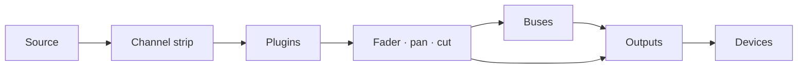

# Manuale d'uso di Patchbay Console

[English](../PATCHBAY-CONSOLE-MANUAL.md)

**Versione 0.1 · Windows 10 (2004) o successivo**

Patchbay Console è un router audio e mixer dal vivo per Windows, costruito attorno a una console di grande formato.
Prende il suono dalla tua interfaccia audio, dai tuoi dispositivi Windows e dai singoli programmi, lo fa
passare attraverso strip di canale, bus e uscite, e lo riproduce sui dispositivi che scegli: le tue
cuffie, i tuoi altoparlanti, uno streaming, un microfono virtuale per chiamate e giochi.

Questo manuale descrive tutto ciò che fa l'app, ti guida passo dopo passo nei lavori più comuni e
ti dice cosa fare quando qualcosa non va.

---

## Indice

1. [Prima di iniziare](#1-before-you-start)
2. [Prima configurazione](#2-first-time-setup)
3. [La finestra](#3-the-window)
4. [Come funziona l'instradamento](#4-how-routing-works)
5. [La console](#5-the-console)
6. [La strip di canale, sezione per sezione](#6-the-channel-strip-section-by-section)
7. [Strip raw: app, pad, tape e combinatori](#7-raw-strips-apps-pads-tape-and-combinators)
8. [Uscite](#8-outputs)
9. [Plugin](#9-plugins)
10. [La pagina Routing](#10-the-routing-page)
11. [Strumenti: Pads](#11-tools-pads)
12. [Strumenti: Tape, Recorder e Replay](#12-tools-tape-recorder-and-replay)
13. [Dispositivi](#13-devices)
14. [Scene, annulla e sessioni](#14-scenes-undo-and-sessions)
15. [Impostazioni](#15-settings)
16. [Controllo remoto, overlay, area di notifica e VR](#16-remote-control-overlay-tray-and-vr)
17. [Guide pratiche](#17-how-to-guides)
18. [Risoluzione dei problemi](#18-troubleshooting)
19. [Riferimento](#19-reference)

---

## 1. Prima di iniziare

### Cosa ti serve

| | |
|---|---|
| **Windows** | Windows 10 versione 2004 o successiva, oppure Windows 11. Per catturare l'audio di un singolo programma serve la versione 2004 o successiva |
| **Un'interfaccia audio** | Facoltativa. Con il suo driver ASIO installato, Patchbay Console funziona con il clock dell'interfaccia per avere il ritardo più basso. Senza, usa il tuo dispositivo di riproduzione di Windows o il suo clock integrato (vedi [Clock](#clocking)) |
| **Cuffie** | Collegate all'interfaccia (o a qualsiasi dispositivo di riproduzione di Windows) per sentire il tuo mix |
| **VB-CABLE** | Facoltativo e gratuito (vb-audio.com/Cable). Un microfono virtuale, così app come Discord, giochi e OBS possono sentire il tuo mix |
| **ffmpeg** | Facoltativo. Con `ffmpeg.exe` nel PATH, il registratore può scrivere anche MP3, AAC, Opus e ALAC |

### Termini usati in questo manuale

| Termine | Significato |
|---|---|
| **Canale** (ingresso) | Una sorgente sulla console: un microfono, un dispositivo, un programma, i pad, il tape |
| **Strip** | La colonna della console che controlla un canale, un bus o un'uscita |
| **Route** | Un collegamento che manda un canale o un bus da qualche parte: a un bus o a un'uscita |
| **Bus** | Un sottomix. Tutto ciò che vi è instradato viene sommato, elaborato insieme e instradato oltre |
| **Combinatore** | Un bus che divide il suo suono in percorsi paralleli, ognuno con i propri plugin, e poi li somma |
| **Uscita** | Un mix finale che suona su un dispositivo (le tue cuffie, gli altoparlanti, un cavo virtuale) |
| **Interfaccia** | La tua interfaccia audio ASIO, se ne hai una |
| **Clock** | Ciò con cui tutto va a tempo: la tua interfaccia, altrimenti il tuo dispositivo di riproduzione di Windows, altrimenti il clock integrato |

## 2. Prima configurazione

Questo capitolo ti porta dall'installer a una configurazione funzionante: il tuo microfono nelle
cuffie, le app che sentono il tuo microfono e il suono di un programma su un canale tutto suo.
Segui i passi in ordine. Ognuno richiede un minuto o due.

### Passo 1: Installa Patchbay Console

1. Avvia l'installer, `PatchbayConsole-<version>-Setup.exe`.
2. Windows SmartScreen può avvisarti di un'app non riconosciuta, perché l'installer non è firmato.
   Fai clic su **Ulteriori informazioni**, poi su **Esegui comunque**.
3. Accetta la licenza e consenti la richiesta di amministratore. Se vuoi un collegamento sul desktop,
   spunta la casella durante l'installazione (è disattivata per impostazione predefinita).
4. L'installer mette l'app in `C:\Program Files\Patchbay Console` e aggiunge **Patchbay Console**
   al menu Start. Tutto ciò che le serve è già incluso.
5. Nell'ultima pagina puoi avviare subito Patchbay Console. Se VB-CABLE non è installato, ti
   propone anche di aprire la sua pagina di download.

Il tuo mix e le tue impostazioni stanno in `%APPDATA%\PatchbayConsole`, separati dal programma.
Se disinstalli, restano dove sono.

### Passo 2: Installa VB-CABLE (facoltativo)

VB-CABLE ti dà un microfono virtuale che le altre app possono scegliere. Salta questo passo se vuoi
solo mixare per le tue cuffie.

1. Scarica VB-CABLE da vb-audio.com/Cable e avvia il suo installer come amministratore.
2. Riavvia Windows quando lo chiede.
3. Windows ora ha due nuovi dispositivi. **CABLE Input** è un dispositivo di riproduzione: tutto ciò
   che suona al suo interno esce da **CABLE Output**, un dispositivo di registrazione che le app
   possono scegliere come microfono.

> **Windows sposta il tuo audio sul cavo.** L'installazione di un cavo virtuale spesso lo rende il
> dispositivo predefinito di Windows: **CABLE Input** come altoparlanti e **CABLE Output** come
> microfono. Allora da Windows non senti nulla, e le app che usano il microfono predefinito sentono
> il cavo. Rimetti entrambi a posto subito dopo l'installazione.

**Rimetti a posto i tuoi dispositivi:**

1. Apri **Impostazioni > Sistema > Audio** (oppure fai clic con il tasto destro sull'icona
   dell'altoparlante nella barra delle applicazioni > **Impostazioni audio**).
2. In **Output**, scegli le tue cuffie o i tuoi altoparlanti (o le uscite della tua interfaccia),
   non **CABLE Input**.
3. In **Input**, scegli il tuo microfono vero, non **CABLE Output**.
4. Windows tiene un predefinito separato per le chiamate. Scorri fino a **Altre impostazioni
   audio**. Nella scheda **Riproduzione**, fai clic con il tasto destro su cuffie o altoparlanti >
   **Imposta come dispositivo di comunicazione predefinito**. Nella scheda **Registrazione**, fai lo
   stesso per il tuo microfono.

Un modo più rapido per impostare l'uscita: fai clic sull'icona dell'altoparlante nella barra delle
applicazioni, fai clic su **>** accanto al cursore del volume e scegli il tuo dispositivo.

Lascia i tuoi dispositivi veri come predefiniti di Windows. Patchbay Console suona nel cavo solo
dove lo instradi tu, e ogni app sceglie da sola **CABLE Output** come microfono (passo 6). Se
l'altoparlante predefinito di Windows è il cavo, PRE-FLIGHT lo segnala sotto **HEARD ONCE**.

### Passo 3: Avvia Patchbay Console

Apri il menu Start e fai clic su **Patchbay Console** (o usa il collegamento sul desktop, se
l'hai creato). La prima volta si apre su **SETUP**.

### Passo 4: Rispondi alle quattro domande di SETUP

SETUP ti fa quattro domande, una per pagina, e costruisce il tuo mix dalle risposte. Fai clic sulle
schede per scegliere. In ogni pagina tranne la terza puoi sceglierne più di una. **NEXT** va avanti,
**BACK** torna indietro.

1. **WHERE YOU LISTEN**: scegli le tue cuffie o i tuoi altoparlanti. Quello predefinito di Windows è già scelto.
2. **MICROPHONES**: scegli i microfoni in cui parli. Sono gli ingressi della tua interfaccia
   (**IN 1**, **IN 2** …) e i tuoi dispositivi di registrazione di Windows.
3. **APPS HEAR YOU**: scegli il cavo virtuale che le app usano come microfono (**CABLE Input**,
   dopo il passo 2), oppure **NOT NOW**.
4. **PROGRAMS**: scegli i programmi che stanno suonando adesso e che vuoi sulla console.
5. Fai clic su **BUILD THE MIX**. **DONE** elenca ciò che è stato creato.
6. Fai clic su **OPEN THE MIXER** per vederlo.

Cosa crea ogni risposta:

| Pagina | Cosa crea |
|---|---|
| **WHERE YOU LISTEN** | Un'uscita su ogni dispositivo. La prima si chiama **HEADPHONES**, le altre prendono il nome del loro dispositivo |
| **MICROPHONES** | Un canale per ciascuno, chiamato **MICROPHONE** (MICROPHONE 2 …) |
| **APPS HEAR YOU** | Un'uscita chiamata **MIC FOR APPS** sul cavo. Ogni microfono vi è instradato |
| **PROGRAMS** | Un canale raw per ciascuno, instradato dove ascolti, più una regola app che lo riporta da sola ogni volta che il programma suona |

I tuoi microfoni non sono instradati alle tue cuffie, così non senti un'eco ritardata della tua
voce. Per sentirti, accendi il tasto **HEADPHONES** del microfono (passo 6).

SETUP resta nella barra laterale. Eseguilo di nuovo ogni volta che aggiungi un dispositivo o un
programma. Aggiunge ciò che manca e non toglie mai nulla.

### Passo 5: Controlla che l'audio sia in funzione

Guarda la **spia di salute** in alto a destra.

- **Verde** con una percentuale: l'audio è in funzione. Vai al passo 6.
- **Rossa, con scritto OFF**: l'audio non è in funzione. Un altro programma potrebbe avere la tua
  interfaccia (una DAW, il pannello di controllo del driver). Chiudilo e riavvia Patchbay Console.
  Vedi [18.4](#184-the-interface-wont-start-or-stopped).

Fai clic sulla spia per aprire **DEVICES**. **STREAMS** mostra il clock in uso (ASIO, Windows o il
clock integrato; vedi [Clock](#clocking)), e **BUFFER** ne imposta la dimensione del buffer. La
dimensione più piccola che suona senza crepitii ti dà il ritardo minore. 256 o 512 campioni vanno
bene per la maggior parte dei sistemi.

### Passo 6: Ascoltati e fai sentire la tua voce alle app

Il Mixer si apre in **SIMPLE**. Ogni canale mostra il suo nome, cosa ascolta, un tasto per ogni
uscita, il suo fader e il suo meter, **CUT** e **SOLO**. Ogni uscita mostra il dispositivo su cui
suona, il suo fader e il suo meter.

| Tasto su un canale | Significa |
|---|---|
| Grigio semplice | Non instradato a quell'uscita |
| Pieno, del colore dell'uscita | Instradato lì. Fai clic per disattivarlo |
| Solo il bordo colorato, **VIA BUS** | Ci arriva attraverso un bus (impostato in PRO). Fai clic per instradarlo anche direttamente |

1. Parla e guarda muoversi il meter del tuo microfono.
2. Per sentirti, fai clic sul tasto **HEADPHONES** del microfono.
3. In Discord, nel tuo gioco, in OBS o in qualsiasi altra app, scegli **CABLE Output** come microfono.
4. Controlla cosa ricevono: **FIND** (Ctrl+K) > **HEAR WHAT THEY HEAR** registra 5 secondi di ciò
   che ricevono le app e te li riproduce.

Un programma continua a suonare anche sul proprio dispositivo. Se è il dispositivo su cui ascolti,
disattiva il tasto **HEADPHONES** del suo canale, altrimenti lo senti due volte (PRE-FLIGHT te lo
segnala).

**+ CHANNEL** e **+ APP** aggiungono canali. **+ OUTPUT** aggiunge un'uscita su un dispositivo che
non ne ha. Il tasto del dispositivo sotto il nome di un'uscita cambia dove suona. Fai clic con il
tasto destro su un nome per **Rename...**, il colore e **Remove**. Rimuovere il canale di un
programma rimuove anche la sua regola app, così il canale non torna da solo.

### Passo 7: PRO, per tutta la console

L'interruttore **SIMPLE / PRO** nella barra superiore mostra lo stesso mix in entrambi i modi. **PRO**
è tutta la console: ingresso, filtri, dinamica ed EQ di ogni canale, bus e combinatori, plugin.

Per modellare il tuo microfono in PRO:

1. Alza **hp** attorno a 80–100 Hz per togliere il rumble.
2. Inserisci **DYNAMICS** (l'interruttore con il simbolo di accensione) e imposta gate e compressore.
3. Imposta l'**EQ**.

Vedi [6](#6-the-channel-strip-section-by-section). Le impostazioni che fai in PRO continuano a
funzionare in SIMPLE.

### Passo 8: Esegui PRE-FLIGHT

Pochi secondi dopo l'avvio, **PRE-FLIGHT** controlla la configurazione e si apre solo se qualcosa
richiede attenzione (non al primissimo avvio, quando viene prima SETUP). Eseguilo quando vuoi da
**SETTINGS > GENERAL > PRE-FLIGHT NOW...** o da **FIND** (Ctrl+K). Ogni riga dovrebbe essere verde.
Vedi [18.1](#181-pre-flight).

### Passo 9: Fine

- **Il tuo mix si salva da solo** entro un secondo da ogni modifica. Per tenere una versione con un
  nome, usa **SETTINGS > GENERAL > SAVE SESSION AS...**.
- **Avvio con Windows**: **SETTINGS > GENERAL > WINDOWS** avvia Patchbay Console nell'area di
  notifica quando accedi, così il tuo microfono funziona fin dall'inizio.
- **Chiudere la finestra non ferma l'audio.** Patchbay Console resta in funzione nell'area di
  notifica del sistema, così microfono e cuffie continuano a funzionare. Per fermarlo, fai clic con
  il tasto destro sull'icona nell'area di notifica e scegli **Quit Patchbay Console**. Avviare il
  programma mentre è nell'area di notifica riporta la finestra.

La prima volta che si apre ogni pagina, un breve suggerimento la spiega. Disattiva i suggerimenti
in **SETTINGS > GENERAL > ON START**.

La configurazione è finita. Il resto del manuale tratta ogni parte nel dettaglio.

## 3. La finestra

### La barra laterale

Le pagine sono schede lungo il lato sinistro: **MIXER**, **ROUTING**, **SETUP**, **TOOLS**,
**DEVICES**, **SETTINGS**. La pagina visualizzata ha un bordo blu acceso. Mentre è visibile il
Mixer, la barra laterale ha anche queste schede (in SIMPLE, solo **ADD CHANNEL** e **ADD APP**):

| Gruppo | Scheda | Cosa fa |
|---|---|---|
| **DESK** | **ADD CHANNEL** | Apre il menu degli ingressi: ingressi dell'interfaccia, dispositivi Windows, app, finestre di programmi e schede del browser, pad, tape |
| | **ADD APP** | Elenca i programmi che stanno suonando adesso. Sceglierne uno gli dà un canale |
| | **ADD BUS** | Un bus, o un combinatore (due percorsi per cominciare) |
| | **PLUGINS** | Fa salire il pannello dei plugin sotto le strip (vedi [9](#9-plugins)) |
| **SELECT** | **AUTO** | Toccare un controllo qualsiasi di una strip seleziona quella strip |
| | **FOLLOW** | La console scorre fino alla strip selezionata, anche quando viene scelta altrove (FIND, un tasto rapido) |
| **METER** | **IN** / **OUT** | I meter dei canali mostrano il segnale in entrata (prima dell'elaborazione) o in uscita |
| **SECTIONS** | HEADER … FADER | Le sezioni della strip. Quelle accese sono sullo schermo. Fai clic su una per scorrere fino a lei |

Le scelte di SELECT e METER vengono ricordate.

Sopra le strip ci sono il display del tempo, il trasporto del deck Tape (indietro, stop, play /
pausa, avanti, registra, loop) e l'interruttore **SIMPLE / PRO** (vedi [Passo 7](#step-7-pro-for-the-whole-console)).

### La barra superiore

Da destra:

| Controllo | Cosa fa |
|---|---|
| **+ 100% -** | Zoom. Passa tra 100, 125 e 150%. Fai clic sulla percentuale per tornare a 100%. Ctrl + / Ctrl - / Ctrl 0 fanno lo stesso |
| **FIND** (Ctrl+K) | Cerca per nome in ogni pagina, canale, scena, macro, pad e comando |
| **HISTORY** (Ctrl+H) | Ogni modifica che hai fatto. Sceglierne una ti riporta a quel punto |
| **MINI** | Una piccola finestra mixer sempre in primo piano |
| **Spia di salute** | Verde: l'audio va bene. Ambra: il carico audio è alto o un dispositivo è rimasto a corto da poco. Rossa: un glitch udibile negli ultimi 10 secondi, oppure nessun audio in funzione. Il numero è il carico audio. Fai clic per aprire DEVICES |
| **SCENES** | I tuoi mix memorizzati. **+** ne memorizza uno nuovo (vedi [14.1](#141-scenes)) |

In una finestra stretta se ne va prima la spia di salute, poi MINI, poi HISTORY. FIND le raggiunge tutte.

### Il trasporto

Sotto la barra superiore, in ogni vista del Mixer, trovi il tempo del deck Tape (trascorso e
durata del brano), il nome del brano e i suoi tasti: **rewind 10 s**, **stop**, **play/pause**,
**forward 10 s**, **record**, **loop**.

- **Record** registra la prima uscita in un file (nel formato e nella cartella del Recorder). Premi di nuovo per fermare.
- **Loop** passa da **repeat all** → **repeat one** (segnato **1**) → **off**.

---

## 4. Come funziona l'instradamento

L'instradamento decide dove va ogni suono. Non si sente nulla finché non è instradato, e qualsiasi
cosa può essere instradata in tutti i posti che vuoi.

### Il percorso di un suono

1. **Un canale** prende una sorgente e la fa passare nella sua strip (ingresso, filtri, dinamica
   ed EQ, nell'ordine mostrato dal suo header), poi nei suoi plugin, poi nel suo fader, pan e cut.
2. **Le route** mandano il canale oltre, a tutti i bus e le uscite che vuoi insieme (fino a 8 di
   ciascuno). Ogni route porta il canale dopo il suo fader, quindi il fader e **CUT** influiscono
   ovunque sia instradato.
3. **Un bus** somma tutto ciò che vi è instradato, fa passare il risultato nella propria strip e nei
   propri plugin, e viene instradato alle uscite (o in altri bus) nello stesso modo.
4. **Un'uscita** somma tutto ciò che vi è instradato, applica il suo compressore di bus, l'EQ del
   mix e il limiter **SAFE**, e suona sul suo dispositivo.

### Le uscite sono dispositivi

Ogni uscita suona su un dispositivo: le uscite della tua interfaccia, una cuffia USB, altoparlanti,
**CABLE Input**. Non crei le uscite a mano. Instrada qualcosa a un dispositivo e su di esso viene
creata un'uscita. Per questo le caselle di instradamento elencano sia i dispositivi sia i bus.

- C'è un'uscita per dispositivo. Instrada più canali allo stesso dispositivo e si incontrano nella
  sua uscita.
- Uscite diverse portano mix diversi. Le tue cuffie possono sentire gioco, musica e voce mentre
  l'uscita dello stream riceve solo musica e voce.
- Scollega un dispositivo e la sua uscita tace finché il dispositivo non torna.

### Tre posti da cui instradare

Tutti e tre cambiano le stesse route. Usa quello che hai più a portata di mano.

| Dove | Come |
|---|---|
| **Caselle di instradamento** (header di ogni strip) | Una casella per ogni bus e dispositivo di uscita. Accesa: instradato lì. Fai clic per cambiare |
| **Route to** (clic destro su una strip) | Lo stesso elenco come menu, con la spunta dove è instradato |
| **La pagina Routing** | Ogni strip come blocco, ogni route come linea. Fai clic su un blocco, poi su un altro (vedi [10](#10-the-routing-page)) |

### Bus

Usa un bus quando più canali hanno bisogno dello stesso trattamento o di un solo fader. Instrada i
canali al bus e il bus all'uscita. Poi togli le route dirette dei canali verso quell'uscita, o ci
arrivano due volte (una diretta, una attraverso il bus). Un bus può alimentare un altro bus, e questo
non aggiunge ritardo.

### Combinatori

Un combinatore è un bus diviso in **percorsi** paralleli (due per cominciare). Ogni percorso ha i
propri plugin, e i percorsi vengono sommati al fader del combinatore. Instrada una sorgente in un
percorso o in più. La strip del combinatore mostra quali sorgenti alimentano ogni percorso.

### Regole che mantengono tutto sicuro

- **I loop di feedback vengono rifiutati.** Una route che riporterebbe un suono al punto da cui è
  venuto (un bus in un bus che lo alimenta, il suono di un'uscita rimandato al suo stesso ingresso)
  viene subito disattivata, e il log degli eventi nomina il loop.
- **Solo** su una strip silenzia ogni strip che non è in solo, tranne quelle segnate solo safe.
- **Una strip spenta** non lascia passare nulla, ovunque sia instradata.
- **Canali app e raddoppio.** Un programma suona sul proprio dispositivo oltre che nel suo canale.
  Non instradare il suo canale a un'uscita sul dispositivo su cui già lo senti.

### Clock

Un dispositivo imposta il clock. Patchbay Console lo sceglie in questo ordine all'avvio:

1. **ASIO**: la tua interfaccia audio, tramite il suo driver ASIO. Il ritardo più basso.
2. **Windows**: senza driver ASIO, il tuo dispositivo di riproduzione predefinito di Windows (un
   cavo virtuale, gli altoparlanti di uno schermo o un visore VR solo quando non c'è altro). Le
   uscite della tua interfaccia diventano uscite di quel dispositivo, e i microfoni vengono aggiunti
   come dispositivi Windows.
3. **Clock integrato**: senza alcun dispositivo di riproduzione. Ogni dispositivo, comprese le tue
   cuffie, lo segue.

Ogni altro dispositivo e ogni programma catturato va con il proprio clock e si unisce attraverso un
piccolo buffer che corregge la deriva, così i clock che si allontanano non fanno mai click.
**DEVICES > STREAMS** mostra ciascuno, e il clock in uso.

Se il dispositivo Windows che imposta il clock viene scollegato, spento o smette di funzionare, il
clock successivo subentra da solo e un avviso ti dice quale. Un dispositivo che non parte (perché un
altro programma lo tiene) viene saltato finché i tuoi dispositivi non cambiano, poi ritentato. Con il
clock integrato, un dispositivo di riproduzione che viene collegato ne prende il posto.

## 5. La console

### Disposizione

La console mostra tutte le strip da sinistra a destra: **canali**, poi **bus** (barra del nome
viola), poi **uscite** (barra del nome ambra). Ogni strip ha sette sezioni, dall'alto in basso:

| Sezione | Contiene |
|---|---|
| **HEADER** | Barre di livello, i tasti FILT / EQ / EXT, l'ordine di elaborazione, le caselle di instradamento, il numero della strip |
| **INPUT** | Trim, polarità (e sulla Dark strip, drive del microfono e interruttore d'ingresso) |
| **DYNAMICS** | Compressore e gate |
| **FILTERS** | Passa-basso e passa-alto |
| **EQ** | Quattro bande |
| **NAME** | La barra del nome e l'interruttore di accensione |
| **FADER** | Pan, SOLO, CUT, SEL, il fader e la sua lettura |

### Mouse e tastiera

| Azione | Risultato |
|---|---|
| **Trascina** una manopola o un fader su/giù | La cambia. Il suo valore compare accanto mentre trascini o passi sopra |
| **Doppio clic** su una manopola o un fader | Torna al valore predefinito |
| **Clic** su un tasto o un interruttore | Acceso / spento |
| **Clic** sulla barra del nome | Seleziona la strip |
| **Trascina** di lato la barra del nome di una strip | La sposta tra quelle del suo tipo: canali, bus o uscite (vedi [17.4](#174-reorder-channels)) |
| **Clic** sul simbolo di accensione sulla barra del nome | Spegne o accende la strip |
| **Clic destro** su una strip | Il menu della strip |
| **Rotellina del mouse** | Fa scorrere la console di lato. **Shift + rotellina** scorre su e giù |
| **Ctrl + / Ctrl -** | Zoom di tutta la finestra |

Un clic sinistro non apre mai un menu. I menu stanno sempre sul tasto destro.

### Selezionare una strip

La strip selezionata è contornata di blu. Selezioni una strip facendo clic sulla sua barra del nome
o sul suo tasto **SEL**, oppure toccando uno qualsiasi dei suoi controlli con **AUTO** attivo. La
strip selezionata è quella che mostra il pannello dei plugin, e quella su cui agiscono FIND, i tasti
rapidi e i controlli remoti.

Con la console in primo piano (fai prima clic su di essa): **Left / Right** selezionano la
strip precedente / successiva, **M** la mette in cut, **S** la mette in solo, e **Up / Down** muovono
il suo fader di 0,5 dB (3 dB con **Shift**).

### Spegnere una strip

Fai clic sul simbolo di accensione a sinistra della barra del nome. La strip sfuma e diventa grigia.
Non viene elaborata, e il suo dispositivo o programma viene rilasciato. Finché è spenta, **su di
essa non si può cambiare nulla**: manopole, tasti e pannello dei plugin ignorano i clic, e il suo
menu offre solo **Turn on** e gli spacer. Fai di nuovo clic sul simbolo di accensione per riaccenderla.

### Tipi di strip

Ogni canale può usare la **Light strip** o la **Dark strip**: clic destro > **Strip type** >
**Light strip** / **Dark strip**. Gli ingressi dell'interfaccia, i dispositivi di registrazione
(microfoni) e i bus partono scuri. Tutto il resto parte chiaro. La Dark strip aggiunge il **drive**
del microfono e l'interruttore d'ingresso, e toglie l'attacco veloce del compressore e l'hold del
gate. La tua scelta viene ricordata per ogni canale.

### Spacer

Gli spacer sono strip vuote che ti danno spazio tra i gruppi. Clic destro su una strip > **Add
spacer before** / **Add spacer after**. Clic destro su uno spacer per **Narrow**, **Add another** e
**Remove spacer**. Uno spacer resta con la strip che segue quando quella strip si sposta.

### Il menu della strip (clic destro)

| Voce | |
|---|---|
| **Input** | Cambia la sorgente: ingressi **Interface**, **Windows devices** (o predefinito di Windows), **What an output plays** (loopback), **Test tone**, **Nothing** |
| **Route to** | Ogni bus e dispositivo di uscita, con la spunta dove viene mandato |
| **Plugins** | Aprine uno, **Add plugin...**, **Remove** |
| **Make mono / Make stereo** | Solo canali |
| **Strip type** | **Light strip** o **Dark strip** |
| **Colour** | Il colore del canale, mostrato lungo la sua barra del nome e sul suo blocco in Routing |
| **Add spacer before / after** | |
| **Rename...** | |
| **Remove** | Elimina il canale o il bus |

---

## 6. La strip di canale, sezione per sezione

### HEADER

| Controllo | Cosa fa |
|---|---|
| **Barre di livello** | Il livello del canale, sinistra e destra (IN o OUT, come scelto in METER) |
| **FILT** | Manda i filtri al detector del gate/compressore (key filtering) |
| **EQ** | EQ inserito o escluso |
| **EXT** | La dinamica ascolta una key esterna (sidechain) invece del canale stesso |
| **Ordine di elaborazione** | Tre blocchi (FILT, EQ, DYN), dall'alto in basso nell'ordine in cui il canale li esegue. **Fai clic su un blocco** per spostarlo su di uno. Quello in cima va in fondo. I blocchi accesi sono in uso |
| **Caselle di instradamento** | Una casella per ogni bus e dispositivo di uscita. Accesa: il canale viene mandato lì. Fai clic per cambiare. Mandare a un dispositivo che non ha ancora un'uscita ne crea l'uscita |
| **Numero** | Il posto della strip sulla console |

### INPUT

| Controllo | |
|---|---|
| **in trim** | Guadagno d'ingresso |
| **ø** | Inversione di polarità |
| **WIDTH** (Light strip) | Larghezza stereo: 0 % mono, 100 % così com'è, 200 % il doppio più larga. Attenuata su un canale mono |
| **mic** (Dark strip) | Drive: aggiunge calore e livello (mostrato in percentuale) |
| **pre** (Dark strip) | Lo stadio d'ingresso inserito o escluso |

### DYNAMICS

L'interruttore **IN** (con il simbolo di accensione) inserisce o esclude insieme compressore e gate.

**Compressore**

| Controllo | |
|---|---|
| **MIX** | Miscela wet/dry (compressione parallela). Trascina la lettura verde |
| **ratio**, **thresh**, **rel** | Rapporto, soglia e rilascio |
| **fast** | Attacco veloce (3 ms). Spento è 10 ms |
| **pk** | Rilevamento dei picchi. Acceso (predefinito), il compressore reagisce ai picchi. Spento, reagisce al livello medio (RMS), che è più morbido |
| **LED di riduzione del guadagno** | 3, 6, 10, 14 e 20 dB di riduzione |

**Gate / expander**

| Controllo | |
|---|---|
| **range**, **thresh**, **rel**, **hold** | Quanto si chiude, dove si apre, quanto velocemente si chiude, quanto resta aperto |
| **exp** | Modalità expander (un gate più delicato) |
| **fast** | Attacco veloce (0,1 ms). Spento è 1,5 ms |
| **LED del gate** | Quanto si sta chiudendo il gate |

I LED mostrano cosa *farebbero* compressore e gate anche quando sono esclusi, così puoi impostarli
prima di inserirli.

### FILTERS

**lp** (passa-basso) e **hp** (passa-alto). Girato tutto giù, il passa-alto è escluso. Girato tutto
su, il passa-basso è escluso.

### EQ

| Banda | Controlli |
|---|---|
| **HF** | gain, freq, **bell** (shelf quando è spento) |
| **HMF** | gain, freq, q |
| **LMF** | gain, freq, q |
| **LF** | gain, freq, **bell** (shelf quando è spento) |

L'interruttore **EQ IN** inserisce o esclude tutto l'EQ (come il tasto EQ dell'header).

### FADER

| Controllo | |
|---|---|
| **PAN** | Sinistra/destra. Doppio clic per centrare |
| **SOLO** | Solo sul posto |
| **CUT** | Mute |
| **SEL** | Seleziona questa strip |
| **Fader** | Livello, da +12 dB a spento. La lettura sotto mostra il livello in dB |
| **safe** | Solo safe: questo canale resta udibile quando altri sono in solo |
| **listen** | Ascolta il segnale key della dinamica |

---

## 7. Strip raw: app, pad, tape e combinatori

Alcuni canali portano un suono già finito: l'audio di un programma, i pad, il tape. Ricevono una
**strip raw**, con instradamento, plugin se li vuoi, pan, fader e tasti, e senza effetti integrati.
Quando una compare sulla console, i suoi effetti integrati vengono esclusi una volta (e annotati nel
log degli eventi). I suoi plugin restano.

| Strip | Le sue sezioni centrali contengono |
|---|---|
| **App** | L'elenco dei plugin (fai clic su uno per aprirlo) e **ADD PLUGIN** |
| **Pads** | I tasti banco **A–D**, i pad 4×4 (premi per suonare; un pad GATE suona finché è premuto) e **STOP ALL** |
| **Tape** | Lo schermo del deck e la barra di ricerca, il trasporto (precedente, rewind, stop, play, pausa, avanti, successivo), **SHUFFLE**, **ADD...** e la playlist (fai clic su un brano per riprodurlo) |
| **Combinatore** | Per ogni percorso: **FROM**, i canali e i bus che lo alimentano (fai clic su uno per andare alla sua strip), e **PLUGINS** su quel percorso (fai clic su uno per aprirlo). **EDIT IN ROUTING** apre la pagina Routing |

Un combinatore non ha effetti propri. Il suo suono viene da ciò che lo alimenta e dai plugin di ogni
percorso. Clic destro > **Paths** per aggiungere un percorso e, per ogni percorso, aprirne, aggiungerne
o rimuoverne i plugin, rinominarlo o rimuoverlo.

---

## 8. Uscite

Ogni uscita (master) ha una propria strip scura:

| Controllo | |
|---|---|
| **DEVICE** | Il dispositivo su cui suona. Fai clic per sceglierne un altro |
| **SAFE** | Un limiter dopo il fader: nulla esce sopra -1 dBFS |
| **MON** | Monitora questa uscita |
| **LUFS** | Loudness a breve termine di ciò che esce ("-- LUFS" quando c'è silenzio) |
| **WIDTH** | Larghezza stereo |
| **BUS COMP** | Interruttore In, il misuratore di riduzione del guadagno in stile VU, **threshold**, **ratio**, **attack**, **release**, **make-up**, **mix** |
| **MIX EQ** | Interruttore In, guadagno e freq HF, guadagno e freq LF |
| **CUT**, **SEL**, fader | Come su un canale |

Clic destro su un'uscita per **Device...**, spacer, **Rename...** e **Remove**.

**Le uscite si creano da sole.** Manda un canale a un dispositivo (con una casella di instradamento,
la pagina Routing o **Route to**) e, se non ce n'è una, su quel dispositivo viene creata un'uscita.

**Un dispositivo mancante.** Se il dispositivo di un'uscita viene scollegato, quell'uscita tace
finché il dispositivo non torna. Niente si sposta da solo su un altro dispositivo.

**FIND > MIX-MINUS AND STEMS** costruisce un feed per ogni ospite (tutto tranne la sua voce) e stem
di voce, musica e gioco.

---

## 9. Plugin

Patchbay Console ospita plugin **VST3** su canali, bus e percorsi dei combinatori, con compensazione
automatica della latenza.

### Aggiungere un plugin

- Su un canale: clic destro > **Plugins > Add plugin...**, oppure **ADD PLUGIN** su una strip raw,
  oppure **ADD** nel pannello dei plugin.
- Su un percorso di combinatore: clic destro sul combinatore > **Paths > PATH n > Add plugin...**.
  Fai clic sul plugin di un percorso sulla strip del combinatore per aprirlo.

Ogni plugin viene **prima provato in una copia separata del programma**, così un plugin che va in
crash o si blocca durante il caricamento non può far cadere il tuo mix. Il risultato viene ricordato
finché il file del plugin non cambia.

### Il pannello dei plugin

Fai clic su **PLUGINS** nella barra laterale. Un pannello sale sotto le strip con i plugin della
**strip selezionata** nell'ordine in cui vengono eseguiti. **FIND** > **PLUGINS: name** lo apre su
quella strip e passa a PRO se è visibile SIMPLE. Ogni scheda mostra:

- **CPU**: la quota del tempo di elaborazione usata dal plugin (verde, ambra oltre il 2 %, rosso oltre il 5 %)
- **Latency**: il ritardo che aggiunge
- **BYPASSED**: spento ma ancora caricato (usa ancora memoria)
- **HEAVY**: insolitamente costoso

Tasti su ogni scheda: **BYPASS**, **OPEN** (la sua finestra), **REMOVE**, e frecce per spostarlo prima
o dopo. **ADD** in fondo ne aggiunge un altro. Non si può cambiare nulla mentre la strip è spenta.

---

## 10. La pagina Routing

La pagina Routing mostra tutto il mix come una mappa: ogni strip è un blocco e ogni route è una
linea. Usala per vedere dove va tutto e per instradare facendo clic su due blocchi.

### Leggere la pagina

- **Tre righe:** **INPUTS** in alto, **BUSES** al centro, **OUTPUTS** in basso. I dispositivi di
  uscita che non hanno ancora un'uscita stanno all'estremità destra della riga OUTPUTS, in grigio.
- **Ogni blocco sta sotto la sua strip.** Un blocco si trova nella stessa posizione orizzontale
  della sua strip sulla console, spacer compresi, e la pagina scorre di lato insieme alla console
  (rotellina del mouse). Riordina la console e la mappa segue.
- **Ogni blocco mostra** il nome e il numero della strip. Una strip spenta è attenuata. Un canale con
  un colore proprio lo mostra come tinta e come banda a sinistra.
- **Le linee sono route.** Ognuna scende dritta dalla sua sorgente in una corsia tutta sua nello
  spazio sotto la sua riga, attraversa, e scende nel blocco che alimenta, finendo in una freccia. Le
  route degli ingressi sono turchesi, quelle dei bus viola. Più linee che escono o arrivano a un
  blocco sono distribuite lungo di esso in ordine, così non si sovrappongono mai.
- **I combinatori** mostrano i loro percorsi come celle **P1, P2, …** lungo il fondo del blocco. Le
  linee finiscono nel percorso che alimentano.

### Instradare da blocco a blocco

1. **Fai clic su un blocco.** Si accende di blu e pulsa. I blocchi a cui è instradato, o da cui
   riceve, hanno il bordo evidenziato, le loro linee si illuminano e tutto il resto si attenua.
2. **Fai clic su un altro blocco.** La route tra i due si attiva (compare una linea) o si disattiva
   (la linea sparisce). Va bene in entrambi gli ordini: sorgente poi destinazione, o destinazione
   poi sorgente.
3. Il primo blocco **resta selezionato**, quindi continua a fare clic per instradarlo in più posti,
   o per togliere più route.
4. **Fai di nuovo clic su di esso**, fai clic nello spazio vuoto o premi **Esc** per rilasciarlo.

Se i due blocchi non possono essere instradati (due uscite, per esempio), viene selezionato il secondo.

### Esempi

| Per | Fai clic su |
|---|---|
| Sentire il tuo microfono | MIC, poi l'uscita delle cuffie |
| Far sentire il tuo microfono alle app | MIC, poi **CABLE Input** (nella riga delle uscite, grigio finché non ha un'uscita) |
| Mandare un gruppo attraverso un bus | Il bus, poi ogni canale; poi il bus, poi la sua uscita |
| Togliere un canale dallo stream | Il canale, poi l'uscita dello stream (la linea sparisce) |
| Alimentare un percorso di combinatore | La sorgente, poi la cella del percorso (P1, P2…) |

Fare clic su un blocco di dispositivo grigio ne crea l'uscita, e la nuova uscita compare subito sulla console.

### Combinatori

Fai clic sulla sorgente, poi sulla **cella del percorso**. Una sorgente può alimentare più percorsi:
fai clic su ogni cella a turno. Fare clic sul combinatore fuori dalle sue celle instrada nel suo
primo percorso. Per aggiungere percorsi o i loro plugin, fai clic destro sul combinatore sulla
console > **Paths**.

### Spostare i canali

Trascina un blocco di lato lungo la sua riga. Una barra blu mostra dove atterra, e la console si
adegua. I canali si spostano tra i canali, i bus tra i bus, le uscite tra le uscite.

### Quando una route non resta attiva

La route creerebbe un loop di feedback, quindi viene subito disattivata. Il log degli eventi nomina
il loop. Rimuovi la route che torna indietro. Vedi [18.8](#188-a-route-wont-switch-on).

## 11. Strumenti: Pads

**TOOLS > PADS** ti dà quattro banchi (**A–D**) di 16 pad: 64 suoni, fino a 32 in riproduzione insieme.

### Far uscire il suono

I pad suonano in un **canale PADS**. Fai clic su **CREATE PADS CHANNEL** (poi diventa **PADS CHANNEL
ACTIVE**), oppure scegli un altro ingresso nel menu **PLAY INTO** per far suonare i pad attraverso i
plugin e le route di quel canale. Senza un canale pad, le pressioni vengono ignorate.

### Caricare e suonare

| Azione | |
|---|---|
| Clic su un pad **vuoto** | Scegli un file audio |
| Clic su un pad caricato | Lo riproduce |
| Clic destro su un pad | Lo seleziona per modificarlo senza riprodurlo |
| Trascina file su un pad | Li carica in quel pad e nei successivi del banco |
| **Ctrl + trascina** su un altro pad | Scambia i due pad |
| **STOP ALL** | Dissolve tutti i pad |

Formati: WAV, FLAC, AIFF, OGG, MP3. Un pad il cui file è stato spostato mostra **MISSING: FILE**.

### L'editor dei pad

| Impostazione | |
|---|---|
| Nome | Doppio clic per rinominare |
| **LOAD**, **CLEAR**, **COLOUR** | |
| **REPLAY** | Il buffer di instant replay diventa il suono di questo pad (salvato come WAV nella cartella delle registrazioni). Attiva prima il replay in TOOLS > TAPE |
| **MODE** | **ONE-SHOT** suona fino alla fine (premere di nuovo riavvia). **GATE** suona finché è premuto. **LOOP** parte con una pressione e si ferma alla successiva |
| **CHOKE** | OFF o gruppo 1–8. I pad dello stesso gruppo si fermano a vicenda |
| **LEVEL** | Da -INF a +12 dB |
| **HOTKEY** | Fai clic (**LEARN...**), poi premi i tasti. Deve includere Ctrl, Alt o un tasto F. Funziona mentre altri programmi hanno il focus. Esc annulla, Delete cancella |
| **MACRO** | Una macro da eseguire con il pad (un pad può avere una macro e nessun suono) |
| **TRIM** | Trascina le linee di inizio e fine sulla forma d'onda. Doppio clic per tutto il file |
| **FADE IN / FADE OUT** | 0–5 s |

---

## 12. Strumenti: Tape, Recorder e Replay

### Il deck Tape

**TOOLS > TAPE** riproduce una playlist in un **canale TAPE**. Fai clic su **CREATE TAPE CHANNEL** per crearne uno.

- **ADD FILES**, **ADD FOLDER**, oppure trascina file e cartelle ovunque nella pagina. **EJECT**
  svuota la playlist.
- Doppio clic su un brano per riprodurlo, trascinane uno per riordinare e premi Delete per rimuovere i
  brani selezionati.
- Trasporto: **PREV**, **REW** (indietro di 10 s; tieni premuto per riavvolgere veloce), **PLAY**,
  **PAUSE**, **STOP**, **FF** (avanti di 10 s; tieni premuto per avanzare veloce), **NEXT**. Inoltre
  **SHUFFLE**, **REPEAT** (all / one / off) e **LEVEL**.
- I brani si riproducono senza pause. Pause e salti sfumano in 30 ms così non fanno mai click.

Il trasporto della barra superiore e la strip tape sulla console controllano lo stesso deck.

### Il registratore

| | |
|---|---|
| **Source** | Qualsiasi uscita, bus o ingresso, oppure **ALL CHANNELS, ONE FILE EACH** (multitraccia: ogni ingresso, o solo quelli con DIRECT acceso, più ogni uscita, allineati al campione) |
| **Format** | WAV 24 bit (predefinito), 16 bit, 32 bit, 32 bit float; FLAC 24/16 bit; AIFF 24/16 bit; OGG Vorbis 128–320k. Con ffmpeg: MP3, AAC (M4A), Opus, ALAC. Ognuno mostra quanto tempo sta nel disco |
| **REC** | Avvia e ferma. Lo schermo mostra tempo, dimensione, tempo rimanente ed eventuali blocchi persi |
| **PATH** / **REVEAL** | Scegli la cartella / aprila in Esplora file |

Le registrazioni vanno in `Music\Patchbay Console Recordings` a meno che tu non scelga una cartella.
I formati ffmpeg registrano prima un WAV e lo convertono quando fermi (il WAV viene conservato se la
conversione fallisce). La registrazione si ferma da sola quando resta meno di 1 GB libero.

### Instant replay

**ARM** conserva gli ultimi **30 s**, **1**, **2** o **5 minuti** della sorgente del registratore.
**SAVE** li scrive in un file (clic destro su SAVE per dargli un tasto rapido globale). Con la
multitraccia scelta, il replay usa la prima uscita.

---

## 13. Dispositivi

**DEVICES** elenca ogni dispositivo audio di Windows e ogni driver ASIO.

| Colonna | |
|---|---|
| **I/O** | ASIO, OUT o IN |
| **DEVICE**, **HARDWARE** | Il suo nome e l'adattatore a cui è collegato |
| **FORMAT** | Canali e frequenza di campionamento |
| **STATE** | Attivo, scollegato, disattivato, oppure **off in Patchbay Console** |
| **TAGS** | DEFAULT e CALLS per i dispositivi predefiniti di Windows |

Fai clic su un'intestazione per ordinare. Seleziona i dispositivi (Ctrl/Shift per più di uno), poi usa:

| Tasto | |
|---|---|
| **EXCLUDE / INCLUDE** | Patchbay Console smette di usare il dispositivo (o riprende). I dispositivi esclusi non vengono mai aperti e sono tolti dagli elenchi |
| **DISABLE / ENABLE IN WINDOWS** | Spegne o accende il dispositivo in Windows stesso |
| **RENAME** | Un nome tuo per il dispositivo, usato ovunque in Patchbay Console (o doppio clic su una riga) |

### Streams

Sotto l'elenco, **STREAMS** mostra lo stato di salute del motore audio:

- **CALLBACK LOAD** (e picco), **OVERLOADS**, **BLOCKS SKIPPED**. Prendono un colore di avviso se ne è successo qualcuno
- **BUFFER**: la dimensione del buffer della tua interfaccia (più piccolo significa meno ritardo e più carico)
- Per dispositivo: audio nel buffer, latenza totale, **DRIFT** (la correzione del clock in ppm), **UNDER**
  (a secco, è stato riprodotto silenzio), **OVER** (traboccato, audio scartato), **RESYNC** (ricentrato). Una riga
  che ha perso audio diventa rossa
- **RESET STATS** azzera i contatori

### VB-CABLE

Se VB-CABLE è installato, una barra in alto imposta la sua **frequenza di campionamento** e la
**latenza massima**. **APPLY** chiede una richiesta di amministratore e riavvia il cavo.

Il log degli eventi in basso registra ogni dispositivo collegato, rimosso o recuperato.

---

## 14. Scene, annulla e sessioni

### 14.1 Scene

Una scena memorizza fader, pan, cut, solo, accensione e route di ogni canale (e, se vuoi, le
impostazioni dei plugin).

- **Memorizza:** fai clic su **+** nella barra superiore e dagli un nome.
- **Richiama:** fai clic sul suo tasto. Fader e pan scorrono in mezzo secondo. Il resto cambia subito.
- **Clic destro su una scena** per: richiamare solo i mute / solo i livelli, memorizzare su di essa,
  includere le impostazioni dei plugin, rinominare, un tasto rapido globale, **Recall on device**
  (quando compare un dispositivo; indietro quando se ne va), **Auto-scene** (quando un'app inizia a
  suonare, si collega un dispositivo, o a una certa ora del giorno), MIDI learn, sposta, elimina.

I dispositivi e i canali stessi non fanno parte di una scena.

### 14.2 Annulla e cronologia

**Ctrl+Z** annulla, **Ctrl+Y** (o Ctrl+Shift+Z) ripristina. **HISTORY** (Ctrl+H) elenca ogni modifica.
Sceglierne una ti riporta a quel punto.

### 14.3 Sessioni

Il tuo mix si salva da solo entro un secondo da ogni modifica, e all'uscita.

| | |
|---|---|
| **Restore session** | Menu dell'area di notifica: versioni precedenti del tuo mix per data (Patchbay Console si riavvia con quella) |
| **SESSION TIMELINE** | FIND: ogni versione conservata. **Restore everything**, oppure **PUT ONE CHANNEL BACK** (livello, pan, mute e rack) senza riavviare |
| **SAVE SESSION AS...** | SETTINGS > GENERAL > SESSIONS: conserva il mix con un nome |
| **OPEN, EXPORT OR IMPORT...** | Apri un mix con nome (riavvia), salva il mix in un file, o caricane uno da un file |

Vengono conservate fino a 60 versioni precedenti (al massimo una ogni 5 minuti). Se il tuo mix non
può essere caricato (manca l'interfaccia, il file è danneggiato), viene **messo da parte** invece
che perso, e parte un mix nuovo. Vedi [18.2](#182-my-mix-is-gone-a-fresh-mix-started).

---

## 15. Impostazioni

**SETTINGS** ha quattro sezioni, come schede lungo il lato sinistro: **GENERAL**, **MACROS**,
**HOTKEYS**, **CONTROL**. Le impostazioni sì/no sono interruttori quadrati che si illuminano di
crema quando sono accesi.

### GENERAL

| Scheda | Impostazioni |
|---|---|
| **WINDOWS** | **START WITH WINDOWS**: si apre nell'area di notifica quando accedi |
| **DESK** | **WARN IF I TALK WHILE MUTED** (un avviso quando un microfono in mute è sopra -30 dBFS). Selezionare una strip quando viene toccata è **SELECT > AUTO** nella barra laterale |
| **APPS** | **APP RULES...**: a quale bus o uscita va un programma quando inizia a suonare (anche in **FIND**). Rimuovere il canale di un programma ne rimuove la regola |
| **SESSIONS** | **SAVE SESSION AS...**; **OPEN, EXPORT OR IMPORT...** |
| **ON START** | **PRE-FLIGHT: CHECK THE SETUP**; **PRE-FLIGHT NOW...**; **TIPS**; **SHOW THE TIPS AGAIN** |
| **NOTICES (IN THE CORNER)** | Dispositivi collegati o spariti, un canale che va in clip (la sua sorgente o la sua uscita a fondo scala), scene richiamate, macro eseguite, annulla e ripristina |
| **ZOOM** | 100%, 125%, 150%, **CUSTOM...** (75–200%) |
| **METER STANDARD** | Come leggono i meter (picco di campione con caduta rapida per impostazione predefinita; IEC e altri) |
| **CHANNEL METER POINT** | **PRE HPF** (sorgente grezza), **PRE FADER** (dopo gli effetti), **POST ON** (dopo il fader, predefinito) |
| **STEAMVR** | **RACK ON THE STEAMVR DASHBOARD** |
| **ABOUT** | Versione e crediti |

### MACROS

Una macro è un elenco di **azioni** eseguite da un tasto rapido, un pad, un trigger o un controllo remoto.

1. Fai clic su **+ NEW**, poi dagli un nome (doppio clic sul nome).
2. **+ ACTION**: MUTE ON/OFF/TOGGLE, SET FADER (dB, tempo di dissolvenza), ASSIGN ON/OFF/TOGGLE (una route),
   CHANNEL ON/OFF, TRIGGER PAD, STOP PAD, ALL NOTES OFF, TRANSPORT PLAY/PAUSE, TRANSPORT NEXT,
   RECORD START/STOP, WAIT, SCENE RECALL, FX ON/OFF/TOGGLE, WINDOWS DEFAULT OUTPUT/INPUT, PLUGIN
   SETTING.
3. Facoltativamente, **+ TRIGGER**: APP STARTS, APP STOPS, DEVICE CONNECTED, DEVICE DISCONNECTED, MASTER
   SILENT (per n secondi), MASTER HAS SOUND, TIME (24 ore).
4. Facoltativamente, un **HOTKEY**, e **MOMENTARY** (le azioni vengono annullate quando il tasto
   viene rilasciato, per il push-to-talk).
5. **FIRE** la esegue subito.

### HOTKEYS

Ogni tasto rapido assegnabile è in un unico posto: **PADS**, **MACROS**, **SCENES**, e **SAVE INSTANT REPLAY**
sotto **TAPE**. Fai clic su uno, poi premi i nuovi tasti (Esc annulla, Delete cancella). I tasti rapidi
devono includere Ctrl, Alt o un tasto F, e funzionano mentre un gioco ha il focus. Sono elencati anche
i tasti fissi ([19.1](#191-keyboard-shortcuts)). I tasti ON THE MIXER della pagina funzionano anche
sulla console ([5](#5-the-console)).

### CONTROL

| Scheda | |
|---|---|
| **SET UP A CONTROLLER** | Configurazione guidata per Loupedeck, Stream Deck, MIDI, OSC e la pagina per telefono |
| **MIDI** | **MIDI MAP** (Ctrl+L); ingressi e assegnazioni; un interruttore per ogni ingresso MIDI |
| **OSC** | **OSC ON (PORT 9000)**; consenti altri dispositivi (tablet, telefono) |
| **DECK PLUGINS (LOCAL API)** | **API ON (127.0.0.1:9123)**, per i plugin di Stream Deck e Loupedeck |
| **PHONE CONTROL (WEB PAGE)** | Una pagina di controllo per il telefono (richiede l'API attiva). Mostra un codice QR |

---

## 16. Controllo remoto, overlay, area di notifica e VR

| | |
|---|---|
| **MIDI MAP** (Ctrl+L) | Fai clic su un controllo sullo schermo, poi muovi una manopola o un tasto del tuo controller. Si possono assegnare fader, pan, CUT, SOLO, accensione e tasti di instradamento di ogni strip, in SIMPLE e in PRO, oltre a scene, pad e tape. Durante l'assegnazione la rotellina del mouse fa scorrere la console (Shift+rotellina su e giù) |
| **Stream Deck / Loupedeck** | Plugin con meter dal vivo sui tasti. Attiva prima l'API |
| **Telefono** | Scansiona il codice QR da SETTINGS > CONTROL > PHONE CONTROL |
| **Overlay nel gioco** (Ctrl+Shift+O) | La spia di parlato di ogni canale microfono, LIVE / MUTED e livello, più fino a quattro tasti scena. Non toglie mai il focus a un gioco. Trascinalo dove vuoi |
| **MINI** | Un piccolo mixer sopra a tutto. **OPEN** torna alla finestra principale |
| **Area di notifica** | Fai clic sull'icona per il mixer dell'area di notifica, doppio clic per aprire la finestra. Clic destro: Show, richiamo scene, Restore session, Start with Windows, About, Quit. L'icona lampeggia in ambra durante un allarme |
| **SteamVR** | Una scheda PATCHBAY CONSOLE sulla dashboard di SteamVR mentre SteamVR è in funzione: RACK, PADS, TAPE, MACROS, DEVICES. Il puntatore laser funziona come un mouse. Le finestre di dialogo dei file vanno completate sul desktop |

Patchbay Console funziona sempre con i tuoi normali diritti utente, anche se avviato da una finestra
di amministratore. Si riavvia da solo con diritti normali, perché SteamVR e l'overlay nel gioco non
possono raggiungere un programma eseguito come amministratore. I pochi passaggi che richiedono un
amministratore (applicare le impostazioni di VB-CABLE, riattivare un dispositivo che Windows ha
spento) chiedono da soli il permesso.

---

## 17. Guide pratiche

### 17.1 Ascoltati: configura un microfono

1. **ADD CHANNEL** > l'ingresso della tua interfaccia (o un dispositivo di registrazione di Windows).
   Compare con una Dark strip.
2. Parla e regola **in trim** in modo che le barre di livello arrivino a picco attorno a -12 / -6 dB.
3. Instradalo: fai clic sulla casella di instradamento per l'uscita delle tue cuffie (o usa la pagina Routing).
4. Puliscilo: **hp** per togliere il rumble (attorno a 80–100 Hz), poi gate e compressore (**IN**
   su DYNAMICS), poi EQ.

### 17.2 Fai sentire il tuo microfono alle app (Discord, giochi, OBS)

1. Installa **VB-CABLE** (PRE-FLIGHT offre un collegamento), poi rimetti i tuoi veri altoparlanti e
   microfono come predefiniti di Windows ([Passo 2](#step-2-install-vb-cable-optional)).
2. Instrada il canale del tuo microfono al dispositivo **CABLE Input**. Su di esso viene creata un'uscita.
3. Nell'app, scegli **CABLE Output** come microfono.
4. Esegui **PRE-FLIGHT NOW...** per controllare che nulla lungo il percorso sia in mute e che nulla vada in loop.

### 17.3 Porta un programma nel mix

1. Avvia il programma e fallo suonare.
2. **ADD APP** > sceglilo. Riceve un canale raw (senza effetti).
3. Instradalo dove vuoi sentirlo. Il programma continua a suonare anche sul proprio dispositivo, quindi
   se senti anche quel dispositivo, non instradare il canale app nello stesso posto (PRE-FLIGHT segnala
   questo raddoppio).

### 17.4 Riordina i canali

Trascina di lato la **barra del nome** di un canale nel Mixer (scorri in basso fino alla sezione NAME),
oppure trascina il suo blocco nella pagina Routing. Una barra blu mostra dove atterrerà, e le strip
scivolano al loro posto. Gli spacer si muovono con la strip che seguono. Bus e uscite si spostano nello
stesso modo, ognuno tra quelli del suo tipo, e le loro route vanno con loro. SIMPLE mostra le uscite
nello stesso ordine.

### 17.5 Raggruppa i canali in un bus

1. **ADD BUS**, poi rinominalo (clic destro > Rename...).
2. Nella pagina Routing, fai clic sul bus, poi su ogni canale per instradarlo dentro.
3. Fai clic sul bus, poi sulla sua uscita, per instradare il bus oltre.
4. Se vuoi quei canali solo attraverso il bus, togli le loro route dirette verso l'uscita.

### 17.6 Elaborazione parallela con un combinatore

1. **ADD BUS > COMBINATOR**. Parte con due percorsi. Clic destro > **Paths > Add path** per averne di
   più.
2. Nella pagina Routing, instrada le sorgenti nelle celle dei percorsi (**P1**, **P2**…).
3. Clic destro > **Paths > PATH n > Add plugin...** per ogni percorso. I percorsi vengono sommati al
   fader del combinatore. La strip del combinatore mostra cosa alimenta ogni percorso e ne apre i plugin.

### 17.7 Crea un mix per lo stream e un mix per le cuffie

1. Manda i tuoi canali a due uscite, per esempio le tue cuffie e il dispositivo che il tuo software
   di streaming cattura.
2. Ogni uscita ha il proprio fader, compressore di bus, EQ e limiter **SAFE**. Attiva **SAFE** per
   l'uscita dello stream.
3. Per tenere qualcosa fuori dallo stream, togli la route di quel canale verso l'uscita dello stream
   (con la sua casella di instradamento o nella pagina Routing).

### 17.8 Registra

1. TOOLS > TAPE > **RECORDER**: scegli la sorgente e il formato.
2. Premi **REC** (o il tasto record nella barra superiore). Premi di nuovo per fermare.
3. **REVEAL** apre la cartella.

### 17.9 Crea un tasto push-to-talk

1. SETTINGS > MACROS > **+ NEW**.
2. **+ ACTION** > **MUTE OFF** > il canale del tuo microfono.
3. Attiva **MOMENTARY** e imposta un **HOTKEY**. Finché lo tieni premuto il microfono è aperto, e al
   rilascio torna in mute. Parti con il microfono in mute.

---

## 18. Risoluzione dei problemi

### 18.1 PRE-FLIGHT

PRE-FLIGHT si esegue pochi secondi dopo l'avvio (e da **PRE-FLIGHT NOW...** o da FIND) e compare
solo se qualcosa non va. Ogni riga ha una spia, il problema trovato e una soluzione:

| Controllo | Problema | Soluzione |
|---|---|---|
| **AUDIO** | Non è partito (un'altra app potrebbe averlo) | **DEVICES** |
| **MIC CABLE** | Niente VB-CABLE: le app non possono sentire il tuo mix come microfono | **GET VB-CABLE** |
| **MIC MASTER** | Nessuna uscita suona nel cavo del microfono | **ROUTING** |
| **MIC CHANNELS** | Qualcosa sulla strada verso il microfono è in mute | **UNMUTE** |
| **HEARD ONCE** | Un loop di feedback, o qualcosa sentito due volte | **SOUND SETTINGS** |

### 18.2 Il mio mix è sparito, è partito un mix nuovo

Il tuo mix non è perso. Quando non può essere usato all'avvio, viene **messo da parte** come
`session-unloaded-<date>.xml`. Il log degli eventi dice perché:

| Motivo | Cosa fare |
|---|---|
| L'interfaccia salvata non è collegata | Collegala, poi **Restore session** (area di notifica) > la versione "kept:" |
| L'interfaccia salvata non si è potuta aprire (un altro programma la tiene) | Chiudi l'altro programma e riavvia Patchbay Console. Nel frattempo nulla viene salvato sopra il tuo mix |
| session.xml non si è potuto leggere | **Restore session** > una versione recente |

### 18.3 Nessun suono

Segui il percorso del segnale:

1. **Spia di salute** rossa con scritto OFF: l'audio non è in funzione. Vedi
   [18.2](#182-my-mix-is-gone-a-fresh-mix-started) e [18.4](#184-the-interface-wont-start-or-stopped).
2. **Il meter del canale** (METER: IN): se non si muove, controlla il suo **Input** (clic destro) e
   che la sorgente stia suonando. Una strip spenta non lascia passare nulla.
3. **CUT** è spento, il fader è alzato e nient'altro è in solo (il **SOLO** di un'altra strip
   silenzia tutto il resto).
4. **Instradamento:** almeno una casella di instradamento è accesa, oppure c'è una linea nella pagina Routing.
5. **L'uscita**: non in CUT, fader alzato, e **DEVICE** mostra il dispositivo giusto (non "NO DEVICE" o
   "(OFF)").
6. **Il dispositivo** è collegato e non è escluso in DEVICES.

### 18.4 L'interfaccia non parte, o si è fermata

- Un altro programma potrebbe tenerla (una DAW, il pannello di controllo del driver). Chiudilo e riavvia.
- **INTERFACE DOWN** nell'area di notifica: l'interfaccia si è resettata e non si è riaperta. Cambia la
  dimensione del suo buffer in DEVICES o riavvia Patchbay Console.
- Le modifiche di frequenza o buffer fatte nel pannello di controllo dell'interfaccia vengono recepite da sole.
- Per lavorare un po' senza l'interfaccia, avvia Patchbay Console con
  `"C:\Program Files\Patchbay Console\Patchbay Console.exe" --clock windows` (il tuo dispositivo di
  riproduzione di Windows) o `--clock builtin` (il clock integrato). `--clock` con una parte del nome
  di un driver ASIO (`--clock focusrite`) sceglie quel driver. Il tuo mix viene con te e resta salvato
  per la tua interfaccia: il prossimo avvio normale torna a essa.

### 18.5 Click, crepitii o interruzioni

1. Guarda la **spia di salute** e **DEVICES > STREAMS**.
2. **CALLBACK LOAD** alto o OVERLOADS: alza il **BUFFER**, oppure trova i plugin costosi nel pannello
   dei plugin (**HEAVY**, CPU alta) e mettili in bypass o rimuovili.
3. **UNDER / OVER** in aumento su un dispositivo: quel dispositivo è in difficoltà. Prova un'altra porta
   USB, chiudi gli altri programmi che lo usano, o escludilo se non lo usi.
4. Un **DRIFT** costante è normale. È la correzione che tiene i clock in passo.

### 18.6 Un'app non compare in ADD APP

- Il programma deve **star suonando** in questo momento. Avvia la riproduzione, poi riapri il menu.
- I programmi che hanno già un canale sono in grigio (**ON THE DESK**).
- Windows precedente a Windows 10 versione 2004 non può catturare un singolo programma ("Windows refused app capture").

### 18.7 Sento qualcosa due volte, o un'eco

- Un canale app è instradato a un'uscita sullo stesso dispositivo su cui l'app già suona, così senti
  l'app direttamente e attraverso Patchbay Console. Instrada il canale app altrove, oppure sposta
  l'app su un altro dispositivo.
- L'altoparlante predefinito di Windows è impostato sul cavo virtuale. PRE-FLIGHT > **HEARD ONCE** lo nomina.

### 18.8 Una route non si attiva

Creerebbe un **loop di feedback** (suono che torna al punto da cui è venuto), quindi viene subito
disattivata. Il log degli eventi nomina il loop. Spezzalo rimuovendo la route che torna indietro.

### 18.9 Non posso cambiare nulla su una strip

La strip è **spenta** (attenuata e grigia). Fai clic sul simbolo di accensione sulla sua barra del nome.

### 18.10 Trascinare un canale non fa nulla

Trascina dalla **barra del nome** (la sezione NAME, vicino al fondo; scorri in basso se serve), oppure
trascina il blocco nella pagina Routing. Una strip si sposta solo tra quelle del suo tipo: un bus non
può andare tra i canali.

### 18.11 Un plugin non si carica

Ogni plugin viene prima provato in una copia separata del programma, e il motivo di un errore viene
riportato: non ha finito di caricarsi in 30 s, è andato in crash durante la prova, oppure nel file non
c'è nessun plugin VST3. Aggiorna o reinstalla il plugin. Quando il suo file cambia, viene provato di nuovo.

### 18.12 Il programma è andato in crash

Viene scritto un rapporto in `%APPDATA%\PatchbayConsole\crash.log`, con un minidump `crash.dmp`. Il tuo
mix si salva entro un secondo da ogni modifica, quindi perdi al massimo le modifiche dell'ultimo istante.

### 18.13 La registrazione si è fermata da sola

La registrazione si ferma quando resta meno di 1 GB di spazio su disco (o quando il limite di
dimensione del formato è vicino). L'area di notifica mostra **RECORDING STOPPED, NO ROOM**. Libera
spazio o scegli un altro **PATH**.

### 18.14 Windows non ha suono dopo l'installazione di VB-CABLE

Windows ha reso il cavo il suo dispositivo predefinito. Imposta di nuovo le tue cuffie o i tuoi
altoparlanti come uscita predefinita, e il tuo microfono vero come ingresso predefinito, sia in
**Impostazioni > Sistema > Audio** sia come dispositivi di comunicazione predefiniti. Vedi
[Passo 2](#step-2-install-vb-cable-optional).

---

## 19. Riferimento

### 19.1 Scorciatoie da tastiera

| Tasti | |
|---|---|
| **Ctrl+K** | FIND |
| **Ctrl+Z / Ctrl+Y** (Ctrl+Shift+Z) | Annulla / ripristina |
| **Ctrl+H** | Cronologia |
| **Ctrl+L** | MIDI MAP |
| **Ctrl + / Ctrl - / Ctrl 0** | Ingrandisci / riduci / 100% |
| **Ctrl+Shift+O** | Mostra / nascondi l'overlay nel gioco (funziona ovunque) |
| **Left / Right** | Seleziona la strip precedente / successiva (console in primo piano) |
| **M / S** | Cut / solo della strip selezionata |
| **Up / Down** | Fader selezionato ±0,5 dB (±3 dB con Shift) |
| **Esc** | Rilascia il blocco selezionato (Routing) |

### 19.2 Riga di comando

| | |
|---|---|
| `--minimised` | Avvia nell'area di notifica |
| `--quit` | Chiude la copia in esecuzione |

### 19.3 File

In `%APPDATA%\PatchbayConsole`:

| File | |
|---|---|
| `session.xml` | Il tuo mix |
| `history\` | Versioni precedenti (fino a 60) |
| `sessions\` | Mix con nome |
| `session-unloaded-*.xml` | Mix messi da parte all'avvio |
| `settings.xml` | Preferenze |
| `console.xml` | Tipi di strip, spacer, scelte di SELECT e METER |
| `plugins.xml` | I plugin trovati e come ognuno ha superato la prova |
| `events.log` | Tutto ciò che è successo (ruota a 5 MB) |
| `status.txt` | Un'istantanea del motore ogni pochi secondi: dispositivi, livelli, buffer, drift |
| `crash.log`, `crash.dmp` | Rapporti di crash |

Il programma stesso è in `C:\Program Files\Patchbay Console`. Le registrazioni vanno in
`Music\Patchbay Console Recordings` a meno che tu non scelga un'altra cartella.

### 19.4 Colori

| Colore | Significa |
|---|---|
| Contorno blu | Selezionato |
| Barra del nome grigia | Canale |
| Viola | Bus |
| Ambra | Uscita |
| Linea turchese | La route di un canale |
| Linea viola | La route di un bus |
| Spia di salute verde | Audio a posto; ambra: sotto sforzo; rossa: glitch o non in funzione |

