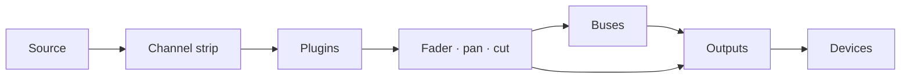

# Patchbay Console 사용자 설명서

[English](../PATCHBAY-CONSOLE-MANUAL.md)

**버전 0.1 · Windows 10 (2004) 이상**

Patchbay Console은 대형 콘솔을 모델로 한 Windows용 라이브 오디오 라우터 겸 믹서입니다.
오디오 인터페이스, Windows 장치, 개별 프로그램에서 소리를 받아 채널 스트립, 버스, 출력을 거친 뒤, 선택한 장치로 재생합니다. 헤드폰, 스피커, 방송, 통화와 게임용 가상 마이크 등 어디든 보낼 수 있습니다.

이 설명서는 앱의 모든 기능을 다루고, 자주 하는 작업을 단계별로 안내하며, 문제가 생겼을 때 할 일을 알려 줍니다.

---

## 목차

1. [시작하기 전에](#1-before-you-start)
2. [처음 설정하기](#2-first-time-setup)
3. [창](#3-the-window)
4. [라우팅 작동 방식](#4-how-routing-works)
5. [콘솔](#5-the-console)
6. [채널 스트립, 섹션별 설명](#6-the-channel-strip-section-by-section)
7. [RAW 스트립: 앱, 패드, 테이프, 컴바이너](#7-raw-strips-apps-pads-tape-and-combinators)
8. [출력](#8-outputs)
9. [플러그인](#9-plugins)
10. [ROUTING 페이지](#10-the-routing-page)
11. [도구: 패드](#11-tools-pads)
12. [도구: 테이프, 레코더, 리플레이](#12-tools-tape-recorder-and-replay)
13. [장치](#13-devices)
14. [씬, 실행 취소, 세션](#14-scenes-undo-and-sessions)
15. [설정](#15-settings)
16. [원격 제어, 오버레이, 트레이, VR](#16-remote-control-overlay-tray-and-vr)
17. [사용 가이드](#17-how-to-guides)
18. [문제 해결](#18-troubleshooting)
19. [참조](#19-reference)

---

## 1. 시작하기 전에

### 필요한 것

| | |
|---|---|
| **Windows** | Windows 10 버전 2004 이상 또는 Windows 11. 개별 프로그램의 소리를 캡처하려면 2004 이상이 필요합니다 |
| **오디오 인터페이스** | 선택 사항입니다. ASIO 드라이버를 설치하면 Patchbay Console이 인터페이스의 클럭으로 동작하여 지연이 가장 짧아집니다. 인터페이스가 없으면 Windows 재생 장치 또는 내장 클럭으로 동작합니다([클럭](#clocking) 참조) |
| **헤드폰** | 믹스를 들을 수 있도록 인터페이스(또는 아무 Windows 재생 장치)에 연결합니다 |
| **VB-CABLE** | 선택 사항이며 무료입니다 (vb-audio.com/Cable). 가상 마이크로, Discord, 게임, OBS 같은 앱이 믹스를 들을 수 있게 해 줍니다 |
| **ffmpeg** | 선택 사항입니다. PATH에 `ffmpeg.exe`가 있으면 레코더가 MP3, AAC, Opus, ALAC로도 저장할 수 있습니다 |

### 이 설명서에서 쓰는 용어

| 용어 | 의미 |
|---|---|
| **채널**(입력) | 데스크 위의 소스 하나: 마이크, 장치, 프로그램, 패드, 테이프 |
| **스트립** | 채널, 버스, 출력을 제어하는 콘솔 위의 세로 열 |
| **루트** | 채널이나 버스를 버스 또는 출력으로 보내는 연결 |
| **버스** | 서브 믹스. 보내진 소리를 모두 합산하고, 함께 처리한 뒤 다음으로 보냅니다 |
| **컴바이너** | 소리를 병렬 경로로 나누어 경로마다 자체 플러그인으로 처리한 뒤 합산하는 버스 |
| **출력** | 장치(헤드폰, 스피커, 가상 케이블)에서 재생되는 최종 믹스 |
| **인터페이스** | ASIO 오디오 인터페이스(있는 경우) |
| **클럭** | 모든 것이 맞춰 동작하는 기준: 인터페이스, 없으면 Windows 재생 장치, 그것도 없으면 내장 클럭 |

## 2. 처음 설정하기

이 장에서는 설치 프로그램부터 동작하는 설정까지 안내합니다. 마이크 소리가 헤드폰에서 들리고, 앱이 내 마이크를 듣고, 프로그램의 소리가 자기 채널로 들어오는 상태입니다. 순서대로 따라 하세요. 각 단계는 1~2분이면 됩니다.

### 1단계: Patchbay Console 설치

1. 설치 프로그램 `PatchbayConsole-<version>-Setup.exe`를 실행합니다.
2. 설치 프로그램에 코드 서명이 없으므로 Windows SmartScreen이 인식되지 않는 앱이라고 경고할 수 있습니다. **추가 정보**를 누른 다음 **실행**을 누릅니다.
3. 사용권 계약에 동의하고 관리자 권한 요청을 허용합니다. 바탕 화면 바로 가기가 필요하면 설치 중에 선택하세요(기본값은 꺼짐입니다).
4. 설치 프로그램은 앱을 `C:\Program Files\Patchbay Console`에 넣고 시작 메뉴에 **Patchbay Console**을 추가합니다. 필요한 것은 모두 함께 들어 있습니다.
5. 마지막 페이지에서 바로 Patchbay Console을 시작할 수 있습니다. VB-CABLE이 설치되어 있지 않으면 VB-CABLE 다운로드 페이지를 열지도 물어봅니다.

믹스와 설정은 프로그램과 별도로 `%APPDATA%\PatchbayConsole`에 저장됩니다. 제거해도 그대로 남습니다.

### 2단계: VB-CABLE 설치(선택 사항)

VB-CABLE은 다른 앱이 고를 수 있는 가상 마이크를 만들어 줍니다. 자신의 헤드폰용으로만 믹스한다면 이 단계는 건너뛰어도 됩니다.

1. vb-audio.com/Cable에서 VB-CABLE을 내려받고 설치 프로그램을 관리자 권한으로 실행합니다.
2. 요청하면 Windows를 다시 시작합니다.
3. Windows에 새 장치가 두 개 생깁니다. **CABLE Input**은 재생 장치이며, 여기에 재생한 소리는 녹음 장치인 **CABLE Output**에서 나옵니다. 앱은 **CABLE Output**을 마이크로 선택할 수 있습니다.

> **Windows가 소리를 케이블로 바꿉니다.** 가상 케이블을 설치하면 흔히 Windows의 기본 장치가 됩니다. 스피커는 **CABLE Input**, 마이크는 **CABLE Output**이 됩니다. 그러면 Windows의 소리가 들리지 않고, 기본 마이크를 쓰는 앱에는 케이블의 소리가 들어갑니다. 설치 직후 둘 다 되돌리세요.

**장치 되돌리기:**

1. **설정 > 시스템 > 소리**를 엽니다(또는 작업 표시줄의 스피커 아이콘을 마우스 오른쪽 단추로 누르고 **소리 설정**을 선택합니다).
2. **출력**에서 **CABLE Input**이 아니라 헤드폰이나 스피커(또는 인터페이스의 출력)를 선택합니다.
3. **입력**에서 **CABLE Output**이 아니라 실제 마이크를 선택합니다.
4. Windows에는 통화용 기본값이 따로 있습니다. **추가 소리 설정**까지 아래로 스크롤합니다. **재생** 탭에서 헤드폰이나 스피커를 마우스 오른쪽 단추로 누르고 **기본 통신 장치로 설정**을 선택합니다. **녹음** 탭에서 마이크도 같은 방식으로 합니다.

출력을 더 빨리 설정하는 방법도 있습니다. 작업 표시줄의 스피커 아이콘을 누르고, 볼륨 슬라이더 옆의 **>**를 누른 뒤 장치를 고릅니다.

실제 장치를 Windows의 기본값으로 유지하세요. Patchbay Console은 라우팅한 곳에서만 케이블로 재생하고, 각 앱이 직접 **CABLE Output**을 마이크로 선택합니다(6단계). Windows의 기본 스피커가 케이블이면 PRE-FLIGHT가 **HEARD ONCE** 아래에 알려 줍니다.

### 3단계: Patchbay Console 시작

시작 메뉴를 열고 **Patchbay Console**을 누릅니다(만들었다면 바탕 화면 바로 가기를 써도 됩니다). 처음에는 **SETUP**으로 열립니다.

### 4단계: SETUP의 네 가지 질문에 답하기

SETUP은 페이지마다 하나씩 네 가지 질문을 하고, 답에 맞춰 믹스를 만듭니다. 카드를 눌러 선택합니다. 세 번째 페이지를 제외하면 여러 개를 고를 수 있습니다. **NEXT**로 넘어가고 **BACK**으로 돌아갑니다.

1. **WHERE YOU LISTEN**: 헤드폰이나 스피커를 고릅니다. Windows 기본값이 이미 선택되어 있습니다.
2. **MICROPHONES**: 말할 마이크를 고릅니다. 인터페이스의 입력(**IN 1**, **IN 2** …)과 Windows 녹음 장치입니다.
3. **APPS HEAR YOU**: 앱이 마이크로 쓰는 가상 케이블을 고릅니다(2단계 이후라면 **CABLE Input**). 아니면 **NOT NOW**를 고릅니다.
4. **PROGRAMS**: 지금 소리를 내고 있고 데스크에 올리고 싶은 프로그램을 고릅니다.
5. **BUILD THE MIX**를 누릅니다. **DONE**에 만들어진 것이 나열됩니다.
6. **OPEN THE MIXER**를 눌러 확인합니다.

답마다 만들어지는 것:

| 페이지 | 만들어지는 것 |
|---|---|
| **WHERE YOU LISTEN** | 각 장치의 출력. 첫 번째는 **HEADPHONES**, 나머지는 장치 이름으로 불립니다 |
| **MICROPHONES** | 마이크마다 채널 하나. 이름은 **MICROPHONE** (MICROPHONE 2 …) |
| **APPS HEAR YOU** | 케이블 위의 **MIC FOR APPS**라는 출력. 모든 마이크가 여기로 라우팅됩니다 |
| **PROGRAMS** | 프로그램마다 RAW 채널 하나. 듣는 곳으로 라우팅되고, 프로그램이 소리를 낼 때마다 자동으로 다시 불러오는 앱 규칙도 함께 만들어집니다 |

마이크는 자신의 헤드폰으로는 라우팅되지 않으므로, 지연된 내 목소리의 에코가 들리지 않습니다. 자신의 소리를 듣고 싶으면 마이크의 **HEADPHONES** 키를 켜세요(6단계).

SETUP은 사이드바에 남아 있습니다. 장치나 프로그램을 추가할 때마다 다시 실행하세요. 빠진 것을 추가할 뿐 아무것도 지우지 않습니다.

### 5단계: 오디오가 실행 중인지 확인

오른쪽 위의 **상태 표시등**을 봅니다.

- 퍼센트가 표시된 **녹색**: 오디오가 실행 중입니다. 6단계로 넘어갑니다.
- **빨간색, OFF 표시**: 오디오가 실행되고 있지 않습니다. 다른 프로그램(DAW, 드라이버 제어판)이 인터페이스를 쓰고 있을 수 있습니다. 그 프로그램을 닫고 Patchbay Console을 다시 시작하세요. [18.4](#184-the-interface-wont-start-or-stopped)를 참조하세요.

표시등을 누르면 **DEVICES**가 열립니다. **STREAMS**에는 사용 중인 클럭(ASIO, Windows, 내장 클럭. [클럭](#clocking) 참조)이 표시되고, **BUFFER**로 버퍼 크기를 설정합니다. 잡음 없이 재생되는 가장 작은 크기가 지연이 가장 짧습니다. 대부분의 시스템에는 256 또는 512 샘플이 적당합니다.

### 6단계: 내 소리 듣기, 앱이 내 소리 듣게 하기

믹서는 **SIMPLE**로 열립니다. 각 채널에는 이름, 듣고 있는 소스, 출력마다 키 하나, 페이더와 미터, **CUT**과 **SOLO**가 표시됩니다. 각 출력에는 재생 중인 장치, 페이더, 미터가 표시됩니다.

| 채널의 키 | 의미 |
|---|---|
| 밋밋한 회색 | 그 출력으로 라우팅되지 않음 |
| 출력의 색으로 채워짐 | 그곳으로 라우팅됨. 누르면 꺼집니다 |
| 가장자리만 색이 있음, **VIA BUS** | 버스를 거쳐 도착합니다(PRO에서 설정). 누르면 그곳으로 직접도 라우팅합니다 |

1. 말을 하고 마이크의 미터가 움직이는지 봅니다.
2. 자신의 소리를 들으려면 마이크의 **HEADPHONES** 키를 누릅니다.
3. Discord, 게임, OBS 등 다른 앱에서 마이크로 **CABLE Output**을 선택합니다.
4. 앱이 무엇을 받는지 확인합니다. **FIND** (Ctrl+K) > **HEAR WHAT THEY HEAR**는 앱이 받는 소리를 5초 동안 녹음해서 들려줍니다.

프로그램은 자기 장치로도 계속 재생됩니다. 그 장치가 내가 듣는 장치라면 그 채널의 **HEADPHONES** 키를 끄세요. 그렇지 않으면 소리가 두 번 들립니다(PRE-FLIGHT가 경고합니다).

**+ CHANNEL**과 **+ APP**은 채널을 추가합니다. **+ OUTPUT**은 출력이 없는 장치에 출력을 추가합니다. 출력 이름 아래의 장치 키로 재생 위치를 바꿉니다. 이름을 마우스 오른쪽 단추로 누르면 **Rename...**, 색, **Remove**를 쓸 수 있습니다. 프로그램의 채널을 삭제하면 그 앱 규칙도 삭제되므로 채널이 저절로 돌아오지 않습니다.

### 7단계: PRO, 콘솔 전체 사용하기

상단 바의 **SIMPLE / PRO** 스위치는 어느 쪽이든 같은 믹스를 보여 줍니다. **PRO**는 콘솔 전체입니다. 각 채널의 입력, 필터, 다이내믹스, EQ, 버스와 컴바이너, 플러그인을 다룹니다.

PRO에서 마이크 소리를 다듬으려면:

1. **hp**를 80~100 Hz 정도로 올려 낮은 잡음을 없앱니다.
2. **DYNAMICS**를 켜고(전원 기호가 있는 스위치) 게이트와 컴프레서를 설정합니다.
3. **EQ**를 설정합니다.

[6](#6-the-channel-strip-section-by-section)을 참조하세요. PRO에서 한 설정은 SIMPLE에서도 계속 적용됩니다.

### 8단계: PRE-FLIGHT 실행

시작하고 몇 초 뒤에 **PRE-FLIGHT**가 설정을 점검하며, 확인할 것이 있을 때만 열립니다(SETUP이 먼저 나오는 첫 시작 때는 열리지 않습니다). 언제든 **SETTINGS > GENERAL > PRE-FLIGHT NOW...** 또는 **FIND** (Ctrl+K)에서 실행할 수 있습니다. 모든 행이 녹색이어야 합니다. [18.1](#181-pre-flight)을 참조하세요.

### 9단계: 마무리

- **믹스는 자동으로 저장됩니다.** 변경하고 1초 안에 저장됩니다. 이름을 붙여 버전을 남기려면 **SETTINGS > GENERAL > SAVE SESSION AS...**를 사용하세요.
- **Windows와 함께 시작:** **SETTINGS > GENERAL > WINDOWS**를 켜면 로그인할 때 Patchbay Console이 트레이에서 시작하여 처음부터 마이크가 작동합니다.
- **창을 닫아도 오디오는 멈추지 않습니다.** Patchbay Console은 시스템 트레이에서 계속 실행되어 마이크와 헤드폰이 계속 작동합니다. 멈추려면 트레이 아이콘을 마우스 오른쪽 단추로 누르고 **Quit Patchbay Console**을 선택하세요. 트레이에 있는 동안 프로그램을 시작하면 창이 다시 나타납니다.

각 페이지를 처음 열 때 짧은 팁이 설명해 줍니다. 팁은 **SETTINGS > GENERAL > ON START**에서 끌 수 있습니다.

이것으로 설정이 끝났습니다. 나머지 장에서는 각 부분을 자세히 다룹니다.

## 3. 창

### 사이드바

페이지는 왼쪽에 세로로 놓인 카드입니다. **MIXER**, **ROUTING**, **SETUP**, **TOOLS**, **DEVICES**, **SETTINGS**. 표시 중인 페이지에는 파랗게 빛나는 테두리가 있습니다. MIXER가 표시되는 동안 사이드바에는 다음 카드도 나타납니다(SIMPLE에서는 **ADD CHANNEL**과 **ADD APP**만).

| 그룹 | 카드 | 기능 |
|---|---|---|
| **DESK** | **ADD CHANNEL** | 입력 메뉴를 엽니다: 인터페이스 입력, Windows 장치, 앱, 프로그램 창과 브라우저 탭, 패드, 테이프 |
| | **ADD APP** | 지금 소리를 내고 있는 프로그램을 나열합니다. 하나를 고르면 채널이 만들어집니다 |
| | **ADD BUS** | 버스 또는 컴바이너(처음에는 경로 두 개) |
| | **PLUGINS** | 스트립 아래로 플러그인 패널을 밀어 올립니다([9](#9-plugins) 참조) |
| **SELECT** | **AUTO** | 스트립의 아무 컨트롤이나 만지면 그 스트립이 선택됩니다 |
| | **FOLLOW** | 선택한 스트립으로 데스크가 부드럽게 이동합니다. FIND나 단축키 등 다른 곳에서 선택해도 마찬가지입니다 |
| **METER** | **IN** / **OUT** | 채널 미터가 들어오는 신호(처리 전) 또는 나가는 신호를 보여 줍니다 |
| **SECTIONS** | HEADER … FADER | 스트립의 섹션. 켜져 있는 것이 화면에 보이는 것입니다. 누르면 그곳으로 부드럽게 이동합니다 |

SELECT와 METER 선택은 기억됩니다.

스트립 위에는 시간 표시, 테이프 덱의 트랜스포트(되감기, 정지, 재생 / 일시 정지, 앞으로 감기, 녹음, 반복), **SIMPLE / PRO** 스위치가 있습니다([7단계](#step-7-pro-for-the-whole-console) 참조).

### 상단 바

오른쪽부터:

| 컨트롤 | 기능 |
|---|---|
| **+ 100% -** | 확대/축소. 100, 125, 150%로 바뀝니다. 퍼센트를 누르면 100%로 돌아갑니다. Ctrl + / Ctrl - / Ctrl 0도 같습니다 |
| **FIND** (Ctrl+K) | 모든 페이지, 채널, 씬, 매크로, 패드, 명령을 이름으로 검색합니다 |
| **HISTORY** (Ctrl+H) | 지금까지 한 모든 변경. 하나를 고르면 그 시점으로 돌아갑니다 |
| **MINI** | 항상 맨 위에 있는 작은 믹서 창 |
| **상태 표시등** | 녹색: 오디오 정상. 주황색: 오디오 부하가 높거나 최근에 장치에서 부족이 있었음. 빨간색: 최근 10초 안에 들리는 글리치가 있었거나 오디오가 실행 중이 아님. 숫자는 오디오 부하입니다. 누르면 DEVICES가 열립니다 |
| **SCENES** | 저장한 믹스. **+**로 새로 저장합니다([14.1](#141-scenes) 참조) |

창이 좁으면 상태 표시등이 가장 먼저, 그다음 MINI, HISTORY 순으로 사라집니다. FIND로는 모두 열 수 있습니다.

### 트랜스포트

상단 바 아래, 모든 Mixer 보기에는 테이프 덱의 시간(경과 시간과 트랙 길이), 트랙 이름, 그리고 키가 있습니다. **10초 되감기**, **정지**, **재생/일시 정지**, **10초 앞으로**, **녹음**, **반복**.

- **녹음**은 첫 번째 출력을 파일로 녹음합니다(레코더의 형식과 폴더로). 다시 누르면 멈춥니다.
- **반복**은 **전체 반복** → **한 곡 반복**(**1** 표시) → **끄기** 순으로 바뀝니다.

---

## 4. 라우팅 작동 방식

라우팅은 각 소리가 어디로 가는지 정합니다. 라우팅하기 전에는 아무것도 들리지 않으며, 하나의 소리를 원하는 만큼 여러 곳으로 라우팅할 수 있습니다.

### 소리의 경로

1. **채널**은 소스 하나를 받아 스트립(입력, 필터, 다이내믹스, EQ. 순서는 헤더에 표시됩니다)에 통과시키고, 그다음 플러그인, 그리고 페이더, 팬, 컷을 거칩니다.
2. **루트**는 채널을 버스와 출력 여러 곳으로 동시에 보냅니다(각각 최대 8개). 모든 루트는 페이더를 거친 뒤의 채널을 전달하므로, 페이더와 **CUT**은 라우팅된 모든 곳에 영향을 줍니다.
3. **버스**는 라우팅된 모든 것을 합산하고, 자기 스트립과 플러그인을 거친 뒤, 같은 방식으로 출력(또는 다른 버스)으로 라우팅됩니다.
4. **출력**은 라우팅된 모든 것을 합산하고, 버스 컴프레서, 믹스 EQ, **SAFE** 리미터를 거쳐 자기 장치로 재생합니다.

### 출력은 장치입니다

출력은 각각 장치 하나로 재생합니다. 인터페이스의 출력, USB 헤드셋, 스피커, **CABLE Input** 등입니다. 출력을 직접 만들 필요는 없습니다. 장치로 무언가를 라우팅하면 그 장치에 출력이 만들어집니다. 라우팅 상자에 버스뿐 아니라 장치도 나열되는 이유입니다.

- 장치당 출력은 하나입니다. 여러 채널을 같은 장치로 라우팅하면 그 출력에서 합쳐집니다.
- 출력마다 다른 믹스를 전달할 수 있습니다. 헤드폰에서는 게임, 음악, 음성이 들리고, 방송 출력에는 음악과 음성만 보낼 수 있습니다.
- 장치를 뽑으면 장치가 돌아올 때까지 그 출력은 무음이 됩니다.

### 라우팅하는 세 곳

세 곳 모두 같은 루트를 바꿉니다. 가장 가까운 것을 쓰세요.

| 위치 | 방법 |
|---|---|
| **라우팅 상자**(각 스트립의 헤더) | 버스와 출력 장치마다 상자 하나. 켜짐: 그곳으로 라우팅됨. 누르면 전환 |
| **Route to**(스트립을 마우스 오른쪽 단추로 클릭) | 같은 목록을 메뉴로 보여 줍니다. 라우팅된 곳에 체크 표시 |
| **ROUTING 페이지** | 스트립마다 블록, 루트마다 선. 블록 하나를 누르고 다른 블록을 누릅니다([10](#10-the-routing-page) 참조) |

### 버스

여러 채널에 같은 처리를 하거나 페이더 하나로 다루고 싶을 때 버스를 씁니다. 채널을 버스로, 버스를 출력으로 라우팅하세요. 그다음 채널에서 그 출력으로 가는 직접 루트를 끄세요. 그러지 않으면 직접 한 번, 버스를 거쳐 한 번, 두 번 도착합니다. 버스는 다른 버스로 보낼 수 있으며 지연이 늘지 않습니다.

### 컴바이너

컴바이너는 병렬 **경로**로 나뉜 버스입니다(처음에는 둘). 경로마다 자체 플러그인이 있고, 경로는 컴바이너의 페이더에서 합산됩니다. 소스를 경로 하나 또는 여러 개로 라우팅할 수 있습니다. 컴바이너의 스트립에는 각 경로로 들어오는 소스가 표시됩니다.

### 안전을 지키는 규칙

- **피드백 루프는 거부됩니다.** 소리가 출발한 곳으로 되돌아가게 만드는 루트(자신에게 보내는 버스로 가는 버스, 출력의 소리를 자기 입력으로 되돌리는 경우)는 바로 다시 꺼지고, 이벤트 로그에 루프가 기록됩니다.
- 아무 스트립에서나 **솔로**를 켜면, 솔로 세이프로 표시된 것을 제외하고 솔로가 아닌 모든 스트립이 무음이 됩니다.
- **꺼진 스트립**은 어디로 라우팅되어 있든 아무것도 통과시키지 않습니다.
- **앱 채널과 이중 재생.** 프로그램은 자기 장치로도 재생하고 채널로도 들어옵니다. 이미 듣고 있는 장치의 출력으로 그 채널을 라우팅하지 마세요.

### 클럭

클럭을 정하는 장치는 하나입니다. Patchbay Console은 시작할 때 다음 순서로 고릅니다.

1. **ASIO**: ASIO 드라이버를 통한 오디오 인터페이스. 지연이 가장 짧습니다.
2. **Windows**: ASIO 드라이버가 없을 때 Windows 기본 재생 장치(가상 케이블, 모니터 스피커, VR 헤드셋은 다른 것이 전혀 없을 때만). 인터페이스의 출력은 그 장치의 출력이 되고, 마이크는 Windows 장치로 추가됩니다.
3. **내장 클럭**: 재생 장치가 전혀 없을 때. 헤드폰을 포함한 모든 장치가 이를 따릅니다.

그 밖의 모든 장치와 캡처된 프로그램은 각자의 클럭으로 동작하며, 드리프트를 보정하는 작은 버퍼를 거쳐 합류하므로 클럭이 어긋나도 클릭 소리가 나지 않습니다. **DEVICES > STREAMS**에서 각각과 사용 중인 클럭을 볼 수 있습니다.

클럭을 정하는 Windows 장치가 뽑히거나, 꺼지거나, 작동을 멈추면 다음 클럭이 자동으로 이어받고 어느 것인지 알림이 표시됩니다. 시작되지 않는 장치(다른 프로그램이 점유 중이라서)는 장치 구성이 바뀔 때까지 건너뛰었다가 다시 시도합니다. 내장 클럭으로 동작 중에 재생 장치가 연결되면 그 장치가 이어받습니다.

## 5. 콘솔

### 레이아웃

데스크에는 모든 스트립이 왼쪽에서 오른쪽으로 놓입니다. **채널**, 그다음 **버스**(보라색 이름 바), 그다음 **출력**(주황색 이름 바). 각 스트립에는 위에서 아래로 일곱 개의 섹션이 있습니다.

| 섹션 | 내용 |
|---|---|
| **HEADER** | 레벨 바, FILT / EQ / EXT 키, 처리 순서, 라우팅 상자, 스트립 번호 |
| **INPUT** | 트림, 극성(Dark strip에서는 마이크 드라이브와 입력 스위치도) |
| **DYNAMICS** | 컴프레서와 게이트 |
| **FILTERS** | 로우패스와 하이패스 |
| **EQ** | 4밴드 |
| **NAME** | 이름 바와 전원 스위치 |
| **FADER** | 팬, SOLO, CUT, SEL, 페이더와 수치 표시 |

### 마우스와 키보드

| 동작 | 결과 |
|---|---|
| 노브나 페이더를 위/아래로 **드래그** | 값을 바꿉니다. 드래그하거나 마우스를 올리면 옆에 값이 표시됩니다 |
| 노브나 페이더를 **더블클릭** | 기본값으로 돌아갑니다 |
| 키나 스위치를 **클릭** | 켜기 / 끄기 |
| 이름 바를 **클릭** | 스트립을 선택합니다 |
| 스트립의 이름 바를 옆으로 **드래그** | 같은 종류(채널, 버스, 출력) 안에서 이동합니다([17.4](#174-reorder-channels) 참조) |
| 이름 바의 전원 기호를 **클릭** | 스트립을 끄거나 켭니다 |
| 스트립을 **마우스 오른쪽 단추로 클릭** | 스트립 메뉴 |
| **마우스 휠** | 데스크를 가로로 스크롤합니다. **Shift + 휠**은 위아래로 스크롤합니다 |
| **Ctrl + / Ctrl -** | 창 전체 확대/축소 |

왼쪽 클릭으로는 메뉴가 열리지 않습니다. 메뉴는 항상 오른쪽 단추입니다.

### 스트립 선택하기

선택한 스트립에는 파란 윤곽선이 생깁니다. 이름 바나 **SEL** 키를 누르거나, **AUTO**가 켜져 있을 때 컨트롤을 만지면 스트립이 선택됩니다. 선택한 스트립은 플러그인 패널이 보여 주는 스트립이며, FIND, 단축키, 원격 제어가 대상으로 삼는 스트립입니다.

데스크에 포커스가 있을 때(먼저 클릭하세요): **Left / Right**는 이전 / 다음 스트립을 선택하고, **M**은 컷, **S**는 솔로, **Up / Down**은 페이더를 0.5 dB(**Shift**와 함께 3 dB) 움직입니다.

### 스트립 끄기

이름 바 왼쪽의 전원 기호를 누릅니다. 스트립이 흐려지고 회색이 됩니다. 처리되지 않으며, 그 장치나 프로그램은 해제됩니다. 꺼져 있는 동안에는 **그 스트립에서 아무것도 바꿀 수 없습니다.** 노브, 키, 플러그인 패널은 클릭을 무시하고, 메뉴에는 **Turn on**과 스페이서만 나옵니다. 전원 기호를 다시 누르면 돌아옵니다.

### 스트립 종류

채널마다 **Light strip** 또는 **Dark strip**을 쓸 수 있습니다. 마우스 오른쪽 단추 > **Strip type** > **Light strip** / **Dark strip**. 인터페이스 입력, 녹음 장치(마이크), 버스는 Dark로 시작하고, 나머지는 Light로 시작합니다. Dark strip에는 마이크 **drive**와 입력 스위치가 추가되고, 컴프레서의 fast 어택과 게이트의 hold는 빠집니다. 선택은 채널마다 기억됩니다.

### 스페이서

스페이서는 그룹 사이에 여백을 두는 빈 스트립입니다. 스트립을 마우스 오른쪽 단추로 클릭 > **Add spacer before** / **Add spacer after**. 스페이서를 마우스 오른쪽 단추로 클릭하면 **Narrow**, **Add another**, **Remove spacer**를 쓸 수 있습니다. 스페이서는 바로 앞 스트립이 이동할 때 함께 움직입니다.

### 스트립 메뉴(마우스 오른쪽 단추)

| 항목 | |
|---|---|
| **Input** | 소스 변경: **Interface** 입력, **Windows devices**(또는 Windows 기본값), **What an output plays**(루프백), **Test tone**, **Nothing** |
| **Route to** | 모든 버스와 출력 장치. 보내는 곳에 체크 표시 |
| **Plugins** | 하나 열기, **Add plugin...**, **Remove** |
| **Make mono / Make stereo** | 채널만 해당 |
| **Strip type** | **Light strip** 또는 **Dark strip** |
| **Colour** | 채널의 색. 이름 바를 따라, 그리고 ROUTING 블록에 표시됩니다 |
| **Add spacer before / after** | |
| **Rename...** | |
| **Remove** | 채널이나 버스를 삭제합니다 |

---

## 6. 채널 스트립, 섹션별 설명

### HEADER

| 컨트롤 | 기능 |
|---|---|
| **레벨 바** | 채널의 레벨, 왼쪽과 오른쪽(METER에서 고른 대로 IN 또는 OUT) |
| **FILT** | 필터를 게이트/컴프레서의 디텍터로 보냅니다(키 필터링) |
| **EQ** | EQ 켜기/끄기 |
| **EXT** | 다이내믹스가 채널 자신이 아니라 외부 키(사이드체인)를 듣습니다 |
| **처리 순서** | 블록 세 개(FILT, EQ, DYN)가 채널이 실행하는 순서대로 위에서 아래로 놓입니다. **블록을 클릭**하면 한 칸 위로 올라갑니다. 맨 위의 것은 맨 끝으로 갑니다. 켜진 블록이 사용 중입니다 |
| **라우팅 상자** | 버스와 출력 장치마다 상자 하나. 켜짐: 채널이 그곳으로 보내집니다. 누르면 전환. 아직 출력이 없는 장치로 보내면 그 출력이 만들어집니다 |
| **번호** | 데스크에서 스트립의 위치 |

### INPUT

| 컨트롤 | |
|---|---|
| **in trim** | 입력 게인 |
| **ø** | 극성 반전 |
| **WIDTH** (Light strip) | 스테레오 폭: 0 %는 모노, 100 %는 그대로, 200 %는 두 배 넓게. 모노 채널에서는 흐리게 표시됩니다 |
| **mic** (Dark strip) | 드라이브: 따뜻함과 레벨을 더합니다(퍼센트로 표시) |
| **pre** (Dark strip) | 입력 스테이지 켜기/끄기 |

### DYNAMICS

**IN** 스위치(전원 기호 포함)는 컴프레서와 게이트를 함께 켜고 끕니다.

**컴프레서**

| 컨트롤 | |
|---|---|
| **MIX** | 웻/드라이 블렌드(병렬 컴프레션). 녹색 수치를 드래그하세요 |
| **ratio**, **thresh**, **rel** | 비율, 임계값, 릴리스 |
| **fast** | 빠른 어택(3 ms). 꺼짐은 10 ms |
| **pk** | 피크 검출. 켜짐(기본값)이면 컴프레서가 피크에 반응합니다. 꺼짐이면 평균(RMS) 레벨에 반응하며 더 부드럽습니다 |
| **게인 리덕션 LED** | 3, 6, 10, 14, 20 dB 감소 |

**게이트 / 익스팬더**

| 컨트롤 | |
|---|---|
| **range**, **thresh**, **rel**, **hold** | 얼마나 닫는지, 어디서 열리는지, 닫히는 속도, 유지 시간 |
| **exp** | 익스팬더 모드(더 완만한 게이트) |
| **fast** | 빠른 어택(0.1 ms). 꺼짐은 1.5 ms |
| **게이트 LED** | 게이트가 얼마나 닫히고 있는지 |

LED는 컴프레서와 게이트가 꺼져 있는 동안에도 켜면 *어떻게 동작할지*를 보여 주므로, 켜기 전에 설정할 수 있습니다.

### FILTERS

**lp**(로우패스)와 **hp**(하이패스). 하이패스는 끝까지 내리면 꺼집니다. 로우패스는 끝까지 올리면 꺼집니다.

### EQ

| 밴드 | 컨트롤 |
|---|---|
| **HF** | gain, freq, **bell**(꺼짐이면 셸프) |
| **HMF** | gain, freq, q |
| **LMF** | gain, freq, q |
| **LF** | gain, freq, **bell**(꺼짐이면 셸프) |

**EQ IN** 스위치는 EQ 전체를 켜고 끕니다(헤더의 EQ 키와 같습니다).

### FADER

| 컨트롤 | |
|---|---|
| **PAN** | 좌/우. 더블클릭하면 가운데 |
| **SOLO** | 제자리 솔로 |
| **CUT** | 음소거 |
| **SEL** | 이 스트립 선택 |
| **페이더** | 레벨, +12 dB에서 꺼짐까지. 아래 수치에 dB로 레벨이 표시됩니다 |
| **safe** | 솔로 세이프: 다른 채널이 솔로일 때도 이 채널은 들립니다 |
| **listen** | 다이내믹스의 키 신호를 듣습니다 |

---

## 7. RAW 스트립: 앱, 패드, 테이프, 컴바이너

이미 완성된 소리를 전달하는 채널이 있습니다. 프로그램의 오디오, 패드, 테이프입니다. 이런 채널에는 **RAW 스트립**이 쓰입니다. 라우팅, 필요하면 플러그인, 팬, 페이더, 키는 있지만 내장 이펙트는 없습니다. 데스크에 나타날 때 내장 이펙트는 한 번 꺼집니다(이벤트 로그에도 기록됩니다). 플러그인은 그대로 유지됩니다.

| 스트립 | 가운데 섹션의 내용 |
|---|---|
| **App** | 플러그인 목록(누르면 열림)과 **ADD PLUGIN** |
| **Pads** | 뱅크 키 **A–D**, 4×4 패드(누르면 재생. GATE 패드는 누르는 동안 재생), **STOP ALL** |
| **Tape** | 덱 화면과 탐색 바, 트랜스포트(이전, 되감기, 정지, 재생, 일시 정지, 앞으로 감기, 다음), **SHUFFLE**, **ADD...**, 재생 목록(트랙을 누르면 재생) |
| **Combinator** | 경로마다: **FROM**(입력되는 채널과 버스. 누르면 그 스트립으로 이동), 그 경로의 **PLUGINS**(누르면 열림). **EDIT IN ROUTING**은 ROUTING 페이지를 엽니다 |

컴바이너 자체에는 이펙트가 없습니다. 소리는 입력되는 것과 각 경로의 플러그인에서 나옵니다. 마우스 오른쪽 단추 > **Paths**로 경로를 추가하고, 경로마다 플러그인을 열거나 추가하거나 제거하고, 이름을 바꾸거나 경로를 제거할 수 있습니다.

---

## 8. 출력

각 출력(마스터)에는 자체 Dark strip이 있습니다.

| 컨트롤 | |
|---|---|
| **DEVICE** | 재생 중인 장치. 누르면 다른 장치를 고릅니다 |
| **SAFE** | 페이더 뒤의 리미터: -1 dBFS를 넘는 소리는 나가지 않습니다 |
| **MON** | 이 출력을 모니터합니다 |
| **LUFS** | 나가는 소리의 단기 라우드니스(무음이면 "-- LUFS") |
| **WIDTH** | 스테레오 폭 |
| **BUS COMP** | In 스위치, VU 방식 게인 리덕션 미터, **threshold**, **ratio**, **attack**, **release**, **make-up**, **mix** |
| **MIX EQ** | In 스위치, HF 게인과 주파수, LF 게인과 주파수 |
| **CUT**, **SEL**, 페이더 | 채널과 같음 |

출력을 마우스 오른쪽 단추로 클릭하면 **Device...**, 스페이서, **Rename...**, **Remove**를 쓸 수 있습니다.

**출력은 자동으로 만들어집니다.** 채널을 장치로 보내면(라우팅 상자, ROUTING 페이지, **Route to** 중 무엇으로든) 그 장치에 출력이 없을 때 만들어집니다.

**장치가 없을 때.** 출력의 장치를 뽑으면 장치가 돌아올 때까지 그 출력은 무음이 됩니다. 저절로 다른 장치로 옮겨 가지 않습니다.

**FIND > MIX-MINUS AND STEMS**는 게스트마다 피드(본인 목소리를 뺀 모든 것)와 음성, 음악, 게임 스템을 만듭니다.

---

## 9. 플러그인

Patchbay Console은 채널, 버스, 컴바이너 경로에서 **VST3** 플러그인을 호스팅하며 지연을 자동으로 보정합니다.

### 플러그인 추가하기

- 채널에서: 마우스 오른쪽 단추 > **Plugins > Add plugin...**, 또는 RAW 스트립의 **ADD PLUGIN**, 또는 플러그인 패널의 **ADD**.
- 컴바이너 경로에서: 컴바이너를 마우스 오른쪽 단추로 클릭 > **Paths > PATH n > Add plugin...**. 컴바이너 스트립에서 경로의 플러그인을 누르면 열립니다.

모든 플러그인은 **먼저 프로그램의 별도 복사본에서 테스트**되므로, 불러오는 중에 충돌하거나 멈추는 플러그인이 믹스를 망가뜨릴 수 없습니다. 결과는 플러그인 파일이 바뀔 때까지 기억됩니다.

### 플러그인 패널

사이드바의 **PLUGINS**를 누릅니다. 스트립 아래로 패널이 올라오며 **선택한 스트립**의 플러그인이 실행되는 순서대로 나옵니다. **FIND** > **PLUGINS: name**은 그 스트립의 패널을 열고, SIMPLE이 표시 중이면 PRO로 전환합니다. 각 카드에는 다음이 표시됩니다.

- **CPU**: 플러그인이 차지하는 처리 시간 비율(녹색, 2 % 초과 주황색, 5 % 초과 빨간색)
- **Latency**: 추가되는 지연
- **BYPASSED**: 꺼져 있지만 아직 로드됨(메모리는 계속 사용)
- **HEAVY**: 비정상적으로 부하가 큼

각 카드의 키: **BYPASS**, **OPEN**(플러그인 창), **REMOVE**, 앞이나 뒤로 옮기는 화살표. 끝의 **ADD**로 하나 더 추가합니다. 스트립이 꺼져 있는 동안에는 아무것도 바꿀 수 없습니다.

---

## 10. ROUTING 페이지

ROUTING 페이지는 믹스 전체를 지도로 보여 줍니다. 스트립마다 블록, 루트마다 선입니다. 모든 것이 어디로 가는지 보고, 블록 두 개를 눌러 라우팅하는 데 사용합니다.

### 페이지 보는 법

- **세 줄:** 맨 위에 **INPUTS**, 가운데 **BUSES**, 아래에 **OUTPUTS**. 아직 출력이 없는 출력 장치는 OUTPUTS 줄의 오른쪽 끝에 회색으로 놓입니다.
- **각 블록은 자기 스트립 아래에 있습니다.** 블록은 데스크의 스트립과 같은 가로 위치에 있으며, 스페이서도 포함됩니다. 페이지는 데스크와 함께 가로로 스크롤됩니다(마우스 휠). 데스크를 재배열하면 지도도 따라갑니다.
- **각 블록에는** 스트립의 이름과 번호가 표시됩니다. 꺼진 스트립은 흐리게 표시됩니다. 자기 색이 있는 채널은 옅은 색조와 왼쪽의 띠로 표시됩니다.
- **선이 루트입니다.** 선은 각각 소스에서 곧장 아래로 내려가 그 줄 아래 틈의 전용 레인으로 들어간 뒤, 옆으로 가서 입력받는 블록으로 내려가 화살표로 끝납니다. 입력 루트는 청록색, 버스 루트는 보라색입니다. 한 블록에서 나가거나 들어오는 여러 선은 순서대로 블록 위에 펼쳐지므로 겹치지 않습니다.
- **컴바이너**는 경로를 블록 아래쪽에 **P1, P2, …** 셀로 보여 줍니다. 선은 입력받는 경로에서 끝납니다.

### 블록에서 블록으로 라우팅하기

1. **블록을 누릅니다.** 파랗게 빛나며 맥동합니다. 그 블록이 라우팅된 곳, 또는 라우팅해 오는 블록은 테두리가 강조되고 선이 밝아지며, 나머지는 어두워집니다.
2. **다른 블록을 누릅니다.** 둘 사이의 루트가 켜지거나(선이 나타남) 꺼집니다(선이 사라짐). 순서는 상관없습니다. 소스 다음 목적지든, 목적지 다음 소스든 같습니다.
3. 첫 번째 블록은 **선택된 채로 유지**되므로, 계속 눌러 여러 곳으로 라우팅하거나 여러 루트를 끌 수 있습니다.
4. **다시 누르거나**, 빈 곳을 누르거나, **Esc**를 누르면 선택이 풀립니다.

두 블록을 라우팅할 수 없으면(예: 출력 두 개) 두 번째 블록이 대신 선택됩니다.

### 예

| 목적 | 누르는 것 |
|---|---|
| 내 마이크 듣기 | MIC, 그다음 헤드폰의 출력 |
| 앱이 내 마이크를 듣게 하기 | MIC, 그다음 **CABLE Input**(출력 줄에 있으며 출력이 생기기 전에는 회색) |
| 그룹을 버스로 보내기 | 버스, 그다음 각 채널. 이어서 버스, 그다음 그 출력 |
| 채널을 방송에서 빼기 | 채널, 그다음 방송의 출력(선이 사라짐) |
| 컴바이너 경로 하나에 입력하기 | 소스, 그다음 경로 셀 (P1, P2…) |

회색 장치 블록을 누르면 그 출력이 만들어지고, 새 출력이 데스크에 바로 나타납니다.

### 컴바이너

소스를 누르고 **경로 셀**을 누릅니다. 소스는 여러 경로에 입력할 수 있습니다. 셀을 차례로 누르세요. 셀 바깥에서 컴바이너를 누르면 첫 번째 경로로 라우팅됩니다. 경로나 그 플러그인을 추가하려면 데스크에서 컴바이너를 마우스 오른쪽 단추로 클릭 > **Paths**를 선택하세요.

### 채널 옮기기

블록을 그 줄을 따라 옆으로 드래그합니다. 파란 막대가 놓일 위치를 보여 주고, 데스크도 그에 맞춰 바뀝니다. 채널은 채널끼리, 버스는 버스끼리, 출력은 출력끼리 이동합니다.

### 루트가 켜진 채로 유지되지 않을 때

그 루트는 피드백 루프가 되므로 바로 꺼집니다. 이벤트 로그에 루프가 기록됩니다. 피드백을 일으키는 루트를 제거하세요. [18.8](#188-a-route-wont-switch-on)을 참조하세요.

## 11. 도구: 패드

**TOOLS > PADS**에는 패드 16개짜리 뱅크 네 개(**A–D**)가 있어, 소리 64개를 담고 동시에 최대 32개를 재생할 수 있습니다.

### 소리 내보내기

패드는 **PADS 채널**로 재생됩니다. **CREATE PADS CHANNEL**을 누르세요(그러면 **PADS CHANNEL ACTIVE**로 표시됩니다). 또는 **PLAY INTO** 메뉴에서 다른 입력을 고르면 패드가 그 채널의 플러그인과 루트를 통해 재생됩니다. 패드 채널이 없으면 눌러도 무시됩니다.

### 불러오기와 재생

| 동작 | |
|---|---|
| **빈** 패드를 클릭 | 소리 파일을 고릅니다 |
| 로드된 패드를 클릭 | 재생합니다 |
| 패드를 마우스 오른쪽 단추로 클릭 | 재생하지 않고 편집용으로 선택합니다 |
| 패드에 파일을 드롭 | 그 패드와 뱅크의 다음 패드들에 불러옵니다 |
| 다른 패드로 **Ctrl + 드래그** | 두 패드를 맞바꿉니다 |
| **STOP ALL** | 모든 패드를 페이드 아웃합니다 |

형식: WAV, FLAC, AIFF, OGG, MP3. 파일이 옮겨진 패드에는 **MISSING: FILE**이 표시됩니다.

### 패드 편집기

| 설정 | |
|---|---|
| 이름 | 더블클릭하여 이름 변경 |
| **LOAD**, **CLEAR**, **COLOUR** | |
| **REPLAY** | 인스턴트 리플레이 버퍼가 이 패드의 소리가 됩니다(녹음 폴더에 WAV로 저장). 먼저 TOOLS > TAPE에서 리플레이를 ARM 하세요 |
| **MODE** | **ONE-SHOT**은 끝까지 재생합니다(다시 누르면 처음부터). **GATE**는 누르는 동안 재생합니다. **LOOP**는 한 번 누르면 시작하고 다음에 누르면 멈춥니다 |
| **CHOKE** | OFF 또는 그룹 1–8. 같은 그룹의 패드는 서로를 멈춥니다 |
| **LEVEL** | -INF에서 +12 dB |
| **HOTKEY** | 클릭(**LEARN...**)한 뒤 키를 누릅니다. Ctrl, Alt 또는 F 키를 포함해야 합니다. 다른 프로그램에 포커스가 있어도 작동합니다. Esc는 취소, Delete는 지우기 |
| **MACRO** | 패드와 함께 실행할 매크로(패드에 매크로만 지정하고 소리는 없어도 됩니다) |
| **TRIM** | 파형의 시작선과 끝선을 드래그합니다. 더블클릭하면 파일 전체 |
| **FADE IN / FADE OUT** | 0–5초 |

---

## 12. 도구: 테이프, 레코더, 리플레이

### 테이프 덱

**TOOLS > TAPE**는 재생 목록을 **TAPE 채널**로 재생합니다. **CREATE TAPE CHANNEL**을 눌러 만드세요.

- **ADD FILES**, **ADD FOLDER**, 또는 페이지 아무 곳에나 파일과 폴더를 드롭합니다. **EJECT**는 재생 목록을 비웁니다.
- 트랙을 더블클릭하면 재생하고, 드래그하면 순서를 바꾸고, Delete를 누르면 선택한 트랙을 제거합니다.
- 트랜스포트: **PREV**, **REW**(10초 뒤로. 누르고 있으면 빠르게 되감기), **PLAY**, **PAUSE**, **STOP**, **FF**(10초 앞으로. 누르고 있으면 빠르게 감기), **NEXT**. 그 밖에 **SHUFFLE**, **REPEAT**(전체 / 한 곡 / 끄기), **LEVEL**.
- 트랙은 끊김 없이 재생됩니다. 일시 정지와 건너뛰기는 30 ms 동안 페이드되어 클릭 소리가 나지 않습니다.

상단 바의 트랜스포트와 데스크의 테이프 스트립은 같은 덱을 제어합니다.

### 레코더

| | |
|---|---|
| **Source** | 아무 출력, 버스, 입력, 또는 **ALL CHANNELS, ONE FILE EACH**(멀티트랙: 모든 입력 또는 DIRECT가 켜진 것만, 그리고 모든 출력. 샘플 단위로 정렬) |
| **Format** | WAV 24-bit(기본값), 16-bit, 32-bit, 32-bit float. FLAC 24/16-bit. AIFF 24/16-bit. OGG Vorbis 128–320k. ffmpeg가 있으면 MP3, AAC (M4A), Opus, ALAC. 각각 디스크에 들어가는 시간이 표시됩니다 |
| **REC** | 시작과 정지. 화면에 시간, 크기, 남은 시간, 누락된 블록이 있으면 표시됩니다 |
| **PATH** / **REVEAL** | 폴더 선택 / 탐색기에서 열기 |

녹음은 폴더를 고르지 않으면 `Music\Patchbay Console Recordings`에 저장됩니다. ffmpeg 형식은 먼저 WAV로 녹음하고 정지할 때 변환합니다(변환에 실패해도 WAV는 남습니다). 여유 공간이 1 GB 미만이 되면 녹음은 저절로 멈춥니다.

### 인스턴트 리플레이

**ARM**은 레코더 소스의 최근 **30초**, **1**, **2** 또는 **5분**을 보관합니다. **SAVE**는 그것을 파일로 씁니다(SAVE를 마우스 오른쪽 단추로 클릭하면 전역 단축키를 지정할 수 있습니다). 멀티트랙을 선택한 경우 리플레이는 첫 번째 출력을 사용합니다.

---

## 13. 장치

**DEVICES**는 모든 Windows 오디오 장치와 ASIO 드라이버를 나열합니다.

| 열 | |
|---|---|
| **I/O** | ASIO, OUT 또는 IN |
| **DEVICE**, **HARDWARE** | 이름과 연결된 어댑터 |
| **FORMAT** | 채널 수와 샘플 레이트 |
| **STATE** | 활성, 연결 해제됨, 사용 안 함, 또는 **off in Patchbay Console** |
| **TAGS** | Windows 기본 장치에 붙는 DEFAULT와 CALLS |

헤더를 누르면 정렬됩니다. 장치를 선택하고(Ctrl/Shift로 여러 개), 다음을 사용합니다.

| 키 | |
|---|---|
| **EXCLUDE / INCLUDE** | Patchbay Console이 그 장치를 쓰지 않거나(또는 다시 쓰기) 합니다. 제외된 장치는 열리지 않고 목록에서도 빠집니다 |
| **DISABLE / ENABLE IN WINDOWS** | Windows 자체에서 장치를 끄거나 켭니다 |
| **RENAME** | 장치에 붙이는 나만의 이름. Patchbay Console 전체에서 쓰입니다(행을 더블클릭해도 됩니다) |

### Streams

목록 아래의 **STREAMS**는 오디오 엔진의 상태를 보여 줍니다.

- **CALLBACK LOAD**(와 피크), **OVERLOADS**, **BLOCKS SKIPPED**. 하나라도 발생하면 경고 색으로 바뀝니다
- **BUFFER**: 인터페이스의 버퍼 크기(작을수록 지연이 짧고 부하가 높음)
- 장치별: 버퍼링된 오디오, 총 지연, **DRIFT**(ppm 단위의 클럭 보정), **UNDER**(바닥나서 무음이 재생됨), **OVER**(넘쳐서 오디오가 버려짐), **RESYNC**(다시 중앙으로 맞춤). 오디오가 누락된 행은 빨간색으로 표시됩니다
- **RESET STATS**는 카운터를 지웁니다

### VB-CABLE

VB-CABLE이 설치되어 있으면 맨 위의 바에서 **샘플 레이트**와 **최대 지연**을 설정합니다. **APPLY**는 관리자 권한 요청을 한 번 하고 케이블을 다시 시작합니다.

맨 아래의 이벤트 로그에는 장치가 연결되거나, 제거되거나, 복구된 기록이 모두 남습니다.

---

## 14. 씬, 실행 취소, 세션

### 14.1 씬

씬에는 모든 채널의 페이더, 팬, 컷, 솔로, 전원, 루트가 저장됩니다(선택하면 플러그인 설정도).

- **저장:** 상단 바의 **+**를 누르고 이름을 붙입니다.
- **불러오기:** 해당 키를 누릅니다. 페이더와 팬은 0.5초에 걸쳐 부드럽게 움직입니다. 나머지는 즉시 바뀝니다.
- **씬을 마우스 오른쪽 단추로 클릭**하면: 음소거만 / 레벨만 불러오기, 덮어쓰기 저장, 플러그인 설정 포함, 이름 변경, 전역 단축키, **Recall on device**(장치가 나타나면 불러오고, 사라지면 되돌림), **Auto-scene**(앱이 재생을 시작할 때, 장치가 연결될 때, 또는 정해진 시각), MIDI 러닝, 이동, 삭제.

장치와 채널 자체는 씬에 포함되지 않습니다.

### 14.2 실행 취소와 기록

**Ctrl+Z**는 실행 취소, **Ctrl+Y**(또는 Ctrl+Shift+Z)는 다시 실행입니다. **HISTORY** (Ctrl+H)에는 모든 변경이 나열됩니다. 하나를 고르면 그 시점으로 돌아갑니다.

### 14.3 세션

믹스는 변경하고 1초 안에, 그리고 종료할 때 자동으로 저장됩니다.

| | |
|---|---|
| **Restore session** | 트레이 메뉴: 날짜별 이전 믹스(Patchbay Console이 그 믹스로 다시 시작됩니다) |
| **SESSION TIMELINE** | FIND: 보관된 모든 버전. **Restore everything**, 또는 다시 시작하지 않고 **PUT ONE CHANNEL BACK**(그 채널의 레벨, 팬, 음소거, 랙) |
| **SAVE SESSION AS...** | SETTINGS > GENERAL > SESSIONS: 믹스를 이름을 붙여 보관 |
| **OPEN, EXPORT OR IMPORT...** | 이름 붙인 믹스 열기(다시 시작됨), 믹스를 파일로 저장, 파일에서 불러오기 |

이전 버전은 최대 60개까지 보관됩니다(5분에 최대 하나). 믹스를 불러올 수 없으면(인터페이스가 없거나 파일이 손상된 경우) 잃어버리는 대신 **따로 보관**되고 새 믹스로 시작합니다. [18.2](#182-my-mix-is-gone-a-fresh-mix-started)를 참조하세요.

---

## 15. 설정

**SETTINGS**에는 왼쪽에 카드로 놓인 네 개의 섹션이 있습니다. **GENERAL**, **MACROS**, **HOTKEYS**, **CONTROL**. 켜기/끄기 설정은 네모난 스위치이며, 켜져 있으면 크림색으로 빛납니다.

### GENERAL

| 카드 | 설정 |
|---|---|
| **WINDOWS** | **START WITH WINDOWS**: 로그인할 때 트레이에서 열림 |
| **DESK** | **WARN IF I TALK WHILE MUTED**(음소거된 마이크가 -30 dBFS를 넘으면 알림). 스트립을 만질 때 선택되는 설정은 사이드바의 **SELECT > AUTO**입니다 |
| **APPS** | **APP RULES...**: 프로그램이 재생을 시작할 때 어느 버스나 출력으로 갈지(**FIND**에서도 열 수 있음). 프로그램의 채널을 삭제하면 그 규칙도 삭제됩니다 |
| **SESSIONS** | **SAVE SESSION AS...**, **OPEN, EXPORT OR IMPORT...** |
| **ON START** | **PRE-FLIGHT: CHECK THE SETUP**, **PRE-FLIGHT NOW...**, **TIPS**, **SHOW THE TIPS AGAIN** |
| **NOTICES (IN THE CORNER)** | 장치 연결/제거, 채널 클리핑(소스나 출력이 풀 스케일), 씬 불러오기, 매크로 실행, 실행 취소와 다시 실행 |
| **ZOOM** | 100%, 125%, 150%, **CUSTOM...**(75–200%) |
| **METER STANDARD** | 미터의 표시 방식(기본값은 빠르게 떨어지는 샘플 피크. IEC 등) |
| **CHANNEL METER POINT** | **PRE HPF**(원래 소스), **PRE FADER**(이펙트 뒤), **POST ON**(페이더 뒤, 기본값) |
| **STEAMVR** | **RACK ON THE STEAMVR DASHBOARD** |
| **ABOUT** | 버전과 크레딧 |

### MACROS

매크로는 단축키, 패드, 트리거, 원격 제어로 실행되는 **액션**의 목록입니다.

1. **+ NEW**를 누르고 이름을 붙입니다(이름을 더블클릭).
2. **+ ACTION**: MUTE ON/OFF/TOGGLE, SET FADER (dB, 페이드 시간), ASSIGN ON/OFF/TOGGLE (루트), CHANNEL ON/OFF, TRIGGER PAD, STOP PAD, ALL NOTES OFF, TRANSPORT PLAY/PAUSE, TRANSPORT NEXT, RECORD START/STOP, WAIT, SCENE RECALL, FX ON/OFF/TOGGLE, WINDOWS DEFAULT OUTPUT/INPUT, PLUGIN SETTING.
3. 필요하면 **+ TRIGGER**: APP STARTS, APP STOPS, DEVICE CONNECTED, DEVICE DISCONNECTED, MASTER SILENT (n초 동안), MASTER HAS SOUND, TIME (24시간제).
4. 필요하면 **HOTKEY**와 **MOMENTARY**(키를 놓으면 액션이 취소됩니다. 푸시 투 토크용).
5. **FIRE**는 지금 실행합니다.

### HOTKEYS

지정할 수 있는 모든 단축키가 한곳에 있습니다. **PADS**, **MACROS**, **SCENES**, 그리고 **TAPE** 아래의 **SAVE INSTANT REPLAY**. 하나를 누르고 새 키를 누르세요(Esc는 취소, Delete는 지우기). 단축키에는 Ctrl, Alt 또는 F 키가 포함되어야 하며, 게임에 포커스가 있어도 작동합니다. 고정 키도 나열됩니다([19.1](#191-keyboard-shortcuts)). 페이지의 ON THE MIXER 키는 콘솔에서도 작동합니다([5](#5-the-console)).

### CONTROL

| 카드 | |
|---|---|
| **SET UP A CONTROLLER** | Loupedeck, Stream Deck, MIDI, OSC, 휴대폰 페이지의 안내형 설정 |
| **MIDI** | **MIDI MAP** (Ctrl+L), 입력과 바인딩, MIDI 입력마다 스위치 |
| **OSC** | **OSC ON (PORT 9000)**. 다른 장치(태블릿, 휴대폰) 허용 |
| **DECK PLUGINS (LOCAL API)** | **API ON (127.0.0.1:9123)**, Stream Deck과 Loupedeck 플러그인용 |
| **PHONE CONTROL (WEB PAGE)** | 휴대폰용 제어 페이지(API가 켜져 있어야 함). QR 코드가 표시됩니다 |

---

## 16. 원격 제어, 오버레이, 트레이, VR

| | |
|---|---|
| **MIDI MAP** (Ctrl+L) | 화면의 컨트롤을 누른 다음 컨트롤러의 노브나 키를 움직입니다. 각 스트립의 페이더, 팬, CUT, SOLO, 전원, 라우팅 키를 SIMPLE과 PRO에서 매핑할 수 있고, 씬, 패드, 테이프도 매핑할 수 있습니다. 매핑하는 동안 마우스 휠로 데스크가 스크롤됩니다(Shift+휠은 위아래) |
| **Stream Deck / Loupedeck** | 키에 실시간 미터가 표시되는 플러그인. 먼저 API를 켜세요 |
| **Phone** | SETTINGS > CONTROL > PHONE CONTROL의 QR 코드를 스캔합니다 |
| **In-game overlay** (Ctrl+Shift+O) | 각 마이크 채널의 말하기 표시등, LIVE / MUTED와 레벨, 그리고 최대 네 개의 씬 키. 게임에서 포커스를 가져가지 않습니다. 어디로든 드래그할 수 있습니다 |
| **MINI** | 모든 것 위에 뜨는 작은 믹서. **OPEN**은 메인 창으로 돌아갑니다 |
| **Tray** | 아이콘을 누르면 트레이 믹서, 더블클릭하면 창이 열립니다. 마우스 오른쪽 단추: Show, 씬 불러오기, Restore session, Start with Windows, About, Quit. 경고 중에는 아이콘이 주황색으로 깜박입니다 |
| **SteamVR** | SteamVR이 실행되는 동안 SteamVR 대시보드에 PATCHBAY CONSOLE 탭이 나타납니다: RACK, PADS, TAPE, MACROS, DEVICES. 레이저 포인터는 마우스처럼 작동합니다. 파일 대화 상자는 데스크톱에서 마쳐야 합니다 |

Patchbay Console은 관리자 창에서 시작해도 항상 일반 사용자 권한으로 실행됩니다. 스스로 일반 권한으로 다시 시작합니다. SteamVR과 게임 내 오버레이는 관리자 권한으로 실행되는 프로그램에 접근할 수 없기 때문입니다. 관리자 권한이 필요한 몇 가지 작업(VB-CABLE 설정 적용, Windows가 꺼 놓은 장치 다시 켜기)은 스스로 권한을 요청합니다.

---

## 17. 사용 가이드

### 17.1 내 소리 듣기: 마이크 설정하기

1. **ADD CHANNEL** > 인터페이스 입력(또는 Windows 녹음 장치). Dark strip으로 나타납니다.
2. 말을 하면서, 레벨 바의 피크가 -12~-6 dB 정도가 되도록 **in trim**을 설정합니다.
3. 라우팅합니다. 헤드폰 출력의 라우팅 상자를 누릅니다(또는 ROUTING 페이지를 사용).
4. 소리를 다듬습니다. **hp**로 낮은 잡음 제거(80~100 Hz 정도), 그다음 게이트와 컴프레서(DYNAMICS의 **IN**), 그다음 EQ.

### 17.2 앱이 내 마이크를 듣게 하기 (Discord, 게임, OBS)

1. **VB-CABLE**을 설치하고(PRE-FLIGHT가 링크를 안내합니다), 실제 스피커와 마이크를 Windows 기본값으로 되돌립니다([2단계](#step-2-install-vb-cable-optional)).
2. 마이크 채널을 **CABLE Input** 장치로 라우팅합니다. 그 장치에 출력이 만들어집니다.
3. 앱에서 마이크로 **CABLE Output**을 선택합니다.
4. **PRE-FLIGHT NOW...**를 실행하여 도중에 음소거된 것이 없고 루프도 없는지 확인합니다.

### 17.3 프로그램을 믹스에 넣기

1. 프로그램을 시작하고 소리가 나게 합니다.
2. **ADD APP** > 그 프로그램을 고릅니다. RAW 채널(이펙트 없음)이 만들어집니다.
3. 들으려는 곳으로 라우팅합니다. 프로그램은 자기 장치로도 계속 재생되므로, 그 장치도 듣고 있다면 앱 채널을 같은 곳으로 라우팅하지 마세요(PRE-FLIGHT가 이런 이중 재생을 경고합니다).

### 17.4 채널 순서 바꾸기

Mixer에서 채널의 **이름 바**를 옆으로 드래그하거나(NAME 섹션까지 아래로 스크롤), ROUTING 페이지에서 그 블록을 드래그합니다. 파란 막대가 놓일 위치를 보여 주고, 스트립이 부드럽게 제자리로 이동합니다. 스페이서는 앞 스트립과 함께 움직입니다. 버스와 출력도 같은 방식으로, 각자 같은 종류 안에서 움직이며 루트도 함께 따라갑니다. SIMPLE도 출력을 같은 순서로 보여 줍니다.

### 17.5 채널을 버스로 묶기

1. **ADD BUS**를 누르고 이름을 바꿉니다(마우스 오른쪽 단추 > Rename...).
2. ROUTING 페이지에서 버스를 누른 다음 각 채널을 눌러 버스로 라우팅합니다.
3. 버스를 누르고 그 출력을 눌러 버스를 다음으로 라우팅합니다.
4. 그 채널들을 버스를 통해서만 보내고 싶다면 출력으로 가는 직접 루트를 끕니다.

### 17.6 컴바이너로 병렬 처리하기

1. **ADD BUS > COMBINATOR**. 경로 두 개로 시작합니다. 더 추가하려면 마우스 오른쪽 단추 > **Paths > Add path**.
2. ROUTING 페이지에서 소스를 경로 셀(**P1**, **P2**…)로 라우팅합니다.
3. 경로마다 마우스 오른쪽 단추 > **Paths > PATH n > Add plugin...**. 경로는 컴바이너의 페이더에서 합산됩니다. 컴바이너 스트립에는 각 경로로 입력되는 것이 표시되고 그 플러그인을 열 수 있습니다.

### 17.7 방송용 믹스와 헤드폰용 믹스 만들기

1. 채널을 출력 두 곳으로 보냅니다. 예를 들어 헤드폰과 방송 소프트웨어가 캡처하는 장치입니다.
2. 출력마다 자체 페이더, 버스 컴프레서, EQ, **SAFE** 리미터가 있습니다. 방송 출력에는 **SAFE**를 켜세요.
3. 방송에 넣고 싶지 않은 것이 있으면 그 채널에서 방송 출력으로 가는 루트를 끕니다(라우팅 상자 또는 ROUTING 페이지에서).

### 17.8 녹음하기

1. TOOLS > TAPE > **RECORDER**: 소스와 형식을 고릅니다.
2. **REC**(또는 상단 바의 녹음 키)를 누릅니다. 다시 누르면 멈춥니다.
3. **REVEAL**은 폴더를 엽니다.

### 17.9 푸시 투 토크 키 만들기

1. SETTINGS > MACROS > **+ NEW**.
2. **+ ACTION** > **MUTE OFF** > 마이크 채널.
3. **MOMENTARY**를 켜고 **HOTKEY**를 설정합니다. 누르고 있는 동안 마이크가 켜지고, 놓으면 다시 음소거됩니다. 마이크를 음소거한 상태로 시작하세요.

---

## 18. 문제 해결

### 18.1 PRE-FLIGHT

PRE-FLIGHT는 시작하고 몇 초 뒤에(그리고 **PRE-FLIGHT NOW...** 또는 FIND에서) 실행되며, 문제가 있을 때만 나타납니다. 각 행에는 표시등, 확인 결과, 해결 방법이 있습니다.

| 검사 | 문제 | 해결 |
|---|---|---|
| **AUDIO** | 시작되지 않았습니다(다른 앱이 사용 중일 수 있음) | **DEVICES** |
| **MIC CABLE** | VB-CABLE 없음: 앱이 믹스를 마이크로 들을 수 없습니다 | **GET VB-CABLE** |
| **MIC MASTER** | 마이크 케이블로 재생하는 출력이 없습니다 | **ROUTING** |
| **MIC CHANNELS** | 마이크로 가는 도중에 음소거된 것이 있습니다 | **UNMUTE** |
| **HEARD ONCE** | 피드백 루프이거나 소리가 두 번 들립니다 | **SOUND SETTINGS** |

### 18.2 믹스가 사라지고 새 믹스로 시작됨

믹스는 사라지지 않았습니다. 시작할 때 사용할 수 없으면 `session-unloaded-<date>.xml`로 **따로 보관**됩니다. 이벤트 로그에 이유가 적혀 있습니다.

| 이유 | 할 일 |
|---|---|
| 저장된 인터페이스가 연결되어 있지 않음 | 연결한 뒤 **Restore session**(트레이) > "kept:" 버전 |
| 저장된 인터페이스를 열 수 없음(다른 프로그램이 사용 중) | 다른 프로그램을 닫고 Patchbay Console을 다시 시작합니다. 그동안 믹스 위에 아무것도 덮어쓰지 않습니다 |
| session.xml을 읽을 수 없음 | **Restore session** > 최근 버전 |

### 18.3 소리가 나지 않음

신호 경로를 따라 확인합니다.

1. **상태 표시등**이 빨간색이고 OFF로 표시됨: 오디오가 실행되고 있지 않습니다. [18.2](#182-my-mix-is-gone-a-fresh-mix-started)와 [18.4](#184-the-interface-wont-start-or-stopped)를 참조하세요.
2. **채널의 미터**(METER: IN): 움직이지 않으면 **Input**(마우스 오른쪽 단추)과 소스가 재생 중인지 확인합니다. 꺼진 스트립은 아무것도 통과시키지 않습니다.
3. **CUT**이 꺼져 있고, 페이더가 올라가 있고, 솔로로 된 다른 것이 없음(다른 스트립의 **SOLO**는 나머지를 모두 무음으로 만듭니다).
4. **라우팅:** 라우팅 상자가 하나 이상 켜져 있거나, ROUTING 페이지에 선이 있음.
5. **출력**: CUT이 아니고, 페이더가 올라가 있고, **DEVICE**에 올바른 장치가 표시됨("NO DEVICE"나 "(OFF)"가 아님).
6. **장치**가 연결되어 있고 DEVICES에서 제외되지 않음.

### 18.4 인터페이스가 시작되지 않거나 멈춤

- 다른 프로그램(DAW, 드라이버 제어판)이 사용 중일 수 있습니다. 닫고 다시 시작하세요.
- 트레이에 **INTERFACE DOWN**: 인터페이스가 스스로 리셋되었고 다시 열리지 않았습니다. DEVICES에서 버퍼 크기를 바꾸거나 Patchbay Console을 다시 시작하세요.
- 인터페이스 자체의 제어판에서 바꾼 레이트나 버퍼 변경은 저절로 반영됩니다.
- 한동안 인터페이스 없이 실행하려면 Patchbay Console을 다음과 같이 시작하세요: `"C:\Program Files\Patchbay Console\Patchbay Console.exe" --clock windows`(Windows 재생 장치) 또는 `--clock builtin`(내장 클럭). `--clock`에 ASIO 드라이버 이름의 일부(`--clock focusrite`)를 붙이면 그 드라이버를 고릅니다. 믹스는 그대로 가져오며 인터페이스용으로 저장된 상태로 남으므로, 다음 일반 시작에서는 인터페이스로 돌아갑니다.

### 18.5 클릭 소리, 잡음, 끊김

1. **상태 표시등**과 **DEVICES > STREAMS**를 봅니다.
2. **CALLBACK LOAD**가 높거나 OVERLOADS가 있으면: **BUFFER**를 올리거나, 플러그인 패널(**HEAVY**, 높은 CPU)에서 부하가 큰 플러그인을 찾아 바이패스하거나 제거합니다.
3. 한 장치에서 **UNDER / OVER**가 계속 증가: 그 장치가 힘들어하고 있습니다. 다른 USB 포트를 써 보거나, 그 장치를 쓰는 다른 프로그램을 닫거나, 쓰지 않는 장치라면 제외하세요.
4. 일정한 **DRIFT**는 정상입니다. 클럭을 맞추는 보정입니다.

### 18.6 앱이 ADD APP에 나타나지 않음

- 프로그램이 지금 **소리를 내고** 있어야 합니다. 재생을 시작한 다음 메뉴를 다시 여세요.
- 이미 채널이 있는 프로그램은 회색으로 표시됩니다(**ON THE DESK**).
- Windows 10 버전 2004보다 오래된 Windows는 개별 프로그램을 캡처할 수 없습니다("Windows refused app capture").

### 18.7 소리가 두 번 들리거나 에코가 있음

- 앱 채널이 그 앱이 이미 재생 중인 같은 장치의 출력으로 라우팅되어 있어서, 앱의 소리가 직접 들리고 Patchbay Console을 거쳐서도 들립니다. 앱 채널을 다른 곳으로 라우팅하거나 앱을 다른 장치로 옮기세요.
- Windows의 기본 스피커가 가상 케이블로 설정되어 있습니다. PRE-FLIGHT > **HEARD ONCE**가 알려 줍니다.

### 18.8 루트가 켜지지 않음

**피드백 루프**(소리가 출발한 곳으로 돌아옴)가 되므로 바로 꺼집니다. 이벤트 로그에 루프가 기록됩니다. 피드백을 일으키는 루트를 제거하여 끊으세요.

### 18.9 스트립에서 아무것도 바꿀 수 없음

스트립이 **꺼져** 있습니다(흐리고 회색). 이름 바의 전원 기호를 누르세요.

### 18.10 채널을 드래그해도 아무 일도 일어나지 않음

**이름 바**(아래쪽의 NAME 섹션. 필요하면 아래로 스크롤)를 드래그하거나, ROUTING 페이지에서 블록을 드래그하세요. 스트립은 같은 종류 안에서만 움직입니다. 버스를 채널 사이로 옮길 수는 없습니다.

### 18.11 플러그인이 로드되지 않음

모든 플러그인은 먼저 프로그램의 별도 복사본에서 테스트되며, 실패하면 이유가 보고됩니다. 30초 안에 로드가 끝나지 않았거나, 테스트 중 충돌했거나, 파일에 VST3 플러그인이 없는 경우입니다. 플러그인을 업데이트하거나 다시 설치하세요. 파일이 바뀌면 다시 테스트됩니다.

### 18.12 프로그램이 충돌함

보고서가 `%APPDATA%\PatchbayConsole\crash.log`에 기록되고, 미니덤프 `crash.dmp`도 생깁니다. 믹스는 변경하고 1초 안에 저장되므로 잃는 것은 마지막 순간의 변경뿐입니다.

### 18.13 녹음이 저절로 멈춤

디스크 여유 공간이 1 GB 미만이 되면(또는 형식의 크기 제한에 가까워지면) 녹음이 멈춥니다. 트레이에 **RECORDING STOPPED, NO ROOM**이 표시됩니다. 공간을 확보하거나 다른 **PATH**를 선택하세요.

### 18.14 VB-CABLE 설치 후 Windows에서 소리가 나지 않음

Windows가 케이블을 기본 장치로 만들었습니다. 헤드폰이나 스피커를 기본 출력으로, 실제 마이크를 기본 입력으로 다시 설정하세요. **설정 > 시스템 > 소리**와 기본 통신 장치 모두에서 해야 합니다. [2단계](#step-2-install-vb-cable-optional)를 참조하세요.

---

## 19. 참조

### 19.1 키보드 단축키

| 키 | |
|---|---|
| **Ctrl+K** | FIND |
| **Ctrl+Z / Ctrl+Y** (Ctrl+Shift+Z) | 실행 취소 / 다시 실행 |
| **Ctrl+H** | 기록 |
| **Ctrl+L** | MIDI MAP |
| **Ctrl + / Ctrl - / Ctrl 0** | 확대 / 축소 / 100% |
| **Ctrl+Shift+O** | 게임 내 오버레이 표시 / 숨기기(어디서나 작동) |
| **Left / Right** | 이전 / 다음 스트립 선택(데스크에 포커스가 있을 때) |
| **M / S** | 선택한 스트립 컷 / 솔로 |
| **Up / Down** | 선택한 페이더 ±0.5 dB (Shift와 함께 ±3 dB) |
| **Esc** | 선택한 블록 해제 (ROUTING) |

### 19.2 명령줄

| | |
|---|---|
| `--minimised` | 트레이에서 시작 |
| `--quit` | 실행 중인 복사본 종료 |

### 19.3 파일

`%APPDATA%\PatchbayConsole` 안:

| 파일 | |
|---|---|
| `session.xml` | 내 믹스 |
| `history\` | 이전 버전(최대 60개) |
| `sessions\` | 이름 붙인 믹스 |
| `session-unloaded-*.xml` | 시작할 때 따로 보관된 믹스 |
| `settings.xml` | 환경 설정 |
| `console.xml` | 스트립 종류, 스페이서, SELECT와 METER 선택 |
| `plugins.xml` | 찾은 플러그인과 각각의 테스트 결과 |
| `events.log` | 일어난 모든 일(5 MB에서 교체) |
| `status.txt` | 몇 초마다 찍는 엔진 스냅샷: 장치, 레벨, 버퍼, 드리프트 |
| `crash.log`, `crash.dmp` | 충돌 보고서 |

프로그램 자체는 `C:\Program Files\Patchbay Console`에 있습니다. 녹음은 다른 폴더를 고르지 않으면 `Music\Patchbay Console Recordings`에 저장됩니다.

### 19.4 색

| 색 | 의미 |
|---|---|
| 파란 윤곽선 | 선택됨 |
| 회색 이름 바 | 채널 |
| 보라색 | 버스 |
| 주황색 | 출력 |
| 청록색 선 | 채널의 루트 |
| 보라색 선 | 버스의 루트 |
| 녹색 상태 표시등 | 오디오 정상. 주황색: 부하가 높음. 빨간색: 글리치 또는 실행 중이 아님 |
