# Patchbay Console Gebruikershandleiding

[English](../PATCHBAY-CONSOLE-MANUAL.md)

**Versie 0.1 · Windows 10 (2004) of later**

Patchbay Console is een live audiorouter en mixer voor Windows, opgebouwd rond een grote mengtafel.
Het haalt geluid van je audio-interface, je Windows-apparaten en afzonderlijke programma's, stuurt het
door kanaalstrips, bussen en uitgangen en speelt het resultaat af op de apparaten die je kiest: je
koptelefoon, je speakers, een stream, een virtuele microfoon voor gesprekken en games.

Deze handleiding behandelt alles wat de app doet, loopt de gewone klussen stap voor stap met je door
en vertelt wat je kunt doen als er iets misgaat.

---

## Inhoud

1. [Voordat je begint](#1-before-you-start)
2. [Eerste installatie](#2-first-time-setup)
3. [Het venster](#3-the-window)
4. [Hoe routing werkt](#4-how-routing-works)
5. [De console](#5-the-console)
6. [De kanaalstrip, sectie voor sectie](#6-the-channel-strip-section-by-section)
7. [Raw-strips: apps, pads, tape en combinators](#7-raw-strips-apps-pads-tape-and-combinators)
8. [Uitgangen](#8-outputs)
9. [Plugins](#9-plugins)
10. [De pagina Routing](#10-the-routing-page)
11. [Tools: Pads](#11-tools-pads)
12. [Tools: Tape, Recorder en Replay](#12-tools-tape-recorder-and-replay)
13. [Apparaten](#13-devices)
14. [Scènes, ongedaan maken en sessies](#14-scenes-undo-and-sessions)
15. [Instellingen](#15-settings)
16. [Afstandsbediening, overlay, systeemvak en VR](#16-remote-control-overlay-tray-and-vr)
17. [Handleidingen](#17-how-to-guides)
18. [Problemen oplossen](#18-troubleshooting)
19. [Naslag](#19-reference)

---

## 1. Voordat je begint

### Wat je nodig hebt

| | |
|---|---|
| **Windows** | Windows 10 versie 2004 of later, of Windows 11. Om het geluid van één programma op te vangen is 2004 of later nodig |
| **Een audio-interface** | Optioneel. Met het ASIO-stuurprogramma geïnstalleerd draait Patchbay Console op de klok van de interface, voor de laagste vertraging. Zonder interface draait het op je Windows-afspeelapparaat, of op zijn ingebouwde klok (zie [Klokken](#clocking)) |
| **Koptelefoon** | Aangesloten op je interface (of op een willekeurig Windows-afspeelapparaat) zodat je je mix hoort |
| **VB-CABLE** | Optioneel en gratis (vb-audio.com/Cable). Een virtuele microfoon, zodat apps zoals Discord, games en OBS je mix kunnen horen |
| **ffmpeg** | Optioneel. Met `ffmpeg.exe` in je PATH kan de recorder ook MP3, AAC, Opus en ALAC schrijven |

### Woorden in deze handleiding

| Woord | Betekenis |
|---|---|
| **Kanaal** (ingang) | Eén bron op de tafel: een microfoon, een apparaat, een programma, de pads, de tape |
| **Strip** | De kolom op de console die een kanaal, bus of uitgang bedient |
| **Route** | Een verbinding die een kanaal of bus ergens heen stuurt: naar een bus of een uitgang |
| **Bus** | Een submix. Alles wat erheen wordt gerouteerd, wordt opgeteld, samen bewerkt en verder gerouteerd |
| **Combinator** | Een bus die zijn geluid splitst in parallelle paden, elk met eigen plugins, en ze daarna optelt |
| **Uitgang** | Een eindmix die op een apparaat wordt afgespeeld (je koptelefoon, speakers, een virtuele kabel) |
| **Interface** | Je ASIO-audio-interface, als je er een hebt |
| **Klok** | Waar alles mee in de pas loopt: je interface, anders je Windows-afspeelapparaat, anders de ingebouwde klok |

## 2. Eerste installatie

Dit hoofdstuk brengt je van het installatieprogramma naar een werkende opstelling: je microfoon in je
koptelefoon, apps die je microfoon horen en het geluid van een programma op een eigen kanaal. Doe de
stappen in volgorde. Elke stap kost een of twee minuten.

### Stap 1: Patchbay Console installeren

1. Start het installatieprogramma, `PatchbayConsole-<version>-Setup.exe`.
2. Windows SmartScreen kan waarschuwen voor een onbekende app, omdat het installatieprogramma niet
   met een code is ondertekend. Klik op **Meer info** en dan op **Toch uitvoeren**.
3. Accepteer de licentie en sta de beheerdersvraag toe. Wil je een bureaubladsnelkoppeling, vink die
   dan onderweg aan (standaard staat hij uit).
4. Het installatieprogramma zet de app in `C:\Program Files\Patchbay Console` en voegt **Patchbay Console**
   toe aan het Startmenu. Alles wat de app nodig heeft, zit erbij.
5. Op de laatste pagina kun je Patchbay Console meteen starten. Is er geen VB-CABLE geïnstalleerd, dan
   biedt het ook aan de downloadpagina van VB-CABLE te openen.

Je mix en instellingen staan in `%APPDATA%\PatchbayConsole`, los van het programma. Bij het
verwijderen blijven ze staan.

### Stap 2: VB-CABLE installeren (optioneel)

VB-CABLE geeft je een virtuele microfoon die andere apps kunnen kiezen. Sla deze stap over als je alleen
voor je eigen koptelefoon wilt mixen.

1. Download VB-CABLE van vb-audio.com/Cable en start het installatieprogramma als beheerder.
2. Start Windows opnieuw op als daarom wordt gevraagd.
3. Windows heeft nu twee nieuwe apparaten. **CABLE Input** is een afspeelapparaat: alles wat erin
   wordt afgespeeld, komt uit **CABLE Output**, een opnameapparaat dat apps als microfoon kunnen kiezen.

> **Windows schakelt je geluid om naar de kabel.** Na het installeren van een virtuele kabel maakt
> Windows hem vaak de standaard: **CABLE Input** als je speakers en **CABLE Output** als je
> microfoon. Dan hoor je niets meer van Windows en horen apps die de standaardmicrofoon gebruiken
> de kabel. Zet beide meteen na het installeren terug.

**Zet je apparaten terug:**

1. Open **Instellingen > Systeem > Geluid** (of klik met rechts op het luidsprekerpictogram in de taakbalk >
   **Geluidsinstellingen**).
2. Kies onder **Uitvoer** je koptelefoon of speakers (of de uitgangen van je interface), niet
   **CABLE Input**.
3. Kies onder **Invoer** je echte microfoon, niet **CABLE Output**.
4. Windows houdt een aparte standaard bij voor gesprekken. Scrol omlaag naar **Meer geluidsinstellingen**. Klik op het tabblad
   **Afspelen** met rechts op je koptelefoon of speakers > **Instellen als standaardcommunicatieapparaat**.
   Doe op het tabblad **Opnemen** hetzelfde voor je microfoon.

Sneller voor de uitvoer: klik op het luidsprekerpictogram in de taakbalk, klik op de **>** naast de
volumeschuif en kies je apparaat.

Laat je echte apparaten de standaard van Windows blijven. Patchbay Console speelt alleen in de kabel waar jij
naartoe routeert, en elke app kiest zelf **CABLE Output** als microfoon (stap 6). Is de standaardspeaker
van Windows de kabel, dan meldt PRE-FLIGHT dat onder **HEARD ONCE**.

### Stap 3: Patchbay Console starten

Open het Startmenu en klik op **Patchbay Console** (of gebruik de bureaubladsnelkoppeling, als je die hebt gemaakt).
De eerste keer opent het op **SETUP**.

### Stap 4: De vier vragen van SETUP beantwoorden

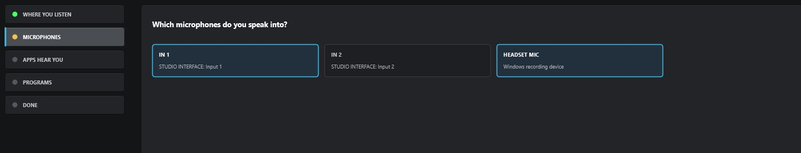

SETUP stelt vier vragen, één per pagina, en bouwt je mix uit je antwoorden. Klik op de kaarten om
te kiezen. Op elke pagina behalve de derde kun je meer dan één kiezen. **NEXT** gaat verder, **BACK**
gaat terug.

1. **WHERE YOU LISTEN**: kies je koptelefoon of speakers. De standaard van Windows is al gekozen.
2. **MICROPHONES**: kies de microfoons waar je in spreekt. Dat zijn de ingangen van je interface
   (**IN 1**, **IN 2** …) en je Windows-opnameapparaten.
3. **APPS HEAR YOU**: kies de virtuele kabel die apps als microfoon gebruiken (**CABLE Input**, na stap 2),
   of **NOT NOW**.
4. **PROGRAMS**: kies de programma's die nu geluid afspelen en die je op de tafel wilt hebben.
5. Klik op **BUILD THE MIX**. **DONE** toont wat er is gemaakt.
6. Klik op **OPEN THE MIXER** om het te zien.

Wat elk antwoord maakt:

| Pagina | Wat het maakt |
|---|---|
| **WHERE YOU LISTEN** | Een uitgang op elk apparaat. De eerste heet **HEADPHONES**, de andere dragen de naam van hun apparaat |
| **MICROPHONES** | Een kanaal voor elk, genaamd **MICROPHONE** (MICROPHONE 2 …) |
| **APPS HEAR YOU** | Een uitgang genaamd **MIC FOR APPS** op de kabel. Elke microfoon wordt erheen gerouteerd |
| **PROGRAMS** | Een raw-kanaal voor elk, gerouteerd naar waar je luistert, plus een app-regel die het vanzelf terugbrengt zodra het programma speelt |

Je microfoons worden niet naar je eigen koptelefoon gerouteerd, zodat je geen vertraagde echo van je
stem hoort. Om jezelf te horen, zet je de toets **HEADPHONES** van de microfoon aan (stap 6).

SETUP blijft in de zijbalk staan. Start het opnieuw als je een apparaat of programma toevoegt. Het voegt toe wat
ontbreekt en verwijdert nooit iets.

### Stap 5: Controleren of de audio draait

Kijk naar het **gezondheidslicht** rechtsboven.

- **Groen** met een percentage: de audio draait. Ga verder met stap 6.
- **Rood, met OFF**: de audio draait niet. Misschien heeft een ander programma je interface in gebruik (een DAW,
  het configuratiescherm van het stuurprogramma). Sluit het en start Patchbay Console opnieuw. Zie
  [18.4](#184-the-interface-wont-start-or-stopped).

Klik op het licht om **DEVICES** te openen. **STREAMS** toont de klok die wordt gebruikt (ASIO, Windows of de
ingebouwde klok; zie [Klokken](#clocking)), en met **BUFFER** stel je de buffergrootte in. De kleinste grootte
die zonder gekraak speelt, geeft je de minste vertraging. 256 of 512 samples past bij de meeste systemen.

### Stap 6: Jezelf horen en apps jou laten horen

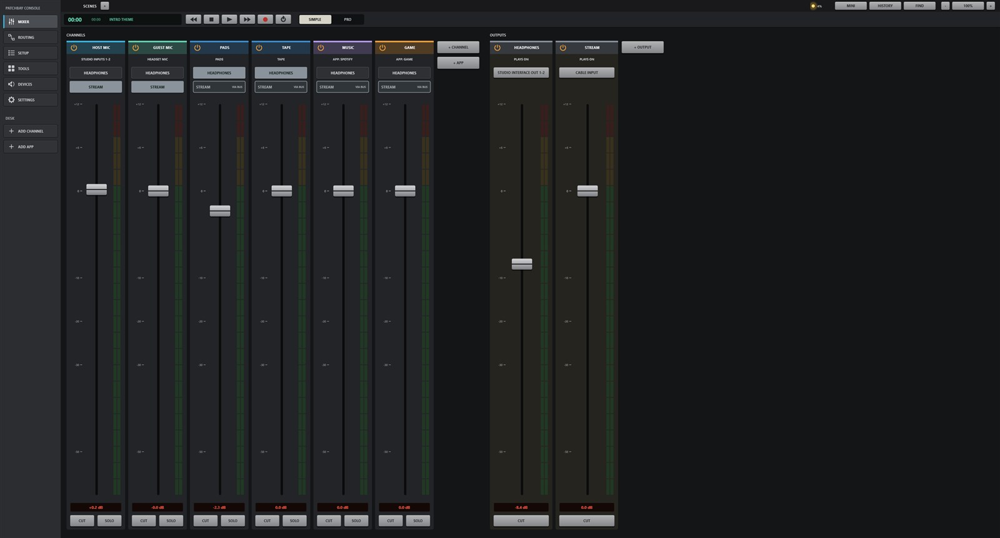

De Mixer opent in **SIMPLE**. Elk kanaal toont zijn naam, waarnaar het luistert, een toets voor elke
uitgang, zijn fader en meter, **CUT** en **SOLO**. Elke uitgang toont het apparaat waarop hij speelt,
zijn fader en meter.

| Toets op een kanaal | Betekent |
|---|---|
| Gewoon grijs | Niet gerouteerd naar die uitgang |
| Gevuld in de kleur van de uitgang | Daarheen gerouteerd. Klik om uit te zetten |
| Alleen gekleurde rand, **VIA BUS** | Het komt er via een bus (ingesteld in PRO). Klik om het ook rechtstreeks erheen te routeren |

1. Spreek en kijk hoe de meter van je microfoon beweegt.
2. Om jezelf te horen, klik je op de toets **HEADPHONES** van de microfoon.
3. Kies in Discord, je game, OBS of een andere app **CABLE Output** als microfoon.
4. Controleer wat ze krijgen: **FIND** (Ctrl+K) > **HEAR WHAT THEY HEAR** neemt 5 seconden op van wat apps
   ontvangen en speelt het voor je af.

Een programma blijft ook op zijn eigen apparaat spelen. Is dat het apparaat waarop je luistert, zet dan de
toets **HEADPHONES** van het kanaal uit, anders hoor je het dubbel (PRE-FLIGHT waarschuwt hiervoor).

**+ CHANNEL** en **+ APP** voegen kanalen toe. **+ OUTPUT** voegt een uitgang toe op een apparaat dat er geen heeft.
De apparaattoets onder de naam van een uitgang verandert waar hij speelt. Klik met rechts op een naam voor **Rename...**,
de kleur en **Remove**. Als je het kanaal van een programma verwijdert, verdwijnt ook zijn app-regel, zodat het kanaal
niet vanzelf terugkomt.

### Stap 7: PRO, voor de hele console

De schakelaar **SIMPLE / PRO** in de bovenbalk toont in beide gevallen dezelfde mix. **PRO** is de hele
console: de ingang, filters, dynamiek en EQ van elk kanaal, bussen en combinators, plugins.

Zo vorm je je microfoon in PRO:

1. Draai **hp** op tot rond 80–100 Hz om gerommel weg te halen.
2. Zet **DYNAMICS** aan (de schakelaar met het aan/uit-symbool) en stel de gate en compressor in.
3. Stel de **EQ** in.

Zie [6](#6-the-channel-strip-section-by-section). Instellingen die je in PRO maakt, blijven ook in SIMPLE werken.

### Stap 8: PRE-FLIGHT uitvoeren

Een paar seconden na het starten controleert **PRE-FLIGHT** de opstelling en opent alleen als er iets aandacht nodig heeft
(niet bij de allereerste start, wanneer SETUP eerst komt). Start het op elk moment via
**SETTINGS > GENERAL > PRE-FLIGHT NOW...** of **FIND** (Ctrl+K). Elke rij moet groen zijn. Zie
[18.1](#181-pre-flight).

### Stap 9: Afronden

- **Je mix slaat zichzelf op** binnen een seconde na elke wijziging. Om een versie onder een naam te bewaren, gebruik je
  **SETTINGS > GENERAL > SAVE SESSION AS...**.
- **Met Windows starten**: **SETTINGS > GENERAL > WINDOWS** start Patchbay Console in het systeemvak wanneer
  je je aanmeldt, zodat je microfoon vanaf het begin werkt.
- **Het venster sluiten stopt de audio niet.** Patchbay Console blijft in het systeemvak draaien,
  zodat je microfoon en koptelefoon blijven werken. Om te stoppen, klik je met rechts op het pictogram in het systeemvak en kies je
  **Quit Patchbay Console**. Start je het programma terwijl het in het systeemvak draait, dan komt het venster terug.

De eerste keer dat elke pagina opent, legt een korte tip uit waar het om gaat. Zet tips uit onder
**SETTINGS > GENERAL > ON START**.

Daarmee is de installatie klaar. De rest van deze handleiding behandelt elk onderdeel in detail.

## 3. Het venster

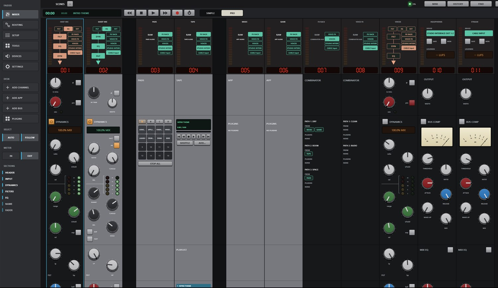

### De zijbalk

De pagina's zijn kaarten langs de linkerkant: **MIXER**, **ROUTING**, **SETUP**, **TOOLS**, **DEVICES**,
**SETTINGS**. De pagina die je ziet, heeft een oplichtende blauwe rand. Zolang de Mixer zichtbaar is, heeft de zijbalk ook
deze kaarten (in SIMPLE alleen **ADD CHANNEL** en **ADD APP**):

| Groep | Kaart | Wat het doet |
|---|---|---|
| **DESK** | **ADD CHANNEL** | Opent het ingangenmenu: interface-ingangen, Windows-apparaten, apps, programmavensters en browsertabs, pads, tape |
| | **ADD APP** | Toont de programma's die nu geluid afspelen. Kies er een om het een kanaal te geven |
| | **ADD BUS** | Een bus, of een combinator (om mee te beginnen twee paden) |
| | **PLUGINS** | Schuift het pluginpaneel omhoog onder de strips (zie [9](#9-plugins)) |
| **SELECT** | **AUTO** | Een willekeurige knop op een strip aanraken selecteert die strip |
| | **FOLLOW** | De tafel glijdt naar de geselecteerde strip, ook als die elders is gekozen (FIND, een sneltoets) |
| **METER** | **IN** / **OUT** | De kanaalmeters tonen het binnenkomende signaal (vóór bewerking) of het uitgaande |
| **SECTIONS** | HEADER … FADER | De secties van de strip. Oplichtende staan in beeld. Klik op een sectie om erheen te glijden |

De keuzes bij SELECT en METER worden onthouden.

Boven de strips staan de tijdweergave, de transportknoppen voor het Tape-deck (terugspoelen, stop, afspelen / pauze,
vooruitspoelen, opnemen, herhalen) en de schakelaar **SIMPLE / PRO** (zie [Stap 7](#step-7-pro-for-the-whole-console)).

### De bovenbalk

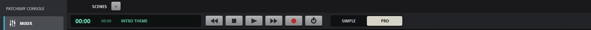

Van rechts:

| Bediening | Wat het doet |
|---|---|
| **+ 100% -** | Zoom. Springt tussen 100, 125 en 150%. Klik op het percentage voor 100%. Ctrl + / Ctrl - / Ctrl 0 doen hetzelfde |
| **FIND** (Ctrl+K) | Zoekt op naam door elke pagina, elk kanaal, elke scène, macro, pad en opdracht |
| **HISTORY** (Ctrl+H) | Elke wijziging die je hebt gemaakt. Kies er een om ernaar terug te gaan |
| **MINI** | Een klein mixervenster dat altijd bovenop blijft |
| **Gezondheidslicht** | Groen: de audio is in orde. Oranje: de audiobelasting is hoog of een apparaat kwam onlangs tekort. Rood: een hoorbare storing in de laatste 10 seconden, of er draait geen audio. Het getal is de audiobelasting. Klik erop voor DEVICES |
| **SCENES** | Je opgeslagen mixen. Met **+** sla je een nieuwe op (zie [14.1](#141-scenes)) |

In een smal venster verdwijnt eerst het gezondheidslicht, dan MINI, dan HISTORY. Met FIND bereik je ze allemaal.

### Het transport

Onder de bovenbalk krijg je in elke Mixer-weergave de tijd van het Tape-deck (verstreken en lengte van het nummer),
de nummernaam en de toetsen: **10 s terug**, **stop**, **afspelen/pauze**, **10 s vooruit**,
**opnemen**, **herhalen**.

- **Opnemen** neemt de eerste uitgang op naar een bestand (in het formaat en de map van de Recorder). Druk nogmaals om te stoppen.
- **Herhalen** schakelt door **alles herhalen** → **één herhalen** (gemarkeerd met **1**) → **uit**.

---

## 4. Hoe routing werkt

Routing bepaalt waar elk geluid heen gaat. Er is niets te horen tot het gerouteerd is, en alles kan naar
zoveel plekken gerouteerd worden als je wilt.

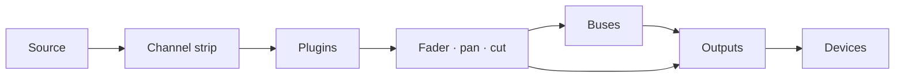

### De weg van een geluid

1. **Een kanaal** neemt één bron en voert die door zijn strip (ingang, filters, dynamiek en EQ,
   in de volgorde die zijn header toont), dan door zijn plugins, dan door zijn fader, pan en cut.
2. **Routes** sturen het kanaal verder, naar een willekeurig aantal bussen en uitgangen tegelijk (tot 8 van elk). Elke
   route draagt het kanaal na zijn fader, dus de fader en **CUT** werken overal waar het
   naartoe is gerouteerd.
3. **Een bus** telt alles op wat erheen is gerouteerd, doorloopt zijn eigen strip en plugins en wordt op dezelfde manier
   doorgerouteerd naar uitgangen (of naar andere bussen).
4. **Een uitgang** telt alles op wat erheen is gerouteerd, doorloopt zijn buscompressor, mix-EQ en
   **SAFE**-limiter en speelt af op zijn apparaat.

### Uitgangen zijn apparaten

Elke uitgang speelt op één apparaat: de uitgangen van je interface, een USB-headset, speakers, **CABLE
Input**. Je maakt uitgangen niet met de hand. Routeer iets naar een apparaat en er wordt een uitgang op gemaakt.
Daarom noemen de routeringsvakjes zowel apparaten als bussen.

- Er is één uitgang per apparaat. Routeer je meerdere kanalen naar hetzelfde apparaat, dan komen ze samen in zijn
  uitgang.
- Verschillende uitgangen voeren verschillende mixen. Je koptelefoon kan game, muziek en stem horen terwijl
  de streamuitgang alleen muziek en stem krijgt.
- Haal je een apparaat los, dan wordt zijn uitgang stil tot het apparaat terugkomt.

### Drie plekken om te routeren

Alle drie wijzigen dezelfde routes. Gebruik wat het dichtstbij is.

| Waar | Hoe |
|---|---|
| **Routeringsvakjes** (header van elke strip) | Eén vakje per bus en uitvoerapparaat. Verlicht: daarheen gerouteerd. Klik om te schakelen |
| **Route to** (rechtsklik op een strip) | Dezelfde lijst als menu, aangevinkt waar gerouteerd is |
| **De pagina Routing** | Elke strip als blok, elke route als lijn. Klik op het ene blok en dan op een ander (zie [10](#10-the-routing-page)) |

### Bussen

Gebruik een bus wanneer meerdere kanalen dezelfde behandeling of één fader nodig hebben. Routeer de kanalen naar de
bus en de bus naar de uitgang. Zet dan de directe routes van de kanalen naar die uitgang uit, anders
komen ze er dubbel aan (één keer direct, één keer via de bus). Een bus kan een andere bus voeden, en dat voegt geen
vertraging toe.

### Combinators

Een combinator is een bus die in parallelle **paden** is gesplitst (om mee te beginnen twee). Elk pad heeft eigen plugins,
en de paden worden opgeteld bij de fader van de combinator. Routeer een bron naar één pad of naar meerdere. De strip
van de combinator toont welke bronnen elk pad voeden.

### Regels die het veilig houden

- **Feedbacklussen worden geweigerd.** Een route die een geluid terug zou brengen naar waar het vandaan kwam (een
  bus naar een bus die hem voedt, het geluid van een uitgang terug in zijn eigen ingang) wordt meteen
  weer uitgezet, en het gebeurtenissenlogboek noemt de lus.
- **Solo** op een willekeurige strip maakt elke strip stil die niet op solo staat, behalve de strips die als solo safe zijn gemarkeerd.
- **Een strip die uit staat** laat niets door, waar hij ook naartoe gerouteerd is.
- **Appkanalen en verdubbeling.** Een programma speelt op zijn eigen apparaat en ook in zijn kanaal.
  Routeer zijn kanaal niet naar een uitgang op het apparaat waarop je het al hoort.

### Klokken

Eén apparaat bepaalt de klok. Patchbay Console kiest hem bij het starten in deze volgorde:

1. **ASIO**: je audio-interface, via zijn ASIO-stuurprogramma. De laagste vertraging.
2. **Windows**: zonder ASIO-stuurprogramma je standaardafspeelapparaat van Windows (een virtuele kabel, de speakers van een
   beeldscherm of een VR-headset alleen als er niets anders is). De uitgangen van je interface
   worden de uitgangen van dat apparaat, en microfoons worden als Windows-apparaten toegevoegd.
3. **Ingebouwde klok**: zonder enig afspeelapparaat. Elk apparaat, ook je koptelefoon, volgt hem.

Elk ander apparaat en elk opgevangen programma draait op zijn eigen klok en sluit aan via een kleine
buffer die afwijkingen corrigeert, zodat uiteenlopende klokken nooit klikken. **DEVICES > STREAMS** toont
ze allemaal, en de klok die wordt gebruikt.

Wordt het Windows-apparaat dat de klok bepaalt losgehaald, uitgezet of valt het uit, dan neemt de volgende klok
het vanzelf over en een melding vertelt je welke. Een apparaat dat niet wil starten (omdat een ander
programma het vasthoudt) wordt overgeslagen tot je apparaten veranderen, en dan opnieuw geprobeerd. Op de ingebouwde klok neemt een
aangesloten afspeelapparaat het van hem over.

## 5. De console

### Indeling

De tafel toont alle strips van links naar rechts: **kanalen**, dan **bussen** (violette naambalk), dan
**uitgangen** (oranje naambalk). Elke strip heeft zeven secties, van boven naar beneden:

| Sectie | Bevat |
|---|---|
| **HEADER** | Niveaubalken, de toetsen FILT / EQ / EXT, de bewerkingsvolgorde, de routeringsvakjes, het stripnummer |
| **INPUT** | Trim, polariteit (en op de Dark strip microfoon-drive en de ingangsschakelaar) |
| **DYNAMICS** | Compressor en gate |
| **FILTERS** | Low-pass en high-pass |
| **EQ** | Vier banden |
| **NAME** | De naambalk en de aan/uit-schakelaar |
| **FADER** | Pan, SOLO, CUT, SEL, de fader en zijn uitlezing |

### Muis en toetsenbord

| Actie | Resultaat |
|---|---|
| **Slepen** aan een knop of fader omhoog/omlaag | Verandert hem. Zijn waarde verschijnt ernaast terwijl je sleept of erboven zweeft |
| **Dubbelklikken** op een knop of fader | Terug naar de standaardwaarde |
| **Klikken** op een toets of schakelaar | Aan / uit |
| **Klikken** op de naambalk | Selecteert de strip |
| **Slepen** van de naambalk van een strip opzij | Verplaatst hem tussen zijn eigen soort: kanalen, bussen of uitgangen (zie [17.4](#174-reorder-channels)) |
| **Klikken** op het aan/uit-symbool in de naambalk | Zet de strip uit of aan |
| **Rechtsklikken** op een strip | Het menu van de strip |
| **Muiswiel** | Scrolt de tafel opzij. **Shift + wiel** scrolt omhoog en omlaag |
| **Ctrl + / Ctrl -** | Zoomt het hele venster |

Een linkerklik opent nooit een menu. Menu's zitten altijd op de rechterknop.

### Een strip selecteren

De geselecteerde strip heeft een blauwe omlijning. Selecteer een strip door op zijn naambalk of zijn toets **SEL** te klikken,
of met **AUTO** aan een van zijn bedieningen aan te raken. De geselecteerde strip is degene die het pluginpaneel
toont en waarop FIND, sneltoetsen en afstandsbedieningen werken.

Met de tafel in focus (klik er eerst op): **Left / Right** selecteren de vorige / volgende strip,
**M** zet hem op cut, **S** zet hem op solo, en **Up / Down** verplaatsen zijn fader 0,5 dB (3 dB met **Shift**).

### Een strip uitzetten

Klik op het aan/uit-symbool links van de naambalk. De strip vervaagt en wordt grijs. Hij wordt niet
bewerkt en zijn apparaat of programma wordt losgelaten. Zolang hij uit staat, **kan er niets aan hem worden veranderd**:
knoppen, toetsen en het pluginpaneel negeren klikken, en zijn menu biedt alleen **Turn on** en spacers aan.
Klik nogmaals op het aan/uit-symbool om hem terug te halen.

### Striptypen

Elk kanaal kan de **Light strip** of de **Dark strip** gebruiken: rechtsklik > **Strip type** >
**Light strip** / **Dark strip**. Interface-ingangen, opnameapparaten (microfoons) en bussen beginnen
donker. Al het andere begint licht. De Dark strip voegt microfoon-**drive** en de ingangsschakelaar toe
en laat de snelle attack van de compressor en de hold van de gate weg. Je keuze wordt per kanaal onthouden.

### Spacers

Spacers zijn lege strips die je ruimte geven tussen groepen. Rechtsklik op een strip > **Add spacer
before** / **Add spacer after**. Rechtsklik op een spacer voor **Narrow**, **Add another** en **Remove
spacer**. Een spacer blijft bij de strip die hij volgt wanneer die strip verhuist.

### Het stripmenu (rechtsklik)

| Item | |
|---|---|
| **Input** | De bron wijzigen: **Interface**-ingangen, **Windows devices** (of de standaard van Windows), **What an output plays** (loopback), **Test tone**, **Nothing** |
| **Route to** | Elke bus en elk uitvoerapparaat, aangevinkt waarheen verzonden wordt |
| **Plugins** | Er een openen, **Add plugin...**, **Remove** |
| **Make mono / Make stereo** | Alleen kanalen |
| **Strip type** | **Light strip** of **Dark strip** |
| **Colour** | De kleur van het kanaal, te zien langs zijn naambalk en op zijn Routing-blok |
| **Add spacer before / after** | |
| **Rename...** | |
| **Remove** | Verwijdert het kanaal of de bus |

---

## 6. De kanaalstrip, sectie voor sectie

### HEADER

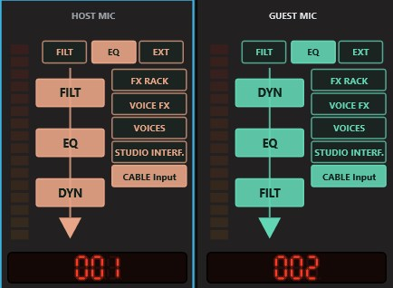

| Bediening | Wat het doet |
|---|---|
| **Level bars** | Het niveau van het kanaal, links en rechts (IN of OUT, zoals gekozen bij METER) |
| **FILT** | Stuurt de filters naar de detector van de gate/compressor (key-filtering) |
| **EQ** | De EQ in of uit |
| **EXT** | De dynamiek luistert naar een externe key (sidechain) in plaats van naar het kanaal zelf |
| **Processing order** | Drie blokken (FILT, EQ, DYN), van boven naar beneden in de volgorde waarin het kanaal ze doorloopt. **Klik op een blok** om het één plek omhoog te zetten. Het bovenste gaat naar het einde. Oplichtende blokken zijn in gebruik |
| **Routing boxes** | Eén vakje per bus en uitvoerapparaat. Verlicht: het kanaal wordt daarheen gestuurd. Klik om te schakelen. Sturen naar een apparaat zonder uitgang maakt zijn uitgang aan |
| **Number** | De plaats van de strip op de tafel |

### INPUT

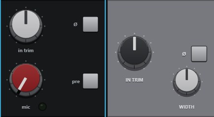

| Bediening | |
|---|---|
| **in trim** | Ingangsversterking |
| **ø** | Polariteit omkeren |
| **WIDTH** (Light strip) | Stereobreedte: 0 % mono, 100 % zoals het is, 200 % twee keer zo breed. Vaag op een monokanaal |
| **mic** (Dark strip) | Drive: voegt warmte en niveau toe (getoond als percentage) |
| **pre** (Dark strip) | De ingangstrap in of uit |

### DYNAMICS

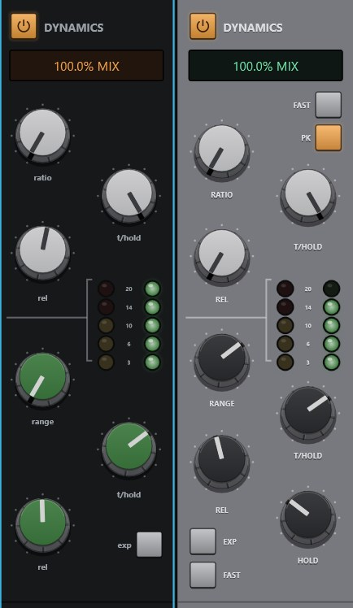

De schakelaar **IN** (met het aan/uit-symbool) zet de compressor en gate samen in of uit.

**Compressor**

| Bediening | |
|---|---|
| **MIX** | Wet/dry-mix (parallelle compressie). Sleep aan de groene uitlezing |
| **ratio**, **thresh**, **rel** | Ratio, threshold en release |
| **fast** | Snelle attack (3 ms). Uit is 10 ms |
| **pk** | Piekdetectie. Aan (de standaard) reageert de compressor op pieken. Uit reageert hij op het gemiddelde (RMS) niveau, wat zachter klinkt |
| **Gain reduction LEDs** | 3, 6, 10, 14 en 20 dB reductie |

**Gate / expander**

| Bediening | |
|---|---|
| **range**, **thresh**, **rel**, **hold** | Hoe ver hij sluit, waar hij opent, hoe snel hij sluit, hoe lang hij vasthoudt |
| **exp** | Expandermodus (een mildere gate) |
| **fast** | Snelle attack (0,1 ms). Uit is 1,5 ms |
| **Gate LEDs** | Hoe ver de gate dichtgaat |

De LED's tonen wat de compressor en gate *zouden* doen, ook als ze uit staan, zodat je ze kunt instellen
voordat je ze inschakelt.

### FILTERS

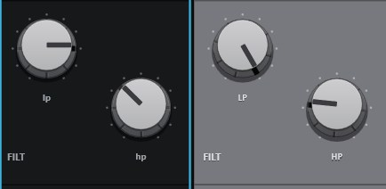

**lp** (low-pass) en **hp** (high-pass). Helemaal omlaag gedraaid is de high-pass uit. Helemaal omhoog gedraaid
is de low-pass uit.

### EQ

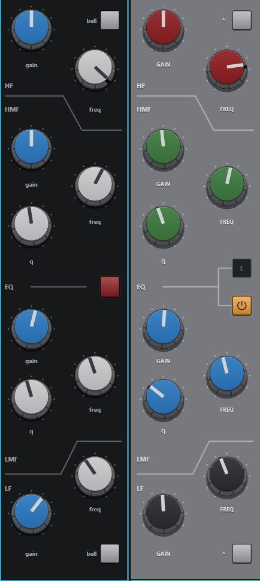

| Band | Bedieningen |
|---|---|
| **HF** | gain, freq, **bell** (shelf als uit) |
| **HMF** | gain, freq, q |
| **LMF** | gain, freq, q |
| **LF** | gain, freq, **bell** (shelf als uit) |

De schakelaar **EQ IN** zet de hele EQ in of uit (hetzelfde als de EQ-toets in de header).

### FADER

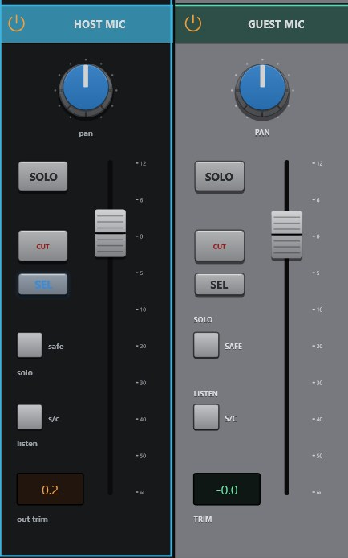

| Bediening | |
|---|---|
| **PAN** | Links/rechts. Dubbelklik om te centreren |
| **SOLO** | Solo in place |
| **CUT** | Dempen |
| **SEL** | Deze strip selecteren |
| **Fader** | Niveau, +12 dB tot uit. De uitlezing eronder toont het niveau in dB |
| **safe** | Solo safe: dit kanaal blijft hoorbaar als andere op solo staan |
| **listen** | Luisteren naar het key-signaal van de dynamiek |

---

## 7. Raw-strips: apps, pads, tape en combinators

Sommige kanalen voeren geluid dat al af is: het geluid van een programma, de pads, de tape. Ze krijgen
een **raw-strip**, met routing, plugins als je die wilt, pan, fader en toetsen, maar zonder ingebouwde
effecten. Verschijnt er een op de tafel, dan worden zijn ingebouwde effecten eenmalig uitgezet (en vastgelegd in
het gebeurtenissenlogboek). Zijn plugins blijven behouden.

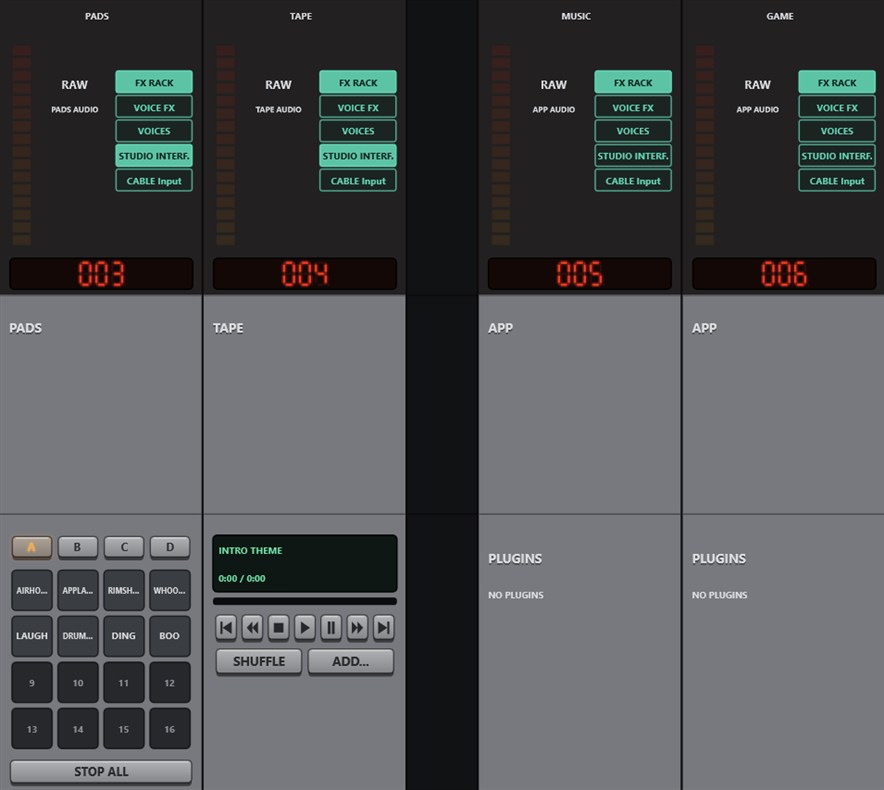

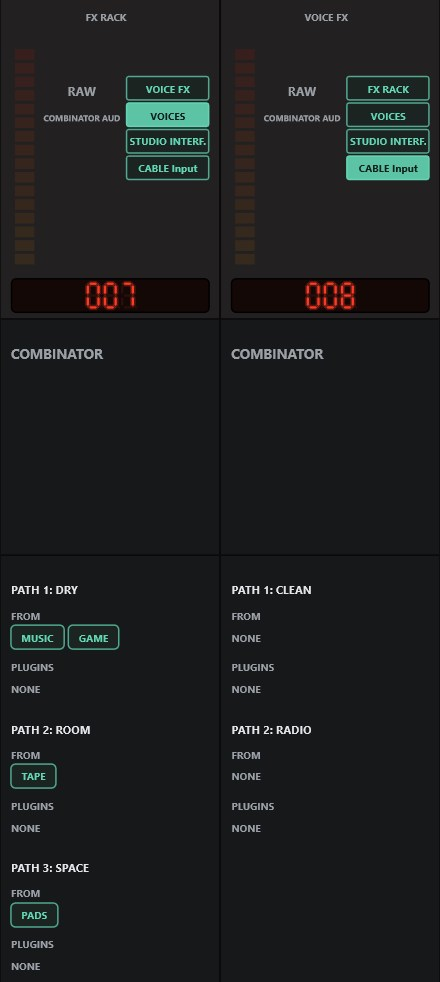

| Strip | Zijn middelste secties bevatten |
|---|---|
| **App** | De pluginlijst (klik op een plugin om hem te openen) en **ADD PLUGIN** |
| **Pads** | Banktoetsen **A–D**, de 4×4-pads (indrukken om af te spelen; een GATE-pad speelt zolang het wordt ingedrukt) en **STOP ALL** |
| **Tape** | Het scherm en de zoekbalk van het deck, het transport (vorige, terugspoelen, stop, afspelen, pauze, vooruitspoelen, volgende), **SHUFFLE**, **ADD...** en de afspeellijst (klik op een nummer om het af te spelen) |
| **Combinator** | Per pad: **FROM**, de kanalen en bussen die het voeden (klik op een om naar zijn strip te gaan), en **PLUGINS** op dat pad (klik op een plugin om hem te openen). **EDIT IN ROUTING** opent de pagina Routing |

Een combinator heeft geen eigen effecten. Zijn geluid komt van wat hem voedt en van de plugins van elk pad.
Rechtsklik erop > **Paths** om een pad toe te voegen en om per pad de plugins te openen, toe te voegen of te verwijderen,
het pad te hernoemen of te verwijderen.

---

## 8. Uitgangen

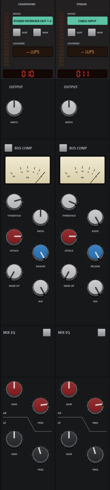

Elke uitgang (master) heeft zijn eigen donkere strip:

| Bediening | |
|---|---|
| **DEVICE** | Het apparaat waarop hij speelt. Klik om een ander te kiezen |
| **SAFE** | Een limiter na de fader: niets verlaat hem boven -1 dBFS |
| **MON** | Deze uitgang monitoren |
| **LUFS** | Kortetermijn-luidheid van wat eruit gaat ("-- LUFS" bij stilte) |
| **WIDTH** | Stereobreedte |
| **BUS COMP** | Aan-schakelaar, de gain-reduction-meter in VU-stijl, **threshold**, **ratio**, **attack**, **release**, **make-up**, **mix** |
| **MIX EQ** | Aan-schakelaar, HF-gain en -freq, LF-gain en -freq |
| **CUT**, **SEL**, fader | Zoals op een kanaal |

Rechtsklik op een uitgang voor **Device...**, spacers, **Rename...** en **Remove**.

**Uitgangen worden voor je gemaakt.** Stuur een kanaal naar een apparaat (met een routeringsvakje, de pagina Routing of
**Route to**) en er wordt een uitgang op dat apparaat gemaakt als er nog geen is.

**Een ontbrekend apparaat.** Wordt het apparaat van een uitgang losgehaald, dan wordt die uitgang stil tot het apparaat
terugkomt. Niets verhuist uit zichzelf naar een ander apparaat.

**FIND > MIX-MINUS AND STEMS** bouwt een feed per gast (alles behalve hun eigen stem) en
stems voor stem, muziek en game.

---

## 9. Plugins

Patchbay Console host **VST3**-plugins op kanalen, bussen en combinatorpaden, met automatische
latentiecompensatie.

### Een plugin toevoegen

- Op een kanaal: rechtsklik > **Plugins > Add plugin...**, of **ADD PLUGIN** op een raw-strip, of
  **ADD** in het pluginpaneel.
- Op een combinatorpad: rechtsklik op de combinator > **Paths > PATH n > Add plugin...**. Klik op de plugin
  van een pad op de combinatorstrip om hem te openen.

Elke plugin wordt **eerst getest in een aparte kopie van het programma**, zodat een plugin die tijdens het laden crasht of
vastloopt je mix niet kan meetrekken. Het resultaat wordt onthouden tot het pluginbestand
verandert.

### Het pluginpaneel

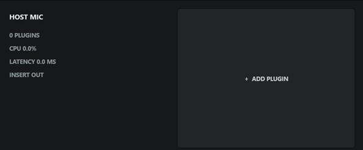

Klik op **PLUGINS** in de zijbalk. Een paneel schuift omhoog onder de strips met de plugins van de **geselecteerde strip**
in de volgorde waarin ze draaien. **FIND** > **PLUGINS: name** opent het op die strip en schakelt over naar
PRO als SIMPLE in beeld is. Elke kaart toont:

- **CPU**: het aandeel van de plugin in de verwerkingstijd (groen, oranje boven 2 %, rood boven 5 %)
- **Latency**: de vertraging die hij toevoegt
- **BYPASSED**: uitgezet maar nog geladen (gebruikt nog geheugen)
- **HEAVY**: ongewoon duur

Toetsen op elke kaart: **BYPASS**, **OPEN** (zijn venster), **REMOVE** en pijlen om hem eerder of
later te zetten. **ADD** aan het einde voegt er nog een toe. Zolang de strip uit staat, kan er niets worden veranderd.

---

## 10. De pagina Routing

De pagina Routing toont de hele mix als kaart: elke strip als blok en elke route als lijn.
Gebruik hem om te zien waar alles heen gaat en om te routeren door twee blokken aan te klikken.

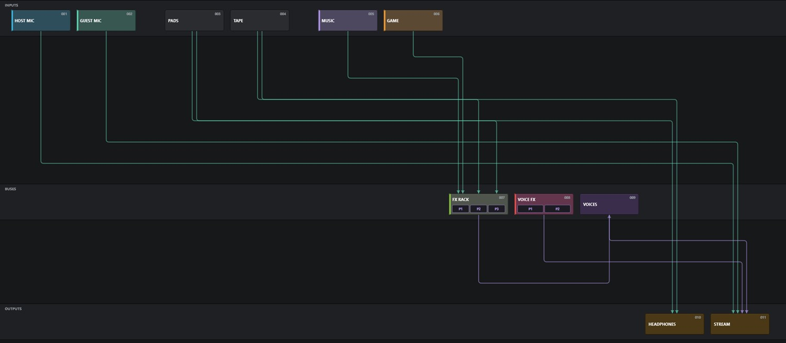

### De pagina lezen

- **Drie rijen:** **INPUTS** bovenaan, **BUSES** in het midden, **OUTPUTS** onderaan. Uitvoerapparaten
  die nog geen uitgang hebben, staan aan het rechteruiteinde van de rij OUTPUTS, in grijs.
- **Elk blok staat onder zijn strip.** Een blok staat op de pagina op dezelfde positie als zijn strip
  op de tafel, spacers meegerekend, en de pagina scrolt opzij mee met de tafel (muiswiel). Zet
  de tafel anders in en de kaart volgt.
- **Elk blok toont** de naam en het nummer van de strip. Een uitgeschakelde strip is gedimd. Een kanaal met
  een eigen kleur toont die als tint en als band links.
- **Lijnen zijn routes.** Elk loopt recht omlaag vanaf zijn bron naar een eigen baan in de
  ruimte onder zijn rij, dwars over en omlaag naar het blok dat hij voedt, en eindigt in een pijl. Ingangsroutes
  zijn blauwgroen, busroutes violet. Meerdere lijnen die een blok verlaten of bereiken, worden op volgorde
  over het blok verdeeld, zodat ze nooit op elkaar liggen.
- **Combinators** tonen hun paden als cellen **P1, P2, …** langs de onderkant van het blok. Lijnen eindigen
  in het pad dat ze voeden.

### Routeren van blok naar blok

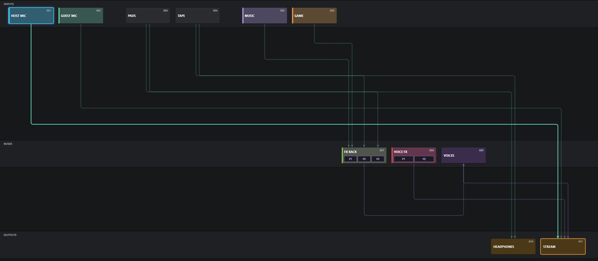

1. **Klik op een blok.** Het licht blauw op en pulseert. De blokken waarheen het gerouteerd is, of waarvandaan het gerouteerd wordt, krijgen een
   gemarkeerde rand, hun lijnen worden helderder en al het andere wordt gedimd.
2. **Klik op een ander blok.** De route ertussen gaat aan (er verschijnt een lijn) of uit (de lijn
   verdwijnt). Beide volgordes werken: eerst bron, dan bestemming, of eerst bestemming, dan bron.
3. Het eerste blok **blijft geselecteerd**, dus blijf klikken om het naar meerdere plekken te routeren of om
   meerdere routes uit te zetten.
4. **Klik er nogmaals op**, klik op lege ruimte of druk op **Esc** om los te laten.

Kunnen de twee blokken niet worden gerouteerd (twee uitgangen, bijvoorbeeld), dan wordt het tweede geselecteerd.

### Voorbeelden

| Om | Klik |
|---|---|
| Je microfoon te horen | MIC, dan de uitgang van de koptelefoon |
| Apps je microfoon te laten horen | MIC, dan **CABLE Input** (in de rij met uitgangen, grijs tot hij een uitgang heeft) |
| Een groep via een bus te sturen | De bus, dan elk kanaal; dan de bus, dan zijn uitgang |
| Een kanaal uit de stream te halen | Het kanaal, dan de uitgang van de stream (de lijn verdwijnt) |
| Eén combinatorpad te voeden | De bron, dan de padcel (P1, P2…) |

Een grijs apparaatblok aanklikken maakt zijn uitgang, en de nieuwe uitgang verschijnt meteen op de tafel.

### Combinators

Klik op de bron en dan op de **padcel**. Een bron kan meerdere paden voeden: klik om de beurt op elke cel.
Op de combinator klikken buiten zijn cellen routeert naar zijn eerste pad. Om paden of hun
plugins toe te voegen, rechtsklik je op de combinator op de tafel > **Paths**.

### Kanalen verplaatsen

Sleep een blok opzij langs zijn rij. Een blauwe balk toont waar het terechtkomt, en de tafel past zich
aan. Kanalen verplaatsen tussen kanalen, bussen tussen bussen, uitgangen tussen uitgangen.

### Als een route niet aan blijft

De route zou een feedbacklus maken, dus wordt hij meteen weer uitgezet. Het gebeurtenissenlogboek noemt de lus.
Verwijder de route die terugvoert. Zie [18.8](#188-a-route-wont-switch-on).

## 11. Tools: Pads

**TOOLS > PADS** geeft je vier banken (**A–D**) van 16 pads: 64 geluiden, tot 32 tegelijk spelend.

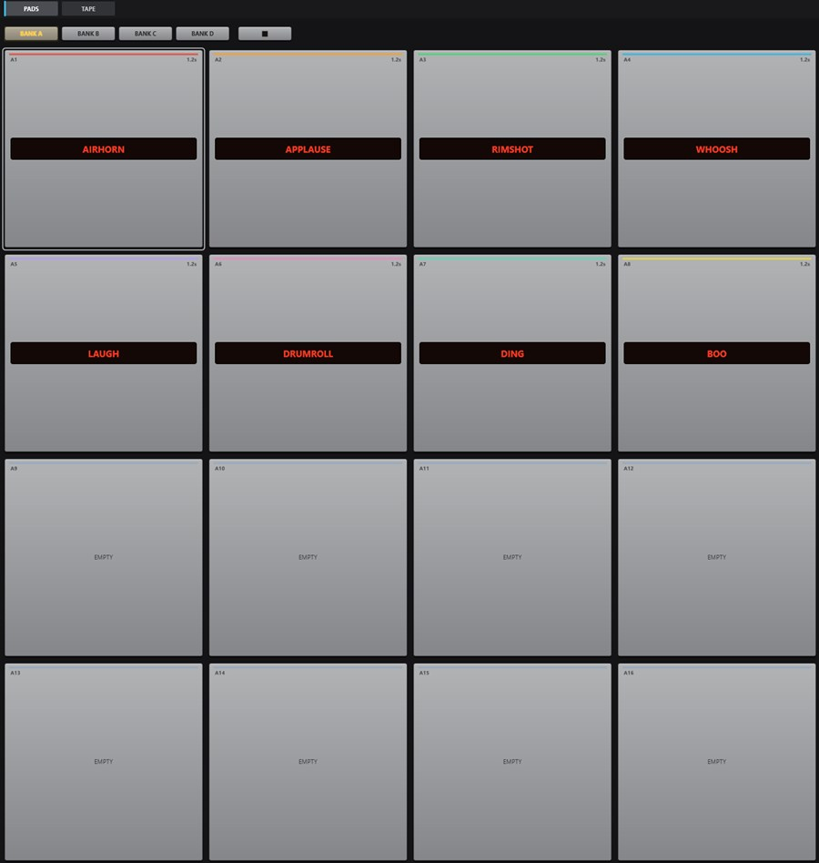

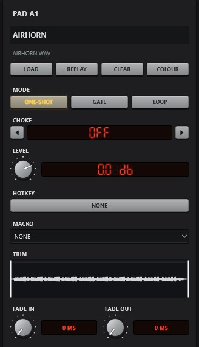

### Geluid eruit krijgen

Pads spelen in een **PADS-kanaal**. Klik op **CREATE PADS CHANNEL** (daarna staat er **PADS CHANNEL
ACTIVE**), of kies een andere ingang in het menu **PLAY INTO** om de pads via de plugins en routes van dat
kanaal te spelen. Zonder padskanaal worden aanslagen genegeerd.

### Laden en spelen

| Actie | |
|---|---|
| Klik op een **leeg** pad | Kies een geluidsbestand |
| Klik op een geladen pad | Speel het af |
| Rechtsklik op een pad | Selecteer het om te bewerken zonder af te spelen |
| Bestanden op een pad laten vallen | Laadt ze in dat pad en de volgende in de bank |
| **Ctrl + slepen** naar een ander pad | Wisselt de twee pads om |
| **STOP ALL** | Laat elk pad uitfaden |

Formaten: WAV, FLAC, AIFF, OGG, MP3. Een pad waarvan het bestand is verplaatst, toont **MISSING: FILE**.

### De padeditor

| Instelling | |
|---|---|
| Naam | Dubbelklik om te hernoemen |
| **LOAD**, **CLEAR**, **COLOUR** | |
| **REPLAY** | De instant-replaybuffer wordt het geluid van dit pad (opgeslagen als WAV in de opnamemap). Schakel replay eerst in via TOOLS > TAPE |
| **MODE** | **ONE-SHOT** speelt tot het einde (nogmaals indrukken start opnieuw). **GATE** speelt zolang het wordt ingedrukt. **LOOP** start met één druk en stopt bij de volgende |
| **CHOKE** | OFF of groep 1–8. Pads in één groep stoppen elkaar |
| **LEVEL** | -INF tot +12 dB |
| **HOTKEY** | Klik (**LEARN...**) en druk dan op de toetsen. Moet Ctrl, Alt of een F-toets bevatten. Werkt ook als andere programma's focus hebben. Esc annuleert, Delete wist |
| **MACRO** | Een macro die met het pad wordt uitgevoerd (een pad kan een macro hebben en geen geluid) |
| **TRIM** | Sleep de start- en eindlijn op de golfvorm. Dubbelklik voor het hele bestand |
| **FADE IN / FADE OUT** | 0–5 s |

---

## 12. Tools: Tape, Recorder en Replay

### Het tape-deck

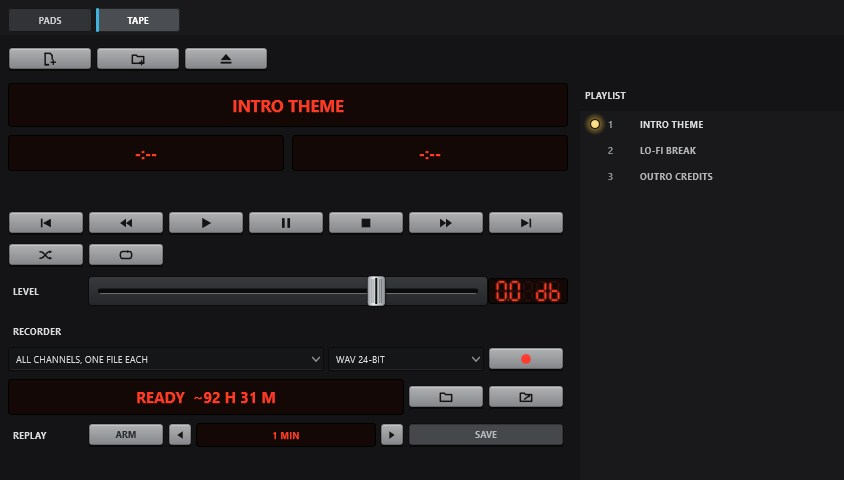

**TOOLS > TAPE** speelt een afspeellijst in een **TAPE-kanaal**. Klik op **CREATE TAPE CHANNEL** om er een te maken.

- **ADD FILES**, **ADD FOLDER**, of laat bestanden en mappen ergens op de pagina vallen. **EJECT** maakt
  de afspeellijst leeg.
- Dubbelklik op een nummer om het af te spelen, sleep er een om te herschikken en druk op Delete om geselecteerde nummers te verwijderen.
- Transport: **PREV**, **REW** (10 s terug; ingedrukt houden om snel terug te spoelen), **PLAY**, **PAUSE**, **STOP**,
  **FF** (10 s vooruit; ingedrukt houden om snel vooruit te spoelen), **NEXT**. Ook **SHUFFLE**, **REPEAT** (alles / één /
  uit) en **LEVEL**.
- Nummers spelen naadloos. Pauzes en sprongen faden over 30 ms, zodat ze nooit klikken.

Het transport van de bovenbalk en de tapestrip op de tafel bedienen hetzelfde deck.

### De recorder

| | |
|---|---|
| **Source** | Elke uitgang, bus of ingang, of **ALL CHANNELS, ONE FILE EACH** (multitrack: elke ingang, of alleen die met DIRECT aan, plus elke uitgang, sample-uitgelijnd) |
| **Format** | WAV 24-bit (standaard), 16-bit, 32-bit, 32-bit float; FLAC 24/16-bit; AIFF 24/16-bit; OGG Vorbis 128–320k. Met ffmpeg: MP3, AAC (M4A), Opus, ALAC. Elk toont hoeveel tijd er op de schijf past |
| **REC** | Start en stopt. Het scherm toont tijd, grootte, resterende tijd en eventuele gemiste blokken |
| **PATH** / **REVEAL** | Kies de map / open hem in Verkenner |

Opnamen gaan naar `Music\Patchbay Console Recordings` tenzij je een map kiest. ffmpeg-formaten nemen eerst
een WAV op en zetten die om wanneer je stopt (de WAV blijft behouden als het omzetten mislukt). Opnemen stopt
vanzelf als er minder dan 1 GB vrij is.

### Instant replay

**ARM** bewaart de laatste **30 s**, **1**, **2** of **5 minuten** van de bron van de recorder.
**SAVE** schrijft het naar een bestand (rechtsklik op SAVE om er een globale sneltoets aan te geven). Met multitrack gekozen
gebruikt replay de eerste uitgang.

---

## 13. Apparaten

**DEVICES** toont alle Windows-audioapparaten en ASIO-stuurprogramma's.

| Kolom | |
|---|---|
| **I/O** | ASIO, OUT of IN |
| **DEVICE**, **HARDWARE** | Zijn naam en de adapter waarop hij zit |
| **FORMAT** | Kanalen en samplefrequentie |
| **STATE** | Actief, losgehaald, uitgeschakeld of **off in Patchbay Console** |
| **TAGS** | DEFAULT en CALLS voor de standaardapparaten van Windows |

Klik op een kop om te sorteren. Selecteer apparaten (Ctrl/Shift voor meerdere) en gebruik dan:

| Toets | |
|---|---|
| **EXCLUDE / INCLUDE** | Patchbay Console stopt (of hervat) het gebruik van het apparaat. Uitgesloten apparaten worden nooit geopend en uit lijsten weggelaten |
| **DISABLE / ENABLE IN WINDOWS** | Zet het apparaat in Windows zelf uit of aan |
| **RENAME** | Je eigen naam voor het apparaat, overal in Patchbay Console gebruikt (of dubbelklik op een rij) |

### Streams

Onder de lijst toont **STREAMS** de gezondheid van de audio-engine:

- **CALLBACK LOAD** (en piek), **OVERLOADS**, **BLOCKS SKIPPED**. Deze krijgen een waarschuwingskleur als er iets van is gebeurd
- **BUFFER**: de buffergrootte van je interface (kleiner betekent minder vertraging en meer belasting)
- Per apparaat: gebufferde audio, totale latentie, **DRIFT** (de klokcorrectie in ppm), **UNDER**
  (leeggelopen, stilte gespeeld), **OVER** (overgelopen, audio weggegooid), **RESYNC** (opnieuw gecentreerd). Een rij
  die audio heeft weggegooid, wordt rood
- **RESET STATS** wist de tellers

### VB-CABLE

Is VB-CABLE geïnstalleerd, dan stelt een balk bovenaan zijn **sample rate** en **max latency** in. **APPLY**
vraagt eenmaal om beheerdersrechten en start de kabel opnieuw.

Het gebeurtenissenlogboek onderaan legt elk apparaat vast dat is aangesloten, verwijderd of hersteld.

---

## 14. Scènes, ongedaan maken en sessies

### 14.1 Scènes

Een scène slaat van elk kanaal fader, pan, cut, solo, aan/uit en routes op (en, als je wilt, de
pluginsinstellingen).

- **Opslaan:** klik op **+** in de bovenbalk en geef haar een naam.
- **Oproepen:** klik op haar toets. Faders en pans glijden in een halve seconde. De rest schakelt meteen.
- **Rechtsklik op een scène** voor: alleen dempingen / alleen niveaus oproepen, erin opslaan, pluginsinstellingen
  opnemen, hernoemen, een globale sneltoets, **Recall on device** (als een apparaat verschijnt; terug als het
  verdwijnt), **Auto-scene** (als een app begint te spelen, een apparaat verbindt, of op een tijdstip), MIDI
  learn, verplaatsen, verwijderen.

Apparaten en de kanalen zelf maken geen deel uit van een scène.

### 14.2 Ongedaan maken en geschiedenis

**Ctrl+Z** maakt ongedaan, **Ctrl+Y** (of Ctrl+Shift+Z) maakt opnieuw. **HISTORY** (Ctrl+H) toont elke wijziging.
Kies er een om ernaar terug te springen.

### 14.3 Sessies

Je mix slaat zichzelf op binnen een seconde na elke wijziging, en bij het afsluiten.

| | |
|---|---|
| **Restore session** | Menu in het systeemvak: eerdere versies van je mix op datum (Patchbay Console start ermee opnieuw) |
| **SESSION TIMELINE** | FIND: elke bewaarde versie. **Restore everything**, of **PUT ONE CHANNEL BACK** (niveau, pan, demping en rack) zonder opnieuw te starten |
| **SAVE SESSION AS...** | SETTINGS > GENERAL > SESSIONS: bewaar de mix onder een naam |
| **OPEN, EXPORT OR IMPORT...** | Een benoemde mix openen (start opnieuw), de mix in een bestand opslaan of er een uit een bestand laden |

Tot 60 eerdere versies worden bewaard (hoogstens één per 5 minuten). Kan je mix ooit niet worden geladen
(de interface ontbreekt, het bestand is beschadigd), dan wordt hij **opzijgezet** in plaats van verloren, en begint er een
verse mix. Zie [18.2](#182-my-mix-is-gone-a-fresh-mix-started).

---

## 15. Instellingen

**SETTINGS** heeft vier secties, als kaarten langs de linkerkant: **GENERAL**, **MACROS**, **HOTKEYS**,
**CONTROL**. Aan/uit-instellingen zijn vierkante schakelaars die crèmekleurig gloeien als ze aan staan.

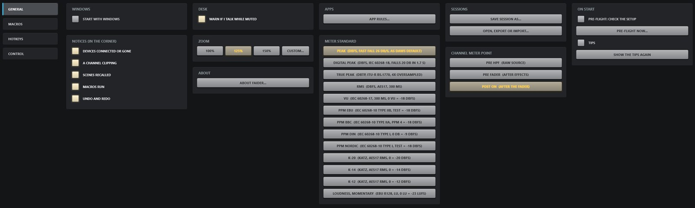

### GENERAL

| Kaart | Instellingen |
|---|---|
| **WINDOWS** | **START WITH WINDOWS**: opent in het systeemvak wanneer je je aanmeldt |
| **DESK** | **WARN IF I TALK WHILE MUTED** (een melding als een gedempte microfoon boven -30 dBFS komt). Een strip selecteren als hij wordt aangeraakt is **SELECT > AUTO** in de zijbalk |
| **APPS** | **APP RULES...**: naar welke bus of uitgang een programma gaat als het begint te spelen (ook in **FIND**). Het kanaal van een programma verwijderen verwijdert zijn regel |
| **SESSIONS** | **SAVE SESSION AS...**; **OPEN, EXPORT OR IMPORT...** |
| **ON START** | **PRE-FLIGHT: CHECK THE SETUP**; **PRE-FLIGHT NOW...**; **TIPS**; **SHOW THE TIPS AGAIN** |
| **NOTICES (IN THE CORNER)** | Apparaten verbonden of weg, een kanaal dat clipt (zijn bron of zijn uitgang op volle schaal), scènes opgeroepen, macro's uitgevoerd, ongedaan maken en opnieuw |
| **ZOOM** | 100%, 125%, 150%, **CUSTOM...** (75–200%) |
| **METER STANDARD** | Hoe meters aflezen (standaard sample peak met snelle terugval; IEC en andere) |
| **CHANNEL METER POINT** | **PRE HPF** (ruwe bron), **PRE FADER** (na de effecten), **POST ON** (na de fader, standaard) |
| **STEAMVR** | **RACK ON THE STEAMVR DASHBOARD** |
| **ABOUT** | Versie en dankbetuigingen |

### MACROS

Een macro is een lijst **acties** die wordt uitgevoerd via een sneltoets, een pad, een trigger of afstandsbediening.

1. Klik op **+ NEW** en geef hem een naam (dubbelklik op de naam).
2. **+ ACTION**: MUTE ON/OFF/TOGGLE, SET FADER (dB, fadetijd), ASSIGN ON/OFF/TOGGLE (een route),
   CHANNEL ON/OFF, TRIGGER PAD, STOP PAD, ALL NOTES OFF, TRANSPORT PLAY/PAUSE, TRANSPORT NEXT,
   RECORD START/STOP, WAIT, SCENE RECALL, FX ON/OFF/TOGGLE, WINDOWS DEFAULT OUTPUT/INPUT, PLUGIN
   SETTING.
3. Optioneel **+ TRIGGER**: APP STARTS, APP STOPS, DEVICE CONNECTED, DEVICE DISCONNECTED, MASTER
   SILENT (gedurende n seconden), MASTER HAS SOUND, TIME (24 uur).
4. Optioneel een **HOTKEY**, en **MOMENTARY** (de acties worden ongedaan gemaakt als de toets wordt losgelaten,
   voor push-to-talk).
5. **FIRE** voert hem nu uit.

### HOTKEYS

Elke toewijsbare sneltoets staat op één plek: **PADS**, **MACROS**, **SCENES** en **SAVE INSTANT REPLAY**
onder **TAPE**. Klik op een toets en druk dan op de nieuwe toetsen (Esc annuleert, Delete wist). Sneltoetsen moeten
Ctrl, Alt of een F-toets bevatten en werken terwijl een game focus heeft. De vaste toetsen staan er ook bij
([19.1](#191-keyboard-shortcuts)). De toetsen onder ON THE MIXER op de pagina werken ook op de console
([5](#5-the-console)).

### CONTROL

| Kaart | |
|---|---|
| **SET UP A CONTROLLER** | Begeleide installatie voor Loupedeck, Stream Deck, MIDI, OSC en de telefoonpagina |
| **MIDI** | **MIDI MAP** (Ctrl+L); ingangen en toewijzingen; een schakelaar per MIDI-ingang |
| **OSC** | **OSC ON (PORT 9000)**; andere apparaten toestaan (tablet, telefoon) |
| **DECK PLUGINS (LOCAL API)** | **API ON (127.0.0.1:9123)**, voor de Stream Deck- en Loupedeck-plugins |
| **PHONE CONTROL (WEB PAGE)** | Een bedieningspagina voor je telefoon (de API moet aan staan). Toont een QR-code |

---

## 16. Afstandsbediening, overlay, systeemvak en VR

| | |
|---|---|
| **MIDI MAP** (Ctrl+L) | Klik op een bediening op het scherm en beweeg dan een knop of toets op je controller. Fader, pan, CUT, SOLO, aan/uit en routeringstoetsen van elke strip kunnen worden toegewezen, in SIMPLE en PRO, evenals scènes, pads en de tape. Het muiswiel scrolt de tafel tijdens het toewijzen (Shift+wiel omhoog en omlaag) |
| **Stream Deck / Loupedeck** | Plugins met live meters op de toetsen. Zet eerst de API aan |
| **Phone** | Scan de QR-code via SETTINGS > CONTROL > PHONE CONTROL |
| **In-game overlay** (Ctrl+Shift+O) | Het praatlampje, LIVE / MUTED en niveau van elk microfoonkanaal, plus tot vier scènetoetsen. Neemt nooit de focus over van een game. Sleep hem overal heen |
| **MINI** | Een kleine mixer bovenop alles. **OPEN** brengt je terug naar het hoofdvenster |
| **Tray** | Klik op het pictogram voor de mixer in het systeemvak, dubbelklik om het venster te openen. Rechtsklik: Show, scène oproepen, Restore session, Start with Windows, About, Quit. Het pictogram knippert oranje bij een waarschuwing |
| **SteamVR** | Een tabblad PATCHBAY CONSOLE op het SteamVR-dashboard zolang SteamVR draait: RACK, PADS, TAPE, MACROS, DEVICES. De laserpointer werkt als een muis. Bestandsdialogen moeten op het bureaublad worden afgerond |

Patchbay Console draait altijd met je gewone gebruikersrechten, ook als het vanuit een beheerdersvenster wordt gestart.
Het start zichzelf opnieuw met gewone rechten, omdat SteamVR en de in-game overlay een programma dat als beheerder draait
niet kunnen bereiken. De paar stappen die een beheerder nodig hebben
(VB-CABLE-instellingen toepassen, een door Windows uitgezet apparaat weer inschakelen) vragen zelf om toestemming.

---

## 17. Handleidingen

### 17.1 Jezelf horen: een microfoon instellen

1. **ADD CHANNEL** > je interface-ingang (of een Windows-opnameapparaat). Hij verschijnt met een Dark
   strip.
2. Spreek en stel **in trim** zo in dat de niveaubalken pieken rond -12 tot -6 dB.
3. Routeer hem: klik op het routeringsvakje voor de uitgang van je koptelefoon (of gebruik de pagina Routing).
4. Maak hem schoon: **hp** om gerommel weg te halen (rond 80–100 Hz), dan de gate en compressor (**IN**
   op DYNAMICS), dan EQ.

### 17.2 Apps je microfoon laten horen (Discord, games, OBS)

1. Installeer **VB-CABLE** (PRE-FLIGHT biedt een link aan) en zet dan je echte speakers en microfoon weer als
   standaard van Windows ([Stap 2](#step-2-install-vb-cable-optional)).
2. Routeer je microfoonkanaal naar het apparaat **CABLE Input**. Er wordt een uitgang op gemaakt.
3. Kies in de app **CABLE Output** als microfoon.
4. Voer **PRE-FLIGHT NOW...** uit om te controleren dat er onderweg niets gedempt is en niets een lus vormt.

### 17.3 Een programma in de mix brengen

1. Start het programma en laat het geluid spelen.
2. **ADD APP** > kies het. Het krijgt een raw-kanaal (zonder effecten).
3. Routeer het waar je het wilt horen. Het programma blijft ook op zijn eigen apparaat spelen. Hoor je
   dat apparaat ook, routeer het appkanaal dan niet naar dezelfde plek (PRE-FLIGHT waarschuwt voor deze
   verdubbeling).

### 17.4 Kanalen herschikken

Sleep de **naambalk** van een kanaal opzij op de Mixer (scrol omlaag naar de sectie NAME), of sleep zijn
blok op de pagina Routing. Een blauwe balk toont waar het terechtkomt, en de strips glijden op hun plek.
Spacers verhuizen met de strip die ze volgen. Bussen en uitgangen verplaatsen op dezelfde manier, elk onder zijn eigen
soort, en hun routes gaan mee. SIMPLE toont de uitgangen in dezelfde volgorde.

### 17.5 Kanalen groeperen in een bus

1. **ADD BUS**, en hernoem hem dan (rechtsklik > Rename...).
2. Klik op de pagina Routing op de bus en klik dan op elk kanaal om het erin te routeren.
3. Klik op de bus en dan op zijn uitgang om de bus verder te routeren.
4. Wil je die kanalen alleen via de bus laten lopen, zet dan hun directe routes naar de uitgang uit.

### 17.6 Parallelle bewerking met een combinator

1. **ADD BUS > COMBINATOR**. Hij begint met twee paden. Rechtsklik erop > **Paths > Add path** voor
   meer.
2. Routeer op de pagina Routing bronnen naar de padcellen (**P1**, **P2**…).
3. Rechtsklik > **Paths > PATH n > Add plugin...** voor elk pad. De paden worden opgeteld bij de fader van de
   combinator. De combinatorstrip toont wat elk pad voedt en opent zijn plugins.

### 17.7 Een streammix en een koptelefoonmix maken

1. Stuur je kanalen naar twee uitgangen, bijvoorbeeld je koptelefoon en het apparaat dat je streamingsoftware
   opvangt.
2. Elke uitgang heeft zijn eigen fader, buscompressor, EQ en **SAFE**-limiter. Zet **SAFE** aan voor de
   streamuitgang.
3. Om iets uit de stream te houden, zet je de route van dat kanaal naar de streamuitgang uit (met
   zijn routeringsvakje of op de pagina Routing).

### 17.8 Opnemen

1. TOOLS > TAPE > **RECORDER**: kies de bron en het formaat.
2. Druk op **REC** (of de opnametoets in de bovenbalk). Druk nogmaals om te stoppen.
3. **REVEAL** opent de map.

### 17.9 Een push-to-talk-toets maken

1. SETTINGS > MACROS > **+ NEW**.
2. **+ ACTION** > **MUTE OFF** > je microfoonkanaal.
3. Zet **MOMENTARY** aan en stel een **HOTKEY** in. Zolang je hem ingedrukt houdt, is de microfoon live, en bij het loslaten
   wordt hij weer gedempt. Begin met de microfoon gedempt.

---

## 18. Problemen oplossen

### 18.1 PRE-FLIGHT

PRE-FLIGHT draait een paar seconden na het starten (en via **PRE-FLIGHT NOW...** of FIND) en verschijnt alleen
als er iets mis is. Elke rij heeft een lampje, de bevinding en een oplossing:

| Check | Probleem | Oplossing |
|---|---|---|
| **AUDIO** | Het is niet gestart (misschien heeft een andere app het) | **DEVICES** |
| **MIC CABLE** | Geen VB-CABLE: apps kunnen je mix niet als microfoon horen | **GET VB-CABLE** |
| **MIC MASTER** | Geen uitgang speelt in de microfoonkabel | **ROUTING** |
| **MIC CHANNELS** | Iets op de weg naar de microfoon is gedempt | **UNMUTE** |
| **HEARD ONCE** | Een feedbacklus, of iets wordt dubbel gehoord | **SOUND SETTINGS** |

### 18.2 Mijn mix is weg, er is een verse mix begonnen

Je mix is niet verloren. Als hij bij het starten niet gebruikt kan worden, wordt hij **opzijgezet** als
`session-unloaded-<date>.xml`. Het gebeurtenissenlogboek vertelt waarom:

| Reden | Wat te doen |
|---|---|
| De opgeslagen interface is niet aangesloten | Sluit hem aan, dan **Restore session** (systeemvak) > de versie met "kept:" |
| De opgeslagen interface kon niet worden geopend (een ander programma heeft hem) | Sluit het andere programma en start Patchbay Console opnieuw. Ondertussen wordt er niets over je mix heen opgeslagen |
| session.xml kon niet worden gelezen | **Restore session** > een recente versie |

### 18.3 Geen geluid

Loop het signaalpad af:

1. **Gezondheidslicht** rood met OFF: de audio draait niet. Zie
   [18.2](#182-my-mix-is-gone-a-fresh-mix-started) en [18.4](#184-the-interface-wont-start-or-stopped).
2. **De meter van het kanaal** (METER: IN): beweegt hij niet, controleer dan zijn **Input** (rechtsklik) en
   of de bron speelt. Een strip die uit staat, laat niets door.
3. **CUT** is uit, de fader staat omhoog en niets anders staat op solo (de **SOLO** van een andere strip dempt
   al het andere).
4. **Routing:** minstens één routeringsvakje is verlicht, of er is een lijn op de pagina Routing.
5. **De uitgang**: niet op CUT, fader omhoog, en **DEVICE** toont het juiste apparaat (niet "NO DEVICE" of
   "(OFF)").
6. **Het apparaat** is aangesloten en niet uitgesloten onder DEVICES.

### 18.4 De interface start niet, of is gestopt

- Een ander programma kan hem vasthouden (een DAW, het configuratiescherm van het stuurprogramma). Sluit het en start opnieuw.
- **INTERFACE DOWN** in het systeemvak: de interface heeft zichzelf gereset en wilde niet meer openen. Wijzig zijn buffergrootte
  onder DEVICES of start Patchbay Console opnieuw.
- Wijzigingen in samplefrequentie of buffer in het eigen configuratiescherm van de interface worden vanzelf opgepikt.
- Om een tijdje zonder de interface te werken, start je Patchbay Console met
  `"C:\Program Files\Patchbay Console\Patchbay Console.exe" --clock windows` (je Windows-afspeelapparaat)
  of `--clock builtin` (de ingebouwde klok). `--clock` met een deel van de naam van een ASIO-stuurprogramma
  (`--clock focusrite`) kiest dat stuurprogramma. Je mix gaat mee en blijft opgeslagen voor je
  interface: de volgende gewone start gaat daar weer naartoe.

### 18.5 Klikken, gekraak of uitvallen

1. Kijk naar het **gezondheidslicht** en **DEVICES > STREAMS**.
2. Hoge **CALLBACK LOAD** of OVERLOADS: verhoog de **BUFFER**, of zoek dure plugins in het pluginpaneel
   (**HEAVY**, hoge CPU) en zet ze op bypass of verwijder ze.
3. **UNDER / OVER** loopt op bij één apparaat: dat apparaat heeft het moeilijk. Probeer een andere USB-poort, sluit
   andere programma's die het gebruiken, of sluit het uit als je het niet gebruikt.
4. Een gestage **DRIFT** is normaal. Het is de correctie die de klokken in de pas houdt.

### 18.6 Een app verschijnt niet in ADD APP

- Het programma moet nu **geluid spelen**. Start het afspelen en open het menu dan opnieuw.
- Programma's die al een kanaal hebben, zijn grijs (**ON THE DESK**).
- Windows ouder dan 10 versie 2004 kan geen enkel programma opvangen ("Windows refused app capture").

### 18.7 Ik hoor iets dubbel, of een echo

- Een appkanaal is gerouteerd naar een uitgang op hetzelfde apparaat waarop de app al speelt, dus je hoort
  de app rechtstreeks en via Patchbay Console. Routeer het appkanaal ergens anders heen, of verplaats de app naar
  een ander apparaat.
- De standaardspeaker van Windows staat op de virtuele kabel. PRE-FLIGHT > **HEARD ONCE** noemt hem.

### 18.8 Een route gaat niet aan

Hij zou een **feedbacklus** maken (geluid dat terugkeert naar waar het vandaan kwam), dus wordt hij meteen
weer uitgezet. Het gebeurtenissenlogboek noemt de lus. Doorbreek hem door de route te verwijderen die terugvoert.

### 18.9 Ik kan niets veranderen aan een strip

De strip staat **uit** (gedimd en grijs). Klik op het aan/uit-symbool op zijn naambalk.

### 18.10 Een kanaal slepen doet niets

Sleep aan de **naambalk** (de sectie NAME, onderaan; scrol omlaag als dat nodig is), of sleep het
blok op de pagina Routing. Een strip verplaatst alleen tussen zijn eigen soort: een bus kan niet tussen de
kanalen.

### 18.11 Een plugin laadt niet

Elke plugin wordt eerst in een aparte kopie van het programma getest, en de reden van een mislukking wordt
gemeld: hij was niet binnen 30 s klaar met laden, hij crashte tijdens het testen, of er zit geen VST3-
plugin in het bestand. Werk de plugin bij of installeer hem opnieuw. Zodra zijn bestand verandert, wordt hij opnieuw getest.

### 18.12 Het programma is gecrasht

Er wordt een rapport geschreven naar `%APPDATA%\PatchbayConsole\crash.log`, met een minidump `crash.dmp`. Je mix
wordt binnen een seconde na elke wijziging opgeslagen, dus je verliest hooguit de wijzigingen van het laatste moment.

### 18.13 Opnemen is vanzelf gestopt

Opnemen stopt als er minder dan 1 GB schijfruimte over is (of de groottelimiet van het formaat nadert).
Het systeemvak toont **RECORDING STOPPED, NO ROOM**. Maak ruimte vrij of kies een andere **PATH**.

### 18.14 Geen geluid van Windows na het installeren van VB-CABLE

Windows heeft de kabel zijn standaardapparaat gemaakt. Zet je koptelefoon of speakers weer als standaard
uitvoer en je echte microfoon als standaard invoer, beide in **Instellingen > Systeem > Geluid**
en als standaardcommunicatieapparaten. Zie [Stap 2](#step-2-install-vb-cable-optional).

---

## 19. Naslag

### 19.1 Sneltoetsen

| Toetsen | |
|---|---|
| **Ctrl+K** | FIND |
| **Ctrl+Z / Ctrl+Y** (Ctrl+Shift+Z) | Ongedaan maken / opnieuw |
| **Ctrl+H** | History |
| **Ctrl+L** | MIDI MAP |
| **Ctrl + / Ctrl - / Ctrl 0** | Inzoomen / uitzoomen / 100% |
| **Ctrl+Shift+O** | De in-game overlay tonen / verbergen (werkt overal) |
| **Left / Right** | De vorige / volgende strip selecteren (tafel in focus) |
| **M / S** | De geselecteerde strip op cut / solo zetten |
| **Up / Down** | Geselecteerde fader ±0,5 dB (±3 dB met Shift) |
| **Esc** | Het geselecteerde blok loslaten (Routing) |

### 19.2 Opdrachtregel

| | |
|---|---|
| `--minimised` | Starten in het systeemvak |
| `--quit` | De draaiende kopie afsluiten |

### 19.3 Bestanden

In `%APPDATA%\PatchbayConsole`:

| Bestand | |
|---|---|
| `session.xml` | Je mix |
| `history\` | Eerdere versies (tot 60) |
| `sessions\` | Benoemde mixen |
| `session-unloaded-*.xml` | Bij het starten opzijgezette mixen |
| `settings.xml` | Voorkeuren |
| `console.xml` | Striptypen, spacers, keuzes bij SELECT en METER |
| `plugins.xml` | De gevonden plugins en hoe elk is getest |
| `events.log` | Alles wat er is gebeurd (roteert bij 5 MB) |
| `status.txt` | Een momentopname van de engine om de paar seconden: apparaten, niveaus, buffers, drift |
| `crash.log`, `crash.dmp` | Crashrapporten |

Het programma zelf staat in `C:\Program Files\Patchbay Console`. Opnamen gaan naar
`Music\Patchbay Console Recordings` tenzij je een andere map kiest.

### 19.4 Kleuren

| Kleur | Betekent |
|---|---|
| Blauwe omlijning | Geselecteerd |
| Grijze naambalk | Kanaal |
| Violet | Bus |
| Oranje | Uitgang |
| Blauwgroene lijn | De route van een kanaal |
| Violette lijn | De route van een bus |
| Groen gezondheidslicht | Audio in orde; oranje: onder druk; rood: storing of draait niet |
